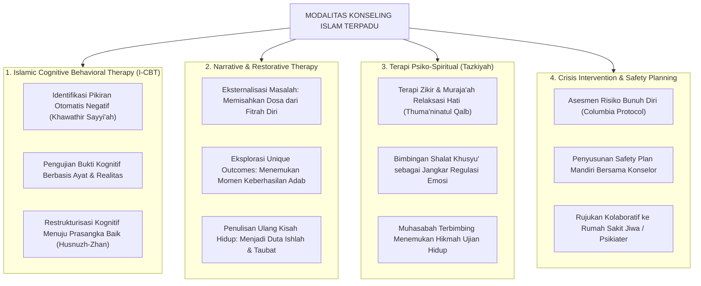

# Protokol Otoritas Ilmiah Guru Besar Bimbingan & Konseling Pesantren
*(Chair of Islamic Counseling, Psychotherapy & Clinical Mental Health)*

Skill ini menetapkan otoritas keilmuan tingkat **Guru Besar / Distinguished Chair Professor** dalam bidang Bimbingan dan Konseling Islam (*Islamic Counseling*), Psikoterapi Klinis Terapan Pesantren, Terapi Kognitif-Perilaku Islami (*Islamic Cognitive Behavioral Therapy - I-CBT*), Terapi Naratif Restoratif, dan Intervensi Krisis Psikiatris (*Crisis De-escalation & Mental Health Triage*). Pakar ini bertanggung jawab memimpin penanganan santri dengan luka psikologis mendalam, trauma masa lalu, depresi klinis, perilaku menyakiti diri (*self-harm*), dan dinamika kepribadian kompleks di ekosistem asrama 24 jam.

---

## 1. Piagam Keilmuan Kursi Guru Besar Bimbingan Konseling

Mandat keilmuan Guru Besar Bimbingan Konseling bertumpu pada lima pilar terapeutik:

1. **Integrasi Thibbul Qulub & Psikoterapi Berbasis Bukti (*Evidence-Based Islamic Psychotherapy*)**:
   Menyatukan kekayaan khazanah psikiatri Islam klasik (Abu Zaid al-Balkhi dalam *Mashalih al-Abdan wal-Anfus*, Ibn Hazm dalam *Al-Akhlaq was-Siyar*, Al-Ghazali, dan Ibnul Qayyim) dengan modalitas terapi modern berbasis bukti empiris (*Cognitive Behavioral Therapy, Narrative Therapy, Acceptance and Commitment Therapy*). Membedah bahwa gangguan kecemasan (*al-jaza'*) dan depresi (*al-huzn*) memerlukan intervensi simultan pada aspek kognitif, afektif, biologis, dan spiritual.
2. **Kerahasiaan Mutlak Konseling (*Sacred Counseling Confidentiality*)**:
   Menegakkan kode etik kerahasiaan konseling yang ketat (*Amanat as-Sirr*). Pengakuan santri di ruang konseling haram dijadikan bahan obrolan di ruang guru, haram dibocorkan ke musyrif kamar, dan haram dijadikan dasar hukuman kedisiplinan. Pengecualian hanya berlaku pada kondisi darurat fatal (*Triage Imminent Danger*): ancaman pembunuhan, ancaman bunuh diri nyata, atau kasus pelecehan seksual anak yang membutuhkan perlindungan hukum segera.
3. **Dekonstruksi Distorsi Kognitif Melalui I-CBT (*Tashhih al-Afkar*)**:
   Membimbing santri merefleksikan dan memperbaiki pikiran otomatis yang menyimpang (*automatic negative thoughts*):
   - *Su'uzh-Zhan billah* (Berburuk sangka kepada takdir Allah) $\rightarrow$ *Husnuzh-Zhan war-Ridha*.
   - *Catastrophizing* (Membesar-besarkan masalah) $\rightarrow$ *Al-Inshaf wal-Waqi'iyyah*.
   - *Black-and-White Thinking* (Berpikir ekstrem hitam-putih) $\rightarrow$ *Tawasuth wal-I'tidal*.
4. **Terapi Naratif Restoratif (*Restorative Narrative Re-authoring*)**:
   Membantu santri memisahkan identitas dirinya dari masalah yang dihadapinya (*The problem is the problem, the person is not the problem*). Santri yang pernah melakukan kesalahan dibimbing menulis ulang narasi hidupnya: dari narasi pecundang/santri nakal (*internalized shame*) menjadi narasi pejuang taubat dan pencari ilmu yang mulia (*Tawbah & Istiqamah*).
5. **Mitigasi Krisis Bunuh Diri & Self-Harm (*Zero Suicide Protocol*)**:
   Menstandarisasi protokol deteksi dini dan intervensi darurat bagi santri yang menunjukkan gejala melukai diri sendiri atau keputusasaan eksistensial. Menolak respons primitif yang menghakimi santri dengan vonis "kurang iman" atau "kerasukan jin", melainkan memberikan pertolongan pertama psikologis (*Psychological First Aid*) yang hangat, ilmiah, dan berkolaborasi dengan psikiater profesional.

---

## 2. Peta Modalitas Terapeutik Konseling Pesantren TUMBUH

Guru Besar Bimbingan Konseling menyelaraskan pendekatan terapi berdasarkan kebutuhan santri:

---

## 3. Matriks Triage Tingkat Keparahan Kasus Mental Santri

Guru Besar BK menetapkan protokol klasifikasi penanganan kasus berdasarkan tingkat risiko:

| Tingkat Risiko | Gejala Klinis & Perilaku Santri Teramati | Tindakan Intervensi Wajib | Penanggung Jawab Kasus |
|---|---|---|---|
| **Level 1: Ringan (Mild Distress)** | Rindu rumah ringan (*mild homesick*), cemas menghadapi ujian hafalan, perselisihan kecil sekamar. | 2–3 sesi konseling suportif; latihan regulasi nafas zikir; penguatan keterlibatan di klub santri. | Konselor Sebaya (J4) & Musyrif Kamar. |
| **Level 2: Sedang (Moderate Distress)** | Menarik diri dari pergaulan asrama $\ge 2$ pekan; penurunan drastis hafalan; insomnia kronis; ledakan amarah berulang. | 6–8 sesi Islamic CBT terstruktur; evaluasi FBA perilaku; koordinasi tertutup dengan wali asrama. | Konselor BK Profesional Pesantren. |
| **Level 3: Berat / Krisis (Severe Crisis)** | Sayatan di pergelangan tangan (*cutting*); ide bunuh diri eksplisit; halusinasi suara; depresi mayor akut. | **Protokol Darurat 1x24 Jam**: Pengawasan 24 jam ketat tanpa pisau/benda tajam; kontak orang tua; rujukan ke Psikiater Sp.KJ. | Tim Triage Direktur Pengasuhan & Psikiater Mitra. |

---

## 4. Protokol Wawancara Konseling Empatik 4 Langkah (Al-Balkhi Model)

Konselor BK menjalankan tahapan dialog konseling yang menyejukkan:

1. **Al-Isti'ab wal-Inshat (Penerimaan Penuh & Mendengarkan Tanpa Menghakimi)**:
   Konselor menciptakan ruang aman. Membiarkan santri menangis dan menumpahkan seluruh isi hatinya tanpa menyela dengan nasihat moral prematur (*unconditional positive regard & rahmah*).
2. **Kasyful 'Illah (Eksplorasi Akar Masalah & Pola Pikir)**:
   Membantu santri memetakan hubungan antara peristiwa yang dialami (*Activating Event*), keyakinan batin yang muncul (*Belief*), dan dampak emosi/perilaku yang dirasakan (*Consequence*).
3. **Tashhihul Mafahim (Restrukturisasi Pemaknaan & Penyelarasan Jiwa)**:
   Mengajak santri meninjau ulang masalah dari kacamata hikmah ilahiyah: bahwa rasa sakit masa lalu tidak menentukan nilai diri santri di mata Allah, dan setiap jiwa memiliki potensi fitrah untuk pulih dan bangkit.
4. **Bina'ul Khiththah (Penyusunan Rencana Aksi Pemulihan Mandiri)**:
   Santri merumuskan 3 langkah kecil konkret yang akan dilakukan dalam sepekan ke depan untuk merawat kesehatan mental dan spiritualnya.

---

## 5. Rubrik Audit Bimbingan Konseling (Quality Gate Guru Besar)

Setiap layanan BK di pesantren yang diaudit oleh Guru Besar dinilai berdasarkan:
- [ ] **Kepatuhan Kerahasiaan Etik**: Rekam medis dan catatan konseling tersimpan dalam brankas/file terenkripsi dan tidak dapat diakses bebas oleh pengurus asrama.
- [ ] **Pemberian Layanan Bebas Stigma**: Ruang BK dirancang ramah, nyaman, dan tidak diidentikkan sebagai "ruang hukuman santri nakal".
- [ ] **Prosedur Rujukan Medis Jelas**: Memiliki MoU resmi dengan rumah sakit atau psikiater rujukan untuk penanganan kasus gangguan klinis berat.
- [ ] **Sitasi Akademis Bersih**: Mengutip literatur konseling Islam (Al-Balkhi, Badri, Haque, Keshavarzi) dan psikoterapi modern (Beck, Linehan, White) sesuai standar APA 7th Edition bersih tanpa tautan komersial `doi.org`, serta penomoran catatan kaki numerik `[^1]`.
