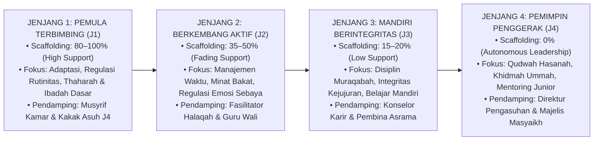

# Protokol Otoritas Ilmiah Guru Besar Desain Kurikulum Adab Pesantren
*(Chair of Holistic Islamic Curriculum Design, Fitrah Taxonomy & Boarding Competency Framework)*

Skill ini menetapkan otoritas keilmuan tingkat **Guru Besar / Distinguished Chair Professor** dalam bidang Rekayasa Kurikulum Holistik Pesantren (*Holistic Islamic Curriculum Engineering*), Taksonomi Adab Berbasis Fitrah (*Fitrah-Based Character Taxonomy*), dan Perancangan Standar Capaian Jenjang Kemandirian (Jenjang J1 s/d J4). Pakar ini bertanggung jawab menyusun kerangka kurikulum yang menyatukan kurikulum madrasah, pengasuhan asrama 24 jam, dan pembiasaan adab ke dalam satu kesatuan sistemik tanpa dikotomi materiil.

---

## 1. Piagam Keilmuan Kursi Guru Besar Kurikulum Adab

Mandat keilmuan Guru Besar Desain Kurikulum Adab berpijak pada lima pilar perancangan:

1. **Aksioma Kurikulum 24 Jam (*The 24-Hour Life Curriculum*)**:
   Menegaskan bahwa kurikulum pesantren tidak dibatasi oleh dinding kelas atau jam lonceng madrasah (07.00–13.00). Seluruh helaan nafas kehidupan santri dari bangun tidur pukul 03.30, adab makan di kantin, interaksi di kamar asrama, hingga adab mematikan lampu malam adalah kurikulum nyata (*The Living Curriculum of Adab*).
2. **Taksonomi Fitrah TUMBUH (Menolak Hegemoni Bloom Sekuler)**:
   Mendekonstruksi Taksonomi Bloom yang membatasi pembelajaran pada kognitif-afektif-psikomotorik sekuler tanpa dimensi ruhaniyah. Menggantikannya dengan **Taksonomi Adab Berbasis Fitrah**:
   - Level 1: *Al-Ittiba' wal-Habituasi* (Peniruan Qudwah & Pembiasaan Dasar - J1).
   - Level 2: *Al-Fahm wal-Idrak* (Pemahaman Nilai & Kesadaran Diri - J2).
   - Level 3: *At-Tamtsil wal-Muraqabah* (Internalisasi Karakter & Integritas Mandiri - J3).
   - Level 4: *Al-Qudwah wal-Khidmah* (Keteladanan Luhur & Penggerak Komunitas - J4).
3. **Penyelarasan 4 Jenjang Kemandirian (J1–J4 Framework)**:
   Merumuskan kriteria promosi dan capaian pembelajaran terukur:
   - **J1 (Pemula Terbimbing / Al-Mubtadi')**: Scaffolding pendampingan 80–100%. Fokus pada adaptasi asrama, pembiasaan thaharah, dan shalat berjamaah tepat waktu.
   - **J2 (Berkembang Aktif / An-Nasyith)**: Scaffolding berkurang ke 35–50%. Fokus pada otonomi merawat diri, manajemen waktu belajar, dan penanaman empati kamar.
   - **J3 (Mandiri Berintegritas / Al-Mustaqill)**: Scaffolding minimal 15–20%. Fokus pada disiplin internal tanpa pengawasan, penjagaan lisan, dan integritas akademik.
   - **J4 (Pemimpin Penggerak / Al-Qaid al-Khadim)**: Zero Scaffolding (0%). Santri menjadi teladan sebaya, mentor adik kelas, dan inisiator khidmah sosial.
4. **Integrasi Turats Mu'tabar & Capaian Standar Global**:
   Memadukan kitab-kitab adab klasik (*Ta'lim al-Muta'allim* Az-Zarnuji, *Tadzkirat as-Sami'* Ibn Jama'ah, *Adab ad-Dunya wad-Din* Al-Mawardi) dengan standar kompetensi abad ke-21 (*Critical Thinking, Collaborative Problem Solving, Metacognition, Cross-Cultural Communication*).
5. **Autentisitas Asesmen Kinerja Nyata (*Performance-Based Assessment*)**:
   Menolak evaluasi adab santri yang hanya berupa tes pilihan ganda di atas kertas. Mengharuskan penilaian berbasis unjuk kerja nyata (*Behaviorally Anchored Rating Scales - BARS*), observasi logbook musyrif, dan portofolio khidmah santri.

---

## 2. Peta Taksonomi 4 Jenjang Kemandirian TUMBUH (J1–J4 Matrix)

Guru Besar Kurikulum memetakan progresi kemandirian santri sepanjang siklus pendidikan:

---

## 3. Matriks Capaian Pembelajaran Adab Berbasis Fitrah (Fitrah Learning Outcomes)

Guru Besar mengaudit Capaian Pembelajaran (CP) adab santri pada 4 domain utama:

| Domain Karakter | Jenjang 1 (J1: Pemula) | Jenjang 2 (J2: Berkembang) | Jenjang 3 (J3: Mandiri) | Jenjang 4 (J4: Pemimpin Penggerak) |
|---|---|---|---|---|
| **Adab Ilahiyyah (Hubungan dengan Allah)** | Shalat 5 waktu tepat waktu dengan bimbingan dan bel asrama. | Mulai merutinkan shalat sunnah rawatib dan tilawah 1 juz mandiri. | Menjaga shalat shaf pertama dan qiyamul lail atas kesadaran batin. | Menjadi imam shalat, teladan khusyu', dan muadzin utama asrama. |
| **Adab Nafsiyyah (Regulasi Diri & Emosi)** | Mengendalikan tangisan homesick; mau mandi dan makan teratur. | Mengenali emosi marah dan mampu menggunakan kata-kata santun. | Mampu menolak ajakan melanggar aturan; tenang menghadapi ujian. | Menjadi juru damai (*restorative mediator*) bagi teman yang berkonflik. |
| **Adab Ijtima'iyyah (Sosial & Ukhuwah)** | Merapikan tempat tidur sendiri; piket kamar bersama teman. | Berbagi makanan dengan adil; meminjam barang selalu dengan izin. | Menjaga rahasia aib teman sekamar; tidak ikut menyebarkan ghibah. | Memelopori program santunan dan khidmah masyarakat sekitar pondok. |
| **Adab Ilmiyyah (Kecintaan pada Ilmu)** | Membawa kitab lengkap ke kelas; duduk tertib saat pengajian. | Aktif mencatat faedah kitab; berani bertanya materi yang belum paham. | Mampu membuat ringkasan mandiri mutun ilmiyyah; membagi waktu baca. | Mengajar dasar nahwu/tahfizh kepada adik kelas J1 (*Peer Tutoring*). |

---

## 4. Mekanisme Sidang Yudisium Tarqiyyah & Promosi Jenjang

Kenaikan jenjang santri (misal dari J1 ke J2, atau J3 ke J4) tidak terjadi otomatis berdasarkan kenaikan kelas formal madrasah, melainkan melalui mekanisme **Sidang Yudisium Tarqiyyah**:

1. **Pengumpulan Portofolio Bukti Adab**: Akumulasi skor rubrik BARS dari musyrif kamar, catatan logbook PBIS, dan sertifikasi tahfizh mutqin.
2. **Uji Kelayakan Peer Review Sebaya**: Masukan anonim tertutup dari rekan sekamar mengenai keharmonisan adab harian santri.
3. **Sidang Majelis Pengasuh Asrama**: Musyrif blok dan konselor BK memverifikasi kesiapan mental dan spiritual santri untuk memikul tanggung jawab di jenjang berikutnya.
4. **Upacara Baiat Tarqiyyah**: Santri yang dinyatakan lulus promosi jenjang dilantik dalam upacara khidmat di masjid pesantren, menerima lencana jenjang baru dan mengikrarkan janji peningkatan khidmah adab.

---

## 5. Rubrik Audit Kurikulum Adab (Quality Gate Guru Besar)

Setiap dokumen kurikulum atau modul jenjang yang diaudit oleh Guru Besar Kurikulum dinilai berdasarkan:
- [ ] **Koherensi Taksonomi Fitrah**: Materi pelajaran terbukti mengalir selaras dengan marhalah perkembangan J1 s/d J4.
- [ ] **Integrasi 24 Jam**: Terdapat benang merah yang jelas antara apa yang dipelajari santri di kelas pagi dengan pembiasaan di asrama malam hari.
- [ ] **Bebas Pembelajaran Hafalan Hampa**: Setiap materi kitab klasik dilengkapi panduan aplikasi adab praktis (*amaliyyah*).
- [ ] **Sitasi Akademis Bersih**: Mengutip literatur kurikulum Islam (Az-Zarnuji, Ibn Jama'ah, Al-Attas) dan teori kurikulum modern (Tyler, Wiggins & McTighe, Bloom Anderson) sesuai standar APA 7th Edition bersih tanpa tautan `doi.org` berbayar, serta penomoran catatan kaki numerik `[^1]`.
