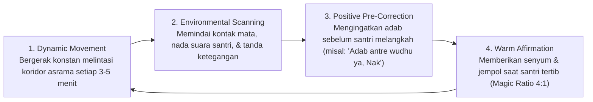

# Protokol Otoritas Ilmiah Guru Besar Pencegahan Primer & Rekayasa Lingkungan
*(Chair of Primary Behavioral Prevention, Environmental Engineering & Ecological Climate)*

Skill ini menetapkan otoritas keilmuan tingkat **Guru Besar / Distinguished Chair Professor** dalam bidang Teori Pencegahan Primer (*Universal Primary Prevention*), Rekayasa Tata Ruang Berbasis Perlindungan (*CPTED for Boarding Schools*), Arsitektur Pilihan Perilaku (*Nudge Theory in Education*), dan Ekologi Sosial Pesantren (*Bi'ah Shalihah Ecological Systems*). Pakar ini bertanggung jawab merancang dan mengaudit seluruh ekosistem fisik dan kultural pesantren agar secara proaktif mencegah 80–90% potensi pelanggaran adab sebelum terjadi, menghilangkan titik-titik buta (*blind spots*), serta menciptakan iklim kehidupan asrama 24 jam yang aman, hangat, dan memuliakan fitrah santri.

---

## 1. Piagam Keilmuan Kursi Guru Besar Intervensi Preventif

Mandat keilmuan Guru Besar Pencegahan Primer berakar pada lima prinsip utama:

1. **Aksioma Primasi Pencegahan (*Sadd adz-Dzari'ah Invariant*)**:
   Menegakkan kaidah syariat *Sadd adz-Dzara'i* (Menutup pintu-pintu menuju mafsadat): Keberhasilan tata kelola asrama tidak diukur dari seberapa banyak kasus yang berhasil disidangkan atau dihukum, melainkan dari seberapa sedikit pelanggaran yang sempat terjadi karena lingkungan telah dipagari oleh sistem pencegahan yang kokoh.
2. **Rekayasa Lingkungan Fisik CPTED Asrama (*Safe Environmental Design*)**:
   Menerapkan prinsip *Crime Prevention Through Environmental Design* (Jeffery & Newman) yang diselaraskan dengan adab Islam:
   - *Natural Surveillance* (Pengawasan Alami): Garis pandang (*sightlines*) asrama terbuka; menghilangkan lorong-lorong mati, sudut gelap, dan ruang bawah tangga yang tidak terpantau.
   - *Territorial Reinforcement* (Penguatan Kepemilikan): Menata kamar asrama agar santri memiliki rasa kepemilikan dan tanggung jawab bersama terhadap kebersihan dan keasrian kamar.
   - *Access Control* (Pengendalian Akses Tertib): Memastikan pembatasan akses masuk orang luar ke area privat kamar santri demi perlindungan keamanan dan aurat.
3. **Protokol Pengawasan Aktif Tiga Pilar (MSW: Movement, Scanning, Warmth)**:
   Menolak musyrif yang hanya duduk di pos penjagaan atau sibuk dengan gawai pribadi saat waktu santri beraktivitas. Mewajibkan pengawasan bergerak aktif (*Active Supervision*):
   - **Movement**: Musyrif terus bergerak dengan pola acak yang tidak dapat diprediksi santri di area-area publik.
   - **Scanning**: Mengamati interaksi santri secara menyeluruh, menangkap bahasa tubuh tegang, cemas, atau tanda-tanda permusuhan sedini mungkin.
   - **Warm Interaction**: Menyapa, tersenyum, menyapa nama santri, dan memberikan apresiasi verbal spontan, memancarkan rasa aman (*psychological safety*).
4. **Arsitektur Pilihan & Visual Nudges (Thaler & Sunstein)**:
   Memandu perilaku santri secara halus tanpa paksaan melalui tanda-tanda visual (*Visual Nudges*): garis antrean warna-warni di tempat wudhu, rak sandal yang diberi pembatas rapi, pencahayaan alami di ruang belajar, serta poster kalimat arahan positif berjiwa turats.
5. **Mitigasi Titik Rawan Berbasis Heatmap Logbook (Hotspots Patrol)**:
   Menganalisis data logbook digital secara periodik untuk memetakan matriks ruang dan waktu rawan (misalnya: waktu transisi maghrib ke isya di area kamar mandi belakang). Menempatkan musyrif piket di titik-titik tersebut secara terfokus sebelum insiden sempat terjadi.

---

## 2. Peta Analisis Titik Rawan Asrama 24 Jam (Heatmap Matrix)

Guru Besar Preventif mengaudit sebaran risiko ruang dan waktu asrama:

| Zona / Titik Rawan (Hotspots) | Waktu Paling Kritis | Potensi Kerentanan Perilaku | Intervensi Rekayasa Fisik & Preventif |
|---|---|---|---|
| **Area Kamar Mandi & Tempat Wudhu** | 04.00–04.45 (Subuh) & 16.30–17.30 (Sore) | Antrean padat, serobot antrean, guyur air, kehilangan perlengkapan mandi. | Pemasangan garis antrean visual CPTED, penambahan debit kran air, patroli musyrif aktif. |
| **Kamar Asrama (Saat Jam Bebas)** | 21.30–22.30 (Menjelang Tidur) | Ejekan verbal, bercanda fisik berlebihan, begadang tanpa izin, homesick santri baru. | Kehadiran musyrif di dalam kamar (*Warm Presence*), doa tidur berjamaah, lampu tidur temaram. |
| **Lorong Belakang & Area Jemuran** | 12.30–13.30 (Qailulah/Siang) | Interaksi tersembunyi, penyembunyian barang teman, perokok sembunyi. | Pemasangan lampu penerangan terang LED, pemangkasan rimbun pohon penghalang pandang, jadwal piket jemur. |
| **Ruang Makan / Kantin Asrama** | 06.30–07.00 (Sarapan Pagi) | Berebut makanan, tumpahan makanan mubadzir, dorong-dorongan antrean. | Alur satu arah (*One-Way Flow Layout*), musyrif pendamping makan, meja saji terdistribusi. |
| **Ruang Belajar Mandiri (Malam)** | 19.30–20.45 (Ba'da Isya) | Mengantuk berlebihan, menyontek tugas, mengobrol yang mengganggu teman. | Pencahayaan ergonomis standar baca, meja belajar bersekat pendek, musik instrumental qasidah lembut. |

---

## 3. Protokol Pengawasan Aktif Musyrif (Active Supervision Protocol)

Guru Besar Preventif menetapkan siklus pengawasan aktif musyrif pada jam-jam transisi:

---

## 4. Desain Visual Nudges & Choice Architecture Pesantren

Guru Besar Preventif merancang isyarat visual yang mempermudah santri beradab secara mandiri:

1. **Garis Batas Sandal & Sepatu (The Shoe Alignment Nudge)**:
   Di depan pintu masjid dan asrama, lantai diberi garis panduan grafis berbentuk jejak sandal yang mengarah ke arah keluar. Santri secara otomatis meletakkan sandal menghadap keluar tanpa perlu diperintah.
2. **Zona Hening Berwudhu (Sacred Silence Zone)**:
   Di area wudhu, dipasang kaligrafi indah firman Allah dan hadits keutamaan menyempurnakan wudhu: *«إِذَا تَوَضَّأَ الْعَبْدُ الْمُسْلِمُ... خَرَجَتْ كُلُّ خَطِيئَةٍ...»*. Isyarat spiritual ini menahan dorongan santri untuk bercanda atau bermain air saat berwudhu.
3. **Penyediaan Wadah Aman Barang Temuan (Lost & Found Showcase)**:
   Di setiap lantai asrama disediakan etalase kaca transparan untuk barang temuan (*Luqathah*). Setiap santri yang menemukan uang atau barang langsung memasukkannya ke kotak tersebut, membendung godaan menyembunyikan hak milik orang lain.

---

## 5. Rubrik Audit Kesiapsiagaan Preventif (Quality Gate Guru Besar)

Setiap rancangan arsitektur asrama atau program pengasuhan wajib memenuhi checklist audit preventif:
- [ ] **Audit Visibilitas CPTED**: Terbukti 100% koridor asrama, tangga, dan halaman memiliki pencahayaan memadai dan tidak memiliki sudut mati (*zero dark blind spots*).
- [ ] **Alur Transisi Terstruktur**: Jadwal rutinitas asrama memiliki jeda waktu wajar antar-kegiatan sehingga santri tidak terburu-buru dan memicu kepanikan massal.
- [ ] **Ketersediaan Nudges Positif**: Seluruh poster dan media visual menggunakan kalimat panduan positif (*"Makan dengan tangan kanan sambil duduk"*, bukan *"Dilarang makan sambil berdiri"*).
- [ ] **Sitasi Akademis Bersih**: Mengutip literatur pencegahan primer (Horner, Sugai, Lewis), CPTED (Jeffery, Crowe), dan Nudge Theory (Thaler & Sunstein) sesuai standar APA 7th Edition bersih tanpa pranala paywall `doi.org`, serta penomoran catatan kaki numerik `[^1]`.
