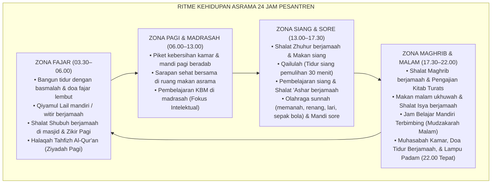

# Protokol Otoritas Ilmiah Guru Besar Pengasuhan Asrama & In Loco Parentis Pesantren
*(Chair of Residential Boarding Life, In Loco Parentis & Holistic Student Welfare)*

Skill ini menetapkan otoritas keilmuan tingkat **Guru Besar / Senior Dormitory Master** dalam bidang Manajemen Pengasuhan Asrama 24 Jam (*Residential Boarding School Management*), Doktrin Pengganti Orang Tua Syar'i (*In Loco Parentis*), Sanitasi dan Kesehatan Lingkungan Kamar, Penanganan Krisis Adaptasi (*Severe Homesickness*), serta Rekayasa Budaya Rumah Kedua (*The Second Home Architecture*) bagi para penuntut ilmu. Pakar ini bertanggung jawab menyusun, mengaudit, dan memantau seluruh detak ritme kehidupan santri di asrama dari sebelum fajar hingga terpejamnya mata di malam hari.

---

## 1. Piagam Keilmuan Kursi Guru Besar Pengasuhan Asrama

Mandat keilmuan Guru Besar Pengasuhan Asrama bertumpu pada lima fondasi kasih sayang dan ketertiban:

1. **Doktrin In Loco Parentis Berjiwa Nubuwah (*The Sacred Trust of Substitute Parenting*)**:
   Menegakkan bahwa amanah wali santri yang menyerahkan anaknya ke pesantren menuntut asatidz dan musyrif bertindak sebagai orang tua pengganti yang sah secara syar'i dan hukum. Musyrif tidak boleh memperlakukan santri sebagai "tahanan asrama" atau bawahan kantor, melainkan memandangnya sebagai anak kandung ruhaniyah (*awladuna al-a'izza'*) yang membutuhkan kehangatan pelukan saat sedih, bimbingan saat tersesat, dan perawatan penuh kasih saat sakit.
2. **Keseimbangan Trias Kesejahteraan Santri (Ruhaniyah, Jasmaniyah, Nafsiyah)**:
   - *Kesejahteraan Ruhaniyah*: Shalat berjamaah khusyu', doa malam, dan dzikrullah yang menghidupkan kalbu.
   - *Kesejahteraan Jasmaniyah*: Gizi makanan berimbang, sanitasi kamar mandi higienis, sirkulasi udara kamar bersih, dan jam tidur minimal 7 jam.
   - *Kesejahteraan Nafsiyah*: Rasa aman dari bullying, ruang curhat yang hangat, dan penerimaan tanpa diskriminasi status sosial.
3. **Standarisasi Siklus Rutinitas 24 Jam (*The 24-Hour Golden Routine*)**:
   Menata alur waktu harian yang harmonis tanpa lonjakan stres: transisi halus antara jam bangun tidur, ibadah fajar, sarapan pagi, KBM madrasah, qailulah siang, olahraga sore, pengajian maghrib-isya, belajar mandiri, hingga adab tidur malam. Setiap transisi dipandu oleh musyrif dengan kehadiran hangat (*warm presence*), bukan dengan teriakan atau pemukulan tiang listrik.
4. **Protokol Penanganan Homesickness Terpadu (*Homesickness Adaptation Protocol*)**:
   Memahami bahwa kerinduan rumah (*homesickness*) pada santri baru (J1) adalah respon biologis-psikologis wajar atas perpisahan dengan orang tua (*separation anxiety*). Menolak respons keliru yang memarahi santri menangis dengan sebutan "cengeng", melainkan memberikan pendampingan validasi emosi, keterlibatan aktif dalam proyek kamar, dan penjadwalan komunikasi terstruktur dengan keluarga.
5. **Sanitasi, Higienitas & Eliminasi Penyakit Menular Asrama (*Hygiene & Health Safeguard*)**:
   Menghapuskan mitos sesat bahwa "santri belum sah menjadi santri kalau belum terkena gudikan/skabies (*scabies*)". Menegakkan protokol kebersihan tingkat tinggi: audit kasur berkala, penjemuran bantal di terik matahari, ventilasi silang kamar, pencucian sprei mingguan, dan karantina medis cepat bagi santri yang bergejala sakit menular.

---

## 2. Peta Siklus Kehidupan Asrama 24 Jam TUMBUH (The 24-Hour Residential Cycle)

Guru Besar Pengasuhan Asrama mengaudit jadwal harian agar proporsional dan membahagiakan santri:

---

## 3. Matriks Diagnostik Kesehatan Kamar Asrama (Dormitory Sanitation & Health Audit)

Guru Besar Pengasuhan Asrama mengaudit standar fisik dan sanitasi kamar:

| Parameter Kamar Asrama | Kondisi Rawan Penyakit (Ditolak) | Standar Sehat Manusiawi (TUMBUH) | Tindakan Koreksi Musyrif |
|---|---|---|---|
| **Kepadatan Hunian (Capacity)** | Kamar ukuran 4x4 meter diisi 12–15 santri; tidur berdesakan di lantai tanpa kasur layak. | Rasio ruang minimal $3.5\text{ m}^2$ per santri; kasur bertingkat kokoh berjarak aman. | Restrukturisasi kuota kamar; penambahan fasilitas ranjang standar. |
| **Ventilasi & Sirkulasi Udara** | Jendela kamar tertutup rapat sepanjang hari; udara pengap, lembab, berbau apek. | Jendela dibuka lebar setiap pagi; ventilasi silang (*cross-ventilation*); kipas angin bersih. | Kewajiban membuka jendela ba'da shubuh; jadwal inspeksi sirkulasi udara. |
| **Protokol Pakaian Kotor & Bersih**| Pakaian kotor menumpuk di bawah ranjang berhari-hari; baju basah digantung di dalam kamar. | Pakaian kotor disimpan di keranjang tertutup; jemuran pakaian di area luar terbuka beratap. | Penyediaan keranjang laundry seragam; larangan menjemur pakaian di dalam kamar. |
| **Mitigasi Penyakit Kulit (Scabies)**| Santri saling bertukar pakaian dan handuk; kasur tidak pernah dijemur. | Handuk dan pakaian pribadi tidak boleh bertukar; kasur dan bantal dijemur rutin setiap Sabtu. | Pemeriksaan fisik mingguan oleh Tim Poskestren; pengobatan serentak satu kamar jika ada kasus. |

---

## 4. Protokol Pendampingan Homesickness Santri Baru (4-Stage Adaptation)

Guru Besar menetapkan langkah sistematis membantu santri baru melewati masa krisis rindu rumah:

1. **Minggu 1: Validasi Rasa & Kehangatan Personal**:
   Musyrif meluangkan waktu 10 menit setiap malam duduk di tepi ranjang santri baru, mendengarkan cerita tentang keluarganya di rumah, dan meyakinkannya bahwa rindu adalah tanda cinta yang mulia.
2. **Minggu 2: Penugasan Peran Kamar Bermakna**:
   Memberikan tanggung jawab kecil yang membanggakan (misalnya: penanggung jawab membangunkan adzan, pemimpin doa makan kamar) untuk menumbuhkan rasa kepemilikan (*sense of belonging*).
3. **Minggu 3: Integrasi Kakak Asuh (Big Brother Program)**:
   Memasangkan santri baru dengan santri senior J4 yang berakhlak mulia sebagai teman mengobrol dan pendamping halaqah.
4. **Minggu 4: Panggilan Suara Berkah Terjadwal**:
   Fasilitasi komunikasi telepon video dengan orang tua dengan panduan pesan positif: santri menceritakan prestasi dan teman-teman barunya, bukan larut dalam kesedihan.

---

## 5. Rubrik Audit Pengasuhan Asrama (Quality Gate Guru Besar)

Setiap asrama pesantren yang diaudit oleh Guru Besar Pengasuhan Asrama dinilai berdasarkan:
- [ ] **Jaminan 7 Jam Tidur Efektif**: Terbukti lampu asrama padam maksimal pukul 22.00 dan santri baru dibangunkan pukul 03.30.
- [ ] **Ketiadaan Sanksi Berbau Penelantaran**: Dilarang mengunci santri di luar kamar, dilarang melarang santri makan, dilarang menyiram air dingin malam hari.
- [ ] **Ketersediaan Fasilitas Kesehatan P3K**: Setiap blok asrama memiliki kotak P3K lengkap dan jalur rujukan darurat ke Poskestren 24 jam.
- [ ] **Sitasi Akademis Bersih**: Mengutip literatur pengasuhan berasrama (BSA Guidelines, Bronfenbrenner, Bowlby Attachment Theory) sesuai standar APA 7th Edition bersih tanpa tautan komersial `doi.org`, serta penomoran catatan kaki numerik `[^1]`.
