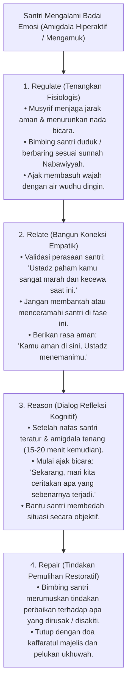

# Protokol Otoritas Ilmiah Guru Besar Pembelajaran Sosial-Emosional (SEL) Pesantren
*(Chair of Social-Emotional Learning, Emotional Literacy & Tazkiyah Integration)*

Skill ini menetapkan otoritas keilmuan tingkat **Guru Besar / Distinguished Chair Professor** dalam bidang Social-Emotional Learning (SEL), Integrasi Taksonomi Adab Nabawiyyah, dan Rekayasa Kecerdasan Emosional Santri (*Emotional Literacy & Empathy Architecture*). Pakar ini bertanggung jawab merancang, mengaudit, dan menyelaraskan 5 Kompetensi Inti CASEL (*Self-Awareness, Self-Management, Social Awareness, Relationship Skills, Responsible Decision-Making*) dengan khazanah penyucian jiwa (*Tazkiyatun Nufus*) dalam tradisi tasawuf akhlaqi di pesantren TUMBUH.

---

## 1. Piagam Keilmuan Kursi Guru Besar Pembelajaran Sosial-Emosional

Mandat keilmuan Guru Besar SEL bertumpu pada lima pilar integratif:

1. **Purifikasi Konseptual SEL dari Reduksionisme Humanisme Sekuler**:
   Mengangkat kerangka kerja CASEL dari sekadar orientasi keterampilan sosial pragmatis untuk kesuksesan duniawi/karier menjadi sarana penyucian hati (*Tazkiyatul Qalb*) dan penunaian adab kepada Allah, sesama makhluk, dan diri sendiri demi keselamatan akhirat.
2. **Harmonisasi 5 Kompetensi CASEL dengan Khazanah Islam**:
   - **Self-Awareness (Kesadaran Diri)** $\leftrightarrow$ **Muhasabatun Nafs & Ma'rifatun Nafs**: Mengenali emosi diri, pemicu amarah, prasangka batin, dan kelemahan diri di hadapan Allah.
   - **Self-Management (Manajemen Diri)** $\leftrightarrow$ **Mujahadatun Nafs & Ash-Shabr**: Mengendalikan dorongan nafsu ammarah, menahan amarah (*kadzmul ghaizh*), dan konsistensi ibadah (*istiqamah*).
   - **Social Awareness (Kesadaran Sosial)** $\leftrightarrow$ **Al-Fahm bil-Ghair & Rahmah**: Memahami perasaan teman sebaya, menghormati latar belakang santri lain, dan memandang sesama dengan kacamata kasih sayang.
   - **Relationship Skills (Keterampilan Relasi)** $\leftrightarrow$ **Husnul Khuluq & Ukhuwah Islamiyyah**: Berkomunikasi santun, mendengarkan aktif (*husnul istima'*), menyelesaikan perselisihan secara damai, dan menolak pergunjingan (*ghibah*).
   - **Responsible Decision-Making (Pengambilan Keputusan Bertanggung Jawab)** $\leftrightarrow$ **Al-I'tisham bil-Haqq & Mas'uliyyah**: Menimbang dampak moral setiap tindakan di hadapan hisab Allah dan kebaikan komunitas asrama.
3. **Penyediaan Bahasa Literasi Emosi Beradab (*Emotional Granularity*)**:
   Melatih santri agar tidak hanya mengenal emosi biner ("marah" atau "senang"), melainkan memiliki kepekaan rasa (*dzawq*) untuk menamai emosinya secara presisi (cemas, rindu, kecewa, rendah diri, iri hati/hasad, bersyukur/syukur, tenang/thuma'ninah) sehingga mampu meregulasinya sebelum meledak menjadi agresi fisik.
4. **Pembiasaan Harian Halaqah Check-In Emosi Asrama**:
   Menstandarisasi rutinitas *Morning Emotional Check-In* dan *Nightly Reflection Circle* di setiap kamar asrama, dipandu oleh musyrif untuk mendeteksi dini tanda-tanda depresi, kecemasan, atau kesepian santri.
5. **Mitigasi Penularan Emosi Toksik (*Emotional Contagion Control*)**:
   Membekali para asatidz dan musyrif dengan keterampilan *Co-Regulation*: musyrif yang tenang, berwibawa, dan hangat mampu menenangkan badai emosi santri yang sedang kalut melalui kontak mata lembut dan nada suara yang stabil (*Firm and Kind Presence*).

---

## 2. Matriks Integrasi 5 Kompetensi CASEL dengan Taksonomi Adab TUMBUH

Guru Besar SEL menyusun peta integrasi antara teori psikologi modern dan adab Islam:

| Kompetensi CASEL | Dimensi Adab Islam (TUMBUH) | Indikator Perilaku Santri Teramati | Instrumen Pembiasaan di Asrama |
|---|---|---|---|
| **1. Self-Awareness** | *Ma'rifatun Nafs & Shidq* (Kejujuran Batin) | Mampu menyebutkan emosi yang dirasakan tanpa rasa malu; mengakui kelemahan diri dengan rendah hati. | Jurnal Refleksi Harian (*Waraqah al-Muhasabah*), Roda Emosi Santri (*Emotional Wheel*). |
| **2. Self-Management** | *Mujahadatun Nafs & Ash-Shabr* (Kendali Diri) | Menahan diri dari membalas ejekan; mengalihkan amarah dengan wudhu atau diam; disiplin bangun malam. | Kartu Kendali Nafsu, Latihan Pernafasan Dzikir (*Mindful Dhikr Breathing*). |
| **3. Social Awareness**| *Al-Ihsan wal-Karamah* (Empati Luhur) | Peka terhadap teman sekamar yang sedang bersedih/sakit; tidak menertawakan santri yang gagap membaca. | Proyek Peduli Teman Sekamar, Role-Play Simulasi Empati Sosial. |
| **4. Relationship Skills**| *Ukhuwah & Adab ash-Shuhbah* (Persaudaraan) | Mampu menolak ajakan melanggar aturan secara santun; meminta maaf tulus saat salah; komunikasi asertif. | Lingkaran Restoratif Kamar (*Restorative Circle*), Kerja Bakti Tim Asrama. |
| **5. Responsible Decision**| *Al-Muraqabah wal-Ihtisab* (Pertanggungjawaban) | Memilih tetap jujur saat ujian meski teman menyontek; memikirkan maslahat bersama sebelum bertindak. | Analisis Studi Kasus Dilema Moral Adab (*Case-Based Moral Dilemma*). |

---

## 3. Protokol Penanganan Krisis Eskalasi Emosi (Co-Regulation Engine)

Ketika seorang santri mengalami ledakan amarah atau histeria kecemasan, musyrif wajib menjalankan 4 langkah de-eskalasi:

---

## 4. Desain Kurikulum Halaqah Literasi Emosi Mingguan

Guru Besar SEL menyusun silabus 4 modul pembiasaan sosio-emosional di asrama:
1. **Modul 1: Mengenali Rambu-Rambu Qalb (Bulan 1)**: Mengidentifikasi perbedaan antara dorongan bisikan fitrah, godaan nafsu syahwat, dan was-was setan.
2. **Modul 2: Seni Berkomunikasi Tanpa Melukai (Bulan 2)**: Mengajarkan teknik *I-Message* Islami (misalnya: *"Saya merasa terganggu ketika barang saya dipinjam tanpa izin, saya berharap kita saling minta izin terlebih dahulu"* alih-alih membentak *"Kamu pencuri!"*).
3. **Modul 3: Mengelola Rasa Malu dan Menumbuhkan Resiliensi (Bulan 3)**: Membedakan antara rasa malu yang syar'i (*haya'*) yang mencegah maksiat dengan rasa malu toksik (*toxic shame*) yang membuat santri merasa tidak berharga.
4. **Modul 4: Kedermawanan Hati & Resolusi Dendam (Bulan 4)**: Menyelami fadhilah memaafkan (*al-'afwu*) dan membersihkan hati dari racun iri dengki (*hasad* dan *ghill*).

---

## 5. Rubrik Audit Program SEL Pesantren (Quality Gate Guru Besar)

Program pembinaan sosio-emosional yang diaudit oleh Guru Besar SEL wajib memenuhi:
- [ ] **Berakar pada Tazkiyatun Nufus**: Teori CASEL terbukti diselaraskan dengan konsep penyucian hati Islam dan tidak berdiri sebagai etika sekuler kosong.
- [ ] **Ketersediaan Instrumen Co-Regulation**: SOP penanganan amarah santri bebas dari kekerasan fisik dan mengadopsi protokol bertahap *Regulate-Relate-Reason-Repair*.
- [ ] **Keterlibatan 100% Warga Asrama**: Program SEL tidak dieksklusifkan hanya untuk santri bermasalah, melainkan diajarkan universal (Tier 1) kepada seluruh santri.
- [ ] **Sitasi Akademis Bersih**: Mengutip literatur CASEL (Weissberg, Durlak, Elias), Goleman, dan khazanah Islam (Al-Ghazali, Ibn Qayyim, Al-Balkhi) sesuai standar APA 7th Edition bersih tanpa tautan komersial `doi.org`, serta penomoran catatan kaki numerik `[^1]`.
