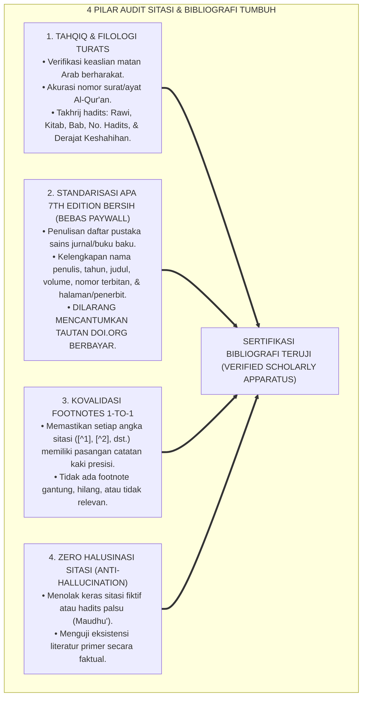

# Panduan & Protokol Pakar Validasi Sitasi, Filologi Turats, & Bibliografi Akademis

Skill ini dirancang untuk melakukan **verifikasi ketat, audit filologi, takhrij hadits, dan validasi bibliografis mutlak** terhadap seluruh sitasi ayat Al-Qur'an, matan hadits, teks Turats Arab klasik, catatan kaki (*footnotes*), dan daftar pustaka sains modern di seluruh dokumen repositori **TUMBUH**.

---

## 1. Peran Utama Auditor Sitasi & Bibliografi

---

## 2. Standar Protokol Validasi 4 Jenis Sumber

### A. Validasi Ayat Al-Qur'an al-Karim
* **Format Penulisan**: Teks Arab berharakat sempurna + Terjemahan Kemenag RI / Terjemahan Maknawiyyah Berjiwa.
* **Pemberian Identitas**: Wajib mencantumkan Nama Surah, Nomor Surah, dan Nomor Ayat.  
  *Format Baku:* `(QS. Al-An'am [6]: 82)` atau `(QS. Luqman [31]: 13–19)`.
* **Uji Integritas**: Tidak boleh ada salah ketik huruf hijaiyah, harakat syaddah, atau harakat sukun.

### B. Validasi Hadits Nabawi & Takhrij
* **Format Penulisan**: Matan Arab ringkas/lengkap + Terjemahan Bahasa Indonesia.
* **Elemen Takhrij Wajib**:
  1. *Mukharrij / Perawi Utama*: (HR. Al-Bukhari, HR. Muslim, HR. Abu Dawud, HR. At-Tirmidzi, HR. Ahmad, dll.).
  2. *Nama Kitab & Bab Asli*: (Kitab *Al-Iman*, Bab *Ma'rifat al-Islam wal-Ihsan*).
  3. *Nomor Hadits Baku*: Mengacu pada penomoran kitab tahqiq standar (*Al-Alamiyyah / Fathul Bari / Syarah Shahih Muslim An-Nawawi*).
  4. *Hukum Derajat Hadits*: Wajib berderajat minimal **Hasan** atau **Shahih**. Dilarang keras menggunakan hadits *Dha'if Jiddan* atau *Maudhu'* (Palsu).

### C. Validasi Rujukan Kitab Turats Klasik
* **Format Entri**: Nama Ulama Pengarang, Tahun Wafat (H), *Judul Lengkap Kitab*, Jilid/Juz, Nama Bab/Fasal, Halaman, Kota Terbit: Penerbit.  
  *Contoh Entri Daftar Pustaka:*  
  `Al-Ghazali, Abu Hamid Muhammad bin Muhammad. (2011). Ihya' 'Ulumiddin (Kitab Al-Muraqabah wal-Muhasabah). Beirut: Dar al-Ma'rifah.`  
  *Contoh Entri Footnote:*  
  `[^2]: Al-Ghazali, Ihya' 'Ulumiddin, Jilid 4, Kitab At-Tauhid wat-Tawakkul, hlm. 245–280.`

### D. Validasi Literatur Sains Global (Standar APA 7th Edition Bersih)
* **PANTANGAN MUTLAK DOI.ORG BERBAYAR**: **Dilarang mencantumkan tautan/URL `doi.org` berbayar (*paywall*)**. Seluruh rujukan jurnal ilmiah wajib menggunakan format sitasi bibliografis teks bersih yang memuat metadata lengkap (nama penulis, tahun, judul artikel, nama jurnal, volume, nomor terbitan, dan rentang halaman) tanpa menyertakan pranala komersial berbayar.
* **Format Baku Jurnal Peer-Reviewed**:  
  `Penulis, A. A., & Penulis, B. B. (Tahun). Judul artikel. Nama Jurnal, Volume(Nomor), Rentang Halaman.`  
  *Contoh:*  
  `Locke, E. A., & Latham, G. P. (2002). Building a practically useful theory of goal setting and task motivation: A 35-year odyssey. American Psychologist, 57(9), 705–717.`
* **Format Baku Buku / Monograf**:  
  `Penulis, C. C. (Tahun). Judul buku (Edisi). Kota Terbit: Penerbit.`  
  *Contoh:*  
  `Frankl, V. E. (1984). Man's Search for Meaning: An Introduction to Logotherapy. Boston: Beacon Press.`

---

## 3. 4 Kaidah Emas Penempatan Sitasi Akademis (Golden Rules)

Pakar Validasi Sitasi menegakkan 4 kaidah baku filologi dan tipografi ilmiah modern tanpa kompromi:

1. **Aturan Anti-Sitasi Bertumpuk (Anti-Stacked Citations Rule)**:
   * Dilarang keras menumpuk dua atau lebih nomor catatan kaki pada ujung satu kalimat atau satu titik tanda baca (`[^1][^2]` atau `[^5][^6]`).
   * Setiap rujukan wajib melekat secara spesifik pada klausa, karya, atau proposisi kalimat yang memang dibahas oleh pengarang tersebut secara mandiri. Bila dua pengarang dikutip berurutan, pisahkan menjadi dua kalimat atau dua paragraf mandiri.
2. **Aturan Penempatan Gramatikal Eksak (Grammatical Precision Rule)**:
   * Nomor superskrip catatan kaki (`[^n]`) wajib diletakkan di luar tanda kurung atau tepat setelah tanda baca penutup (titik atau koma).
   * Dilarang keras menyelipkan tag di dalam kurung halaman (misal: `hlm. 21[^1]` adalah keliru; yang benar `hlm. 21).[^1]`), nomor hadits (`No. 3535[^5]` adalah keliru; yang benar `No. 3535).[^5]`), atau penamaan versi/branch teknis (misal: `v2[^1].0.0` adalah keliru fatal; yang benar `v2.0.0`).
3. **Aturan Eliminasi Teks Mentah APA di Tubuh Narasi (No Raw Floating References)**:
   * Seluruh entri sitasi bibliografis lengkap (Nama, Tahun, Judul, Penerbit) hanya boleh berada di **Bagian 11 (Catatan Kaki Akademis & Bibliografi Terkurasi)**.
   * Di dalam paragraf tubuh narasi (Bagian 1 s/d 10), nama tokoh dan tahun cukup dirujuk secara kontekstual disertai superskrip `[^n]`, tidak boleh ada baris mentah APA yang tercecer di tengah teks.
4. **Aturan Keterurutan Kronologis Mutlak (Strictly Sequential 1-to-N)**:
   * Urutan kemunculan nomor sitasi di dalam teks tubuh wajib mengalir secara berurutan: `[^1]`, lalu `[^2]`, lalu `[^3]`, hingga `[^N]`.
   * Daftar catatan kaki pada Bagian 11 wajib disusun dalam urutan yang sama persis 1-to-1 dengan urutan pemanggilannya di dalam teks.

---

## 4. Checklist Audit Mutu Bibliografi (Quality Gate Sitasi)

Sebelum berkas monograf dinyatakan lolos verifikasi sempurna, Auditor Sitasi wajib memverifikasi checklist berikut:

| No | Parameter Audit Sitasi | Kriteria Lolos Mutlak | Status Verifikasi |
| :---: | :--- | :--- | :---: |
| 1 | **Kesesuaian 1-to-1 Presisi** | Setiap `[^n]` di teks memiliki pasangan di Bagian 11, tanpa ada tag/entri gantung. | [ ] |
| 2 | **Zero Stacked Citations** | Tidak ada sitasi ganda bertumpuk (`[^a][^b]`). Setiap sitasi berdiri pada kalimat mandiri. | [ ] |
| 3 | **Keterurutan Kronologis** | Seluruh nomor sitasi mengalir urut $1, 2, 3, \dots, N$ dari awal bab ke akhir bab. | [ ] |
| 4 | **Ketepatan Posisi Gramatikal** | Tag sitasi berada setelah tanda baca atau di luar kurung (bebas dari angka halaman/hadits). | [ ] |
| 5 | **Kuantitas Rujukan Primer** | Memuat minimal **10 hingga 25 entri pustaka primer** yang disintesiskan secara substantif. | [ ] |
| 6 | **Kesesuaian Takhrij Hadits** | Setiap hadits mencantumkan perawi, nomor hadits baku, dan derajat keshahihan minimal Hasan. | [ ] |
| 7 | **Keotentikan Teks Arab** | Matan Arab berharakat rapi tanpa kesalahan tipografi nash syar'i. | [ ] |
| 8 | **Standarisasi APA 7th Bersih** | Bebas mutlak dari tautan komersial berbayar `doi.org`; metadata lengkap teks bersih. | [ ] |
| 9 | **Zero Raw Floating Lines** | Tidak ada baris daftar pustaka mentah yang tercecer di dalam paragraf narasi. | [ ] |
| 10 | **Glosarium Terminologi** | Memuat minimal 10 entri istilah kunci dengan definisi operasional komprehensif. | [ ] |
| 11 | **Format Tabel untuk Kotak** | Seluruh ikhtisar/daftar terkotak memakai tabel Markdown resmi (nihil kotak buatan `_` atau `|`). | [ ] |

---

## 5. Perintah Khusus Pemeriksaan Cepat (Fast Verification Routine)
Jika agen diminta memeriksa sitasi dokumen tertentu, jalankan protokol:
1. Scan seluruh tag `[^n]` dalam teks dan pastikan ada pasangannya di bagian `## 11. Catatan Kaki Akademis (*Footnotes*)`.
2. Pastikan tidak ada satupun pola regex `\[\^\d+\]\[\^\d+\]` (sitasi bertumpuk).
3. Cross-check setiap nama penulis di `Daftar Pustaka` dengan sitasi dalam naskah (*In-Text Citations*).
4. Verifikasi bahwa penomoran in-text berjalan strictly sequential dari 1 hingga N.

---

## 6. Protokol Kurasi & Pembaruan Folder `REFERENCES/` (Auto-Cataloging)

Skill ini bertanggung jawab penuh sebagai **Kustodian Resmi Folder `REFERENCES/`**. Setiap kali berkas PROBE, Fundamental, atau Implementation mengkaji atau mengutip karya baru yang belum terdaftar:

1. **Deteksi Rujukan Baru**: Periksa apakah kitab Turats, buku teks sains, atau jurnal yang dikutip sudah ada dalam katalog di `REFERENCES/` (misalnya `REFERENCES/books/01-Turats-Klasik-dan-Adab-Islam.md`, `REFERENCES/books/04-Falsafah-Sosiologi-dan-Kepemimpinan-Pesantren.md`, `REFERENCES/journals/`, dll.).
2. **Standardisasi Metadata Entri**:
   - Nomor urut berikutnya.
   - Nama Pengarang / Ulama Klasik / Peneliti.
   - Judul Karya Lengkap.
   - Abad Hijriyah / Tahun Terbit Masehi.
   - Fokus Utama Pembahasan & Lokus Integrasi Domain TUMBUH (misal: `01_FUNDAMENTAL/01_PHILOSOPHY`).
3. **Penyisipan Otomatis ke File Katalog Terkait**: Tambahkan baris baru ke tabel Markdown katalog yang relevan.
4. **Validasi Anti-Halusinasi**: Pastikan karya yang dimasukkan benar-benar ada dan otentik secara filologis dan akademis sebelum dicatat ke repositori.
