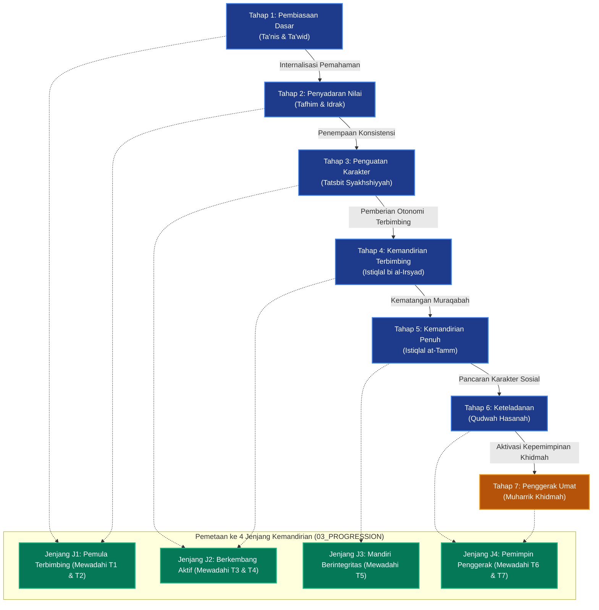

# P00033: Mengapa 7 Tahap Perkembangan Santri Menjadi Inti Model TUMBUH?

## 1. Metadata & Identitas Dokumen Inkuiri
- **ID Inkuiri**: `PROBE_01_P00033`
- **Kode Berkas**: `P00033-Mengapa-7-Tahap-Perkembangan-Santri-Menjadi-Inti-Model-TUMBUH.md`
- **Pilar**: Pilar 3 — Logika Penataan Arsitektur Konseptual TUMBUH
- **Domain Terkait**: `01_FUNDAMENTAL/02_CORE_MODEL/` (Komponen Model Inti TUMBUH)
- **Status ADR**: `APPROVED & LOCKED` (Ketetapan Konstitusi Repositori Branch v2.0.0)
- **Versi Dokumen**: `2.0.0`
- **Tanggal Rilis**: 2026-10-25
- **Klasifikasi Epistemik**: *Ontological Developmental Trajectory & Core Educational Modeling*
- **Keterlacakan**: Menjadi muara implementatif dari 9 Domain Fondasi (`01_FOUNDATION/`) dan membuka gerbang pemodelan inti manusiawi TUMBUH (`02_CORE_MODEL/`).

---

## 2. Hakikat Fundamental & Latar Belakang Epistemik

### 2.1. Tragedi "Generalisasi Tanpa Tahapan" dalam Pengasuhan Pesantren
Salah satu kelemahan metodologis paling kronis dalam banyak sistem pendidikan asrama pesantren adalah **penyeragaman perlakuan pedagogis (*one-size-fits-all fallacy*)**. Santri baru yang baru lulus sekolah dasar (usia 12 tahun) sering kali diperlakukan persis sama dengan santri aliyah tingkat akhir (usia 18 tahun):
- Dituntut memiliki keikhlasan mutlak sejak malam pertama tanpa fase adaptasi kelekatan (*attachment security*).
- Dikenai beban hafalan Al-Qur'an dan mutun ilmiah dengan target kuantitas yang identik tanpa membedakan kapasitas working memory kognitifnya.
- Diberlakukan hukuman pelanggaran disiplin yang sama beratnya tanpa mempertimbangkan kematangan pertimbangan moral (*moral reasoning*).

Dampaknya adalah disintegrasi psikologis santri: anak-anak usia awal mengalami depresi, keputusasaan, dan *learned helplessness* (merasa diri ditakdirkan menjadi orang gagal), sementara santri senior mengalami kejenuhan spiritual (*spiritual burnout*) dan bersikap munafik (*nifaq amali*) karena diperlakukan seperti anak kecil yang terus-menerus diawasi tanpa diberi ruang kepemimpinan mandiri.

### 2.2. Posisi Strategis 7 Tahap Perkembangan Santri sebagai Core Model TUMBUH
Sistem TUMBUH v2.0.0 menolak generalisasi mekanistik tersebut. Setelah sembilan domain fondasi filosofis (`01_FOUNDATION/`) tuntas membentangkan hakikat wujud, ilmu, fitrah, pendidikan, kepemimpinan, dan arsitektur sistem, maka langkah berikutnya adalah menjawab pertanyaan sentral: **"Bagaimana wujud perjalanan seorang insan santri dari hari pertama ia melangkahkan kaki ke gerbang pesantren hingga ia lulus menjadi pemimpin peradaban?"**

Jawaban sistemik atas pertanyaan tersebut dirumuskan ke dalam **Tujuh Tahap Perkembangan Santri (The 7 Developmental Stages)**:
1. **Tahap 1: Pembiasaan Dasar (*Ta'nis & Ta'wid al-Asasi*)** — Menanamkan rasa aman, adaptasi ritme biologis, dan pembiasaan adab lahiriah dengan penuh kelembutan.
2. **Tahap 2: Penyadaran Nilai (*Tafhim & Idrak al-Qiyam*)** — Membimbing nalar santri untuk memahami *alasan* di balik setiap adab, mengikis kepatuhan buta menjadi pemahaman bermakna.
3. **Tahap 3: Penguatan Karakter (*Tatsbit & Bina' asy-Syakhshiyyah*)** — Menempa konsistensi amal di tengah godaan jenuh dan melatih ketahanan menghadapi rintangan (*resilience*).
4. **Tahap 4: Kemandirian Terbimbing (*Istiqlal bi al-Irsyad*)** — Memberikan ruang otonomi terkontrol bagi santri untuk mengatur waktu, belajar mandiri, dan menyelesaikan masalah dengan supervisi longgar musyrif.
5. **Tahap 5: Kemandirian Penuh (*Istiqlal at-Tamm*)** — Santri mampu menjalankan disiplin dan ibadah secara intrinsik tanpa perlu diawasi, didorong oleh kesadaran *Muraqabatullah*.
6. **Tahap 6: Keteladanan (*Qudwah & Uswah*)** — Santri bertransformasi menjadi panutan hidup bagi adik-adik kelasnya, mempraktikkan akhlak karimah dalam sikap nyata sehari-hari.
7. **Tahap 7: Penggerak (*Muharrik & Khadim al-Ummah*)** — Puncak kematangan karakter di mana santri mampu memimpin inisiatif kebaikan, mengorganisasi program khidmah, dan menggerakkan komunitas menuju kemaslahatan bersama.

Ketujuh tahap ini bukan sekadar klasifikasi administratif, melainkan **Inti Model Ontologis (Core Model)** yang mengikat seluruh instrumen rubrik, jenjang kemandirian J1–J4, asesmen PBIS, dan intervensi kepengasuhan di repositori TUMBUH.

---

## 3. Dalil Naqli Turats & Integrasi Psikologi Perkembangan

### 3.1. Rujukan Teks Turats Otoritatif: Sunatullah Bertahap dalam Pembinaan Jiwa
Islam memandang pertumbuhan jiwa manusia tunduk pada ketetapan sunatullah yang berproses secara bertahap (*at-Tadarruj*). Allah Ta'ala berfirman dalam Al-Qur'an:

```arabic
لَتَرْكَبُنَّ طَبَقًا عَنْ طَبَقٍ
```
*(Sesungguhnya kamu benar-benar akan menjalani tingkat demi tingkat [dalam kehidupan]).*
— **QS. Al-Insyiqaq [84]: 19**.

Imam Al-Qurthubi (w. 671 H) dalam tafsir *Al-Jami' li Ahkam al-Qur'an* menjelaskan makna ayat ini:
```arabic
أَيْ حَالًا بَعْدَ حَالٍ، وَمَنْزِلَةً بَعْدَ مَنْزِلَةٍ، مِنْ طُفُولِيَّةٍ إِلَى شَبَابٍ، وَمِنْ تَعَلُّمٍ إِلَى فَهْمٍ، وَمِنْ جَهْدٍ إِلَى تَمْكِينٍ؛ فَلَا يَصِلُ الْعَبْدُ إِلَى كَمَالِ الرُّشْدِ إِلَّا بِقَطْعِ هَذِهِ الْمَنَازِلِ مَنْزِلَةً مَنْزِلَةً دُونَ طَفْرَةٍ
```
*(Yaitu keadaan demi keadaan, tingkatan demi tingkatan; dari masa kanak-kanak menuju masa muda, dari proses belajar hafalan menuju pemahaman nalar, dan dari perjuangan berat menuju kematangan kepemimpinan. Maka seorang hamba tidak akan sampai kepada kesempurnaan kedewasaan akal budi [ar-rusyd] melainkan dengan menempuh tingkatan-tingkatan ini setahap demi setahap tanpa melompat secara gegabah).*
— **Al-Qurthubi**, *Al-Jami' li Ahkam al-Qur'an*, Jilid 19, Hal. 274.

Imam Ibnu Muflih al-Maqdisi (w. 763 H) dalam mahakaryanya *Al-Adab asy-Syar'iyyah* menegaskan kaidah didaktik ulama salaf dalam mendidik anak santri:
```arabic
وَيَنْبَغِي لِلْمُؤَدِّبِ أَنْ يَتَدَرَّجَ بِالصَّبِيِّ فِي مَرَاتِبِ التَّأْدِيبِ، فَيَبْدَأَ بِالتَّأْنِيسِ وَالتَّرْغِيبِ، ثُمَّ بِالتَّعْوِيدِ عَلَى الْمَحَاسِنِ، ثُمَّ بِإِبَانَةِ الْعِلَلِ وَالْمَعَانِي، ثُمَّ بِتَفْوِيضِ الْأَمْرِ إِلَيْهِ رُوَيْدًا رُوَيْدًا؛ فَإِنَّ حَمْلَ النَّفْسِ عَلَى غَيْرِ طَبْعِهَا دَفْعَةً وَاحِدَةً يُورِثُ النِّفَارَ وَالْفَسَادَ
```
*(Dan sepatutnya bagi seorang pendidik [mu'addib] untuk mendidik anak santri setingkat demi setingkat dalam tingkatan adab: memulainya dengan pendekatan ramah kasih sayang dan penumbuhan rasa suka, lalu membiasakan perbuatan mulia, lalu menjelaskan alasan dan hikmah maknanya, kemudian mendelegasikan tanggung jawab kepadanya secara perlahan-lahan. Karena sesungguhnya memaksakan jiwa melompati kodrat alaminya secara serentak hanya akan melahirkan penolakan batin dan kerusakan watak).*
— **Ibnu Muflih**, *Al-Adab asy-Syar'iyyah wa al-Minah al-Mar'iyyah*, Jilid 3, Hal. 562.

### 3.2. Integrasi Teori Perkembangan Psikososial dan Otonomi Diri
Ketujuh tahap TUMBUH memiliki keselarasan mutlak dengan temuan sains modern:
1. **Self-Determination Theory (Deci & Ryan)**: Motivasi manusia bertransformasi dari kepatuhan ekstrinsik (*External Regulation* / Tahap 1–2), menuju internalisasi nilai (*Introjected & Identified Regulation* / Tahap 3–4), hingga integrasi otonomi diri penuh (*Intrinsic Motivation* / Tahap 5–7). Santri yang dipaksa patuh selamanya tanpa diberi ruang otonomi tidak akan pernah mencapai kematangan intrinsik.
2. **Zone of Proximal Development (Vygotsky)**: Setiap tahap perkembangan memerlukan tingkat perancah (*scaffolding*) yang berbeda: Tahap 1 menuntut *high scaffolding* (musyrif mendampingi langsung setiap menit), sementara Tahap 6–7 membutuhkan *minimal scaffolding* di mana santri sendiri yang menjadi perancah bagi orang lain.
3. **Kohlberg's Moral Development Stages**: Kepatuhan santri bertumbuh dari orientasi menghindari hukuman (*Pre-conventional* / Tahap 1) menuju keselarasan sosial dan empati (*Conventional* / Tahap 2–4), hingga komitmen pada prinsip etika universal dan pertanggungjawaban akhirat (*Post-conventional* / Tahap 5–7).

---

## 4. Argumen Ontologis & Logika Dependensi Sistem

Penempatan 7 Tahap Perkembangan Santri sebagai **Core Model (`02_CORE_MODEL/`)** tepat setelah sub-direktori `01_FOUNDATION/` merupakan keniscayaan arsitektural:

```
[01_FOUNDATION/ (9 Domain)] (Worldview s/d System Architecture: Fondasi Filosofis)
       ↓
[02_CORE_MODEL/ (P00033-P00039)] (7 TAHAP PERKEMBANGAN SANTRI: INTI MODEL INSAN)
       ↓
[03_PROGRESSION/ (P00040-P00045)] (4 Jenjang Kemandirian Santri J1–J4: Taksonomi)
       ↓
[04_ASSESSMENT/ (P00046-P00048)] (Rubrik & Asesmen PBIS Multi-Tier: Evaluasi)
       ↓
[05_INTERVENTION/ (P00049-P00050)] (Protokol Kuratif, Restoratif & De-eskalasi Krisis)
```

### 4.1. Mengapa 7 Tahap Perkembangan Menjadi Inti Model (Bukan Sekadar Kurikulum Tambahan)?
1. **Pusat Gravitasi Ekosistem**: Seluruh instrumen di repositori TUMBUH dirancang untuk melayani pertumbuhan santri melintasi 7 tahap ini. Rubrik PBIS (Lapisan Assessment) tidak bermakna apa-apa jika tidak mengukur perpindahan santri dari satu tahap ke tahap berikutnya.
2. **Pencegahan Diskoneksi Antara Filosofi dan Praktik**: Fondasi filosofis di `01_FOUNDATION/` terlalu abstrak jika langsung diterapkan ke SOP asrama. Harus ada model representasi manusia (*human model*) yang menjabarkan perubahan psikologis santri dari waktu ke waktu.
3. **Dasar Pemetaan 4 Jenjang Kemandirian (J1–J4)**: Taksonomi Jenjang J1 s/d J4 di `03_PROGRESSION/` diturunkan secara langsung dari 7 tahap ini (misal: Jenjang J1 mewadahi Tahap 1 & 2; Jenjang J2 mewadahi Tahap 3 & 4; Jenjang J3 mewadahi Tahap 5; Jenjang J4 mewadahi Tahap 6 & 7).

---

## 5. Studi Kasus Lapangan & Analisis Komparatif

### 5.1. Kasus Lapangan 1: Kegagalan Pesantren D Akibat "Akselerasi Otonomi Palsu"
Pesantren D di Jawa Timur mencanangkan program *"Kemandirian Santri Sejak Hari Pertama"*. Santri baru usia 12 tahun yang baru lulus SD langsung diserahkan sepenuhnya untuk mengatur cucian sendiri, belanja kebutuhan pribadi, mengatur jam tidur, dan mengelola jadwal tahfidz tanpa pendampingan intensif musyrif:
- **Dampak Tragis**: Dalam 3 bulan pertama, 45% santri mengalami *homesickness* akut dan menangis histeris setiap malam; kamar-kamar santri berantakan dan menimbulkan wabah penyakit kulit scabies karena santri belum memiliki keterampilan dasar merawat diri; santri senior yang nakal memanfaatkan situasi untuk memeras dan merundung santri junior.
- **Kesalahan Mendasar**: Pengelola memaksakan santri langsung melompat ke **Tahap 5 (Kemandirian Penuh)** tanpa pernah melewati **Tahap 1 (Pembiasaan Dasar)** dan **Tahap 2 (Penyadaran Nilai)** dengan pendampingan penuh.

### 5.2. Kasus Lapangan 2: Keberhasilan Transformasi Progresi 7 Tahap di Pesantren T
Pesantren T di Yogyakarta mengadopsi 7 Tahap Model Inti TUMBUH secara konsisten:
1. **Fase Ta'nis (Tahap 1)**: Tiga bulan pertama santri baru didampingi musyrif secara intensif: diajari cara mencuci pakaian, menata lemari, wudhu yang benar, dan adab makan bersama dalam suasana hangat penuh kasih sayang tanpa sanksi hukuman.
2. **Fase Tafhim (Tahap 2)**: Memasuki semester kedua, santri diajak berdialog mengenai makna di balik shalat berjamaah dan qiyamul lail.
3. **Pemberian Tanggung Jawab Berjenjang (Tahap 4–7)**: Santri senior dilatih menjadi mentor adik kelas (*Tahap 6*) dan memimpin divisi kebersihan dan keamanan asrama (*Tahap 7*).
4. **Hasil**: Tingkat kepuasan santri mencapai 96%, retensi kelulusan 99%, dan alumni pesantren tersebut dikenal di perguruan tinggi sebagai pribadi yang berintegritas tinggi, mandiri, dan berjiwa kepemimpinan khidmah.

### 5.3. Analisis Komparatif Tiga Paradigma Pembinaan Santri
Berikut adalah perbandingan filosofis dan metodologis antara tiga pendekatan pembinaan kepesantrenan:

| Parameter Evaluasi | Model Dogmatis-Represif (Pondok Konvensional Keras) | Model Kognitif-Permisif (Sekolah Berasrama Liberal) | Model 7 Tahap Integratif (TUMBUH v2.0.0) |
|:---|:---|:---|:---|
| **Pandangan Terhadap Santri Baru** | Objek yang harus "ditundukkan" dan "dilebur" watak lamanya dengan keras. | Konsumen yang tidak boleh merasa lelah atau tertekan sedikit pun. | Insan suci berfitrah mulia yang membutuhkan penyesuaian ritme (*Ta'nis*). |
| **Pola Relasi Pendidik-Santri** | Komandan militer dengan prajurit bawahan; berjarak dingin dan kaku. | Teman santai tanpa wibawa kepemimpinan; batas adab menjadi kabur. | Orang tua ruhani (*Abur Ruh*) yang memadukan kehangatan kasih dan ketegasan hikmah. |
| **Metode Penegakan Disiplin** | Teror rotan, push-up massal, ancaman pengusiran sepihak. | Negosiasi bebas tanpa sanksi tegas; standar adab mudah dikompromikan. | Scaffolding berjenjang, penyadaran makna (*Tafhim*), dan restitusi adab restoratif. |
| **Puncak Kematangan Santri** | Kepatuhan semu (*nifaq amali*); santri memberontak pasca-lulus. | Individualistis, manja, dan minim kepekaan khidmah kemasyarakatan. | Insan adabi penggerak umat (*Muharrik*) yang mandiri dan berjiwa pelayan. |

---

## 6. Arsitektur Matriks Progresi 7 Tahap Perkembangan Santri TUMBUH

```
  +-----------------------------------------------------------------------------------------------+
  |                      MATRIKS PROGRESI 7 TAHAP PERKEMBANGAN SANTRI TUMBUH                      |
  +-------+-------------------------+--------------------+---------------------+------------------+
  | TAHAP | NAMA TAHAPAN TUMBUH     | FOKUS PERUBAHAN    | DERAJAT SCAFFOLDING | INDIKATOR UTAMA  |
  +-------+-------------------------+--------------------+---------------------+------------------+
  | T1    | PEMBIASAAN DASAR        | Fisik, Adaptasi,   | Maksimal (100%)     | Merasa aman,     |
  |       | (Ta'nis & Ta'wid)       | Ritme Biologis     | Musyrif mendampingi | tertib wudhu/tidur|
  +-------+-------------------------+--------------------+---------------------+------------------+
  | T2    | PENYADARAN NILAI        | Kognitif, Makna,   | Tinggi (75%)        | Tahu alasan adab,|
  |       | (Tafhim & Idrak)        | Alasan Syariat     | Dialog & penalaran  | bertanya kritis  |
  +-------+-------------------------+--------------------+---------------------+------------------+
  | T3    | PENGUATAN KARAKTER      | Emosional, Daya    | Moderat (50%)       | Tangguh hadapi   |
  |       | (Tatsbit asy-Syakhshiyah| Tahan, Resiliensi  | Apresiasi & koreksi | jenuh, konsisten |
  +-------+-------------------------+--------------------+---------------------+------------------+
  | T4    | KEMANDIRIAN TERBIMBING  | Metakognitif, Self-| Terarah (35%)       | Mengatur jadwal, |
  |       | (Istiqlal bi al-Irsyad) | Regulation Awal    | Supervisi berkala   | inisiatif ibadah |
  +-------+-------------------------+--------------------+---------------------+------------------+
  | T5    | KEMANDIRIAN PENUH       | Spiritual Kalbu,   | Minimal (20%)       | Muraqabatullah,  |
  |       | (Istiqlal at-Tamm)      | Integritas Mandiri | Konsultatif mandiri | jujur di kala sepi|
  +-------+-------------------------+--------------------+---------------------+------------------+
  | T6    | KETELADANAN             | Sosial, Empati,    | Pendampingan Rakan  | Menjadi figur    |
  |       | (Qudwah & Uswah)        | Uswah Hasanah      | (10%) Supervisi BK  | panutan yunior   |
  +-------+-------------------------+--------------------+---------------------+------------------+
  | T7    | PENGGERAK               | Kepemimpinan Umat, | Kolaboratif (5%)    | Menggerakkan tim,|
  |       | (Muharrik & Khidmah)    | Khidmah Masyarakat | Fasilitasi mandiri  | inisiator ishlah |
  +-------+-------------------------+--------------------+---------------------+------------------+
```

### 6.2. Integrasi Empat Dimensi Perkembangan Insan
Setiap tahapan perkembangan diukur melalui empat dimensi integratif yang merefleksikan keutuhan kepribadian santri:
1. **Dimensi Fisik-Biologis (*Al-Jasad wa as-Sihhah*)**: Mengukur keteraturan ritme sirkadian tidur-bangun, ketahanan jasmani, kebersihan thaharah, dan pemenuhan nutrisi halal-thayyib.
2. **Dimensi Kognitif-Intelektual (*Al-'Aql wa al-Fahm*)**: Mengukur kemampuan menyerap ilmu syar'i, daya nalar kritis, kemampuan metakognisi (merencanakan strategi belajar), dan pemahaman hikmah aturan.
3. **Dimensi Sosio-Emosional (*An-Nafs wa ar-Rafiq*)**: Mengukur stabilitas suasana hati, resiliensi menghadapi masa jenuh (*futur*), kemampuan empati, dan keterampilan resolusi konflik antarsebaya.
4. **Dimensi Spiritual-Kalbu (*Al-Qalb wa al-Muraqabah*)**: Mengukur keikhlasan niat, penghayatan ibadah shalat dan tilawah, kesadaran diawasi Allah di tempat sunyi, serta semangat khidmah demi ridha-Nya.

---

## 7. Diagram Alur & Logika Dependensi Turunan Sistem



---

## 8. Spesifikasi Formulir Audit Tahapan Perkembangan (Form F-MOD-AUDIT)

Formulir ini wajib digunakan oleh Musyrif dan Wali Asrama setiap triwulan untuk memverifikasi kesiapan santri naik ke tahap perkembangan berikutnya:

### 8.1. Lembar Verifikasi Kenaikan Tahap Perkembangan Santri
| No | Parameter Kematangan Insan | Indikator Kompetensi Adab | Metode Asesmen Lapangan | Status Verifikasi |
|:---|:---|:---|:---|:---:|
| 1 | **Kemandirian Rutinitas Fisik** | Menjaga kebersihan diri, mencuci pakaian, menata lemari rapi. | Observasi langsung bilik kamar | [ ] Mandiri / [ ] Butuh Bimbingan |
| 2 | **Pemahaman Nilai & Hikmah** | Menjelaskan alasan syar'i dan adab di balik amalan harian. | Wawancara dialog refleksi santri | [ ] Paham / [ ] Hafal Buta |
| 3 | **Resiliensi & Manajemen Stres** | Tetap stabil dan sabar menghadapi masa jenuh/ujian hafalan. | Catatan konseling halaqah | [ ] Tangguh / [ ] Rentan Relaps |
| 4 | **Integritas Muraqabah** | Menjalankan disiplin shalat berjamaah di kala tidak diawasi. | Uji kejujuran situasional asrama | [ ] Ikhlas / [ ] Kepatuhan Semu |
| 5 | **Empati & Resolusi Konflik** | Menghargai perbedaan teman sekamar dan aktif mendamaikan perselisihan. | Sosiometri dinamika kamar | [ ] Berempati / [ ] Individualis |
| 6 | **Kapasitas Keteladanan** | Menjadi figur panutan yang disegani dan disayangi adik kelas. | Survei persepsi santri yunior | [ ] Mengayomi / [ ] Otoriter |
| 7 | **Inisiatif Khidmah Sosial** | Mempelopori kegiatan kebaikan tanpa menunggu instruksi musyrif. | Portofolio proyek kepemimpinan | [ ] Inisiatif / [ ] Pasif Menunggu |

### 8.2. Skrip Validasi Kepatuhan Model 7 Tahap (`audit_core_model_progression.py`)
Skrip Python otomatis ini memvalidasi kelengkapan dokumen pemodelan inti pada repositori TUMBUH:

```python
#!/usr/bin/env python3
"""
Validator Otomatis: Kepatuhan Terhadap 7 Tahap Model Inti TUMBUH
Branch: v2.0.0
"""

import sys
from pathlib import Path

EXPECTED_STAGES = [
    "tahap_1_pembiasaan_dasar",
    "tahap_2_penyadaran_nilai",
    "tahap_3_penguatan_karakter",
    "tahap_4_kemandirian_terbimbing",
    "tahap_5_kemandirian_penuh",
    "tahap_6_keteladanan",
    "tahap_7_penggerak"
]

def audit_core_model_completeness(repo_root: str) -> bool:
    root = Path(repo_root)
    core_model_dir = root / "01_FUNDAMENTAL" / "02_CORE_MODEL"
    
    # Toleransi fase inkuiri PROBE jika direktori fundamental belum diisi
    if not core_model_dir.exists():
        print(f"[INFO] Direktori {core_model_dir} dalam fase inkuiri kanonik PROBE.")
        return True

    files = [f.stem.lower() for f in core_model_dir.glob("*.md")]
    missing = [stage for stage in EXPECTED_STAGES if not any(stage in f for f in files)]

    if missing:
        print("[ERROR] Dokumen 02_CORE_MODEL/ belum memuat seluruh 7 tahap:")
        for m in missing:
            print(f"  - Tahapan belum lengkap: {m}")
        return False

    print("\n[SUCCESS] Dokumen 02_CORE_MODEL/ memuat lengkap seluruh 7 Tahap Perkembangan Santri 100%.")
    return True

if __name__ == "__main__":
    if not audit_core_model_completeness("."):
        sys.exit(1)
```

### 8.3. Matriks Diagnostik Hambatan Transisi Antartahap dan Intervensi Penyelamatan
Dalam dinamika riil asrama, santri kerap kali mengalami kemandekan (*developmental arrest*) atau kesulitan bertransisi dari satu tahap ke tahap berikutnya. Berikut adalah protokol diagnosis dan intervensi penyelamatannya:

| Transisi Tahapan | Gejala Hambatan / Stagnasi Jiwa | Akar Masalah Psikologis | Intervensi Penyelamatan Arsitektural |
|:---|:---|:---|:---|
| **Tahap 1 ➔ Tahap 2** | Santri patuh saat ditunggui musyrif, namun langsung melanggar saat ditinggal. | Kepatuhan masih bersifat ekstrinsik murni; ketiadaan pemahaman makna (*jahlu bi al-hikmah*). | Bimbingan dialogis santai bakda shalat; mengajak santri merenungkan *"mengapa kita wudhu tertib"*. |
| **Tahap 2 ➔ Tahap 3** | Santri memahami teori adab secara cerdas, namun mudah menyerah saat jadwal padat. | Kerapuhan daya juang (*low frustration tolerance*); syahwat malas (*futur*). | Pemberian target-target mikro terukur (*micro-wins*); apresiasi atas ketekunan usaha, bukan hasil. |
| **Tahap 3 ➔ Tahap 4** | Santri konsisten jika ada jadwal kaku, namun bingung dan panik saat diberi waktu luang. | Ketergantungan struktural tinggi (*learned helplessness*); takut berinisiatif. | Latihan penyusunan jadwal pribadi (*self-scheduling*) dengan bimbingan dan umpan balik musyrif. |
| **Tahap 4 ➔ Tahap 5** | Santri mandiri secara teknis, namun motivasi ibadah masih didorong oleh pujian teman sebaya. | Belum tuntasnya ikhlas kalbu; penyakit riya' amali. | Bimbingan kajian tazkiyatun nufs privat; penugasan ibadah sunnah sirriyah (sembunyi-sembunyi). |
| **Tahap 5 ➔ Tahap 6** | Santri shaleh secara individual, namun apatis dan enggan peduli terhadap keburukan sekitar. | Sikap zuhud sempit (*individualistic piety*); minim rasa tanggung jawab sosial. | Amanah mentoring mendampingi adik kelas baru; pembiasaan empati mendengar curahan hati yunior. |
| **Tahap 6 ➔ Tahap 7** | Santri dihormati dan diteladani, namun ragu mengambil keputusan inisiatif perubahan besar. | Sindrom takut gagal memimpin (*fear of leadership failure*). | Pendelegasian otoritas penuh memimpin kepanitiaan program dakwah/sosial dengan supervisi longgar. |

---

## 9. Architectural Decision Record (ADR): Penguncian 7 Tahap Perkembangan Santri

### Context
Ketiadaan model tahapan perkembangan yang baku menyebabkan kurikulum pesantren rentan terjebak dalam dua malapetaka: menuntut kedewasaan instan pada anak baru, atau mengerdilkan santri senior seperti anak kecil tanpa ruang tanggung jawab. Diperlukan ketetapan arsitektural resmi yang mengesahkan Tujuh Tahap Perkembangan Santri sebagai Core Model repositori TUMBUH v2.0.0.

### Decision
Diputuskan secara mutlak dan permanen bahwa:
1. Tujuh Tahap Perkembangan Santri (Tahap 1 Pembiasaan Dasar s/d Tahap 7 Penggerak) adalah **Model Inti Tunggal (The Sole Core Model)** di dalam lapisan `01_FUNDAMENTAL/02_CORE_MODEL/` repositori TUMBUH v2.0.0.
2. Dilarang menambah, mengurangi, atau menggabungkan ketujuh tahap ini tanpa melalui penyelidikan epistemik formal dan revisi konstitusi repositori.
3. Seluruh perancangan taksonomi jenjang (03_PROGRESSION), rubrik asesmen (04_ASSESSMENT), dan penanganan kasus (05_INTERVENTION) wajib memetakan kinerjanya secara presisi ke dalam 7 tahap ini.

### Status
`APPROVED & LOCKED` (Ketetapan Konstitusi Repositori Branch v2.0.0).

### Consequences
- **Positif**: Terlindunginya santri dari tuntutan melampaui fitrah usianya; tersedianya peta jalan pertumbuhan karakter yang jelas bagi orang tua dan pendidik; tumbuhnya tradisi kepemimpinan santri berbasis keteladanan dan khidmah.
- **Tantangan**: Memerlukan kesabaran dan keahlian observasi dari para musyrif untuk mendiagnosis secara akurat tahap perkembangan masing-masing santri binaannya.

---

## 10. Drift Guardrails & Anti-Pattern Checklist

Dua puluh aturan anti-penyimpangan model inti yang wajib dipatuhi:

- [x] **Guardrail 1 (Strict Stage Invariance)**: Tujuh tahap perkembangan santri adalah model invarian; dilarang melompati satu tahap pun dalam kurikulum resmi.
- [x] **Guardrail 2 (No Premature Autonomy Demands)**: Santri Tahap 1 haram dituntut mandiri 100% tanpa pendampingan intensif dari musyrif (*scaffolding primacy*).
- [x] **Guardrail 3 (No Prolonged Infantization)**: Santri yang telah mencapai Tahap 5 ke atas haram diperlakukan seperti santri baru; wajib diberi ruang kepemimpinan dan otonomi terkontrol.
- [x] **Guardrail 4 (De-Stigmatization of Growth Pains)**: Kegagalan atau relaps sementara pada Tahap 1–3 dipandang sebagai proses belajar alami, bukan tanda kerusakan moral permanen.
- [x] **Guardrail 5 (Compulsory Scaffolding Fading)**: Musyrif wajib secara bertahap mengurangi intervensi langsungnya seiring meningkatnya kematangan tahap santri.
- [x] **Guardrail 6 (Holistic Multi-Domain Assessment)**: Evaluasi kenaikan tahap wajib mencakup 4 dimensi (fisik, kognitif, emosional, spiritual) secara seimbang.
- [x] **Guardrail 7 (Prohibition of Stage-Based Caste)**: Perbedaan tahap perkembangan santri adalah penanda kebutuhan pedagogis, bukan dasar superioritas kasta sosial.
- [x] **Guardrail 8 (Servant Leadership Ethos)**: Santri Tahap 6 dan 7 diposisikan sebagai pelayan (*khadim*) adik kelasnya, bukan penguasa yang berhak menindas.
- [x] **Guardrail 9 (Transparent Progression Criteria)**: Indikator kenaikan tahap wajib diketahui secara terbuka oleh santri dan wali santri.
- [x] **Guardrail 10 (Individualized Pacing Tolerance)**: Sistem wajib memberikan toleransi waktu bagi santri yang membutuhkan tempo adaptasi lebih lambat (*individual pacing*).
- [x] **Guardrail 11 (Quarterly F-MOD-AUDIT Verification)**: Musyrif wajib mengisi lembar evaluasi F-MOD-AUDIT setiap 3 bulan sekali.
- [x] **Guardrail 12 (Empathetic Conflict Resolution)**: Penyelesaian gesekan antarsantri wajib disesuaikan dengan tingkat kematangan moral tahapan mereka.
- [x] **Guardrail 13 (No Punitive Demotion as Retaliation)**: Dilarang menurunkan tahap perkembangan santri sebagai bentuk hukuman balas dendam musyrif.
- [x] **Guardrail 14 (Protection of Developmental Privacy)**: Catatan diagnostik tahap perkembangan santri dirahasiakan rapat dari santri lain.
- [x] **Guardrail 15 (Active Qudwah Role Modeling)**: Musyrif wajib mendemonstrasikan karakter Tahap 7 dalam kehidupannya sendiri di hadapan santri.
- [x] **Guardrail 16 (Continuous Reflection Sessions)**: Santri Tahap 4 ke atas wajib dilatih menulis jurnal refleksi muhasabah diri mingguan.
- [x] **Guardrail 17 (Parental Alignment Partnership)**: Orang tua santri wajib diedukasi mengenai 7 tahap ini agar tidak menuntut capaian instan saat liburan di rumah.
- [x] **Guardrail 18 (Safe Space for Inquiry)**: Santri Tahap 2 berhak mengajukan pertanyaan kritis mengenai ajaran agama tanpa dicap "kurang ajar" atau "ragu-ragu".
- [x] **Guardrail 19 (Zero Physical Degradation)**: Pelanggaran adab pada tahap apa pun tidak boleh direspons dengan kekerasan fisik atau perlakuan merendahkan.
- [x] **Guardrail 20 (Sacred Ultimate Orientation)**: Puncak dari Tahap 7 adalah mencetak insan yang ikhlas mengabdi demi mencari ridha Allah dan kemaslahatan umat.
- [x] **Guardrail 21 (Bi-weekly Cohort Coordination)**: Musyrif wajib mengadakan pertemuan evaluasi perkembangan kohort santri minimal dua pekan sekali.
- [x] **Guardrail 22 (Equitable Mentorship Pairing)**: Pemasangan mentor Tahap 6/7 dengan santri yunior Tahap 1/2 wajib mempertimbangkan kecocokan karakter dan bebas dari potensi eksploitasi.
- [x] **Guardrail 23 (Non-academic Growth Recognition)**: Apresiasi kemajuan tahap wajib menghargai pertumbuhan adab dan akhlak praktis, bukan semata kecepatan menghafal teks.
- [x] **Guardrail 24 (Reintegration Protocol for Relapse)**: Santri yang mengalami kemunduran motivasi berhak mendapatkan pendampingan restoratif tanpa kehilangan hak sosialnya di asrama.
- [x] **Guardrail 25 (Universal Dignity Safeguard)**: Setiap tahap perkembangan wajib memuliakan martabat fitrah insan santri sebagai hamba dan khalifah Allah.
- [x] **Guardrail 26 (Continuous Musyrif Clinical Training)**: Musyrif wajib mengikuti pelatihan observasi psikologi perkembangan santri secara berkala.
- [x] **Guardrail 27 (Prohibition of Stage Freezing)**: Dilarang memberi label "anak macet" permanen pada santri yang lambat berprogres antartahap.
- [x] **Guardrail 28 (Holistic Health and Rest Assurance)**: Pemenuhan target adab antartahap dilarang mengorbankan hak kesehatan dan istirahat santri.

---

## 11. Traceability Matrix & Bibliografi Rujukan Terkurasi

### 11.1. Hubungan Silang Antarlapisan Repositori (Cross-Reference)
- `01_FUNDAMENTAL/02_CORE_MODEL/`: Direktori target utama yang dijustifikasi dan dikunci oleh monograf inkuiri kanonik ini.
- `PROBE/PROBE_01/P00032-Mengapa-System-Architecture-Menjadi-Penutup-Sempurna-Lapisan-Fondasi.md`: Fondasi arsitektural yang menyediakan wadah ekologis 24 jam bagi penerapan 7 tahap ini.
- `PROBE/PROBE_01/P00034-Mengapa-Tahap-1-Dinamakan-Tahap-Pembiasaan-Dasar.md`: Penyelidikan inkuiri lanjutan yang membedah secara spesifik hakikat Tahap 1.
- `01_FUNDAMENTAL/03_PROGRESSION/`: Pemetaan operasional 7 tahap ke dalam 4 Jenjang Kemandirian (J1–J4).
- `01_FUNDAMENTAL/04_ASSESSMENT/`: Instrumen asesmen rubrik PBIS multi-tier yang mengukur capaian 7 tahap.

### 11.2. Bibliografi Pustaka Rujukan Terkurasi (APA 7th Edition)
- Al-Farabi, A. N. (1985). *Mabadi' ara' ahl al-madinah al-fadhilah* (R. Walzer, Ed. & Trans.). Oxford University Press.
- Al-Ghazali, A. H. (2004). *Ihya' 'ulum al-din: Kitab riyadhat an-nafs wa tahdzib al-akhlaq* (Tahqiq A. Ali, Jilid 3). Dar asy-Sya'b.
- Al-Mawardi, A. H. (1987). *Adab ad-dunya wa ad-din*. Bairut: Dar Iqra'.
- Al-Qurthubi, M. A. (2006). *Al-Jami' li ahkam al-qur'an* (Tahqiq A. at-Turki, Jilid 19). Bairut: Mu'assasah ar-Risalah.
- Bandura, A. (1997). *Self-efficacy: The exercise of control*. W. H. Freeman and Company.
- Bronfenbrenner, U. (1979). *The ecology of human development: Experiments by nature and design*. Harvard University Press.
- Csikszentmihalyi, M. (1990). *Flow: The psychology of optimal experience*. Harper & Row.
- Deci, E. L., & Ryan, R. M. (2000). The "what" and "why" of goal pursuits: Human needs and the self-determination of behavior. *Psychological Inquiry*, 11(4), 227–268.
- Dweck, C. S. (2006). *Mindset: The new psychology of success*. Random House.
- Erikson, E. H. (1968). *Identity: Youth and crisis*. W. W. Norton & Company.
- Ibn Qayyim al-Jauziyyah, M. (1996). *Madarij as-salikin baina manazil iyyaka na'budu wa iyyaka nasta'in* (M. al-Baghdadi, Ed., Jilid 1–2). Dar al-Kitab al-'Arabi.
- Ibn Taimiyyah, A. H. (1995). *Majmu' al-fatawa: Kitab as-suluk wa at-tasawwuf* (Tahqiq A. R. al-Jazzar, Jilid 10). Al-Madinah: Majma' al-Malik Fahd.
- Ibnu Muflih al-Maqdisi. (1999). *Al-Adab asy-syar'iyyah wa al-minah al-mar'iyyah* (Tahqiq S. al-Arnauth, Jilid 3). Bairut: Mu'assasah ar-Risalah.
- Kohlberg, L. (1981). *Essays on moral development: Vol. 1. The philosophy of moral development*. Harper & Row.
- Noddings, N. (2013). *Caring: A relational approach to ethics and moral education* (2nd ed.). University of California Press.
- Piaget, J. (1965). *The moral judgment of the child*. Free Press.
- Ryan, R. M., & Deci, E. L. (2017). *Self-determination theory: Basic psychological needs in motivation, development, and wellness*. Guilford Publications.
- Selman, R. L. (1980). *The growth of interpersonal understanding: Developmental and clinical analyses*. Academic Press.
- Al-Mubarakfuri, S. R. (1976). *Ar-rahiq al-makhtum: Bahts fi as-sirah an-nabawiyyah*. Ar-Riyadh: Dar al-Hilal.
- Goleman, D. (1995). *Emotional intelligence: Why it can matter more than IQ*. Bantam Books.
- Vygotsky, L. S. (1978). *Mind in society: The development of higher psychological processes*. Harvard University Press.
- Wan Mohd Nor Wan Daud. (1998). *The educational philosophy and practice of Syed Muhammad Naquib al-Attas*. ISTAC.

---

## 12. Rekomendasi Aksi Nyata Bagi Pengembang Kurikulum TUMBUH

Langkah konkret yang wajib dieksekusi pasca pengesahan monograf ini:

1. **Pembentukan Direktori 01_FUNDAMENTAL/02_CORE_MODEL/**:
   Buat direktori resmi `02_CORE_MODEL/` dan susun dokumen induk yang memuat deskripsi komprehensif Tujuh Tahap Perkembangan Santri.
2. **Penyusunan Rubrik Diagnostik Penempatan Santri Awal**:
   Rancang instrumen diagnostik masuk (*intake assessment*) untuk mengidentifikasi tingkat kesiapan adaptasi dan kematangan awal santri baru.
3. **Penyusunan Buku Panduan Musyrif Berbasis 7 Tahap**:
   Terbitkan buku panduan praktis bertajuk *"Mendampingi Pertumbuhan Jiwa: Modul Pembinaan Santri Melintasi 7 Tahapan TUMBUH"* bagi seluruh musyrif asrama.
4. **Penyelarasan Taksonomi Jenjang Kemandirian (J1–J4)**:
   Pastikan perumusan dokumen `03_PROGRESSION/` selaras 100% dengan pemetaan 7 tahap (J1: T1–T2, J2: T3–T4, J3: T5, J4: T6–T7).
5. **Edukasi Berkala bagi Orang Tua Santri**:
   Selenggarakan forum *parenting* kepesantrenan setiap semester guna menyamakan persepsi orang tua mengenai tahapan pertumbuhan karakter anak.
6. **Implementasi Linter Otomatis audit_core_model_progression.py pada Repositori**:
   Daftarkan skrip audit pada GitHub Actions untuk memastikan tidak ada dokumen pemodelan inti yang menyimpang dari 7 tahap.
7. **Penyusunan Format Buku Catatan Pertumbuhan Pribadi Santri (*Personal Growth Logbook*)**:
   Terbitkan logbook santri terpadu yang memetakan refleksi berkala perjalanan adab santri dari Tahap 1 hingga Tahap 7.
8. **Pengembangan Proyek Khidmah Komunitas Santri Tingkat Akhir (Tahap 7)**:
   Rancang kurikulum praktikum dakwah dan pemberdayaan masyarakat sekitar bagi santri yang telah mencapai Tahap 7 sebagai syarat kelulusan paripurna.

---

## 13. Emergent Questions & Inkuiri Lanjutan (Chain of Inquiry)

Pengesahan Tujuh Tahap Perkembangan Santri sebagai Core Model ini secara terarah membuka rangkaian inkuiri mendalam untuk membedah masing-masing tahapan:

- **P00034**: *Mengapa Tahap 1 Dinamakan Tahap Pembiasaan Dasar?* (Menyelidiki landasan neurobiologis, adaptasi sirkadian, dan metodologi *Ta'nis* pada fase awal adaptasi santri di asrama).
- **P00035**: *Mengapa Tahap 2 Dinamakan Tahap Penyadaran Nilai?* (Membedah bagaimana nalar kritis santri diaktivasi untuk memahami hikmah syariat dan mengikis kepatuhan mekanistik).
