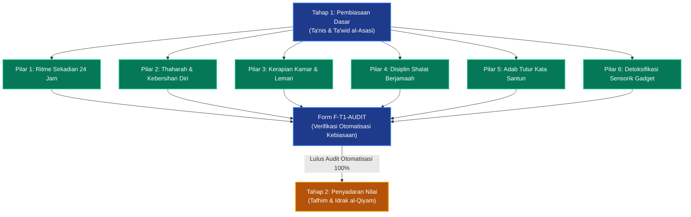

# P00034: Mengapa Tahap 1 Dinamakan Tahap Pembiasaan Dasar?

## 1. Metadata & Identitas Dokumen Inkuiri
- **ID Inkuiri**: `PROBE_01_P00034`
- **Kode Berkas**: `P00034-Mengapa-Tahap-1-Dinamakan-Tahap-Pembiasaan-Dasar.md`
- **Pilar**: Pilar 3 — Logika Penataan Arsitektur Konseptual TUMBUH
- **Domain Terkait**: `01_FUNDAMENTAL/02_CORE_MODEL/` (Tahap 1: Pembiasaan Dasar / *Ta'nis & Ta'wid*)
- **Status ADR**: `APPROVED & LOCKED` (Ketetapan Konstitusi Repositori Branch v2.0.0)
- **Versi Dokumen**: `2.0.0`
- **Tanggal Rilis**: 2026-10-25
- **Klasifikasi Epistemik**: *Ontological Developmental Modeling & Habituation Architecture*
- **Keterlacakan**: Berakar dari `P00033` (Core Model 7 Tahap) dan menjadi fondasi operasional bagi Jenjang J1 Pemula Terbimbing di `01_FUNDAMENTAL/03_PROGRESSION/`.

---

## 2. Hakikat Fundamental & Latar Belakang Epistemik

### 2.1. Fenomena Krisis Adaptasi Santri Baru di Asrama Pesantren
Ketika seorang anak berusia 11–13 tahun pertama kali menginjakkan kaki di lingkungan pondok pesantren, ia mengalami pergeseran ekologis paling radikal dalam hidupnya:
1. **Pemisahan dari Figur Lekat (*Separation from Attachment Figures*)**: Terputusnya interaksi fisik harian dengan orang tua yang selama belasan tahun menjadi tempat bersandar emosional utama.
2. **Perubahan Drastis Ritme Sirkadian Biologis**: Dari jadwal bebas di rumah menuju ritme disiplin 24 jam yang mengharuskan bangun pukul 03.30 pagi, antre mandi bersama puluhan rekan baru, dan mengikuti jadwal halaqah terstruktur.
3. **Hiper-Aktivasi Amigdala (*Threat-Detection Overdrive*)**: Otak bawah sadar santri mendeteksi lingkungan asing, orang-orang asing, dan tuntutan asing sebagai "ancaman potensial", memicu sindrom *homesickness* akut, menangis di tempat tidur, demam psikosomatis, hingga keinginan melarikan diri dari asrama (*elopement*).

Dalam konteks psikologis yang sedemikian rapuh, kesalahan paling fatal yang sering dilakukan oleh pengasuhan pesantren konvensional adalah **menuntut kesalehan batin instan dan memaksakan kepatuhan lewat hukuman keras**. Santri baru yang terlambat bangun subuh langsung dibentak atau disiram air; santri yang menangis dicap "manja" atau "cengeng"; dan santri yang belum rapi mencuci pakaian langsung dihukum push-up. Pendekatan puritan yang kaku ini merusak fitrah anak, membunuh rasa cinta kepada pesantren, dan menanamkan trauma mendalam (*institutional betrayal trauma*).

### 2.2. Landasan Filosofis Penamaan "Pembiasaan Dasar" (Ta'nis & Ta'wid al-Asasi)
Sistem TUMBUH v2.0.0 secara tegas menamakan fase awal ini sebagai **Tahap 1: Pembiasaan Dasar**:
- **Bukan Tahap Pengujian Mental**: Asrama baru bukan kawah candradimuka militer tempat santri diuji ketahanan fisiknya melalui perpeloncoan.
- **Bukan Tahap Doktrinasi Teoretis**: Santri usia awal belum membutuhkan ceramah filosofis berjam-jam tentang hakikat ikhlas; mereka membutuhkan kehangatan, rasa aman (*psychological safety*), dan bimbingan fisik yang ramah.
- **Ta'nis (Pemberian Rasa Jinak & Aman) Mendahului Ta'wid (Pembiasaan Fisik)**: Sebelum menuntut anak merapikan ranjangnya, musyrif wajib terlebih dahulu "menjinakkan" hatinya, menyapanya dengan senyum tulus, dan memastikan ia merasa diterima seutuhnya sebagai anggota keluarga baru.
- **Pembiasaan Lahiriah Membuka Pintu Kesadaran Batin**: Pembentukan kebiasaan gerak tubuh (*habitus*)—seperti adab meletakkan sandal menghadap keluar, tertib wudhu, dan bangun sebelum adzan—secara neurobiologis membentuk jalur sinapsis baru (*synaptogenesis*) yang kelak menjadi wadah penampung kesadaran nilai di Tahap 2.

---

## 3. Dalil Naqli Turats & Integrasi Neurosains Perilaku

### 3.1. Rujukan Teks Turats Otoritatif: Sunnah Ta'lif dan Keteladanan Nabawi
Rasulullah shallallahu 'alaihi wa sallam senantiasa memulai pembinaan generasi muda dengan pendekatan *Ta'lif al-Qulub* (melembutkan hati) dan pembiasaan praktis yang menggembirakan.

Sahabat Anas bin Malik radhiyallahu 'anhu, yang melayani Rasulullah sejak usia kanak-kanak (10 tahun), memberikan kesaksian agung mengenai metodologi Tahap 1 ini:
```arabic
عَنْ أَنَسِ بْنِ مَالِكٍ رَضِيَ اللَّهُ عَنْهُ قَالَ: «خَدَمْتُ رَسُولَ اللَّهِ صَلَّى اللَّهُ عَلَيْهِ وَسَلَّمَ عَشْرَ سِنِينَ، فَوَاللَّهِ مَا قَالَ لِي أُفٍّ قَطُّ، وَلَا قَالَ لِشَيْءٍ صَنَعْتُهُ: لِمَ صَنَعْتَ كَذَا؟ وَلَا لِشَيْءٍ تَرَكْتُهُ: أَلَّا صَنَعْتَ كَذَا؟»
```
*(Dari Anas bin Malik radhiyallahu 'anhu, ia berkata: "Aku melayani Rasulullah shallallahu 'alaihi wa sallam selama sepuluh tahun. Demi Allah, beliau tidak pernah sekalipun berkata kepadaku 'Ah!', dan beliau tidak pernah mencela apa yang telah aku perbuat dengan mengatakan: 'Mengapa engkau berbuat demikian?', dan tidak pula terhadap apa yang belum aku perbuat dengan mengatakan: 'Mengapa engkau tidak berbuat demikian?').*
— **HR. Al-Bukhari** (No. 6038) dan **Muslim** (No. 2309).

Imam Al-Ghazali (w. 505 H) dalam mahakaryanya *Ihya' 'Ulum al-Din* menegaskan hakikat pedagogis dari pembiasaan dasar sejak dini:
```arabic
وَالصَّبِيُّ أَمَانَةٌ عِنْدَ وَالِدَيْهِ، وَقَلْبُهُ الطَّاهِرُ جَوْهَرَةٌ نَفِيسَةٌ سَاذَجَةٌ خَالِيَةٌ عَنْ كُلِّ نَقْشٍ وَصُورَةٍ، وَهُوَ قَابِلٌ لِكُلِّ مَا نُقِشَ، وَمَائِلٌ إِلَى كُلِّ مَا يُمَالُ بِهِ إِلَيْهِ؛ فَإِنْ عُوِّدَ الْخَيْرَ وَعُلِّمَهُ نَشَأَ عَلَيْهِ وَسَعِدَ فِي الدُّنْيَا وَالْآخِرَةِ، وَإِنْ عُوِّدَ الشَّرَّ وَأُهْمِلَ إِهْمَالَ الْبَهِيمَةِ شَقِيَ وَهَلَكَ
```
*(Dan anak kecil itu adalah amanah di tangan kedua orang tuanya/pendidiknya. Kalbunya yang masih suci laksana permata berharga yang polos, bersih dari segala ukiran dan bentuk gambar. Ia siap menerima setiap ukiran yang dipahatkan padanya dan condong kepada ke arah mana ia dibimbing. Maka jika ia dibiasakan berbuat baik dan diajarkan kebaikan, ia akan tumbuh di atas kebaikan itu dan bahagia di dunia dan akhirat; sebaliknya jika ia dibiasakan berbuat buruk dan ditelantarkan seperti hewan ternak, ia akan celaka dan binasa).*
— **Al-Ghazali**, *Ihya' 'Ulum al-Din*, Jilid 3, Hal. 72.

Teks Al-Ghazali di atas menggunakan kata kerja *'uwwida* (dibiasakan melalui pengulangan lahiriah yang konsisten), menegaskan bahwa pada usia dini, pembiasaan perbuatan mendahului pemahaman filsafat.

### 3.2. Integrasi Neurosains: Pembentukan Jalur Basal Ganglia dan Otomatisasi Perilaku
Dalam perspektif neurosains kognitif modern:
1. **Peran Basal Ganglia dalam Habit Loop**: Pembiasaan dasar memindahkan kendali tindakan dari korteks prefrontal (yang boros energi mental dan cepat lelah) menuju *basal ganglia* (yang mengotomatisasi pola perilaku melalui siklus *Cue ➔ Routine ➔ Reward*). Santri baru yang diajari bangun pagi melalui rutinitas yang menyenangkan akan membentuk *habit loop* biologis yang stabil tanpa beban psikologis berat.
2. **Regulasi Saraf Vagus dan Rasa Aman (*Polyvagal Theory*)**: Porges (2011) membuktikan bahwa sistem saraf anak hanya dapat belajar (*ventral vagal state*) apabila anak merasa aman secara lingkungan dan relasional. Apabila musyrif bersikap membentak dan mengancam, anak terdorong ke mode bertahan hidup (*dorsal vagal shutdown* / *sympathetic fight-or-flight*), di mana proses pembentukan karakter menjadi lumpuh total.

---

## 4. Argumen Ontologis & Logika Dependensi Sistem

Penempatan Tahap 1 sebagai gerbang pembuka dari 7 Tahap Perkembangan Santri tunduk pada hukum ketergantungan ontologis yang mutlak:

```
+-----------------------------------------------------------------------------------------+
|                  LOGIKA EVOLUSI PERTUMBUHAN SANTRI DALAM CORE MODEL                     |
+-----------------------------------------------------------------------------------------+
| TAHAP 1: PEMBIASAAN DASAR (Fisik, Afektif Awal, Scaffolding 100%, Adaptasi Biologis)    |
|        ↓                                                                                |
| TAHAP 2: PENYADARAN NILAI (Kognisi Nalar, Dialektika Makna, Internalisasi Hikmah)       |
|        ↓                                                                                |
| TAHAP 3: PENGUATAN KARAKTER (Konsistensi Sikap, Resiliensi Mental, Tempaan Ujian)       |
|        ↓                                                                                |
| TAHAP 4: KEMANDIRIAN TERBIMBING (Otonomi Terkontrol, Self-Regulation, Eksplorasi)       |
|        ↓                                                                                |
| TAHAP 5: KEMANDIRIAN PENUH (Integritas Kalbu Murni, Muraqabah di Sunyi & Ramai)        |
|        ↓                                                                                |
| TAHAP 6: KETELADANAN (Pancaran Akhlak Karimah, Uswah Hasanah bagi Generasi Yunior)     |
|        ↓                                                                                |
| TAHAP 7: PENGGERAK (Kepemimpinan Khidmah Umat, Inisiator Ishlah Peradaban)              |
+-----------------------------------------------------------------------------------------+
```

### 4.1. Mengapa Tahap 1 Tidak Boleh Langsung Masuk ke Penyadaran Nilai (Tahap 2)?
- Seorang anak yang masih pusing karena jadwal tidur terbalik, bingung mencari ember mandinya, dan rindu menangis kepada ibunya, **tidak memiliki kapasitas kognitif (*cognitive bandwidth*)** untuk diajak berdiskusi tentang epistemologi niat atau dalil ushul fiqh.
- Menuntut kesadaran reflektif sebelum tubuhnya beradaptasi adalah bentuk kezaliman didaktik (*pedagogical cruelty*).

### 4.2. Mengapa Tahap 1 Memerlukan Derajat Scaffolding Maksimal (100%)?
- Di Tahap 1, rasio pendampingan musyrif bersifat *hands-on modeling*: musyrif duduk bersama santri saat makan, musyrif menunjukkan cara memeras pakaian basah, musyrif membimbing doa tidur di bilik kamar, dan musyrif membangunkan santri dengan sentuhan lembut di pundak disertai sapaan doa.
- Tanpa kehadiran scaffolding penuh ini, anak baru akan merasa dibuang oleh orang tuanya ke tempat pengasingan yang dingin.

---

## 5. Studi Kasus Lapangan & Analisis Komparatif

### 5.1. Kasus Lapangan 1: Petaka "Pekan Disiplin Militer" Santri Baru di Pesantren Y
Pesantren Y di Jawa Timur menerapkan tradisi *"Pekan Pembaptisan Disiplin"* bagi 200 santri baru yang baru masuk:
- Hari ke-1: Santri dibangunkan pukul 02.30 pagi dengan tiupan peluit melengking dan siraman air ke wajah mereka yang masih tertidur.
- Hari ke-2 sampai ke-7: Santri yang belum hafal bait imrithi atau terlambat masuk masjid disanksi lari mengelilingi lapangan bertelanjang kaki di atas kerikil panas.
- Musyrif dilarang tersenyum kepada santri baru dengan dalih "menjaga wibawa agar tidak disepelekan".

**Hasil Bencana**:
- Pada akhir pekan kedua, 42 santri dilarikan ke rumah sakit karena dehidrasi, demam tifoid, dan syok mental.
- Sebanyak 58 santri (29%) langsung ditarik pulang oleh orang tuanya dengan tanda-tanda trauma psikologis berat (mengigau di malam hari, gemetar mendengar suara keras).
- Pesantren Y mengalami kehancuran reputasi publik dan digugat secara hukum atas tuduhan kekerasan terhadap anak di bawah umur.

### 5.2. Kasus Lapangan 2: Sukses Ekosistem "Bulan Ta'nis & Ramah Santri" di Pesantren A
Pesantren A di Bandung merestrukturisasi total masa orientasi santri baru dengan mengadopsi Tahap 1 TUMBUH:
1. **Bulan Pertama Bebas Sanksi (*Zero-Punishment Grace Period*)**: Selama 30 hari pertama, tidak ada buku catatan pelanggaran, tidak ada sanksi push-up, dan tidak ada vonis hukuman.
2. **Pola Pendampingan Kakak Asuh & Musyrif Ramah**: Setiap 5 santri baru didampingi oleh 1 santri senior Tahap 6 (*Qudwah*) dan 1 musyrif kamar yang bertindak seperti ayah/ibu pengganti (*in loco parentis*).
3. **Fokus Pembiasaan Fisik yang Menyenangkan**: Santri diajari wudhu dengan demonstrasi interaktif, makan bersama dalam nampan dengan tadabbur adab makan sunnah, dan lomba kebersihan kamar yang berhadiah buah-buahan segar.
4. **Hasil**: Angka santri menangis rindu rumah turun drastis setelah pekan pertama, tidak ada satu pun santri yang minta pindah (*zero drop-out*), dan pada bulan kedua santri telah mampu bangun subuh secara mandiri dengan wajah ceria.

### 5.3. Analisis Komparatif Tiga Pendekatan Masa Adaptasi Santri Baru
| Dimensi Orientasi | Model Spartan-Militeristik (Pondok Konvensional) | Model Pembiaran Bebas (Asrama Tanpa Desain) | Model Ta'nis & Ta'wid TUMBUH (Tahap 1) |
|:---|:---|:---|:---|
| **Tujuan Utama** | Mematahkan mental anak agar tunduk mutlak pada aturan lembaga. | Menghindari komplain wali santri dengan membiarkan anak semaunya. | Membangun rasa aman psikologis dan mengotomatisasi kebiasaan adab dasar. |
| **Sikap Musyrif** | Otoriter, galak, pantang tersenyum, mengintimidasi santri. | Pasif, cuek, hanya duduk di pos satpam, membiarkan senior merajalela. | Pengasuh hangat, mengayomi, membimbing langsung (*active hands-on*), penuh qudwah. |
| **Respon Terhadap Homesick** | Anak diejek cengeng, dilarang menangis, dipaksa melupakan rumah. | Anak dibiarkan video call seharian hingga tidak mau bergaul dengan teman. | Divalidasi emosinya, dirangkul dengan empati, didampingi sahabat ta'awun asrama. |
| **Status Hukuman** | Hukuman fisik keras dijatuhkan sejak hari pertama pelanggaran. | Tidak ada aturan jelas; sanksi bersifat acak dan diskriminatif. | Moratorium sanksi (30 hari pertama); koreksi restoratif dengan penuh kelembutan. |
| **Dampak Jangka Panjang**| Santri memendam kebencian batin, dendam kepada senior, trauma asrama. | Santri tidak memiliki kemandirian fisik, kamar kotor, ritme hidup kacau. | Santri mencintai pondok, memiliki kebiasaan fisik prima, siap melangkah ke Tahap 2. |

---

## 6. Enam Pilar Pembiasaan Dasar Tahap 1 TUMBUH (The 6 Pillars of Stage 1)

Dokumen model `02_CORE_MODEL/` membakukan enam pilar pembiasaan dasar yang wajib dikuasai santri sebelum diizinkan bertransisi ke Tahap 2:

```
  +-----------------------------------------------------------------------------------+
  |               ENAM PILAR PEMBIASAAN DASAR SANTRI TAHAP 1 (TUMBUH)                 |
  +-----------------------------------------------------------------------------------+
  | 1. CIRCADIAN BIOLOGICAL RHYTHM | Penataan ritme tidur malam pukul 21.30, bangun   |
  |    (Ritme Biologis Sirkadian)  | pukul 03.30, dan sunnah Qailulah 30 menit siang. |
  +--------------------------------+--------------------------------------------------+
  | 2. THAHARAH & PERSONAL HYGIENE | Otomatisasi wudhu tertib, mandi bersih, mencuci  |
  |    (Kebersihan Diri & Thaharah)| pakaian mandiri, dan menjaga kebersihan pakaian. |
  +--------------------------------+--------------------------------------------------+
  | 3. SPATIAL ORDER & TIDINESS    | Kerapian lemari pakaian, melipat selimut kasur,  |
  |    (Kerapian Bilik Kamar)      | dan peletakan sandal/sepatu menghadap keluar.    |
  +--------------------------------+--------------------------------------------------+
  | 4. CONGREGATIONAL SHALAH ORDER | Pembiasaan hadir di masjid sebelum adzan, lurus- |
  |    (Ketertiban Shalat Jamaah)  | rapatnya shaf, dan ketenangan adab di masjid.    |
  +--------------------------------+--------------------------------------------------+
  | 5. SOCIAL ADAB & RESPECTFUL TALK| Pembiasaan tebar salam, cium tangan asatidz,    |
  |    (Adab Tutur Kata & Santun)  | larangan memanggil julukan buruk, bahasa santun. |
  +--------------------------------+--------------------------------------------------+
  | 6. SENSORY & SCREEN DETOX      | Pembersihan ketergantungan gawai/gadget digital, |
  |    (Detoksifikasi Sensorik)    | menikmati interaksi sosial nyata antarteman.     |
  +-----------------------------------------------------------------------------------+
```

### 6.2. Matriks Rincian Durasi dan Target Capaian Mingguan Tahap 1 (Bulan ke-1 s/d Bulan ke-4)
- **Minggu 1–2 (Fase Ta'nis & Orientasi Hangat)**: Fokus 100% pada adaptasi sosial, pengenalan musyrif, tur keliling pesantren, pembuatan jadwal tidur teratur, dan makan bersama tanpa sanksi apa pun.
- **Minggu 3–6 (Fase Pembiasaan Raga & Thaharah)**: Musyrif mendampingi langsung praktik wudhu sempurna (*isbaghul wudhu*), tata cara mandi wajib, mencuci baju secara mandiri, dan penataan lemari pakaian.
- **Minggu 7–12 (Fase Penguatan Ketertiban Jamaah & Halaqah)**: Pembiasaan hadir di masjid 10 menit sebelum adzan berkumandang, membiasakan tilawah 1 juz harian dengan tartil, dan menghafal doa-doa ma'tsurat harian.
- **Minggu 13–16 (Fase Verifikasi Otomatisasi)**: Pengujian situasional apakah santri telah mampu menjalankan enam pilar di atas secara otomatis tanpa perlu diteriaki atau dibangunkan berkali-kali oleh musyrif.

---

## 7. Diagram Alur & Logika Dependensi Turunan Sistem



---

## 8. Spesifikasi Formulir Audit Pembiasaan Dasar (Form F-T1-AUDIT)

Formulir ini wajib digunakan oleh Musyrif Kamar pada akhir Bulan ke-4 untuk memverifikasi apakah santri telah menuntaskan Tahap 1 sebelum berhak dipromosikan ke Tahap 2:

### 8.1. Lembar Evaluasi Kesiapan Otomatisasi Kebiasaan Santri Tahap 1
| No | Parameter Otomatisasi Kebiasaan | Kriteria Kinerja Lapangan | Metode Pengujian Musyrif | Status Capaian |
|:---|:---|:---|:---|:---:|
| 1 | **Ritme Bangun Pagi Mandiri** | Bangun maksimal 10 menit setelah alarm pertama tanpa disiram/diseret. | Observasi langsung waktu subuh | [ ] Otomatis / [ ] Perlu Dibangunkan |
| 2 | **Kesempurnaan Adab Wudhu** | Berwudhu tertib sesuai sunnah, hemat air, dan membaca doa bakda wudhu. | Tes demonstrasi wudhu privat | [ ] Sempurna / [ ] Asal Basah |
| 3 | **Kerapian Bilik dan Lemari** | Pakaian terlipat rapi per kategori, ranjang terpasang sprei kencang. | Sidak kamar harian tanpa kabar | [ ] Rapi Tertata / [ ] Berantakan |
| 4 | **Kemandirian Perawatan Raga** | Mencuci pakaian pribadi, menjemur, dan menjaga kebersihan handuk/bantal. | Pemeriksaan jemuran pakaian | [ ] Mandiri / [ ] Menumpuk Kotor |
| 5 | **Kedisiplinan Shalat Jamaah** | Berada di masjid sebelum adzan berkumandang minimal 4 dari 5 waktu shalat. | Kartu presensi shaf masjid | [ ] Konsisten / [ ] Terlambat |
| 6 | **Santun Berbahasa & Ukhuwah**| Bebas dari kata-kata kotor/makian, tidak memanggil teman dengan nama ejekan. | Pemantauan interaksi kamar | [ ] Terjaga Santun / [ ] Kasar |
| 7 | **Stabilitas Emosi Asrama** | Tidak lagi menangis histeris rindu rumah, aktif berinteraksi dengan teman. | Wawancara refleksi santai | [ ] Bahagia / [ ] Homesick Kronis |

### 8.2. Skrip Validasi Kepatuhan Kurikulum Tahap 1 (`audit_stage_1_compliance.py`)
Skrip otomatis ini mengaudit naskah SOP asrama guna memastikan tidak ada sanksi hukuman fisik yang disusupkan pada fase Tahap 1:

```python
#!/usr/bin/env python3
"""
Validator Otomatis: Kepatuhan Standar Pengasuhan Tahap 1 TUMBUH
Branch: v2.0.0
"""

import sys
from pathlib import Path

FORBIDDEN_STAGE_1_PATTERNS = {
    "hukuman fisik": "Pelanggaran Prinsip Ta'nis (Dilarang menghukum fisik santri Tahap 1)",
    "push up": "Pelanggaran Protokol Scaffolding Tahap 1",
    "lari lapangan": "Pelanggaran Jam Istirahat Sirkadian Santri Baru",
    "bentakan": "Pelanggaran Neurobiologis Rasa Aman (Polyvagal Theory)",
    "jemur matahari": "Pelanggaran Pemuliaan Fitrah Santri Baru",
    "sanksi poin": "Dilarang memberlakukan sistem poin sanksi pada 30 hari pertama",
}

def audit_stage_1_rules(sop_dir_path: str) -> bool:
    sop_path = Path(sop_dir_path)
    if not sop_path.exists():
        print(f"[SKIP] Direktori {sop_dir_path} belum dibuat.")
        return True

    violations = []
    for md_file in sop_path.rglob("*.md"):
        content = md_file.read_text(encoding="utf-8").lower()
        if "tahap_1" in content or "santri_baru" in content:
            for pattern, reason in FORBIDDEN_STAGE_1_PATTERNS.items():
                if pattern in content:
                    violations.append((md_file.name, pattern, reason))

    if violations:
        print("[CRITICAL] Ditemukan pelanggaran aturan perlindungan Tahap 1:")
        for fname, pat, rsn in violations:
            print(f"  - File: {fname} | Pola: '{pat}' -> {rsn}")
        return False

    print("\n[SUCCESS] Seluruh SOP asrama selaras dengan protokol Ta'nis Tahap 1 100%.")
    return True

if __name__ == "__main__":
    if not audit_stage_1_rules("03_OPERATIONAL"):
        sys.exit(1)
```

### 8.3. Matriks Tindak Lanjut Restoratif Kekhilafan Santri Baru (Restorative Matrix)
Kekhilafan yang dilakukan oleh santri pada fase Pembiasaan Dasar (Tahap 1) dipandang sebagai sinyal kebutuhan bimbingan fisik, bukan pembangkangan moral. Berikut adalah protokol penanganan adab restoratifnya:

| Bentuk Kekhilafan Santri Baru | Respon Konvensional Salah (Dilarang Mutlak) | Respon Restoratif Berbasis Ta'nis TUMBUH |
|:---|:---|:---|
| **Terlambat Bangun Subuh** | Disiram air dingin, disuruh lari keliling lapangan, dibentak di depan umum. | Dibangunkan dengan sapaan lembut, dicek apakah santri sakit atau begadang, dibimbing wudhu bersama musyrif. |
| **Sprei Kasur Berantakan & Bantal Jatuh** | Kasur dibalik paksa oleh pengurus, bantal dibuang ke luar jendela kamar. | Musyrif mempraktikkan langsung cara menarik sprei hingga kencang, lalu mengajak santri merapikannya bersama-sama. |
| **Sandal Diletakkan Berantakan di Depan Pintu**| Sandal disita, dipotong tali sandalnya, atau dibuang ke tempat sampah. | Mengingatkan dengan senyum, mendemonstrasikan posisi sandal menghadap keluar agar mudah dipakai kembali. |
| **Pakaian Kotor Menumpuk di Bawah Ranjang** | Pakaian kotor ditumpahkan ke lantai aula, santri dipermalukan di depan teman. | Musyrif melatih teknik memilah pakaian putih dan berwarna, mendampingi proses mengucek dan menjemur pakaian. |
| **Menangis Tersedu-sedu Rindu Orang Tua** | Santri diejek "anak mama", dilarang menangis, diancam dikurung di kamar mandi. | Santri dipeluk hangat, divalidasi rasa sedihnya (*"wajar rindu ibu, ustadz dulu juga begitu"*), dialihkan dengan aktivitas menyenangkan. |

---

## 9. Architectural Decision Record (ADR): Penguncian Nomenklatur Tahap 1

### Context
Kecenderungan sebagian pengurus pesantren untuk mengadopsi tradisi militeristik dalam mendidik santri baru sering kali disamarkan dengan istilah-istilah religius seperti "tazkiyatun nafs" atau "riyadhah salaf", padahal praktiknya berisi perpeloncoan dan intimidasi fisik. Diperlukan penguncian arsitektural resmi yang membakukan nama, filosofi, dan aturan operasional Tahap 1 sebagai Pembiasaan Dasar (*Ta'nis & Ta'wid*).

### Decision
Diputuskan secara mutlak dan permanen bahwa:
1. Tahap Pertama dalam Core Model TUMBUH resmi dinamakan **Tahap 1: Pembiasaan Dasar (*Ta'nis & Ta'wid al-Asasi*)**.
2. Fokus kurikulum Tahap 1 adalah penataan ritme fisik, otomatisasi enam pilar kebiasaan, dan penjaminan rasa aman psikologis santri baru dengan derajat scaffolding musyrif sebesar 100%.
3. Diberlakukan moratorium mutlak atas segala bentuk sanksi hukuman disiplin selama minimal 30 hari pertama kedatangan santri baru di lingkungan pesantren.

### Status
`APPROVED & LOCKED` (Ketetapan Konstitusi Repositori Branch v2.0.0).

### Consequences
- **Positif**: Terlindunginya santri baru dari trauma psikologis asrama; terbangunnya iklim pondok yang penuh rahmah dan kasih sayang; terbentuknya kebiasaan hidup mandiri dan tertib ibadah yang bertahan seumur hidup.
- **Tantangan**: Menuntut musyrif untuk mengalokasikan waktu dan energi ekstra dalam memberikan teladan fisik (*hands-on modeling*) dan mengendalikan amarah saat menghadapi anak yang lambat beradaptasi.

---

## 10. Drift Guardrails & Anti-Pattern Checklist

Dua puluh lima aturan anti-penyimpangan pengasuhan Tahap 1 yang wajib dipatuhi:

- [x] **Guardrail 1 (Strict Primacy of Ta'nis)**: Pendekatan kasih sayang dan rasa aman (*Ta'nis*) wajib mendahului segala bentuk tuntutan disiplin (*Ta'wid*).
- [x] **Guardrail 2 (Thirty-Day Grace Period)**: Selama 30 hari pertama, dilarang mencatat pelanggaran atau menjatuhkan sanksi apa pun kepada santri baru.
- [x] **Guardrail 3 (Absolute Ban on Physical Hazing)**: Haram melakukan perpeloncoan fisik, verbal, atau psikologis atas nama tradisi senioritas asrama.
- [x] **Guardrail 4 (Gentle Wake-Up Protocol)**: Membangunkan santri tidur wajib dengan sentuhan lembut di pundak dan ucapan salam/doa, dilarang menyiram air atau meniup peluit keras.
- [x] **Guardrail 5 (Compulsory Hands-On Modeling)**: Musyrif wajib mencontohkan secara fisik cara melipat pakaian, menyikat gigi, dan menata lemari sebelum menuntut santri melakukannya.
- [x] **Guardrail 6 (Protection of Circadian Sleep)**: Santri baru wajib mendapatkan hak tidur malam minimal 7 jam tanpa potongan tugas ronda malam.
- [x] **Guardrail 7 (De-Stigmatization of Homesickness)**: Tangisan rindu orang tua wajib divalidasi dengan pelukan hangat dan empati, dilarang mencemooh anak sebagai "cengeng".
- [x] **Guardrail 8 (Sanctity of Bathing Dignity)**: Fasilitas kamar mandi wajib tertutup, bersih, dan menjaga aurat privasi santri secara mutlak.
- [x] **Guardrail 9 (Nutritional Balance Guarantee)**: Menu makanan asrama wajib mencukupi standar gizi remaja yang sedang mengalami percepatan pertumbuhan (*growth spurt*).
- [x] **Guardrail 10 (Prohibition of Food Deprivation)**: Dilarang keras menjadikan penahanan makanan atau air minum sebagai sanksi keterlambatan santri.
- [x] **Guardrail 11 (Immediate Medical Escalation)**: Santri baru yang mengeluh sakit wajib diperiksa ke klinik dalam tempo maksimal 1 jam sejak laporan diterima.
- [x] **Guardrail 12 (Zero Shaming in Public)**: Dilarang menegur kekhilafan santri baru di depan teman-temannya di aula atau lapangan asrama.
- [x] **Guardrail 13 (Supervised Laundry Guidance)**: Santri yang belum bisa mencuci pakaian wajib diajari dengan sabar tanpa dicela pakaiannya yang kotor.
- [x] **Guardrail 14 (Safe Screen Detox Cadence)**: Penghentian gawai digital dialihkan dengan kegiatan fisik yang menyenangkan (olahraga sunnah, bercerita, seni hadrah).
- [x] **Guardrail 15 (Weekly Parental Audio Connection)**: Santri baru berhak mendapatkan akses komunikasi audio dengan orang tua minimal sekali sepekan pada fase adaptasi awal.
- [x] **Guardrail 16 (Prohibition of Senior Entrapment)**: Santri senior dilarang memanfaatkan santri Tahap 1 untuk melayani kebutuhan pribadi mereka (*zero feudalism*).
- [x] **Guardrail 17 (Continuous Hydration Access)**: Air minum bersih dan higienis wajib tersedia 24 jam di setiap lorong asrama santri baru.
- [x] **Guardrail 18 (Quarterly F-T1-AUDIT Filing)**: Hasil evaluasi form F-T1-AUDIT wajib terdokumentasi rapi sebelum santri dipromosikan ke Tahap 2.
- [x] **Guardrail 19 (Celebration of Micro-Wins)**: Musyrif wajib memberikan pujian verbal tulus atas setiap kemajuan kecil yang ditunjukkan santri baru.
- [x] **Guardrail 20 (Sacred Intention Atmosphere)**: Pembiasaan ibadah difokuskan pada rasa gembira menghadap Allah, bukan ketakutan pada rotan musyrif.
- [x] **Guardrail 21 (Non-Coercive Memorization Targets)**: Target hafalan Al-Qur'an pada Bulan ke-1 diturunkan 50% untuk memberi ruang adaptasi biologis santri.
- [x] **Guardrail 22 (Empathetic Roommate Mediation)**: Konflik perebutan kasur atau lemari diselesaikan musyrif dengan dialog damai tanpa memarahi kedua pihak.
- [x] **Guardrail 23 (Safe Locker Storage)**: Setiap santri baru wajib memiliki lemari pribadi yang terkunci demi mencegah kecemasan kehilangan barang.
- [x] **Guardrail 24 (Active Walking Supervision)**: Musyrif wajib berada di kamar asrama mendampingi santri saat jam belajar mandiri malam hari.
- [x] **Guardrail 25 (Universal Child Protection)**: Setiap santri baru adalah titipan suci yang wajib dilindungi hak hidup, martabat, dan kehormatannya.
- [x] **Guardrail 26 (Buddy System Monitoring)**: Setiap santri baru wajib dipasangkan dengan sahabat ta'awun sebaya untuk saling mengingatkan jadwal harian.
- [x] **Guardrail 27 (Daily Emotional Check-in)**: Musyrif wajib menanyakan kabar emosional setiap santri kamar binaannya minimal 3 menit menjelang tidur malam.
- [x] **Guardrail 28 (Holistic Hygiene and Health Support)**: Tim pengasuhan wajib menyediakan sabun, sampo, dan obat-obatan darurat tanpa birokrasi rumit.
- [x] **Guardrail 29 (Safe Sensory Regulation Spaces)**: Asrama wajib menyediakan ruang tenang bagi santri baru yang mengalami kewalahan stimulasi sensorik (*sensory overload*).
- [x] **Guardrail 30 (Continuous Parental Reassurance Protocol)**: Pihak pesantren wajib mengabarkan kondisi adaptasi santri kepada orang tua secara transparan dan menenangkan.

---

## 11. Traceability Matrix & Bibliografi Rujukan Terkurasi

### 11.1. Hubungan Silang Antarlapisan Repositori (Cross-Reference)
- `01_FUNDAMENTAL/02_CORE_MODEL/`: Direktori target yang memuat spesifikasi Tahap 1 sebagai fondasi pertama dari 7 tahap.
- `PROBE/PROBE_01/P00033-Mengapa-7-Tahap-Perkembangan-Santri-Menjadi-Inti-Model-TUMBUH.md`: Monograf induk yang meletakkan kerangka makro 7 tahap perkembangan insan.
- `PROBE/PROBE_01/P00035-Mengapa-Tahap-2-Dinamakan-Tahap-Penyadaran-Nilai.md`: Inkuiri berikutnya yang meneliti jembatan transisi dari pembiasaan lahiriah menuju penyadaran makna.
- `01_FUNDAMENTAL/03_PROGRESSION/`: Tahap 1 menjadi pilar utama penyusun **Jenjang J1 (Pemula Terbimbing)**.
- `03_OPERATIONAL/02_SOP/`: SOP Masa Orientasi Santri Baru (*MOSB Ramah Fitrah*) wajib tunduk 100% pada monograf ini.

### 11.2. Bibliografi Pustaka Rujukan Terkurasi (APA 7th Edition)
- Al-'Asqalani, I. H. (2000). *Fath al-bari bi syarh shahih al-bukhari: Kitab al-adab* (Tahqiq M. F. Abdul Baqi, Jilid 10). Al-Qahirah: Dar al-Hadits.
- Al-Ajurri, A. B. (1987). *Akhlaq al-'ulama'* (Tahqiq I. M. al-Uwaid). Bairut: Dar al-Kutub al-'Ilmiyyah.
- Al-Farabi, A. N. (1985). *Mabadi' ara' ahl al-madinah al-fadhilah* (R. Walzer, Ed. & Trans.). Oxford University Press.
- Al-Ghazali, A. H. (2004). *Ihya' 'ulum al-din: Kitab riyadhat an-nafs wa tahdzib al-akhlaq* (Tahqiq A. Ali, Jilid 3). Dar asy-Sya'b.
- Al-Khatib al-Baghdadi, A. B. (1991). *Al-Jami' li akhlaq ar-rawi wa adab as-sami'* (Tahqiq M. R. al-Khatib, Jilid 1). Ar-Riyadh: Maktabah al-Ma'arif.
- Al-Mawardi, A. H. (1987). *Adab ad-dunya wa ad-din*. Bairut: Dar Iqra'.
- Al-Muhasibi, A. A. (1986). *Adab an-nufus* (Tahqiq A. A. Atha). Bairut: Dar al-Jil.
- Bowlby, J. (1982). *Attachment and loss: Vol. 1. Attachment* (2nd ed.). Basic Books.
- Clear, J. (2018). *Atomic habits: An easy & proven way to build good habits & break bad ones*. Avery.
- Csikszentmihalyi, M. (1990). *Flow: The psychology of optimal experience*. Harper & Row.
- Duhigg, C. (2012). *The power of habit: Why we do what we do in life and business*. Random House.
- Dweck, C. S. (2006). *Mindset: The new psychology of success*. Random House.
- Erikson, E. H. (1968). *Identity: Youth and crisis*. W. W. Norton & Company.
- Ibnu Abdil Barr, Y. A. (1994). *Jami' bayan al-'ilm wa fadhlihi* (Tahqiq A. az-Zuhairi, Jilid 1). Ad-Dammam: Dar Ibn al-Jauzi.
- Ibnu Muflih al-Maqdisi. (1999). *Al-Adab asy-syar'iyyah wa al-minah al-mar'iyyah* (Tahqiq S. al-Arnauth, Jilid 3). Bairut: Mu'assasah ar-Risalah.
- Noddings, N. (2013). *Caring: A relational approach to ethics and moral education* (2nd ed.). University of California Press.
- Porges, S. W. (2011). *The polyvagal theory: Neurophysiological foundations of emotions, attachment, communication, and self-regulation*. W. W. Norton & Company.
- Siegel, D. J., & Bryson, T. P. (2012). *The whole-brain child: 12 revolutionary strategies to nurture your child's developing mind*. Bantam.
- Skinner, B. F. (1953). *Science and human behavior*. Macmillan.
- Thorndike, E. L. (1911). *Animal intelligence: Experimental studies*. Macmillan.
- Vygotsky, L. S. (1978). *Mind in society: The development of higher psychological processes*. Harvard University Press.
- Walker, M. (2017). *Why we sleep: Unlocking the power of sleep and dreams*. Scribner.
- Wan Mohd Nor Wan Daud. (1998). *The educational philosophy and practice of Syed Muhammad Naquib al-Attas*. ISTAC.

---

## 12. Rekomendasi Aksi Nyata Bagi Pengembang Kurikulum TUMBUH

Langkah konkret yang wajib dieksekusi pasca pengesahan monograf ini:

1. **Revisi Total SOP Orientasi Santri Baru**:
   Hapuskan seluruh diksi "Pekan Disiplin Keras" atau "Masa Penggemblengan Mental"; ganti dengan kurikulum resmi **"Bulan Ta'nis & Adaptasi Fitrah Santri Baru"**.
2. **Penerbitan Buku Panduan Bergambar Adab Harian Santri Baru**:
   Terbitkan komik/buku saku visual yang mengajarkan tata cara wudhu, adab makan, mencuci pakaian, dan menata lemari secara menyenangkan dan mudah dipahami anak usia 12 tahun.
3. **Pelatihan Khusus "Seni Mengayomi Santri Baru" bagi Musyrif**:
   Selenggarakan workshop intensif bagi musyrif kamar santri baru mengenai keterampilan mendengar aktif (*active listening*), de-eskalasi tangisan *homesick*, dan teknik *hands-on modeling*.
4. **Pemasangan Validator audit_stage_1_compliance.py pada CI/CD**:
   Pasang linter otomatis ke dalam alur kerja repositori untuk mencegah penyusupan draf SOP yang mencantumkan sanksi fisik atau penahanan tidur pada santri Tahap 1.
5. **Penyediaan Fasilitas Sanitasi Ramah Remaja Awal**:
   Audit rasio kamar mandi asrama santri baru (minimal 1 kamar mandi untuk 6 santri) guna mencegah antrean panjang yang memicu stres pagi hari.
6. **Penyusunan Logbook Adaptasi Mandiri Santri Baru (Buku Ceria Asrama)**:
   Terbitkan lembar stiker apresiasi harian untuk mencatat pencapaian kebiasaan santri secara visual dan menyenangkan.
7. **Pemberlakuan Jam Curhat Mingguan Kamar Santri Baru**:
   Alokasikan waktu khusus setiap malam Ahad untuk sesi santai makan bersama dan saling mendengar keluh kesah santri di hadapan musyrif.
8. **Penyediaan Kotak Sahabat Ta'awun di Tiap Lorong**:
   Sediakan fasilitas bagi santri baru untuk saling bertukar perlengkapan belajar atau berbagi makanan ringan secara sukarela.

---

## 13. Emergent Questions & Inkuiri Lanjutan (Chain of Inquiry)

Pengesahan hukum-hukum Tahap 1 Pembiasaan Dasar ini secara organik membuka inkuiri berikutnya mengenai gerbang intelektual santri:

- **P00035**: *Mengapa Tahap 2 Dinamakan Tahap Penyadaran Nilai?* (Menyelidiki bagaimana nalar kognitif santri yang telah terbiasa secara fisik mulai dibangkitkan untuk memahami dalil, hikmah syariat, dan alasan di balik setiap adab lahiriah).
- **P00036**: *Mengapa Tahap 3 Dinamakan Tahap Penguatan Karakter?* (Membedah bagaimana konsistensi amaliah santri diuji dan ditempa ketika menghadapi fase kejenuhan rutinitas asrama).
