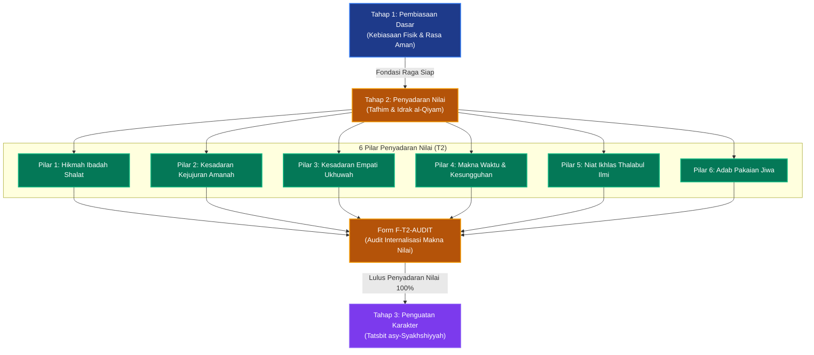

# P00035: Mengapa Tahap 2 Dinamakan Tahap Penyadaran Nilai?

## 1. Metadata & Identitas Dokumen Inkuiri
- **ID Inkuiri**: `PROBE_01_P00035`
- **Kode Berkas**: `P00035-Mengapa-Tahap-2-Dinamakan-Tahap-Penyadaran-Nilai.md`
- **Pilar**: Pilar 3 — Logika Penataan Arsitektur Konseptual TUMBUH
- **Domain Terkait**: `01_FUNDAMENTAL/02_CORE_MODEL/` (Tahap 2: Penyadaran Nilai / *Tafhim & Idrak al-Qiyam*)
- **Status ADR**: `APPROVED & LOCKED` (Ketetapan Konstitusi Repositori Branch v2.0.0)
- **Versi Dokumen**: `2.0.0`
- **Tanggal Rilis**: 2026-10-25
- **Klasifikasi Epistemik**: *Cognitive Dialectics & Value Internalization Architecture*
- **Keterlacakan**: Berkelanjutan langsung dari `P00034` (Tahap 1 Pembiasaan Dasar) dan menjadi pilar kedua dalam menyusun Jenjang J1 Pemula Terbimbing di `01_FUNDAMENTAL/03_PROGRESSION/`.

---

## 2. Hakikat Fundamental & Latar Belakang Epistemik

### 2.1. Bahaya "Robotisasi Karakter" dalam Pembiasaan Tanpa Kesadaran
Dalam dunia pendidikan asrama, pembiasaan fisik (*habituation*) yang berhasil di Tahap 1 menyimpan satu risiko patologis tersembunyi apabila tidak segera dievolusikan ke tahap berikutnya: **mekanisasi perilaku tanpa kalbu (*character robotization*)**.

Santri yang telah terbiasa bangun pukul 03.30 pagi, merapikan kasur, dan berbaris rapi di shaf terdepan masjid dapat dengan mudah terjebak dalam kepatuhan mekanis (*conditioned reflex* murni). Mereka melakukan seluruh rangkaian ibadah dan adab bukan karena memahami keagungan Allah atau mencintai kebaikan, melainkan semata-mata karena:
1. Terkondisikan oleh bunyi lonceng asrama seperti anjing dalam eksperimen Pavlov.
2. Takut dicatat poin pelanggarannya oleh tim keamanan santri.
3. Meniru teman sekamar secara buta (*taqlid amali*).

Tragedi ini meledak ketika santri pulang ke rumah saat liburan semester atau lulus dari pondok pesantren: seluruh rutinitas shalat malam, tilawah Al-Qur'an, dan adab sopan santun runtuh seketika dalam hitungan hari. Santri langsung kembali kecanduan gawai, meninggalkan shalat berjamaah, dan membangkang kepada orang tua. Fenomena ini membuktikan bahwa **perilaku yang hanya berhenti pada pembiasaan raga tanpa disertai penyadaran nilai batin adalah kepatuhan semu yang rapuh (*superficial compliance*)**.

### 2.2. Landasan Filosofis Penamaan "Penyadaran Nilai" (Tafhim & Idrak al-Qiyam)
Sistem TUMBUH v2.0.0 secara terencana menamakan fase kedua ini sebagai **Tahap 2: Penyadaran Nilai**:
- **Aktivasi Akal Sehat (*I'mal al-'Aql*)**: Santri yang raganya telah tenang dan terbiasa dengan ritme asrama kini diajak menyalakan daya nalarnya untuk memahami *alasan* (*al-'illah wa al-hikmah*) di balik setiap tata tertib.
- **Transisi dari "Bagaimana" (*How*) Menuju "Mengapa" (*Why*)**: Jika di Tahap 1 pertanyaannya adalah *"Bagaimana cara melipat pakaian dan wudhu yang tertib?"*, maka di Tahap 2 fokus beralih menjadi *"Mengapa Islam memerintahkan kesucian thaharah sebelum bermunajat kepada Allah?"* dan *"Mengapa menjaga kerapian kamar adalah cerminan keimanan batin?"*.
- **Penyadaran Nilai Membangun Jangkar Kalbu**: Penyadaran nilai mengubah adab lahiriah dari "beban aturan yang menindas" menjadi "kebutuhan jiwa yang dirindukan" (*internal desire*). Nilai yang telah disadari secara rasional dan spiritual akan mengakar kuat di dalam sanubari, sehingga tetap tegak kokoh meskipun tidak ada lagi musyrif atau pengawas yang melihat.

---

## 3. Dalil Naqli Turats & Integrasi Psikologi Kognitif

### 3.1. Rujukan Teks Turats Otoritatif: Perintah Menggapai Pemahaman Mendalam (Tafaqquh)
Al-Qur'an dan As-Sunnah secara tegas mencela kepatuhan buta yang hampa dari pemahaman nilai. Allah Ta'ala berfirman:

```arabic
أَفَلَا يَتَدَبَّرُونَ الْقُرْآنَ أَمْ عَلَى قُلُوبٍ أَقْفَالُهَا
```
*(Maka apakah mereka tidak mentadabburi [merenungkan makna] Al-Qur'an ataukah kalbu mereka telah terkunci rapat?).*
— **QS. Muhammad [47]: 24**.

Rasulullah shallallahu 'alaihi wa sallam juga menegaskan bahwa kebaikan sejati yang dikehendaki Allah bagi seorang hamba diukur dari pemahaman mendalamnya (*tafaqquh*), bukan sekadar banyaknya hafalan mekanis:

```arabic
عَنْ مُعَاوِيَةَ بْنِ أَبِي سُفْيَانَ رَضِيَ اللَّهُ عَنْهُمَا قَالَ: سَمِعْتُ رَسُولَ اللَّهِ صَلَّى اللَّهُ عَلَيْهِ وَسَلَّمَ يَقُولُ: «مَنْ يُرِدِ اللَّهُ بِهِ خَيْرًا يُفَقِّهْهُ فِي الدِّينِ»
```
*(Dari Mu'awiyah bin Abi Sufyan radhiyallahu 'anhuma, ia berkata: Aku mendengar Rasulullah shallallahu 'alaihi wa sallam bersabda: "Barangsiapa yang Allah kehendaki kebaikan baginya, niscaya Allah fahamkan ia secara mendalam dalam urusan agamanya").*
— **HR. Al-Bukhari** (No. 71) dan **Muslim** (No. 1037).

Imam Az-Zarnuji (w. 620 H) dalam kitab monumentalnya *Ta'lim al-Muta'allim Thariq at-Ta'allum* menjelaskan bahaya belajar dan beramal tanpa pemahaman nilai:
```arabic
وَكَمْ مِنْ مُتَعَبِّدٍ جَاهِلٍ بِمَعَانِي عِبَادَتِهِ يَتْعَبُ بَدَنُهُ وَلَا يَصِحُّ لَهُ عَمَلُهُ، وَإِنَّمَا قِوَامُ التَّأَدُّبِ مَعْرِفَةُ الْحِكْمَةِ الَّتِي أُسِّسَ عَلَيْهَا الْأَدَبُ؛ فَإِذَا عَرَفَ التِّلْمِيذُ مَعْنَى مَا يَفْعَلُ، أَقْبَلَ عَلَيْهِ بِقَلْبِهِ وَصَارَ الْأَدَبُ لَهُ طَبْعًا لَا تَكَلُّفًا
```
*(Betapa banyak orang yang beribadah namun bodoh terhadap makna-makna ibadahnya; badannya lelah namun amalnya tidak bernilai sempurna. Sesungguhnya tegaknya adab itu bergantung pada pengetahuan tentang hikmah yang mendasarinya. Apabila murid telah mengetahui makna di balik apa yang ia perbuat, niscaya ia akan melaksanakannya dengan segenap kalbunya, sehingga adab itu menjadi watak alaminya, bukan lagi kepura-puraan yang dipaksakan).*
— **Az-Zarnuji**, *Ta'lim al-Muta'allim Thariq at-Ta'allum*, Hal. 14.

### 3.2. Integrasi Teori Perkembangan Moral dan Internalisasi Nilai
Dalam sains psikologi perkembangan moral dan neurokognisi:
1. **Teori Internalisasi Nilai (Deci & Ryan's Self-Determination Theory)**: Tahap 2 mewakili pergeseran krusial dari *External Regulation* (patuh demi hadiah/takut sanksi) menuju *Identified Regulation* (santri menerima perilaku karena secara sadar menganggap nilai tersebut penting bagi jati dirinya). Penyadaran nilai mengubah regulasi eksternal menjadi motivasi otonom.
2. **Kohlberg's Moral Reasoning Transition**: Pada usia 12–14 tahun, anak bertransisi dari *Stage 1 (Obedience & Punishment)* menuju *Stage 3 (Interpersonal Concordance & Mutual Understanding)*. Santri mulai peduli pada alasan logis di balik peraturan sosial dan dampak perilakunya terhadap kenyamanan orang lain.
3. **Dialektika Sokrates & Pendidikan Kritis Paulo Freire**: Penyadaran nilai tidak dapat dicapai melalui instruksi satu arah (*banking model of education*). Ia menuntut metode dialog reflektif (*dialogical inquiry*), di mana pendidik memfasilitasi santri untuk berpikir, bertanya, dan menyimpulkan nilai secara mandiri.

---

## 4. Argumen Ontologis & Logika Dependensi Sistem

Penempatan Tahap 2 tepat setelah Tahap 1 dan tepat sebelum Tahap 3 mengikuti hukum kesinambungan perkembangan jiwa yang runtut:

```
+-----------------------------------------------------------------------------------------+
|                  LOGIKA DEPENDENSI SEKUANSIAL CORE MODEL (T1 -> T2 -> T3)               |
+-----------------------------------------------------------------------------------------+
| TAHAP 1: PEMBIASAAN DASAR (Fisik stabil, rasa aman tercipta, ritme biologis terbentuk)  |
|        ↓                                                                                |
| TAHAP 2: PENYADARAN NILAI (Akal diaktivasi, hikmah dipahami, nilai diinternalisasi)     |
|        ↓                                                                                |
| TAHAP 3: PENGUATAN KARAKTER (Konsistensi diuji dalam realitas krisis & masa jenuh)      |
+-----------------------------------------------------------------------------------------+
```

### 4.1. Mengapa Penyadaran Nilai Tidak Bisa Mendahului Pembiasaan Dasar?
- Jika santri langsung dijejali wacana kesadaran nilai di hari pertama kedatangannya (tanpa melalui Tahap 1), otak santri yang sedang mengalami stres akut *homesick* tidak akan mampu menyerapnya (*cognitive overload*).
- Kebiasaan fisik di Tahap 1 berfungsi sebagai **wadah wadag (*al-ina' al-jasadi*)**, sementara kesadaran nilai di Tahap 2 adalah **isi ruhani (*al-ma'na ar-ruhi*)**. Menuangkan air ke dalam wadah yang belum terbentuk hanya akan menumpahkannya ke tanah.

### 4.2. Mengapa Penyadaran Nilai Harus Diletakkan Sebelum Penguatan Karakter (Tahap 3)?
- Tahap 3 adalah fase penempaan konsistensi di tengah badai kejenuhan (*futur*).
- Jika seorang santri tidak memiliki pemahaman nilai yang kokoh di dadanya, maka begitu ia diterpa ujian kejenuhan hafalan atau konflik sebaya di Tahap 3, ia akan langsung patah semangat dan kabur, karena ia tidak tahu *untuk apa* ia harus bertahan dan berjuang.

---

## 5. Studi Kasus Lapangan & Analisis Komparatif

### 5.1. Kasus Lapangan 1: Fenomena "Santri Bermuka Dua" di Pesantren E
Pesantren E di Jawa Tengah memiliki sistem kedisiplinan yang sangat ketat: santri berbaris rapi, shalat jamaah tidak pernah masbuq, dan hafalan mutun tuntas tepat waktu. Namun, lembaga ini menerapkan prinsip dogmatis mutlak: santri dilarang bertanya, dilarang mendiskusikan aturan, dan wajib mematuhi seluruh perintah asatidz tanpa bantahan (*"Sami'na wa atha'na tanpa nalar"*).

**Temuan Evaluasi Independen**:
- Ketika santri berada di luar pantauan asatidz (di balik tembok asrama atau saat liburan), 78% santri mengaku merokok secara sembunyi-sembunyi, menonton video terlarang di warnet, dan mengejek kiai mereka di grup media sosial privat.
- Santri mengalami fenomena kepribadian ganda (*split personality*): santun di hadapan ustadz demi mencari aman, namun liar dan memberontak di belakang.
- **Akar Masalah**: Pesantren E melompati Tahap 2; mereka memaksakan pembiasaan fisik tanpa pernah menyadarkan nilai kalbu santri.

### 5.2. Kasus Lapangan 2: Keberhasilan Transformasi "Halaqah Tadabbur Hikmah" di Pesantren R
Pesantren R di Yogyakarta menerapkan kurikulum Tahap 2 TUMBUH secara sistematis pada santri semester kedua (Bulan ke-5 s/d Bulan ke-8):
1. **Transformasi Halaqah Malam Menjadi Forum Diskusi Hikmah**: Dua kali sepekan bakda Isya, halaqah asrama diisi bukan dengan ceramah searah, melainkan bedah nilai interaktif: *"Mengapa kita harus jujur saat ujian tahfidz meski tidak ada yang melihat?"*, *"Apa hikmah di balik larangan ghibah bagi kedamaian kamar kita?"*.
2. **Keterbukaan Menerima Pertanyaan Kritis**: Santri diberi ruang aman (*safe inquiry space*) untuk bertanya tanpa takut dihakimi, termasuk pertanyaan seputar keraguan iman, masalah keadilan takdir, dan fungsi syariat.
3. **Hasil Terukur**: Angka pelanggaran sembunyi-sembunyi turun 86%, santri mampu menjelaskan nilai-nilai adab dengan bahasa mereka sendiri, dan ketika liburan semester tiba, 94% orang tua santri melaporkan bahwa anak-anak mereka tetap shalat berjamaah di masjid rumah atas inisiatif sendiri.

### 5.3. Analisis Komparatif Tiga Pendekatan Transformasi Nilai
| Dimensi Transformasi | Model Indoktrinasi Dogmatis (Kepatuhan Buta) | Model Sekuler-Rasionalistik (Bebas Nilai) | Model Penyadaran Nilai TUMBUH (Tahap 2) |
|:---|:---|:---|:---|
| **Metode Penanaman** | Ceramah doktrin satu arah; tabu bertanya kritis (*sami'na wa atha'na* buta). | Debat rasional bebas tanpa pijakan wahyu; nilai bersifat relatif. | *Hiwar Ta'limi* (dialog sokratik Islami) berakar pada wahyu dan nalar sehat. |
| **Status Pertanyaan Kritis**| Dianggap tanda lemah iman, kurang ajar, atau dirasuki bisikan setan. | Dirayakan tanpa batas hingga meragukan kebenaran aqidah pokok. | Diakomodasi sebagai pintu gerbang menuju keimanan mendalam (*Tafaqquh*). |
| **Peran Musyrif** | Jaksa penuntut yang mendikte dogma dan memvonis kesalahan logika. | Fasilitator netral yang tidak peduli pada komitmen aqidah santri. | *Murabbi Hikmah* yang sabar mengurai keraguan dan membimbing kesadaran batin. |
| **Karakter Kepatuhan** | Kepatuhan semu (*nifaq amali*); rapuh saat berada di luar kontrol otoritas. | Kepatuhan situasional berbasis kontrak sosial kalkulatif untung-rugi. | Kepatuhan intrinsik berbasis *Muraqabatullah* dan kecintaan pada adab syariat. |

---

## 6. Enam Pilar Penyadaran Nilai Tahap 2 TUMBUH (The 6 Pillars of Stage 2)

Dokumen model `02_CORE_MODEL/` membakukan enam pilar penyadaran nilai yang wajib dicapai santri di Tahap 2:

```
  +-----------------------------------------------------------------------------------+
  |               ENAM PILAR PENYADARAN NILAI SANTRI TAHAP 2 (TUMBUH)                 |
  +-----------------------------------------------------------------------------------+
  | 1. MAQASHID & HIKMAH SHALAH    | Memahami makna bacaan shalat, khusyu', dan       |
  |    (Hikmah & Makna Ibadah)     | dampak shalat dalam mencegah perbuatan keji/munkar|
  +--------------------------------+--------------------------------------------------+
  | 2. SANCTITY OF TRUTH & AMANAH  | Menyadari kehinaan dusta, bahaya riya', dan      |
  |    (Kesadaran Kejujuran Jiwa)  | indahnya kejujuran di kala sendirian di kamar.   |
  +--------------------------------+--------------------------------------------------+
  | 3. UKHUWAH & EMPATHIC BOUNDARY | Memahami hakikat persaudaraan mukmin, dampak     |
  |    (Kesadaran Empati Sebaya)   | ghibah/bullying, dan pemuliaan privasi teman.    |
  +--------------------------------+--------------------------------------------------+
  | 4. VALUE OF TIME & STRUGGLE    | Memahami hakikat umur sebagai modal akhirat dan  |
  |    (Kesadaran Makna Waktu)     | bahaya menyia-nyiakan waktu thalabul ilmi.       |
  +--------------------------------+--------------------------------------------------+
  | 5. PURPOSE OF KNOWLEDGE        | Menyadari tujuan menuntut ilmu untuk tazkiyah,   |
  |    (Orientasi Ikhlas Belajar)  | bukan untuk menyombongkan diri atau pamer dunia. |
  +--------------------------------+--------------------------------------------------+
  | 6. INTEGRAL NATURE OF ADAB     | Memahami bahwa adab bukan sekadar formalitas,    |
  |    (Adab Sebagai Kebutuhan Ruh)| melainkan pakaian jiwa yang mempercantik fitrah. |
  +-----------------------------------------------------------------------------------+
```

### 6.2. Metodologi Dialektika Hikmah: Tiga Format Halaqah Penyadaran Nilai
Tahap 2 mengalihkan metode pengasuhan musyrif dari instruksi fisik (*hand-on modeling* Tahap 1) menuju bimbingan dialektis (*scaffolding 75%*):
1. **Halaqah Hiwar al-Qalbi (Dialog Kalbu Mingguan)**: Diskusi santai melingkar di kamar asrama dengan topik kontekstual (misal: *"Mengapa kita merasa sakit hati saat diejek teman? Bagaimana syariat mengajarkan kita memaafkan?"*).
2. **Jurnal Tadabbur Pribadi (*Reflective Journaling*)**: Santri dilatih menuliskan satu hikmah atau perenungan pribadi setiap pekan mengenai amalan adab yang paling berkesan bagi jiwanya.
3. **Simulasi Studi Kasus Etika (*Dilemma Case Study*)**: Musyrif memaparkan dilema moral sehari-hari (misal: *"Menemukan uang di lorong masjid tanpa pemilik; apa yang seharusnya dilakukan menurut adab luqathah?"*), lalu memandu santri menganalisis pilihan moralnya.

---

## 7. Diagram Alur & Logika Dependensi Turunan Sistem



---

## 8. Spesifikasi Formulir Audit Penyadaran Nilai (Form F-T2-AUDIT)

Formulir ini wajib digunakan oleh Tim Musyrif dan Konselor BK pada akhir Bulan ke-8 untuk mengevaluasi apakah santri telah berhasil menginternalisasi nilai sebelum dipromosikan ke Tahap 3:

### 8.1. Lembar Evaluasi Internalisasi Makna dan Penalaran Moral Santri
| No | Parameter Penyadaran Nilai | Indikator Kompetensi Kognitif & Afektif | Metode Asesmen Lapangan | Status Verifikasi |
|:---|:---|:---|:---|:---:|
| 1 | **Artikulasi Makna Ibadah** | Mampu menjelaskan hikmah shalat berjamaah dan tadabbur wudhu dengan kata-kata sendiri. | Dialog reflektif terstruktur | [ ] Paham Mendalam / [ ] Hafalan Buta |
| 2 | **Komitmen Integritas Kejujuran**| Mengakui kesalahan secara sukarela tanpa perlu diancam atau diselidiki paksa. | Catatan investigasi kejujuran | [ ] Mengaku Tulus / [ ] Mengelak |
| 3 | **Empati & Pengendalian Lisan** | Menahan diri dari mencela teman; mampu merasakan dampak buruk ghibah/ejekan. | Observasi interaksi sosial sebaya | [ ] Menjaga Lisan / [ ] Gemar Mencela |
| 4 | **Kesadaran Pemanfaatan Waktu** | Mengisi waktu luang dengan membaca kitab/muroja'ah tanpa perlu diperintah berkali-kali. | Logbook harian santri | [ ] Produktif Mandiri / [ ] Menghabiskan Waktu |
| 5 | **Motivasi Belajar Intrinsik** | Menunjukkan rasa ingin tahu ilmiah (*curiosity*); aktif bertanya hikmah dalil. | Catatan keaktifan kelas ta'lim | [ ] Aktif Kritis / [ ] Pasif Apatis |
| 6 | **Resonansi Adab Terhadap Pendidik**| Menghormati asatidz dari kesadaran memuliakan pewaris nabi, bukan karena rasa takut. | Observasi adab berpapasan | [ ] Ta'dzim Tulus / [ ] Formalitas Takut |
| 7 | **Ketahanan Nilai Saat Liburan** | Melaporkan komitmen shalat jamaah dan tilawah yang terjaga selama liburan semester. | Angket verifikasi wali santri | [ ] Istiqamah / [ ] Relaps Total |

### 8.2. Skrip Validasi Kepatuhan Kurikulum Tahap 2 (`audit_stage_2_dialectic.py`)
Skrip otomatis ini mengaudit silabus bimbingan halaqah asrama guna memastikan adanya forum dialog hikmah dan larangan pengasuhan berbasis indoktrinasi buta:

```python
#!/usr/bin/env python3
"""
Validator Otomatis: Kepatuhan Standar Dialektika Tahap 2 TUMBUH
Branch: v2.0.0
"""

import sys
from pathlib import Path

REQUIRED_STAGE_2_ELEMENTS = [
    "dialog_hikmah",
    "tadabbur_makna",
    "internalisasi_nilai",
    "safe_inquiry",
    "reflective_journaling"
]

FORBIDDEN_STAGE_2_PATTERNS = [
    "dilarang bertanya",
    "patuh buta",
    "doktrin mutlak",
    "sanksi atas pertanyaan"
]

def audit_stage_2_syllabus(core_model_dir: str) -> bool:
    target_dir = Path(core_model_dir)
    if not target_dir.exists():
        print(f"[SKIP] Direktori {core_model_dir} belum dibuat.")
        return True

    violations = []
    has_stage_2_doc = False
    for md_file in target_dir.glob("*.md"):
        content = md_file.read_text(encoding="utf-8").lower()
        if "tahap_2" in content or "penyadaran_nilai" in content:
            has_stage_2_doc = True
            for forbidden in FORBIDDEN_STAGE_2_PATTERNS:
                if forbidden in content:
                    violations.append((md_file.name, f"Pola terlarang ditemukan: '{forbidden}'"))
            for req in REQUIRED_STAGE_2_ELEMENTS:
                if req not in content:
                    violations.append((md_file.name, f"Komponen wajib belum ada: '{req}'"))

    if violations:
        print("[CRITICAL ERROR] Ditemukan ketidaksesuaian kurikulum Tahap 2:")
        for fname, msg in violations:
            print(f"  - File: {fname} | {msg}")
        return False

    print("\n[SUCCESS] Kurikulum Tahap 2 memenuhi standar dialektika penyadaran nilai 100%.")
    return True

if __name__ == "__main__":
    if not audit_stage_2_syllabus("01_FUNDAMENTAL/02_CORE_MODEL"):
        sys.exit(1)
```

### 8.3. Matriks Diagnostik Hambatan Internalisasi Nilai dan Intervensi Korektif
Berikut adalah panduan bagi musyrif dalam mendiagnosis santri yang mengalami kebuntuan pada Tahap 2:

| Gejala Hambatan Nilai | Akar Masalah Kognitif / Spiritual | Intervensi Korektif Berbasis Hikmah |
|:---|:---|:---|
| **Santri Mengajukan Pertanyaan Skeptis** (*"Untuk apa shalat jika Allah tidak butuh shalat kita?"*) | Keraguan nalar wajar (*syubuhat intelektual*); fase perkembangan kognitif formal operasional. | Didengarkan penuh empati, divalidasi kecerdasannya, dijelaskan konsep kebutuhan ruhani manusia akan Allah. |
| **Kepatuhan Hanya di Depan Musyrif** (*Lip-service compliance*) | Santri belum menemukan relevansi pribadi nilai adab; memandang aturan sebagai penjara luar. | Sesi dialog empat mata santai; mengajak santri mengevaluasi keuntungan batin hidup beradab. |
| **Menghakimi Teman Sekamar Secara Kasar** (*Self-righteous arrogance*) | Memahami nilai sebagai alat pembenaran diri (*superiority complex*); ketiadaan adab kerendahhatian (*tawadhu'*). | Bimbingan kajian tazkiyah bahaya ujub; penugasan membersihkan tempat wudhu bersama rekan yang dicela. |
| **Apatis Terhadap Pelanggaran Sekitar** | Kehilangan rasa memiliki (*sense of belonging*); menganggap asrama urusan pengurus semata. | Melibatkan santri dalam merumuskan kesepakatan kamar (*room charter*) secara partisipatif. |

---

## 9. Architectural Decision Record (ADR): Penguncian Nomenklatur Tahap 2

### Context
Kecenderungan sistem pendidikan otoriter untuk mencap pertanyaan santri sebagai "pembangkangan" atau "tanda kekafiran" telah melahirkan generasi alumni yang munafik, rapuh aqidahnya saat kuliah, dan memusuhi syariat Islam. Repositori TUMBUH membutuhkan penguncian arsitektural yang membakukan Tahap 2 sebagai Penyadaran Nilai (*Tafhim & Idrak al-Qiyam*) dengan jaminan kebebasan bertanya secara aman dan bimbingan dialektika hikmah.

### Decision
Diputuskan secara mutlak dan permanen bahwa:
1. Tahap Kedua dalam Core Model TUMBUH resmi dinamakan **Tahap 2: Penyadaran Nilai (*Tafhim & Idrak al-Qiyam*)**.
2. Fokus kurikulum Tahap 2 adalah aktivasi nalar kritis, penanaman hikmah syariat, internalisasi motivasi intrinsik, dan pembukaan ruang aman bertanya (*safe inquiry space*), dengan derajat scaffolding musyrif sebesar 75%.
3. Dilarang keras membungkam, menghukum, atau mencap sesat pertanyaan santri yang diajukan dalam rangka mencari kebenaran dan pemahaman nilai adab.

### Status
`APPROVED & LOCKED` (Ketetapan Konstitusi Repositori Branch v2.0.0).

### Consequences
- **Positif**: Terbentuknya santri yang memiliki aqidah kokoh berbasis pemahaman rasional-spiritual (*iman 'an bashirah*); hilangnya budaya kepura-puraan (*nifaq amali*); dan terciptanya iklim dialogis ilmiah yang mencerdaskan kalbu santri.
- **Tantangan**: Menuntut para asatidz dan musyrif untuk memperluas wawasan keilmuan, menguasai metode dialektika hikmah, dan meninggalkan pendekatan doktriner kaku yang anti-pertanyaan.

---

## 10. Drift Guardrails & Anti-Pattern Checklist

Tiga puluh aturan anti-penyimpangan pengasuhan Tahap 2 yang wajib dipatuhi:

- [x] **Guardrail 1 (Strict Primacy of Tafhim)**: Penyadaran nilai wajib mengiringi pembiasaan fisik; dilarang mempertahankan kepatuhan buta tanpa penjelasan makna.
- [x] **Guardrail 2 (Safe Inquiry Space Guarantee)**: Santri dijamin kebebasannya untuk menanyakan alasan di balik setiap peraturan asrama dan hukum syariat tanpa intimidasi.
- [x] **Guardrail 3 (Absolute Ban on Question Shaming)**: Dilarang mencela santri yang bertanya kritis sebagai anak "kurang ajar", "banyak tanya", atau "lemah iman".
- [x] **Guardrail 4 (Socratic Dialectic Priority)**: Pembinaan halaqah wajib menggunakan metode tanya-jawab reflektif (*hiwar*), dilarang ceramah searah yang mematikan nalar.
- [x] **Guardrail 5 (Fostering Intrinsic Motivation)**: Musyrif wajib menuntun santri beramal karena cinta kepada Allah, bukan semata-mata karena mengejar poin atau takut hukuman.
- [x] **Guardrail 6 (Protection of Doubting Students)**: Santri yang mengalami keraguan iman wajib didampingi tim bimbingan konseling secara privat dan penuh kasih sayang.
- [x] **Guardrail 7 (Reflective Journaling Protection)**: Catatan refleksi pribadi santri dalam jurnal muhasabah dilindungi kerahasiaannya, dilarang dipublikasikan ke orang lain.
- [x] **Guardrail 8 (De-Dogmatization of Daily Adab)**: Setiap instruksi adab (seperti adab makan atau adab tidur) wajib disertai penjelasan hikmah kesehatan dan sunnahnya.
- [x] **Guardrail 9 (Empathy-Centered Ethics)**: Penanaman adab ukhuwah difokuskan pada pengasahan rasa empati, bukan semata pasal tata tertib tertulis.
- [x] **Guardrail 10 (Participatory Room Charter)**: Santri Tahap 2 berhak dilibatkan dalam penyusunan aturan bersama di kamar asramanya masing-masing.
- [x] **Guardrail 11 (Holistic Assessment of Understanding)**: Evaluasi Tahap 2 mengukur penalaran adab nyata dalam pergaulan, bukan hafalan teks jawaban ujian.
- [x] **Guardrail 12 (Prohibition of Intellectual Bullying)**: Asatidz dilarang mempermalukan santri yang salah dalam menyampaikan argumen logikanya di kelas/halaqah.
- [x] **Guardrail 13 (Gradual Scaffolding Fading)**: Musyrif mulai melatih santri mengambil keputusan adab mandiri dengan supervisi sebesar 75%.
- [x] **Guardrail 14 (Tawhid-Centered Value Anchoring)**: Seluruh penjelasan hikmah nilai wajib bermuara pada pengenalan keagungan Allah (*Ma'rifatullah*).
- [x] **Guardrail 15 (De-Stigmatization of Relapse)**: Penurunan motivasi santri di Tahap 2 ditangani dengan konseling nilai, bukan dengan penambahan beban fisik.
- [x] **Guardrail 16 (Inter-Disciplinary Science Harmony)**: Penjelasan hikmah adab wajib memadukan dalil naqli dengan temuan sains kesehatan modern yang relevan.
- [x] **Guardrail 17 (Parental Alignment on Inquiry)**: Orang tua santri diedukasi agar tidak panik saat anak mulai kritis bertanya mengenai agama di rumah.
- [x] **Guardrail 18 (Quarterly F-T2-AUDIT Verification)**: Musyrif wajib memverifikasi ketercapaian nilai santri menggunakan lembar F-T2-AUDIT sebelum promosi ke Tahap 3.
- [x] **Guardrail 19 (Sanctity of Individual Conscience)**: Dilarang memaksakan pengakuan penyesalan verbal santri jika hatinya belum tulus menyadarinya.
- [x] **Guardrail 20 (Cultivating Intellectual Humility)**: Santri diajarkan bahwa akal manusia memiliki keterbatasan dalam memahami hikmah mutlak ketetapan Allah (*Ta'abbudi*).
- [x] **Guardrail 21 (Constructive Peer Feedback)**: Halaqah melatih santri memberikan masukan perbaikan kepada teman sekamar dengan bahasa santun dan empati.
- [x] **Guardrail 22 (Elimination of Hypocritical Climate)**: Asrama didesain agar santri merasa aman mengakui ketidakmampuannya tanpa takut dicap buruk.
- [x] **Guardrail 23 (Active Qudwah in Rationality)**: Musyrif wajib menunjukkan sikap terbuka, mau mengakui jika belum tahu jawaban, dan meneliti bersama santri.
- [x] **Guardrail 24 (Balanced Cognitive Burden)**: Diskusi nilai disesuaikan dengan tingkat kematangan usia santri (12–14 tahun) tanpa istilah filsafat rumit.
- [x] **Guardrail 25 (Universal Respect for Fitrah)**: Menghormati fitrah rasa ingin tahu santri sebagai anugerah Allah yang suci untuk mengenal kebenaran.
- [x] **Guardrail 26 (Continuous Ethical Dilemma Training)**: Latihan pemecahan dilema moral wajib diselenggarakan minimal sebulan sekali di tiap halaqah.
- [x] **Guardrail 27 (Prohibition of Forced Pledges)**: Dilarang memaksa santri menandatangani ikrar kesalehan yang tidak ia pahami konsekuensi maknanya.
- [x] **Guardrail 28 (Holistic Spiritual Mentoring)**: Diskusi nilai wajib diimbangi dengan penghayatan qiyamul lail dan munajat doa bersama musyrif.
- [x] **Guardrail 29 (Equitable Speaking Time)**: Setiap santri di halaqah berhak mendapatkan kesempatan berbicara yang sama tanpa dominasi santri vokal.
- [x] **Guardrail 30 (Sincere Orientation to Akhirah)**: Muara tertinggi dari penyadaran nilai adalah tertanamnya rasa rindu akan perjumpaan dengan Allah di akhirat.

---

## 11. Traceability Matrix & Bibliografi Rujukan Terkurasi

### 11.1. Hubungan Silang Antarlapisan Repositori (Cross-Reference)
- `01_FUNDAMENTAL/02_CORE_MODEL/`: Direktori target yang memuat spesifikasi Tahap 2 sebagai pilar kedua dari 7 tahap.
- `PROBE/PROBE_01/P00034-Mengapa-Tahap-1-Dinamakan-Tahap-Pembiasaan-Dasar.md`: Tahap pendahulu yang menyediakan kebiasaan raga dan rasa aman sebelum akal diaktivasi.
- `PROBE/PROBE_01/P00036-Mengapa-Tahap-3-Dinamakan-Tahap-Penguatan-Karakter.md`: Tahap berikutnya yang menguji ketahanan nilai yang telah disadari di tengah badai kejenuhan.
- `01_FUNDAMENTAL/03_PROGRESSION/`: Tahap 2 melengkapi Tahap 1 dalam membentuk **Jenjang J1 (Pemula Terbimbing)**.
- `01_FUNDAMENTAL/04_ASSESSMENT/`: Rubrik asesmen PBIS Tier 1 yang mengukur internalisasi nilai dan penalaran moral santri.

### 11.2. Bibliografi Pustaka Rujukan Terkurasi (APA 7th Edition)
- Al-'Asqalani, I. H. (2000). *Fath al-bari bi syarh shahih al-bukhari: Kitab al-'ilm* (Tahqiq M. F. Abdul Baqi, Jilid 1). Al-Qahirah: Dar al-Hadits.
- Al-Attas, S. M. N. (1980). *The concept of education in Islam: A framework for an Islamic philosophy of education*. Muslim Youth Movement of Malaysia (ABIM).
- Al-Farabi, A. N. (1985). *Mabadi' ara' ahl al-madinah al-fadhilah* (R. Walzer, Ed. & Trans.). Oxford University Press.
- Al-Ghazali, A. H. (2004). *Ihya' 'ulum al-din: Kitab al-'ilm wa fadhlihi* (Tahqiq A. Ali, Jilid 1). Dar asy-Sya'b.
- Al-Mawardi, A. H. (1987). *Adab ad-dunya wa ad-din*. Bairut: Dar Iqra'.
- Az-Zarnuji, B. (1986). *Ta'lim al-muta'allim thariq at-ta'allum* (Tahqiq M. A. an-Najjar). Bairut: Dar al-Kutub al-'Ilmiyyah.
- Deci, E. L., & Ryan, R. M. (2000). The "what" and "why" of goal pursuits: Human needs and the self-determination of behavior. *Psychological Inquiry*, 11(4), 227–268.
- Dweck, C. S. (2006). *Mindset: The new psychology of success*. Random House.
- Freire, P. (2000). *Pedagogy of the oppressed* (M. B. Ramos, Trans.; 30th anniversary ed.). Continuum.
- Ibnu Qayyim al-Jauziyyah, M. (1996). *Miftah dar as-sa'adah wa mansyur wilayat al-'ilm wa al-iradah* (Tahqiq A. al-Halabi, Jilid 1). Bairut: Dar al-Kutub al-'Ilmiyyah.
- Kohlberg, L. (1981). *Essays on moral development: Vol. 1. The philosophy of moral development*. Harper & Row.
- Noddings, N. (2013). *Caring: A relational approach to ethics and moral education* (2nd ed.). University of California Press.
- Piaget, J. (1965). *The moral judgment of the child*. Free Press.
- Ryan, R. M., & Deci, E. L. (2017). *Self-determination theory: Basic psychological needs in motivation, development, and wellness*. Guilford Publications.
- Selman, R. L. (1980). *The growth of interpersonal understanding: Developmental and clinical analyses*. Academic Press.
- Vygotsky, L. S. (1978). *Mind in society: The development of higher psychological processes*. Harvard University Press.
- Wan Mohd Nor Wan Daud. (1998). *The educational philosophy and practice of Syed Muhammad Naquib al-Attas*. ISTAC.

---

## 12. Rekomendasi Aksi Nyata Bagi Pengembang Kurikulum TUMBUH

Langkah konkret yang wajib dieksekusi pasca pengesahan monograf ini:

1. **Penyusunan Modul Dialog Hikmah Tahap 2**:
   Terbitkan buku panduan resmi bertajuk *"Dialektika Hikmah Asrama: 24 Tema Diskusi Nilai Santri Tahap 2"* sebagai pegangan musyrif halaqah.
2. **Transformasi Format Halaqah Malam di Asrama**:
   Ubah format pengajian malam asrama dari ceramah satu arah menjadi forum diskusi melingkar yang mengedepankan studi kasus etika dan tadabbur nilai.
3. **Pelatihan Keterampilan Fasilitasi Sokratik bagi Musyrif**:
   Selenggarakan workshop bagi seluruh musyrif tentang teknik bertanya terbuka (*open-ended questioning*), cara merespons keraguan santri tanpa menghakimi, dan seni membimbing konklusi nilai.
4. **Penyediaan Buku Jurnal Refleksi Pribadi Santri Tahap 2**:
   Cetak dan bagikan buku jurnal refleksi mingguan bagi santri Tahap 2 untuk merekam pergulatan batin dan pemahaman hikmah adab harian mereka.
5. **Pemasangan Validator audit_stage_2_dialectic.py pada CI/CD**:
   Daftarkan skrip audit ke GitHub Actions guna mencegah penerbitan silabus asrama yang melarang santri bertanya kritis atau memaksakan indoktrinasi buta.
6. **Integrasi Kasus Dilema Moral dalam Kurikulum Kelas**:
   Kolaborasikan antara guru kelas syariat dan musyrif asrama untuk menghadirkan contoh kasus riil kehidupan asrama dalam pelajaran fiqh dan aqidah akhlak.
7. **Pemberlakuan Piagam Kamar Partisipatif (*Room Social Contract*)**:
   Fasilitasi santri di setiap kamar untuk merumuskan dan menandatangani piagam adab kamar yang disepakati bersama berdasarkan nilai ukhuwah dan keadilan.
8. **Edukasi Wali Santri Mengenai Fase Kritis Kognitif Remaja**:
   Terbitkan buletin bulanan bagi orang tua santri yang menjelaskan bahwa pertanyaan kritis anak di rumah adalah tanda kematangan akal budi yang harus dibimbing dengan hikmah.

---

## 13. Emergent Questions & Inkuiri Lanjutan (Chain of Inquiry)

Pengesahan hakikat Tahap 2 Penyadaran Nilai ini secara logis membuka penyelidikan pada fase ujian konsistensi karakter santri:

- **P00036**: *Mengapa Tahap 3 Dinamakan Tahap Penguatan Karakter?* (Menyelidiki bagaimana nilai yang telah disadari diuji di tengah fase jenuh rutinitas, godaan teman sebaya, dan pembentukan daya tahan batin / *resilience*).
- **P00037**: *Mengapa Tahap 4 Dinamakan Tahap Kemandirian Terbimbing?* (Membedah bagaimana karakter yang telah menguat mulai dilatih beroperasi secara otonom melalui pelonggaran perancah musyrif).
