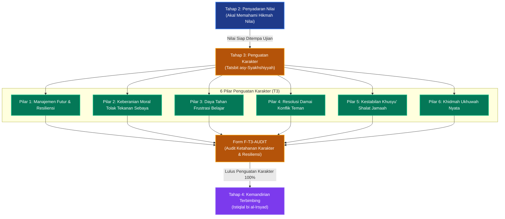

# P00036: Mengapa Tahap 3 Dinamakan Tahap Penguatan Karakter?

## 1. Metadata & Identitas Dokumen Inkuiri
- **ID Inkuiri**: `PROBE_01_P00036`
- **Kode Berkas**: `P00036-Mengapa-Tahap-3-Dinamakan-Tahap-Penguatan-Karakter.md`
- **Pilar**: Pilar 3 — Logika Penataan Arsitektur Konseptual TUMBUH
- **Domain Terkait**: `01_FUNDAMENTAL/02_CORE_MODEL/` (Tahap 3: Penguatan Karakter / *Tatsbit asy-Syakhshiyyah*)
- **Status ADR**: `APPROVED & LOCKED` (Ketetapan Konstitusi Repositori Branch v2.0.0)
- **Versi Dokumen**: `2.0.0`
- **Tanggal Rilis**: 2026-10-25
- **Klasifikasi Epistemik**: *Character Consolidation & Psychological Resilience Architecture*
- **Keterlacakan**: Berkelanjutan dari `P00035` (Tahap 2 Penyadaran Nilai) dan menjadi pilar pembuka dalam merumuskan Jenjang J2 Berkembang Aktif di `01_FUNDAMENTAL/03_PROGRESSION/`.

---

## 2. Hakikat Fundamental & Latar Belakang Epistemik

### 2.1. Fenomena "Sophomore Slump" dan Badai Kejenuhan (Futur) Santri Tahun Kedua
Dalam siklus kehidupan santri di pondok pesantren, periode paling kritis yang sering menjadi kuburan bagi cita-cita santri bukanlah bulan-bulan pertama (Tahap 1), melainkan **masa transisi tahun kedua (Bulan ke-9 hingga Bulan ke-18)**. Fenomena ini dalam psikologi pendidikan dikenal sebagai *The Sophomore Slump* atau dalam tradisi Islam disebut sebagai **sindrom futur al-himmah** (melemahnya gelora tekad):
1. **Hilangnya Kebaruan (*Erosion of Novelty*)**: Euforia menjadi santri baru telah memudar; rutinitas bangun subuh, halaqah Al-Qur'an, dan kajian mutun mulai terasa sebagai beban monoton yang menjemukan.
2. **Lonjakan Gejolak Pubertas (*Adolescent Identity Crisis*)**: Santri memasuki usia 13–15 tahun, di mana fluktuasi hormon testosteron/estrogen dan perkembangan sistem limbik otak memicu dorongan mencari identitas diri, sensitivitas terhadap penerimaan kelompok sebaya (*peer conformity*), dan dorongan untuk menguji batas aturan (*boundary testing*).
3. **Peningkatan Beban Kognitif & Target Hafalan**: Target hafalan dan materi kitab kuning ditingkatkan secara signifikan, menimbulkan rasa frustrasi kognitif (*cognitive frustration*) apabila hafalan sering terlupakan.

Apabila pada fase genting ini santri tidak mendapatkan penanganan yang tepat, mereka akan mengalami keruntuhan karakter: menjadi santri pembangkang (*cynical rebels*), apatis terhadap prestasi, atau bahkan terjerumus dalam kenakalan tersembunyi antarteman sebaya.

### 2.2. Landasan Filosofis Penamaan "Penguatan Karakter" (Tatsbit asy-Syakhshiyyah)
Sistem TUMBUH v2.0.0 secara filosofis menamakan fase ketiga ini sebagai **Tahap 3: Penguatan Karakter**:
- **Karakter Bukan Sekadar Tahu, Karakter Adalah Ketahanan (*Grit & Tsabat*)**: Santri di Tahap 1 telah memiliki kebiasaan fisik, dan di Tahap 2 telah memahami alasan syariatnya. Namun, mengetahui kebaikan tidak otomatis menjamin kemampuan melakukannya di saat lelah, jenuh, atau dirayu oleh godaan teman. Tahap 3 hadir untuk mengubah "pengetahuan nilai" menjadi **daya tahan watak (*character muscle / malakah rasikhah*)**.
- **Tatsbit (Menancapkan Akar yang Menghujam)**: Istilah *tatsbit* diambil dari konsep Al-Qur'an tentang penguatan kalbu orang beriman agar tidak goyah diterpa badai ujian. Di tahap ini, santri dilatih menavigasi masa futur, mengelola kebosanan, dan bangkit kembali (*resilience*) setelah mengalami kegagalan.
- **Pematangan Relasional Antarsebaya**: Karakter santri diperkuat melalui interaksi ukhuwah yang sehat: belajar memaafkan kesalahan teman, menahan amarah saat berselisih, dan berani menolak ajakan negatif sebaya (*assertive boundary setting*).

---

## 3. Dalil Naqli Turats & Integrasi Psikologi Resiliensi

### 3.1. Rujukan Teks Turats Otoritatif: Sunatullah Ketetapan Hati (Tsabat) dan Penempaan
Al-Qur'an mengibaratkan jiwa yang telah terbangun karakternya laksana pohon rindang yang akarnya menghujam kokoh ke perut bumi dan cabangnya menjulang ke langit, tidak tumbang oleh tiupan angin kencang:

```arabic
أَلَمْ تَرَ كَيْفَ ضَرَبَ اللَّهُ مَثَلًا كَلِمَةً طَيِّبَةً كَشَجَرَةٍ طَيِّبَةٍ أَصْلُهَا ثَابِتٌ وَفَرْعُهَا فِي السَّمَاءِ . تُؤْتِي أُكُلَهَا كُلَّ حِينٍ بِإِذْنِ رَبِّهَا
```
*(Tidakkah kamu memperhatikan bagaimana Allah telah membuat perumpamaan kalimat yang baik seperti pohon yang baik, akarnya teguh menghujam dan cabangnya [menjulang] ke langit. [Pohon itu] menghasilkan buahnya pada setiap waktu dengan seizin Tuhannya).*
— **QS. Ibrahim [14]: 24–25**.

Dalam hadits shahih, Rasulullah shallallahu 'alaihi wa sallam mengajarkan bahwa fenomena futur adalah sunatullah manusiawi yang wajib diantisipasi dengan ketetapan hati di atas manhaj sunnah:

```arabic
عَنْ عَبْدِ اللَّهِ بْنِ عَمْرٍو رَضِيَ اللَّهُ عَنْهُمَا، عَنِ النَّبِيِّ صَلَّى اللَّهُ عَلَيْهِ وَسَلَّمَ قَالَ: «إِنَّ لِكُلِّ عَمَلٍ شِرَّةً، وَلِكُلِّ شِرَّةٍ فَتْرَةً، فَمَنْ كَانَتْ فَتْرَتُهُ إِلَى سُنَّتِي فَقَدْ أَفْلَحَ، وَمَنْ كَانَتْ إِلَى غَيْرِ ذَلِكَ فَقَدْ هَلَكَ»
```
*(Dari Abdullah bin 'Amr radhiyallahu 'anhuma, dari Nabi shallallahu 'alaihi wa sallam, beliau bersabda: "Sesungguhnya pada setiap amal itu ada masa semangat yang membara [syirrah], dan pada setiap masa semangat itu ada masa jenuh/futur [fatrah]. Maka barangsiapa yang masa futurnya tetap condong kepada sunnahku, sungguh ia telah beruntung; dan barangsiapa yang masa futurnya condong kepada selain itu, maka sungguh ia telah binasa").*
— **HR. Ahmad** (No. 6764) dan **Ibnu Hibban** (No. 361), shahih.

Imam Ibnu Qayyim al-Jauziyyah (w. 751 H) dalam *Madarij as-Salikin* menguraikan hakikat stasiun penguatan jiwa (*Tatsbit/Tamkin*):
```arabic
وَالْعَبْدُ فِي سَيْرِهِ إِلَى اللَّهِ لَا بُدَّ لَهُ مِنْ مَرْحَلَةِ الْمُعَالَجَةِ وَالتَّثْبِيتِ؛ حَيْثُ تَنْقَطِعُ عَنْهُ لَذَّةُ الْبِدَايَاتِ، وَتَهْجُمُ عَلَيْهِ عَوَارِضُ الْفُتُورِ وَالْوَحْشَةِ؛ فَإِنْ ثَبَتَ بِالصَّبْرِ وَالْمُصَابَرَةِ رَسَخَتْ فِي قَلْبِهِ مَلَكَةُ الصِّدْقِ، وَإِلَّا انْقَلَبَ عَلَى عَقِبَيْهِ مَخْذُولًا
```
*(Seorang hamba dalam perjalanannya menuju Allah niscaya melewati fase penempaan dan pemantapan [al-mu'alajah wa at-tatsbit]; di mana manisnya masa-masa awal telah terputus dan badai kejenuhan serta keterasingan menyerang jiwanya. Sekiranya ia bertahan dengan kesabaran dan keteguhan hati [musyabarah], niscaya akan menancap kokoh watak kejujuran [malakatush shidq] di kalbunya; jika tidak, ia akan berbalik ke belakang dalam keadaan binasa terhina).*
— **Ibnu Qayyim al-Jauziyyah**, *Madarij as-Salikin*, Jilid 2, Hal. 156.

### 3.2. Integrasi Teori Ketahanan Mental (Grit) dan Neuroplastisitas Sikap
Dalam psikologi kontemporer dan neurosains perkembangan:
1. **Teori Grit & Ketahanan Angela Duckworth**: Karakter bukanlah bakat bawaan (*talent*), melainkan perpaduan antara hasrat mendalam (*passion*) dan ketekunan jangka panjang (*perseverance*). Tahap 3 secara terencana melatih santri untuk tidak menyerah ketika menghadapi kebosanan rutinitas atau kemacetan hafalan.
2. **Growth Mindset Carol Dweck**: Santri di Tahap 3 dibimbing untuk memandang kesulitan dan kesalahan bukan sebagai "bukti kebodohan diri", melainkan sebagai stimulus pertumbuhan otak (*neuroplasticity*). Otak manusia seperti otot yang bertambah kuat justru saat mengangkat beban kognitif yang menantang.
3. **Regulasi Emosi Remaja (Casey & Steinberg)**: Korteks prefrontal remaja sedang mengalami pemangkasan sinaptik (*synaptic pruning*), sementara sistem limbik yang memproses emosi sedang sangat aktif. Tahap 3 menyediakan perancah emosional (*emotional scaffolding 50%*) agar santri tidak dikuasai oleh dorongan impulsif amarah atau putus asa.

---

## 4. Argumen Ontologis & Logika Dependensi Sistem

Mengapa Tahap 3 Penguatan Karakter wajib diletakkan tepat setelah Tahap 2 Penyadaran Nilai dan tepat sebelum Tahap 4 Kemandirian Terbimbing?

```
+-----------------------------------------------------------------------------------------+
|                  LOGIKA DEPENDENSI SEKUANSIAL CORE MODEL (T1 -> T2 -> T3 -> T4)         |
+-----------------------------------------------------------------------------------------+
| TAHAP 1: PEMBIASAAN DASAR (Otomatisasi raga, pembiasaan gerak, rasa aman)               |
|        ↓                                                                                |
| TAHAP 2: PENYADARAN NILAI (Akal kritis menyala, hikmah dipahami, nilai diinternalisasi) |
|        ↓                                                                                |
| TAHAP 3: PENGUATAN KARAKTER (Nilai ditempa dalam ujian futur, melahirkan resiliensi)    |
|        ↓                                                                                |
| TAHAP 4: KEMANDIRIAN TERBIMBING (Otonomi mulai dilepas karena karakter telah kokoh)     |
+-----------------------------------------------------------------------------------------+
```

### 4.1. Mengapa Karakter Tidak Bisa Menguat Tanpa Melewati Penyadaran Nilai (Tahap 2)?
- Ketahanan mental (*grit*) tidak bisa dibangun di atas ruang hampa. Seorang santri hanya akan rela bersabar menghadapi rasa kantuk di sepertiga malam apabila kalbunya telah menyadari kemuliaan munajat kepada Allah.
- Tanpa Tahap 2, tuntutan ketahanan di Tahap 3 hanya akan menjadi siksaan fisik (*brute endurance*) yang melahirkan kepahitan batin dan dendam kepada sistem.

### 4.2. Mengapa Kemandirian Terbimbing (Tahap 4) Tidak Boleh Diberikan Sebelum Tahap 3 Tuntas?
- Memberikan otonomi dan kebebasan mengatur waktu kepada santri yang karakternya belum kuat ibarat melepaskan anak kecil menyetir mobil di jalan raya: santri akan menyalahgunakan kebebasan tersebut untuk malas-malasan, begadang main game, atau melanggar aturan secara tersembunyi.
- Karakter yang telah teruji konsistensinya di Tahap 3 menjadi prasyarat mutlak sebelum pelonggaran perancah musyrif di Tahap 4 dapat dilakukan dengan aman.

---

## 5. Studi Kasus Lapangan & Analisis Komparatif

### 5.1. Kasus Lapangan 1: Fenomena "Tsunami Eksodus Santri Kelas 2" di Pesantren S
Pesantren S di Jawa Timur menghadapi pola tahunan yang sangat mencemaskan: setiap memasuki semester ganjil tahun kedua (kelas 2 MTs/SMP), lebih dari 30% santri mengajukan pindah sekolah (*drop out* massal), dan terjadi lonjakan kasus perkelahian serta perusakan fasilitas asrama:
- **Respon Salah Pihak Manajemen**: Pimpinan menganggap santri tahun kedua "mulai besar kepala dan kurang ajar". Manajemen merespons dengan memperketat hukuman: santri yang terlambat shalat langsung digunduli kepalanya, dan poin pelanggaran dilipatgandakan.
- **Dampak Fatal**: Alih-alih tertib, asrama berubah menjadi medan perlawanan gerilya. Santri membakar lemari pengurus, memboikot makan siang dapur umum, dan puluhan wali santri datang melabrak yayasan.
- **Diagnosis TUMBUH**: Santri Pesantren S sedang mengalami badai *Sophomore Slump* dan krisis identitas pubertas. Tindakan represif manajemen justru memicu reaksi perlawanan defensif otak santri. Yang mereka butuhkan bukan rotan yang lebih keras, melainkan **pendampingan resiliensi Tahap 3**.

### 5.2. Kasus Lapangan 2: Keberhasilan "Klinik Pemulihan Resiliensi" di Pesantren G
Pesantren G di Jawa Barat merestrukturisasi pembinaan santri tahun keduanya dengan mengadopsi Tahap 3 TUMBUH:
1. **Penyediaan Program Dekompresi Futur**: Memasuki bulan ke-10, santri diajak mengikuti retret alam luar ruangan (*tadabbur alam*) selama 3 hari untuk me-refresh kejenuhan mental tanpa ada tuntutan setoran hafalan kaku.
2. **Klinik Penguatan Karakter & Manajemen Stres**: Dibentuk sesi bimbingan kelompok kecil (maksimal 6 santri) yang dipandu musyrif senior untuk mendiskusikan cara mengatasi kebosanan hafalan, membagi teknik belajar pomodoro islami, dan mengurai gesekan pertemanan.
3. **Pemberian Tanggung Jawab Proyek Sosial Kecil**: Santri kelas dua dilatih menjadi panitia perayaan hari besar Islam di pondok guna menyalurkan energi pubertas mereka ke ranah kreativitas positif.
4. **Hasil**: Angka putus sekolah di tahun kedua turun dari 28% menjadi hanya 1,5%, indeks kebahagiaan santri melonjak hingga 91%, dan kualitas hafalan mutun meningkat secara signifikan.

### 5.3. Analisis Komparatif Tiga Paradigma Menghadapi Kejenuhan Santri
| Dimensi Penanganan | Model Represif Keras (Pondok Otokratis) | Model Apatis Permisif (Asrama Tanpa Standar) | Model Penguatan Karakter TUMBUH (Tahap 3) |
|:---|:---|:---|:---|
| **Pandangan Terhadap Futur** | Dianggap sebagai kemunafikan, dosa besar, dan pembangkangan sengaja. | Dianggap hal biasa yang dibiarkan santri tidur seharian di asrama. | Diakui sebagai sunatullah psikologis yang wajib dinavigasi dengan sabar dan hikmah. |
| **Respon Terhadap Pelanggaran** | Menggandakan intensitas hukuman fisik dan mempermalukan santri di muka umum. | Mengabaikan pelanggaran demi menghindari komplain orang tua. | Mediasi restoratif, penataan ulang beban target kognitif, dan pengasahan resiliensi batin. |
| **Pola Pendampingan Musyrif** | Pengawas galak yang mengintai celah kesalahan santri dari kejauhan. | Sosok pasif yang tidak hadir dalam pergulatan batin santri. | *Mentor Resiliensi* (Scaffolding 50%) yang mendampingi santri bangkit dari kegagalan. |
| **Hasil Karakter Akhir** | Santri trauma, berjiwa kerdil, memendam amarah, atau menjadi pemberontak. | Santri manja, rapuh (*fragile*), tidak tahan banting, mudah menyerah. | Santri tangguh (*gritty*), berintegritas kokoh, memiliki daya tahan mental prima seumur hidup. |

---

## 6. Enam Pilar Penguatan Karakter Tahap 3 TUMBUH (The 6 Pillars of Stage 3)

Dokumen model `02_CORE_MODEL/` membakukan enam pilar penguatan karakter yang wajib ditempa pada diri santri di Tahap 3:

```
  +-----------------------------------------------------------------------------------+
  |               ENAM PILAR PENGUATAN KARAKTER SANTRI TAHAP 3 (TUMBUH)               |
  +-----------------------------------------------------------------------------------+
  | 1. RESILIENCE & FUTUR MANAGEMENT | Keterampilan mengenali gejala kejenuhan batin  |
  |    (Navigasi Resiliensi Mental)  | dan strategi bangkit kembali (*bounce back*).  |
  +----------------------------------+------------------------------------------------+
  | 2. MORAL COURAGE & PEER AUTONOMY | Keberanian moral menolak ajakan maksiat sebaya |
  |    (Keteguhan Prinsip Mandiri)   | tanpa rasa takut dikucilkan dari pergaulan.    |
  +----------------------------------+------------------------------------------------+
  | 3. FRUSTRATION TOLERANCE         | Kesabaran menghadapi hafalan sulit atau nilai  |
  |    (Daya Tahan Frustrasi Belajar)| ujian rendah dengan mentalitas belajar tumbuh. |
  +----------------------------------+------------------------------------------------+
  | 4. EMPATHIC CONFLICT RESOLUTION  | Kematangan menyelesaikan perselisihan kamar    |
  |    (Resolusi Perselisihan Adab)  | melalui dialog tabayyun dan saling memaafkan.  |
  +----------------------------------+------------------------------------------------+
  | 5. CONSISTENT SHALAH HUZUR       | Menjaga kekhusyu'an shalat berjamaah dan zikir |
  |    (Kekhusyu'an Ibadah Stabil)   | meski badan lelah setelah seharian beraktivitas|
  +----------------------------------+------------------------------------------------+
  | 6. ACTIVE BROTHERHOOD SERVICE    | Semangat mengalah demi maslahat bersama dan    |
  |    (Pengorbanan Ukhuwah Nyata)   | kerelaan berkhidmah merawat teman sekamar sakit|
  +-----------------------------------------------------------------------------------+
```

### 6.2. Metodologi Scaffolding 50%: Transisi dari Pendampingan ke Pemberdayaan
Di Tahap 3, musyrif secara sadar menarik 50% intervensi fisiknya untuk memberi ruang latihan bagi otot karakter santri:
1. **Fading Direct Supervision**: Musyrif tidak lagi membangunkan santri satu per satu di kasur, melainkan memantau dari pintu aula dan membiarkan santri mengaktifkan alarm partner (*sahabat ta'awun*).
2. **Coaching Through Struggles**: Saat santri mengeluh hafalannya macet, musyrif tidak langsung memberikan dispensasi instan atau memarahinya, melainkan memandu dengan pertanyaan pemberdayaan: *"Bagian mana yang paling menantang? Strategi apa yang kemarin berhasil dan bisa kita coba lagi hari ini?"*.
3. **Restorative Circle Mediation**: Ketika terjadi pertengkaran antarteman kamar, musyrif bertindak sebagai fasilitator mediasi netral, bukan hakim yang memvonis siapa yang salah.

---

## 7. Diagram Alur & Logika Dependensi Turunan Sistem



---

## 8. Spesifikasi Formulir Audit Penguatan Karakter (Form F-T3-AUDIT)

Formulir ini wajib digunakan oleh Musyrif Kamar dan Guru Pembina Halaqah pada akhir Bulan ke-14 untuk memverifikasi ketahanan karakter santri sebelum dipromosikan ke Tahap 4:

### 8.1. Lembar Evaluasi Ketahanan Karakter dan Resiliensi Santri
| No | Parameter Penguatan Karakter | Indikator Ketahanan Perilaku Lapangan | Metode Asesmen Musyrif | Status Capaian |
|:---|:---|:---|:---|:---:|
| 1 | **Resiliensi Menghadapi Futur** | Mampu bangkit dari kemacetan hafalan dalam waktu maksimal 7 hari tanpa putus asa. | Analisis tren logbook tahfidz | [ ] Resilien / [ ] Stagnan Menyerah |
| 2 | **Independensi Moral Sebaya** | Menolak tegas ajakan melanggar aturan (seperti begadang ilegal) tanpa rasa minder. | Uji situasional integritas kamar | [ ] Kokoh / [ ] Terbawa Arus |
| 3 | **Stabilitas Pengendalian Emosi**| Tidak membalas dengan kekerasan fisik atau makian saat tersinggung oleh teman. | Catatan insiden perkelahian | [ ] Terkendali / [ ] Impulsif Agresif |
| 4 | **Ketekunan Tugas Sulit (*Grit*)** | Menyelesaikan target muraja'ah kitab yang menantang meski merasa lelah. | Pengamatan jam belajar mandiri | [ ] Tekun / [ ] Cepat Bosan |
| 5 | **Inisiatif Ishlah Antarteman** | Aktif mendamaikan rekan kamar yang berselisih tanpa menunggu disuruh ustadz. | Sosiometri perdamaian kamar | [ ] Inisiator / [ ] Memperkeruh |
| 6 | **Konsistensi Shalat Berjamaah** | Tetap berada di shaf pertama secara istiqamah meski tidak ada musyrif di dekatnya. | Presensi shaf mandiri | [ ] Istiqamah / [ ] Menghilang |
| 7 | **Kerelaan Berkhidmah Sosial** | Membantu merawat teman sekamar yang sakit (mengambilkan makanan, menemani ke klinik). | Verifikasi ketua halaqah | [ ] Penuh Khidmah / [ ] Apatis |

### 8.2. Skrip Validasi Kepatuhan Kurikulum Tahap 3 (`audit_stage_3_resilience.py`)
Skrip otomatis ini mengaudit naskah panduan pengasuhan guna memastikan adanya protokol manajemen futur dan larangan hukuman represif bagi santri yang mengalami penurunan motivasi sementara:

```python
#!/usr/bin/env python3
"""
Validator Otomatis: Kepatuhan Standar Resiliensi Tahap 3 TUMBUH
Branch: v2.0.0
"""

import sys
from pathlib import Path

REQUIRED_STAGE_3_ELEMENTS = [
    "manajemen_futur",
    "growth_mindset",
    "peer_autonomy",
    "frustration_tolerance",
    "scaffolding_fading"
]

FORBIDDEN_STAGE_3_PATTERNS = [
    "hukuman putus asa",
    "cap anak gagal",
    "drop out atas futur",
    "penambahan sanksi fisik"
]

def audit_stage_3_resilience_framework(core_model_dir: str) -> bool:
    target_dir = Path(core_model_dir)
    if not target_dir.exists():
        print(f"[SKIP] Direktori {core_model_dir} belum dibuat.")
        return True

    violations = []
    has_stage_3_doc = False
    for md_file in target_dir.glob("*.md"):
        content = md_file.read_text(encoding="utf-8").lower()
        if "tahap_3" in content or "penguatan_karakter" in content:
            has_stage_3_doc = True
            for forbidden in FORBIDDEN_STAGE_3_PATTERNS:
                if forbidden in content:
                    violations.append((md_file.name, f"Pola represif terlarang: '{forbidden}'"))
            for req in REQUIRED_STAGE_3_ELEMENTS:
                if req not in content:
                    violations.append((md_file.name, f"Komponen wajib belum ada: '{req}'"))

    if violations:
        print("[CRITICAL ERROR] Ditemukan ketidaksesuaian kurikulum Tahap 3:")
        for fname, msg in violations:
            print(f"  - File: {fname} | {msg}")
        return False

    print("\n[SUCCESS] Kurikulum Tahap 3 memenuhi standar penguatan karakter & resiliensi 100%.")
    return True

if __name__ == "__main__":
    if not audit_stage_3_resilience_framework("01_FUNDAMENTAL/02_CORE_MODEL"):
        sys.exit(1)
```

### 8.3. Matriks Protokol Navigasi Santri Mengalami Futur Akut
Berikut adalah langkah intervensi musyrif dalam menangani santri yang mengalami penurunan motivasi (*futur*) pada Tahap 3:

| Gejala Klinis Futur | Tindakan Konvensional Salah (Dilarang) | Intervensi Resiliensi TUMBUH |
|:---|:---|:---|
| **Menolak Masuk Kelas / Menutup Diri di Ranjang** | Diseret paksa, disiram air, dicap malas dan durhaka kepada guru. | Sesi konseling empat mata; diagnosis pemicu kelelahan mental; pemberian istirahat medis terkontrol. |
| **Hafalan Al-Qur'an Macet Total Selama 2 Pekan** | Diultimatum dikeluarkan dari program tahfidz; disanksi berdiri di aula. | Dekompresi beban hafalan (turunkan target 70% sementara); tadabbur ayat-ayat penghiburan kalbu. |
| **Menunjukkan Sikap Sinis Terhadap Aturan Asrama** | Dibentak di depan halaqah; diancam penurunan tahap secara sepihak. | Dialog personal menggali akar kekecewaan; penugasan proyek kreatif yang membangkitkan harga diri. |
| **Terpengaruh Teman yang Suka Melanggar** | Santri langsung dimutasi ke kamar isolasi seperti narapidana. | Penataan ulang konfigurasi kamar (*bi'ah restructuring*); dipasangkan dengan sahabat ta'awun yang berkarakter kokoh. |

---

## 9. Architectural Decision Record (ADR): Penguncian Nomenklatur Tahap 3

### Context
Ketiadaan pemahaman mengenai dinamika psikologis tahun kedua sering kali membuat pengurus pesantren mengartikan masa jenuh santri sebagai "kemerosotan moral permanen" yang harus dibalas dengan hukuman represif. Repositori TUMBUH memerlukan ketetapan arsitektural yang membakukan Tahap 3 sebagai Penguatan Karakter (*Tatsbit asy-Syakhshiyyah*) yang berfokus pada pembangunan resiliensi, manajemen futur, dan penempaan watak tangguh.

### Decision
Diputuskan secara mutlak dan permanen bahwa:
1. Tahap Ketiga dalam Core Model TUMBUH resmi dinamakan **Tahap 3: Penguatan Karakter (*Tatsbit asy-Syakhshiyyah*)**.
2. Fokus kurikulum Tahap 3 adalah penempaan daya tahan batin (*grit*), manajemen masa jenuh (*futur*), otonomi moral dari tekanan sebaya, dan pembentukan watak konsisten (*malakah rasikhah*) dengan derajat scaffolding musyrif sebesar 50%.
3. Dilarang keras mengeluarkan (*drop out*) santri semata-mata karena mengalami masa jenuh atau penurunan performa kognitif sementara pada tahapan ini.

### Status
`APPROVED & LOCKED` (Ketetapan Konstitusi Repositori Branch v2.0.0).

### Consequences
- **Positif**: Terlindunginya santri dari keputusasaan saat menghadapi masa jenuh; terbentuknya santri yang memiliki resiliensi mental prima dan kemandirian moral; serta melonjaknya angka retensi kelulusan santri hingga tingkat akhir.
- **Tantangan**: Menuntut musyrif untuk memiliki kecakapan *coaching* emosional, kesabaran dalam mendampingi santri yang sedang futur, dan kejelian membedakan antara pembangkangan sengaja dengan kelelahan mental.

---

## 10. Drift Guardrails & Anti-Pattern Checklist

Tiga puluh aturan anti-penyimpangan pengasuhan Tahap 3 yang wajib dipatuhi:

- [x] **Guardrail 1 (Strict Primacy of Tatsbit)**: Fokus Tahap 3 adalah penempaan daya tahan (*grit*) dan konsistensi sikap, bukan sekadar penambahan teori baru.
- [x] **Guardrail 2 (De-Stigmatization of Futur)**: Masa jenuh (*futur*) diakui sebagai fase psikologis alami; haram mencap santri yang sedang futur sebagai "anak gagal".
- [x] **Guardrail 3 (Absolute Ban on Punitive Drop-Out)**: Dilarang memecat santri atas penurunan capaian hafalan sementara di tahun kedua.
- [x] **Guardrail 4 (Growth Mindset Orientation)**: Setiap teguran atas kesalahan wajib dibarengi dengan keyakinan bahwa santri mampu memperbaikinya (*growth mindset*).
- [x] **Guardrail 5 (Scaffolding Fading to 50%)**: Musyrif wajib mengurangi ketergantungan instruksi langsung dan mulai melatih santri memecahkan masalahnya sendiri.
- [x] **Guardrail 6 (Protection from Destructive Peer Pressure)**: Lembaga wajib memfasilitasi santri memiliki keberanian moral menolak ajakan negatif sebaya.
- [x] **Guardrail 7 (Restorative Conflict Resolution)**: Pertikaian antarsantri diselesaikan dengan mediasi lingkaran restoratif, bukan hukuman fisik sepihak.
- [x] **Guardrail 8 (Sanctity of Emotional Confidentiality)**: Curahan hati santri mengenai rasa jenuh atau krisis pribadinya dilindungi kerahasiaannya secara mutlak.
- [x] **Guardrail 9 (Proportional Cognitive Load)**: Target hafalan dan materi kitab disesuaikan dengan kapasitas ketahanan kognitif santri tanpa akselerasi paksa.
- [x] **Guardrail 10 (Holistic Respite Days)**: Santri Tahap 3 berhak mendapatkan kegiatan rekreasi alam (*tadabbur alam*) berkala untuk dekompresi mental.
- [x] **Guardrail 11 (Promotion of Brotherly Service)**: Pembiasaan khidmah merawat teman sekamar yang sakit diprioritaskan di atas ambisi individu.
- [x] **Guardrail 12 (Elimination of Public Shaming)**: Dilarang mengumumkan nama santri yang belum mencapai target hafalan di hadapan seluruh civitas pondok.
- [x] **Guardrail 13 (Celebration of Perseverance)**: Apresiasi diberikan kepada santri yang tekun berusaha dan bangkit dari kegagalan, bukan hanya yang juara kelas.
- [x] **Guardrail 14 (Safe Frustration Tolerance Spaces)**: Santri diajari teknik pernapasan dan doa saat mengalami stres atau kelelahan kognitif.
- [x] **Guardrail 15 (Active Buddy System Reinforcement)**: Sahabat ta'awun difungsikan sebagai mitra saling menguatkan tekad saat salah satu pihak mengalami futur.
- [x] **Guardrail 16 (Prohibition of Senior Entrapment)**: Santri Tahap 3 dilarang menindas atau menyuruh-nyuruh santri baru Tahap 1/2.
- [x] **Guardrail 17 (Parental Collaboration on Resilience)**: Orang tua diedukasi agar tidak langsung panik atau menarik anak saat anak mengeluh jenuh di tahun kedua.
- [x] **Guardrail 18 (Quarterly F-T3-AUDIT Filing)**: Musyrif wajib mengisi lembar evaluasi F-T3-AUDIT sebelum mempromosikan santri ke Tahap 4.
- [x] **Guardrail 19 (Equitable Rest and Recreation)**: Hak tidur malam 7 jam dan waktu olahraga sore tetap terjamin penuh tanpa pemotongan tugas.
- [x] **Guardrail 20 (Sacred Inner Grounding)**: Ketahanan karakter ditambatkan pada keikhlasan mencari ridha Allah dan mengharap pahala akhirat (*Ihtisab*).
- [x] **Guardrail 21 (Coaching Over Dictating)**: Musyrif mengedepankan pendekatan bertanya reflektif (*coaching*) daripada perintah searah.
- [x] **Guardrail 22 (Non-Discriminatory Emotional Support)**: Santri yang pendiam atau introvert berhak mendapatkan perhatian emosional yang setara dengan santri vokal.
- [x] **Guardrail 23 (Early Warning Detection)**: Musyrif wajib mendeteksi tanda-tanda awal kemunduran motivasi sebelum berkembang menjadi depresi berat.
- [x] **Guardrail 24 (Safe Creative Outlets)**: Pesantren menyediakan ruang penyaluran energi pubertas melalui seni kaligrafi, jurnalistik, dan olahraga bela diri.
- [x] **Guardrail 25 (Universal Dignity Safeguard)**: Martabat kemanusiaan santri tidak boleh diinjak-injak oleh cemoohan atau sarkasme pendidik.
- [x] **Guardrail 26 (Continuous Musyrif Supervision)**: Musyrif Tahap 3 wajib mendapatkan supervisi klinis dari konselor BK profesional setiap bulan.
- [x] **Guardrail 27 (Prohibition of Arbitrary Demotion)**: Dilarang menurunkan tahap santri tanpa bukti pelanggaran berat yang diverifikasi komite mutu.
- [x] **Guardrail 28 (Spiritual Renewal Halaqah)**: Setiap pekan diadakan halaqah tazkiyatun nufs khusus untuk memperbaharui niat dan membersihkan penyakit hati.
- [x] **Guardrail 29 (Equitable Workload in Room Duties)**: Pembagian piket kebersihan kamar wajib adil dan merata tanpa ada santri yang diistimewakan.
- [x] **Guardrail 30 (Preparation for Autonomous Living)**: Tahap 3 wajib membekali santri dengan kesiapan batin sebelum memasuki Tahap 4 Kemandirian Terbimbing.

---

## 11. Traceability Matrix & Bibliografi Rujukan Terkurasi

### 11.1. Hubungan Silang Antarlapisan Repositori (Cross-Reference)
- `01_FUNDAMENTAL/02_CORE_MODEL/`: Direktori target yang memuat spesifikasi Tahap 3 sebagai pilar penempa karakter dalam 7 tahap.
- `PROBE/PROBE_01/P00035-Mengapa-Tahap-2-Dinamakan-Tahap-Penyadaran-Nilai.md`: Tahap pendahulu yang menyediakan fondasi makna nilai sebelum karakter ditempa.
- `PROBE/PROBE_01/P00037-Mengapa-Tahap-4-Dinamakan-Tahap-Kemandirian-Terbimbing.md`: Tahap berikutnya yang mulai memberikan otonomi mandiri pasca karakter menguat.
- `01_FUNDAMENTAL/03_PROGRESSION/`: Tahap 3 menjadi fondasi pembuka bagi perumusan **Jenjang J2 (Berkembang Aktif)**.
- `01_FUNDAMENTAL/05_INTERVENTION/`: Protokol de-eskalasi dan intervensi Tier 2 PBIS yang menangani santri futur.

### 11.2. Bibliografi Pustaka Rujukan Terkurasi (APA 7th Edition)
- Al-Ghazali, A. H. (2004). *Ihya' 'ulum al-din: Kitab ash-shabr wa asy-syukr* (Tahqiq A. Ali, Jilid 4). Dar asy-Sya'b.
- Al-Mawardi, A. H. (1987). *Adab ad-dunya wa ad-din*. Bairut: Dar Iqra'.
- Bandura, A. (1997). *Self-efficacy: The exercise of control*. W. H. Freeman and Company.
- Casey, B. J., Jones, R. M., & Somerville, L. H. (2011). Braking and accelerating of the adolescent brain. *Journal of Research on Adolescence*, 21(1), 21–33.
- Csikszentmihalyi, M. (1990). *Flow: The psychology of optimal experience*. Harper & Row.
- Duckworth, A. (2016). *Grit: The power of passion and perseverance*. Scribner.
- Dweck, C. S. (2006). *Mindset: The new psychology of success*. Random House.
- Erikson, E. H. (1968). *Identity: Youth and crisis*. W. W. Norton & Company.
- Ibn Qayyim al-Jauziyyah, M. (1996). *Madarij as-salikin baina manazil iyyaka na'budu wa iyyaka nasta'in* (M. al-Baghdadi, Ed., Jilid 2). Dar al-Kitab al-'Arabi.
- Ibnu Muflih al-Maqdisi. (1999). *Al-Adab asy-syar'iyyah wa al-minah al-mar'iyyah* (Tahqiq S. al-Arnauth, Jilid 3). Bairut: Mu'assasah ar-Risalah.
- Kohlberg, L. (1981). *Essays on moral development: Vol. 1. The philosophy of moral development*. Harper & Row.
- Masten, A. S. (2001). Ordinary magic: Resilience processes in development. *American Psychologist*, 56(3), 227–238.
- Noddings, N. (2013). *Caring: A relational approach to ethics and moral education* (2nd ed.). University of California Press.
- Ryan, R. M., & Deci, E. L. (2017). *Self-determination theory: Basic psychological needs in motivation, development, and wellness*. Guilford Publications.
- Steinberg, L. (2008). A social neuroscience perspective on adolescent risk-taking. *Developmental Review*, 28(1), 78–106.
- Vygotsky, L. S. (1978). *Mind in society: The development of higher psychological processes*. Harvard University Press.
- Wan Mohd Nor Wan Daud. (1998). *The educational philosophy and practice of Syed Muhammad Naquib al-Attas*. ISTAC.

---

## 12. Rekomendasi Aksi Nyata Bagi Pengembang Kurikulum TUMBUH

Langkah konkret yang wajib dieksekusi pasca pengesahan monograf ini:

1. **Penerbitan Buku Panduan Manajemen Futur Santri**:
   Susun dan terbitkan modul resmi *"Menavigasi Badai Futur: Panduan Pendampingan Santri Tahun Kedua Melintasi Ujian Kejenuhan"* bagi seluruh musyrif dan wali asrama.
2. **Penyelenggaraan Retret Tadabbur Alam Dekompresi Mental**:
   Agendakan kegiatan luar ruangan rutin setiap pertengahan semester bagi santri Tahap 3 guna memulihkan kesegaran mental dan mempererat ikatan ukhuwah kamar.
3. **Pembentukan Klinik Konseling Resiliensi Asrama**:
   Sediakan ruang konseling privat yang nyaman dengan konselor BK ramah untuk memfasilitasi santri yang mengalami hambatan belajar atau krisis identitas pubertas.
4. **Pemasangan Validator audit_stage_3_resilience.py pada CI/CD**:
   Pasang linter otomatis pada repositori guna memblokir regulasi yang melegalkan vonis pemecatan atau penambahan sanksi fisik bagi santri yang sedang futur.
5. **Pelatihan Keterampilan Coaching bagi Musyrif Tahap 3**:
   Latih seluruh musyrif tahun kedua dalam teknik memfasilitasi pemecahan masalah mandiri (*empowering coaching*) dan manajemen konflik sebaya.
6. **Integrasi Logbook Refleksi Ketahanan Santri (*Grit Tracker*)**:
   Terbitkan instrumen pencatatan mandiri bagi santri untuk memantau keberhasilan bangkit dari kegagalan harian secara objektif.
7. **Pemberian Tanggung Jawab Proyek Kepanitiaan Kecil**:
   Berikan amanah kepada kelompok santri Tahap 3 untuk mengorganisasi perlombaan olahraga dan seni antarhalaqah guna melatih kerja sama tim.
8. **Edukasi Khusus "Memahami Pubertas dan Kejenuhan Anak" bagi Orang Tua**:
   Gelar seminar parenting online bagi wali santri kelas dua mengenai pentingnya mendengarkan keluh kesah anak tanpa menghakimi saat liburan semester.

---

## 13. Emergent Questions & Inkuiri Lanjutan (Chain of Inquiry)

Pengesahan hukum-hukum Tahap 3 Penguatan Karakter ini secara terarah membuka gerbang inkuiri berikutnya mengenai pelonggaran perancah menuju kemandirian:

- **P00037**: *Mengapa Tahap 4 Dinamakan Tahap Kemandirian Terbimbing?* (Menyelidiki bagaimana otonomi santri mulai diuji secara nyata dengan pelonggaran pengawasan musyrif hingga derajat scaffolding 35%).
- **P00038**: *Mengapa Tahap 5 Dinamakan Tahap Kemandirian Penuh?* (Membedah bagaimana kesadaran *Muraqabatullah* memungkinkan santri beroperasi mandiri 100% tanpa pengawasan eksternal).
