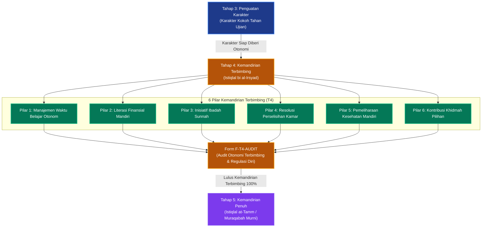

# P00037: Mengapa Tahap 4 Dinamakan Tahap Kemandirian Terbimbing?

## 1. Metadata & Identitas Dokumen Inkuiri
- **ID Inkuiri**: `PROBE_01_P00037`
- **Kode Berkas**: `P00037-Mengapa-Tahap-4-Dinamakan-Tahap-Kemandirian-Terbimbing.md`
- **Pilar**: Pilar 3 — Logika Penataan Arsitektur Konseptual TUMBUH
- **Domain Terkait**: `01_FUNDAMENTAL/02_CORE_MODEL/` (Tahap 4: Kemandirian Terbimbing / *Istiqlal bi al-Irsyad*)
- **Status ADR**: `APPROVED & LOCKED` (Ketetapan Konstitusi Repositori Branch v2.0.0)
- **Versi Dokumen**: `2.0.0`
- **Tanggal Rilis**: 2026-10-25
- **Klasifikasi Epistemik**: *Guided Autonomy Architecture & Self-Regulation Engineering*
- **Keterlacakan**: Berkelanjutan dari `P00036` (Tahap 3 Penguatan Karakter) dan melengkapi Jenjang J2 Berkembang Aktif sebelum memasuki Jenjang J3 Mandiri Berintegritas di `01_FUNDAMENTAL/03_PROGRESSION/`.

---

## 2. Hakikat Fundamental & Latar Belakang Epistemik

### 2.1. Jebakan "Helicopter Musyrif" vs "Pelepasan Liar" dalam Pendidikan Asrama
Dalam tradisi kepengasuhan pesantren, terdapat dua kesalahan metodologis yang saling bertolak belakang dalam memperlakukan santri yang menginjak usia remaja madya (14–16 tahun / kelas 3 MTs s/d kelas 1 MA):
1. **Sindrom Pengasuhan Otoriter Abadi (*The Helicopter Musyrif Trap*)**: Musyrif memperlakukan santri usia 15 tahun persis seperti anak usia 11 tahun yang baru masuk. Setiap menit diatur kaku, langkah santri diawasi dengan mikro-manajemen, lemari diperiksa setiap hari tanpa privasi, dan santri tidak diberi ruang membuat keputusan sendiri. Dampaknya adalah ketergantungan patologis (*learned helplessness*): santri tidak memiliki inisiatif, lumpuh saat dihadapkan pada pilihan hidup, dan menjadi pribadi penakut yang tidak mampu memimpin dirinya sendiri.
2. **Sindrom Pelepasan Liar (*Premature Total Abandonment*)**: Kebalikan ekstrem dari model pertama, sebagian pesantren menganggap santri kelas 3 MTs "sudah besar" sehingga dibiarkan bebas tanpa supervisi. Santri dilepas mengatur keuangan, waktu tidur, dan pergaulan tanpa mekanisme pembimbingan reflektif. Akibatnya, santri yang kontrol dirinya (*executive function*) belum matang sempurna terjerumus dalam pemborosan uang saku, begadang larut malam, kecanduan rokok/vape sembunyi-sembunyi, dan kemerosotan prestasi akademik.

Kedua kegagalan di atas berpangkal pada kegagalan memahami **hukum gradualitas otonomi (*The Gradual Release of Responsibility*)**.

### 2.2. Landasan Filosofis Penamaan "Kemandirian Terbimbing" (Istiqlal bi al-Irsyad)
Sistem TUMBUH v2.0.0 secara presisi menamakan fase transisi krusial ini sebagai **Tahap 4: Kemandirian Terbimbing**:
- **Kemandirian Adalah Otot yang Wajib Dilatih Bertahap**: Kemandirian (*al-Istiqlal*) bukanlah saklar lampu yang bisa dinyalakan seketika dari "tidak mandiri" menjadi "mandiri 100%". Kemandirian adalah kapasitas regulasi diri (*self-regulation*) yang membutuhkan ruang simulasi aman (*safe failure zone*).
- **Makna "Terbimbing" (*Bi al-Irsyad*)**: Otonomi diberikan kepada santri, namun perancah (*scaffolding*) tidak dicabut total, melainkan dikurangi secara terukur hingga tersisa **35%**. Musyrif beralih peran dari "mandor pengawas fisik" menjadi **konsultan kehidupan dan pembimbing refleksi (*Murshid*)**.
- **Jembatan Menuju Integritas Murni (Tahap 5)**: Santri di Tahap 4 dilatih mengelola waktu luang (*self-scheduling*), mengalokasikan anggaran keuangan bulanan, memilih proyek khidmah minat bakat, dan memecahkan konflik kamar, dengan pendampingan evaluasi mingguan. Tanpa melewati fase kemandirian terbimbing ini, lompatan menuju kemandirian penuh berbasis *Muraqabatullah* di Tahap 5 adalah kemustahilan pedagogis.

---

## 3. Dalil Naqli Turats & Integrasi Neurosains Eksekutif

### 3.1. Rujukan Teks Turats Otoritatif: Perintah Menguji Kematangan Akal Budi (Rusyd)
Konsep kemandirian terbimbing berakar kuat pada perintah Al-Qur'an dalam menguji kesiapan kemandirian anak sebelum melepaskan tanggung jawab penuh kepadanya:

```arabic
وَابْتَلُوا الْيَتَامَى حَتَّى إِذَا بَلَغُوا النِّكَاحَ فَإِنْ آنَسْتُمْ مِنْهُمْ رُشْدًا فَادْفَعُوا إِلَيْهِمْ أَمْوَالَهُمْ
```
*(Dan ujilah anak-anak yatim itu sampai mereka cukup umur untuk menikah. Kemudian jika menurut pendapatmu mereka telah cerdas [pandai memelihara harta dan berakal budi matang], maka serahkanlah kepada mereka harta-hartanya).*
— **QS. An-Nisa' [4]: 6**.

Ayat di atas menggunakan kata kerja *wabtaluu* (ujilah, berikan latihan bertahap), bukan langsung menyerahkan tanggung jawab secara serentak. Imam Al-Baidhawi (w. 685 H) dalam tafsir *Anwar at-Tanzil wa Asrar at-Ta'wil* menjelaskan kaidah pedagogis ini:
```arabic
وَالِابْتِلَاءُ يَكُونُ بِتَفْوِيضِ شَيْءٍ مِنْ أُمُورِ التَّصَرُّفِ إِلَيْهِمْ مَرَّةً بَعْدَ أُخْرَى؛ لِيُخْتَبَرَ حُسْنُ تَدْبِيرِهِمْ وَرُشْدُ عُقُولِهِمْ قَبْلَ رَفْعِ الْوِلَايَةِ عَنْهُمْ، فَلَا يُسَلَّمُ إِلَيْهِمُ الْأَمْرُ دَفْعَةً وَاحِدَةً مَخَافَةَ التَّبْذِيرِ، وَلَا يُحْجَرُ عَلَيْهِمْ أَبَدًا فَيَبْقَوْا عَلَى الْعَجْزِ
```
*(Dan pengujian itu dilakukan dengan cara mendelegasikan sebagian urusan pengelolaan kepada mereka secara bertahap kali demi kali; guna menguji kebaikan tata kelola mandiri mereka dan kematangan akal budi mereka sebelum perwalian dicabut sepenuhnya. Maka urusan tidak boleh diserahkan sekaligus karena khawatir terjadi pemborosan/kerusakan, dan tidak boleh pula terus-menerus dikekang sehingga mereka tetap berada dalam ketidakberdayaan selamanya).*
— **Al-Baidhawi**, *Anwar at-Tanzil wa Asrar at-Ta'wil*, Jilid 2, Hal. 63.

Teks tafsir klasik ini merumuskan esensi Tahap 4: delegasi bertahap di bawah pengawasan reflektif agar anak tidak manja selamanya dan tidak celaka karena kebebasan liar.

Dalam tradisi sirah Nabawiyyah, Rasulullah shallallahu 'alaihi wa sallam mempraktikkan *Istiqlal bi al-Irsyad* ketika mengutus Mu'adz bin Jabal radhiyallahu 'anhu ke Yaman. Beliau tidak mendikte setiap detail keputusan Mu'adz, melainkan menguji prinsip metodologi ijtihadnya:
```arabic
«كَيْفَ تَقْضِي إِذَا عَرَضَ لَكَ قَضَاءٌ؟» قَالَ: أَقْضِي بِكِتَابِ اللَّهِ، قَالَ: «فَإِنْ لَمْ تَجِدْ؟» قَالَ: فَبِسُنَّةِ رَسُولِ اللَّهِ، قَالَ: «فَإِنْ لَمْ تَجِدْ؟» قَالَ: أَجْتَهِدُ رَأْيِي وَلَا آلُو، فَضَرَبَ رَسُولُ اللَّهِ صَدْرَهُ وَقَالَ: «الْحَمْدُ لِلَّهِ الَّذِي وَفَّقَ رَسُولَ رَسُولِ اللَّهِ لِمَا يُرْضِي رَسُولَ اللَّهِ»
```
*(Beliau bersabda: "Bagaimana engkau memutuskan jika diajukan kepadamu suatu perkara?" Mu'adz menjawab: "Aku memutuskan dengan Kitabullah." Beliau bertanya: "Jika engkau tidak menemukannya?" Ia menjawab: "Dengan Sunnah Rasulullah." Beliau bertanya: "Jika engkau tidak menemukannya?" Ia menjawab: "Aku berijtihad dengan nalarku dan tidak akan lalai." Maka Rasulullah menepuk dada Mu'adz seraya bersabda: "Segala puji bagi Allah yang telah memberi taufiq kepada utusan Rasulullah menuju apa yang diridhai Rasulullah").*
— **HR. Abu Dawud** (No. 3592) dan **At-Tirmidzi** (No. 1327), hasan.

### 3.2. Integrasi Neurosains: Pematangan Fungsi Eksekutif Korteks Prefrontal
Dalam perspektif neurosains perkembangan remaja:
1. **Pematangan Executive Function**: Fungsi eksekutif otak—yang mencakup perencanaan masa depan (*planning*), pengendalian impuls (*inhibitory control*), fleksibilitas kognitif, dan manajemen waktu—berada di korteks prefrontal (*PFC*) yang baru matang sempurna pada usia pertengahan 20-an. Remaja usia 14–16 tahun sedang berada dalam fase pembentukan sirkuit saraf ini. Jika mereka tidak diberi latihan mengambil keputusan (karena dikekang total), PFC mereka tidak akan berkembang optimal.
2. **Scaffolding Fading Vygotskian**: Vygotsky menegaskan bahwa perkembangan kognitif tertinggi terjadi di dalam *Zone of Proximal Development* (ZPD). Di Tahap 4, musyrif memberikan tantangan di batas kemampuan santri, mengamati dari jarak aman, dan hanya turun tangan memberikan intervensi ketika santri meminta bimbingan atau ketika terjadi risiko bahaya fatal.
3. **Deci & Ryan's Need for Autonomy**: Self-Determination Theory membuktikan bahwa rasa otonomi (*perceived autonomy*) adalah kebutuhan psikologis dasar manusia. Remaja yang merasa memiliki kendali atas hidupnya akan menunjukkan motivasi belajar, kreativitas, dan integritas moral yang jauh lebih tinggi dibandingkan remaja yang terus-menerus dikontrol secara eksternal.

---

## 4. Argumen Ontologis & Logika Dependensi Sistem

Penempatan Tahap 4 sebagai penutup Jenjang J2 dan jembatan menuju Tahap 5 tunduk pada alur kausalitas sistemik:

```
+-----------------------------------------------------------------------------------------+
|                  LOGIKA EVOLUSI PROGRESI MENUJU KEMANDIRIAN (T1 -> T5)                  |
+-----------------------------------------------------------------------------------------+
| TAHAP 1: PEMBIASAAN DASAR (Scaffolding 100% - Raga otomatis, ritme biologis tertata)   |
|        ↓                                                                                |
| TAHAP 2: PENYADARAN NILAI (Scaffolding 75% - Akal kritis memahami hikmah syariat)      |
|        ↓                                                                                |
| TAHAP 3: PENGUATAN KARAKTER (Scaffolding 50% - Jiwa tahan banting menghadapi futur)    |
|        ↓                                                                                |
| TAHAP 4: KEMANDIRIAN TERBIMBING (Scaffolding 35% - Latihan otonomi terkontrol & waktu)  |
|        ↓                                                                                |
| TAHAP 5: KEMANDIRIAN PENUH (Scaffolding 20% - Otonomi intrinsik berbasis Muraqabah)   |
+-----------------------------------------------------------------------------------------+
```

### 4.1. Mengapa Kemandirian Terbimbing Harus Berada Setelah Penguatan Karakter (Tahap 3)?
- Memberikan otonomi kepada santri yang belum memiliki ketahanan karakter (Tahap 3) ibarat memberikan kebebasan kepada prajurit yang belum terlatih: begitu menghadapi rasa bosan atau godaan pergaulan negatif, ia akan langsung menyalahgunakan kebebasan tersebut untuk lari dari tugas.
- Penguatan karakter di Tahap 3 membekali santri dengan "rem batin" (*internal brake*), sehingga saat rem eksternal musyrif mulai dilonggarkan di Tahap 4, santri telah mampu mengendalikan dirinya sendiri.

### 4.2. Mengapa Tahap 4 Tidak Bisa Langsung Dinyatakan Mandiri Penuh (Tahap 5)?
- Santri usia 14–16 tahun masih rentan mengalami distorsi penilaian risiko (*sensation-seeking bias* khas remaja). Mereka membutuhkan cermin refleksi obyektif dari musyrif setiap pekan.
- Jika bimbingan musyrif dicabut 100%, santri belum memiliki kematangan spiritual kalbu untuk mendeteksi jebakan ujub, riya', atau distorsi prioritas belajar.

---

## 5. Studi Kasus Lapangan & Analisis Komparatif

### 5.1. Kasus Lapangan 1: Tragedi "Pengekangan Ekstrem Berujung Ledakan Liar" di Pesantren P
Di Pesantren P di Jawa Tengah, santri kelas 3 MTs dan 1 MA diperlakukan dengan aturan militeristik tanpa ruang otonomi sedikit pun:
- Waktu belajar mandiri malam diawasi oleh musyrif yang berdiri membawa tongkat di lorong; santri dilarang menoleh atau berdiskusi.
- Pembagian waktu mencuci pakaian, mandi, dan makan diatur per menit menggunakan pluit lonceng.
- Santri tidak boleh memegang uang saku sepeser pun; seluruh kebutuhan dibelanjakan oleh koperasi yayasan.

**Dampak Bencana Pasca-Lulus**:
- Hasil penelusuran alumni menunjukkan bahwa 62% lulusan Pesantren P mengalami gegar kebebasan (*freedom shock*) saat kuliah di perguruan tinggi umum. Mereka terjerumus dalam pergaulan bebas, pesta narkoba, dan meninggalkan shalat lima waktu karena tidak pernah dilatih mengendalikan diri sendiri tanpa kehadiran pengawas fisik.
- Alumni mengaku membenci pesantren karena merasa diperlakukan seperti hewan sirkus yang hanya taat saat ada cambuk pawang.

### 5.2. Kasus Lapangan 2: Sukses Model "Blok Waktu Mandiri & Coaching Mingguan" di Pesantren N
Pesantren N di Malang merestrukturisasi kurikulum santri kelas 3 MTs dan 1 MA dengan mengadopsi Tahap 4 TUMBUH:
1. **Pemberlakuan Blok Waktu Otonom (*Autonomous Time Blocks*)**: Setiap sore (pukul 16.00–17.30) dan malam (pukul 20.30–21.30), santri tidak diatur secara kaku; mereka diberi kebebasan memilih apakah akan muroja'ah tahfidz di masjid, membaca kitab di perpustakaan, atau olahraga bersama teman, dengan syarat target mingguan tercapai.
2. **Pengelolaan Dompet Anggaran Mandiri (*Personal Financial Literacy*)**: Santri memegang uang sakunya sendiri, diajari mencatat pembukuan pengeluaran sederhana, dan menyisihkan infaq sukarela.
3. **Forum Evaluasi Bimbingan Pekanan (*Weekly Coaching Circle*)**: Setiap Ahad pagi, musyrif menggelar sesi dialog santai 30 menit bersama santri binaan untuk merefleksikan: *"Bagaimana efektivitas manajemen waktumu pekan ini? Di mana tantangan terbesarmu dan bagaimana solusinya?"*.
4. **Hasil Terukur**: Tingkat kemandirian belajar santri melonjak hingga 89%, pelanggaran disiplin tersembunyi turun mendekati nol, dan ketika melanjutkan ke perguruan tinggi, alumni Pesantren N dikenal sebagai mahasiswa teladan yang aktif berorganisasi dan berprestasi akademik tinggi.

### 5.3. Analisis Komparatif Tiga Paradigma Pengasuhan Remaja Madya
| Parameter Manajemen | Model Pengekangan Total (Helicopter Musyrif) | Model Pembiaran Total (Laissez-Faire) | Model Kemandirian Terbimbing (TUMBUH Tahap 4) |
|:---|:---|:---|:---|
| **Derajat Pengawasan** | 100% mikro-manajemen fisik; santri tidak punya ruang privasi. | 0% pengawasan; musyrif abai dan tidak peduli proses harian santri. | 35% pengawasan terarah (*faded scaffolding*) berbasis akuntabilitas mingguan. |
| **Pengelolaan Waktu Belajar**| Jadwal kaku hingga hitungan menit; dilarang memilih aktivitas. | Waktu bebas tanpa target capaian; santri membuang waktu sia-sia. | Blok waktu otonom dengan target mingguan jelas yang dievaluasi berkala. |
| **Pengelolaan Finansial** | Santri dilarang memegang uang; seluruhnya dibelikan sistem. | Santri bebas membelanjakan uang tanpa catatan dan bimbingan literasi. | Latihan budgeting mandiri, pencatatan arus kas pribadi, dan sedekah teratur. |
| **Peran Pendidik** | Sipir penjara yang terus memantau celah kesalahan santri. | Orang asing yang tidak hadir dalam pergulatan kognitif santri. | *Life Coach & Murshid* yang mendengarkan, membimbing, dan memberdayakan. |
| **Output Karakter Alumni** | Jiwa kerdil (*dependent*), mudah tersesat saat dilepas di dunia luar. | Pribadi impulsif, boros, minim disiplin, dan rapuh komitmennya. | Insan adabi mandiri (*self-regulated*), berdaya nalar matang, dan berintegritas. |

---

## 6. Enam Pilar Kemandirian Terbimbing Tahap 4 TUMBUH (The 6 Pillars of Stage 4)

Dokumen model `02_CORE_MODEL/` membakukan enam pilar kemandirian terbimbing yang wajib dikuasai santri di Tahap 4:

```
  +-----------------------------------------------------------------------------------+
  |               ENAM PILAR KEMANDIRIAN TERBIMBING SANTRI TAHAP 4 (TUMBUH)           |
  +-----------------------------------------------------------------------------------+
  | 1. SELF-SCHEDULED LEARNING     | Kemampuan menyusun jadwal muroja'ah dan muthala'ah|
  |    (Manajemen Belajar Mandiri) | mandiri dalam blok waktu otonom yang disediakan. |
  +--------------------------------+--------------------------------------------------+
  | 2. FINANCIAL SELF-REGULATION   | Literasi mengelola uang saku bulanan, membedakan |
  |    (Pengelolaan Anggaran Diri) | kebutuhan vs keinginan, dan kebiasaan infaq.     |
  +--------------------------------+--------------------------------------------------+
  | 3. PROACTIVE ADAB OBSERVANCE   | Menjalankan shalat sunnah rawatib dan qiyamul    |
  |    (Inisiatif Ibadah Personal) | lail atas dorongan sendiri tanpa perlu digiring. |
  +--------------------------------+--------------------------------------------------+
  | 4. MEDIATED CONFLICT OWNERSHIP | Menyelesaikan perselisihan dengan teman sekamar  |
  |    (Tanggung Jawab Damai Kamar)| secara dewasa sebelum melibatkan pihak musyrif.  |
  +--------------------------------+--------------------------------------------------+
  | 5. HEALTH & SANITATION STEWARD | Menjaga nutrisi tubuh, kebersihan pakaian, dan   |
  |    (Pemeliharaan Kebugaran)    | kesehatan diri tanpa perlu diingatkan musyrif.   |
  +--------------------------------+--------------------------------------------------+
  | 6. SERVICE-DRIVEN ENGAGEMENT   | Memilih inisiatif khidmah asrama (piket takmir,  |
  |    (Inisiatif Khidmah Terarah) | perpustakaan, klinik) sesuai minat kontribusi.   |
  +-----------------------------------------------------------------------------------+
```

### 6.2. Protokol Pelonggaran Perancah (Scaffolding Fading Protocol 35%)
Di Tahap 4, musyrif menerapkan tiga instrumen pelonggaran perancah secara terstruktur:
1. **The Autonomous Time Contract**: Santri menandatangani kontrak komitmen pemanfaatan blok waktu otonom di awal semester, menyepakati target capaian hafalan dan kebersihan bilik.
2. **Weekly One-on-One Reflection Dialogue**: Sesi bimbingan empat mata berdurasi 15 menit setiap pekan, di mana musyrif memfasilitasi santri mengevaluasi keberhasilan dan kegagalan pengelolaan dirinya.
3. **Safe Failure & Restorative Redirection**: Apabila santri gagal memanfaatkan waktu mandirinya (misalnya tertidur saat jam muroja'ah), musyrif tidak menjatuhkan hukuman fisik, melainkan memandu santri menganalisis penyebab kegagalan (*root-cause analysis*) dan menyusun rencana perbaikan mandiri.

---

## 7. Diagram Alur & Logika Dependensi Turunan Sistem



---

## 8. Spesifikasi Formulir Audit Kemandirian Terbimbing (Form F-T4-AUDIT)

Formulir ini wajib digunakan oleh Musyrif dan Tim Bimbingan Konseling pada akhir Bulan ke-20 untuk memverifikasi kesiapan santri naik ke Tahap 5 Kemandirian Penuh:

### 8.1. Lembar Verifikasi Kapasitas Regulasi Diri Santri Tahap 4
| No | Parameter Kemandirian Terbimbing | Indikator Otonomi Lapangan | Metode Asesmen Musyrif | Status Capaian |
|:---|:---|:---|:---|:---:|
| 1 | **Manajemen Blok Waktu Otonom** | Memanfaatkan 90% waktu bebas untuk muroja'ah/membaca tanpa perlu diawasi fisik. | Logbook target mingguan santri | [ ] Otonom Produktif / [ ] Terbuang Sia-sia |
| 2 | **Akuntabilitas Keuangan Pribadi** | Memiliki catatan pembukuan uang saku rapi; tidak berhutang atau boros. | Audit dompet keuangan mandiri | [ ] Tertata Hemat / [ ] Boros Berhutang |
| 3 | **Konsistensi Ibadah Mandiri** | Melaksanakan shalat dhuha dan witir rutin atas inisiatif kalbu sendiri. | Pengamatan acak waktu dhuha/malam | [ ] Inisiatif Sendiri / [ ] Menunggu Perintah |
| 4 | **Resolusi Mandiri Konflik Kamar**| Menyelesaikan selisih paham antarteman secara damai tanpa eskalasi ke pos musyrif. | Laporan dinamika kamar asrama | [ ] Dewasa Mandiri / [ ] Menuntut Intervensi |
| 5 | **Kemandirian Kesehatan Fisik** | Mengatur pola makan sehat, minum air cukup, dan menjaga kebersihan pakaian tertib. | Evaluasi sanitasi kamar mingguan | [ ] Higienis Mandiri / [ ] Jorok Lalai |
| 6 | **Tanggung Jawab Khidmah Pilihan**| Melaksanakan tugas piket pelayanan asrama sesuai komitmen tanpa diingatkan. | Verifikasi penanggung jawab unit | [ ] Amanah Tuntas / [ ] Mangkir Tugas |
| 7 | **Keterbukaan dalam Sesi Coaching**| Jujur mengakui kesulitan dan aktif mencari solusi saat sesi evaluasi mingguan. | Catatan wawancara empat mata | [ ] Terbuka Proaktif / [ ] Menutup Diri |

### 8.2. Skrip Validasi Kepatuhan Kurikulum Tahap 4 (`audit_stage_4_autonomy.py`)
Skrip otomatis ini mengaudit SOP asrama guna memastikan adanya blok waktu otonom dan larangan praktik pengekangan mikro-manajemen pada santri Tahap 4:

```python
#!/usr/bin/env python3
"""
Validator Otomatis: Kepatuhan Standar Kemandirian Terbimbing Tahap 4 TUMBUH
Branch: v2.0.0
"""

import sys
from pathlib import Path

REQUIRED_STAGE_4_ELEMENTS = [
    "blok_waktu_otonom",
    "self_scheduled_learning",
    "financial_self_regulation",
    "weekly_coaching_reflection",
    "scaffolding_35_percent"
]

FORBIDDEN_STAGE_4_PATTERNS = [
    "mikro manajemen total",
    "larangan waktu bebas",
    "pengawasan fisik 24 jam",
    "peniadaan otonomi santri"
]

def audit_stage_4_curriculum(core_model_dir: str) -> bool:
    target_dir = Path(core_model_dir)
    if not target_dir.exists():
        print(f"[SKIP] Direktori {core_model_dir} belum dibuat.")
        return True

    violations = []
    has_stage_4_doc = False
    for md_file in target_dir.glob("*.md"):
        content = md_file.read_text(encoding="utf-8").lower()
        if "tahap_4" in content or "kemandirian_terbimbing" in content:
            has_stage_4_doc = True
            for forbidden in FORBIDDEN_STAGE_4_PATTERNS:
                if forbidden in content:
                    violations.append((md_file.name, f"Pola pengekangan terlarang: '{forbidden}'"))
            for req in REQUIRED_STAGE_4_ELEMENTS:
                if req not in content:
                    violations.append((md_file.name, f"Komponen wajib belum ada: '{req}'"))

    if violations:
        print("[CRITICAL ERROR] Ditemukan ketidaksesuaian kurikulum Tahap 4:")
        for fname, msg in violations:
            print(f"  - File: {fname} | {msg}")
        return False

    print("\n[SUCCESS] Kurikulum Tahap 4 memenuhi standar kemandirian terbimbing 100%.")
    return True

if __name__ == "__main__":
    if not audit_stage_4_curriculum("01_FUNDAMENTAL/02_CORE_MODEL"):
        sys.exit(1)
```

### 8.3. Matriks Diagnostik Kegagalan Manajemen Diri dan Bimbingan Solutif
Berikut panduan musyrif dalam mendampingi santri yang mengalami disorientasi pada masa transisi otonomi Tahap 4:

| Pola Kegagalan Otonomi | Akar Masalah Eksekutif | Tindakan Bimbingan Musyrif (*Coaching Approach*) |
|:---|:---|:---|
| **Menghabiskan Waktu Bebas dengan Mengobrol Sia-sia** | Lemahnya keterampilan manajemen waktu (*poor time horizon*); ilusi waktu luang berlebih. | Membimbing santri membuat pemetaan blok waktu visual (*time-blocking sheet*); membatasi waktu ngobrol. |
| **Uang Saku Habis di Pekan Pertama Bulan** | Perilaku impulsif jajan (*impulsive consumerism*); ketiadaan anggaran tertulis. | Melatih santri menyusun amplop anggaran mingguan; mengunci sisa uang di brankas musyrif hingga pekan berikutnya. |
| **Hafalan Turun Karena Salah Mengatur Prioritas** | Kesulitan menyeimbangkan antara tugas sekolah dan target tahfidz (*multitasking strain*). | Menganalisis kurva produktivitas santri; menetapkan jam emas (*golden hours*) khusus hafalan di pagi hari. |
| **Menolak Sesi Coaching Mingguan / Defensif** | Takut dihakimi atas kegagalan target; menganggap coaching sebagai ajang interogasi. | Menegaskan kembali peran musyrif sebagai mitra pendamping, bukan jaksa; mengawali sesi dengan apresiasi usaha. |

---

## 9. Architectural Decision Record (ADR): Penguncian Nomenklatur Tahap 4

### Context
Ketiadaan ruang latihan kemandirian di masa remaja madya telah menghasilkan ribuan alumni pesantren yang gagap hidup mandiri di perguruan tinggi dan masyarakat umum. Sebaliknya, pelepasan kebebasan tanpa bimbingan reflektif menimbulkan kecelakaan moral dan kenakalan remaja. Repositori TUMBUH membutuhkan penguncian arsitektural resmi yang membakukan Tahap 4 sebagai Kemandirian Terbimbing (*Istiqlal bi al-Irsyad*).

### Decision
Diputuskan secara mutlak dan permanen bahwa:
1. Tahap Keempat dalam Core Model TUMBUH resmi dinamakan **Tahap 4: Kemandirian Terbimbing (*Istiqlal bi al-Irsyad*)**.
2. Fokus kurikulum Tahap 4 adalah pembiasaan regulasi diri (*self-regulation*), pengelolaan blok waktu otonom, literasi keuangan mandiri, dan tanggung jawab sosial, dengan derajat scaffolding musyrif sebesar 35%.
3. Dilarang keras menerapkan mikro-manajemen fisik 24 jam yang merampas seluruh otonomi santri, atau sebaliknya melepaskan santri tanpa mekanisme sesi bimbingan reflektif mingguan (*weekly coaching*).

### Status
`APPROVED & LOCKED` (Ketetapan Konstitusi Repositori Branch v2.0.0).

### Consequences
- **Positif**: Terbentuknya santri yang memiliki kematangan fungsi eksekutif, cakap mengatur waktu hidupnya sendiri, tangguh mengambil keputusan moral, dan siap bertransisi menuju kemandirian penuh di Tahap 5.
- **Tantangan**: Menuntut musyrif untuk belajar menahan diri dari dorongan mengontrol santri secara berlebihan (*resisting the urge to micromanage*) dan menguasai seni bertanya yang memberdayakan.

---

## 10. Drift Guardrails & Anti-Pattern Checklist

Tiga puluh aturan anti-penyimpangan pengasuhan Tahap 4 yang wajib dipatuhi:

- [x] **Guardrail 1 (Strict Primacy of Guided Autonomy)**: Otonomi wajib diberikan secara terencana dan dipadukan dengan bimbingan reflektif; dilarang pelepasan liar tanpa arah.
- [x] **Guardrail 2 (Mandatory Autonomous Time Blocks)**: Pesantren wajib menyediakan minimal 2,5 jam per hari waktu bebas terstruktur bagi santri Tahap 4 untuk belajar mandiri.
- [x] **Guardrail 3 (Absolute Ban on Total Micromanagement)**: Dilarang mengatur santri usia 15 tahun per menit layaknya anak balita (*anti-helicopter musyrif*).
- [x] **Guardrail 4 (Weekly Coaching Reflection Priority)**: Musyrif wajib mengadakan sesi evaluasi empat mata berdurasi minimal 15 menit setiap pekan bersama santri binaan.
- [x] **Guardrail 5 (Safe Failure Learning Zone)**: Kegagalan santri dalam mengatur waktu luang dijadikan bahan pembelajaran reflektif, bukan langsung dihukum fisik.
- [x] **Guardrail 6 (Financial Budgeting Empowerment)**: Santri dilatih mengelola uang saku pribadinya dengan pencatatan buku kas sederhana.
- [x] **Guardrail 7 (Scaffolding Reduced to 35%)**: Musyrif dilarang mencampuri keputusan-keputusan kecil santri yang dapat diselesaikan sendiri.
- [x] **Guardrail 8 (Sanctity of Personal Locker Space)**: Hak privasi lemari dan barang pribadi santri dihormati; dilarang membongkar lemari santri tanpa izin dan saksi.
- [x] **Guardrail 9 (Self-Initiated Congregational Shalah)**: Santri dilatih hadir ke masjid tepat waktu atas dorongan alarm dan jam tangannya sendiri, bukan giringan rotan.
- [x] **Guardrail 10 (Restorative Peer Conflict Resolution)**: Santri diarahkan menyelesaikan perselisihan kamar melalui musyawarah adab sebelum melapor ke musyrif.
- [x] **Guardrail 11 (Holistic Self-Care Accountability)**: Santri bertanggung jawab penuh menjaga kebersihan pakaian, tempat tidur, dan sanitasi diri secara mandiri.
- [x] **Guardrail 12 (Service Commitment Ownership)**: Penugasan piket asrama dijalankan berdasarkan kontrak komitmen pribadi, bukan paksaan intimidatif.
- [x] **Guardrail 13 (Prohibition of Senior Entrapment)**: Santri Tahap 4 dilarang menuntut privilese feodal senioritas atas santri Tahap 1 dan Tahap 2.
- [x] **Guardrail 14 (Protection of Intellectual Exploration)**: Santri difasilitasi membaca buku-buku wawasan peradaban di perpustakaan pada blok waktu otonom.
- [x] **Guardrail 15 (Active Growth Mindset Mentoring)**: Kegagalan mencapai target hafalan disikapi dengan evaluasi strategi belajar, bukan vonis moral.
- [x] **Guardrail 16 (Quarterly F-T4-AUDIT Verification)**: Musyrif wajib memverifikasi ketercapaian regulasi diri menggunakan lembar F-T4-AUDIT sebelum promosi ke Tahap 5.
- [x] **Guardrail 17 (Parental Partnership on Trust)**: Orang tua diedukasi agar memberikan kepercayaan kepada anak untuk mengelola waktu mandiri di rumah saat liburan.
- [x] **Guardrail 18 (Equitable Recreation Access)**: Fasilitas olahraga, laboratorium bahasa, dan perpustakaan dibuka bebas bagi santri pada jam otonom.
- [x] **Guardrail 19 (Zero Physical & Verbal Abuse)**: Pelanggaran disiplin pada Tahap 4 ditangani dengan dialog restoratif dan restitusi adab, bukan kekerasan.
- [x] **Guardrail 20 (Sacred Ultimate Sincerity)**: Kemandirian diri diorientasikan untuk memerdekakan jiwa dari perbudakan makhluk menuju pengabdian kepada Allah semata.
- [x] **Guardrail 21 (Constructive Time Management Training)**: Lembaga menyediakan workshop produktivitas dan teknik fokus Islami bagi santri Tahap 4.
- [x] **Guardrail 22 (Elimination of Public Comparison)**: Musyrif dilarang membanding-bandingkan kemandirian satu santri dengan santri lainnya di halaqah.
- [x] **Guardrail 23 (Early Burnout Detection)**: Musyrif wajib memantau tanda-tanda kelelahan kognitif santri yang memaksakan diri belajar berlebihan tanpa istirahat.
- [x] **Guardrail 24 (Safe Boundaries for Social Interaction)**: Hubungan persahabatan antarsebaya dijaga agar tetap sehat, saling menguatkan, dan bebas dari eksploitasi.
- [x] **Guardrail 25 (Universal Dignity Safeguard)**: Setiap santri Tahap 4 dihormati sebagai calon pemimpin masa depan yang sedang mematangkan integritas dirinya.
- [x] **Guardrail 26 (Continuous Clinical Supervision)**: Musyrif Tahap 4 wajib mendiskusikan kemajuan binaannya dengan tim psikologi BK setiap dua pekan.
- [x] **Guardrail 27 (Prohibition of Arbitrary Privilege Revocation)**: Hak waktu otonom tidak boleh dicabut sepihak tanpa evaluasi kontrak belajar yang jelas.
- [x] **Guardrail 28 (Spiritual Solitude Opportunities)**: Santri difasilitasi memiliki waktu menyendiri (*khalwah adabiyyah*) untuk bermunajat dan membaca Al-Qur'an dengan tenang.
- [x] **Guardrail 29 (Equitable Duty Distribution)**: Pembagian tanggung jawab kepanitiaan asrama wajib merata dan tidak membebani santri tertentu saja.
- [x] **Guardrail 30 (Preparation for Stage 5 Muraqabah)**: Tahap 4 wajib memastikan santri telah memiliki kesadaran diawasi Allah sebelum memasuki otonomi penuh di Tahap 5.

---

## 11. Traceability Matrix & Bibliografi Rujukan Terkurasi

### 11.1. Hubungan Silang Antarlapisan Repositori (Cross-Reference)
- `01_FUNDAMENTAL/02_CORE_MODEL/`: Direktori target yang memuat spesifikasi Tahap 4 sebagai penutup pembinaan Jenjang J2.
- `PROBE/PROBE_01/P00036-Mengapa-Tahap-3-Dinamakan-Tahap-Penguatan-Karakter.md`: Tahap pendahulu yang membekali ketahanan watak sebelum otonomi dilepas.
- `PROBE/PROBE_01/P00038-Mengapa-Tahap-5-Dinamakan-Tahap-Kemandirian-Penuh.md`: Tahap berikutnya yang menyempurnakan kemandirian lahiriah menjadi integritas kalbu murni.
- `01_FUNDAMENTAL/03_PROGRESSION/`: Tahap 4 melengkapi Tahap 3 dalam menyusun **Jenjang J2 (Berkembang Aktif)**.
- `03_OPERATIONAL/01_JOB_DESCRIPTION/`: Rincian tugas musyrif Tahap 4 yang bertransisi dari pengawas fisik menjadi *Life Coach*.

### 11.2. Bibliografi Pustaka Rujukan Terkurasi (APA 7th Edition)
- Al-Baidhawi, A. U. (1998). *Anwar at-tanzil wa asrar at-ta'wil* (Tahqiq M. A. al-Mar'asyali, Jilid 2). Bairut: Dar Ihya' at-Turats al-'Arabi.
- Al-Ghazali, A. H. (2004). *Ihya' 'ulum al-din: Kitab al-muraqabah wa al-muhasabah* (Tahqiq A. Ali, Jilid 4). Dar asy-Sya'b.
- Al-Mawardi, A. H. (1987). *Adab ad-dunya wa ad-din*. Bairut: Dar Iqra'.
- Bandura, A. (1997). *Self-efficacy: The exercise of control*. W. H. Freeman and Company.
- Casey, B. J., Jones, R. M., & Somerville, L. H. (2011). Braking and accelerating of the adolescent brain. *Journal of Research on Adolescence*, 21(1), 21–33.
- Deci, E. L., & Ryan, R. M. (2000). The "what" and "why" of goal pursuits: Human needs and the self-determination of behavior. *Psychological Inquiry*, 11(4), 227–268.
- Duckworth, A. (2016). *Grit: The power of passion and perseverance*. Scribner.
- Dweck, C. S. (2006). *Mindset: The new psychology of success*. Random House.
- Erikson, E. H. (1968). *Identity: Youth and crisis*. W. W. Norton & Company.
- Ibnu Muflih al-Maqdisi. (1999). *Al-Adab asy-syar'iyyah wa al-minah al-mar'iyyah* (Tahqiq S. al-Arnauth, Jilid 3). Bairut: Mu'assasah ar-Risalah.
- Noddings, N. (2013). *Caring: A relational approach to ethics and moral education* (2nd ed.). University of California Press.
- Piaget, J. (1965). *The moral judgment of the child*. Free Press.
- Ryan, R. M., & Deci, E. L. (2017). *Self-determination theory: Basic psychological needs in motivation, development, and wellness*. Guilford Publications.
- Steinberg, L. (2008). A social neuroscience perspective on adolescent risk-taking. *Developmental Review*, 28(1), 78–106.
- Vygotsky, L. S. (1978). *Mind in society: The development of higher psychological processes*. Harvard University Press.
- Walker, M. (2017). *Why we sleep: Unlocking the power of sleep and dreams*. Scribner.
- Wan Mohd Nor Wan Daud. (1998). *The educational philosophy and practice of Syed Muhammad Naquib al-Attas*. ISTAC.

---

## 12. Rekomendasi Aksi Nyata Bagi Pengembang Kurikulum TUMBUH

Langkah konkret yang wajib dieksekusi pasca pengesahan monograf ini:

1. **Revisi Regulasi Jadwal Harian Asrama Kelas 3 MTs & 1 MA**:
   Hapuskan jadwal mikro-manajemen yang kaku; tetapkan alokasi resmi **Blok Waktu Otonom (minimal 2,5 jam per hari)** bagi santri Tahap 4.
2. **Penerbitan Buku Panduan Manajemen Waktu dan Literasi Keuangan Santri**:
   Cetak dan bagikan buku saku *"Menata Waktu & Mengelola Amanah Harta: Modul Regulasi Diri Santri Tahap 4"* lengkap dengan lembar time-blocking dan buku kas mingguan.
3. **Pelatihan Keterampilan Coaching bagi Musyrif Tahap 4**:
   Selenggarakan pelatihan intensif teknik mendengarkan aktif, seni memfasilitasi evaluasi mingguan (*weekly coaching circle*), dan mitigasi kecemasan santri.
4. **Pemasangan Validator audit_stage_4_autonomy.py pada CI/CD**:
   Pasang linter otomatis pada repositori guna memblokir penyusupan draf SOP yang memaksakan mikro-manajemen 100% atau menghapuskan blok waktu otonom pada Tahap 4.
5. **Penyusunan Kontrak Belajar Mandiri Partisipatif (*Autonomous Time Contract*)**:
   Wajibkan setiap santri Tahap 4 menyusun target capaian pribadi di awal semester yang disepakati bersama musyrif pendamping halaqah.
6. **Integrasi Fasilitas Belajar Mandiri yang Kondusif**:
   Sediakan ruang belajar mandiri di asrama yang tenang, bebas bising, dan dilengkapi akses referensi kitab yang memadai.
7. **Pemberian Amanah Proyek Layanan Komunitas Asrama**:
   Libatkan kelompok santri Tahap 4 dalam mengelola perpustakaan asrama, koperasi santri, dan tim kebersihan lingkungan masjid.
8. **Edukasi Kemitraan Orang Tua Mengenai Kepercayaan dan Kemandirian**:
   Adakan forum sosialisasi bagi wali santri mengenai pentingnya memberikan kepercayaan kepada anak untuk mengatur waktu belajar dan uang sakunya sendiri di rumah.

---

## 13. Emergent Questions & Inkuiri Lanjutan (Chain of Inquiry)

Pengesahan hukum-hukum Tahap 4 Kemandirian Terbimbing ini secara alami membuka pintu gerbang bagi penyelidikan puncak kemandirian personal:

- **P00038**: *Mengapa Tahap 5 Dinamakan Tahap Kemandirian Penuh?* (Menyelidiki bagaimana transisi dari otonomi terbimbing bergeser menjadi integritas kalbu mutlak berbasis *Muraqabatullah*, di mana santri beroperasi mandiri 100% tanpa membutuhkan pengawasan manusia).
- **P00039**: *Mengapa Tahap 6 Dinamakan Tahap Keteladanan dan Tahap 7 Dinamakan Penggerak?* (Membedah bagaimana kemandirian personal bertransformasi menjadi pancaran sosial dan kepemimpinan khidmah bagi peradaban umat).
