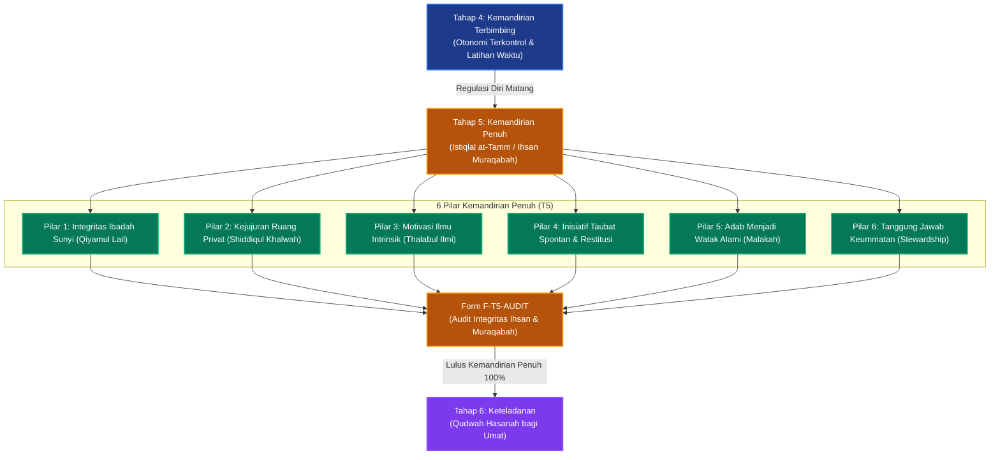

# P00038: Mengapa Tahap 5 Dinamakan Tahap Kemandirian Penuh?

## 1. Metadata & Identitas Dokumen Inkuiri
- **ID Inkuiri**: `PROBE_01_P00038`
- **Kode Berkas**: `P00038-Mengapa-Tahap-5-Dinamakan-Tahap-Kemandirian-Penuh.md`
- **Pilar**: Pilar 3 — Logika Penataan Arsitektur Konseptual TUMBUH
- **Domain Terkait**: `01_FUNDAMENTAL/02_CORE_MODEL/` (Tahap 5: Kemandirian Penuh / *Istiqlal at-Tamm*)
- **Status ADR**: `APPROVED & LOCKED` (Ketetapan Konstitusi Repositori Branch v2.0.0)
- **Versi Dokumen**: `2.0.0`
- **Tanggal Rilis**: 2026-10-25
- **Klasifikasi Epistemik**: *Autonomous Ihsan Architecture & Internal Locus of Control Modeling*
- **Keterlacakan**: Berkelanjutan dari `P00037` (Tahap 4 Kemandirian Terbimbing) dan menjadi landasan substantif tunggal bagi **Jenjang J3 (Mandiri Berintegritas)** di `01_FUNDAMENTAL/03_PROGRESSION/`.

---

## 2. Hakikat Fundamental & Latar Belakang Epistemik

### 2.1. Distorsi "Kemandirian Sekuler" vs "Kemandirian Islami (Ihsan)"
Di dunia modern, konsep kemandirian (*independence/autonomy*) kerap kali terdistorsi menjadi individualisme liar, penolakan terhadap otoritas moral, dan kebebasan hawa nafsu tanpa batas (*liberal autonomy*). Dalam paradigma sekuler, seseorang dianggap "mandiri" jika ia bebas melakukan apa pun yang ia sukai tanpa campur tangan orang lain.

Sebaliknya, dalam tradisi kepesantrenan lama, kerap kali ditemukan distorsi kebalikannya: **ketakutan berlebihan terhadap kemandirian**. Santri tingkat akhir usia 17–18 tahun tetap diperlakukan seperti anak kecil yang harus digiring dengan rotan ke masjid, disidak lemarinya setiap malam, dan tidak dipercaya mengelola tanggung jawab. Akibatnya, lembaga memproduksi lulusan yang mengalami infantilisme spiritual: shaleh hanya saat dipenjara dalam ekosistem asrama, namun langsung terseret arus kemaksiatan saat hidup di tengah masyarakat terbuka.

### 2.2. Hakikat Filosofis Nomenklatur "Kemandirian Penuh" (Istiqlal at-Tamm)
Sistem TUMBUH v2.0.0 membakukan **Tahap 5: Kemandirian Penuh** sebagai puncak kematangan personal (*personal mastery*) santri:
- **Kemandirian Bukan Pemutusan Hubungan, Melainkan Pembebasan dari Kontrol Makhluk**: Kemandirian penuh dalam Islam bukanlah independensi dari Allah, melainkan **kemerdekaan kalbu dari ketergantungan pada pengawasan manusia**. Santri beribadah, belajar, dan beradab bukan lagi karena ada musyrif yang mencatat, melainkan semata-mata karena cinta, takut, dan rasa harap kepada Allah Ta'ala (*Muraqabatullah*).
- **Pengawasan Eksternal Digantikan oleh Radar Batin (*Internal Locus of Control*)**: Derajat perancah musyrif (*scaffolding*) pada Tahap 5 dikurangi secara drastis hingga tersisa **20% (Level Konsultatif Murni)**. Musyrif tidak lagi bertindak sebagai polisi asrama, melainkan sahabat diskusi spiritual (*spiritual confidant*).
- **Integritas di Kala Sepi (*Integrity in Solitude*)**: Tolok ukur kemandirian penuh bukanlah kesalehan di hadapan publik, melainkan konsistensi adab saat pintu kamar terkunci rapat, saat lampu asrama padam, atau saat santri memegang perangkat digital tanpa pengawas. Inilah stasiun *Ihsan*: *"Engkau beribadah kepada Allah seakan-akan engkau melihat-Nya; dan jika engkau tidak melihat-Nya, maka sesungguhnya Dia melihatmu"*.

---

## 3. Dalil Naqli Turats & Integrasi Psikologi Integritas Diri

### 3.1. Rujukan Teks Turats Otoritatif: Hakikat Maqam Muraqabah dan Ihsan
Al-Qur'anul Karim secara eksplisit memuji hamba-hamba yang memiliki kemandirian batin tinggi: mereka yang takut kepada Allah di tempat tersembunyi yang jauh dari pandangan manusia:

```arabic
إِنَّ الَّذِينَ يَخْشَوْنَ رَبَّهُمْ بِالْغَيْبِ لَهُمْ مَغْفِرَةٌ وَأَجْرٌ كَبِيرٌ . وَأَسِرُّوا قَوْلَكُمْ أَوِ اجْهَرُوا بِهِ إِنَّهُ عَلِيمٌ بِذَاتِ الصُّدُورِ
```
*(Sesungguhnya orang-orang yang takut kepada Tuhannya di kala mereka tidak terlihat [oleh manusia], bagi mereka ampunan dan pahala yang besar. Dan rahasiakanlah perkataanmu atau lahirkanlah; sesungguhnya Dia Maha Mengetahui segala isi hati).*
— **QS. Al-Mulk [67]: 12–13**.

Dalam hadits Jibril yang sangat masyhur, Rasulullah shallallahu 'alaihi wa sallam mendefinisikan derajat tertinggi dari pembinaan iman dan akhlak manusia:
```arabic
قَالَ: فَأَخْبِرْنِي عَنِ الْإِحْسَانِ، قَالَ: «أَنْ تَعْبُدَ اللَّهَ كَأَنَّكَ تَرَاهُ، فَإِنْ لَمْ تَكُنْ تَرَاهُ فَإِنَّهُ يَرَاكَ»
```
*(Jibril berkata: "Maka kabarkanlah kepadaku tentang Ihsan!" Rasulullah menjawab: "Engkau beribadah kepada Allah seakan-akan engkau melihat-Nya; dan jika engkau tidak mampu melihat-Nya, maka sesungguhnya Dia melihatmu").*
— **HR. Muslim** (No. 8).

Imam Ibnu Rajab al-Hanbali (w. 795 H) dalam syarah *Jami' al-'Ulum wa al-Hikam* menguraikan bahwa derajat Ihsan ini adalah muara akhir dari seluruh proses pendidikan karakter:
```arabic
وَهَذَا الْقَدْرُ مِنْ مُرَاقَبَةِ اللَّهِ فِي الْخَلَوَاتِ هُوَ عِمَادُ الدِّينِ، وَمِلَاكُ الْإِيمَانِ؛ بِحَيْثُ يَسْتَوِي عِنْدَ الْعَبْدِ ظَاهِرُهُ وَبَاطِنُهُ، وَخَلْوَتُهُ وَجَلْوَتُهُ؛ فَلَا يَكُونُ تَرْكُهُ لِلْمَعْصِيَةِ لِمَخَافَةِ النَّاسِ، وَلَا فِعْلُهُ لِلطَّاعَةِ رِئَاءَهُمْ، بَلْ يَكُونُ حَرَكَتُهُ وَسُكُونُهُ خَالِصًا لِلَّهِ
```
*(Dan kadar Muraqabah kepada Allah di saat kesunyian ini adalah pilar utama agama dan inti keimanan; di mana pada diri seorang hamba telah menjadi sama antara lahiriah dan batiniahnya, antara kesendirian dan keramaiannya. Maka penolakannya terhadap maksiat bukan karena takut kepada manusia, dan pengamalan ketaatannya bukan karena riya' kepada mereka, melainkan gerak dan diamnya murni karena Allah semata).*
— **Ibnu Rajab al-Hanbali**, *Jami' al-'Ulum wa al-Hikam*, Jilid 1, Hal. 126.

Imam Al-Harawi (w. 481 H) dalam kitab *Manazil as-Sa'irin* menempatkan *Muraqabah* sebagai stasiun di mana jiwa telah mandiri dari ketergantungan pada motivasi eksternal: jiwa senantiasa terjaga (*dawam al-huzhur*) bersama kebenaran.

### 3.2. Integrasi Teori Motivasi Otonom Penuh dan Regulasi Diri Intrinsik
Dalam sains psikologi kepribadian dan neurokognisi kontemporer:
1. **Self-Determination Theory (Deci & Ryan) - Integrated Regulation**: Tahap 5 merepresentasikan puncak dari internalisasi motivasi, yaitu *Integrated Regulation*. Pada fase ini, nilai-nilai adab, disiplin, dan ibadah tidak lagi dirasakan sebagai tuntutan eksternal lembaga, melainkan telah melebur sepenuhnya menjadi bagian integral dari identitas diri santri (*"Aku shalat malam bukan karena aturan pondok, melainkan karena inilah siapa diriku sebagai hamba Allah"*).
2. **Internal Locus of Control (Rotter)**: Santri Tahap 5 memiliki lokus kendali internal yang dominan. Mereka meyakini bahwa kesuksesan belajar, kedekatan dengan Allah, dan masa depan mereka ditentukan oleh ikhtiar sungguh-sungguh dan taufiq Allah, bukan oleh pengawasan orang lain.
3. **Pematangan Sirkuit Frontostriatal Otak**: Pada usia 16–18 tahun, konektivitas antara korteks prefrontal dan amigdala/striatum telah jauh lebih stabil. Kapasitas menunda kepuasan sesaat (*delayed gratification*) demi tujuan jangka panjang (*akhirat*) telah dapat beroperasi secara mandiri tanpa membutuhkan intervensi musyrif terus-menerus.

---

## 4. Argumen Ontologis & Logika Dependensi Sistem

Penempatan Tahap 5 sebagai jembatan tunggal antara kemandirian personal (Jenjang J1–J3) dengan kepemimpinan sosial (Jenjang J4) merupakan hukum keniscayaan sistemik:

```
+-----------------------------------------------------------------------------------------+
|                  LOGIKA DEPENDENSI SEKUANSIAL CORE MODEL (T1 s/d T7)                    |
+-----------------------------------------------------------------------------------------+
| FASE PEMBENTUKAN PERSONAL (Tahap 1, Tahap 2, Tahap 3, Tahap 4)                          |
|        ↓                                                                                |
| TAHAP 5: KEMANDIRIAN PENUH (PUNCAK INTEGRITAS DIRI, MURAQABAH 100%, SCAFFOLDING 20%)    |
|        ↓                                                                                |
| FASE TRANSFORMASI SOSIAL (Tahap 6 Keteladanan & Tahap 7 Penggerak Umat)                 |
+-----------------------------------------------------------------------------------------+
```

### 4.1. Mengapa Kemandirian Penuh Tidak Boleh Diberikan di Tahap Awal?
- Jika santri di Tahap 1 atau Tahap 2 langsung diberikan kemandirian penuh (tanpa scaffolding musyrif), santri akan mengalami disorientasi moral dan kehancuran ritme hidup, karena radar batinnya belum terbentuk.
- Kemandirian penuh adalah **buah matang (*tsamarah*)** dari pohon panjang yang akarnya telah ditanam lewat pembiasaan raga (T1), disirami pemahaman nalar (T2), ditempa dalam ujian resiliensi (T3), dan dilatih dalam simulasi terbimbing (T4).

### 4.2. Mengapa Kemandirian Penuh Wajib Mendahului Tahap Keteladanan (Tahap 6)?
- Seseorang tidak dapat menjadi panutan hidup (*Qudwah*) yang autentik bagi adik-adik kelasnya jika integritas moralnya masih rapuh saat sendirian.
- Keteladanan yang dipaksakan pada santri yang belum mandiri penuh hanya akan melahirkan **keteladanan palsu (*kemunafikan kepemimpinan*)**: manis tutur katanya di mimbar masjid, namun bermaksiat secara rahasia di bilik kamar mandi atau media sosial. Tahap 5 memastikan bahwa santri telah selesai dengan dirinya sendiri sebelum memimpin orang lain.

---

## 5. Studi Kasus Lapangan & Analisis Komparatif

### 5.1. Kasus Lapangan 1: Fenomena "Munafik Digital" Santri Tingkat Akhir di Pesantren M
Pesantren M di Jawa Barat memiliki tradisi penegakan disiplin kaku hingga kelas 3 Aliyah: santri tingkat akhir tetap diwajibkan diabsen per jam oleh musyrif, lemari disidak mingguan, dan santri dilarang memiliki waktu luang tanpa instruksi.

**Bencana Penemuan Kasus**:
- Ketika diadakan audit mendadak oleh yayasan bersama tim siber, ditemukan bahwa 48% santri kelas 3 Aliyah memiliki telepon genggam pintar ilegal yang disembunyikan di dalam plafon atap asrama.
- Melalui perangkat tersebut, santri mengakses situs perjudian daring, konten asusila, dan grup pergaulan bebas.
- Yang paling mengejutkan, sebagian besar santri yang terlibat adalah pengurus keamanan santri yang di siang hari sangat galak merazia adik kelasnya.
- **Akar Masalah**: Pesantren M tidak pernah melatih **Tahap 5 Kemandirian Penuh**. Lembaga hanya memproduksi kepatuhan karena takut kamera CCTV dan mata musyrif; ketika mata pengawas terpejam, radar moral batin santri mati total.

### 5.2. Kasus Lapangan 2: Keberhasilan "Kamar Santri Berintegritas Mandiri" di Pesantren K
Pesantren K di Jawa Tengah merancang blok asrama khusus santri kelas 2 dan 3 Aliyah berbasis Tahap 5 TUMBUH:
1. **Peniadaan Absensi Fisik Menjelang Subuh**: Musyrif tidak lagi masuk ke kamar untuk membangunkan santri; santri membangunkan dirinya sendiri menggunakan kesadaran alarm batin. Pintu kamar asrama tidak digembok dan tidak dipasang kamera pengawas.
2. **Kantin Kejujuran & Pengelolaan Fasilitas Mandiri**: Santri mengelola laboratorium komputer, perpustakaan, dan kantin asrama tanpa penjaga; uang pembayaran ditaruh di kotak terbuka, dan catatan belanja ditulis sendiri secara jujur.
3. **Hasil Teruji**: Selama 3 tahun berturut-turut, tingkat ketepatan shalat berjamaah santri blok Tahap 5 mencapai 99,4%, selisih keuangan kantin kejujuran 100% klop (bahkan sering kali surplus karena santri melebihkan uang infaq), dan santri menghasilkan puluhan karya tulis ilmiah serta mutun hafalan yang mutqin.

### 5.3. Analisis Komparatif Tiga Paradigma Kedewasaan Santri
| Parameter Evaluasi | Model Panoptikon (Pengawasan Sensorik Total) | Model Sekuler-Permisif (Kemandirian Tanpa Tuhan) | Model Ihsan Muraqabah (TUMBUH Tahap 5) |
|:---|:---|:---|:---|
| **Sumber Kepatuhan** | Ketakutan akan tertangkap basah oleh kamera/pengawas fisik. | Pertimbangan untung-rugi rasional atau citra sosial duniawi. | Kesadaran kalbu diawasi oleh Allah di kala sepi dan ramai (*Muraqabah*). |
| **Derajat Pengawasan** | 100% intervensi fisik; musyrif bertindak sebagai polisi/detektif. | 0% pengawasan; tidak ada ikatan nilai dan bimbingan ruhani. | 20% konsultatif murni (*scaffolding minimal*); musyrif sebagai sahabat taqwa. |
| **Perilaku di Kala Sendiri**| Pelanggaran tersembunyi; hipokrisi moral (*nifaq amali*). | Bebas melakukan apa saja selama tidak melanggar hukum positif. | Konsisten menjaga pandangan, lisan, dan ibadah sunnah (*shiddiqul khulwah*). |
| **Respon Terhadap Kekhilafan**| Menyembunyikan kesalahan serapat mungkin karena takut dihukum. | Merasa wajar berbuat salah tanpa penyesalan spiritual (*anomi moral*). | Segera bertaubat nasuha, melakukan muhasabah, dan restitusi mandiri. |
| **Kesiapan Menghadapi Dunia Luar**| Sangat rapuh; mudah terseret pergaulan bebas begitu lulus pondok. | Individualistis, sekuler, dan kering dari ruh keikhlasan pengabdian. | Tangguh, berintegritas kokoh, menjadi pelita adab di tengah masyarakat. |

---

## 6. Enam Pilar Kemandirian Penuh Tahap 5 TUMBUH (The 6 Pillars of Stage 5)

Dokumen model `02_CORE_MODEL/` menetapkan enam pilar kemandirian penuh yang wajib mengakar pada santri di Tahap 5:

```
  +-----------------------------------------------------------------------------------+
  |               ENAM PILAR KEMANDIRIAN PENUH SANTRI TAHAP 5 (TUMBUH)                |
  +-----------------------------------------------------------------------------------+
  | 1. UNSUPERVISED QIYYAM & IBADAH| Istiqamah bangun malam (tahajjud), witir, dan     |
  |    (Integritas Ibadah Sunyi)   | shalat rawatib tanpa perlu dibangunkan musyrif.  |
  +--------------------------------+--------------------------------------------------+
  | 2. SHIDDIQ AL-KHALWAH          | Menjaga pandangan mata, kehormatan diri, dan     |
  |    (Kejujuran Saat Sendirian)  | etika digital saat sendirian tanpa pengawas.     |
  +--------------------------------+--------------------------------------------------+
  | 3. INTRINSIC SCHOLARLY PURSUIT | Menuntut ilmu, meneliti kitab, dan muroja'ah     |
  |    (Gandrung Ilmu Mandiri)     | hafalan didorong oleh kelezatan thalabul ilmi.   |
  +--------------------------------+--------------------------------------------------+
  | 4. SPONTANEOUS RESTORATION     | Segera mengakui kesalahan secara kesatria dan    |
  |    (Inisiatif Taubat & Ishlah) | melakukan perbaikan adab tanpa menunggu disidang.|
  +--------------------------------+--------------------------------------------------+
  | 5. INTERNALIZED ADAB ETIQUETTE | Menjalankan adab sopan santun sebagai watak alami|
  |    (Adab Menjadi Watak Alami)  | (*malakah rasikhah*), bukan demi mencari pujian. |
  +--------------------------------+--------------------------------------------------+
  | 6. ALTRUISTIC STEWARDSHIP      | Menjaga ketertiban dan kebersihan asrama karena  |
  |    (Tanggung Jawab Keummatan)  | rasa memiliki (*sense of sacred stewardship*).   |
  +-----------------------------------------------------------------------------------+
```

### 6.2. Metodologi Pendampingan Musyrif: Konsultatif Kemitraan Ruhani (Scaffolding 20%)
Di Tahap 5, interaksi antara musyrif dan santri berubah menjadi relasi kemitraan ruhani yang matang:
1. **The Monthly Spiritual Mentoring (Halaqah Khusus Maqamat)**: Musyrif bertemu sebulan sekali untuk mendiskusikan kedalaman batin, pembersihan hati (*tazkiyatun nufs*), dan persiapan masa depan santri menuju jenjang kepemimpinan umat.
2. **Consultative Life Planning**: Santri menyusun rencana hidup (*life masterplan*), target karya ilmiah, dan pilihan jurusan perguruan tinggi, lalu meminta masukan dari musyrif sebagai penasihat bijak.
3. **Full Honor-Code Trust**: Santri diberikan kepercayaan memegang kunci kamar, akses perpustakaan 24 jam, dan tanggung jawab memelihara fasilitas pondok tanpa pemeriksaan mencurigakan.

---

## 7. Diagram Alur & Logika Dependensi Turunan Sistem



---

## 8. Spesifikasi Formulir Audit Kemandirian Penuh (Form F-T5-AUDIT)

Formulir ini wajib digunakan oleh Musyrif Senior dan Dewan Asatidz pada akhir Semester 1 Kelas 3 Aliyah untuk memverifikasi kelayakan santri melangkah ke fase kepemimpinan sosial (Tahap 6 Keteladanan):

### 8.1. Lembar Verifikasi Integritas Muraqabah dan Ihsan Santri Tahap 5
| No | Parameter Kemandirian Penuh | Indikator Integritas Nyata di Lapangan | Metode Verifikasi Asatidz | Status Kelayakan |
|:---|:---|:---|:---|:---:|
| 1 | **Konsistensi Qiyamul Lail Mandiri**| Melaksanakan shalat malam rutin di masjid/kamar tanpa dibangunkan siapa pun. | Pemantauan cctv adab / saksi rekan | [ ] Mandiri Penuh / [ ] Terkadang Bolong |
| 2 | **Kejujuran Ruang Privat Digital** | Tidak menggunakan gawai untuk hal-hal maksiat saat memiliki akses mandiri. | Uji integritas acak & wawancara kalbu | [ ] Bersih Terjaga / [ ] Bocor Maksiat |
| 3 | **Kemandirian Mutqin Hafalan** | Muroja'ah mandiri 2–3 juz per hari tanpa menunggu jadwal setoran wajib ustadz. | Uji ketahanan sima'an 5 juz | [ ] Mutqin Mandiri / [ ] Menunggu Ditagih |
| 4 | **Kesatriaan Mengakui Kekhilafan** | Datang sendiri melapor dan meminta maaf jika tanpa sengaja merusak fasilitas/salah adab. | Catatan spontanitas restitusi | [ ] Kesatria Tulus / [ ] Pasif Mengelak |
| 5 | **Kemurnian Niat Beramal** | Menolak publisitas semu; lebih bahagia beramal secara tersembunyi (*amalan sirri*). | Observasi keikhlasan khidmah | [ ] Ikhlas Terjaga / [ ] Gemar Dipuji |
| 6 | **Kedewasaan Menjaga Iklim Asrama**| Berani mengingatkan teman yang lalai dengan hikmah dan kelembutan tanpa memicu konflik. | Umpan balik sosiometri asrama | [ ] Mengayomi / [ ] Cuek Masa Bodoh |
| 7 | **Kesiapan Integritas Pasca-Lulus** | Memiliki komitmen tertulis nilai moral dan rencana istiqamah hidup di perguruan tinggi. | Sidang komprehensif kepribadian | [ ] Siap Terjun / [ ] Masih Ragu |

### 8.2. Skrip Validasi Kepatuhan Kurikulum Tahap 5 (`audit_stage_5_integrity.py`)
Skrip otomatis ini mengaudit naskah regulasi asrama santri senior guna menjamin ketiadaan sistem mikro-manajemen dan memastikan berlakunya sistem *Honor Code*:

```python
#!/usr/bin/env python3
"""
Validator Otomatis: Kepatuhan Standar Kemandirian Penuh Tahap 5 TUMBUH
Branch: v2.0.0
"""

import sys
from pathlib import Path

REQUIRED_STAGE_5_CONSTRUCTS = [
    "muraqabah",
    "ihsan",
    "honor_code",
    "scaffolding_20_percent",
    "shiddiq_al_khalwah"
]

FORBIDDEN_STAGE_5_PATTERNS = [
    "razia mendadak tanpa izin",
    "pemasangan cctv di bilik privat",
    "giringan fisik shalat",
    "hukuman mempermalukan senior"
]

def audit_stage_5_framework(core_model_dir: str) -> bool:
    target_dir = Path(core_model_dir)
    if not target_dir.exists():
        print(f"[SKIP] Direktori {core_model_dir} belum dibuat.")
        return True

    violations = []
    has_stage_5_doc = False
    for md_file in target_dir.glob("*.md"):
        content = md_file.read_text(encoding="utf-8").lower()
        if "tahap_5" in content or "kemandirian_penuh" in content:
            has_stage_5_doc = True
            for forbidden in FORBIDDEN_STAGE_5_PATTERNS:
                if forbidden in content:
                    violations.append((md_file.name, f"Pola intervensi terlarang: '{forbidden}'"))
            for req in REQUIRED_STAGE_5_CONSTRUCTS:
                if req not in content:
                    violations.append((md_file.name, f"Konstruk wajib belum ada: '{req}'"))

    if violations:
        print("[CRITICAL ERROR] Ditemukan ketidaksesuaian kurikulum Tahap 5:")
        for fname, msg in violations:
            print(f"  - File: {fname} | {msg}")
        return False

    print("\n[SUCCESS] Kurikulum Tahap 5 memenuhi standar Kemandirian Penuh & Ihsan 100%.")
    return True

if __name__ == "__main__":
    if not audit_stage_5_framework("01_FUNDAMENTAL/02_CORE_MODEL"):
        sys.exit(1)
```

### 8.3. Matriks Penanganan Kebocoran Integritas pada Tahap 5
Meskipun santri telah berada di Tahap 5, kekhilafan manusiawi tetap dapat terjadi. Berikut adalah protokol pemulihan adab bagi santri senior:

| Kategori Kebocoran Integritas | Respon Hukuman Keliru (Dilarang) | Penanganan Restoratif Maqam Ihsan (TUMBUH) |
|:---|:---|:---|
| **Terlanjur Mengakses Konten Negatif di Gawai** | Diarak keliling pesantren, disiarkan di megafon, dipecat seketika (*drop out*). | Sesi konseling taubat nasuha tertutup bersama asatidz kharismatik; detoks digital 14 hari dengan proyek tadabbur tafsir. |
| **Terlambat Bangun Subuh Karena Kelelahan Belajar**| Dicukur botak, disanksi membersihkan septic tank di depan adik kelas. | Evaluasi beban belajar malam santri; bimbingan adab manajemen tidur sunnah (*Qailulah*); mengganti dengan shalat dhuha 8 rakaat. |
| **Terlibat Konflik Tajam dengan Rekan Senior** | Kedua pihak langsung dicopot dari jabatan organisasi santri. | Mediasi *Ishlah Dzatil Bain* empat mata; saling memaafkan dan penugasan proyek kebajikan bersama untuk adik kelas. |
| **Mengalami Krisis Keraguan Arah Masa Depan** | Santri dicap kurang bersyukur dan kurang tawakkal kepada Allah. | Bimbingan pemetaan bakat dan istikharah karir (*career coaching*) oleh tim alumni dan psikolog pendidikan Islam. |

---

## 9. Architectural Decision Record (ADR): Penguncian Nomenklatur Tahap 5

### Context
Ketiadaan ruang pematangan integritas mandiri di tingkat akhir telah melahirkan generasi santri yang rapuh imannya ketika tidak lagi diawasi oleh figur otoritas pesantren. Di sisi lain, perlakuan yang terus-menerus mengekang santri dewasa menumbuhkan sikap hipokrit dan kemunafikan tersembunyi. Repositori TUMBUH membutuhkan penguncian arsitektural yang membakukan Tahap 5 sebagai Kemandirian Penuh (*Istiqlal at-Tamm*) berbasis kesadaran *Muraqabatullah*.

### Decision
Diputuskan secara mutlak dan permanen bahwa:
1. Tahap Kelima dalam Core Model TUMBUH resmi dinamakan **Tahap 5: Kemandirian Penuh (*Istiqlal at-Tamm*)**.
2. Fokus kurikulum Tahap 5 adalah pengokohan maqam Ihsan, pembentukan kejujuran di kala sendirian (*Shiddiq al-Khalwah*), motivasi belajar intrinsik, dan tanggung jawab keummatan, dengan derajat scaffolding musyrif sebesar 20% (Level Konsultatif).
3. Santri Tahap 5 dinaungi dalam sistem kehormatan (*Honor Code System*) yang memberikan kepercayaan penuh tanpa pengawasan fisik yang mencurigai martabat fitrahnya.

### Status
`APPROVED & LOCKED` (Ketetapan Konstitusi Repositori Branch v2.0.0).

### Consequences
- **Positif**: Terlahirkannya insan adabi sejati yang shalih lahir dan batin; terlindunginya santri dari penyakit kemunafikan; dan tersedianya calon-calon pemimpin yang memiliki integritas tak tergoyahkan untuk dipromosikan ke Tahap 6 (Keteladanan).
- **Tantangan**: Menuntut pengelola pesantren untuk berani memberikan kepercayaan besar kepada santri senior dan meninggalkan paradigma pengawasan militeristik lama.

---

## 10. Drift Guardrails & Anti-Pattern Checklist

Tiga puluh aturan anti-penyimpangan pengasuhan Tahap 5 yang wajib dipatuhi:

- [x] **Guardrail 1 (Strict Primacy of Muraqabah)**: Kemandirian penuh wajib berporos pada kesadaran diawasi Allah (*Muraqabah*), bukan kebebasan sekuler tanpa batas.
- [x] **Guardrail 2 (Honor Code System Implementation)**: Santri Tahap 5 diperlakukan berbasis asas praduga kejujuran (*trust-based honor system*).
- [x] **Guardrail 3 (Scaffolding Faded to 20%)**: Musyrif dilarang melakukan inspeksi mikro yang merendahkan martabat kedewasaan santri Tahap 5.
- [x] **Guardrail 4 (Absolute Ban on CCTV in Private Dorms)**: Dilarang keras memasang kamera pengawas di dalam kamar tidur atau bilik istirahat santri senior.
- [x] **Guardrail 5 (Sanctity of Solitary Devotion)**: Santri difasilitasi memiliki ruang hening untuk mendirikan qiyamul lail dan tilawah malam secara mandiri.
- [x] **Guardrail 6 (Confidentiality of Spiritual Confessions)**: Pengakuan dosa atau kekhilafan santri saat sesi konseling haram dibocorkan kepada dewan guru lain.
- [x] **Guardrail 7 (Intrinsic Motivation Priority)**: Evaluasi ibadah santri tidak lagi menggunakan kartu presensi paraf, melainkan kesadaran kalbu santri sendiri.
- [x] **Guardrail 8 (De-Stigmatization of Temporary Slips)**: Kekhilafan santri senior diselesaikan secara elegan tanpa mempermalukannya di depan adik kelas.
- [x] **Guardrail 9 (Prohibition of Spy Networks)**: Pengasuh dilarang merekrut adik kelas untuk menjadi mata-mata yang mengintai santri Tahap 5.
- [x] **Guardrail 10 (Restorative Restitution Over Retaliation)**: Pelanggaran etika diselesaikan melalui restitusi adab nyata yang mendidik, bukan skorsing kejam.
- [x] **Guardrail 11 (Autonomous Academic Research)**: Santri difasilitasi menulis karya ilmiah, artikel jurnal, atau risalah keilmuan secara mandiri.
- [x] **Guardrail 12 (Safe Digital Access Training)**: Santri dilatih menggunakan gawai digital secara bertanggung jawab sebagai sarana dakwah dan riset ilmu.
- [x] **Guardrail 13 (Parental Respect for Autonomy)**: Orang tua diedukasi agar memperlakukan anak usia 17–18 tahun sebagai orang dewasa yang diajak bermusyawarah.
- [x] **Guardrail 14 (Continuous Altruistic Stewardship)**: Santri Tahap 5 dibiasakan merawat fasilitas pesantren bukan karena disuruh, tapi karena rasa cinta pada almamater.
- [x] **Guardrail 15 (Quarterly F-T5-AUDIT Verification)**: Verifikasi form F-T5-AUDIT wajib dituntaskan sebelum santri dilantik menjadi mentor Tahap 6.
- [x] **Guardrail 16 (Prohibition of Feudal Bullying)**: Santri Tahap 5 haram memanfaatkan otonominya untuk menindas atau menyuruh-nyuruh adik kelas.
- [x] **Guardrail 17 (Promotion of Sincere Humility)**: Penekanan bahwa kemandirian ibadah tidak boleh melahirkan penyakit kesombongan spiritual (*ujub*).
- [x] **Guardrail 18 (Equitable Opportunity for Introverts)**: Santri yang berkepribadian pendiam tetap diberikan ruang kemandirian yang setara tanpa diskriminasi.
- [x] **Guardrail 19 (Healthy Nutrition and Sleep Balance)**: Santri dilatih menjaga jam istirahat malam dan nutrisi halal-thayyib tanpa perlu diperingatkan.
- [x] **Guardrail 20 (Sacred Ultimate Longing for Allah)**: Puncak pencapaian Tahap 5 adalah rasa manisnya iman (*halawatul iman*) dan kerinduan berjumpa Allah.
- [x] **Guardrail 21 (Consultative Life Roadmap Mentoring)**: Asatidz mendampingi santri merumuskan visi dakwah dan peta jalan hidup 10 tahun ke depan.
- [x] **Guardrail 22 (Elimination of Public Punishments)**: Santri senior yang khilaf tidak boleh dihukum lari di lapangan atau dibentak di depan umum.
- [x] **Guardrail 23 (Safe Emotional Catharsis Spaces)**: Pesantren menyediakan ruang aman bagi santri untuk mengungkapkan kecemasan menghadapi ujian akhir.
- [x] **Guardrail 24 (Active Brotherhood Cohesion)**: Ikatan ukhuwah antarsantri Tahap 5 diperkuat agar menjadi jaringan alumni yang saling menguatkan kebaikan.
- [x] **Guardrail 25 (Universal Fitrah Protection)**: Menjamin bahwa lingkungan Tahap 5 senantiasa memancarkan keindahan Islam yang rahmatan lil 'alamin.
- [x] **Guardrail 26 (Continuous Clinical Supervision)**: Musyrif pembina Tahap 5 wajib mendapatkan bimbingan berkala dari pakar konseling keluarga Islam.
- [x] **Guardrail 27 (Prohibition of Forced Conformity)**: Menghargai keragaman minat bakat keilmuan santri (sains, fiqh, sastra, teknologi) tanpa penyeragaman kaku.
- [x] **Guardrail 28 (Spiritual Retreat Experiences)**: Santri difasilitasi mengikuti program i'tikaf sepuluh hari terakhir Ramadhan secara mandiri dan syahdu.
- [x] **Guardrail 29 (Equitable Sharing of Leadership Burdens)**: Amanah tata kelola asrama dibagi rata agar tidak membebani santri tertentu hingga mengorbankan belajar.
- [x] **Guardrail 30 (Preparation for Stage 6 Qudwah)**: Tahap 5 wajib memastikan santri telah memiliki keteladanan batin sebelum menjadi uswah bagi adik kelas di Tahap 6.

---

## 11. Traceability Matrix & Bibliografi Rujukan Terkurasi

### 11.1. Hubungan Silang Antarlapisan Repositori (Cross-Reference)
- `01_FUNDAMENTAL/02_CORE_MODEL/`: Direktori target yang memuat spesifikasi Tahap 5 sebagai puncak pencapaian personal santri.
- `PROBE/PROBE_01/P00037-Mengapa-Tahap-4-Dinamakan-Tahap-Kemandirian-Terbimbing.md`: Tahap pendahulu yang melatih otonomi terkontrol sebelum kemandirian penuh dicapai.
- `PROBE/PROBE_01/P00039-Mengapa-Tahap-6-Dinamakan-Tahap-Keteladanan-dan-Tahap-7-Dinamakan-Penggerak.md`: Tahap berikutnya yang mentransformasikan integritas personal menjadi keteladanan sosial.
- `01_FUNDAMENTAL/03_PROGRESSION/`: Tahap 5 menjadi fondasi pembentuk **Jenjang J3 (Mandiri Berintegritas)**.
- `03_OPERATIONAL/02_SOP/`: SOP Tata Kelola Asrama Santri Senior yang berbasis *Honor Code System*.

### 11.2. Bibliografi Pustaka Rujukan Terkurasi (APA 7th Edition)
- Al-'Asqalani, I. H. (2000). *Fath al-bari bi syarh shahih al-bukhari: Kitab ar-riqaq* (Tahqiq M. F. Abdul Baqi, Jilid 11). Al-Qahirah: Dar al-Hadits.
- Al-Ghazali, A. H. (2004). *Ihya' 'ulum al-din: Kitab al-muraqabah wa al-muhasabah* (Tahqiq A. Ali, Jilid 4). Dar asy-Sya'b.
- Al-Harawi, A. I. (1988). *Manazil as-sa'irin ila al-haqq al-mubin*. Al-Qahirah: Dar al-Kitab al-Lubnani.
- Al-Mawardi, A. H. (1987). *Adab ad-dunya wa ad-din*. Bairut: Dar Iqra'.
- Bandura, A. (1997). *Self-efficacy: The exercise of control*. W. H. Freeman and Company.
- Casey, B. J., Jones, R. M., & Somerville, L. H. (2011). Braking and accelerating of the adolescent brain. *Journal of Research on Adolescence*, 21(1), 21–33.
- Deci, E. L., & Ryan, R. M. (2000). The "what" and "why" of goal pursuits: Human needs and the self-determination of behavior. *Psychological Inquiry*, 11(4), 227–268.
- Duckworth, A. (2016). *Grit: The power of passion and perseverance*. Scribner.
- Dweck, C. S. (2006). *Mindset: The new psychology of success*. Random House.
- Erikson, E. H. (1968). *Identity: Youth and crisis*. W. W. Norton & Company.
- Ibn Qayyim al-Jauziyyah, M. (1996). *Madarij as-salikin baina manazil iyyaka na'budu wa iyyaka nasta'in: Manzilat al-muraqabah* (M. al-Baghdadi, Ed., Jilid 2). Dar al-Kitab al-'Arabi.
- Ibnu Rajab al-Hanbali. (2001). *Jami' al-'ulum wa al-hikam fi syarh khamsina haditsan min jawami' al-kalim* (Tahqiq T. A. Sa'd, Jilid 1). Al-Qahirah: Dar al-Hadits.
- Noddings, N. (2013). *Caring: A relational approach to ethics and moral education* (2nd ed.). University of California Press.
- Rotter, J. B. (1966). Generalized expectancies for internal versus external control of reinforcement. *Psychological Monographs: General and Applied*, 80(1), 1–28.
- Ryan, R. M., & Deci, E. L. (2017). *Self-determination theory: Basic psychological needs in motivation, development, and wellness*. Guilford Publications.
- Steinberg, L. (2008). A social neuroscience perspective on adolescent risk-taking. *Developmental Review*, 28(1), 78–106.
- Vygotsky, L. S. (1978). *Mind in society: The development of higher psychological processes*. Harvard University Press.
- Wan Mohd Nor Wan Daud. (1998). *The educational philosophy and practice of Syed Muhammad Naquib al-Attas*. ISTAC.

---

## 12. Rekomendasi Aksi Nyata Bagi Pengembang Kurikulum TUMBUH

Langkah konkret yang wajib dieksekusi pasca pengesahan monograf ini:

1. **Pemberlakuan Piagam Kehormatan (*Honor Code Charter*)**:
   Terbitkan naskah resmi piagam kehormatan bagi asrama santri kelas 2 & 3 Aliyah yang memberikan otonomi penuh berbasis integritas Muraqabah.
2. **Peniadaan Kamera CCTV di Bilik Kamar dan Lorong Privat Asrama Senior**:
   Pindahkan fokus pengawasan dari perangkat elektronik mata-mata menuju pembinaan kalbu dan sesi bimbingan refleksi tatap muka.
3. **Penyelenggaraan Program Kantin dan Fasilitas Kejujuran Tanpa Penjaga**:
   Fasilitasi laboratorium praktik integritas di mana santri melayani diri sendiri dan mencatat keuangannya secara mandiri.
4. **Pemasangan Validator audit_stage_5_integrity.py pada CI/CD**:
   Pasang linter otomatis guna mencegah diterbitkannya SOP yang memperlakukan santri Tahap 5 dengan hukuman fisik atau mikro-manajemen infantil.
5. **Pelatihan Spiritual Mentoring bagi Musyrif Senior**:
   Selenggarakan pembekalan khusus bagi musyrif pembina santri tingkat akhir tentang cara mendampingi krisis eksistensial remaja dan penanaman aqidah mendalam.
6. **Penyusunan Portofolio Karya Mandiri Kelulusan**:
   Wajibkan setiap santri Tahap 5 menyelesaikan karya ilmiah, karya seni sastra adab, atau hafalan mutun sebagai bukti kemandirian intelektualnya.
7. **Pemberian Akses Perpustakaan dan Laboratorium 24 Jam**:
   Berikan kartu akses mandiri kepada santri Tahap 5 untuk meneliti dan membaca referensi keilmuan tanpa batasan jam malam yang kaku.
8. **Edukasi Khusus "Menyambut Kedewasaan Anak" bagi Orang Tua**:
   Gelar forum diskusi bersama wali santri tingkat akhir mengenai cara membangun komunikasi setara dan menghargai keputusan hidup anak secara bijak.

---

## 13. Emergent Questions & Inkuiri Lanjutan (Chain of Inquiry)

Pengesahan kemandirian penuh berbasis integritas kalbu ini secara organik membuka pintu penyelidikan pada dua tahapan puncak pemodelan TUMBUH:

- **P00039**: *Mengapa Tahap 6 Dinamakan Tahap Keteladanan dan Tahap 7 Dinamakan Penggerak?* (Menyelidiki bagaimana integritas personal santri bertransformasi menjadi pancaran uswah hasanah bagi generasi adik kelas di Tahap 6, serta memuncak menjadi kepemimpinan khidmah penggerak peradaban umat di Tahap 7).
- **P00040**: *Penutup Pilar 3 & Jembatan ke Pilar 4: Logika Taksonomi 4 Jenjang Kemandirian (J1–J4)*. (Mengevaluasi bagaimana ketujuh tahapan perkembangan ini dipetakan secara matematis dan pedagogis ke dalam empat jenjang kemandirian santri).
