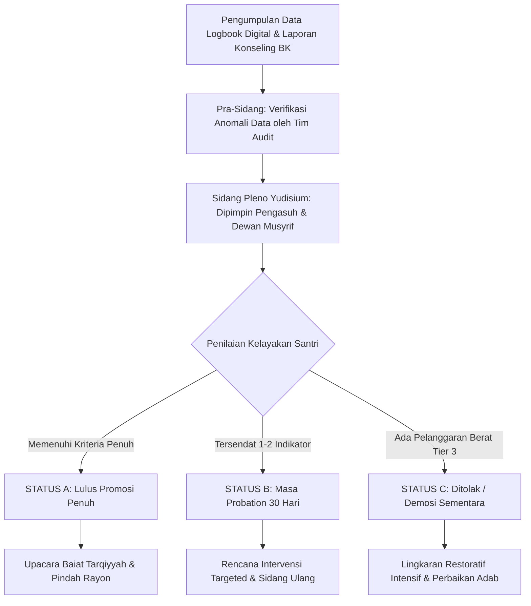

# P00045: Mekanisme Transisi dan Promosi Antar-Jenjang

> **Status Monograf:** APPROVED & LOCKED  
> **Kategori:** Pilar 4 - Operasionalisasi Profil Jenjang J1–J4 dan Asesmen PBIS Multi-Tier  
> **Klasifikasi:** Panduan Tata Kelola Promosi Karakter, Sidang Yudisium Adab, Protokol Probation & Upacara Baiat Tarqiyyah  
> **Keterlacakan Fondasi:** `01_FUNDAMENTAL/03_PROGRESSION/02_FOUR_LEVELS.md`, `01_FUNDAMENTAL/03_PROGRESSION/03_ASSESSMENT_SYSTEM.md`, `01_FUNDAMENTAL/01_FOUNDATION/09_SYSTEM_ARCHITECTURE.md`  
> **Penanggung Jawab:** Dewan Pakar Psikometri Karakter & Tata Kelola Evaluasi Santri TUMBUH  

---

## 1. Identitas Penyelidikan dan Konteks Masalah

Dalam dunia pendidikan pesantren, kenaikan jenjang santri secara tradisional hampir selalu disandarkan secara otomatis pada pergantian tahun ajaran kalender atau kelulusan ujian akademik tertulis madrasah. Pola kenaikan otomatis (*automatic grade promotion*) ini menimbulkan distorsi pedagogis yang berbahaya: santri yang secara akademis memperoleh nilai tinggi tetapi adab kesehariannya masih sangat bergantung pada bentakan musyrif (mentalitas J1) tetap dinaikkan ke kelas atas, di mana mereka justru menjadi sumber friksi sosial dan penyebaran perilaku buruk kepada santri yang lebih muda.

Sebaliknya, ada santri yang memiliki kematangan adab, kemandirian ibadah hening, dan kepedulian sosial luar biasa, namun tersendat dalam promosi kelas formal hanya karena nilai ujian hafalan tertulisnya kurang memuaskan. Ketimpangan ini melahirkan sinisme santri terhadap nilai-nilai akhlak, seolah-olah adab hanyalah pemanis bibir yang tidak diperhitungkan dalam status kelembagaan.

Arsitektur TUMBUH menetapkan bahwa **Promosi Jenjang Kemandirian (J1 → J2 → J3 → J4)** adalah keputusan berbasis bukti perilaku (*behavioral evidence-based decision*) yang berdiri independen namun tersinkronisasi secara harmonis dengan rapor akademik. Penyelidikan P00045 merumuskan mekanisme operasional transisi antar-jenjang: tata cara Sidang Yudisium Karakter kuartalan, portofolio logbook adab digital, protokol masa peninjauan (*probation*) berkeadilan, hingga upacara sakral pengukuhan baiat jenjang (*Tasyakkur at-Tarqiyyah*).

---

## 2. Hakikat Fundamental Mekanisme Transisi & Promosi

Transisi antar-jenjang dalam TUMBUH bukan sekadar seremoni serah terima predikat, melainkan **uji kelayakan kapasitas pemikul amanah (*maratib al-amanah wa al-mas'uliyyah*)**:

```
===================================================================================================
ALUR TATA KELOLA SIDANG PROMOSI JENJANG KEMANDIRIAN SANTRI (J1 -> J4)
===================================================================================================
1. Akumulasi Logbook   : Perekaman data observasi harian PBIS Tier 1 & 2 selama 90–180 hari.
2. Pra-Sidang Rayon    : Musyrif rayon bersama konselor BK menyusun rekapitulasi skor adab.
3. Sidang Yudisium     : Forum musyawarah tertutup musyrif, asatidz, dan pimpinan pengasuhan.
4. Penetapan Status    : [A] Lulus Promosi Penuh  |  [B] Masa Probation (30 Hari)  |  [C] Ditolak/Demosi.
5. Upacara Tarqiyyah   : Baiat ikrar amanah jenjang baru & penyerahan pin pengenal karakter.
===================================================================================================
```

### 2.1 Tiga Prinsip Epistemik Promosi Jenjang TUMBUH
1. **Bukti Faktual Mengalahkan Persepsi Subjektif (*Data Over Impression*):** Keputusan promosi wajib didasarkan pada catatan logbook harian terverifikasi, bukan berdasarkan perasaan suka-tidak suka (*like-dislike*) musyrif terhadap santri tertentu.
2. **Keadilan Restoratif bagi Santri Lambat (*Equity for Slower Developers*):** Santri yang belum memenuhi kriteria promosi tidak dicap gagal, melainkan diberikan pendampingan terarah dalam masa *probation* dengan penyesuaian strategi *scaffolding*.
3. **Peningkatan Jenjang Berarti Peningkatan Khidmah (*Ascension as Service*):** Kenaikan jenjang bukan pemberian previlese kenikmatan, melainkan pelipatgandaan tanggung jawab moral untuk melayani ekosistem pesantren.

---

## 3. Landasan Teks Turats Klasik dan Takhrij Kitab

### 3.1 Kaidah Syar'i Pemberian Tanggung Jawab Berdasarkan Kesiapan Kapasitas
Dalam tradisi syariat Islam, penyerahan amanah kepemimpinan dan kelonggaran taklif senantiasa diikat dengan bukti kelayakan integritas (*al-kifayah wa al-amanah*). Allah Subhanahu wa Ta'ala berfirman:

> **إِنَّ خَيْرَ مَنِ اسْتَأْجَرْتَ الْقَوِيُّ الْأَمِينُ**  
> *"Sesungguhnya orang yang paling baik yang engkau ambil sebagai pekerja adalah orang yang kuat lagi dapat dipercaya."*  
> (QS. Al-Qashash [28]: 26)

Serta peringatan tegas Rasulullah Shallallahu 'Alaihi Wasallam mengenai bahaya menyerahkan urusan kepada orang yang belum matang kapasitasnya:

> **إِذَا ضُيِّعَتِ الْأَمَانَةُ فَانْتَظِرِ السَّاعَةَ، قَالَ: كَيْفَ إِضَاعَتُهَا يَا رَسُولَ اللَّهِ؟ قَالَ: إِذَا وُسِّدَ الْأَمْرُ إِلَى غَيْرِ أَهْلِهِ فَانْتَظِرِ السَّاعَةَ**  
> *"Apabila amanah telah disia-siakan, maka tunggulah datangnya kehancuran. Sahabat bertanya: 'Bagaimana bentuk penyia-nyiaannya wahai Rasulullah?' Beliau menjawab: 'Apabila suatu perkara diserahkan kepada yang bukan ahlinya, maka tunggulah kehancurannya'."*  
> (HR. Al-Bukhari no. 59, Shahih)

### 3.2 Metodologi Imtihan dan Pemberian Ijazah Ulama Salaf
Imam Al-Khatib al-Baghdadi dalam kitab monumentalnya *Al-Jami' li Akhlaq ar-Rawi wa Adab as-Sami'* (Jilid 1, Bab *Ikhtibar al-Hifzh wa ash-Shidq*) menjelaskan tradisi pengujian kelayakan murid sebelum dinaikkan derajat ilmunya:

> **كَانَ شُيُوخُنَا لَا يَمْنَحُونَ الطَّالِبَ رُتْبَةَ التَّحْدِيثِ وَالتَّصَدُّرِ حَتَّى يَمْتَحِنُوا خُلُقَهُ فِي طُولِ الْمُلَازَمَةِ، وَيَخْتَبِرُوا أَمَانَتَهُ فِي خَلَوَاتِهِ، فَمَنْ رَأَوْا فِيهِ طُمَأْنِينَةَ الْوَرَعِ وَثَبَاتَ الْعَقْلِ قَدَّمُوهُ، وَمَنْ رَأَوْا فِيهِ خِفَّةَ الطَّيْشِ وَحُبَّ الظُّهُورِ أَمْسَكُوا عَنْهُ حَتَّى تَنْضَجَ نَفْسُهُ.**  
> *"Adalah para guru kami tidak memberikan kepada murid martabat meriwayatkan hadits dan memimpin majelis hingga mereka menguji akhlaknya melalui kebersamaan yang lama, dan meneliti integritas amanahnya saat berada dalam kesendirian. Barangsiapa yang mereka dapati memiliki ketenteraman wara' dan kematangan akal, mereka akan memajukannya; dan barangsiapa yang mereka dapati padanya kegoyahan hawa nafsu dan ambisi ingin tampil (riya'), mereka menahannya hingga jiwanya matang."*

Imam Asy-Syatibi dalam *Al-I'tisham* (Jilid 2, hlm. 720) menegaskan prinsip kehati-hatian dalam pemberian pengakuan kematangan:

> **لَا يَحِلُّ لِأَحَدٍ أَنْ يَشْهَدَ لِأَحَدٍ بِالرُّسُوخِ وَالْفَضْلِ إِلَّا بَعْدَ شُهُودِ دَلَائِلِهِ الْقَاطِعَةِ مِنْ أَفْعَالِهِ الْمُطَابِقَةِ لِلشَّرِيعَةِ فِي مَيَادِينِ الِابْتِلَاءِ.**  
> *"Tidak halal bagi seseorang untuk bersaksi atas keteguhan dan keutamaan seseorang melainkan setelah menyaksikan bukti-bukti nyata yang meyakinkan dari perbuatan-perbuatannya yang selaras dengan syariat di medan-medan ujian kehidupan."*

---

## 4. Landasan Psikometri Pendidikan dan Manajemen Transisi Perkembangan

### 4.1 Teori Reliabilitas Asesmen Autentik (Wiggins, 1998)
Grant Wiggins merumuskan bahwa asesmen autentik (*authentic assessment*) harus mengukur kemampuan siswa dalam menerapkan kompetensi di dunia nyata, bukan sekadar menjawab tes di atas kertas:
* Promosi Jenjang TUMBUH menguji kinerja perilaku adab harian santri selama 24 jam di habitat asrama yang sesungguhnya.
* Mengombinasikan data observasi multi-penilai (*multi-rater assessment*): musyrif kamar, guru madrasah, konselor BK, serta umpan balik sebaya.

### 4.2 Teori Transisi Schlossberg (Schlossberg's Transition Theory, 1981)
Nancy Schlossberg menjelaskan bahwa kemampuan individu melewati transisi hidup ditentukan oleh model **4S (Situation, Self, Support, Strategies)**:
1. **Situation (Kondisi Lapangan):** Santri memahami secara jelas tuntutan dan kebebasan baru pada jenjang target.
2. **Self (Kesiapan Internal):** Santri memiliki regulasi emosi dan kesadaran diri yang memadai untuk memikul amanah baru.
3. **Support (Sistem Pendukung):** Tersedianya pendampingan transisional selama 30 hari pertama di rayon baru.
4. **Strategies (Strategi Koping):** Pembekalan modul manajemen waktu dan komunikasi asertif sebelum promosi diresmikan.

### 4.3 Teori Validitas Konstruk Messick (1995) dan Reliabilitas Antar-Penilai (Cohen's Kappa)
Samuel Messick (1995) menegaskan bahwa validitas penilaian bukan sekadar angka instrumen, melainkan konsekuensi etis dan sosial dari penggunaan skor tersebut (*consequential validity*):
* Menilai adab santri menggunakan instrumen tunggal sangat rentan bias halo (*halo effect*), di mana santri yang tampan atau pandai bicara selalu dinilai beradab tinggi.
* Sistem Yudisium TUMBUH mewajibkan pengujian reliabilitas antar-penilai (*Inter-Rater Reliability*) dengan koefisien Cohen's Kappa $\kappa \ge 0.75$ antara musyrif asrama, guru madrasah, dan konselor BK sebelum data dipresentasikan di sidang pleno.
* Validitas konsekuensial menjamin bahwa keputusan promosi benar-benar mendorong pertumbuhan fitrah santri (*catalytic validity*), bukan sekadar stempel birokratis kosong.

---

## 5. Matriks Syarat Kelayakan Promosi Antar-Jenjang (J1 → J2 → J3 → J4)

Berikut adalah tabel kriteria kelayakan arsitektural yang wajib dipenuhi santri untuk setiap jenjang:

| Parameter Evaluasi | Syarat Promosi J1 → J2 | Syarat Promosi J2 → J3 | Syarat Promosi J3 → J4 |
| :--- | :--- | :--- | :--- |
| **Masa Observasi Minimal** | 6 Bulan (1 Semester) di J1. | 12 Bulan (2 Semester) di J2. | 12 Bulan (2 Semester) di J3. |
| **Skor Rerata Logbook** | Minimal **30 / 40** pada `F-J1`. | Minimal **34 / 40** pada `F-J2`. | Minimal **36 / 40** pada `F-J3`. |
| **Kehadiran Shalat Jamaah**| $\ge 88.0\%$ tepat waktu. | $\ge 92.0\%$ tepat waktu. | $\ge 95.0\%$ di shaf terdepan. |
| **Catatan Pelanggaran PBIS**| Nol insiden Tier 2 (30 hari terakhir). | Nol insiden Tier 2 (60 hari terakhir). | Nol insiden Tier 2 & 3 sepanjang J3. |
| **Kemandirian Fasilitas** | Merapikan ranjang & loker 100%. | Bertanggung jawab piket selasar. | Memegang kunci fasilitas kehormatan. |
| **Asesmen Kematangan Emosi**| Homesickness tuntas teratasi. | Tahan terhadap provokasi kawan. | Kestabilan jiwa & muraqabah hening. |
| **Umpan Balik Rekan Sebaya** | Penerimaan baik di kelompok kamar.| Hubungan hangat bebas geng eksklusif.| Evaluasi kepemimpinan junior $\ge 4.2/5$. |
| **Kontribusi Khidmah Nyata** | Menjaga kebersihan meja makan. | Inisiatif membantu kawan sakit. | Mengelola klinik belajar/kebersihan. |

---

## 6. Protokol Sidang Yudisium Karakter Kuartalan

Sidang Yudisium Karakter diselenggarakan secara tertutup setiap akhir kuartal (tiga bulan sekali) dengan tata kelola profesional:



### 6.1 Ketetapan Status Hasil Sidang
1. **Status A (Lulus Promosi Penuh):** Santri berhak menerima pin tanda jenjang baru, berpindah ke rayon yang sesuai, dan menikmati pengurangan *scaffolding* secara resmi.
2. **Status B (Masa Probation 30 Hari):** Santri diberikan masa percobaan 30 hari dengan kontrak perbaikan adab khusus. Jika dalam 30 hari indikator terpenuhi, promosi diresmikan tanpa menunggu kuartal berikutnya.
3. **Status C (Ditolak / Demosi Sementara):** Santri yang melakukan pelanggaran berat PBIS Tier 3 atau mengalami regresi adab kronis ditolak promosinya atau diturunkan sementara ke jenjang sebelumnya guna menjalani proses rehabilitasi restoratif.

---

## 7. Studi Kasus Lapangan dan Protokol Probation Berkeadilan

### 7.1 Studi Kasus 1: Santri Jenius Akademik yang Tertahan Masuk J3
**Konteks Lapangan:**  
Santri E (16 tahun, ranking 1 paralel madrasah aliyah) mengajukan promosi ke Jenjang J3. Namun, data logbook kamar menunjukkan ia sering tidur saat piket kebersihan kamar mandi dan membentak teman sekamar yang menegurnya.

**Keputusan Sidang Yudisium:**  
Dewan pengasuh menolak memberikan Status A dan menetapkan **Status B (Probation 30 Hari)**. Pengasuh menjelaskan secara empatik kepada E: *"Antum cerdas luar biasa dalam ilmu, namun Jenjang J3 menuntut kecerdasan akhlak saat tidak ada orang yang melihat. Bersihkanlah toilet kamar antum bersama kawan-kawan selama 30 hari ke depan dengan penuh keikhlasan, buktikan bahwa ilmu antum membuahkan tawadhu'."*

**Hasil Evaluasi Pasca-Probation:**  
Santri E menerima nasihat tersebut dengan lapang dada. Selama 30 hari, ia menjadi santri yang paling rajin merapikan kamar mandi rayon. Pada sidang verifikasi ulang, E dinyatakan lulus promosi ke J3 dengan penghormatan tulus dari teman sekamarnya.

### 7.2 Studi Kasus 2: Penanganan Santri yang Mengalami Demosi Sementara
**Konteks Lapangan:**  
Santri M (17 tahun, Jenjang J4) kedapatan meminjamkan akun sosial media terlarang kepada santri J2 untuk menonton konten yang tidak pantas, melanggar prinsip keteladanan qudwah.

**Protokol Demosi Restoratif:**  
Musyrif tidak mengumumkan kesalahan M di papan pengumuman. Dalam sidang tertutup, M dicopot sementara dari Korps Khidmah J4 dan ditempatkan kembali pada status J3 selama 60 hari. Diberikan tugas restitusi: merancang kurikulum literasi digital sehat untuk santri junior. Setelah 60 hari pembuktian integritas, hak kepemimpinan M dipulihkan kembali tanpa meninggalkan bekas luka penghinaan sosial.

---

## 8. Formulir Berita Acara Sidang, Skrip Python Validator, dan Instrumen Yudisium

### 8.1 Formulir Berita Acara Sidang Yudisium Promosi (`F-YUDISIUM-AUDIT`)

```
========================================================================================
BERITA ACARA SIDANG YUDISIUM PROMOSI JENJANG KEMANDIRIAN (F-YUDISIUM-AUDIT)
Kategori: Tata Kelola Progresi Kemandirian TUMBUH v2.0.0
========================================================================================
Nomor Berita Acara  : BA-YUD/TUMBUH/_____ / 2026    Tanggal Sidang : ___________________
Rayon Asrama        : ___________________________    Ruang Sidang   : ___________________
Pimpinan Sidang     : ___________________________    Sekretaris     : ___________________
----------------------------------------------------------------------------------------
DAFTAR KEPUTUSAN YUDISIUM SANTRI:
NO  NAMA SANTRI         NIS     JENJANG ASAL  TARGET  STATUS KEPUTUSAN  CATATAN KHUSUS
----------------------------------------------------------------------------------------
1.  __________________  ______  [J1/J2/J3]    [J2/J3/J4] [A / B / C]    ................
2.  __________________  ______  [J1/J2/J3]    [J2/J3/J4] [A / B / C]    ................
3.  __________________  ______  [J1/J2/J3]    [J2/J3/J4] [A / B / C]    ................
4.  __________________  ______  [J1/J2/J3]    [J2/J3/J4] [A / B / C]    ................
----------------------------------------------------------------------------------------
Keterangan Status:
A = Lulus Promosi Penuh (Berhak Pindah Rayon & Semat Pin)
B = Probation 30 Hari (Masa Peninjauan Kontrak Perilaku)
C = Ditolak / Demosi Sementara (Rencana Intervensi Restoratif)
Tanda Tangan Pimpinan Sidang: ___________________   Pengasuh Pesantren: ________________
========================================================================================
```

### 8.2 Skrip Python Validasi Otomatis Keputusan Yudisium Promosi

Skrip otomatis berikut mengeksekusi audit kepatuhan terhadap parameter promosi:

```python
"""
VALIDATOR SISTEM YUDISIUM PROMOSI JENJANG TUMBUH v2.0.0
Memverifikasi kepatuhan kuantitatif data santri terhadap kriteria promosi jenjang J1-J4.
"""

def validasi_sidang_yudisium(kandidat_santri):
    hasil_yudisium = []
    
    for k in kandidat_santri:
        nama = k.get("nama")
        asal = k.get("jenjang_asal") # J1, J2, J3
        skor = k.get("skor_logbook", 0.0)
        jamaah = k.get("persen_jamaah", 0.0)
        t2 = k.get("pelanggaran_tier2", 0)
        t3 = k.get("pelanggaran_tier3", 0)
        
        # Ambang Batas Parameter:
        syarat_skor = {"J1": 30.0, "J2": 34.0, "J3": 36.0}
        syarat_jamaah = {"J1": 88.0, "J2": 92.0, "J3": 95.0}
        target_jenjang = {"J1": "J2", "J2": "J3", "J3": "J4"}
        
        min_skor = syarat_skor.get(asal, 40.0)
        min_jam = syarat_jamaah.get(asal, 100.0)
        target = target_jenjang.get(asal, "ALUMNI")
        
        if t3 > 0:
            status = "STATUS C: DITOLAK (Ada pelanggaran berat Tier 3)"
            lulus = False
        elif t2 > 2:
            status = "STATUS C: DITOLAK (Frekuensi Tier 2 melampaui batas)"
            lulus = False
        elif skor >= min_skor and jamaah >= min_jam and t2 == 0:
            status = f"STATUS A: LULUS PENUH KE {target}"
            lulus = True
        elif skor >= (min_skor - 3.0) and jamaah >= (min_jam - 5.0):
            status = f"STATUS B: PROBATION 30 HARI KE {target}"
            lulus = False
        else:
            status = f"STATUS C: TETAP PADA {asal}"
            lulus = False
            
        hasil_yudisium.append({
            "nama": nama,
            "asal": asal,
            "target": target,
            "keputusan": status,
            "lulus": lulus
        })
        
    return hasil_yudisium

if __name__ == "__main__":
    sampel_sidang = [
        {"nama": "Ammar Syahid", "jenjang_asal": "J1", "skor_logbook": 32.5, "persen_jamaah": 91.0, "pelanggaran_tier2": 0, "pelanggaran_tier3": 0},
        {"nama": "Farhan Danu", "jenjang_asal": "J2", "skor_logbook": 32.0, "persen_jamaah": 89.0, "pelanggaran_tier2": 1, "pelanggaran_tier3": 0},
        {"nama": "Lukman Hakim", "jenjang_asal": "J3", "skor_logbook": 37.0, "persen_jamaah": 96.5, "pelanggaran_tier2": 0, "pelanggaran_tier3": 0}
    ]
    
    hasil = validasi_sidang_yudisium(sampel_sidang)
    for h in hasil:
        print(f"Santri: {h['nama']} ({h['asal']} -> {h['target']}) | Hasil: {h['keputusan']}")
```

### 8.3 Protokol Upacara Pengukuhan Baiat Jenjang (Tasyakkur at-Tarqiyyah)
Upacara sakral diselenggarakan di masjid utama pesantren setelah shalat Isya berjamaah:
1. **Pembacaan Surat Keputusan Yudisium:** Sekretaris dewan pengasuhan membacakan nama-nama santri yang dipromosikan.
2. **Penyematan Pin Karakter Jenjang:** Pengasuh menyematkan pin warna jenjang (J1: Hijau Muda, J2: Biru Langit, J3: Emas Murni, J4: Putih Perak).
3. **Pengucapan Ikrar Janji Amanah:** Seluruh santri yang dipromosikan berdiri menghadap kiblat dan melafalkan baiat komitmen peningkatan adab dan khidmah.
4. **Sujud Syukur Kolektif:** Seluruh hadirin sujud syukur bersama memohon perlindungan dari sifat takabur dan riya'.
5. **Tradisi Salam Musafahah Ukhuwah:** Santri yang dipromosikan bersalaman dengan para asatidz dan memeluk kawan-kawan sekamar.

### 8.4 Matriks Panduan Tindak Lanjut Pasca-Sidang Berdasarkan Status Keputusan
Alur kerja yang wajib dieksekusi tim pengasuhan setelah sidang pleno yudisium:

| Status Keputusan | Tindakan Pengasuhan Rayon | Perlakuan Fisik Asrama | Jadwal Evaluasi Lanjutan |
| :--- | :--- | :--- | :--- |
| **Status A (Lulus Promosi Penuh)** | Penyematan pin jenjang baru dan penyerahan buku panduan otonomi baru. | Pindah ranjang dan loker ke blok rayon baru maksimal H+7 sidang. | Evaluasi berkala normal pada sidang kuartal berikutnya. |
| **Status B (Probation 30 Hari)** | Penandatanganan Lembar Kontrak Probation terfokus pada indikator lemah. | Tetap di kamar asal; didampingi mentor sebaya dari jenjang target. | Sidang kalibrasi mini hari ke-30 untuk penetapan status akhir. |
| **Status C (Ditolak / Demosi)** | Sesi konseling pemulihan martabat bersama tim BK dan musyrif senior. | Penataan ulang penempatan kamar yang aman dari stigma sosial. | Evaluasi perbaikan perilaku setelah 60 hari intervensi restoratif. |

### 8.5 Format Lembar Kontrak Khusus Santri Masa Probation (Bitaqah al-Khitam)
Instrumen tertulis yang dipegang santri Status B selama 30 hari peninjauan:

```
========================================================================================
LEMBAR KONTRAK PEMANTAPAN ADAB MASA PROBATION (BITAQAH AL-KHITAM)
========================================================================================
Nama Santri   : ___________________________   NIS / Rayon    : _________________________
Jenjang Asal  : [J1 / J2 / J3]                Target Promosi : [J2 / J3 / J4]
Target Perbaikan Spesifik yang Wajib Dipenuhi dalam 30 Hari:
1. Indikator Kehadiran Masjid  : Tidak masbuq shalat fardhu selama 30 hari berturut-turut.
2. Indikator Kerapian Kamar    : Merapikan loker dan tempat tidur sebelum pukul 06.00 pagi.
3. Indikator Adab Pertemanan   : Nol catatan perselisihan atau kata-kata kasar kepada kawan.
Saya memahami bahwa kontrak ini adalah wujud kasih sayang asatidz agar jiwa saya siap
memikul amanah di jenjang yang lebih tinggi dengan ridha Allah Ta'ala.
Tanda Tangan Santri: _______________________      Musyrif Pembina: _____________________
========================================================================================
```

---

## 9. Architectural Decision Record (ADR)

### ADR-TUMBUH-P00045: Mekanisme Transisi & Promosi Antar-Jenjang Kemandirian (J1–J4)

* **Status:** `APPROVED & LOCKED`
* **Konteks:** Menolak promosi kenaikan jenjang otomatis berbasis kalender dan mengunci tata kelola yudisium berbasis bukti perilaku faktual (*behavioral evidence*).
* **Keputusan Arsitektur:**
  1. Promosi jenjang kemandirian (J1 → J2 → J3 → J4) wajib melalui **Sidang Yudisium Karakter Kuartalan** yang sah dan tercatat dalam berita acara resmi repositori.
  2. Kriteria promosi mencakup 8 parameter wajib (masa observasi, rerata skor logbook, shalat jamaah, ketiadaan insiden PBIS, kemandirian fasilitas, kematangan emosi, peer feedback, dan aksi khidmah).
  3. Ditetapkan sistem status tiga cabang: **Status A (Lulus Penuh)**, **Status B (Probation 30 Hari)**, dan **Status C (Ditolak / Demosi Sementara)**.
* **Konsekuensi Arsitektur:**
  * Menjamin mutu integritas moral santri di setiap jenjang secara akuntabel dan transparan.
  * Mencegah perpindahan santri yang belum matang ke rayon yang memiliki scaffolding rendah.

---

## 10. Daftar Batasan Penyelidikan dan Mitigasi Drift (Guardrails)

Untuk menjaga kemurnian inkuiri P00045, ditetapkan 30 guardrails pencegah deviasi konseptual:

1. **Anti-Automatic Promotion:** Dilarang menaikkan jenjang santri semata-mata karena pergantian semester sekolah formal.
2. **Data Integrity Mandate:** Keputusan yudisium wajib didukung bukti logbook digital minimal 90 hari observasi.
3. **No Subjective Bias:** Dilarang meluluskan atau menahan santri atas dasar preferensi pribadi musyrif tanpa data faktual.
4. **Probation Dignity:** Masa probation adalah periode pembinaan kasih sayang, bukan hukuman isolasi yang memalukan.
5. **Turats Alignment:** Mekanisme pengujian wajib selaras dengan tradisi *ikhtibar al-akhlaq* para ulama salafus shalih.
6. **Tier 3 Veto Rule:** Pelanggaran berat Tier 3 yang belum tuntas proses restitusinya otomatis membatalkan kelayakan promosi.
7. **Transparent Assessment:** Santri berhak mengetahui rincian skor logbook mereka sebelum sidang yudisium digelar.
8. **Multi-Rater Reliability:** Penilaian wajib melibatkan minimal tiga sudut pandang (musyrif kamar, guru kelas, konselor BK).
9. **No Bribery / Nepotism:** Menolak segala bentuk intervensi wali santri donatur dalam keputusan penjenjangan.
10. **Prompt Room Relocation:** Perpindahan fisik kamar asrama pasca-promosi dilaksanakan maksimal 7 hari setelah upacara yudisium.
11. **Emotional Preparation:** Santri yang dipromosikan dibekali orientasi adaptasi rayon baru untuk mencegah syok peran.
12. **Inclusivity for Slow Developers:** Santri yang memerlukan waktu lebih lama tetap dihargai martabatnya tanpa stigma bodoh.
13. **Digital Logbook Protection:** Sistem database yudisium wajib terlindungi dari manipulasi atau peretasan data nilai.
14. **Parental Official Notification:** Surat keputusan yudisium dikirimkan resmi kepada orang tua santri disertai narasi apresiasi.
15. **Confidential Plenary Deliberation:** Pembahasan dinamika personal santri dalam sidang yudisium bersifat rahasia negara asrama.
16. **Continuous Calibration:** Mengadakan sidang kalibrasi antar-musyrif rayon sebelum sidang pleno untuk menyamakan standar nilai.
17. **Pin Decorum:** Pin tanda jenjang bukan lambang kasta kekuasaan, melainkan pengingat amanah tanggung jawab moral.
18. **Demotion Re-entry Protocol:** Santri yang mengalami demosi sementara memiliki hak pemulihan status setelah 60 hari pembuktian adab.
19. **Restorative Restitution Check:** Verifikasi ketuntasan restitusi wajib disahkan oleh pihak korban sebelum santri dipromosikan.
20. **Physical Health Clearance:** Kondisi kesehatan fisik santri dipastikan siap memikul ritme mandiri di rayon baru.
21. **No Academic Gatekeeping:** Kelemahan akademik hafalan teori tidak boleh menghalangi promosi santri yang terbukti beradab luhur.
22. **Continuous Musyrif Debriefing:** Dewan musyrif mengevaluasi efektivitas instrumen yudisium setiap akhir tahun ajaran.
23. **Humility in Elevation:** Mengingatkan santri yang promosi agar tidak menyombongkan diri kepada kawan yang belum promosi.
24. **Safe Reporting Access:** Santri yang merasa dirugikan dalam penilaian berhak mengajukan permohonan banding beradab ke tim BK.
25. **Repository Boundary Preservation:** Berkas ini adalah mekanisme konseptual penjenjangan; daftar nama santri diatur di `03_OPERATIONAL/`.
26. **Anti-Clique Evaluation:** Memastikan kelompok pertemanan tidak bersekongkol memanipulasi penilaian umpan balik sebaya.
27. **Environmental Readiness:** Rayon baru wajib menyiapkan ranjang dan loker bersih sebelum santri promosi pindah kamar.
28. **Modesty in Celebration:** Perayaan kelulusan jenjang dirayakan dengan sujud syukur dan makan bersama sederhana, bukan pesta pora.
29. **Spiritual Grounding:** Seluruh proses transisi diniatkan semata-mata untuk menggapai ridha Allah Subhanahu wa Ta'ala.
30. **Architecture Gatekeeper:** Mekanisme penjenjangan ini adalah pilar integritas TUMBUH yang terkunci dan tidak boleh diubah sepihak.

---

## 11. Matriks Keterlacakan dan Hubungan Lintas Dokumen

| Kode Dokumen | Nama Dokumen Repositori | Hubungan Konseptual dengan P00045 |
| :--- | :--- | :--- |
| `01_FUNDAMENTAL/03_PROGRESSION/02_FOUR_LEVELS.md` | Kerangka 4 Jenjang Kemandirian Santri | Fondasi substantif taksonomi Jenjang J1, J2, J3, dan J4. |
| `01_FUNDAMENTAL/03_PROGRESSION/03_ASSESSMENT_SYSTEM.md` | Sistem Asesmen Karakter Santri | Standar operasional instrumen evaluasi perilaku harian dan rubrik adab. |
| `01_FUNDAMENTAL/01_FOUNDATION/09_SYSTEM_ARCHITECTURE.md` | Arsitektur Sistem TUMBUH | Menempatkan transisi penjenjangan sebagai pilar integrasi kelembagaan. |
| `PROBE/PROBE_01/P00040` | Logika Taksonomi 4 Jenjang Kemandirian (J1-J4) | Dokumen payung arsitektural yang menetapkan pembagian 4 jenjang makro. |
| `PROBE/PROBE_01/P00041` – `P00044` | Profil Operasional Jenjang J1 hingga J4 | Profil deskriptor kompetensi spesifik yang diaudit dalam sidang yudisium. |
| `PROBE/PROBE_01/P00046` | Arsitektur Multi-Tier PBIS Berbasis Adab Pesantren | Menguraikan sistem pencegahan perilaku yang menjadi parameter yudisium. |

---

## 12. Rekomendasi Aksi Nyata Bagi Manajemen Pesantren

Untuk mengimplementasikan mekanisme transisi dan promosi antar-jenjang secara efektif:

1. **Bentuk Komite Yudisium Karakter Santri Tetap (*Lajnah at-Tarqiyyah*):**  
   Menerbitkan surat keputusan pembentukan tim independen yang terdiri dari pimpinan pengasuhan, kepala madrasah, dan ketua musyrif.

2. **Jadwalkan Sidang Yudisium Kuartalan Kalender Asrama:**  
   Menetapkan tanggal sidang yudisium secara pasti dalam kalender akademik tahunan pesantren (setiap akhir kuartal).

3. **Digitalisasi Pengolahan Data Logbook PBIS:**  
   Mengintegrasikan aplikasi input harian musyrif dengan sistem skoring otomatis yang langsung memetakan santri ke dalam status A, B, atau C.

4. **Sediakan Ruang Konseling Probation Khusus:**  
   Menyediakan fasilitas pendampingan terfokus bagi santri Status B agar dapat menuntaskan kontrak perbaikan adab dalam 30 hari.

5. **Selenggarakan Tradisi Upacara Tasyakkur at-Tarqiyyah Khidmat:**  
   Merancang tata upacara pengukuhan baiat jenjang di masjid dengan suasana spiritual mendalam yang menumbuhkan rasa haru dan tekad ibadah.

6. **Penerbitan Surat Keputusan Promosi Resmi bagi Wali Santri:**  
   Mengirimkan sertifikat kenaikan jenjang resmi yang ditandatangani pengasuh kepada orang tua sebagai wujud transparansi laporan karakter.

7. **Pelatihan Standardisasi Penilaian bagi Musyrif Baru:**  
   Mengadakan lokakarya kalibrasi rubrik observasi adab setiap awal semester guna menyamakan persepsi skor antar-musyrif rayon.

8. **Penyusunan Modul Transisi Orientasi Rayon Baru:**  
   Membagikan buku panduan adaptasi singkat bagi santri yang berpindah rayon guna mempermudah penyesuaian diri dengan iklim baru.

9. **Pemberian Apresiasi Kamar dengan Angka Promosi Tertinggi:**  
   Memberikan penghargaan musyrif dan kamar teladan (*Ghurfah Mutamayyizah*) yang berhasil meluluskan seluruh anggotanya promosi penuh.

10. **Sistem Pengarsipan Digital Permanen Berita Acara Yudisium:**  
    Menyimpan seluruh lembar berita acara yudisium dalam repositori digital terenkripsi yang dapat diakses sewaktu-waktu untuk audit akreditasi.

---

## 13. Pertanyaan Penyelidikan Lanjutan (Emergent Inquiries)

1. *Bagaimana mekanisme banding formal (appeals process) yang beradab bagi santri yang merasa tidak puas dengan keputusan status yudisium?*
2. *Bagaimana sistem informasi manajemen santri mendeteksi secara otomatis potensi manipulasi data logbook oleh musyrif yang bersekongkol dengan santri?*
3. *Bagaimana menyelaraskan ritme promosi jenjang yang berbasis kesiapan karakter dengan aturan birokrasi kenaikan kelas kementerian pendidikan/agama?*
4. *Bagaimana menangani santri yang secara spiritual dan adab telah mencapai kualifikasi J3 namun secara usia fisik masih setara dengan santri J1?*
5. *Bagaimana rancangan intervensi psikologis bagi santri yang mengalami tekanan depresi berat akibat ditolak promosinya dalam sidang yudisium?*
6. *Bagaimana model pelibatan orang tua dalam sesi evaluasi santri yang berada pada Status B (Probation 30 Hari) tanpa memicu intervensi defensif?*
7. *Bagaimana standarisasi rubrik penilaian khidmah komunal bagi santri J3 yang mengajukan promosi ke Jenjang J4?*
8. *Bagaimana tata kelola logistik asrama dalam mengatur perpindahan ratusan santri antarrayon secara tertib dan efisien dalam waktu singkat?*
9. *Bagaimana format evaluasi berkala bagi santri yang telah dipromosikan ke J4 agar tidak mengalami sindrom kepemimpinan feodal pasca-yudisium?*
10. *Bagaimana standarisasi sertifikat kelulusan Jenjang J4 agar dapat menjadi portofolio resmi pengabdian masyarakat santri berprestasi?*
