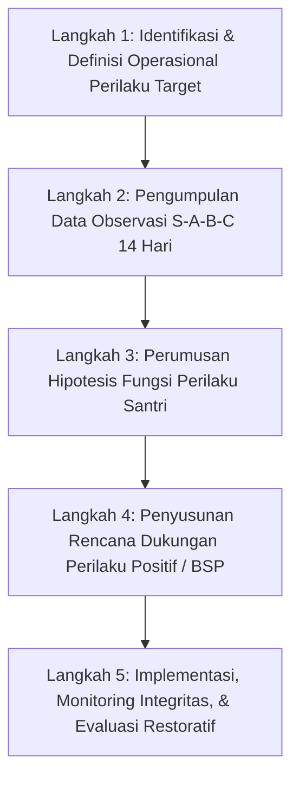

# P00047: Functional Behavior Assessment (FBA) Berbasis Fitrah dan Adab

> **Status Monograf:** APPROVED & LOCKED  
> **Kategori:** Pilar 4 - Operasionalisasi Profil Jenjang J1–J4 dan Asesmen PBIS Multi-Tier  
> **Klasifikasi:** Panduan Desain Asesmen Fungsional Perilaku (FBA), Diagnosis Motif Batin & Desain Rencana Perilaku Positif (BSP)  
> **Keterlacakan Fondasi:** `01_FUNDAMENTAL/03_PROGRESSION/03_ASSESSMENT_SYSTEM.md`, `01_FUNDAMENTAL/01_FOUNDATION/03_HUMAN_NATURE.md`, `01_FUNDAMENTAL/01_FOUNDATION/08_CHANGE.md`  
> **Penanggung Jawab:** Dewan Pakar Psikologi Perilaku Santri & Bimbingan Konseling Islam TUMBUH  

---

## 1. Identitas Penyelidikan dan Konteks Masalah

Dalam tata kelola kedisiplinan pesantren konvensional, para pembina asrama sering kali terjebak dalam penghakiman permukaan (*surface moral judgment*). Ketika seorang santri melakukan pelanggaran berulang (seperti sering membolos tahfizh, tertidur di kelas, bersikap agresif kepada teman kamar, atau mencuri makanan di kantin), respon umum yang diberikan adalah mencap santri tersebut sebagai 'anak durhaka', 'pemalas', 'berhati hitam', atau 'pemberontak'. Santri kemudian dijatuhi sanksi fisik atau dipermalukan di depan umum.

Pendekatan moralistis dangkal ini mengabaikan aksioma ilmiah dan syar'i bahwa **setiap perilaku manusia selalu memiliki fungsi (*function*) dan motif batin (*bā'its an-nafs*)**. Santri yang membolos tahfizh mungkin bukan karena benci Al-Qur'an, melainkan karena mengalami kecemasan sosial akut (*social phobia*) akibat belum lancar membaca dan takut ditertawakan kawan; santri yang agresif mungkin sedang mencari pelepasan stres akibat trauma kekerasan di rumah (*adverse childhood experiences*). Memberi hukuman fisik pada perilaku tanpa membedah fungsinya hanya akan memperparah disfungsi psikologis santri.

Arsitektur TUMBUH menetapkan **Functional Behavior Assessment (FBA) Berbasis Fitrah dan Adab** sebagai instrumen diagnosis ilmiah Tier 3. Penyelidikan P00047 menyusun metodologi FBA Islam: membedah rantai perilaku *Setting Event → Antecedent → Behavior → Consequence (S-A-B-C)*, memetakan 4 fungsi perilaku fitrah, menyusun Rencana Dukungan Perilaku (*Behavior Support Plan / BSP*), hingga menghapus stigma destruktif melalui kelembutan investigasi profetik.

---

## 2. Hakikat Fundamental FBA Berbasis Fitrah dan Adab

Secara esensial, FBA Berbasis Fitrah memandang perilaku menyimpang santri bukan sebagai 'keburukan bawaan', melainkan sebagai **upaya maladaptif santri dalam memenuhi kebutuhan fitrah yang sah (*legitimate fitrah needs pursued through illegitimate/dysfunctional means*)**:

```
===================================================================================================
RANTAI ANALISIS FUNGSIONAL PERILAKU SANTRI (S - A - B - C)
===================================================================================================
[Setting Event]  --> [Antecedent / Pemicu] --> [Target Behavior]  --> [Maintaining Consequence]
Kondisi Latar        Stimulus Langsung          Perilaku Nyata         Keuntungan yang Didapat
(Kurang tidur,       (Teguran keras musyrif,    (Membanting pintu,     (Terhindar dari tugas /
masalah keluarga)    tuntutan hafalan sulit)    berteriak, kabur)      mendapat perhatian kawan)
       |                     |                         |                         |
       V                     V                         V                         V
Rekayasa Konteks     Mitigasi Pemicu           Ajarkan Perilaku        Putus Penguatan Negatif
(Tidur cukup, doa)   (Instruksi santun)        Pengganti (Adab)        (Tidak beri panggung ego)
===================================================================================================
```

### 2.1 Empat Fungsi Dasar Perilaku Manusia (The 4 Functions of Behavior)
Dalam perspektif psikologi perilaku yang diintegrasikan dengan fitrah Islam, segala tindakan santri dimotivasi oleh salah satu dari empat tujuan:
1. **Menghindar / Melarikan Diri (*Escape / Avoidance*):** Santri ingin lepas dari tugas yang dirasa terlalu sulit, situasi yang memalukan, atau orang yang menakutkan.
2. **Mencari Perhatian (*Attention Seeking*):** Santri merasa kesepian atau terabaikan, sehingga memilih dimarahi musyrif daripada tidak dipedulikan sama sekali.
3. **Mendapatkan Akses Benda/Aktivitas (*Access to Tangibles/Activities*):** Ingin memperoleh makanan, waktu istirahat, atau perangkat tertentu.
4. **Regulasi Sensorik / Stimulasi Fisik (*Sensory Stimulation / Coping*):** Menyalurkan ketegangan tubuh, kecemasan amigdala, atau kebosanan energi motorik.

---

## 3. Landasan Teks Turats Klasik dan Takhrij Kitab

### 3.1 Meneliti Niat dan Motif Batin (*I'tibar al-Maqashid wa al-Bawa'its*)
Landasan epistemik penyelidikan motif perilaku berakar dari hadits agung yang diriwayatkan oleh Amirul Mukminin Umar bin al-Khattab radhiyallahu 'anhu:

> **إِنَّمَا الْأَعْمَالُ بِالنِّيَّاتِ، وَإِنَّمَا لِكُلِّ امْرِئٍ مَا نَوَى**  
> *"Sesungguhnya setiap amal perbuatan itu bergantung pada niatnya, dan sesungguhnya setiap orang akan mendapatkan sesuai dengan apa yang ia niatkan."*  
> (HR. Al-Bukhari no. 1 dan Muslim no. 1907)

Hadits ini bukan hanya kaidah fiqih ibadah, melainkan kaidah psikologi hukum: bahwa nilai hakiki suatu perilaku ditentukan oleh motif pendorong batiniah (*al-ba'its an-nafsi*) yang melatarbelakanginya.

Imam Abu Hamid al-Ghazali dalam *Ihya' 'Ulum ad-Din* (Jilid 3, Kitab *Riyadhah an-Nafs*, Bab Bayan 'Ilaj Amradh al-Qulub) menguraikan metodologi dokter ruhani (*thabib al-qulub*):

> **وَالْمُرَبِّي الْحَاذِقُ لَا يَنْظُرُ إِلَى ظَاهِرِ الزَّلَّةِ فَيُعَاقِبَ عَلَيْهَا مُجَرَّدَةً، بَلْ يَنْبَغِي أَنْ يَكُونَ مَثَلُهُ مَثَلَ الطَّبِيبِ الْعَالِمِ بِالْعِلَلِ وَالْأَسْبَابِ؛ فَإِنَّ الطَّبِيبَ لَا يُدَاوِي حُمْرَةَ الْعَيْنِ أَوْ حَرَارَةَ الْبَدَنِ دُونَ أَنْ يَبْحَثَ عَنْ مَادَّتِهَا مِنَ الصَّفْرَاءِ أَوِ الدَّمِ؛ فَكَذَلِكَ الْمُرَبِّي يَنْظُرُ: هَلْ هَذِهِ الْمَعْصِيَةُ صَدَرَتْ عَنْ شَهْوَةٍ غَالِبَةٍ، أَمْ عَنْ غَضَبٍ طَارِئٍ، أَمْ عَنْ غَفْلَةٍ وَجَهْلٍ، أَمْ عَنْ شُعُورٍ بِالْهَوَانِ وَالذُّلِّ؟ فَلِكُلِّ دَاءٍ دَوَاءٌ يُنَاسِبُهُ.**  
> *"Pendidik yang mahir tidak memandang sekadar lahiriah kesalahan lalu menghukumnya begitu saja, melainkan perumpamaannya ibarat seorang dokter ahli yang memahami sebab-sebab penyakit; sesungguhnya dokter tidak mengobati merahnya mata atau panasnya tubuh tanpa meneliti sumber materinya dari cairan empedu atau darah. Demikian pula pendidik, ia meneliti: apakah maksiat ini lahir dari syahwat yang mendominasi, atau kemarahan sesaat, atau kelalaian dan ketidaktahuan, atau rasa terhina dan rendah diri? Karena setiap penyakit memiliki obat yang sesuai dengannya."*

Imam Ibnul Qayyim al-Jauziyyah dalam *Ighatsat al-Lahfan min Masyayid asy-Syaithan* (Jilid 1, hlm. 82) merinci anatomi dorongan jiwa:

> **مَبْدَأُ كُلِّ عَمَلٍ اخْتِيَارِيٍّ: خَاطِرَةٌ، ثُمَّ فِكْرَةٌ، ثُمَّ شَهْوَةٌ، ثُمَّ إِرَادَةٌ، ثُمَّ عَزِيمَةٌ، ثُمَّ فِعْلٌ؛ فَمَنْ عَالَجَ الْخَاطِرَةَ أَرَاحَ نَفْسَهُ مِنْ تَبِعَاتِ الْفِعْلِ، وَمَنْ أَهْمَلَ الْخَاطِرَ حَتَّى صَارَ عَزِيمَةً صَعُبَ عَلَيْهِ الِانْفِكَاكُ مِنْهَا.**  
> *"Permulaan setiap perbuatan sukarela: lintasan pikiran (khatirah), kemudian gagasan (fikrah), kemudian syahwat dorongan rasa, kemudian kehendak (iradah), kemudian tekad bulat ('azimah), barulah lahir perbuatan fisik (fi'l). Barangsiapa yang mengobati lintasan pikiran awal, ia menyelamatkan dirinya dari konsekuensi perbuatan; dan barangsiapa yang menelantarkan lintasan pikiran hingga menjadi tekad bulat, niscaya akan sangat sulit baginya melepaskan diri darinya."*

---

## 4. Landasan Neurosains Kognitif dan Analisis Perilaku Terapan (ABA)

### 4.1 Teori Analisis Fungsional Perilaku (O'Neill et al., 1997; Cooper et al., 2020)
Dalam sains perilaku terapan, FBA adalah proses terstruktur untuk mengumpulkan informasi guna menemukan hubungan fungsional antara variabel lingkungan dan perilaku bermasalah:
1. **Analisis Konsekuensi yang Mempertahankan Perilaku (*Maintaining Consequences*):**  
   Bila seorang santri mengamuk di kelas dan guru mengeluarkannya dari kelas, santri tersebut berhasil 'menghindar dari tugas' (*negative reinforcement*). Amukan santri akan berulang di masa depan karena fungsi menghindarnya tercapai.
2. **Perilaku Pengganti Fungsional Ekuivalen (*Functionally Equivalent Replacement Behavior / FERB*):**  
   FBA tidak sekadar melarang perilaku lama, melainkan mengajarkan cara baru yang beradab untuk mencapai tujuan yang sama. Contoh: mengajari santri mengangkat kartu istirahat darurat saat cemas, alih-alih mengamuk.

### 4.2 Neurosains Disregulasi Emosional dan Pembajakan Amigdala (Goleman, 1995; Siegel, 2012)
Daniel Goleman merumuskan konsep *Amygdala Hijack* (pembajakan amigdala). Daniel Siegel menjelaskan metafora *Hand Model of the Brain* (*flipping the lid*):
* Ketika santri mengalami stres berat atau merasa terancam martabatnya, korteks prefrontal terputus kendalinya dari sistem limbik. Santri bereaksi secara reaktif-defensif murni (menyerang, memukul, berteriak).
* Musyrif yang menghukum santri saat sedang membajak amigdala ibarat menyiram bensin ke api yang membara. Santri membutuhkan *de-eskalasi fisiologis* (menurunkan detak jantung dan hormon kortisol) sebelum nalar kognitifnya mampu mencerna nasihat adab.

### 4.3 Jendela Toleransi Emosi (Window of Tolerance) dan Zona Disregulasi
Dan Siegel (1999) dan Ogden (2006) memetakan kondisi neurologis manusia ke dalam tiga zona:
1. **Zona Optimal (Window of Tolerance):** Santri mampu berpikir jernih, memproses nasihat asatidz, dan merefleksikan kesalahannya dengan tenang.
2. **Zona Hiper-Arousal (Fight-or-Flight):** Amigdala meledak; santri berteriak, agresif, atau melempar barang. Menuntut kepatuhan kaku pada zona ini adalah kekeliruan fatal.
3. **Zona Hipo-Arousal (Freeze-or-Collapse):** Sistem saraf mati rasa (*dissociation*); santri mengunci diri, menolak makan, mematung, atau menatap kosong.
* FBA melatih pembina mengenali di zona mana santri berada: tugas pertama musyrif bukan menghukum, melainkan mengembalikan santri ke dalam *Window of Tolerance* melalui kehadiran fisik yang aman (*co-regulation*).

---

## 5. Matriks Empat Fungsi Perilaku Santri dan Intervensi Adab Solutif

Tabel komparatif berikut membedah fungsi perilaku dan alternatif adab solutifnya:

| Fungsi Perilaku | Gejala Perilaku Santri yang Teramati | Analisis Motif Batin FBA | Intervensi FBA TUMBUH (Perilaku Pengganti) |
| :--- | :--- | :--- | :--- |
| **1. Escape / Avoidance**<br>(Menghindar dari Tugas/Situasi) | Pura-pura sakit perut saat tahfizh, membolos halaqah, mengulur waktu wudhu. | Takut ditertawakan kawan karena hafalan terbata-bata; beban kognitif terlalu berat. | Menyesuaikan target hafalan (*chunking*), memberikan sesi bimbingan privat tanpa disaksikan kawan. |
| **2. Attention Seeking**<br>(Mencari Perhatian Pembina/Kawan) | Membuat lelucon gaduh saat shalat, membantah musyrif dengan nada menantang. | Merasa diabaikan di rumah/asrama; butuh validasi bahwa dirinya diakui ada (*sense of significance*). | Memberikan perhatian positif terencana (*non-contingent attention*); menugaskannya menjadi MC/pemimpin acara. |
| **3. Access to Tangibles**<br>(Mendapatkan Benda/Fasilitas) | Menyelundupkan makanan instan ke kamar, mengambil sabun/sandal kawan tanpa izin. | Rasa lapar akibat porsi makan kurang; ketidakmampuan mengelola uang saku; gengsi sosial. | Menyediakan kantin malam asrama terkelola; klinik literasi keuangan; bantuan bagi santri dhuafa. |
| **4. Sensory / Coping**<br>(Pelepasan Ketegangan Fisik) | Menggigit kuku saat belajar, memukul-mukul dinding kamar, tidak bisa diam saat halaqah. | Hiperaktivitas saraf motorik; kecemasan psikosomatis homesickness; kelelahan otot. | Memberikan jeda peregangan (*movement break*); olahraga sore teratur; latihan pernapasan dzikir hening. |

---

## 6. Protokol 5 Langkah Pelaksanaan FBA di Lingkungan Asrama

Penyelidikan FBA dilaksanakan secara sistematis melalui lima tahapan baku:



### 6.1 Rincian Prosedur Langkah demi Langkah
1. **Langkah 1 (Definisi Operasional):** Mendefinisikan perilaku santri secara objektif, jelas, dan terukur. Hindari kata samar *"santri bersikap kurang ajar"*, gantikan dengan *"santri meninggalkan ruang halaqah tanpa izin dan membanting pintu saat dipanggil musyrif"*.
2. **Langkah 2 (Pengumpulan Data S-A-B-C):** Musyrif dan guru mencatat peristiwa dalam lembar observasi minimal selama 10–14 hari observasi konsisten: kapan terjadi, di mana lokasinya, siapa yang hadir, dan apa respon lingkungan.
3. **Langkah 3 (Perumusan Hipotesis):** Menguji pola data untuk merumuskan kalimat hipotesis: *"Ketika [Antecedent], santri melakukan [Behavior] untuk mendapatkan/menghindari [Function], terutama bila didahului oleh [Setting Event]"*.
4. **Langkah 4 (Penyusunan BSP):** Merancang rencana dukungan perilaku individual yang mencakup: modifikasi lingkungan, pengajaran perilaku pengganti adab (*FERB*), dan penguatan positif.
5. **Langkah 5 (Evaluasi):** Memantau grafik frekuensi perilaku target setiap minggu hingga tercapai penurunan frekuensi minimal 80%.

---

## 7. Studi Kasus Lapangan dan Rencana Dukungan Perilaku (BSP)

### 7.1 Studi Kasus: Santri Agresif di Kamar Tidur (Rayon J2)
**Identitas Kasus:**  
Santri R (14 tahun, kelas VIII) sering memukul ranjang kawan sekamar, melempar bantal, dan berteriak kasar setiap kali musyrif mengumumkan waktu tidur malam pukul 22.00. Musyrif sebelumnya menganggap R 'anak kesurupan jin' dan menyiramnya dengan air ruqyah, namun perilaku agresifnya semakin menjadi-jadi.

**Pelaksanaan FBA TUMBUH:**
* **Setting Event (Latar):** Santri R memiliki riwayat insomnia klinis dan rasa takut gelap sejak kecil akibat perceraian orang tuanya.
* **Antecedent (Pemicu):** Lampu kamar dimatikan total tepat pukul 22.00 diiringi instruksi ketat musyrif untuk segera tidur.
* **Behavior (Perilaku):** Berteriak, memukul ranjang, dan memprovokasi kawan lain agar ikut terjaga.
* **Maintaining Consequence:** Musyrif menyalakan kembali lampu kamar dan menemani R berbicara selama 1 jam (Fungsi: *Escape dari kegelapan & Attention dari musyrif*).

**Rencana Dukungan Perilaku (BSP) yang Diterapkan:**
1. *Modifikasi Lingkungan:* Memasang lampu tidur redup berwarna kuning hangat (*dim night-light*) di sudut kamar R sehingga kamar tidak gelap gulita.
2. *Pengajaran Perilaku Pengganti (FERB):* Mengajari R teknik dzikir tidur dan mendengarkan murottal Al-Qur'an melalui speaker kecil dengan volume lirih saat gelisah.
3. *Perhatian Positif Terencana:* Musyrif menyapa R 15 menit sebelum lampu dipadamkan untuk mendengarkan kisahnya secara santai (*proactive attention*).
4. *Hasil:* Dalam 14 hari, amukan malam R turun menjadi 0 insiden. Santri R dapat tidur tenang tanpa mengganggu ketertiban kamar.

---

## 8. Formulir Lembar Observasi S-A-B-C, Skrip Python Validator, dan Format BSP

### 8.1 Formulir Observasi Fungsional S-A-B-C (`F-FBA-OBSERVASI`)

```
========================================================================================
LEMBAR OBSERVASI ANALISIS FUNGSIONAL PERILAKU S-A-B-C (F-FBA-OBSERVASI)
Kategori: Asesmen Intervensi PBIS Tier 3 TUMBUH v2.0.0
========================================================================================
Nama Santri       : ___________________________   NIS / Rayon    : _____________________
Musyrif Observer  : ___________________________   Perilaku Target: _____________________
----------------------------------------------------------------------------------------
TGL / JAM  SETTING EVENT     ANTECEDENT (Pemicu) BEHAVIOR (Perilaku) CONSEQUENCE (Respon)
----------------------------------------------------------------------------------------
.. / ..    Kurang tidur malam Ditugaskan membaca  Membanting kitab   Dikeluarkan ke lorong
14.30      karena tugas mad.  matan di depan kelas keluar ruang KBM  (Santri lolos tugas)
----------------------------------------------------------------------------------------
.. / ..    Mendengar kabar    Dipanggil giliran   Berteriak histeris Musyrif memeluk &
20.15      orang tua sakit    setoran tahfizh     lari ke kamar mandi menunda setoran
----------------------------------------------------------------------------------------
.. / ..    Diejek kawan kamar Antre mandi pagi    Memukul pundak     Kawan membalas ejek,
05.45      mengenai logatnya  panjang & sempit    kawan antrean      musyrif melerai
----------------------------------------------------------------------------------------
Kesimpulan Dugaan Fungsi Perilaku Dominan:
[ ] Menghindari Tugas/Situasi (Escape)      [ ] Mencari Perhatian Pembina/Kawan (Attention)
[ ] Memperoleh Benda/Fasilitas (Tangible)  [ ] Stimulasi Sensorik / Pelepasan Emosi (Sensory)
Tanda Tangan Musyrif Observer: _________________   Konselor BK: ________________________
========================================================================================
```

### 8.2 Skrip Python Analisis Frekuensi dan Hipotesis Fungsi Perilaku FBA

Skrip otomatis berikut mengolah data lembar observasi untuk menentukan fungsi perilaku dominan secara statistik:

```python
"""
ANALYZER DATA OBSERVASI FBA S-A-B-C TUMBUH v2.0.0
Menganalisis frekuensi motif perilaku santri guna merumuskan hipotesis intervensi BSP.
"""

def analisis_fungsi_perilaku_fba(log_observasi):
    total_insiden = len(log_observasi)
    if total_insiden == 0:
        return {"status": "ERROR: Tidak ada data observasi yang dicatat"}
        
    penghitung_fungsi = {"Escape": 0, "Attention": 0, "Tangible": 0, "Sensory": 0}
    
    for obs in log_observasi:
        f = obs.get("fungsi_terduga")
        if f in penghitung_fungsi:
            penghitung_fungsi[f] += 1
            
    # Temukan fungsi dengan persentase tertinggi
    fungsi_dominan = max(penghitung_fungsi, key=penghitung_fungsi.get)
    proporsi_dominan = (penghitung_fungsi[fungsi_dominan] / total_insiden) * 100.0
    
    rekomendasi_ferb = {
        "Escape": "Ajarkan santri meminta jeda istirahat terstruktur (Break Card) & penyesuaian beban tugas.",
        "Attention": "Terapkan Non-Contingent Attention & berikan peran kepemimpinan positif di hadapan kawan.",
        "Tangible": "Fasilitasi akses kebutuhan halal terjadwal & edukasi regulasi kesabaran muamalah.",
        "Sensory": "Sediakan jeda gerak fisik teratur, olahraga terarah, & latihan pernapasan dzikir hening."
    }
    
    return {
        "total_observasi": total_insiden,
        "distribusi_fungsi": penghitung_fungsi,
        "fungsi_dominan": f"{fungsi_dominan} ({proporsi_dominan:.1f}%)",
        "arah_intervensi_bsp": rekomendasi_ferb.get(fungsi_dominan, "Evaluasi ulang")
    }

if __name__ == "__main__":
    sampel_data = [
        {"insiden": 1, "fungsi_terduga": "Escape"},
        {"insiden": 2, "fungsi_terduga": "Escape"},
        {"insiden": 3, "fungsi_terduga": "Attention"},
        {"insiden": 4, "fungsi_terduga": "Escape"},
        {"insiden": 5, "fungsi_terduga": "Escape"},
        {"insiden": 6, "fungsi_terduga": "Sensory"}
    ]
    
    hasil = analisis_fungsi_perilaku_fba(sampel_data)
    print(f"Fungsi Dominan: {hasil['fungsi_dominan']}")
    print(f"Rekomendasi BSP: {hasil['arah_intervensi_bsp']}")
```

### 8.3 Format Dokumen Rencana Dukungan Perilaku (Behavior Support Plan / BSP)
Dokumen resmi intervensi yang ditandatangani musyrif, konselor BK, santri, dan wali santri:

```
========================================================================================
RENCANA DUKUNGAN PERILAKU POSITIF INDIVIDUAL (BEHAVIOR SUPPORT PLAN / BSP)
========================================================================================
Nama Santri       : ___________________________   NIS / Rayon    : _____________________
Perilaku Target   : ___________________________   Fungsi Hipotesis: ____________________
----------------------------------------------------------------------------------------
1. MODIFIKASI LINGKUNGAN (Pencegahan Pemicu / Antecedent Strategies):
   - ...................................................................................
   - ...................................................................................
2. PENGAJARAN PERILAKU PENGGANTI (Functionally Equivalent Replacement Behavior / FERB):
   - Perilaku Adab Baru: ...............................................................
   - Cara Santri Mengomunikasikan: .....................................................
3. PENGUATAN PERILAKU POSITIF (Reinforcement Strategies):
   - Apresiasi Segera: .................................................................
   - Target Evaluasi Mingguan: .........................................................
4. PROTOKOL RESPON KETIKA TERJADI REGRESI (De-escalation & Safety Strategies):
   - ...................................................................................
========================================================================================
```

### 8.4 Matriks Diagnosis Banding Motif Perilaku Santri Kasus Kompleks
Panduan diferensial musyrif untuk membedakan fungsi perilaku yang tampak mirip:

| Perilaku Terlihat | Bila Fungsinya Menghindar (Escape) | Bila Fungsinya Mencari Perhatian (Attention) |
| :--- | :--- | :--- |
| **Tertidur saat Pengajian** | Terjadi saat materi kitab sangat sulit atau santri takut ditanya guru. | Terjadi saat musyrif berada dekat; santri sengaja mendengkur agar ditegur kawan. |
| **Menolak Masuk Masjid** | Santri merasa cemas dengan keramaian atau bajunya basah/kotor. | Santri berdiri menantang di lorong menunggu musyrif membujuknya secara dramatis. |
| **Membantah Perintah Musyrif**| Terjadi saat diberi beban piket tambahan yang dirasa tidak adil. | Terjadi di depan kawan-kawan sekamar untuk mendapatkan status 'jagoan'. |

### 8.5 Format Panduan Wawancara Diagnostik FBA dengan Santri (Al-Hiwar at-Tasykhishi)
Pedoman dialog empatik konselor BK saat menggali motif batin santri:

```
========================================================================================
PANDUAN WAWANCARA DIAGNOSTIK EMPATIK SANTRI (AL-HIWAR AT-TASYKHISHI)
========================================================================================
1. Membuka Ruang Aman (De-eskalasi): "Ustadz memanggil antum bukan untuk memarahi atau
   menghukum. Ustadz peduli pada antum dan ingin mendengar apa yang antum rasakan."
2. Menggali Pemicu (Antecedent): "Bisa ceritakan apa yang terjadi tepat sebelum antum
   merasa sangat marah/kesal di kamar tadi?"
3. Mengidentifikasi Fungsi Batin: "Saat antum membanting pintu tadi, apa yang sebenarnya
   paling antum harapkan terjadi? Apakah antum ingin kawan antum diam, atau antum lelah?"
4. Menyepakati Perilaku Pengganti: "Jika situasi menyebalkan itu terjadi lagi besok,
   apa cara yang lebih mulia dan tenang yang bisa antum lakukan untuk memberi tahu kami?"
Tanda Tangan Santri: _______________________      Konselor Pengasuhan: _________________
========================================================================================
```

---

## 9. Architectural Decision Record (ADR)

### ADR-TUMBUH-P00047: Standardisasi Metodologi FBA Berbasis Fitrah dan Adab

* **Status:** `APPROVED & LOCKED`
* **Konteks:** Menghapus kebiasaan memberi label buruk dan hukuman fisik buta pada santri bermasalah, serta menetapkan diagnosis ilmiah fungsi perilaku (*Functional Behavior Assessment*) berbasis fitrah manusia.
* **Keputusan Arsitektur:**
  1. Penanganan seluruh kasus santri PBIS Tier 3 **wajib diawali dengan asesmen FBA formal** minimal 10 hari pengumpulan data S-A-B-C sebelum tindakan disipliner diputuskan.
  2. Dilarang keras mengeluarkan vonis hukuman atau menjatuhkan sanksi skorsing/drop-out tanpa adanya dokumen Rencana Dukungan Perilaku (*Behavior Support Plan / BSP*) yang telah diuji cobakan secara sungguh-sungguh.
  3. Mengakui 4 fungsi perilaku fitrah (Escape, Attention, Tangible, Sensory) dan mewajibkan perancangan perilaku pengganti beradab (*FERB*).
* **Konsekuensi Arsitektur:**
  * Menyelamatkan santri rentan dari ancaman putus sekolah yang tidak adil.
  * Menjadi fondasi ilmiah bagi perancangan rubrik asesmen faktual pada P00048 dan mediasi restoratif pada P00049.

---

## 10. Daftar Batasan Penyelidikan dan Mitigasi Drift (Guardrails)

Untuk menjaga kemurnian inkuiri P00047, ditetapkan 30 guardrails pencegah deviasi konseptual:

1. **Anti-Demonization Guard:** Dilarang mencap santri bermasalah sebagai 'anak setan', 'terkutuk', atau 'pemberontak abadi'.
2. **Behavioral Function Prerequisite:** Musyrif dilarang menjatuhkan sanksi sebelum memahami fungsi pendorong perilaku santri.
3. **FERB Requirement:** Dilarang menghentikan perilaku buruk tanpa mengajarkan perilaku pengganti yang bernilai adab.
4. **No Quackery Diagnosis:** Dilarang mengaitkan seluruh gangguan perilaku dengan gangguan gaib/kesurupan tanpa asesmen medis/psikologis.
5. **Turats Coherence:** Setiap langkah analisis fungsional wajib selaras dengan kaidah *thabib al-qulub* Al-Ghazali dan Ibnul Qayyim.
6. **Data Multi-Setting:** Pengumpulan data S-A-B-C wajib mencakup minimal 3 setting (kamar asrama, kelas madrasah, masjid).
7. **Confidentiality Protection:** Dokumen FBA dan BSP santri diklasifikasikan sebagai data rahasia bimbingan konseling.
8. **No Negative Reinforcement Trap:** Musyrif dilarang merespons amukan santri dengan memberikan apa yang santri inginkan secara kompromistis.
9. **Extinction Burst Anticipation:** Musyrif wajib memahami bahwa perilaku buruk akan melonjak sementara di awal terapi perilaku.
10. **Objective Operational Definitions:** Menghindari kata sifat multitafsir; seluruh perilaku wajib dapat dilihat dan dihitung.
11. **Trauma-Informed Care:** Mempertimbangkan latar belakang trauma keluarga dalam mengevaluasi setting event santri.
12. **Medical Clearance:** Memastikan kondisi fisik dan nutrisi santri normal sebelum menyimpulkan gangguan perilaku murni.
13. **Continuous FBA Monitoring:** Rencana BSP dievaluasi efektivitasnya setiap 14 hari melalui grafik tren insiden.
14. **Parental Consent & Partnership:** Penyusunan dokumen BSP melibatkan orang tua secara transparan dan solutif.
15. **Collaborative Team Drafting:** Dokumen FBA disusun bersama oleh musyrif kamar, guru kelas, dan konselor BK.
16. **No Corporal Consequence in BSP:** Dokumen BSP diharamkan memuat sanksi fisik, pemukulan, atau penjemuran santri.
17. **Prompt De-escalation Protocol:** Saat santri amuk (*amygdala hijack*), fokus utama adalah keselamatan fisik, bukan ceramah adab.
18. **Spiritual Grounding of FERB:** Menghubungkan perilaku pengganti dengan keteladanan akhlak Rasulullah SAW.
19. **Equal Access to Support:** Fasilitas FBA dan BSP terbuka bagi seluruh santri tanpa diskriminasi latar belakang sosial.
20. **Humility in Counseling:** Konselor dilarang bersikap superior atau menggurui saat mewawancarai santri kasus Tier 3.
21. **Environment First:** Selalu mengutamakan rekayasa lingkungan (meredam pemicu) sebelum menuntut santri berubah.
22. **Inclusivity for Neurodiverse Santri:** Menyesuaikan protokol FBA bagi santri berkebutuhan khusus (ADHD/sensory issues).
23. **Safe Room Protocol:** Ruang de-eskalasi krisis wajib bebas dari benda tajam, kaca rapuh, dan bahaya fisik lain.
24. **Continuous Musyrif Training:** Seluruh pembina asrama wajib mengikuti simulasi analisis S-A-B-C minimal sekali setahun.
25. **Repository Boundary Preservation:** Berkas ini adalah metodologi konseptual FBA; berkas kasus individual diatur di `03_OPERATIONAL/`.
26. **Non-Judgmental Listening:** Mendengarkan keluhan santri dengan kontak mata hangat tanpa menyela atau menghakimi.
27. **Positive Reinforcement Ratio:** Memastikan santri Tier 3 menerima minimal 5 penguatan positif atas keberhasilan kecilnya.
28. **Peer Isolation Guard:** Mencegah teman sekamar mengucilkan santri yang sedang menjalani program dukungan perilaku BSP.
29. **Restorative Restitution Integration:** Santri yang merusak fasilitas tetap dibimbing mengganti kerusakan secara bermartabat.
30. **Architecture Gatekeeper:** Metodologi FBA ini adalah standar audit wajib repositori TUMBUH yang tidak boleh dilewati.

---

## 11. Matriks Keterlacakan dan Hubungan Lintas Dokumen

| Kode Dokumen | Nama Dokumen Repositori | Hubungan Konseptual dengan P00047 |
| :--- | :--- | :--- |
| `01_FUNDAMENTAL/03_PROGRESSION/03_ASSESSMENT_SYSTEM.md` | Sistem Asesmen Karakter Santri | Standar operasional instrumen asesmen perilaku Tier 3 PBIS. |
| `01_FUNDAMENTAL/01_FOUNDATION/03_HUMAN_NATURE.md` | Domain Filosofis Hakikat Insan | Landasan teologis mengenai fitrah, dorongan nafsu, dan kalbu. |
| `01_FUNDAMENTAL/01_FOUNDATION/08_CHANGE.md` | Domain Filosofis Dinamika Perubahan | Prinsip perubahan perilaku melalui penataan motif batiniah. |
| `PROBE/PROBE_01/P00046` | Arsitektur Multi-Tier PBIS Berbasis Nilai Pesantren | Menempatkan FBA sebagai instrumen diagnosis wajib pada Tier 3. |
| `PROBE/PROBE_01/P00048` | Rubrik Asesmen Perilaku Faktual | Menyediakan skala observasi objektif yang digunakan dalam FBA. |
| `PROBE/PROBE_01/P00049` | Protokol Intervensi Restoratif & Ishlah al-Bain | Tindak lanjut pemulihan relasi pasca-penanganan perilaku FBA. |

---

## 12. Rekomendasi Aksi Nyata Bagi Manajemen Pesantren

Untuk mengimplementasikan metodologi FBA secara efektif di pesantren:

1. **Bentuk Satgas FBA & Bimbingan Konseling Khusus (*Lajnah ash-Sihhah an-Nafsiyyah*):**  
   Mengesahkan tim penanganan kasus Tier 3 yang memiliki kewenangan melakukan asesmen mendalam terhadap santri bermasalah.

2. **Standardisasi Lembar Observasi S-A-B-C di Seluruh Pos Rayon:**  
   Menyediakan formulir pencatatan pemicu dan konsekuensi perilaku di setiap meja kerja musyrif untuk pengumpulan data cepat.

3. **Pelatihan Keterampilan Wawancara Diagnostik bagi Konselor Asrama:**  
   Menyelenggarakan pelatihan teknik wawancara sokratik dan pemetaan 4 fungsi perilaku bagi para asatidz pembina.

4. **Sediakan Ruang De-eskalasi Krisis & Relaksasi Sensorik (*Ghurfah at-Tahdi'ah*):**  
   Mendesain ruangan khusus dengan pencahayaan lembut, sofa nyaman, dan perlengkapan relaksasi untuk menenangkan santri yang amuk.

5. **Integrasikan Sistem Analisis Data FBA ke dalam Dashboard Digital:**  
   Mengembangkan fitur grafik analisis fungsi perilaku otomatis pada aplikasi kepengasuhan santri TUMBUH.

6. **Penerbitan Surat Perjanjian Kemitraan BSP dengan Orang Tua:**  
   Melibatkan wali santri secara resmi dalam menandatangani dokumen komitmen dukungan perilaku di rumah saat masa liburan.

7. **Protokol Peninjauan Rutin 14 Hari Pasca-Penyusunan BSP:**  
   Menjadwalkan sidang evaluasi berkala untuk menilai efektivitas perilaku pengganti yang diajarkan kepada santri.

8. **Penyusunan Bank Perilaku Pengganti Beradab (*Adab Alternative Bank*):**  
   Menyusun modul panduan perilaku pengganti praktis bagi 50 jenis pelanggaran santri yang paling sering terjadi di asrama.

9. **Penyelenggaraan Sesi Debriefing Kasus FBA Mingguan:**  
   Konselor BK dan tim musyrif mengadakan evaluasi mingguan untuk meninjau perkembangan grafik perilaku santri penerima program BSP.

10. **Pemberian Apresiasi bagi Kamar yang Berhasil Membantu Rekan Tier 3 Pulih:**  
    Memberikan penghargaan khusus bagi anggota kamar yang menunjukkan empati luar biasa dalam mendampingi kawannya keluar dari krisis perilaku.

---

## 13. Pertanyaan Penyelidikan Lanjutan (Emergent Inquiries)

1. *Bagaimana membedakan secara akurat antara perilaku santri yang didorong oleh fungsi mencari perhatian (Attention) dengan dorongan manipulasi kekuasaan sebaya?*
2. *Bagaimana mengatasi santri yang menolak diajak berkomunikasi dalam sesi wawancara FBA akibat trauma masa lalu terhadap figur otoritas?*
3. *Bagaimana merancang perilaku pengganti (FERB) yang efektif bagi santri yang terbiasa melampiaskan kemarahan dengan kata-kata kotor di asrama?*
4. *Bagaimana protokol kerahasiaan data FBA agar tidak bocor dan menjadi bahan ejekan teman sekamar santri bersangkutan?*
5. *Bagaimana model pelibatan psikiater atau psikolog klinis profesional luar dalam kasus santri yang menunjukkan gejala psikopatologi berat?*
6. *Bagaimana melatih musyrif asrama agar tidak terpancing emosi secara personal (counter-transference) saat menghadapi santri yang sengaja memprovokasi?*
7. *Bagaimana standarisasi indikator keberhasilan penghentian program BSP sehingga santri dapat dikembalikan ke status Tier 1 normal?*
8. *Bagaimana merancang kurikulum pembekalan bagi teman sekamar santri Tier 3 agar mereka mampu memberikan dukungan sosial yang sehat?*
9. *Bagaimana mengatasi situasi di mana orang tua santri menolak hasil diagnosis FBA dan bersikap defensif menyalahkan pihak pesantren?*
10. *Bagaimana integrasi antara data FBA dengan evaluasi kurikulum madrasah guna mencegah kejenuhan akademik berlebihan pada santri?*
