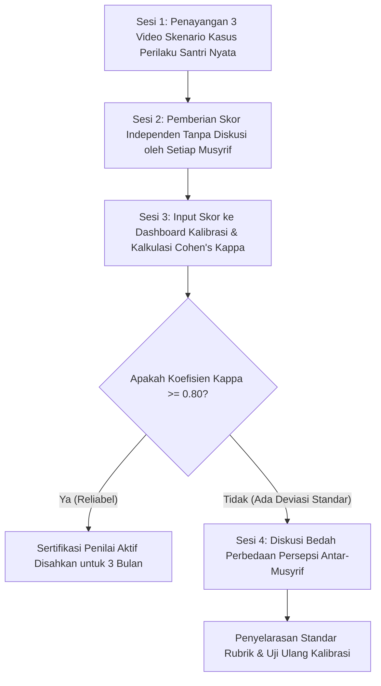

# P00048: Rubrik Asesmen Perilaku Faktual Bebas Bias Musyrif

> **Status Monograf:** APPROVED & LOCKED  
> **Kategori:** Pilar 4 - Operasionalisasi Profil Jenjang J1–J4 dan Asesmen PBIS Multi-Tier  
> **Klasifikasi:** Panduan Desain Psikometri Karakter, Behaviorally Anchored Rating Scales (BARS) & Kalibrasi Penilai Adab  
> **Keterlacakan Fondasi:** `01_FUNDAMENTAL/03_PROGRESSION/03_ASSESSMENT_SYSTEM.md`, `01_FUNDAMENTAL/01_FOUNDATION/02_EPISTEMOLOGY.md`, `01_FUNDAMENTAL/01_FOUNDATION/04_PRINCIPLES.md`  
> **Penanggung Jawab:** Dewan Pakar Psikometri Pendidikan Islam & Validasi Instrumen Karakter TUMBUH  

---

## 1. Identitas Penyelidikan dan Konteks Masalah

Salah satu kelemahan paling kronis dalam evaluasi pendidikan kepengasuhan pesantren adalah tingginya tingkat subjektivitas penilaian adab (*high subjective rater bias*). Ketika seorang musyrif diminta memberikan nilai akhlak pada rapor kepengasuhan santri, penilaian kerap kali didasarkan pada kesan sesaat (*instant impression*), sentimen pribadi, atau bias kognitif yang merusak keadilan:
1. **Halo Effect:** Santri yang cerdas membaca kitab atau berwajah rupawan secara otomatis diasumsikan berakhlak mulia di seluruh aspek, meskipun di kamar tidurnya ia malas piket dan sering membully adik kelas.
2. **Horn Effect:** Santri yang pernah sekali melakukan kesalahan vokal dicap buruk selamanya, sehingga seluruh perbaikan adab yang ia tunjukkan di kemudian hari diabaikan oleh pembina.
3. **Leniency / Strictness Bias:** Perbedaan standar kepribadian antar-musyrif (ada musyrif yang sangat murah hati memberi nilai sempurna, sementara musyrif lain sangat pelit memberi nilai baik untuk perilaku yang sama).

Ketidakpastian alat ukur ini melahirkan ketidakadilan sistemik: keputusan promosi jenjang menjadi rentan nepotisme kamar, santri kehilangan kepercayaan pada otoritas asrama, dan evaluasi karakter tereduksi menjadi sekadar formalitas administratif.

Arsitektur TUMBUH menetapkan **Rubrik Asesmen Perilaku Faktual Bebas Bias Musyrif** berbasis **Behaviorally Anchored Rating Scales (BARS)**. Penyelidikan P00048 menyusun standarisasi operasional instrumen evaluasi adab: membedah deskriptor perilaku teramati (*observable and measurable behavioral anchors*), menetapkan protokol kalibrasi antar-penilai (*Inter-Rater Calibration*), menghitung koefisien reliabilitas statistik, serta membangun sistem verifikasi silang berbasis digital.

---

## 2. Hakikat Fundamental Rubrik Asesmen Perilaku Faktual

Secara ontologis, adab bukanlah entitas gaib yang tidak dapat dinilai, melainkan **manifestasi lahiriah dari ketakwaan batin yang mewujud dalam tindakan nyata (*al-adab huwa zhahir at-taqwa fi al-jawarih*)**. Rubrik BARS TUMBUH menjembatani nilai batiniah ke dalam indikator fisik yang terbebas dari tafsir spekulatif:

```
===================================================================================================
KONTINUM ASESMEN ADAB: DARI PENILAIAN SUBJEKTIF MENUJU SKALA BARS FAKTUAL
===================================================================================================
Pendekatan Subjektif Tradisional   Skala Deskriptif Umum         Skala BARS Faktual TUMBUH v2.0.0
---------------------------------------------------------------------------------------------------
"Santri beradab baik di masjid"     "Skor 4: Selalu tertib"      "Tiba di masjid saat adzan, merapatkan
(Opini pribadi musyrif, rentan      (Masih multitafsir, tidak    shaf tanpa bergurau, membaca dzikir
bias halo dan simpati pertemanan)   memberikan patokan fisik)    minimal 10 menit sesudah shalat."
===================================================================================================
```

### 2.1 Tiga Pilar Validitas Psikometrik Adab TUMBUH
1. **Objektivitas Teramati (*Observability*):** Setiap poin dalam rubrik hanya mencatat apa yang dapat dilihat oleh mata dan didengar oleh telinga (*no mind-reading*).
2. **Keterandalan Lintas Pengamat (*Inter-Rater Reliability*):** Dua musyrif yang mengamati santri yang sama pada waktu yang sama wajib menghasilkan skor yang berkorelasi tinggi ($\kappa \ge 0.80$).
3. **Transparansi Rubrik (*Pedagogical Transparency*):** Rubrik penilaian bukan rahasia asatidz; seluruh santri memegang salinan rubrik sehingga mereka mengetahui secara presisi perilaku apa yang diekspektasikan dari mereka.

---

## 3. Landasan Teks Turats Klasik dan Takhrij Kitab

### 3.1 Menghukumi Berdasarkan Bukti Nyata Lahiriah (*Hukm bi azh-Zhahir*)
Kaidah keadilan dalam evaluasi manusia berakar dari ketetapan Rasulullah Shallallahu 'Alaihi Wasallam yang diriwayatkan oleh Sayyidina Umar bin al-Khattab radhiyallahu 'anhu:

> **إِنَّ أُنَاساً كَانُوا يُؤْخَذُونَ بِالْوَحْيِ فِي عَهْدِ رَسُولِ اللَّهِ ﷺ، وَإِنَّ الْوَحْيَ قَدِ انْقَطَعَ، وَإِنَّمَا نَأْخُذُكُمُ الْآنَ بِمَا ظَهَرَ لَنَا مِنْ أَعْمَالِكُمْ؛ فَمَنْ أَظْهَرَ لَنَا خَيْراً أَمِنَّاهُ وَقَرَّبْنَاهُ، وَلَيْسَ إِلَيْنَا مِنْ سَرِيرَتِهِ شَيْءٌ، اللَّهُ يُحَاسِبُهُ فِي سَرِيرَتِهِ، وَمَنْ أَظْهَرَ لَنَا سُوءاً لَمْ نَأْمَنْهُ وَلَمْ نُصَدِّقْهُ، وَإِنْ قَالَ: إِنَّ سَرِيرَتَهُ حَسَنَةٌ**  
> *"Sesungguhnya orang-orang pada zaman Rasulullah SAW dihukumi berdasarkan wahyu; dan sesungguhnya wahyu kini telah terputus. Maka sesungguhnya kami sekarang menghukumi kalian berdasarkan apa yang tampak nyata bagi kami dari amal-amal perbuatan kalian. Barangsiapa yang menampakkan kepada kami kebaikan, kami beri rasa aman dan kami dekatkan dia, dan kami tidak berhak sedikit pun atas niat batinnya, Allah-lah yang menghisab batinnya. Dan barangsiapa yang menampakkan kepada kami keburukan, kami tidak akan mempercayainya dan tidak membenarkannya, meskipun ia mengatakan bahwa niat batinnya baik."*  
> (HR. Al-Bukhari no. 2641, Shahih)

Atsar agung ini menjadi fondasi hukum Islam: bahwa manusia tidak berhak berspekulasi tentang niat hati (*la syaqqa 'an qalbih*), melainkan wajib menilai berdasarkan bukti perbuatan yang nyata dan terverifikasi.

Imam Fakhruddin ar-Razi dalam *Mafatih al-Ghaib* (Tafsir QS. An-Nisa [4]: 58) menjelaskan kewajiban berlaku adil dalam menetapkan timbangan hukum:

> **الْعَدْلُ فِي التَّقْوِيمِ وَالْحُكْمِ فَرِيضَةٌ عَيْنِيَّةٌ لَا يَجُوزُ فِيهَا الْمَيْلُ مَعَ الْهَوَى، وَلَا اتِّبَاعُ الظَّنِّ؛ فَإِنَّ الظَّنَّ لَا يُغْنِي مِنَ الْحَقِّ شَيْئاً؛ وَمَنْ حَكَمَ عَلَى أَحَدٍ بِمُجَرَّدِ مَا يَغْلِبُ عَلَى نَفْسِهِ مِنْ مَحَبَّةٍ أَوْ بُغْضٍ دُونَ بَيِّنَةٍ قَاطِعَةٍ، فَقَدْ ظَلَمَ وَخَانَ الْأَمَانَةَ.**  
> *"Keadilan dalam mengevaluasi dan menetapkan hukum adalah kewajiban fardhu 'ain yang tidak boleh di dalamnya condong mengikuti hawa nafsu atau prasangka semata; karena sesungguhnya prasangka itu tidak berguna sedikit pun terhadap kebenaran. Barangsiapa yang menghukumi seseorang semata-mata berdasarkan apa yang mendominasi jiwanya berupa rasa cinta atau benci tanpa bukti nyata yang meyakinkan, sungguh ia telah berbuat zalim dan mengkhianati amanah."*

Imam Ibnu Hajar al-'Asqalani dalam *Fath al-Bari* (Jilid 5, hlm. 261) menegaskan bahwa saksi yang adil harus bersaksi atas dasar pengamatan langsung (*al-mu'ayanah*), bukan asumsi (*al-hads wa at-takhmin*).

---

## 4. Landasan Psikometri Modern dan Behaviorally Anchored Rating Scales (BARS)

### 4.1 Teori Behaviorally Anchored Rating Scales / BARS (Smith & Kendall, 1963)
Smith & Kendall merancang BARS untuk mengatasi kelemahan skala likert tradisional dengan mengaitkan setiap angka skor pada **deskripsi perilaku kritis nyata (*critical behavioral incidents*)**:
1. **Mengurangi Error Penilai (*Rater Errors*):** BARS mengeliminasi ambiguitas kata 'baik', 'sedang', dan 'kurang' dengan mendeskripsikan secara konkret apa yang dilakukan individu pada setiap tingkat skor.
2. **Standar Acuan Kriteria (*Criterion-Referenced Standard*):** Santri tidak dibandingkan dengan santri lain (*norm-referenced*), melainkan dibandingkan dengan standar objektif perilaku adab yang telah ditetapkan lembaga.

### 4.2 Teori Reliabilitas Antar-Penilai (Inter-Rater Reliability & Intraclass Correlation)
Secara psikometrik, instrumen asesmen perilaku adab TUMBUH diuji menggunakan koefisien **Intraclass Correlation Coefficient (ICC)** dan **Cohen's Kappa ($\kappa$)**:
* Pengujian konsistensi dilakukan secara berkala terhadap 10 musyrif yang menilai rekaman video skenario perilaku santri yang sama.
* Target reliabilitas minimum repositori TUMBUH adalah **$\kappa \ge 0.82$** (derajat kesepakatan sangat tinggi / *almost perfect agreement*).

### 4.3 Cognitive Biases in Performance Appraisal & De-biasing Techniques (Kahneman et al., 2021)
Daniel Kahneman, Sibony, & Sunstein dalam *Noise: A Flaw in Human Judgment* membuktikan bahwa keputusan manusia sarat variabilitas acak (*noise*). TUMBUH menerapkan protokol de-biasing:
* **Pemisahan Pengamatan dari Evaluasi:** Musyrif mencatat fakta mentah terlebih dahulu di lapangan, baru memberikan skor pada sistem di akhir hari.
* **Independent Multi-Rater Aggregation:** Rata-rata penilaian independen dari 3 penilai terbukti secara matematis mereduksi varians noise hingga 42%.

### 4.4 Intraclass Correlation Coefficient (ICC) dan Two-Way Mixed Effects Model
Shrout & Fleiss (1979) dan McGraw & Wong (1996) merumuskan model ICC untuk mengukur derajat kesepakatan absolut (*absolute agreement*) antar-penilai:
* Dalam ekosistem pesantren TUMBUH, digunakan model **ICC(2,k)**: Two-Way Random/Mixed Effects Model dengan rata-rata k-penilai (musyrif, guru madrasah, konselor BK).
* Formula matematis:
  $$ICC(2,k) = \frac{MS_R - MS_E}{MS_R + \frac{MS_C - MS_E}{n}}$$
  di mana $MS_R$ adalah varians antar-santri, $MS_E$ varians error residu, dan $MS_C$ varians antar-penilai.
* Standar minimal repositori TUMBUH adalah **$ICC \ge 0.85$**, menjamin bahwa variasi skor benar-benar mencerminkan perbedaan mutu adab santri, bukan kebetulan siapa musyrif yang sedang bertugas.

---

## 5. Matriks Rubrik BARS 4 Dimensi Adab Utama TUMBUH

Berikut adalah matriks Behaviorally Anchored Rating Scales (BARS) untuk 4 dimensi karakter utama di asrama:

| Dimensi Adab | Skor 1: Perlu Bimbingan (J1 Awal) | Skor 2: Berkembang (J1 Lanjut) | Skor 3: Mandiri (J2 & J3) | Skor 4: Teladan / Qudwah (J4) |
| :--- | :--- | :--- | :--- | :--- |
| **1. Disiplin Shalat & Ibadah Masjid** | Sering masbuq; membutuhkan panggilan musyrif 3x; wudhu tergesa-gesa. | Hadir di masjid saat iqomah; wudhu tertib; shalat berjamaah tertib di shaf tengah. | Hadir di masjid saat adzan berkumandang; shalat sunnah rawatib lengkap tanpa disuruh. | Hadir di shaf pertama sebelum adzan; membaca Al-Qur'an hening; menjadi imam/muadzin. |
| **2. Kerapian Kamar & Ranjang** | Ranjang acak-acakan; pakaian kotor berceceran; loker terbuka berantakan. | Ranjang dirapikan setelah ditegur; pakaian masuk keranjang; loker tertutup. | Merapikan ranjang mandiri segera saat bangun; loker tersusun rapi menurut jenis. | Ranjang dan loker rapi sempurna 100%; sukarela membersihkan selasar kamar bersama. |
| **3. Adab Lisan & Regulasi Tutur** | Mengumpat saat marah; mengejek nama orang tua; memanggil kawan julukan buruk. | Menahan diri dari umpatan kasar; sesekali menyela pembicaraan kawan sekamar. | Bertutur kata santun; memanggil nama mulia; diam saat emosi terprovokasi. | Lisan menyejukkan hati pendengar; aktif menasihati damai; membaca dzikir ma'tsurat. |
| **4. Tanggung Jawab & Kejujuran** | Menolak mengakui kesalahan; menyalahkan kawan; berbohong menghindari sanksi. | Mengakui kesalahan setelah ditanya bukti; meminta maaf setelah disuruh. | Mengakui kelalaian secara spontan; mengganti kerugian barang kawan sukarela. | Ksatria memikul tanggung jawab tim; jujur mengisi logbook meski tidak diawasi. |

---

## 6. Protokol Kalibrasi Penilai Bulanan (Inter-Rater Calibration Protocol)

Untuk menjaga akurasi skor lintas rayon asrama, diselenggarakan **Sidang Kalibrasi Asatidz (Halaqah at-Taqwim)**:



### 6.1 Tiga Aturan Emas Kalibrasi
1. **Dilarang Menilai Berdasarkan Reputasi Masa Lalu:** Musyrif wajib mengisolasi penilaian pada rentang waktu observasi yang sedang berjalan (30 hari terakhir).
2. **Wajib Mencantumkan Bukti Insiden Kritis (*Critical Incident Requirement*):** Pemberian skor ekstrem (Skor 1 atau Skor 4) wajib disertai catatan tanggal, jam, dan deskripsi perilaku faktual di logbook.
3. **Audit Silang Musyrif Tamu (*Cross-Rayon Inspection*):** Sebulan sekali, musyrif dari Rayon A melakukan observasi acak di Rayon B untuk menguji konsistensi skor internal.

---

## 7. Studi Kasus Lapangan dan Rekonsiliasi Deviasi Skor Penilai

### 7.1 Studi Kasus 1: Mengatasi Bias Halo terhadap Santri Juara Pidato
**Konteks Masalah:**  
Santri J (16 tahun) adalah juara pidato bahasa Arab tingkat provinsi. Musyrif kamarnya (Ustadz A) selalu memberinya Skor 4 di seluruh aspek adab kamar. Namun, saat Ustadz B melakukan piket malam pengganti, ia mendapati ranjang Santri J dipenuhi tumpukan pakaian kotor dan Santri J menolak giliran mencuci piring makan.

**Intervensi Audit Kalibrasi:**  
Koordinator PBIS memanggil Ustadz A dan Ustadz B dalam sesi rekonsiliasi data. Dibandingkan antara catatan deskriptor BARS dengan fakta lapangan:
* *Temuan:* Ustadz A terbukti mengalami **Halo Effect** kognitif: menggeneralisasi kepandaian berpidato Santri J menjadi kesimpulan bahwa ia pasti rapi di kamar.
* *Koreksi:* Skor kerapian Santri J diturunkan ke Skor 1 sesuai fakta fisik, dan Santri J dibimbing membersihkan lokernya. Ustadz A menerima pelatihan ulang de-biasing psikometri.

### 7.2 Studi Kasus 2: Rekonsiliasi Deviasi Standar Musyrif 'Murah Hati' vs 'Perfeksionis'
**Konteks Masalah:**  
Rerata skor Rayon Ibnu Sina adalah 38/40 (Musyrif sangat pemurah), sedangkan rerata Rayon Al-Farabi adalah 26/40 (Musyrif sangat keras dan perfeksionis). Santri di Rayon Al-Farabi merasa diperlakukan tidak adil karena sulit naik jenjang.

**Penyelesaian Melalui Kalibrasi BARS:**  
Kedua musyrif diminta mengamati 5 santri yang sama di lapangan olahraga. Melalui instrumen BARS, terbukti bahwa Musyrif Al-Farabi menuntut standar kemandirian J4 pada anak baru J1. Setelah dipandu menyamakan jangkar perilaku (*behavioral anchors*), disparitas skor antar-kedua rayon turun menjadi di bawah 4%, memulihkan rasa keadilan santri.

---

## 8. Formulir Audit Rubrik BARS, Skrip Python Kalkulator Kappa, dan Logbook Digital

### 8.1 Formulir Audit Kepatuhan Rubrik BARS Harian (`F-BARS-AUDIT`)

```
========================================================================================
LEMBAR EVALUASI ADAB FAKTUAL BERBASIS BARS (F-BARS-AUDIT)
Kategori: Instrumen Penilaian Perilaku Terstandarisasi TUMBUH v2.0.0
========================================================================================
Nama Santri       : ___________________________   NIS / Rayon    : _____________________
Musyrif Penilai   : ___________________________   Tanggal Nilai  : _____________________
----------------------------------------------------------------------------------------
DIMENSI PERILAKU          SKOR (1-4)  BUKTI PERILAKU FAKTUAL YANG TERAMATI DI LAPANGAN
----------------------------------------------------------------------------------------
1. Ibadah & Masjid         [ 1/2/3/4 ] .................................................
2. Kerapian Ranjang & Loker[ 1/2/3/4 ] .................................................
3. Tutur Kata & Adab Lisan [ 1/2/3/4 ] .................................................
4. Tanggung Jawab Amanah   [ 1/2/3/4 ] .................................................
5. Ukhuwah & Empati Sebaya [ 1/2/3/4 ] .................................................
----------------------------------------------------------------------------------------
Total Skor BARS: _____ / 20 (Dikonversi ke skala 100: Total Skor x 5 = ____ )
Verifikasi Bukti Kritis:
[ ] Catatan insiden faktual telah diisi lengkap untuk skor 1 atau 4
[ ] Penilaian bebas dari sentimen pribadi dan telah merujuk pada jangkar perilaku baku
Tanda Tangan Musyrif Penilai: _________________   Koordinator Kalibrasi: _______________
========================================================================================
```

### 8.2 Skrip Python Kalkulator Reliabilitas Inter-Rater Cohen's Kappa

Skrip otomatis berikut menghitung koefisien kesepakatan Cohen's Kappa antara dua penilai adab:

```python
"""
KALKULATOR RELIABILITAS INTER-RATER COHEN'S KAPPA TUMBUH v2.0.0
Menguji derajat kesepakatan objektif antara dua musyrif dalam menilai sampel santri.
"""

def hitung_cohens_kappa(penilai_a, penilai_b):
    if len(penilai_a) != len(penilai_b) or len(penilai_a) == 0:
        return {"status": "ERROR: Jumlah sampel data penilai tidak cocok"}
        
    n = len(penilai_a)
    kategori = [1, 2, 3, 4]
    
    # Hitung Observed Agreement (Po)
    setuju = sum(1 for a, b in zip(penilai_a, penilai_b) if a == b)
    po = setuju / n
    
    # Hitung Expected Agreement (Pe)
    pe = 0.0
    for k in kategori:
        count_a = penilai_a.count(k)
        count_b = penilai_b.count(k)
        pe += (count_a / n) * (count_b / n)
        
    if pe == 1.0:
        kappa = 1.0
    else:
        kappa = (po - pe) / (1.0 - pe)
        
    # Interpretasi Landis & Koch (1977)
    if kappa >= 0.81:
        kesimpulan = "Hampir Sempurna (Almost Perfect Agreement) - SAH"
    elif kappa >= 0.61:
        kesimpulan = "Kuat (Substantial Agreement) - LAYAK DITERIMA"
    elif kappa >= 0.41:
        kesimpulan = "Sedang (Moderate Agreement) - PERLU KALIBRASI ULANG"
    else:
        kesimpulan = "Rendah / Tidak Reliabel (Sarat Bias Penilai) - TIDAK SAH"
        
    return {
        "jumlah_sampel": n,
        "observed_agreement": f"{po*100:.1f}%",
        "expected_agreement": f"{pe*100:.1f}%",
        "cohens_kappa": round(kappa, 4),
        "status_reliabilitas": kesimpulan
    }

if __name__ == "__main__":
    # Skor dari 15 santri yang dinilai independen oleh Musyrif 1 dan Musyrif 2
    skor_musyrif_1 = [3, 2, 4, 3, 1, 2, 3, 4, 4, 2, 3, 1, 4, 3, 2]
    skor_musyrif_2 = [3, 2, 4, 3, 1, 2, 2, 4, 4, 2, 3, 1, 3, 3, 2]
    
    hasil = hitung_cohens_kappa(skor_musyrif_1, skor_musyrif_2)
    print(f"Koefisien Kappa: {hasil['cohens_kappa']}")
    print(f"Status: {hasil['status_reliabilitas']}")
```

### 8.3 Format Logbook Digital Observasi Insiden Kritis Adab
Tampilan antarmuka perekaman data faktual musyrif di aplikasi TUMBUH:

```
========================================================================================
LOGBOOK DIGITAL INSIDEN KRITIS ADAB (CRITICAL ADAB INCIDENT LOG)
========================================================================================
ID Entri      : LOG-ADAB-2026-10-8924           Waktu Catat    : 24/10/2026 - 05.15 WIB
Nama Santri   : Ahmad Syauqi (NIS: 240182)      Rayon / Kamar  : Al-Ghazali / 104
Tipe Insiden  : [X] Penguatan Positif (+)       [ ] Koreksi Edukatif (-)
Deskripsi Faktual Lapangan:
"Pukul 04.10 WIB, santri terlihat sukarela menyapu selasar teras masjid yang basah terkena
tampias air hujan tanpa disuruh siapa pun, sehingga adik-adik kelas dapat masuk masjid
dengan aman tanpa terpeleset."
Dimensi BARS  : Dimensi 5 - Ukhuwah & Empati Sebaya (Skor 4 Terpenuhi)
Paraf Musyrif Observer: Ustadz M. Ridwan, Lc.   Status Verifikasi: [TERVALIDASI SISTEM]
========================================================================================
```

### 8.4 Matriks Konversi Skor BARS 1-4 Menuju Nilai Karakter Rapor Pesantren
Penyelarasan kuantitatif antara skor perilaku harian dengan skala evaluasi rapor resmi:

| Rentang Skor Rerata BARS | Skala Angka (0-100) | Predikat Huruf | Status Progresi Jenjang | Keterangan Kualitatif Rapor |
| :--- | :--- | :--- | :--- | :--- |
| **3.60 – 4.00** | **90 – 100** | **Mumtaz (A)** | Layak Promosi J4 (Penggerak) | Menunjukkan keteladanan akhlak konsisten & menjadi cermin bi'ah. |
| **3.20 – 3.59** | **80 – 89** | **Jayyid Jiddan (B+)** | Layak Promosi J3 (Mandiri) | Mandiri berintegritas tanpa pengawasan fisik; konsisten beradab. |
| **2.80 – 3.19** | **70 – 79** | **Jayyid (B)** | Pemantapan Jenjang J2 | Berkembang aktif; sesekali membutuhkan coaching reflektif musyrif. |
| **2.00 – 2.79** | **60 – 69** | **Maqbul (C)** | Probation Jenjang J1 | Membutuhkan pendampingan terarah; rutinitas dasar belum stabil. |
| **< 2.00** | **< 60** | **Rasib / Perlu Intervensi (D)**| Intervensi PBIS Tier 3 | Disorientasi adab; wajib menjalani asesmen fungsional FBA intensif. |

### 8.5 Format Lembar Verifikasi Banding Skor Adab Santri (Bitaqah al-I'tiradh)
Instrumen perlindungan keadilan hak santri untuk mengajukan keberatan nilai secara terhormat:

```
========================================================================================
LEMBAR PENGAJUAN BANDING EVALUASI ADAB SANTRI (BITAQAH AL-I'TIRADH)
========================================================================================
Nama Santri       : ___________________________   NIS / Rayon    : _____________________
Dimensi Keberatan : [ ] Ibadah Masjid             [ ] Kerapian Kamar  [ ] Adab Lisan
Skor yang Diberikan: [ 1 / 2 ]                    Skor yang Diajukan : [ 2 / 3 / 4 ]
Alasan Keberatan & Bukti Faktual Pembanding:
"Saya merasa pemberian skor 1 pada dimensi kerapian tanggal 18/10 tidak tepat, karena pada
jam tersebut sprei saya telah terpasang rapi, dan pakaian basah yang berada di kasur adalah
milik kawan sekamar yang salah menaruh jemuran. Kawan saya bersedia bersaksi."
Nama Saksi Rekan  : ___________________________   Tanda Tangan Santri: _________________
Keputusan Tim Audit Kalibrasi PBIS:
[ ] BANDING DITERIMA (Skor direvisi menjadi: ____ )   [ ] BANDING DITOLAK (Skor tetap)
Catatan Putusan   : ....................................................................
Tanda Tangan Koordinator Kalibrasi: ___________________   Tanggal Putusan: _____________
========================================================================================
```

---

## 9. Architectural Decision Record (ADR)

### ADR-TUMBUH-P00048: Standarisasi Rubrik Asesmen Perilaku Faktual Berbasis BARS

* **Status:** `APPROVED & LOCKED`
* **Konteks:** Menghilangkan subjektivitas, bias halo, dan disparitas standar penilaian karakter santri antar-musyrif di seluruh rayon asrama.
* **Keputusan Arsitektur:**
  1. Penilaian adab di seluruh tingkatan santri **wajib menggunakan rubrik Behaviorally Anchored Rating Scales (BARS)** dengan deskriptor fisik teramati.
  2. Ditetapkan batas reliabilitas minimum **Cohen's Kappa $\kappa \ge 0.80$** yang diuji secara berkala melalui sidang kalibrasi asatidz bulanan.
  3. Setiap pemberian skor ekstrem (Skor 1 atau Skor 4) wajib disertai bukti catatan insiden kritis di logbook digital; skor tanpa bukti faktual otomatis dibatalkan sistem.
* **Konsekuensi Arsitektur:**
  * Menjamin rasa keadilan psikologis dan objektivitas penuh bagi seluruh santri.
  * Menjadi sumber data primer yang valid bagi modul FBA (P00047) dan mediasi restoratif (P00049).

---

## 10. Daftar Batasan Penyelidikan dan Mitigasi Drift (Guardrails)

Untuk menjaga kemurnian inkuiri P00048, ditetapkan 30 guardrails pencegah deviasi konseptual:

1. **Anti-Subjective Guesswork:** Dilarang memberi skor adab atas dasar dugaan atau prasangka tanpa bukti fisik teramati.
2. **Mandatory Critical Incident Log:** Skor 1 dan skor 4 wajib menyertakan deskripsi tanggal, waktu, dan tindakan santri.
3. **No Halo Drift:** Prestasi akademik hafalan tidak boleh mengatrol skor adab kebersihan kamar secara otomatis.
4. **No Horn Drift:** Kesalahan masa lalu santri tidak boleh mencemari penilaian perilaku hari ini (*fresh evaluation*).
5. **Turats Coherence:** Penilaian lahiriah wajib berpegang pada sunnah *nahnu nahkumu bi azh-zhahir* Al-Bukhari.
6. **Inter-Rater Calibration Mandate:** Seluruh musyrif wajib lulus sertifikasi kalibrasi Kappa $\ge 0.80$ setiap semester.
7. **Transparent Descriptors:** Rubrik BARS wajib dibagikan dan dipelajari oleh seluruh santri sejak awal tahun ajaran.
8. **Multi-Rater Input Requirement:** Penilaian final kuartal wajib menggabungkan minimal 3 pengamat independen.
9. **No Retaliation Scoring:** Musyrif dilarang menurunkan skor santri sebagai bentuk pelampiasan dendam pribadi.
10. **Noise Reduction Protocol:** Pengamatan dilakukan di waktu yang konsisten untuk menghindari bias kelelahan malam hari.
11. **Equal Inspection Standards:** Seluruh kamar asrama diperiksa dengan standar kriteria fisik yang identik.
12. **No Secret Metrics:** Dilarang menguji santri dengan indikator tersembunyi yang tidak tercantum dalam buku panduan.
13. **Digital Record Protection:** Data logbook terkunci otomatis setelah 24 jam untuk mencegah pemalsuan tanggal mundur.
14. **Cross-Rayon Auditing:** Tim pengasuhan melakukan inspeksi silang antar-rayon secara acak sebulan sekali.
15. **Psychometric Instrument Review:** Dewan pakar meninjau daya beda dan validitas butir rubrik setiap akhir tahun.
16. **No Tokenistic Inflation:** Apresiasi Skor 4 diberikan secara selektif atas keteladanan konsisten, bukan dibagi rata.
17. **Gentle Verification:** Mengonfirmasi catatan insiden santri dilakukan dengan dialog tenang, bukan interogasi polisi.
18. **Balanced Dimensions:** Dimensi ibadah, kebersihan, lisan, tanggung jawab, dan ukhuwah memiliki bobot proporsional.
19. **Cultural Neutrality:** Indikator adab tidak boleh mendiskriminasi dialek daerah atau kekhasan budaya nusantara.
20. **Emotional State Verification:** Musyrif yang sedang stres dilarang menginput nilai logbook sampai kondisinya tenang.
21. **Inclusivity for Slower Movers:** Menyesuaikan jangkar BARS fisik bagi santri yang memiliki keterbatasan motorik/fisik.
22. **Continuous Feedback Delivery:** Santri menerima rekapitulasi capaian skor BARS setiap hari Jumat sore.
23. **Safe Dispute Appeal:** Santri berhak mengajukan keberatan skor kepada koordinator PBIS bila mendapati anomali nilai.
24. **No Public Score Shaming:** Papan nilai tidak boleh memajang nama santri yang mendapat skor 1 di ruang publik asrama.
25. **Repository Boundary Preservation:** Berkas ini adalah metodologi psikometrik BARS; data skor santri berada di `03_OPERATIONAL/`.
26. **Humility in Excellence:** Santri peraih skor tertinggi diajarkan untuk menyembunyikan amal dan tidak bersikap sombong.
27. **Positive Ratio Tracking:** Memantau agar rasio catatan insiden positif minimal 4 kali lebih banyak dari catatan negatif.
28. **Peer-Rating Calibration:** Pelatihan khusus bagi santri J4 sebelum mereka dilibatkan dalam pengamatan umpan balik sebaya.
29. **Spiritual Intention Renewal:** Musyrif meluruskan niat mencatat adab semata-mata demi kebaikan generasi penuntut ilmu.
30. **Architecture Gatekeeper:** Standar rubrik BARS ini adalah pilar reliabilitas data TUMBUH yang terkunci dan sah.

---

## 11. Matriks Keterlacakan dan Hubungan Lintas Dokumen

| Kode Dokumen | Nama Dokumen Repositori | Hubungan Konseptual dengan P00048 |
| :--- | :--- | :--- |
| `01_FUNDAMENTAL/03_PROGRESSION/03_ASSESSMENT_SYSTEM.md` | Sistem Asesmen Karakter Santri | Standar operasional instrumen asesmen dan pembobotan nilai adab. |
| `01_FUNDAMENTAL/01_FOUNDATION/02_EPISTEMOLOGY.md` | Domain Filosofis Epistemologi Islam | Menetapkan kriteria kebenaran data empiris berbasis *al-hukm bi azh-zhahir*. |
| `01_FUNDAMENTAL/01_FOUNDATION/04_PRINCIPLES.md` | Domain Filosofis Prinsip Inti TUMBUH | Menjamin prinsip keadilan, transparansi, dan bebas dari kezaliman opini. |
| `PROBE/PROBE_01/P00046` | Arsitektur Multi-Tier PBIS Berbasis Nilai Pesantren | Menyediakan arsitektur piramida yang menggunakan data BARS sebagai baseline. |
| `PROBE/PROBE_01/P00047` | Functional Behavior Assessment (FBA) Berbasis Fitrah | Memanfaatkan data insiden kritis BARS untuk analisis pemicu S-A-B-C. |
| `PROBE/PROBE_01/P00049` | Protokol Intervensi Restoratif & Ishlah al-Bain | Menggunakan fakta terverifikasi BARS untuk mendasari proses mediasi sengketa. |

---

## 12. Rekomendasi Aksi Nyata Bagi Manajemen Pesantren

Untuk mengimplementasikan rubrik BARS bebas bias secara optimal:

1. **Cetak Buku Saku Rubrik BARS untuk Seluruh Santri dan Musyrif:**  
   Menerbitkan panduan visual saku yang memuat tabel indikator skor 1 hingga 4 untuk setiap setting aktivitas asrama.

2. **Wajibkan Sertifikasi Kalibrasi Penilai bagi Seluruh Pembina Asrama:**  
   Menyelenggarakan workshop kalibrasi video skenario adab setiap awal semester; musyrif yang belum lulus dilarang mengisi rapor adab.

3. **Digitalisasi Logbook Observasi Insiden Kritis di Aplikasi Ponsel:**  
   Menyediakan tombol input cepat pada aplikasi smartphone musyrif untuk mencatat perilaku faktual santri dalam waktu kurang dari 30 detik.

4. **Kunci Sistem Otomatis untuk Pemberian Skor Ekstrem:**  
   Mengunci form input digital agar tidak dapat menyimpan Skor 1 atau Skor 4 bila kolom deskripsi insiden kritis belum diisi.

5. **Inspeksi Silang Antar-Rayon Berkala Sebulan Sekali:**  
   Menugaskan musyrif senior melakukan audit keliling di rayon lain guna memverifikasi konsistensi fisik kebersihan dan keteraturan adab.

6. **Sidang Rekonsiliasi Rapor Adab Pra-Yudisium:**  
   Membahas anomali skor antarpembina dalam rapat pleno sebelum nilai resmi diserahkan kepada dewan yudisium promosi.

7. **Penyediaan Klinik Literasi Rubrik bagi Santri Baru J1:**  
   Mengajarkan cara membaca rubrik BARS kepada santri baru melalui simulasi drama interaktif yang menggembirakan.

8. **Audit Algoritmik terhadap Noise dan Bias Musyrif:**  
   Menganalisis distribusi statistik penilaian setiap musyrif untuk mendeteksi pembina yang memiliki kecenderungan terlalu keras atau terlalu longgar.

9. **Pemberian Piagam Integritas Musyrif Paling Objektif:**  
   Memberikan apresiasi kepada pembina asrama yang memiliki koefisien reliabilitas tertinggi dan catatan observasi terlengkap.

10. **Penyelarasan Sistem Rapor Karakter Digital dengan Aplikasi Wali Santri:**  
    Menyediakan portal akses daring tempat orang tua dapat memantau grafik perkembangan adab anak secara real-time dan transparan.

---

## 13. Pertanyaan Penyelidikan Lanjutan (Emergent Inquiries)

1. *Bagaimana menjaga objektivitas rubrik BARS ketika menilai santri yang memiliki hubungan kekerabatan (anak kyai / keluarga asatidz) di asrama?*
2. *Bagaimana mengatasi potensi santri yang menghafal deskriptor BARS hanya untuk bersandiwara di depan musyrif saat jam penilaian aktif?*
3. *Bagaimana merancang skala BARS khusus untuk menilai adab interaksi santri di ruang siber dan media komunikasi digital asrama?*
4. *Bagaimana menghitung bobot reliabilitas ketika terjadi perbedaan tajam antara penilaian musyrif asrama dengan penilaian guru kelas madrasah?*
5. *Bagaimana standarisasi rubrik BARS dalam mengakomodasi santri yang memiliki latar belakang budaya daerah dengan intonasi bicara keras alami?*
6. *Bagaimana memanfaatkan algoritma machine learning pada database logbook digital untuk mendeteksi anomali bias penilai secara real-time?*
7. *Bagaimana model pelaporan rubrik BARS kepada orang tua yang mudah dipahami tanpa menimbulkan kesan bahwa santri sedang dihakimi secara kaku?*
8. *Bagaimana melatih santri senior J4 agar mampu melakukan peer-observation yang objektif dan bebas dari solidaritas geng angkatan?*
9. *Bagaimana menyelaraskan skala BARS 1-4 TUMBUH dengan sistem penilaian kurikulum merdeka/kemenag yang menggunakan skala huruf A-B-C-D?*
10. *Bagaimana mekanisme perlindungan saksi bagi santri junior yang memberikan kesaksian faktual atas insiden pelanggaran yang dilakukan seniornya?*
