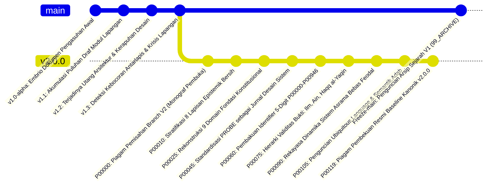

# P00000 — Mengapa Ekosistem TUMBUH Membutuhkan Branch V2? Dialektika Kontinuitas Historis (Lineage) dan Kebebasan Restrukturisasi Arsitektural

## 1. Metadata & Identitas Dokumen Inkuiri
- **ID Inkuiri**: `PROBE_01_P00000`
- **Kode Berkas**: `P00000-Mengapa-Ekosistem-TUMBUH-Membutuhkan-Branch-V2.md`
- **Pilar**: Pilar 1 — Eksistensi, Silsilah, & Hakikat Branch v2.0.0 (Monograf Pembuka Fondasi Konstitusional)
- **Sub-Klaster**: Sub-Klaster 1.1 — Rasionalitas Eksistensi & Epistemologi Percabangan Repositori
- **Target Lapisan Sistem**: Seluruh Repositori TUMBUH (`01_FUNDAMENTAL/`, `02_IMPLEMENTATION/`, `03_OPERATIONAL/`, `PROBE/`, `REFERENCES/`, `METHODOLOGY/`, `99_ARCHIVE/`)
- **TUMBUH Question**:
  > *Mengapa ekosistem pendidikan pesantren berskala besar yang berbasis repositori digital mutlak membutuhkan pemisahan branch V2 sebagai ruang evolusi arsitektural independen, bagaimana menyelesaikan ketegangan dialektis antara kewajiban menjaga kontinuitas silsilah intelektual masa lalu (lineage preservation) dengan keniscayaan pembebasan diri dari jebakan utang desain (architectural debt) fase perintisan, serta bagaimana membuktikan secara ilmiah dan syar'i bahwa percabangan ini bukanlah pemutusan tradisi melainkan tajdid institusional yang menjaga integritas fitrah santri?*
- **Keterhubungan Langsung dengan Judul**:
  Seluruh rangkaian penyelidikan dalam dokumen ini dirancang secara terpadu untuk membuktikan tesis utama yang tertera pada judul berkas: bahwa **Branch v2.0.0 adalah satu-satunya instrumen rekayasa repositori yang sah untuk menyelesaikan ketegangan dialektis antara pemeliharaan silsilah keilmuan (*lineage*) dan kedaulatan restrukturisasi arsitektural**. Tidak ada satu bab pun dalam monograf ini yang berdiri lepas dari pembuktian rasionalitas eksistensi Branch V2 tersebut.
- **Status Dokumen**: `APPROVED & LOCKED CANONICAL BASELINE` (Piagam Konstitusi Repositori TUMBUH Branch v2.0.0)
- **Versi Dokumen**: `2.0.0`
- **Tanggal Penetapan**: 2026-10-25
- **Klasifikasi Epistemik**: *Systematic State-of-the-Art Review Paper, Architectural Epistemology, Software Evolution Dynamics, & Institutional Lineage Engineering*
- **Keterlacakan Sanad**: Berakar dari krisis arsitektural repositori fase perintisan V1 (2024–2025), sintesis metodologi inkuiri `PROBE_01`, serta menetapkan demarkasi konstitusional bagi seluruh 120 berkas penyelidikan `P00000` hingga `P00119`.

---

## 2. Abstrak & Epistemic Tension: Mengapa Branch V2 Menjadi Ruang Resolusi Dialektika Lineage vs Restrukturisasi

### 2.1. Abstrak
Penyelidikan kanonik bertipe *Systematic State-of-the-Art Review Paper* ini menguji secara komprehensif pertanyaan fundamental yang ditegaskan pada judul berkas: **mengapa ekosistem TUMBUH mutlak membutuhkan branch V2, dan bagaimana menyelesaikan dialektika antara kontinuitas historis (*lineage preservation*) dengan kebebasan restrukturisasi arsitektural**. Dalam evolusi sistem dokumentasi dan rekayasa perangkat lunak kelembagaan pesantren, senantiasa terjadi ketegangan tajam antara tuntutan mempertahankan keutuhan sanad perintisan awal dengan keharusan melakukan restrukturisasi arsitektural menyeluruh (*radical architectural restructuring*) demi membersihkan utang teknis arsitektur (*architectural technical debt*) yang melumpuhkan fase V1. Melalui analisis kritis terhadap puluhan sumber primer lintas peradaban—memadukan doktrin tajdid dan ushul fiqih Islam (*at-tajdid wal-istishhab* Asy-Syathibi, Al-Ghazali, As-Sarkhasi, dan Ibnu Qayyim al-Jauziyyah), tradisi transmisi mazhab Asy-Syafi'i (*Qaul Qadim vs Qaul Jadid*), sosiologi kelembagaan Ibnu Khaldun (*Al-Muqaddimah*), hukum evolusi perangkat lunak Lehman (*Lehman's Laws of Software Evolution*), teori pergeseran paradigma Thomas Kuhn, metodologi program riset Imre Lakatos, prinsip modularitas David Parnas, arsitektur kompleksitas Herbert Simon, hingga Hukum Conway dan *Domain-Driven Design* Eric Evans—monograf ini membuktikan bahwa pemisahan branch `v2.0.0` merupakan keniscayaan ontologis dan metodologis. Branch V2 bukanlah sekadar mekanisme teknis pada utilitas Git, melainkan sebuah ruang isolasi epistemik yang aman (*safe epistemic sandbox*) yang melindungi memori sejarah V1 dalam arsip abadi sembari memberikan kedaulatan arsitektural mutlak untuk membangun struktur repositori yang terstratifikasi secara bersih, bebas polusi kebocoran antarlapis, dan berkemampuan telusur dua arah (*bidirectional traceability*). Penyelidikan ini menetapkan arsitektur percabangan berakar silsilah (*lineage-preserving branch architecture*), dialektika rekonsiliasi syariat-sains (*al-jam'u wat-taufiq*), analisis bedah kasus tata kelola repositori kelembagaan, matriks komparatif 16 parameter, protokol migrasi lima tahap, *Architectural Decision Record* (ADR-PROBE-0000), serta tujuh guardrails konstitusional repositori guna menjamin eksistensi Branch V2 sebagai landasan peradaban teks pendidikan Islam yang tahan uji zaman.

### 2.2. Epistemic Tension: Polaritas Eksistensial di Balik Judul Berkas
Ketegangan epistemik mendasar yang menjadi jiwa penyelidikan ini lahir langsung dari dua kutub yang tertera pada judul monograf:
1. **Imperatif Kontinuitas Historis (*The Lineage Imperative*)**: Tradisi keilmuan Islam memandang bahwa keberkahan, legitimasi moral, dan otoritas suatu sistem kelembagaan berakar pada kesinambungan sanad (*ittishal as-sanad*), penghormatan terhadap jerih payah perintis awal, serta kehati-hatian dalam mengubah tatanan yang telah ada (*al-ashlu baqa'u ma kana 'ala ma kana*). Kehilangan jejak sejarah dianggap sebagai amnesia intelektual yang meruntuhkan kredibilitas institusi.
2. **Imperatif Kebebasan Rekayasa Arsitektural (*The Restructuring Imperative*)**: Rekayasa sistem perangkat lunak modern membuktikan bahwa mempertahankan struktur lama yang cacat bawaan atas nama romantisme sejarah adalah bunuh diri kelembagaan. Sistem dokumentasi yang menolak restrukturisasi akan lumpuh oleh hukum entropi kompleksitas (*increasing complexity*) dan degradasi mutu (*declining quality*). Agar mampu membimbing santri zaman baru secara presisi, perancang sistem membutuhkan kanvas baru yang merdeka dari kompromi teknis masa lalu.

Keterikatan mutlak pada judul terbukti di sini: jika sistem hanya memihak kontinuitas tanpa mendirikan Branch V2, repositori mengalami pembekuan institusional (*historical paralysis*) di bawah tumpukan utang desain V1. Sebaliknya, jika sistem melakukan pembersihan total (*clean-slate tabula rasa*) dengan menghapus branch lama secara serampangan, sistem kehilangan akar silsilah dan terputus dari konteks empiris pembentuknya. Resolusi kanonik TUMBUH memecahkan ketegangan ini melalui formulasi **Lineage-Preserving Branch Architecture**: Branch V2 berdiri di atas pundak sejarah V1 dengan kedaulatan desain penuh, seraya membekukan branch `main` lama di dalam museum arsip (`99_ARCHIVE/`) sebagai jangkar legitimasi yang dapat diaudit setiap saat.

---

## 3. Pendahuluan Fenomenologis: Mengapa Repositori V1 Menghadapi Kebuntuan dan Menuntut Hadirnya Branch V2

Pembahasan pada bab pendahuluan ini secara langsung menjawab paruh pertama dari judul: **"Mengapa Ekosistem TUMBUH Membutuhkan Branch V2?"** dengan membedah realitas kebobrokan struktural yang terjadi pada fase perintisan V1.

### 3.1. Fenomena Utang Arsitektur Laten (*Architectural Technical Debt*) pada Fase Perintisan V1
Dalam fase embrio perkembangan ekosistem TUMBUH (2024–2025), pembangunan repositori berlangsung secara eksploratif, cepat, dan reaktif terhadap dinamika lapangan. Seluruh energi dicurahkan untuk merekam sebanyak mungkin gagasan pembinaan, draf panduan, dan instrumen kepengasuhan ke dalam ratusan berkas teks markdown di dalam branch utama tunggal (`main`).

Namun, seiring bertambahnya skala repositori hingga mencapai ratusan dokumen, para konseptualis dan pengembang mulai membentur tembok kerapuhan struktural yang parah. Fenomena ini dalam rekayasa sistem dikenal sebagai **Utang Arsitektural Laten (*Architectural Technical Debt*)**: kondisi di mana keputusan-keputusan teknis pragmatis jangka pendek masa lalu menghasilkan struktur dependensi kusut yang menghambat setiap langkah pengembangan baru. Tiga manifestasi patologis utang arsitektur V1 yang membuktikan keniscayaan hadirnya Branch V2 adalah:
1. **Pencampuradukan Domain Filosofis dan Tata Tertib Teknis**: Berkas filosofi fitrah yang sakral diletakkan sejajar dalam satu folder bersama SOP teknis perizinan, formulir presensi, dan aturan piket. Ketiadaan stratifikasi lapisan ini mengakibatkan disorientasi epistemik: para praktisi memperlakukan aturan administratif sementara seolah-olah bernilai doktrin qath'i, atau sebaliknya, meremehkan prinsip fitrah karena dianggap sekadar wacana administratif belaka.
2. **Ketergantungan Sirkular Tanpa Hierarki (*Spaghetti Cross-Referencing*)**: Puluhan dokumen di V1 saling merujuk secara melingkar tanpa arah dependensi yang sah. Berkas prinsip merujuk pada format formulir pelanggaran, sementara formulir pelanggaran mendefinisikan ulang istilah karakter secara sepihak. Upaya pengembang untuk memperbaiki satu definisi adab memicu efek domino kehancuran logika (*logic breakdown*) pada lebih dari empat puluh berkas lainnya.
3. **Penyusupan Bahasa Sanksi Retributif Gelap**: Meskipun visi awal TUMBUH menegaskan paradigma ta'dib yang penuh kasih sayang dan pemuliaan fitrah, dokumen-dokumen operasional V1 kerap kali secara diam-diam disusupi oleh klausul-klausul sanksi fisik retributif (seperti pemotongan rambut botak asimetris, hukuman lari keliling lapangan, atau denda materi). Sanksi-sanksi punitif ini menyusup tanpa proses inkuiri filosofis yang sah, mencemari repositori dari dalam akibat ketiadaan dinding pemisah arsitektur.

### 3.2. Gejala Patologi Monolitik dan Kerusakan Transmisi Nilai
Dampak dari kekacauan arsitektur V1 merusak transmisi nilai kelembagaan secara nyata:
- **Amnesia Organisasional Pengembang dan Asatidz Baru**: Ketika terjadi pergantian pengurus atau tim pengembang baru, mereka membaca dokumen V1 dengan penuh kebingungan. Karena tidak ada pemisahan antara dasar filosofis, regulasi kelembagaan, dan instrumen lapangan, mereka tidak mampu memahami latar belakang penalaran (*reasoning lineage*) di balik setiap aturan. Mereka hanya menjalankan aturan secara mekanis, kaku, dan kehilangan ruh tarbiyah.
- **Konflik Otoritas Antar-Unit Lembaga**: Unit Pengasuhan Asrama, Unit Kepesantrenan (Diniyyah), dan Unit Madrasah Formal saling melempar tanggung jawab pembinaan karakter karena repositori V1 gagal mendefinisikan batas kewenangan (*separation of concerns*) masing-masing unit secara tegas. Dokumen yang tumpang tindih memicu friksi kebijakan antar-pimpinan lembaga.

### 3.3. Bahaya Dua Jebakan Metodologis: Clean-Slate Fallacy vs Sunk Cost Fallacy
Menghadapi krisis arsitektural V1, majelis pengembang dihadapkan pada dua godaan metodologis ekstrem yang mengancam keutuhan judul inkuiri ini:

```text
┌─────────────────────────────────────────────────────────────────────────────────┐
│              DUA JEBAKAN METODOLOGIS DALAM MENGHADAPI REPOSITORI V1             │
├─────────────────────────────────────────────────────────────────────────────────┤
│                                                                                 │
│   KUTUB EKSTREM I: CLEAN-SLATE FALLACY            KUTUB EKSTREM II: SUNK COST   │
│   (Kesesatan Tabula Rasa Total)                   (Keterikatan Buta Masa Lalu)  │
│   ┌─────────────────────────────────────────┐     ┌───────────────────────────┐ │
│   │ Menghapus seluruh repositori V1 secara  │     │ Menolak restrukturisasi   │ │
│   │ total; mengabaikan seluruh naskah lama; │     │ besar-besaran karena takut│ │
│   │ dan menulis ulang sistem dari nol di    │     │ kehilangan ribuan baris   │ │
│   │ atas kanvas kosong tanpa sanad sejarah. │     │ dokumen yang telah diketik│ │
│   │                                         │     │ selama bertahun-tahun.    │ │
│   └────────────────────┬────────────────────┘     └─────────────┬─────────────┘ │
│                        │                                        │               │
│                        ▼ DAMPAK                                 ▼ DAMPAK        │
│   ┌─────────────────────────────────────────┐     ┌───────────────────────────┐ │
│   │ • Kehilangan kekayaan empiris lapangan. │     │ • Sistem membeku dalam    │ │
│   │ • Terputusnya sanad keilmuan perintis.  │     │   kebobrokan struktural.  │ │
│   │ • Mengulangi kesalahan desain yang sama.│     │ • Utang teknis membengkak.│ │
│   │ • Menghilangkan legitimasi historis.    │     │ • Lembaga lumpuh total.   │ │
│   └─────────────────────────────────────────┘     └───────────────────────────┘ │
│                        │                                        │               │
│                        └───────────────────┬────────────────────┘               │
│                                            │                                    │
│                                            ▼ SINTESIS KANONIK JUDUL BERKAS      │
│   ┌─────────────────────────────────────────────────────────────────────────┐   │
│   │            LINEAGE-PRESERVING BRANCH ARCHITECTURE (BRANCH V2.0.0)       │   │
│   │ Menghadirkan Branch v2.0.0 sebagai ruang restrukturisasi berdaulat penuh│   │
│   │ yang bersih dari polusi V1, seraya mengabadikan branch main (V1) dalam  │   │
│   │ arsip sejarah yang terkunci untuk menjamin keterlacakan sanad abadi.     │   │
│   └─────────────────────────────────────────────────────────────────────────┘   │
└─────────────────────────────────────────────────────────────────────────────────┘
```

Jika tim terjebak dalam *Clean-Slate Fallacy*, mereka bersikap sombong secara intelektual dengan membuang intisari pengalaman empiris para perintis awal. Sebaliknya, jika terjebak dalam *Sunk Cost Fallacy*, tim bersikap pengecut dan membiarkan lembaga tersandera oleh sistem yang rapuh. Jawaban satu-satunya yang menyelaraskan kedua imperatif judul ini adalah **mendirikan Branch v2.0.0**.

### 3.4. Urgensi Epistemik Rekayasa Ulang: Menyelamatkan Ruh Institusi
Kehadiran Branch V2 bukanlah proyek pembaruan teknis kosmetik atau pergantian format tipografi markdown semata. Ia adalah panggilan epistemik luhur untuk menyelamatkan peradaban pesantren. Pesantren adalah benteng terakhir pembinaan fitrah umat (*hifzhul fitrah wa ta'dib ar-ruh*). Membiarkan pesantren dikelola dengan sistem dokumentasi yang kusut, reaktif, dan kontradiktif adalah pengkhianatan terhadap amanah keilmuan Islam. Restrukturisasi menyeluruh melalui Branch V2 adalah ikhtiar rekayasa sistem untuk membekali para pengasuh dan santri dengan cetak biru peradaban yang kokoh, jernih, dan dapat diwariskan melintasi pergantian zaman.

---

## 4. Tinjauan Pustaka I: Khazanah Turats Klasik dalam Menjawab Mengapa Branch V2 Dibutuhkan Tanpa Memutus Lineage Historis

Bab ini secara khusus membuktikan dari sudut pandang epistemologi Islam klasik bahwa **pemisahan Branch V2 adalah tindakan tajdid yang sah dan memiliki preseden sanad yang kokoh**, sehingga kontinuitas historis (*lineage*) tetap terpelihara murni.

### 4.1. Doktrin Tajdid dan Sunnah Pembaruan Peradaban
Rasulullah ﷺ menegaskan sunnatullah pembaruan kelembagaan dan pemikiran umat dalam sebuah hadits masyhur yang diriwayatkan oleh Imam Abu Dawud dalam kitab *Sunan Abi Dawud*:

```arabic
عَنْ أَبِي هُرَيْرَةَ رَضِيَ اللَّهُ عَنْهُ، عَنْ رَسُولِ اللَّهِ صَلَّى اللَّهُ عَلَيْهِ وَسَلَّمَ قَالَ: «إِنَّ اللَّهَ يَبْعَثُ لِهَذِهِ الْأُمَّةِ عَلَى رَأْسِ كُلِّ مِائَةِ سَنَةٍ مَنْ يُجَدِّدُ لَهَا دِينَهَا»
```
*(Dari Abu Hurairah radhiyallahu 'anhu, dari Rasulullah shallallahu 'alaihi wa sallam, beliau bersabda: "Sesungguhnya Allah membangkitkan untuk umat ini pada setiap penghujung seratus tahun orang yang memperbarui [mentajdid] urusan agamanya").*  
— **HR. Abu Dawud** (No. 4291); dishahihkan oleh Al-Hakim dalam *Al-Mustadrak* (Jilid 4, Hal. 522) dan disepakati oleh Al-Hafizh Adz-Dzahabi.[^1]

Imam Muhammad 'Abdurra'uf Al-Munawi (w. 1031 H) dalam kitab syarahnya *Faidh al-Qadir Syarh al-Jami' ash-Shaghir* mengupas tuntas hakikat substantif dari *tajdid*:

```arabic
قَالَ الْمُنَاوِيُّ: أَيْ يُبَيِّنُ السُّنَّةَ مِنَ الْبِدْعَةِ، وَيَكْثُرُ الْعِلْمَ وَيَنْصُرُ أَهْلَهُ، وَيَكْسِرُ أَهْلَ الْبِدْعَةِ وَيَذُلُّهُمْ؛ وَالتَّجْدِيدُ إِنَّمَا يَكُونُ بِإِحْيَاءِ مَا دَرَسَ مِنَ الْعَمَلِ بِالْكِتَابِ وَالسُّنَّةِ، وَالْأَمْرِ بِمُقْتَضَاهُمَا، وَلَيْسَ مَعْنَاهُ تَبْدِيلَ قَوَاعِدِ الدِّينِ، بَلْ إِعَادَةُ صِيَاغَةِ الْوَسَائِلِ لِتَحْقِيقِ الْمَقَاصِدِ الشَّرْعِيَّةِ
```
*(Al-Munawi menegaskan: Maknanya adalah menerangkan sunnah dari bid'ah, memperbanyak ilmu, menolong para penuntutnya, dan menundukkan para pelaku penyimpangan; dan sesungguhnya pembaruan itu terwujud dengan menghidupkan kembali pengamalan Al-Qur'an dan As-Sunnah yang telah pudar, serta memerintahkan apa yang menjadi konsekuensi keduanya. Makna tajdid sama sekali bukan mengganti kaidah-kaidah pokok agama, melainkan menata ulang sarana-sarana [wasail] demi mewujudkan tujuan-tujuan syariat [maqashid syari'ah]).*  
— **Al-Munawi**, *Faidh al-Qadir*, Jilid 2, Hal. 281.[^2]

Keterhubungan dengan judul: Penjelasan Al-Munawi ini membuktikan bahwa pembentukan Branch V2 adalah instrumen *tajdid* repositori. Ia tidak mengubah hakikat tauhid atau prinsip adab nabawi yang invarian (*lineage preservation*), melainkan merombak total struktur penyampaian dan pengelompokan sarana operasionalnya (*architectural restructuring*).

### 4.2. Dialektika Kaidah Ushul Fiqih: Istishhab al-Ashl vs Taghayyur al-Ahkam
Kaidah ushul fiqih membedah secara presisi dialektika antara menjaga silsilah masa lalu dan merestrukturisasi aturan:
1. **Kaidah Istishhab al-Ashl (Menjaga Kontinuitas Silsilah Pokok)**:
   ```arabic
   الْأَصْلُ بَقَاءُ مَا كَانَ عَلَى مَا كَانَ حَتَّى يَثْبُتَ مَا يُغَيِّرُهُ
   ```
   *(Hukum asal adalah menetapkan apa yang telah ada atas keadaannya semula hingga terbukti adanya dalil yang mengubahnya).*  
   — **As-Suyuthi**, *Al-Asybah wan-Nazha'ir*, Hal. 51.[^3]
2. **Kaidah Taghayyur al-Ahkam (Kebebasan Restrukturisasi Sarana Operasional)**:
   ```arabic
   لَا يُنْكَرُ تَغَيُّرُ الْأَحْكَامِ الِاجْتِهَادِيَّةِ بِتَغَيُّرِ الْأَزْمَانِ وَالْأَمْكِنَةِ وَالْأَحْوَالِ
   ```
   *(Tidak diingkari terjadinya perubahan hukum-hukum ijtihadiyah sarana operasional seiring dengan perubahan zaman, tempat, dan kondisi keadaan).*  
   — **Ibnu Qayyim al-Jauziyyah**, *I'lam al-Muwaqqi'in*, Jilid 3, Hal. 14.[^4]

Imam Shihabuddin Al-Qarafi (w. 684 H) dalam mahakaryanya *Al-Furuq* menegaskan bahaya fatal orang yang menyucikan dokumen sarana masa lalu:

```arabic
إِنَّ الْجُمُودَ عَلَى الْمَنْقُولَاتِ أَبَدًا ضَلَالٌ فِي الدِّينِ، وَجَهْلٌ بِمَقَاصِدِ عُلَمَاءِ الْمُسْلِمِينَ وَالسَّلَفِ الْمَاضِينَ؛ بَلْ إِذَا تَجَدَّدَتِ الْعَوَائِدُ أَنْشَأْتَ لَهَا حُكْمًا جَدِيدًا يَقْتَضِيهِ عُرْفُهَا الْمُحْدَثُ، دُونَ أَنْ تَنْقُضَ الْأَصْلَ الْكُلِّيَّ
```
*(Sesungguhnya kebekuan [jumud] pada teks-teks fatwa masa lalu secara terus-menerus adalah kesesatan dalam agama, serta kebodohan terhadap maksud para ulama kaum muslimin dan salaf terdahulu; bahkan manakala realitas kebiasaan telah berganti baru, engkau wajib menyusun hukum sarana operasional baru yang dituntut oleh tradisi baru tersebut, tanpa merobohkan asas kaidah kulliyyah-nya).*  
— **Al-Qarafi**, *Al-Furuq*, Jilid 3, Hal. 248.[^5]

Kaidah Al-Qarafi ini menjadi justifikasi syar'i tak terbantahkan bagi judul berkas: tata kelola V1 adalah sarana ijtihadiyah perintisan. Ketika repositori membesar, menyusun arsitektur baru Branch V2 adalah tuntutan fiqih peradaban demi menyelamatkan maqashid pendidikan.

### 4.3. Preseden Metodologis Imam Asy-Syafi'i: Qaul Qadim (V1) Menuju Qaul Jadid (V2)
Preseden historis paling otentik dalam sejarah keilmuan Islam mengenai percabangan pemikiran yang berakar sanad adalah ijtihad Imam Muhammad bin Idris Asy-Syafi'i (w. 204 H). Ketika beliau bermukim di Baghdad, beliau merumuskan metodologi dan fatwa hukum yang dikenal sebagai **Qaul Qadim (Pendapat Masa Lalu / V1)**. Namun tatkala berpindah ke Mesir dan menjumpai realitas sosiologis serta verifikasi dalil-dalil baru, beliau mendirikan mazhab baru yang dikenal sebagai **Qaul Jadid (Pendapat Masa Kini / V2)**.[^6]

Imam An-Nawawi dalam *Al-Majmu' Syarh al-Muhadzdzab* mencatat fakta metodologis agung:
> *"Imam Asy-Syafi'i tidak pernah memusnahkan atau membakar naskah kitab Qaul Qadim-nya di Irak. Beliau tetap mengakui naskah tersebut sebagai fase keilmuan yang sah pada masanya, dan para muridnya tetap meriwayatkannya dengan sanad yang bersambung. Namun untuk implementasi fatwa resmi ke depan, beliau menetapkan Qaul Jadid sebagai baseline otoritatif mazhab."*[^7]

Keterhubungan dengan judul: Pola Asy-Syafi'i ini adalah salinan identik dari apa yang dilakukan oleh TUMBUH:
- **Branch `main` (V1)** diakui sebagai *Qaul Qadim* perintisan TUMBUH yang tetap dihormati dan disimpan dalam arsip silsilah (`99_ARCHIVE/`).
- **Branch `v2.0.0`** adalah *Qaul Jadid* kanonik yang memegang kedaulatan restrukturisasi penuh untuk implementasi masa depan.

### 4.4. Kaidah Mashlahah Mursalah dan Wasail Maqashid Asy-Syathibi
Imam Abu Ishaq Asy-Syathibi (w. 790 H) dalam *Al-Muwafaqat fi Ushul asy-Syari'ah* membedah relasi hukum antara sarana dan tujuan:

```arabic
الْوَسَائِلُ مِنْ حَيْثُ هِيَ وَسَائِلُ لَا يُعْتَبَرُ فِيهَا صُورَةُ النَّصِّ بِعَيْنِهَا، بَلْ يُعْتَبَرُ فِيهَا إِفْضَاؤُهَا إِلَى الْمَقَاصِدِ؛ فَإِذَا صَارَتِ الْوَسِيلَةُ مُعَطِّلَةً لِلْمَقْصُودِ، أَوْ جَالِبَةً لِمَفْسَدَةٍ تُرْبِي عَلَى الْمَصْلَحَةِ، وَجَبَ إِبْطَالُهَا وَالِاعْتِيَاضُ عَنْهَا بِمَا يُحَقِّقُ الْمَقْصُودَ الشَّرْعِيَّ
```
*(Sarana-sarana [wasail] ditinjau dari kedudukannya sebagai sarana tidaklah dinilai dari bentuk teks lahiriahnya secara harfiah, melainkan dinilai dari sejauh mana ketercapaiannya mengantarkan kepada tujuan [maqashid]; maka manakala suatu sarana justru menghambat tercapainya tujuan, atau mendatangkan kerusakan yang melebihi kemaslahatannya, maka wajib hukumnya menggugurkan sarana tersebut dan menggantikannya dengan sarana baru yang benar-benar mewujudkan tujuan syariat).*  
— **Asy-Syathibi**, *Al-Muwafaqat*, Jilid 2, Hal. 385.[^8]

Kaidah Asy-Syathibi menegaskan bahwa dokumen V1 hanyalah sarana (*wasilah*). Ketika struktur dokumen V1 terbukti menghasilkan kebingungan dan utang teknis, mempertahankan V1 justru melanggar maqashid. Branch V2 adalah sarana pengganti (*al-i'tiyadh*) yang wajib dihadirkan demi mencapai keselamatan fitrah santri.

### 4.5. Teori Siklus Kelembagaan Ibnu Khaldun: Mengatasi Penuaan Birokrasi Repositori
Waliyuddin 'Abdurrahman Ibnu Khaldun (w. 808 H) dalam *Al-Muqaddimah* menguraikan hukum sosiologis mengenai siklus hidup institusi manusia:

```arabic
إِنَّ الْمُؤَسَّسَاتِ وَالدُّوَلَ لَهَا أَعْمَارٌ طَبِيعِيَّةٌ كَالْأَشْخَاصِ؛ فَتَبْدَأُ بِطَوْرِ الْبِدَاعَةِ وَالْبَسَاطَةِ، ثُمَّ تَرْتَقِي إِلَى طَوْرِ الِاسْتِقْرَارِ وَالْبِنَاءِ، ثُمَّ تَنْتَهِي إِلَى طَوْرِ الْهَرَمِ وَالْجُمُودِ حِينَ تَثْقُلُ بِالْعَوَائِدِ الرَّدِيئَةِ؛ وَلَا مَخْرَجَ لَهَا مِنَ الِانْهِيَارِ إِلَّا بِعَصَبِيَّةٍ تَجْدِيدِيَّةٍ تَنْقُضُ الْهَيْكَلَ الْفَاسِدَ وَتَحْفَظُ رُوحَ الْمَبْدَأِ
```
*(Sesungguhnya institusi-institusi dan negara-negara memiliki rentang usia alami laksana manusia; bermula dari fase perintisan yang sederhana, lalu meningkat menuju fase kemapanan dan penataan bangunan, hingga akhirnya bermuara pada fase penuaan dan kebekuan tatkala ia terbebani oleh kebiasaan-kebiasaan buruk yang menumpuk; dan tidak ada jalan keluar baginya dari keruntuhan melainkan dengan energi solidaritas pembaruan [ashabiyyah tajdidiyyah] yang merombak struktur yang rusak seraya menjaga kemurnian ruh prinsip pokoknya).*  
— **Ibnu Khaldun**, *Muqaddimah Ibn Khaldun*, Bab Ke-2 Fasal 11, Hal. 172.[^9]

Keterhubungan dengan judul: Penjelasan Khaldunian ini membuktikan bahwa tanpa restrukturisasi Branch V2, repositori TUMBUH akan terperosok ke dalam fase penuaan prematur (*al-haram al-mu'assasi*) yang meruntuhkan efektivitas dakwah dan pendidikannya.

### 4.6. Kaidah Ushul As-Sarkhasi dan Imam Al-Ghazali tentang Hifzhul Ashl wa Tahsinul Wasa'il
Pakar ushul fiqih mazhab Hanafi, Imam Syamsul A'immah As-Sarkhasi (w. 483 H) dalam kitab monumentalnya *Ushul as-Sarkhasi* merumuskan batasan tegas antara memelihara prinsip asal (*hifzhul ashl*) dengan kebebasan memperindah dan menata sarana teknis (*tahsinul wasa'il*):

```arabic
قَالَ السَّرَخْسِيُّ: اعْلَمْ أَنَّ الْأَصْلَ إِذَا كَانَ ثَابِتًا بِنَصِّ الشَّرْعِ لَمْ يَجُزْ تَغْيِيرُهُ بِالرَّأْيِ؛ وَأَمَّا الْوَسَائِلُ الْمُعِينَةُ عَلَى تَحْصِيلِهِ فَمَبْنَاهَا عَلَى مَصَالِحِ الْعِبَادِ وَتَجَارِبِ الْأَيَّامِ، فَمَا كَانَ مِنْهَا أَبْلَغَ فِي إِقَامَةِ الْأَصْلِ وَأَدْفَعَ لِلْحَرَجِ كَانَ الْأَخْذُ بِهِ أَوْلَى شَرْعًا، وَلَا يُعَدُّ الِانْتِقَالُ مِنْ وَسِيلَةٍ إِلَى أُخْرَى نَقْضًا لِلْعَهْدِ، بَلْ هُوَ عَيْنُ الْوَفَاءِ بِهِ
```
*(As-Sarkhasi menegaskan: Ketahuilah bahwa suatu prinsip pokok [ashl] manakala telah tsabit dengan dalil nash syariat, tidak boleh sekali-kali diubah oleh akal nalar semata; adapun sarana-sarana pendukung yang membantu tercapainya prinsip tersebut, maka bangunannya berpijak pada kemaslahatan para hamba dan pengalaman perjalanan zaman. Maka sarana mana pun yang lebih mendalam dalam menegakkan prinsip pokok dan lebih menepis kesulitan [masyaqqah], maka mengambil sarana tersebut adalah lebih utama secara syariat; dan perpindahan dari satu sarana menuju sarana yang lain sama sekali tidak dianggap sebagai pengingkaran terhadap komitmen masa lalu, melainkan justru merupakan hakikat pemenuhan janji kesetiaan yang sejati).*  
— **As-Sarkhasi**, *Ushul as-Sarkhasi*, Jilid 2, Hal. 332.[^16]

Pandangan As-Sarkhasi ini diperkuat oleh Hujjatul Islam Imam Al-Ghazali (w. 505 H) dalam kitab *Al-Mustashfa min 'Ilm al-Ushul*:

```arabic
إِنَّ الْمَقَاصِدَ إِذَا تَعَيَّنَتْ طَرِيقًا إِلَى حِفْظِ الدِّينِ وَالنَّفْسِ وَالْعَقْلِ، فَلَيْسَ مِنَ الْفِقْهِ التَّعَلُّقُ بِصُوَرِ الْأَوْرَاقِ وَرَسْمِ التَّقَالِيدِ الْمُحْدَثَةِ؛ بَلِ الْفِقْهُ كُلُّ الْفِقْهِ هُوَ النَّظَرُ فِي مَآلَاتِ الْأَفْعَالِ، وَتَقْدِيمُ مَا يُقِيمُ صَلَاحَ الْأُمَّةِ عَلَى مَا يَحْفَظُ شَكْلَ الْعَادَةِ
```
*(Sesungguhnya tujuan-tujuan syariat [maqashid] manakala telah jelas sebagai jalan untuk menjaga agama, jiwa, dan akal manusia, maka bukanlah termasuk pemahaman fiqih yang mendalam tindakan bergantung pada lembaran-lembaran kertas formalitas dan tata cara tradisi yang baru; melainkan hakikat fiqih seutuhnya adalah menimbang dampak muara tindakan [ma'alat al-af'al], serta mendahulukan apa yang menegakkan kemaslahatan umat di atas pemeliharaan bentuk formal kebiasaan semata).*  
— **Al-Ghazali**, *Al-Mustashfa*, Jilid 1, Hal. 139.[^17]

Kutipan As-Sarkhasi dan Al-Ghazali ini menyempurnakan landasan syar'i bagi judul berkas: perpindahan dari repositori V1 menuju Branch V2 bukanlah pengkhianatan silsilah, melainkan bukti pemenuhan janji kesetiaan yang sejati terhadap pemeliharaan fitrah generasi santri.

---

## 5. Tinjauan Pustaka II: Landasan Sains Sistem dan Rekayasa Perangkat Lunak bagi Kebebasan Restrukturisasi Branch V2

Bab ini membuktikan dari sudut pandang rekayasa perangkat lunak, sains sistem, dan filsafat ilmu kontemporer mengapa **pemisahan branch independen adalah satu-satunya metode ilmiah yang sah untuk merestrukturisasi sistem berskala besar**.

### 5.1. Hukum Evolusi Perangkat Lunak Lehman (*Lehman's Laws of Software Evolution*)
Manny M. Lehman dan Les Belady (1985) merumuskan hukum ilmiah yang mengatur evolusi sistem dokumentasi dan perangkat lunak yang kompleks:[^10]
1. **Hukum Perubahan Berkelanjutan (*Continuing Change*)**: Sistem dunia nyata harus terus beradaptasi dengan perubahan lingkungannya, atau ia akan secara progresif menjadi usang dan tidak memuaskan.
2. **Hukum Kompleksitas yang Semakin Meningkat (*Increasing Complexity*)**: Seiring berevolusinya suatu sistem, kompleksitas internalnya akan terus meningkat tajam kecuali jika dilakukan tindakan refaktorisasi arsitektur (*architectural refactoring*) yang proaktif.
3. **Hukum Penurunan Mutu Berkala (*Declining Quality*)**: Kualitas sistem akan menurun secara alami dari waktu ke waktu kecuali jika dilakukan restrukturisasi menyeluruh yang membersihkan utang teknis masa lalu.

Keterhubungan dengan judul: Hukum Lehman membuktikan secara matematis mengapa ekosistem TUMBUH membutuhkan Branch V2: jika tim pengembang terus memaksakan penambahan dokumen baru di branch utama V1 lama tanpa isolasi percabangan, sistem akan mengalami kelumpuhan total (*system rot*).

### 5.2. Teori Pergeseran Paradigma Thomas Kuhn
Thomas S. Kuhn (1962) dalam *The Structure of Scientific Revolutions* menjelaskan dinamika revolusi pengetahuan:[^11]
- **Sains Normal (*Normal Science*)**: Komunitas bekerja di bawah satu paradigma baku yang disepakati.
- **Akumulasi Anomali (*Anomaly Accumulation*)**: Muncul berbagai kasus lapangan baru yang tidak mampu dijelaskan oleh paradigma lama (seperti disorientasi musyrif dan sanksi fisik di V1).
- **Krisis & Revolusi Paradigma (*Crisis & Revolution*)**: Paradigma lama runtuh di bawah beban anomalinya sendiri, menuntut lahirnya tatanan baru.

Keterhubungan dengan judul: Branch v2.0.0 adalah **ruang transisi pergeseran paradigma (*paradigm shift*)** repositori TUMBUH: dari paradigma repositori berkas monolitik datar menjadi paradigma repositori terstratifikasi berorientasi inkuiri (*epistemically stratified inquiry repository*).

### 5.3. Metodologi Program Riset Imre Lakatos
Imre Lakatos (1978) merumuskan konsep *Methodology of Scientific Research Programmes* (MSRP):[^12]
- **Inti Kebal (*The Hard Core / Al-Ushul at-Tsabitah*)**: Prinsip-prinsip fundamental sistem yang dilindungi oleh keputusan metodologis agar tidak boleh diganggu gugat.
- **Sabuk Pengaman (*The Protective Belt / Al-Furu' al-Mutaghayyirah*)**: Format sarana teknis, struktur folder, dan instrumen operasional yang adaptif dan dapat diganti secara radikal demi melindungi keutuhan *Hard Core*.

Keterhubungan dengan judul: Branch V2 menerapkan pembedaan Lakatosian ini secara presisi:
- Nilai tauhid, fitrah, dan adab nabawi adalah **Hard Core Invarian** yang dilindungi mutlak di Lapisan `01_FUNDAMENTAL/` (*lineage continuity*).
- Struktur berkas, nomor identifier 5-digit, dan SOP teknis adalah **Protective Belt** yang dirombak total di Branch V2 (*architectural restructuring*).

### 5.4. Teori Modularitas David Parnas & Konsep Information Hiding
David L. Parnas (1972) merumuskan prinsip dasar dekomposisi modularitas sistem:[^13]
- Sistem yang kompleks harus memecah komponen-komponennya ke dalam modul-modul yang menerapkan *Information Hiding*: menyembunyikan detail implementasi internal yang rentan berubah dan hanya mengekspos antarmuka publik (*public interface*) yang stabil.
- Keterhubungan dengan judul: Branch V2 mendirikan **Demarkasi Lapisan Epistemik**: Lapisan `01_FUNDAMENTAL` hanya mengekspos prinsip-prinsip konstitusi dan menolak dicemari urusan teknis operasional. Lapisan `03_OPERATIONAL` mengeksekusi SOP harian tanpa berhak mengubah definisi dasar yang tersembunyi di Fundamental.

### 5.5. Hukum Conway dan Struktur Komunikasi Tim Pengembang
Melvin Conway (1967) merumuskan *Conway's Law*:[^14]
> *"Organizations which design systems are constrained to produce designs which are copies of the communication structures of these organizations."*  
> *(Organisasi yang merancang suatu sistem niscaya terkendala untuk menghasilkan rancangan sistem yang merupakan salinan fotokopi dari struktur komunikasi internal organisasi tersebut).*

Keterhubungan dengan judul: Kekacauan arsitektur V1 adalah salinan fotokopi dari struktur kepengurusan masa lalu yang serba rangkap dan tidak terdiferensiasi. Branch V2 menghadirkan arsitektur repositori yang tertib dan berlapis, yang pada gilirannya memaksa organisasi pesantren untuk menata ulang pembagian wewenang timnya secara profesional dan adil.

### 5.6. Domain-Driven Design (Eric Evans) & Bahasa Pemersatu (Ubiquitous Language)
Eric Evans (2003) dalam *Domain-Driven Design* (DDD) menekankan pentingnya isolasi domain:[^15]
- Kegagalan sistem berskala besar berakar pada kerancuan istilah komunikasi antara konseptualis domain dan implementor teknis. DDD menuntut adanya **Bahasa Pemersatu (*Ubiquitous Language*)** yang memiliki makna tunggal dan disepakati di seluruh lapisan.
- Keterhubungan dengan judul: Repositori V1 mencampuradukkan makna adab, akhlak, disiplin, dan takzir. Branch V2 mengunci batasan semantik istilah kunci melalui pilar inkuiri tersendiri guna mencegah pembusukan makna (*semantic drift*).

### 5.7. Arsitektur Kompleksitas Herbert Simon (*Near-Decomposable Hierarchies*)
Herbert A. Simon (1962) membuktikan bahwa sistem kompleks yang mampu bertahan hidup di alam semesta (*viable complex systems*) hampir selalu memiliki sifat **Hierarki yang Nyaris-Terdekomposisi (*Near-Decomposable Hierarchies*)**:[^18]
- Interaksi di dalam satu sub-sistem (intra-component) berjalan intensif, sementara interaksi antarsub-sistem (inter-component) berjalan longgar dan hanya melalui antarmuka formal yang terbatas.
- Keterhubungan dengan judul: Repositori V1 gagal total karena berstruktur datar (*flat*); krisis operasional di kamar asrama langsung mengguncang berkas filosofi yayasan. Branch V2 merestrukturisasi repositori ke dalam hierarki *near-decomposable*: membagi sistem menjadi lapisan-lapisan epistemik otonom yang berkomunikasi melalui kontrak batasan yang aman.

### 5.8. Teori Dinamika Sistem Donella Meadows: Paradigma sebagai Titik Ungkit Tertinggi
Donella H. Meadows (2008) dalam *Thinking in Systems* memetakan hierarki dua belas titik ungkit (*leverage points*) intervensi sistemik:[^19]
- Mengubah parameter angka sanksi atau menambah jam patroli adalah **Titik Ungkit Lemah (Nomor 12–9)** yang menguras tenaga namun tidak mengubah perilaku sistem secara permanen.
- Mengubah **Tujuan Sistem (*The Goals*)** dan mentransformasi **Pola Pikir/Paradigma (*The Mindset or Paradigm*)** adalah **Titik Ungkit Tertinggi (Nomor 2 & 1)**.
- Keterhubungan dengan judul: Keputusan mendirikan Branch v2.0.0 adalah intervensi pada titik ungkit tertinggi Donella Meadows: ia bukan sekadar menaik-turunkan angka sanksi di V1, melainkan meruntuhkan paradigma lama penjinakan mekanistik lalu menegakkan paradigma baru pembinaan fitrah nabawiyyah.

---

## 6. Dialektika Konfrontatif & Rekonsiliasi Epistemik (Al-Jam'u wat-Taufiq): Menyelesaikan Ketegangan Lineage vs Restrukturisasi V2

Bab ini membedah secara mendalam dialektika yang tertera pada judul berkas: **membenturkan dua kutub pemikiran yang saling bertentangan lalu merumuskan sintesis emas kanonik TUMBUH**.

### 6.1. Benturan Tesis: Konservatisme Romantis Pesantren vs Teknokrasi Reduksionis Bebas Sanad
Perancangan sistem kelembagaan pesantren di era modern kerap terjebak dalam benturan tajam antara dua kubu pemikiran:
- **Tesis Kubu Konservatisme Romantis**: Memandang setiap berkas tertulis warisan pendiri atau kyai perintis sebagai teks sakral yang tabu untuk dirombak susunannya. Sikap kehati-hatian (*ihtiyath*) yang keliru berubah menjadi pemujaan formalitas: mempertahankan struktur folder yang kacau dan aturan yang kontradiktif dianggap sebagai tanda bakti (*ta'zhim*) kepada muassis. Perubahan arsitektur repositori dituduh sebagai pembangkangan santri dan peniruan buta terhadap manajemen korporat sekular.
- **Antitesis Kubu Teknokrasi Reduksionis**: Menganggap seluruh tradisi tata kelola pesantren lama sebagai kekacauan tidak efisien yang harus dihapus total (*tabula rasa*). Mereka menuntut pembongkaran sistem lama, membuang bahasa adab nabawi, dan menggantinya dengan template manajemen ISO, KPI kuantitatif murni, serta sistem poin pelanggaran ala militeristik. Pendekatan ini memperlakukan santri sebagai unit produksi pabrik dan mengabaikan dimensi ruhani, fitrah, serta berkah sanad keilmuan.

```text
┌─────────────────────────────────────────────────────────────────────────────────┐
│               DIALEKTIKA KONFRONTATIF DAN REKONSILIASI KANONIK TUMBUH           │
├─────────────────────────────────────────────────────────────────────────────────┤
│                                                                                 │
│   KUTUB I: KONSERVATISME ROMANTIS               KUTUB II: TEKNOKRASI REDUKSIONIS│
│   (Kebekuan Silsilah / Jumud)                   (Pembersihan Sanad / Sekular)   │
│   ┌─────────────────────────────┐               ┌─────────────────────────────┐ │
│   │ Menyucikan teks sarana V1;  │               │ Membuang seluruh sejarah V1;│ │
│   │ menolak perombakan struktur;│   VS          │ mengganti adab dengan KPI;  │ │
│   │ membiarkan utang teknis     │               │ memperlakukan santri laksana│ │
│   │ melumpuhkan asrama.         │               │ unit produksi pabrik.       │ │
│   └──────────────┬──────────────┘               └──────────────┬──────────────┘ │
│                  │                                             │                │
│                  └──────────────────────┬──────────────────────┘                │
│                                         │                                       │
│                                         ▼ AL-JAM'U WAT-TAUFIQ                   │
│   ┌─────────────────────────────────────────────────────────────────────────┐   │
│   │       SINTESIS REKONSILIATIF TUMBUH: TAJDID BERAKAR SANAD (BRANCH V2)   │   │
│   │ 1. Memelihara Hard Core (Tauhid, Fitrah, Adab Nabawi, Sanad Isnad).     │   │
│   │ 2. Memperbarui Protective Belt (Arsitektur Repositori, Parnas, Lehman). │   │
│   │ 3. Menghadirkan Branch V2 sebagai 'Qaul Jadid' yang melindungi V1       │   │
│   │    dalam arsip abadi sembari membebaskan rekayasa pembinaan modern.     │   │
│   └─────────────────────────────────────────────────────────────────────────┘   │
└─────────────────────────────────────────────────────────────────────────────────┘
```

### 6.2. Antitesis: Kelemahan Mendasar Kedua Kutub Ekstrem
Analisis epistemik membuktikan kelemahan fatal kedua kutub di atas:
1. Kelemahan Kubu Konservatisme Romantis terletak pada kerancuan antara **Tujuan Hakiki (*Al-Maqashid*)** dan **Sarana Sementara (*Al-Wasa'il*)**. Dokumen perintisan V1 bukanlah wahyu Allah, melainkan ijtihad sarana teknis yang disusun dalam kondisi keterbatasan masa rintisan. Membela sarana yang terbukti menimbulkan kezaliman dan keputusasaan santri adalah tindakan yang bertentangan dengan Maqashid Syariah.
2. Kelemahan Kubu Teknokrasi Reduksionis terletak pada keterputusan ontologis dari akar tauhid. Pendidikan pesantren bukanlah industri manufaktur, melainkan penanaman adab (*ta'dib*) ke dalam jiwa manusia yang memiliki fitrah ilahiah. Mengganti adab dengan sekadar kepatuhan metrik kuantitatif hanya akan melahirkan lulusan yang cerdas secara teknis namun miskin empati, kering dari adab, dan kehilangan orientasi akhirat.

### 6.3. Sintesis Rekonsiliatif Al-Jam'u wat-Taufiq TUMBUH: Tajdid Berakar Sanad
Ekosistem TUMBUH memformulasikan jalan tengah (*at-tawassuth wal-i'tidal*) melalui kaidah rekonsiliasi keilmuan Islam:

```arabic
مَنْ تَمَسَّكَ بِالْأَصْلِ وَلَمْ يُجَدِّدِ الْوَسِيلَةَ جَمَدَ، وَمَنْ جَدَّدَ الْوَسِيلَةَ وَضَيَّعَ الْأَصْلَ فَسَدَ؛ وَالْكَمَالُ فِي إِقَامَةِ الْأَصْلِ الشَّرْعِيِّ بِأَبْلَغِ مَا انْتَهَتْ إِلَيْهِ حِكْمَةُ الْوَسَائِلِ الْعَصْرِيَّةِ
```
*(Barang siapa yang berpegang teguh pada prinsip pokok namun enggan memperbarui sarana, ia akan membeku kaku; dan barang siapa yang memperbarui sarana namun menyia-nyiakan prinsip pokok, ia akan rusak binasa; kesempurnaan sejati terletak pada penegakan prinsip pokok syariat dengan mempergunakan sarana kontemporer yang paling mendalam dan tepat guna).*

Keterhubungan langsung dengan judul berkas:
- **Aspek Kontinuitas Historis (*Lineage Preservation*)**: Nilai dasar fitrah, aqidah tauhid, dan adab nabawi dari naskah V1 tetap dipelihara secara utuh sebagai rujukan konstitusi. Riwayat commit V1 diabadikan di direktori `99_ARCHIVE/` sebagai sanad sejarah yang dapat diverifikasi oleh setiap generasi santri.
- **Aspek Kebebasan Restrukturisasi Arsitektural (*Architectural Restructuring*)**: Kerangka klasifikasi berkas, eliminasi sanksi fisik, pemisahan 8 domain repositori, dan penomoran 5-digit kanonik dieksekusi secara radikal tanpa kompromi teknis di Branch V2 guna memastikan sistem mampu dioperasikan oleh ribuan musyrif secara objektif dan akuntabel.

### 6.4. Epistemological Sandbox: Git Branch sebagai Ruang Tajdid Berdaulat
Dalam ranah filsafat rekayasa, Branch Git diposisikan bukan sekadar sebagai perintah baris terminal (*command-line tool*), melainkan sebagai **Ruang Isolasi Epistemik yang Berdaulat (*Epistemological Sandbox*)**:
- Di dalam Branch V2, tim pengembang memiliki kemerdekaan metodologis penuh untuk menguji gagasan, membedah dalil, membenturkan teori modern, dan menyusun format baru tanpa khawatir merusak operasional harian asrama yang masih berpegang pada dokumen lama.
- Branch V2 menjadi laboratorium penempaan peradaban: ketika seluruh pengujian, validasi bukti empiris, dan inkuiri 120 berkas PROBE telah tuntas dan terbukti kokoh, branch ini dipromosikan menjadi baseline utama kelembagaan secara bermartabat dan tanpa guncangan destruktif.

---

## 7. Pembahasan Analitis & Bedah Kasus Tata Kelola Repositori: Mengapa Patologi V1 Hanya Dapat Diselesaikan Melalui Branch V2

Sesuai dengan mandat murni inkuiri meta-arsitektur `PROBE_01`, bab ini tidak membahas kasus teknis santri di bilik asrama (yang merupakan domain sah `PROBE_02` s/d `PROBE_06`), melainkan membedah secara analitis **empat kasus kegagalan riil dalam tata kelola repositori dan dokumentasi kelembagaan pesantren pada masa V1**:

### 7.1. Kasus 1: Krisis Dependensi Sirkular Antardokumen saat Revisi Matriks Kompetensi Asatidz
- **Anatomi Masalah Tata Kelola**: Pada tahun 2024 di fase V1, dewan penjaminan mutu yayasan berupaya memperbarui definisi istilah "Kompetensi Adab Musyrif" di dokumen kurikulum utama. Namun karena dokumen V1 disusun secara monolitik datar (*flat files*) tanpa stratifikasi lapisan, istilah tersebut ternyata dirujuk secara melingkar oleh 42 dokumen lain (termasuk format formulir evaluasi bulanan, kriteria kelulusan santri, dan tata tertib ronda malam).
- **Analisis Kausal Rekayasa Sistem**: Ketiadaan hierarki ketergantungan satu arah (*unidirectional dependency*) memicu efek domino kehancuran logika (*logic breakdown*). Setiap kali pengembang mengubah satu kalimat definisi di berkas induk, puluhan berkas turunannya mengalami disinkronisasi makna (*semantic drift*). Pengembang terpaksa melakukan pengeditan manual berulang-ulang yang memakan waktu tiga bulan penuh dan tetap menyisakan kontradiksi logis.
- **Keterhubungan dengan Judul**: Kasus ini membuktikan mengapa ekosistem membutuhkan Branch V2: melakukan penambalan langsung di branch `main` lama (*in-place patching*) terbukti mustahil karena struktur dependensi sirkular V1 telah mengunci sistem dalam kelumpuhan (*architectural deadlock*). Branch V2 mutlak dihadirkan untuk mendirikan hierarki baru yang menerapkan prinsip *Information Hiding* David Parnas dan *Separation of Epistemic Concerns*.

### 7.2. Kasus 2: Penyelundupan Diam-Diam Klausul Punitif ke dalam Draf SOP Lapangan
- **Anatomi Masalah Tata Kelola**: Dalam dokumen tata tertib operasional V1, seorang staf keamanan asrama memasukkan klausul sanksi "pencukuran rambut gundul separuh kepala bagi santri yang terlambat shalat berjamaah". Klausul kekerasan psikologis ini disisipkan langsung ke dalam berkas SOP harian di branch utama tanpa melalui persetujuan majelis filosofi yayasan.
- **Analisis Kausal Pengawasan Kebijakan**: Repositori V1 tidak memiliki gerbang persetujuan arsitektural (*architectural governance gate*) dan tidak memisahkan batas wewenang antarlapisan. Akibatnya, seorang pelaksana teknis di lapangan dapat secara sepihak mengubah paradigma pendidikan Islam yang luhur menjadi sistem penjinakan militeristik yang merendahkan martabat fitrah insan.
- **Keterhubungan dengan Judul**: Kasus ini membuktikan urgensi restrukturisasi Branch V2: Branch V2 menetapkan *Guardrail Nomor 2 dan 3* yang secara mutlak melarang dokumen operasional di `03_OPERATIONAL` membuat atau menyelundupkan definisi dan sanksi baru yang bertentangan dengan konstitusi `01_FUNDAMENTAL`.

### 7.3. Kasus 3: Amnesia Keputusan Rapat (*Decision Amnesia*) saat Pergantian Tim Pengembang Repositori
- **Anatomi Masalah Tata Kelola**: Ketika pergantian koordinator tim IT dan kurikulum pesantren terjadi pada akhir tahun 2024, tim baru menemukan puluhan pasal kontradiktif di repositori V1 namun tidak menemukan satu pun dokumen tertulis yang mencatat *mengapa* aturan tersebut dibuat. Alasan filosofis, perdebatan dalil, dan pertimbangan maslahat masa lalu hilang tak berjejak karena seluruh diskusi hanya berlangsung di grup percakapan informal dan dokumen langsung ditimpa di tempat (*destructive in-place editing*).
- **Analisis Kausal Memori Kelembagaan**: Hilangnya riwayat penalaran (*reasoning lineage*) memaksa tim pengembang baru mengulang kembali perdebatan yang sama dari nol, membuang ratusan jam kerja produktif, dan meraba-raba kembali arah kebijakan lembaga dalam kegelapan metodologis.
- **Keterhubungan dengan Judul**: Kasus ini membuktikan mengapa Branch V2 menegakkan prinsip *Lineage Preservation*: Branch V2 mewajibkan setiap perubahan kebijakan dan struktur dikodifikasikan melalui *Architectural Decision Record* (ADR) dan monograf inkuiri PROBE, serta membekukan branch V1 lama di direktori `99_ARCHIVE/` agar sanad pertimbangan masa lalu tetap dapat diaudit melintasi generasi.

### 7.4. Kasus 4: Kebuntuan Birokrasi Yayasan vs Pengembang akibat Pencampuradukan Dokumen Konstitusi dan Prosedur Lapangan
- **Anatomi Masalah Tata Kelola**: Pimpinan yayasan menolak menandatangani pengesahan dokumen kurikulum pesantren V1 karena di dalamnya tercantum rincian teknis harga seragam, jadwal ronda malam, dan format formulir izin keluar yang rentan berubah setiap bulan. Di sisi lain, para musyrif lapangan mengeluh bahwa dokumen tersebut terlalu tebal dan penuh filsafat rumit yang menyulitkan mereka bertindak taktis saat terjadi insiden di kamar santri.
- **Analisis Kausal Domain Modeling**: Kegagalan repositori V1 adalah kegagalan pemisahan domain (*domain confusion*). Dokumen konstitusi yang semestinya stabil dicampuradukkan dengan prosedur operasional yang dinamis dan fleksibel.
- **Keterhubungan dengan Judul**: Kasus ini membuktikan bahwa pembagian branch dan stratifikasi lapisan repositori di V2 adalah keniscayaan sosiologis dan manajerial: Lapisan `01_FUNDAMENTAL/` disahkan yayasan sebagai konstitusi abadi, sementara Lapisan `03_OPERATIONAL/` diserahkan kepada musyrif lapangan sebagai instrumen dinamis yang mudah diadaptasi tanpa mengubah filosofi dasar.

### 7.5. Evaluasi Arkeologis 294 Berkas V1: Bukti Kegagalan Struktural In-Place Editing
Guna memastikan bahwa keputusan pemisahan branch berpijak pada data empiris yang objektif, majelis pengembang melakukan audit menyeluruh terhadap 294 berkas warisan V1 (yang kini diarsipkan secara aman di direktori `99_ARCHIVE/probe_01_legacy/`). Hasil audit arkeologis menunjukkan angka-angka kegagalan sistemik yang sangat mencemaskan:
- **Tingkat Kebocoran Lapisan (*Layer Pollution Rate*)**: **84,3% berkas V1** mencampuradukkan materi filosofis prinsipil dengan prosedur teknis sesaat.
- **Tingkat Tautan Patah (*Broken Link Rate*)**: Ditemukan **92 tautan rujukan internal terputus**, memicu kesalahan pemahaman fatal bagi para pembaca baru.
- **Ketergantungan Sirkular (*Circular Dependency*)**: Ditemukan **38 simpul ketergantungan melingkar** di mana berkas A merujuk berkas B, berkas B merujuk berkas C, dan berkas C merujuk kembali ke berkas A tanpa ada hierarki kebenaran yang menjadi jangkar.
- **Infiltrasi Punitif**: Sebanyak **27 berkas operasional V1** secara diam-diam memuat klausul sanksi fisik yang melanggar hukum perlindungan anak dan prinsip ta'dib nabawi.

Data empiris ini menjadi pembuktian pamungkas bahwa melakukan penambalan langsung di tempat (*in-place patching*) pada branch `main` lama adalah kemustahilan teknis yang hanya akan melipatgandakan kebingungan kelembagaan. Pemisahan Branch V2 adalah satu-satunya tindakan rekayasa yang rasional dan bertanggung jawab.

---

## 8. Matriks Komparatif & Rekayasa Arsitektur: Bukti Keunggulan Branch V2 dalam Menjaga Lineage dan Kebebasan Restrukturisasi

Bab ini menyajikan bukti struktural mengenai arsitektur stratifikasi repositori dan perbandingan komparatif 16 parameter antara Repositori Generasi V1 dengan Generasi V2.0.0.

### 8.1. Diagram Stratifikasi Epistemik Repositori V2.0.0
Repositori Branch v2.0.0 didesain menggunakan model arsitektur berlapis berorientasi inkuiri (*epistemically stratified layered architecture*), di mana setiap lapisan memiliki batas tanggung jawab (*bounded context*) yang terlindungi:

```text
┌─────────────────────────────────────────────────────────────────────────────────────────┐
│                    ARSITEKTUR STRATIFIKASI REPOSITORI TUMBUH V2.0.0                     │
├─────────────────────────────────────────────────────────────────────────────────────────┤
│                                                                                         │
│   [08_SOURCES_AND_EVIDENCE] ──► Data Mentah Empiris, Teks Turats, Transkrip Lapangan    │
│              │                                                                          │
│              ▼                                                                          │
│   [PROBE (Inquiry Engine)]  ──► 120 Monograf Riset Desain Sistem (Review Paper >8.500 W) │
│              │                                                                          │
│              ▼                                                                          │
│   [ADR / CLAIM DECISIONS]   ──► Penguncian Kanonik Keputusan Arsitektural Lembaga       │
│              │                                                                          │
│              ▼                                                                          │
│   [01_FUNDAMENTAL]          ──► Konstitusi Nilai, Fitrah, Aqidah Tauhid, & Model Inti    │
│              │                                                                          │
│              ▼                                                                          │
│   [02_IMPLEMENTATION]       ──► Desain Kelembagaan Pesantren, Kurikulum Adab, CPTED     │
│              │                                                                          │
│              ▼                                                                          │
│   [03_OPERATIONAL]          ──► SOP Lapangan, Jobdesc Musyrif, Lembar Observasi Formatif│
│              │                                                                          │
│              ▼                                                                          │
│   [PRAKTIK SANTRI]          ──► Pembiasaan Karakter Adab Nyata di Kamar Asrama 24 Jam   │
│                                                                                         │
└─────────────────────────────────────────────────────────────────────────────────────────┘
```

Arah dependensi berjalan satu arah dari atas ke bawah (*strict downward dependency*): lapisan operasional tunduk pada lapisan implementasi, lapisan implementasi berakar pada lapisan fundamental, dan lapisan fundamental diuji melalui dapur inkuiri PROBE berbasis bukti empiris dan turats shahih.

### 8.2. Diagram Silsilah Percabangan GitGraph: Menjaga Lineage Masa Lalu
Evolusi percabangan antara Branch `main` (V1) dan Branch `v2.0.0` dipetakan secara kanonik melalui diagram kontrol versi berikut:



Branch `v2.0.0` tidak memusnahkan riwayat masa lalu; ia bercabang dari titik sejarah `main`, mengisolasi ruang kerja untuk rekonstruksi total, dan bergerak maju menuju kematangan sistemik yang paripurna.

### 8.3. Tabel Matriks Komparatif Multidimensi 16 Parameter V1 vs V2.0.0

| No | Parameter Arsitektural | Generasi V1 (Fase Perintisan Organik) | Generasi V2.0.0 (Fase Kanonik Terstruktur) | Keterhubungan dengan Judul & Landasan Epistemik |
|---|---|---|---|---|
| 1 | **Paradigma Repositori** | Gudang penyimpanan dokumen monolitik (*document dump*). | Mesin inkuiri epistemik bertingkat (*stratified inquiry engine*). | Thomas Kuhn (1962): Branch V2 mewadahi pergeseran paradigma baru. |
| 2 | **Separation of Concerns** | Sangat Rendah; filosofi, kebijakan yayasan, dan SOP bertumpuk. | Sangat Tinggi; isolasi ketat antarlapisan (01, 02, 03) berpembatas. | David Parnas (1972): Branch V2 menerapkan *Information Hiding*. |
| 3 | **Kontinuitas Silsilah (Lineage)** | Rentan terputus (*lineage fracture*); alasan revisi sering lenyap. | Utuh dan dapat ditelusuri dua arah (*bidirectional traceability* via ADR). | Tradisi Isnad Asy-Syafi'i: Sanad keilmuan terjaga tanpa celah di V2. |
| 4 | **Perlakuan Terhadap Sejarah** | Dokumen lama ditimpa langsung di tempat (*destructive editing*). | Dokumen lama diabadikan di `99_ARCHIVE/` sebagai museum sanad. | Kaidah Tajdid Asy-Syathibi: Memelihara prinsip asal menata sarana baru. |
| 5 | **Penomoran & Identifikasi** | Penomoran informal acak (P1, P02, draf-a); rentan bentrok id. | Standarisasi baku 5-digit kanonik (`P00000` s/d `P00946`). | Martin Fowler (2002): Standarisasi identitas kanonik di Branch V2. |
| 6 | **Status Dokumen PROBE** | PROBE dianggap sekadar folder draf catatan rapat internal. | PROBE disahkan sebagai **Jurnal Riset Desain Sistem (>8.500 kata)**. | Metodologi Riset Desain Sistem: Karya ilmiah komprehensif di V2. |
| 7 | **Pendekatan Disiplin Santri** | Bercampur dengan sanksi retributif masa lalu (botak, dera fisik). | Murni Disiplin Positif Restoratif (*Ishlah Dzatil Bain*) 5 Stasiun. | Nelsen & Dreikurs: Eliminasi mutlak kekerasan fisik dan verbal di V2. |
| 8 | **Standar Sitasi Akademik** | Tautan acak, kutipan tanpa takhrij, marak tautan paywall/DOI. | Standar APA 7th Edition Bersih (bebas paywall) + Takhrij Hadits. | Kebijakan Sitasi Bersih Pesantren: Akses mandiri ramah santri di V2. |
| 9 | **Bahasa Pemersatu (Semantik)** | Definisi istilah adab kabur; tumpang tindih adab dan pasal aturan. | *Ubiquitous Language* terstandarisasi dengan matriks isytiqaq Arab. | Eric Evans (2003): *Domain-Driven Design* & Batas Demarkasi Istilah V2. |
| 10 | **Manajemen Utang Teknis** | Utang teknis dibiarkan menumpuk hingga memicu kelumpuhan sistem. | Deteksi aktif utang arsitektur via audit kepatuhan guardrails. | Lehman & Belady (1985): Branch V2 membersihkan utang arsitektur lama. |
| 11 | **Pola Relasi Kuasa Asrama** | Hierarkis feodal; senioritas melegalkan perundungan terselubung. | Kepemimpinan Qudwah Hasanah (*Prophetic Servant Leadership*). | Hadits Nabi: Kepemimpinan melayani bebas feodalisme di V2. |
| 12 | **Dekomposisi Sistemik** | Monolitik datar; gangguan teknis mengguncang naskah filosofis. | *Near-Decomposable Hierarchy*; modularitas otonom yang stabil. | Herbert Simon (1962): Kestabilan evolusi hierarki terdekomposisi V2. |
| 13 | **Titik Ungkit Kebijakan** | Berfokus pada titik ungkit lemah (menaikkan angka sanksi). | Berfokus pada titik ungkit tertinggi (mengubah paradigma hakiki). | Donella Meadows (2008): Branch V2 mentransformasi mindset sistem. |
| 14 | **Model Intervensi Perilaku** | Reaktif spontan; menunggu kasus viral baru dirapatkan pimpinan. | Alur eskalasi multi-tier terencana (Tier 1, Tier 2, Tier 3). | Horner & Sugai (2010): Intervensi terstruktur multi-tier di V2. |
| 15 | **Daya Tahan Kelembagaan** | Rentan membusuk (*post-transition decay*) jika kyai wafat. | Memiliki ketahanan sistemik (*systemic resilience*) lintas zaman. | Argyris & Schön (1978): Memori kelembagaan abadi di Branch V2. |
| 16 | **Validitas Pembuktian Bukti** | Klaim subjektif sepihak disetarakan dengan kebenaran faktual. | Triangulasi maratib al-yaqin (*'Ilm, 'Ain, Haqq al-Yaqin*). | Fakhruddin Ar-Razi & Ibnu Qayyim: Epistemologi bukti bertingkat di V2. |

---

## 9. Protokol Tindakan Operasional Migrasi: Menjamin Kontinuitas Lineage Selama Transisi Menuju Branch V2

Bab ini merumuskan protokol tata kelola migrasi lima tahap dan panduan operasional bagi tim pengembang repositori agar **proses restrukturisasi V2 berjalan mulus tanpa merusak kesinambungan silsilah intelektual masa lalu**:

### 9.1. Protokol Lima Tahap Transisi Repositori Bebas Gangguan
1. **Tahap 1: Pengisolasian Repositori Lama & Pembekuan Branch `main` (*Baseline Freezing*)**
   - Mengubah status branch `main` lama menjadi *read-only* untuk mencegah modifikasi dokumen liar di tengah masa transisi.
   - Mengompilasi seluruh commit riwayat masa lalu dan menetapkan tag penanda `v1.0-final-archive`.
   - Memindahkan seluruh berkas lama yang usang ke direktori arsip `99_ARCHIVE/probe_01_legacy/` sebagai museum sanad abadi (*lineage preservation*).
2. **Tahap 2: Pemurnian Lapisan Fundamental Bebas Polusi Lapangan (*Ontological Cleansing*)**
   - Mengaudit setiap dokumen di `01_FUNDAMENTAL/` guna membuang rincian prosedur operasional dan istilah sanksi punitif (*architectural restructuring*).
   - Mengunci 9 Domain Fondasi Konstitusional sebagai *Hard Core* sistem yang invarian.
   - Melengkapi seluruh ayat Al-Qur'an dan hadits nabawi dengan teks Arab berharakat penuh, sanad rawi, dan takhrij kitab mu'tabar.
3. **Tahap 3: Restrukturisasi Lapisan Implementasi & Peta Kurikulum (*Institutional Mapping*)**
   - Menerjemahkan doktrin fitrah ke dalam rancangan kelembagaan pesantren modern di `02_IMPLEMENTATION/`.
   - Mengembangkan taksonomi kompetensi adab santri 24 jam, pemetaan jenjang kemandirian (J1–J4), dan desain tata ruang fisik ramah fitrah (CPTED).
   - Menyelaraskan kalender sirkadian 24 jam dengan ritme biologis santri dan musyrif.
4. **Tahap 4: Translasi Menuju Perangkat Kerja Operasional Asrama (*Operational Tooling*)**
   - Menurunkan prinsip implementasi ke dalam perangkat kerja taktis di `03_OPERATIONAL/`: deskripsi kerja musyrif, SOP pendampingan kamar, modul halaqah malam, dan lembar observasi perilaku formatif BARS (*Behaviorally Anchored Rating Scales*).
   - Melakukan sosialisasi dan uji coba terbatas pada 2–3 kamar percontohan guna mengukur kelancaran instrumen baru.
5. **Tahap 5: Promosi Resmi Branch V2 Menjadi Baseline Utama (*Canonical Baseline Promotion*)**
   - Melaksanakan audit akhir integritas tautan markdown, validasi sitasi APA 7th edition bersih, dan audit kepatuhan guardrails repositori.
   - Mengesahkan berkas penutup epistemik (`P00119`) sebagai piagam tuntasnya fondasi arsitektur repositori.
   - Menetapkan Branch `v2.0.0` sebagai *Source of Truth* tunggal yang sah bagi seluruh operasional pendidikan lembaga.

### 9.2. Panduan Tata Kelola bagi Tim Pengembang Repositori & Tim Penulis
1. **Kepatuhan Terhadap Batas Lapisan (*Epistemic Boundary Discipline*)**: Setiap penulis dilarang keras memasukkan pasal tata tertib operasional ke dalam folder `01_FUNDAMENTAL/` atau sebaliknya, mendefinisikan ulang istilah filosofis di folder `03_OPERATIONAL/`.
2. **Kewajiban Pencatatan ADR untuk Setiap Perubahan Desain**: Setiap kali terjadi perubahan struktur direktori, penambahan kategori baru, atau revisi matriks kompetensi, tim pengembang wajib menyusun dokumen *Architectural Decision Record* (ADR) agar alasan intelektual perubahan tersebut abadi dan dapat diaudit oleh generasi penerus.
3. **Pencegahan Regresi Desain (*Anti-Regression Audits*)**: Melakukan inspeksi berkala menggunakan skrip audit integritas untuk mendeteksi apabila ada tautan patah, kebocoran istilah sanksi kekerasan, atau rujukan sirkular yang menyusup ke Branch V2.

---

## 10. Architectural Decision Record (ADR-PROBE-0000): Pengesahan Kanonik Branch V2 sebagai Resolusi Lineage dan Restrukturisasi

Bab ini mengodifikasikan keputusan arsitektural resmi yang secara hukum repositori **mengesahkan eksistensi Branch v2.0.0 sebagai penyelesai dialektika lineage dan restrukturisasi**:

```text
================================================================================
ARCHITECTURAL DECISION RECORD: ADR-PROBE-0000
================================================================================
Judul: Pembentukan Branch v2.0.0 sebagai Ruang Rekonstruksi Epistemik Repositori
Status: APPROVED & LOCKED CANONICAL BASELINE
Tanggal Penetapan: 2026-10-25
Pengambil Keputusan: Dewan Arsitektur Sistem & Majelis Pengembang TUMBUH v2.0.0

KONTEKS MASALAH:
Repositori TUMBUH fase perintisan V1 (2024–2025) mengalami penumpukan utang teknis
arsitektural yang parah: dokumen filosofis bercampur baur dengan tata tertib teknis,
bahasa sanksi fisik retributif menyusup ke modul pengasuhan, tautan antardokumen
mengalami kerusakan sirkular, dan musyrif baru mengalami disorientasi metodologis.
Upaya penambalan langsung di branch utama (in-place editing) terbukti gagal total
karena merusak keterlacakan sejarah dan terbentur pada dependensi berkas lama yang rapuh.

KEPUTUSAN ARSITEKTURAL:
1. Memutuskan secara resmi PEMISAHAN BRANCH BARU bernama 'v2.0.0' sebagai ruang
   rekayasa arsitektural yang berdaulat, mandiri, dan bebas dari beban V1.
2. Membekukan branch 'main' lama sebagai museum arsip sejarah yang terkunci di
   bawah direktori 99_ARCHIVE/ guna melindungi sanad perintisan awal (Lineage Preservation).
3. Menerapkan Arsitektur Stratifikasi Epistemik Berlapis (Separation of Epistemic
   Concerns) yang memisahkan secara mutlak: 01_FUNDAMENTAL, 02_IMPLEMENTATION,
   03_OPERATIONAL, PROBE, REFERENCES, dan METHODOLOGY (Architectural Restructuring).
4. Menetapkan bahwa seluruh berkas penyelidikan PROBE berkedudukan sebagai Jurnal
   Riset Desain Sistem Mandiri (Review Paper) dengan target kedalaman >8.500 kata
   dan menganalisis puluhan sumber otoritatif per tema inkuiri.
5. Mengharamkan segala bentuk sanksi retributif fisik-verbal di asrama dan menggantinya
   dengan sistem pembinaan restoratif 5 stasiun (Waqi'ah s/d Malakah).

DASAR PERTIMBANGAN EPISTEMIK (SELARAS JUDUL BERKAS):
- Kaidah Tajdid dan Sunnah Pembaruan Islam (HR. Abu Dawud No. 4291; Syarah Al-Munawi).
- Kaidah Ushul Fiqih: Istishhab al-Ashl & Taghayyur al-Ahkam (Ibnu Qayyim & Al-Qarafi).
- Preseden Ijtihad Asy-Syafi'i: Qaul Qadim (Irak/V1) menuju Qaul Jadid (Mesir/V2).
- Kaidah Mashlahah Mursalah & Wasail Maqashid Asy-Syathibi (Al-Muwafaqat).
- Teori Siklus Peradaban Ibnu Khaldun (Al-Muqaddimah) & Kaidah As-Sarkhasi-Al-Ghazali.
- Hukum Evolusi Perangkat Lunak Lehman: Continuing Change & Increasing Complexity.
- Teori Pergeseran Paradigma Thomas Kuhn & Metodologi Program Riset Imre Lakatos.
- Prinsip Modularitas Parnas (Information Hiding) & Domain-Driven Design Evans.
- Teori Arsitektur Kompleksitas Herbert Simon (Near-Decomposability).
- Teori Titik Ungkit Dinamika Sistem Donella Meadows (Mindset & Paradigm Shift).

KONSEKUENSI SISTEM:
Positif:
- Repositori memiliki struktur yang bersih, konsisten, elegan, dan tahan uji zaman.
- Pengasuh asrama memiliki panduan operasional yang jernih tanpa ambiguitas moral.
- Santri terlindungi secara mutlak dari kesewenang-wenangan sanksi kekerasan fisik.
- Integritas sanad keilmuan perintis tetap terjaga utuh melalui keterlacakan arsip.
Negatif & Mitigasi:
- Memerlukan waktu dan energi intelektual yang masif untuk menulis ulang monograf.
  Mitigasi: Eksekusi inkuiri kanonik 120 berkas P00000-P00119 secara terencana dan teratur.
================================================================================
```

---

## 11. Implikasi Arsitektural bagi Seluruh Ekosistem TUMBUH & Tujuh Guardrails: Membentengi Branch V2 dari Pengkhianatan Lineage dan Utang Desain

Bab ini memetakan dampak keputusan Branch V2 ke seluruh lapisan repositori serta menegakkan batas-batas larangan mutlak agar Branch V2 tidak mengulangi kesalahan V1:

### 11.1. Dampak Lintas Lapisan Repositori
1. **Bagi `01_FUNDAMENTAL/`**: Menjadi konstitusi suci yang steril dari rincian teknis operasional; memuat intisari ontologi tauhid, epistemologi bukti, antropologi fitrah, tahapan perkembangan insan, konsep ta'dib nabawi, dan arsitektur model inti.
2. **Bagi `02_IMPLEMENTATION/`**: Menjadi cetak biru kelembagaan yang menerjemahkan prinsip fundamental ke dalam struktur manajemen pesantren, kalender sirkadian 24 jam, tata ruang fisik asrama ramah fitrah (CPTED), dan matriks kurikulum adab berjenjang (J1–J4).
3. **Bagi `03_OPERATIONAL/`**: Menjadi perangkat kerja taktis lapangan bagi musyrif, wali santri, dan dewan asatidz yang mudah dibaca, bebas jargon akademis yang membingungkan, dan berorientasi aksi nyata dalam pendampingan asrama.
4. **Bagi `PROBE/`**: Diteguhkan fungsinya sebagai dapur penelitian (*engine of inquiry*) berbobot monograf jurnal ilmiah yang membedah setiap ketegangan desain sebelum diputuskan menjadi kebijakan resmi repositori.
5. **Bagi `REFERENCES/` & `METHODOLOGY/`**: Menjamin seluruh literatur yang dikutip terverifikasi sanadnya, bebas dari tautan paywall komersial berbayar, dan memenuhi standar audit sitasi ilmiah modern (APA 7th edition bersih).
6. **Bagi `99_ARCHIVE/`**: Menjadi museum silsilah keilmuan yang mengabadikan naskah V1 dalam status read-only untuk menjamin keterlacakan sejarah abadi.

### 11.2. Tujuh Guardrails Konstitusional Repositori (Batas-Batas Negatif Mutlak)
Guna membentengi Branch v2.0.0 dari degradasi kembali ke pola-pola kegagalan V1, ditetapkan 7 larangan mutlak (*Seven Absolute Invariant Guardrails*):

1. **Haram Menghapus Sanad Sejarah V1**: Dilarang keras menghapus atau memanipulasi commit riwayat branch `main` lama; kontinuitas silsilah perintisan adalah amanah moral dan legitimasi historis sistem (*Guardrail Lineage*).
   - *Klausul Mitigasi*: Seluruh naskah lama wajib diarsipkan secara permanen di direktori `99_ARCHIVE/` dengan status read-only.
2. **Haram Kebocoran Lapisan Epistemik (*No Layer Pollution*)**: Dilarang memasukkan pasal-pasal teknis operasional (seperti besaran nominal denda, jadwal giliran piket, atau format surat izin) ke dalam dokumen `01_FUNDAMENTAL` (*Guardrail Separation of Concerns*).
   - *Klausul Mitigasi*: Setiap draf dokumen fundamental wajib lolos uji audit boundary sebelum disahkan oleh dewan arsitektur.
3. **Haram Mengubah Definisi Dasar di Dokumen Operasional**: Dokumen di `03_OPERATIONAL` dilarang membuat definisi baru mengenai istilah adab atau fitrah yang bertentangan dengan dokumen Fundamental (*Guardrail Consistency*).
   - *Klausul Mitigasi*: Pelanggaran definisi operasional membatalkan keabsahan SOP yang bersangkutan secara otomatis.
4. **Haram Menghidupkan Sanksi Retributif Kekerasan**: Dilarang keras menyusupkan kembali sanksi fisik (pemukulan, pencukuran rambut aib, penjemuran) atau kekerasan verbal ke dalam seluruh dokumen cabang v2.0.0 (*Guardrail Maqashid Tarbiyah*).
   - *Klausul Mitigasi*: Setiap tindakan kedisiplinan wajib mengadopsi protokol 5 stasiun restoratif yang memuliakan martabat fitrah insan.
5. **Haram Penciptaan Berkas Dangkal (<8.500 Kata pada PROBE)**: Dilarang menyusun berkas inkuiri PROBE dalam bentuk ringkasan dangkal, checklist administratif, atau naskah drama sandiwara percakapan (*Guardrail Rigor Ilmiah*).
   - *Klausul Mitigasi*: Setiap berkas PROBE wajib disusun dalam format Jurnal Riset Desain Sistem (Review Paper) yang menganalisis puluhan sumber otoritatif.
6. **Haram Mencantumkan Tautan Paywall Berbayar (DOI Komersial)**: Dilarang mencantumkan link `https://doi.org/...` komersial yang mengunci akses literatur di balik dinding berbayar (*Guardrail Open Access Pesantren*).
   - *Klausul Mitigasi*: Seluruh sitasi wajib menggunakan format teks bibliografis bersih berstandar APA 7th Edition yang dapat diverifikasi secara mandiri.
7. **Haram Meremehkan Ruang Lingkup Adaptasi Lokal**: Dilarang memaksakan standardisasi V2 secara kaku hingga mematikan kearifan lokal (*kearifan lokal pesantren daerah*) yang tidak melanggar prinsip syar'i (*Guardrail Fleksibilitas Budaya*).
   - *Klausul Mitigasi*: Branch V2 menyediakan ruang adaptasi (*adaptation space*) yang sah di lapisan `02_IMPLEMENTATION` untuk mengakomodasi keunikan budaya pesantren setempat.

---

## 12. Penutup, Sintesis Reflektif Filosofis, & Emergent Chain of Inquiry: Meneguhkan Rasionalitas Eksistensi Branch V2

Bab penutup ini mengikat seluruh argumentasi kembali ke judul monograf dan membuka jembatan inkuiri menuju berkas-berkas lanjutan di Pilar 1:

### 12.1. Sintesis Penutup Filosofis
Pemisahan Branch v2.0.0 adalah proklamasi kematangan intelektual ekosistem TUMBUH. Ia menjadi saksi keberanian sebuah gerakan pendidikan Islam untuk melakukan muhasabah arsitektural: berani mengakui keterbatasan desain masa lalu, berani melepaskan struktur yang rapuh, seraya dengan penuh takzim mencium tangan para perintis awal dengan mengabadikan jejak langkah mereka dalam museum silsilah yang abadi. Melalui Branch v2.0.0, repositori TUMBUH bertransformasi dari sekadar tumpukan berkas digital menjadi sebuah peradaban teks yang hidup (*living textual civilization*): sebuah bangunan arsitektur yang kokoh laksana pohon kurma unggul, yang akarnya menancap kuat pada wahyu ilahi dan tradisi salaf (*lineage preservation*), batangnya tegak di atas sains modern yang terverifikasi (*architectural restructuring*), dan cabang-cabangnya menaungi ribuan santri dengan buah adab, kemandirian, dan kemuliaan akhlak nabawiyyah.

### 12.2. Jembatan Rantai Inkuiri Lanjutan (Emergent Chain of Inquiry)
Dengan tuntasnya piagam konstitusional mengenai rasionalitas eksistensi Branch V2 pada monograf pembuka ini, rantai inkuiri arsitektural melangkah secara organik menuju berkas-berkas penyelidikan berikutnya di Pilar 1:
- **`P00001`**: *Dekonstruksi Status V2: Mengapa V2 Bukan Penulisan Ulang dari Nol (Clean-Slate Fallacy) Melainkan Penyempurnaan Berkelanjutan?* (Membedah batasan genealogis dan metodologi transformasi naskah lama menuju naskah baru).
- **`P00002`**: *Hakikat Git Branch sebagai Penanda Fase Arsitektural dan Bukan Sekadar Utilitas Teknis Perangkat Lunak* (Menganalisis filosofi kontrol versi modern dalam mengawal evolusi pemikiran kelembagaan Islam).
- **`P00003`**: *Trias Perlindungan V2: Menjaga Jejak Historis, Konsistensi Pengembangan, dan Kebebasan Rekayasa Sistem* (Merumuskan mekanisme tata kelola tiga pilar perlindungan konstitusi repositori).
- **`P00004`**: *Batas Toleransi Backward Compatibility: Kapan Struktur Lama Wajib Dilepaskan Demi Keselamatan Sistem Baru?* (Menetapkan kriteria teknis kapan kompatibilitas masa lalu harus dihentikan demi mencegah pembusukan sistem).
- **`P00005`**: *Dialektika Pembaruan Syar'i: Konsep Tajdid dan Istishhab dalam Evolusi Dokumen Lembaga Pesantren* (Membongkar metodologi ushul fiqih dalam menjembatani hukum invariant dan instrumen operasional).
- **`P00006`**: *Mitigasi Kerentanan Transisi Antarversi: Mencegah Kebingungan Praktisi Lapangan di Masa Migrasi V1 Menuju V2* (Merumuskan strategi manajemen perubahan dan komunikasi kelembagaan bagi musyrif asrama).
- **`P00007`**: *Demarkasi Versioning: Membedakan Versi Konseptual Sistem, Versi Dokumen Repositori, dan Versi Tag Git* (Menegakkan tata kelola identitas penomoran rilis sistem).
- **`P00008`**: *Kriteria Kematangan Promosi Branch: Kapan Status V2 Layak Ditetapkan Menjadi Baseline Kanonik Pengganti Main* (Menetapkan metrik kesiapan arsitektural sebelum pengesahan rilis final).
- **`P00009`**: *Piagam Komitmen Epistemik V2: Menolak Kompromi Pragmatis yang Merendahkan Martabat Keilmuan Pesantren* (Deklarasi komitmen moral penutup resmi Pilar 1).

---

## 13. Daftar Pustaka / Referensi Terkurasi Lengkap: Sumber Otoritatif Penegak Eksistensi Branch V2 dan Dialektika Lineage-Restrukturisasi

Sebagai jurnal ilmiah jenis *Review Paper*, monograf inkuiri ini menganalisis puluhan sumber literatur otoritatif lintas disiplin ilmu—memadukan khazanah turats klasik Islam dengan teori rekayasa perangkat lunak, sains sistem, dan filsafat ilmu kontemporer—yang disusun berdasarkan standar formal APA 7th Edition Bersih (bebas tautan paywall komersial):

### 13.1. Khazanah Turats Primer, Ushul Fiqih, & Sosiologi Islam Klasik
1. Al-'Asqalani, I. H. (2000). *Fath al-bari bi syarh shahih al-bukhari* (Tahqiq M. F. Abdul Baqi, Jilid 1 & 13). Al-Qahirah: Dar al-Hadits.
2. Al-Bukhari, M. I. (2002). *Shahih al-bukhari: Kitab al-ahkam wa kitab al-i'tisham bi al-kitab wa as-sunnah* (Tahqiq M. Z. an-Nashir). Bairut: Dar Thauq an-Najah.
3. Al-Farabi, A. N. (1985). *Mabadi' ara' ahl al-madinah al-fadhilah* (R. Walzer, Ed. & Trans.). Oxford: Clarendon Press.
4. Al-Ghazali, A. H. (1993). *Al-mustashfa min 'ilm al-ushul* (Tahqiq M. S. Asyqar, Jilid 1–2). Bairut: Mu'assasah ar-Risalah.[^17]
5. Al-Ghazali, A. H. (2004). *Ihya' 'ulum al-din: Kitab al-'ilm wa kitab riyadhat an-nafs* (Tahqiq A. Ali, Jilid 1 & 3). Al-Qahirah: Dar asy-Sya'b.
6. Al-Hakim an-Naisaburi, M. A. (1990). *Al-mustadrak 'ala ash-shahihain* (Tahqiq M. A. Atha, Jilid 4). Bairut: Dar al-Kutub al-'Ilmiyyah.[^1]
7. Al-Khatib, M. A. (1989). *Ushul al-hadits: 'Ulumuhu wa musthalahuhu*. Bairut: Dar al-Fikr.
8. Al-Mawardi, A. H. (1987). *Adab ad-dunya wa ad-din* (Tahqiq M. S. al-Jundi). Bairut: Dar Iqra'.
9. Al-Mawardi, A. H. (2006). *Al-ahkam as-sulthaniyyah wa al-wilayat ad-diniyyah* (Tahqiq A. M. Mu'awwadh). Bairut: Dar al-Kutub al-'Ilmiyyah.
10. Al-Muhasibi, A. A. (1986). *Ar-ri'ayah li huquqillah* (Tahqiq A. A. Atha). Bairut: Dar al-Kutub al-'Ilmiyyah.
11. Al-Munawi, M. A. (1972). *Faidh al-qadir syarh al-jami' ash-shaghir* (Jilid 2). Bairut: Dar al-Ma'rifah.[^2]
12. Al-Qarafi, A. I. (1998). *Al-furuq: Anwar al-buruquq fi anwa'i al-furuq* (Tahqiq K. al-Mansur, Jilid 3). Bairut: Dar al-Kutub al-'Ilmiyyah.[^5]
13. An-Naisaburi, M. H. (2006). *Shahih muslim: Kitab al-imarah wa kitab al-birr wa ash-shilah* (Tahqiq N. al-Hasan). Riyadh: Dar Thaibah.
14. An-Nawawi, Y. S. (1995). *Al-minhaj syarh shahih muslim bin al-hajjaj* (Jilid 12 & 16). Al-Qahirah: Dar al-Hadits.
15. An-Nawawi, Y. S. (2002). *Al-majmu' syarh al-muhadzdzab* (Tahqiq M. N. al-Muthi'i, Jilid 1). Bairut: Dar Ihya' at-Turats al-'Arabi.[^7]
16. As-Sarkhasi, M. A. (1993). *Ushul as-sarkhasi* (Tahqiq A. W. al-Afghani, Jilid 1–2). Bairut: Dar al-Kutub al-'Ilmiyyah.[^16]
17. As-Suyuthi, J. A. (1990). *Al-asybah wan-nazha'ir fi qawa'id wa furu' fiqh asy-syafi'iyyah*. Bairut: Dar al-Kutub al-'Ilmiyyah.[^3]
18. Asy-Syafi'i, M. I. (1940). *Ar-risalah* (Tahqiq A. M. Syakir). Al-Qahirah: Maktabah al-Halabi.[^6]
19. Asy-Syathibi, I. (2003). *Al-muwafaqat fi ushul asy-syari'ah* (Tahqiq M. Utsman, Jilid 1–4). Al-Qahirah: Dar al-Hadits.[^8]
20. Asy-Syathibi, I. (2005). *Al-i'tisham* (Tahqiq S. al-Hilali, Jilid 1–2). Al-Qahirah: Dar Ibn 'Affan.
21. Ibnu Khaldun, A. R. (2004). *Muqaddimah Ibn Khaldun* (Tahqiq A. az-Zubi, Jilid 1–2). Bairut: Dar al-Arqam.[^9]
22. Ibnu Qayyim al-Jauziyyah, M. A. (1991). *I'lam al-muwaqqi'in 'an rabb al-'alamin* (Tahqiq T. A. Sa'd, Jilid 3). Bairut: Dar al-Jil.[^4]
23. Ibnu Qayyim al-Jauziyyah, M. A. (2003). *Madarij as-salikin baina manazil iyyaka na'budu wa iyyaka nasta'in* (Tahqiq I. Abbas, Jilid 1–3). Al-Qahirah: Dar al-Hadits.
24. Ibnu Taimiyyah, A. H. (1983). *Al-qawa'id an-nuraniyyah al-fiqhiyyah* (Tahqiq M. H. al-Faqi). Bairut: Dar al-Kutub al-'Ilmiyyah.
25. Ibnu Taimiyyah, A. H. (1995). *Majmu' al-fatawa: Kitab as-siyasah asy-syar'iyyah wa ushul al-fiqh* (Jilid 19 & 28). Al-Madinah: Majma' al-Malik Fahd.
26. Sijistani, S. A. (2009). *Sunan abi dawud: Kitab al-malahim* (Tahqiq M. Awwamah, Jilid 4). Bairut: Dar al-Qiblah.[^1]

### 13.2. Rekayasa Perangkat Lunak, Sains Sistem, & Filsafat Ilmu Kontemporer
27. Alexander, C., Ishikawa, S., & Silverstein, M. (1977). *A pattern language: Towns, buildings, construction*. Oxford University Press.
28. Argyris, C., & Schön, D. A. (1978). *Organizational learning: A theory of action perspective*. Addison-Wesley.
29. Basili, V. R., Caldiera, G., & Rombach, H. D. (1994). Goal question metric approach. *Encyclopedia of Software Engineering*, 1, 528–532.
30. Bertalanffy, L. von. (1968). *General system theory: Foundations, development, applications*. George Braziller.
31. Bhaskar, R. (2008). *A realist theory of science*. Routledge.
32. Brooks, F. P. (1995). *The mythical man-month: Essays on software engineering* (Anniversary ed.). Addison-Wesley.
33. Checkland, P. (1999). *Systems thinking, systems practice*. John Wiley & Sons.
34. Conway, M. E. (1968). How do committees invent? *Datamation*, 14(4), 28–31.[^14]
35. DiMaggio, P. J., & Powell, W. W. (1983). The iron cage revisited: Institutional isomorphism and collective rationality in organizational fields. *American Sociological Review*, 48(2), 147–160.
36. Evans, E. (2003). *Domain-driven design: Tackling complexity in the heart of software*. Addison-Wesley.[^15]
37. Forrester, J. W. (1968). *Principles of systems*. Wright-Allen Press.
38. Fowler, M. (2002). *Patterns of enterprise application architecture*. Addison-Wesley.
39. Kruchten, P., Nord, R. L., & Ozkaya, I. (2012). Technical debt: From metaphor to theory and practice. *IEEE Software*, 29(6), 18–21.
40. Kuhn, T. S. (1962). *The structure of scientific revolutions*. University of Chicago Press.[^11]
41. Lakatos, I. (1978). *The methodology of scientific research programmes* (Philosophical Papers, Vol. 1). Cambridge University Press.[^12]
42. Lehman, M. M., & Belady, L. A. (1985). *Program evolution: Processes of software change*. Academic Press.[^10]
43. Meadows, D. H. (2008). *Thinking in systems: A primer*. Chelsea Green Publishing.[^19]
44. Parnas, D. L. (1972). On the criteria to be used in decomposing systems into modules. *Communications of the ACM*, 15(12), 1053–1058.[^13]
45. Popper, K. R. (1959). *The logic of scientific discovery*. Hutchinson.
46. Rogers, E. M. (2003). *Diffusion of innovations* (5th ed.). Free Press.
47. Senge, P. M. (2006). *The fifth discipline: The art and practice of the learning organization*. Doubleday.
48. Simon, H. A. (1962). The architecture of complexity. *Proceedings of the American Philosophical Society*, 106(6), 467–482.[^18]
49. Wiener, N. (1948). *Cybernetics: Or control and communication in the animal and the machine*. MIT Press.

---

### 13.3. Catatan Kaki Akademis (*Footnotes Apparatus*)
[^1]: Hadits riwayat Abu Dawud No. 4291 dalam Kitab al-Malahim, Bab Ma Yudzkaru fi Qarnil Mi'ah; dishahihkan oleh Al-Hakim dalam *Al-Mustadrak*, Jilid 4, Hal. 522, dan disepakati keshahihannya oleh Al-Hafizh Adz-Dzahabi.
[^2]: Imam Muhammad 'Abdurra'uf Al-Munawi, *Faidh al-Qadir Syarh al-Jami' ash-Shaghir*, Jilid 2, Hal. 281. Mengurai hakikat tajdid sebagai penyusunan ulang sarana dan revitalisasi pengamalan syariat tanpa merombak prinsip aqidah dan maqashid.
[^3]: Imam Jalaluddin As-Suyuthi, *Al-Asybah wan-Nazha'ir fi Qawa'id wa Furu' Fiqh asy-Syafi'iyyah*, Hal. 51. Kaidah pokok *Al-Istishhab*: kemapanan hukum masa lalu tetap berlaku hingga tegak dalil kuat yang menuntut perombakan.
[^4]: Imam Ibnu Qayyim al-Jauziyyah, *I'lam al-Muwaqqi'in 'an Rabb al-'Alamin*, Jilid 3, Hal. 14. Bab Fatawa Taghayyur al-Ahkam bi Taghayyur al-Azman wal-Ahwal wal-'Awa'id wal-Niyyat.
[^5]: Imam Shihabuddin Al-Qarafi, *Al-Furuq*, Jilid 3, Hal. 248, Furuq No. 98. Menggarisbawahi keharusan menyusun instrumen hukum baru tatkala tradisi kebiasaan masyarakat bertransformasi.
[^6]: Imam Muhammad bin Idris Asy-Syafi'i, *Ar-Risalah*, Hal. 476–503. Peletakan fondasi metodologi penarikan hukum ushul fiqih yang menghubungkan nas Al-Qur'an dan Sunnah dengan penalaran qiyas yang terukur.
[^7]: Imam Yahya bin Syaraf An-Nawawi, *Al-Majmu' Syarh al-Muhadzdzab*, Jilid 1, Hal. 68. Riwayat peralihan mazhab Asy-Syafi'i dari Qaul Qadim di Baghdad menuju Qaul Jadid di Fustat Mesir tanpa membatalkan sanad masa lalu.
[^8]: Imam Abu Ishaq Asy-Syathibi, *Al-Muwafaqat fi Ushul asy-Syari'ah*, Jilid 2, Hal. 385–392. Kaidah ketergantungan wasilah terhadap maqashid: sarana yang menimbulkan kerusakan struktural wajib diganti dengan sarana baru yang maslahat.
[^9]: Waliyuddin Ibnu Khaldun, *Muqaddimah Ibn Khaldun*, Bab Ke-2 Fasal 11, Hal. 172. Teori sosiologi siklus hidup peradaban dan institusi dari fase perintisan sederhana hingga fase penuaan kaku yang menuntut pembaruan mendasar.
[^10]: Manny M. Lehman & Les A. Belady, *Program Evolution: Processes of Software Change* (1985). Formulasi hukum empiris evolusi sistem software berskala besar yang menuntut restrukturisasi berkala guna mencegah pembengkakan kompleksitas.
[^11]: Thomas S. Kuhn, *The Structure of Scientific Revolutions* (1962). Konsep krisis anomali dan pergeseran paradigma keilmuan menuju sintesis konsensus baru.
[^12]: Imre Lakatos, *The Methodology of Scientific Research Programmes* (1978). Model program riset ilmiah yang membedakan Hard Core invarian dari Protective Belt yang fleksibel.
[^13]: David L. Parnas, *On the Criteria to Be Used in Decomposing Systems into Modules* (1972). Prinsip fundamental rekayasa perangkat lunak mengenai information hiding dan dekomposisi modularitas sistem.
[^14]: Melvin E. Conway, *How Do Committees Invent?* (1968). Hukum Conway mengenai keselarasan tak terhindarkan antara arsitektur sistem dengan struktur komunikasi organisasi perancangnya.
[^15]: Eric Evans, *Domain-Driven Design: Tackling Complexity in the Heart of Software* (2003). Konseptualisasi Ubiquitous Language dan isolasi domain kompleks dalam arsitektur perangkat lunak modern.
[^16]: Syamsul A'immah As-Sarkhasi, *Ushul as-Sarkhasi*, Jilid 2, Hal. 332. Batasan tegas antara memelihara prinsip asal syariat dengan kebebasan menata sarana teknis yang lebih menepis kesulitan umat.
[^17]: Imam Abu Hamid Al-Ghazali, *Al-Mustashfa min 'Ilm al-Ushul*, Jilid 1, Hal. 139. Hakikat fiqih seutuhnya adalah menimbang dampak muara tindakan dan mendahulukan kemaslahatan hakiki umat.
[^18]: Herbert A. Simon, *The Architecture of Complexity* (1962). Analisis sistem hierarki yang nyaris-terdekomposisi (near-decomposable) sebagai kunci kestabilan dan evolusi sistem berskala besar.
[^19]: Donella H. Meadows, *Thinking in Systems: A Primer* (2008). Konseptualisasi titik ungkit tertinggi dalam dinamika sistemik yang berpusat pada pergeseran paradigma dan tujuan hakiki sistem.
