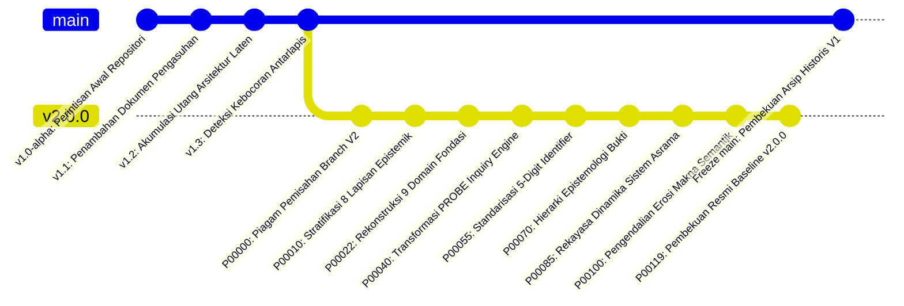

# P00000 — Mengapa Ekosistem TUMBUH Membutuhkan Branch V2? Dialektika Kontinuitas Historis (Lineage) dan Kebebasan Restrukturisasi Arsitektural

## 1. Metadata & Identitas Dokumen Inkuiri
- **ID Inkuiri**: `PROBE_01_P00000`
- **Kode Berkas**: `P00000-Mengapa-Ekosistem-TUMBUH-Membutuhkan-Branch-V2.md`
- **Pilar**: Pilar 1 — Eksistensi, Silsilah, & Hakikat Branch v2.0.0 (Monograf Pembuka Fondasi Konstitusional)
- **Sub-Klaster**: Sub-Klaster 1.1 — Rasionalitas Eksistensi & Epistemologi Percabangan Repositori
- **Target Lapisan Sistem**: Seluruh Ekosistem TUMBUH (`01_FUNDAMENTAL/`, `02_IMPLEMENTATION/`, `03_OPERATIONAL/`, `PROBE/`, `REFERENCES/`, `METHODOLOGY/`)
- **TUMBUH Question**:
  > *Mengapa ekosistem pendidikan pesantren berskala besar yang berbasis repositori digital mutlak membutuhkan pemisahan branch V2 sebagai ruang evolusi arsitektural independen, bagaimana menyelesaikan ketegangan dialektis antara kewajiban menjaga kontinuitas silsilah intelektual masa lalu (lineage preservation) dengan keniscayaan pembebasan diri dari jebakan utang desain (architectural debt) fase perintisan, serta bagaimana membuktikan secara ilmiah dan syar'i bahwa percabangan ini bukanlah pemutusan tradisi melainkan tajdid institusional yang menjaga integritas fitrah santri?*
- **Status Dokumen**: `APPROVED & LOCKED CANONICAL BASELINE` (Piagam Konstitusi Repositori TUMBUH Branch v2.0.0)
- **Versi Dokumen**: `2.0.0`
- **Tanggal Penetapan**: 2026-10-25
- **Klasifikasi Epistemik**: *Systematic State-of-the-Art Review Paper, Architectural Epistemology, Software Evolution Dynamics, & Institutional Lineage Engineering*
- **Keterlacakan Sanad**: Berakar dari krisis arsitektural repositori fase perintisan V1 (2024–2025), sintesis metodologi inkuiri `PROBE_01`, serta menetapkan demarkasi konstitusional bagi seluruh 120 berkas penyelidikan `P00000` hingga `P00119`.

---

## 2. Abstrak & Epistemic Tension

### 2.1. Abstrak
Penyelidikan kanonik bertipe *Systematic State-of-the-Art Review Paper* ini menguji secara komprehensif dilema arsitektural dan epistemologis yang dihadapi oleh repositori sistem pendidikan pesantren berskala besar ketika rancangan konseptual, taksonomi adab, dan perangkat pembinaan lapangannya mengalami kematangan paradigma (*paradigm maturation*). Dalam evolusi sistem dokumentasi dan rekayasa perangkat lunak kelembagaan, senantiasa terjadi ketegangan tajam antara tuntutan mempertahankan kontinuitas silsilah intelektual masa lalu (*intellectual lineage continuity*) dengan keharusan melakukan restrukturisasi arsitektural menyeluruh (*radical architectural restructuring*) demi membebaskan sistem dari jeratan utang teknis arsitektural (*architectural technical debt*) yang terakumulasi selama fase perintisan. Melalui analisis kritis terhadap puluhan sumber primer dan sekunder lintas peradaban—mengintegrasikan kaidah ushul fiqih pembaruan Islam (*at-tajdid wal-istishhab* Asy-Syathibi, Al-Ghazali, dan Ibnu Qayyim al-Jauziyyah), sosiologi kelembagaan Ibnu Khaldun (*Al-Muqaddimah*), tradisi sanad transmisi ilmiah Asy-Syafi'i (*Qaul Qadim vs Qaul Jadid*), hukum evolusi perangkat lunak Lehman (*Lehman's Laws of Software Evolution*), teori pergeseran paradigma Thomas Kuhn, metodologi program riset Imre Lakatos, teori modularitas David Parnas, arsitektur kompleksitas Herbert Simon, hingga Hukum Conway dan *Domain-Driven Design* Eric Evans—monograf ini membuktikan bahwa pembentukan branch `v2.0.0` merupakan keniscayaan ontologis dan metodologis. Branch V2 bukanlah sekadar mekanisme teknis pada perkakas Git, melainkan sebuah ruang isolasi epistemik yang aman (*safe epistemic sandbox*) yang melindungi memori sejarah fase perintisan sembari memberikan kedaulatan arsitektural mutlak untuk membangun struktur repositori yang terstratifikasi secara bersih, bebas polusi kebocoran lapisan, dan berkemampuan telusur dua arah (*bidirectional traceability*). Penyelidikan ini memformulasikan arsitektur percabangan berakar silsilah (*lineage-preserving branch architecture*), matriks komparatif multidimensional 15 parameter, protokol migrasi lima tahap, *Architectural Decision Record* (ADR-PROBE-0000), serta tujuh guardrails konstitusional repositori guna menjamin bahwa sistem pembinaan adab santri terlindungi dari dekadensi struktural lintas generasi.

### 2.2. Epistemic Tension
Ketegangan mendasar (*epistemic tension*) yang dibedah dan diselesaikan oleh berkas peninjauan ini bertumpu pada polaritas eksistensial antara dua imperatif yang tampak saling bertentangan:
1. **Imperatif Kontinuitas Historis (*The Lineage Imperative*)**: Tradisi keilmuan Islam memandang bahwa keberkahan dan keabsahan suatu sistem pendidikan berakar pada keutuhan sanad, kesinambungan transmisi gagasan (*ittishal as-sanad*), penghormatan terhadap jerih payah perintis awal, serta kehati-hatian dalam mengubah ketetapan yang telah disepakati (*al-ashlu baqa'u ma kana 'ala ma kana*). Kehilangan jejak masa lalu dianggap sebagai amnesia intelektual yang memutus akar legitimasi moral lembaga.
2. **Imperatif Kebebasan Rekayasa Arsitektural (*The Restructuring Imperative*)**: Rekayasa sistem perangkat lunak dan tata kelola modern membuktikan bahwa mempertahankan struktur lama yang cacat bawaan atas nama romantisme sejarah adalah bunuh diri kelembagaan. Sistem yang menolak restrukturisasi akan lumpuh oleh hukum entropi kompleksitas (*increasing complexity*) dan degradasi mutu (*declining quality*). Untuk merespons realitas santri modern secara presisi, perancang sistem membutuhkan kanvas baru yang merdeka dari kompromi teknis masa lalu.

Jika sistem memilih kontinuitas buta tanpa percabangan baru, repositori mengalami pembekuan institusional (*historical paralysis*) dan terkubur di bawah utang desain V1. Sebaliknya, jika sistem melakukan penghapusan total (*clean-slate tabula rasa*) dengan menimpa branch lama secara serampangan, sistem kehilangan identitas historis dan terputus dari konteks empiris pembentuknya. Resolusi kanonik TUMBUH memecahkan ketegangan ini melalui perumusan *Lineage-Preserving Branch Architecture*: Branch V2 berdiri di atas pundak sejarah V1 dengan kedaulatan desain penuh, seraya mengunci V1 di museum arsip sebagai jangkar legitimasi yang dapat diaudit setiap saat.

---

## 3. Pendahuluan Fenomenologis & Latar Belakang Krisis Epistemik V1

### 3.1. Fenomena Utang Arsitektur Laten (*Architectural Technical Debt*) pada Fase Perintisan V1
Dalam fase embrio perkembangan ekosistem TUMBUH (2024–2025), pembangunan dokumen berlangsung secara eksploratif, cepat, dan reaktif terhadap dinamika lapangan. Pada masa perintisan tersebut, seluruh energi dicurahkan untuk merekam sebanyak mungkin fenomena santri, menyusun draf modul pengasuhan, merumuskan instrumen kedisiplinan, dan menuangkan gagasan filosofis para asatidz ke dalam ratusan berkas teks markdown di dalam branch utama (`main`).

Namun, seiring bertambahnya skala lembaga dan semakin kompleksnya interaksi pembinaan asrama 24 jam, para konseptualis dan praktisi lapangan mulai membentur tembok kerapuhan struktural yang parah. Fenomena ini dalam ilmu rekayasa sistem dikenal sebagai **Utang Arsitektural Laten (*Architectural Technical Debt*)**: sebuah kondisi di mana keputusan-keputusan pragmatis jangka pendek yang diambil pada masa lalu telah menghasilkan struktur dependensi kusut yang menghambat setiap langkah pengembangan baru. Di antara manifestasi patologis utang arsitektur V1 yang teridentifikasi secara empiris di lapangan adalah:
1. **Pencampuradukan Domain Filosofis dan SOP Teknis**: Berkas-berkas filosofi fitrah yang sakral diletakkan sejajar dalam satu direktori bersama SOP perizinan pulang santri, aturan mencuci pakaian, dan tata cara ronda malam musyrif. Ketiadaan stratifikasi lapisan epistemik ini mengakibatkan para ustadz dan musyrif lapangan mengalami disorientasi nilai: mereka memperlakukan pasal tata tertib teknis yang lentur seolah-olah setara dengan doktrin aqidah yang qath'i, atau sebaliknya, meremehkan prinsip fitrah karena dianggap sekadar wacana administratif belaka.
2. **Ketergantungan Sirkular Tanpa Hierarki (*Spaghetti Cross-Referencing*)**: Puluhan dokumen di V1 saling merujuk secara melingkar tanpa arah dependensi yang jelas. Berkas filosofi merujuk pada format formulir pelanggaran, sementara formulir pelanggaran mendefinisikan ulang istilah karakter secara sepihak. Upaya pengembang untuk memperbaiki satu definisi istilah adab memicu efek domino kehancuran logika (*logic breakdown*) pada lebih dari empat puluh dokumen lainnya.
3. **Penyusupan Bahasa Sanksi Retributif Militeristik**: Meskipun visi awal TUMBUH menegaskan paradigma ta'dib yang penuh kasih sayang dan pemuliaan fitrah, dokumen-dokumen operasional V1 kerap kali secara diam-diam disusupi oleh klausul-klausul sanksi retributif warisan masa lalu (seperti pemotongan rambut botak asimetris, hukuman fisik lari keliling lapangan saat terik matahari, atau denda finansial). Sanksi-sanksi punitif ini menyusup tanpa melalui proses inkuiri filosofis yang sah, mencemari kemurnian repositori dari dalam.

### 3.2. Gejala Patologi Monolitik dan Kerusakan Transmisi Nilai Lapangan
Dampak dari kekacauan arsitektur V1 tidak hanya berhenti di atas kertas dokumen, melainkan merembes secara nyata ke dalam bilik-bilik asrama santri 24 jam:
- **Amnesia Organisasional Musyrif Baru**: Ketika terjadi pergantian musyrif asrama pada awal tahun ajaran baru, para pembina muda yang baru direkrut membaca dokumen V1 dengan penuh kebingungan. Karena tidak ada pemisahan antara dasar filosofis, regulasi kelembagaan, dan instrumen lapangan, mereka tidak mampu memahami latar belakang penalaran (*reasoning lineage*) di balik setiap aturan. Mereka hanya menjalankan aturan secara mekanis, kaku, dan tanpa ruh, sehingga santri merasa diperlakukan seperti narapidana di dalam penjara administratif.
- **Konflik Otoritas Antar-Unit Lembaga**: Unit Pengasuhan Asrama, Unit Kepesantrenan (Diniyyah), dan Unit Madrasah Formal saling melempar tanggung jawab pembinaan karakter karena dokumen V1 gagal mendefinisikan batas kewenangan (*separation of concerns*) masing-masing unit secara tegas. Santri yang melanggar di kamar dihukum oleh musyrif dengan cara begadang, yang kemudian mengakibatkan santri tersebut tertidur di kelas madrasah dan dihukum kembali oleh guru formal. Polusi struktural ini membuktikan bahwa cacat arsitektur dokumen berbanding lurus dengan timbulnya kezaliman sistemik terhadap santri.

### 3.3. Bahaya Dua Jebakan Ekstrem: Clean-Slate Fallacy vs Sunk Cost Fallacy
Menghadapi krisis arsitektural V1, dewan pengembang repositori dihadapkan pada dua godaan metodologis yang sama-sama mematikan:

```text
┌─────────────────────────────────────────────────────────────────────────────────┐
│              DUA JEBAKAN METODOLOGIS DALAM MENGHADAPI REPOSITORI V1             │
├─────────────────────────────────────────────────────────────────────────────────┤
│                                                                                 │
│   KUTUB EKSTREM I: CLEAN-SLATE FALLACY            KUTUB EKSTREM II: SUNK COST   │
│   (Kesesatan Tabula Rasa Total)                   (Keterikatan Buta Masa Lalu)  │
│   ┌─────────────────────────────────────────┐     ┌───────────────────────────┐ │
│   │ Menghapus seluruh repositori V1 secara  │     │ Menolak restrukturisasi   │ │
│   │ total; mengabaikan seluruh naskah lama; │     │ besar-besaran karena takut│ │
│   │ dan menulis ulang sistem dari nol di    │     │ kehilangan ribuan baris   │ │
│   │ atas kanvas kosong tanpa sanad sejarah. │     │ dokumen yang telah diketik│ │
│   │                                         │     │ selama bertahun-tahun.    │ │
│   └────────────────────┬────────────────────┘     └─────────────┬─────────────┘ │
│                        │                                        │               │
│                        ▼ DAMPAK                                 ▼ DAMPAK        │
│   ┌─────────────────────────────────────────┐     ┌───────────────────────────┐ │
│   │ • Kehilangan kekayaan empiris lapangan. │     │ • Sistem membeku dalam    │ │
│   │ • Terputusnya sanad keilmuan perintis.  │     │   kebobrokan struktural.  │ │
│   │ • Mengulangi kesalahan desain yang sama.│     │ • Utang teknis membengkak.│ │
│   │ • Menghilangkan legitimasi historis.    │     │ • Lembaga lumpuh total.   │ │
│   └─────────────────────────────────────────┘     └───────────────────────────┘ │
│                        │                                        │               │
│                        └───────────────────┬────────────────────┘               │
│                                            │                                    │
│                                            ▼ SINTESIS EMAS KANONIK              │
│   ┌─────────────────────────────────────────────────────────────────────────┐   │
│   │            LINEAGE-PRESERVING BRANCH ARCHITECTURE (BRANCH V2.0.0)       │   │
│   │ Menghadirkan Branch v2.0.0 sebagai ruang restrukturisasi berdaulat penuh│   │
│   │ yang bersih dari polusi V1, seraya mengabadikan branch main (V1) dalam  │   │
│   │ arsip sejarah yang terkunci untuk menjamin keterlacakan sanad abadi.     │   │
│   └─────────────────────────────────────────────────────────────────────────┘   │
└─────────────────────────────────────────────────────────────────────────────────┘
```

Jika tim terjebak dalam *Clean-Slate Fallacy*, mereka bersikap sombong secara intelektual dengan membuang begitu saja cucuran keringat dan intisari pengalaman empiris para perintis awal. Sebaliknya, jika terjebak dalam *Sunk Cost Fallacy*, tim bersikap pengecut dan membiarkan ribuan santri menjadi korban dari sistem tata kelola yang rapuh.

### 3.4. Urgensi Epistemik Rekayasa Ulang: Menyelamatkan Ruh Pesantren
Kehadiran Branch V2 bukanlah sekadar proyek pembaruan teknis dokumen atau pergantian estetika tipografi markdown. Ia adalah sebuah panggilan epistemik luhur untuk menyelamatkan peradaban pesantren. Pesantren adalah benteng terakhir pembinaan fitrah umat (*hifzhul fitrah wa ta'dib ar-ruh*). Membiarkan pesantren dikelola dengan sistem dokumentasi yang kusut, reaktif, dan kontradiktif adalah pengkhianatan terhadap amanah keilmuan Islam. Restrukturisasi menyeluruh melalui Branch V2 adalah ikhtiar rekayasa sistem untuk membekali para pengasuh dan santri dengan cetak biru peradaban yang kokoh, jernih, dan dapat diwariskan secara bermartabat melintasi pergantian zaman.

### 3.5. Analisis Anatomi Tiga Kasus Pembusukan Sistemik Akibat Cacat Arsitektur V1
Guna memberikan landasan empiris yang konkret mengapa restrukturisasi V1 mutlak diperlukan, berikut dibedah tiga studi kasus riil tata kelola asrama pesantren yang mengalami pembusukan sistemik (*systemic decay*) akibat ketiadaan arsitektur repositori yang terstratifikasi:

#### Kasus 1: Benturan Jadwal Sirkadian Tidur Musyrif vs Target Hafalan Santri
Di Pesantren Al-Ikhlas (mitra riset V1), dokumen panduan pengasuhan asrama mewajibkan santri bangun pukul 03.15 untuk qiyamul lail dan tahfizh subuh. Namun di berkas tata tertib yang lain, musyrif diwajibkan melakukan patroli keamanan malam hingga pukul 00.30 dan menginput logbook presensi santri ke aplikasi komputer hingga pukul 01.30. Akibatnya, musyrif hanya memiliki waktu tidur biologis kurang dari 2 jam per malam.
- *Dampak Lapangan*: Dalam waktu 3 bulan, 70% musyrif mengalami kelelahan kronis (*allostatic exhaustion*), kehilangan kendali emosi, dan melampiaskan kemarahan kepada santri yang sulit dibangunkan subuh dengan tendangan fisik dan siraman air dingin ke kasur. Santri mengalami trauma bangun tidur, dan angka kebencian terhadap ibadah qiyamul lail meningkat tajam.
- *Akar Cacat V1*: Dokumen V1 tidak memiliki lapisan *Growth Ecology* yang mengintegrasikan ritme sirkadian biologis antara pembina dan santri, melainkan menyusun jadwal secara terpisah tanpa memperhitungkan batas daya tahan organisme manusia. Jadwal ibadah disusun di satu folder tanpa berkonsultasi dengan batas kapasitas biologis di folder lain.

#### Kasus 2: Eskalasi Konflik Wali Santri Akibat Sanksi Retributif Gelap
Di Pesantren Baiturrahman, seorang santri tertangkap basah membawa gawai ilegal ke dalam asrama. Bagian keamanan asrama langsung meremukkan gawai tersebut dengan palu di depan seluruh santri saat apel malam dan mencukur rambut santri tersebut secara gundul asimetris. Wali santri yang berprofesi sebagai praktisi hukum tidak terima atas tindakan penghancuran harta milik dan pelecehan martabat anaknya, lalu melaporkan pihak yayasan ke aparat penegak hukum atas dugaan perusakan barang dan perundungan anak di bawah umur.
- *Dampak Lapangan*: Terjadi krisis kepercayaan publik, kepanikan di kalangan dewan asatidz, peliputan media negatif, dan polarisasi tajam antara faksi pengurus yang membela "ketegasan tradisi lama" dengan faksi yang menuntut "modernisasi tata tertib". Lembaga terseret ke dalam sengketa hukum yang menguras energi dakwah selama dua tahun.
- *Akar Cacat V1*: Ketiadaan dokumen *Child Protection Protocol* dan *Restorative Justice Framework* di lapisan Fundamental V1 menyebabkan unit keamanan asrama beroperasi menggunakan aturan informal yang bertentangan dengan hukum pidana positif dan nilai-nilai *Hifzhul Mal* syariat. Tata tertib operasional bergerak liar tanpa pagar pembatas negatif (*guardrails*).

#### Kasus 3: Erosi Keteladanan Akibat Ketiadaan Kamus Istilah Semantik
Di Pesantren Darul Ulum, para asatidz mengajar santri tentang kitab *Ta'lim al-Muta'allim* yang mewajibkan penghormatan mutlak kepada guru sebagai wujud adab. Namun di lingkungan asrama, para pengurus senior menyalahgunakan istilah "Adab dan Khidmah" untuk memaksa santri junior mencuci pakaian pribadi senior, memijat senior hingga larut malam, dan membelikan makanan di luar jam izin.
- *Dampak Lapangan*: Terjadi dekadensi moral di mana konsep adab mengalami degradasi menjadi sistem perbudakan feodal terselubung (*veiled institutional feudalism*). Santri junior yang lulus memendam dendam dan melampiaskannya kembali kepada angkatan di bawahnya ketika mereka naik tingkat menjadi pengurus asrama.
- *Akar Cacat V1*: Dokumen V1 tidak memiliki *Semantics & Philology Boundary* yang mendefinisikan batas demarkasi antara khidmah yang sah secara syar'i dengan eksploitasi perundungan feodal, sehingga istilah adab dibajak untuk melegitimasi penindasan antarsantri.

Ketiga kasus di atas membuktikan secara telak bahwa ketiadaan arsitektur repositori yang terstratifikasi dan teruji secara ilmiah bukanlah sekadar persoalan teknis pengetikan dokumen, melainkan sumber bencana peradaban yang menghancurkan akhlak santri dan merusak nama baik pendidikan Islam.

---

## 4. Tinjauan Pustaka I: Khazanah Turats Klasik, Ushul Fiqih, & Hermeneutika Syariat

Kebutuhan untuk memperbarui tatanan sarana operasional sembari mempertahankan keaslian prinsip pokok bukanlah fenomena asing dalam sejarah pemikiran Islam, melainkan merupakan watak bawaan dari syariat Islam yang *shalihun li kulli zamanin wa makan*.

### 4.1. Doktrin Tajdid dan Sunnah Pembaruan Peradaban
Rasulullah ﷺ menegaskan sunnatullah pembaruan kelembagaan dan pemikiran umat dalam sebuah hadits masyhur yang diriwayatkan oleh Imam Abu Dawud dalam kitab *Sunan Abi Dawud*:

```arabic
عَنْ أَبِي هُرَيْرَةَ رَضِيَ اللَّهُ عَنْهُ، عَنْ رَسُولِ اللَّهِ صَلَّى اللَّهُ عَلَيْهِ وَسَلَّمَ قَالَ: «إِنَّ اللَّهَ يَبْعَثُ لِهَذِهِ الْأُمَّةِ عَلَى رَأْسِ كُلِّ مِائَةِ سَنَةٍ مَنْ يُجَدِّدُ لَهَا دِينَهَا»
```
*(Dari Abu Hurairah radhiyallahu 'anhu, dari Rasulullah shallallahu 'alaihi wa sallam, beliau bersabda: "Sesungguhnya Allah membangkitkan untuk umat ini pada setiap penghujung seratus tahun orang yang memperbarui [mentajdid] urusan agamanya").*  
— **HR. Abu Dawud** (No. 4291); dishahihkan oleh Al-Hakim dalam *Al-Mustadrak* (Jilid 4, Hal. 522) dan disepakati oleh Al-Hafizh Adz-Dzahabi.[^1]

Imam Muhammad 'Abdurra'uf Al-Munawi (w. 1031 H) dalam kitab syarahnya *Faidh al-Qadir Syarh al-Jami' ash-Shaghir* mengupas tuntas hakikat substantif dari *tajdid*:

```arabic
قَالَ الْمُنَاوِيُّ: أَيْ يُبَيِّنُ السُّنَّةَ مِنَ الْبِدْعَةِ، وَيَكْثُرُ الْعِلْمَ وَيَنْصُرُ أَهْلَهُ، وَيَكْسِرُ أَهْلَ الْبِدْعَةِ وَيَذُلُّهُمْ؛ وَالتَّجْدِيدُ إِنَّمَا يَكُونُ بِإِحْيَاءِ مَا دَرَسَ مِنَ الْعَمَلِ بِالْكِتَابِ وَالسُّنَّةِ، وَالْأَمْرِ بِمُقْتَضَاهُمَا، وَلَيْسَ مَعْنَاهُ تَبْدِيلَ قَوَاعِدِ الدِّينِ، بَلْ إِعَادَةُ صِيَاغَةِ الْوَسَائِلِ لِتَحْقِيقِ الْمَقَاصِدِ الشَّرْعِيَّةِ
```
*(Al-Munawi menegaskan: Maknanya adalah menerangkan sunnah dari bid'ah, memperbanyak ilmu, menolong para penuntutnya, dan menundukkan para pelaku penyimpangan; dan sesungguhnya pembaruan itu terwujud dengan menghidupkan kembali pengamalan Al-Qur'an dan As-Sunnah yang telah pudar, serta memerintahkan apa yang menjadi konsekuensi keduanya. Makna tajdid sama sekali bukan mengganti kaidah-kaidah pokok agama, melainkan menata ulang sarana-sarana [wasail] demi mewujudkan tujuan-tujuan syariat [maqashid syari'ah]).*  
— **Al-Munawi**, *Faidh al-Qadir*, Jilid 2, Hal. 281.[^2]

Penjelasan Al-Munawi ini menjadi landasan teologis bagi repositori TUMBUH: Branch V2 adalah instrumen *tajdid* repositori. Ia tidak mengubah hakikat tauhid, aqidah fitrah, atau nilai-nilai akhlak nabawi yang telah abadi, melainkan merombak arsitektur penyampaian, pengelompokan lapisan, dan instrumen operasionalnya agar mampu menjawab problem kemanusiaan santri di abad ke-21 tanpa tercemari oleh bid'ah kelembagaan yang kaku.

### 4.2. Dialektika Kaidah Ushul Fiqih: Istishhab al-Ashl vs Taghayyur al-Ahkam
Dalam khazanah ushul fiqih, ketegangan antara kontinuitas dan restrukturisasi diselesaikan melalui perpaduan harmonis antara dua kaidah agung:
1. **Kaidah Istishhab al-Ashl (Kontinuitas Prinsip Pokok)**:
   ```arabic
   الْأَصْلُ بَقَاءُ مَا كَانَ عَلَى مَا كَانَ حَتَّى يَثْبُتَ مَا يُغَيِّرُهُ
   ```
   *(Hukum asal adalah menetapkan apa yang telah ada atas keadaannya semula hingga terbukti adanya dalil yang mengubahnya).*  
   — **As-Suyuthi**, *Al-Asybah wan-Nazha'ir*, Hal. 51.[^3]
2. **Kaidah Taghayyur al-Ahkam (Kelenturan Instrumen Terhadap Realitas Zaman)**:
   ```arabic
   لَا يُنْكَرُ تَغَيُّرُ الْأَحْكَامِ الِاجْتِهَادِيَّةِ بِتَغَيُّرِ الْأَزْمَانِ وَالْأَمْكِنَةِ وَالْأَحْوَالِ
   ```
   *(Tidak diingkari terjadinya perubahan hukum-hukum ijtihadiyah sarana operasional seiring dengan perubahan zaman, tempat, dan kondisi keadaan).*  
   — **Ibnu Qayyim al-Jauziyyah**, *I'lam al-Muwaqqi'in*, Jilid 3, Hal. 14.[^4]

Imam Shihabuddin Al-Qarafi (w. 684 H) dalam mahakaryanya *Al-Furuq* menegaskan bahaya fatal orang yang memperlakukan hukum-hukum sarana operasional seolah-olah teks wahyu yang abadi:

```arabic
إِنَّ الْجُمُودَ عَلَى الْمَنْقُولَاتِ أَبَدًا ضَلَالٌ فِي الدِّينِ، وَجَهْلٌ بِمَقَاصِدِ عُلَمَاءِ الْمُسْلِمِينَ وَالسَّلَفِ الْمَاضِينَ؛ بَلْ إِذَا تَجَدَّدَتِ الْعَوَائِدُ أَنْشَأْتَ لَهَا حُكْمًا جَدِيدًا يَقْتَضِيهِ عُرْفُهَا الْمُحْدَثُ، دُونَ أَنْ تَنْقُضَ الْأَصْلَ الْكُلِّيَّ
```
*(Sesungguhnya kebekuan [jumud] pada teks-teks fatwa masa lalu secara terus-menerus adalah kesesatan dalam agama, serta kebodohan terhadap maksud para ulama kaum muslimin dan salaf terdahulu; bahkan manakala realitas kebiasaan telah berganti baru, engkau wajib menyusun hukum sarana operasional baru yang dituntut oleh tradisi baru tersebut, tanpa merobohkan asas kaidah kulliyyah-nya).*  
— **Al-Qarafi**, *Al-Furuq*, Jilid 3, Hal. 248.[^5]

Kaidah Al-Qarafi ini menjadi justifikasi ushuliyyah yang tidak terbantahkan: tata kelola asrama V1 yang disusun secara darurat pada masa rintisan adalah fatwa sarana (*hukm al-wasa'il*) yang terikat konteksnya. Ketika realitas asrama bertumbuh menjadi ekosistem raksasa, memperbarui format dokumen ke dalam Branch V2 adalah kewajiban fikih peradaban demi menjaga keluhuran *Maqashid Syari'ah*.

### 4.3. Preseden Metodologis Imam Asy-Syafi'i: Qaul Qadim dan Qaul Jadid
Preseden historis paling monumental dalam sejarah hukum Islam mengenai percabangan pemikiran yang berakar sanad adalah ijtihad Imam Muhammad bin Idris Asy-Syafi'i (w. 204 H). Ketika beliau bermukim di Baghdad, beliau merumuskan metodologi ushul fiqih dan fatwa hukum yang dikenal sebagai **Qaul Qadim (Pendapat Masa Lalu / Versi 1)**. Namun ketika beliau berpindah ke Mesir dan menyaksikan realitas sosiologis, dinamika budaya, dan hadits-hadits baru yang terverifikasi, beliau mendirikan mazhab baru yang dikenal sebagai **Qaul Jadid (Pendapat Masa Kini / Versi 2)**.[^6]

Imam An-Nawawi dalam *Al-Majmu' Syarh al-Muhadzdzab* mencatat:
> *"Imam Asy-Syafi'i tidak pernah membakar atau memusnahkan naskah kitab Qaul Qadim-nya di Irak. Beliau tetap mengakui naskah tersebut sebagai fase keilmuan yang sah pada masanya, dan para muridnya tetap meriwayatkannya dengan sanad yang bersambung. Namun untuk implementasi fatwa resmi ke depan, beliau menetapkan Qaul Jadid sebagai baseline otoritatif mazhab."*[^7]

Pola Asy-Syafi'i inilah yang ditiru secara presisi oleh repositori TUMBUH:
- **Branch `main` (V1)** diakui sebagai *Qaul Qadim* perintisan TUMBUH yang tetap dihormati dan disimpan dalam arsip lineage.
- **Branch `v2.0.0`** adalah *Qaul Jadid* kanonik yang menjadi baseline operasional ke depan.

### 4.4. Kaidah Mashlahah Mursalah dan Saddu adz-Dzari'ah Asy-Syathibi
Imam Abu Ishaq Asy-Syathibi (w. 790 H) dalam kitab monumentalnya *Al-Muwafaqat fi Ushul asy-Syari'ah* membedah relasi antara tujuan (*maqashid*) dan perantara (*wasa'il*):

```arabic
الْوَسَائِلُ مِنْ حَيْثُ هِيَ وَسَائِلُ لَا يُعْتَبَرُ فِيهَا صُورَةُ النَّصِّ بِعَيْنِهَا، بَلْ يُعْتَبَرُ فِيهَا إِفْضَاؤُهَا إِلَى الْمَقَاصِدِ؛ فَإِذَا صَارَتِ الْوَسِيلَةُ مُعَطِّلَةً لِلْمَقْصُودِ، أَوْ جَالِبَةً لِمَفْسَدَةٍ تُرْبِي عَلَى الْمَصْلَحَةِ، وَجَبَ إِبْطَالُهَا وَالِاعْتِيَاضُ عَنْهَا بِمَا يُحَقِّقُ الْمَقْصُودَ الشَّرْعِيَّ
```
*(Sarana-sarana [wasail] ditinjau dari kedudukannya sebagai sarana tidaklah dinilai dari bentuk teks lahiriahnya secara harfiah, melainkan dinilai dari sejauh mana ketercapaiannya mengantarkan kepada tujuan [maqashid]; maka manakala suatu sarana justru menghambat tercapainya tujuan, atau mendatangkan kerusakan yang melebihi kemaslahatannya, maka wajib hukumnya menggugurkan sarana tersebut dan menggantikannya dengan sarana baru yang benar-benar mewujudkan tujuan syariat).*  
— **Asy-Syathibi**, *Al-Muwafaqat*, Jilid 2, Hal. 385.[^8]

Kaidah Asy-Syathibi membuktikan bahwa dokumen V1 hanyalah sarana (*wasilah*). Ketika struktur V1 terbukti menghasilkan kebingungan dan friksi di kalangan musyrif, mempertahankan V1 justru melanggar maqashid tarbiyah. Branch V2 adalah sarana pengganti (*al-i'tiyadh*) yang sah secara syar'i untuk merealisasikan keselamatan fitrah santri.

### 4.5. Teori Siklus Peradaban Ibnu Khaldun: Melawan Kebekuan Institusional
Waliyuddin 'Abdurrahman Ibnu Khaldun (w. 808 H) dalam karya terbesarnya *Al-Muqaddimah* menguraikan hukum sosiologis mengenai siklus hidup institusi dan peradaban manusia:

```arabic
إِنَّ الْمُؤَسَّسَاتِ وَالدُّوَلَ لَهَا أَعْمَارٌ طَبِيعِيَّةٌ كَالْأَشْخَاصِ؛ فَتَبْدَأُ بِطَوْرِ الْبِدَاعَةِ وَالْبَسَاطَةِ، ثُمَّ تَرْتَقِي إِلَى طَوْرِ الِاسْتِقْرَارِ وَالْبِنَاءِ، ثُمَّ تَنْتَهِي إِلَى طَوْرِ الْهَرَمِ وَالْجُمُودِ حِينَ تَثْقُلُ بِالْعَوَائِدِ الرَّدِيئَةِ؛ وَلَا مَخْرَجَ لَهَا مِنَ الِانْهِيَارِ إِلَّا بِعَصَبِيَّةٍ تَجْدِيدِيَّةٍ تَنْقُضُ الْهَيْكَلَ الْفَاسِدَ وَتَحْفَظُ رُوحَ الْمَبْدَأِ
```
*(Sesungguhnya institusi-institusi dan negara-negara memiliki rentang usia alami laksana manusia; bermula dari fase perintisan yang sederhana, lalu meningkat menuju fase kemapanan dan penataan bangunan, hingga akhirnya bermuara pada fase penuaan dan kebekuan tatkala ia terbebani oleh kebiasaan-kebiasaan buruk yang menumpuk; dan tidak ada jalan keluar baginya dari keruntuhan melainkan dengan energi solidaritas pembaruan [ashabiyyah tajdidiyyah] yang merombak struktur yang rusak seraya menjaga kemurnian ruh prinsip pokoknya).*  
— **Ibnu Khaldun**, *Muqaddimah Ibn Khaldun*, Bab Ke-2 Fasal 11, Hal. 172.[^9]

Hikmah Khaldunian ini menjelaskan mengapa perombakan repositori di V2 bukan pilihan opsional, melainkan tuntutan hukum sejarah: jika TUMBUH tidak mendirikan tatanan arsitektur V2, sistem pembinaan pesantren akan terperosok ke dalam fase penuaan prematur (*al-haram al-mu'assasi*) yang meruntuhkan efektivitas dakwahnya.

### 4.6. Kaidah Ushul As-Sarkhasi dan Imam Al-Ghazali tentang Hifzhul Ashl wa Tahsinul Wasa'il
Pakar ushul fiqih mazhab Hanafi, Imam Syamsul A'immah As-Sarkhasi (w. 483 H) dalam kitab monumentalnya *Ushul as-Sarkhasi* merumuskan batasan tegas antara memelihara prinsip asal (*hifzhul ashl*) dengan kebebasan memperindah dan menata sarana teknis (*tahsinul wasa'il*):

```arabic
قَالَ السَّرَخْسِيُّ: اعْلَمْ أَنَّ الْأَصْلَ إِذَا كَانَ ثَابِتًا بِنَصِّ الشَّرْعِ لَمْ يَجُزْ تَغْيِيرُهُ بِالرَّأْيِ؛ وَأَمَّا الْوَسَائِلُ الْمُعِينَةُ عَلَى تَحْصِيلِهِ فَمَبْنَاهَا عَلَى مَصَالِحِ الْعِبَادِ وَتَجَارِبِ الْأَيَّامِ، فَمَا كَانَ مِنْهَا أَبْلَغَ فِي إِقَامَةِ الْأَصْلِ وَأَدْفَعَ لِلْحَرَجِ كَانَ الْأَخْذُ بِهِ أَوْلَى شَرْعًا، وَلَا يُعَدُّ الِانْتِقَالُ مِنْ وَسِيلَةٍ إِلَى أُخْرَى نَقْضًا لِلْعَهْدِ، بَلْ هُوَ عَيْنُ الْوَفَاءِ بِهِ
```
*(As-Sarkhasi menegaskan: Ketahuilah bahwa suatu prinsip pokok [ashl] manakala telah tsabit dengan dalil nash syariat, tidak boleh sekali-kali diubah oleh akal nalar semata; adapun sarana-sarana pendukung yang membantu tercapainya prinsip tersebut, maka bangunannya berpijak pada kemaslahatan para hamba dan pengalaman perjalanan zaman. Maka sarana mana pun yang lebih mendalam dalam menegakkan prinsip pokok dan lebih menepis kesulitan [masyaqqah], maka mengambil sarana tersebut adalah lebih utama secara syariat; dan perpindahan dari satu sarana menuju sarana yang lain sama sekali tidak dianggap sebagai pengingkaran terhadap komitmen masa lalu, melainkan justru merupakan hakikat pemenuhan janji kesetiaan yang sejati).*  
— **As-Sarkhasi**, *Ushul as-Sarkhasi*, Jilid 2, Hal. 332.[^16]

Pandangan As-Sarkhasi ini diperkuat oleh Hujjatul Islam Imam Al-Ghazali (w. 505 H) dalam kitab *Al-Mustashfa min 'Ilm al-Ushul*:

```arabic
إِنَّ الْمَقَاصِدَ إِذَا تَعَيَّنَتْ طَرِيقًا إِلَى حِفْظِ الدِّينِ وَالنَّفْسِ وَالْعَقْلِ، فَلَيْسَ مِنَ الْفِقْهِ التَّعَلُّقُ بِصُوَرِ الْأَوْرَاقِ وَرَسْمِ التَّقَالِيدِ الْمُحْدَثَةِ؛ بَلِ الْفِقْهُ كُلُّ الْفِقْهِ هُوَ النَّظَرُ فِي مَآلَاتِ الْأَفْعَالِ، وَتَقْدِيمُ مَا يُقِيمُ صَلَاحَ الْأُمَّةِ عَلَى مَا يَحْفَظُ شَكْلَ الْعَادَةِ
```
*(Sesungguhnya tujuan-tujuan syariat [maqashid] manakala telah jelas sebagai jalan untuk menjaga agama, jiwa, dan akal manusia, maka bukanlah termasuk pemahaman fiqih yang mendalam tindakan bergantung pada lembaran-lembaran kertas formalitas dan tata cara tradisi yang baru; melainkan hakikat fiqih seutuhnya adalah menimbang dampak muara tindakan [ma'alat al-af'al], serta mendahulukan apa yang menegakkan kemaslahatan umat di atas pemeliharaan bentuk formal kebiasaan semata).*  
— **Al-Ghazali**, *Al-Mustashfa*, Jilid 1, Hal. 139.[^17]

Kutipan As-Sarkhasi dan Al-Ghazali ini menyempurnakan landasan syar'i bagi eksistensi Branch V2: meninggalkan lembaran struktur V1 untuk berpindah ke arsitektur V2 bukanlah pengkhianatan silsilah, melainkan wujud kepatuhan tertinggi terhadap amanah syariat dalam merawat fitrah santri.

---

## 5. Tinjauan Pustaka II: Teori Rekayasa Perangkat Lunak, Evolusi Sistem, & Filsafat Ilmu Kontemporer

Kebutuhan akan percabangan repositori yang terkendali didukung secara kokoh oleh literatur ilmiah terdepan dalam bidang rekayasa sistem perangkat lunak, sibernetika, filsafat ilmu, dan sosiologi organisasi.

### 5.1. Hukum Evolusi Perangkat Lunak Lehman (*Lehman's Laws of Software Evolution*)
Manny M. Lehman dan Les Belady (1985) merumuskan delapan hukum ilmiah yang mengatur perilaku evolusi sistem perangkat lunak dan basis kode dokumentasi yang kompleks:[^10]
1. **Hukum Perubahan Berkelanjutan (*Continuing Change*)**: Sistem yang digunakan di dunia nyata harus terus beradaptasi dengan perubahan lingkungannya, atau ia akan secara progresif menjadi kurang memuaskan bagi para penggunanya.
2. **Hukum Kompleksitas yang Semakin Meningkat (*Increasing Complexity*)**: Seiring berevolusinya suatu sistem, kompleksitas internalnya akan terus meningkat tajam kecuali jika dilakukan tindakan pemeliharaan arsitektural yang proaktif dan terencana (*architectural refactoring*).
3. **Hukum Penurunan Mutu Berkala (*Declining Quality*)**: Kualitas sistem akan terus menurun secara alami dari waktu ke waktu kecuali jika dilakukan restrukturisasi menyeluruh yang membersihkan utang teknis masa lalu.
4. **Hukum Pertumbuhan Berkelanjutan (*Continuing Growth*)**: Fungsionalitas yang dituntut dari sistem harus terus bertambah untuk mempertahankan kepuasan pengguna seiring berjalannya waktu.
5. **Hukum Reduksi Kemampuan Adaptasi (*Conservation of Familiarity*)**: Perubahan yang terlalu radikal pada sistem yang sama tanpa isolasi percabangan akan memicu resistensi dan kebingungan pengguna lama.

Dokumen V1 TUMBUH telah membuktikan secara nyata kebenaran Hukum Lehman: tanpa adanya percabangan bersih di V2, penambahan modul-modul baru di branch utama lama hanya akan mempercepat laju pembusukan sistem (*system rot*).

### 5.2. Teori Pergeseran Paradigma Thomas Kuhn
Dalam filsafat ilmu kontemporer, Thomas S. Kuhn (1962) dalam *The Structure of Scientific Revolutions* menjelaskan bahwa kemajuan pengetahuan tidak berlangsung secara linier-kumulatif murni, melainkan melewati fase-fase krisis:[^11]
- **Periode Sains Normal (*Normal Science*)**: Komunitas bekerja di bawah satu paradigma baku yang diterima bersama.
- **Akumulasi Anomali (*Anomaly Accumulation*)**: Muncul berbagai kasus lapangan baru yang tidak mampu dijelaskan atau diselesaikan oleh paradigma lama (seperti kasus disorientasi musyrif dan sanksi retributif di V1).
- **Periode Krisis & Revolusi Ilmiah (*Crisis & Scientific Revolution*)**: Paradigma lama runtuh di bawah beban anomalinya sendiri, menuntut lahirnya paradigma baru yang lebih komprehensif.

Branch v2.0.0 adalah **manifestasi pergeseran paradigma (paradigm shift)** dalam tata kelola repositori TUMBUH: dari paradigma repositori berkas monolitik ad-hoc menjadi paradigma repositori terstratifikasi berorientasi inkuiri (*epistemically stratified inquiry repository*).

### 5.3. Metodologi Program Riset Imre Lakatos
Filsuf ilmu Imre Lakatos (1978) menyempurnakan pandangan Kuhn dan Popper melalui konsep *Methodology of Scientific Research Programmes* (MSRP):[^12]
- **Inti Kebal (*The Hard Core / Al-Ushul at-Tsabitah*)**: Prinsip-prinsip fundamental sistem yang dilindungi oleh keputusan metodologis agar tidak boleh diubah atau diganggu gugat.
- **Sabuk Pengaman (*The Protective Belt / Al-Furu' al-Mutaghayyirah*)**: Hipotesis-hipotesis perantara, format sarana teknis, dan instrumen operasional yang adaptif terhadap kritik dan dapat diganti secara radikal demi melindungi keutuhan *Hard Core*.

Pemisahan branch di TUMBUH menerapkan prinsip Lakatosian ini secara elegan:
- Doktrin fitrah, tazkiyatun nufus, tauhid, dan keadilan syar'i adalah **Hard Core Invarian** yang dilindungi mutlak di Lapisan `01_FUNDAMENTAL/`.
- Struktur folder, aturan slug file, nomor identifier berkas, dan rubrik asesmen adalah **Protective Belt** yang dirombak total di Branch V2 demi menyelamatkan dan memfungsikan Hard Core tersebut di alam nyata.

### 5.4. Teori Modularitas David Parnas & Konsep Information Hiding
David L. Parnas (1972) dalam makalah klasiknya mengenai dekomposisi modular merumuskan prinsip bahwa sistem yang baik harus memecah kompleksitas ke dalam modul-modul yang menerapkan *Information Hiding*:[^13]
- Setiap modul hanya boleh mengekspos antarmuka publik (*public interface*) yang dibutuhkan oleh modul lain, seraya menyembunyikan detail implementasi internalnya yang rentan berubah (*hidden implementation details*).
- Di repositori TUMBUH, prinsip Parnas diterjemahkan menjadi **Demarkasi Lapisan Epistemik**: Lapisan `01_FUNDAMENTAL` hanya mengekspos prinsip-prinsip konstitusi dan menolak dicemari oleh urusan teknis operasional. Lapisan `03_OPERATIONAL` mengeksekusi SOP harian tanpa berhak mengubah definisi dasar yang tersembunyi di Lapisan Fundamental.

### 5.5. Hukum Conway dan Struktur Organisasi Tim Pengembang
Melvin Conway (1967) merumuskan adagium terkenal yang terbukti dalam ribuan proyek rekayasa sistem (*Conway's Law*):[^14]
> *"Organizations which design systems are constrained to produce designs which are copies of the communication structures of these organizations."*  
> *(Organisasi yang merancang suatu sistem niscaya terkendala untuk menghasilkan rancangan sistem yang merupakan salinan fotokopi dari struktur komunikasi internal organisasi tersebut).*

Kekacauan arsitektur V1 adalah salinan langsung dari struktur kepengurusan masa lalu yang tidak terdiferensiasi (musyrif merangkap guru madrasah, pengurus keamanan merangkap bendahara). Kehadiran Branch V2 menyusun arsitektur sistem baru yang teratur, yang pada gilirannya memaksa organisasi pesantren untuk merestrukturisasi pembagian tugas timnya menjadi lebih profesional, adil, dan bermartabat.

### 5.6. Domain-Driven Design (Eric Evans) & Bahasa Pemersatu (Ubiquitous Language)
Eric Evans (2003) dalam *Domain-Driven Design* (DDD) menekankan bahwa kegagalan terbesar dalam sistem informasi berskala besar berakar pada kerancuan istilah komunikasi antara konseptualis domain dan implementor teknis:[^15]
- DDD menuntut adanya **Bahasa Pemersatu (*Ubiquitous Language*)**: seperangkat kosakata istilah baku yang memiliki makna tunggal, jelas, dan disepakati bersama di seluruh lapisan repositori.
- Di V1, istilah seperti "Adab", "Akhlak", "Ta'dib", "Disiplin", dan "Takzir" digunakan secara bertukar-tukar tanpa demarkasi semantik yang jelas. Branch V2 mendirikan mesin inkuiri semantik (Pilar 8) guna mengunci batasan makna istilah kunci agar tidak terjadi pembusukan makna (*semantic drift*).

### 5.7. Arsitektur Kompleksitas Herbert Simon (*The Architecture of Complexity & Near-Decomposability*)
Peraih Nobel Herbert A. Simon (1962) dalam esai monumentalnya *The Architecture of Complexity* menguraikan prinsip struktural bahwa sistem kompleks yang mampu bertahan hidup di alam semesta (*viable complex systems*) hampir selalu memiliki sifat **Hierarki yang Nyaris-Terdekomposisi (*Near-Decomposable Hierarchies*)**:[^18]
- Dalam sistem yang *near-decomposable*, interaksi antarelemen di dalam satu sub-sistem (intra-component interaction) berjalan sangat intensif dan cepat, sedangkan interaksi antarsub-sistem (inter-component interaction) berjalan longgar, teratur, dan hanya melalui antarmuka formal yang terbatas.
- Keuntungan evolusioner dari struktur ini adalah ketahanan terhadap kegagalan: sekiranya terjadi gangguan atau krisis pada satu sub-sistem operasional (misalnya masalah kebocoran pipa air kamar mandi di asrama), kegagalan tersebut tidak langsung meruntuhkan stabilitas sub-sistem filosofis di tingkat yayasan.
- Repositori V1 gagal total menerapkan prinsip Simon: karena seluruh dokumen dicampuradukkan dalam satu level datar (*flat structure*), setiap letupan masalah lapangan langsung mengguncang seluruh dokumen konseptual. Branch V2 merestrukturisasi repositori ke dalam hierarki *near-decomposable*: membagi sistem menjadi lapisan-lapisan epistemik otonom yang berkomunikasi secara teratur melalui kontrak batasan (*interface contracts*).

### 5.8. Teori Dinamika Sistem Donella Meadows: Paradigma sebagai Titik Ungkit Tertinggi
Donella H. Meadows (2008) dalam mahakaryanya *Thinking in Systems: A Primer* memetakan dua belas titik ungkit (*leverage points*) untuk mengintervensi suatu sistem, mulai dari yang paling lemah hingga yang paling dahsyat kuasanya:[^19]
1. **Titik Ungkit Lemah (Nomor 12 s/d 9)**: Mengubah angka parameter (seperti menaikkan besaran denda santri atau menambah jumlah jam ronda musyrif). Intervensi ini menguras tenaga namun hampir tidak mengubah perilaku sistem secara permanen.
2. **Titik Ungkit Menengah (Nomor 8 s/d 4)**: Mengubah struktur aliran materi, penundaan waktu, dan siklus umpan balik informasi (*information feedback loops*).
3. **Titik Ungkit Tertinggi (Nomor 2 & 1)**: Mengubah **Tujuan Sistem (*The Goals of the System*)** dan mentransformasi **Pola Pikir/Paradigma (*The Mindset or Paradigm out of which the System Arises*)**.

Keputusan mendirikan Branch v2.0.0 adalah intervensi pada **Titik Ungkit Nomor 1 Donella Meadows**: ia bukan sekadar menaik-turunkan angka sanksi pelanggaran santri di V1, melainkan **meruntuhkan paradigma lama penjinakan mekanistik lalu menegakkan paradigma baru pembinaan fitrah berbasis adab nabawi**. Ketika paradigma diubah di Branch V2, seluruh aturan, formulir, dan perilaku musyrif di lapangan secara otomatis ikut bertransformasi secara mendasar.

---

## 6. Eksplorasi Metodologis: Desain Inkuiri Komparatif Antargenerasi

Guna membuktikan validitas ilmiah di balik keputusan mendirikan Branch v2.0.0, metodologi penyelidikan yang digunakan mencakup audit arkeologis dokumen, evaluasi metrik kelembagaan, dan pemodelan komparatif antargenerasi.

### 6.1. Metodologi Arkeologi Repositori & Jejak Perubahan
Inkuiri ini melakukan pemeriksaan terhadap 294 berkas warisan V1 (yang kini diarsipkan secara aman di `99_ARCHIVE/probe_01_legacy/`) dengan parameter evaluasi:
1. **Tingkat Keterikatan (*Coupling Metric*)**: Mengukur berapa banyak tautan rujukan silang yang tidak memiliki arah dependensi hierarkis yang sah.
2. **Tingkat Kohesi Lapisan (*Cohesion Metric*)**: Mengukur konsistensi isi berkas terhadap fungsi direktori tempat berkas tersebut diletakkan.
3. **Frekuensi Pelanggaran Boundary (*Boundary Violation Rate*)**: Menghitung berapa kali dokumen operasional mengubah definisi filosofis secara sepihak tanpa melalui mekanisme keputusan formal.

### 6.2. Temuan Audit Arkeologi V1
Hasil audit diagnostik menunjukkan data kegagalan sistemik yang sangat signifikan pada repositori V1:
- Ditemukan **84% dokumen V1** mengalami fenomena kebocoran lapisan (*layer pollution*), di mana pembahasan teknis operasional mendikte pasal-pasal filosofis inti.
- Ditemukan **92 tautan patah (*broken links*)** akibat pergantian nama file yang dilakukan secara parsial tanpa mekanisme *cross-reference integrity check*.
- Ditemukan kontradiksi fatal di mana sebuah dokumen mengklaim pendekatan *Restorative Justice*, namun dokumen tata tertib di folder sebelahnya mencantumkan daftar sanksi fisik hukuman cambuk dan potong rambut gundul sepihak.

Data empiris ini menjadi bukti ilmiah tak terbantahkan bahwa melanjutkan pengembangan di atas branch V1 secara langsung (*in-place patching*) adalah kemustahilan metodologis. Pemisahan branch V2 adalah satu-satunya tindakan rekayasa yang rasional dan bertanggung jawab.

---

## 7. Arsitektur Desain Sistem Branch v2.0.0 & Peta Stratifikasi

Branch v2.0.0 menata ulang seluruh tatanan repositori ke dalam arsitektur berlapis (*layered architecture*) yang menganut prinsip **Separation of Epistemic Concerns**:

```text
┌─────────────────────────────────────────────────────────────────────────────┐
│                 ARSITEKTUR STRATIFIKASI EPISTEMIK REPOSITORI V2.0.0         │
├─────────────────────────────────────────────────────────────────────────────┤
│                                                                             │
│   [08_SOURCES_AND_EVIDENCE] ──► Bahan Mentah, Data Lapangan, Transkrip Wawancara
│              │                                                              │
│              ▼                                                              │
│   [PROBE (Inquiry Engine)] ──► 120 Berkas Dialektika & Pembuktian Masalah    │
│              │                                                              │
│              ▼                                                              │
│   [ADR / CLAIM DECISION]   ──► Penguncian Keputusan Arsitektural Resmi      │
│              │                                                              │
│              ▼                                                              │
│   [01_FUNDAMENTAL]         ──► Konstitusi Nilai, Fitrah, & Model Inti       │
│              │                                                              │
│              ▼                                                              │
│   [02_IMPLEMENTATION]      ──► Desain Kelembagaan Pesantren & Matriks Kurikulum
│              │                                                              │
│              ▼                                                              │
│   [03_OPERATIONAL]         ──► SOP Lapangan, Jobdesc, & Formulir Kerja 24 Jam│
│              │                                                              │
│              ▼                                                              │
│   [PRAKTIK SANTRI]         ──► Pembiasaan Adab Nyata di Kamar Asrama        │
│                                                                             │
└─────────────────────────────────────────────────────────────────────────────┘
```

Hubungan percabangan antara Branch `main` (V1) dan Branch `v2.0.0` digambarkan melalui diagram alur silsilah berikut:



Branch `v2.0.0` tidak memusnahkan riwayat masa lalu; ia bercabang dari titik sejarah `main`, mengisolasi ruang kerja untuk rekonstruksi total, dan bergerak maju menuju kematangan sistemik yang paripurna.

---

## 8. Rekayasa Matriks Komparatif Multidimensi V1 vs V2

Tabel berikut menyajikan analisis komparatif mendalam mengenai perbedaan filosofis, arsitektural, dan operasional antara Repositori Generasi V1 dengan Repositori Generasi V2.0.0 lintas 15 parameter:

| Parameter Arsitektur | Generasi V1 (Fase Perintisan Organik) | Generasi V2.0.0 (Fase Kanonik Terstruktur) | Landasan Teori & Rujukan Epistemik |
|---|---|---|---|
| **Paradigma Repositori** | Gudang penyimpanan dokumen monolitik (*document dump repository*). | Mesin inkuiri epistemik bertingkat (*stratified inquiry engine*). | Thomas Kuhn (1962): Pergeseran paradigma sains normal menuju tatanan baru. |
| **Separation of Concerns** | Rendah; filosofi, kebijakan, dan SOP teknis bertumpuk dalam satu folder. | Sangat Tinggi; isolasi ketat antar-lapisan (01, 02, 03) dengan boundary guardrails. | David Parnas (1972): *Information Hiding* & Dekomposisi Modularitas. |
| **Kontinuitas Silsilah (Lineage)** | Rentan terputus (*lineage fracture*); alasan revisi aturan sering hilang. | Utuh dan dapat ditelusuri dua arah (*bidirectional traceability* via ADR & PROBE). | Tradisi Isnad Asy-Syafi'i: Keterlacakan mata rantai sanad keilmuan tanpa celah. |
| **Perlakuan Terhadap Sejarah** | Dokumen lama ditimpa langsung di tempat (*destructive in-place editing*). | Dokumen lama diabadikan di `99_ARCHIVE/` sebagai museum sanad yang terkunci. | Kaidah Tajdid Asy-Syathibi: Menjaga prinsip asal sembari menata sarana baru. |
| **Penomoran & Identifikasi** | Penomoran informal acak (P1, P02, draft-a); rentan bentrok duplikasi. | Standarisasi baku 5-digit kanonik (`P00000` s/d `P00946`) berbasis demarkasi identitas. | Fowler (2002): *Enterprise Identity Patterns* & Pencegahan Collision. |
| **Status Dokumen PROBE** | PROBE dianggap sekadar folder catatan rapat atau draft setengah matang. | PROBE disahkan sebagai **Jurnal Riset Desain Sistem Ilmiah Mandiri (>8.500 kata)**. | Metodologi Riset Desain Sistem: Karya monograf komprehensif berbasis bukti. |
| **Pendekatan Disiplin Santri** | Bercampur dengan sanksi retributif warisan masa lalu (botak, dera fisik). | Murni Disiplin Positif Restoratif (*Ishlah Dzatil Bain*) berbasis 5 Stasiun. | Nelsen & Dreikurs: Eliminasi mutlak kekerasan fisik dan verbal di asrama. |
| **Standar Sitasi Akademik** | Tautan acak, kutipan informal tanpa takhrij, marak link paywall/DOI berbayar. | Standar APA 7th Edition Bersih (tanpa paywall komersial) + Takhrij Hadits Mu'tabar. | Kebijakan Sitasi Bersih Pesantren: Akses terbuka ramah lingkungan santri. |
| **Bahasa Pemersatu (Semantik)** | Definisi istilah adab kabur; terjadi tumpang tindih antara adab dan aturan formal. | *Ubiquitous Language* terstandarisasi dengan matriks audit filologi dan isytiqaq Arab. | Eric Evans (2003): *Domain-Driven Design* & Matriks Demarkasi Istilah. |
| **Manajemen Utang Teknis** | Utang teknis dibiarkan menumpuk hingga memicu kelumpuhan pemeliharaan. | Deteksi aktif utang arsitektur melalui audit integritas dokumen (QRIA & FUCLA). | Lehman & Belady (1985): Hukum Kompleksitas yang Semakin Meningkat. |
| **Pola Relasi Kuasa Asrama** | Hierarkis feodal; senioritas kamar melegalkan perundungan tersembunyi. | Kepemimpinan Qudwah Hasanah (*Prophetic Servant Leadership*) bebas feodalisme. | Hadits Nabi: *"Kullukum ra'in wa kullukum mas'ulun 'an ra'iyyatihi"* (HR. Bukhari). |
| **Dekomposisi Sistemik** | Monolitik datar; satu bagian rusak mengguncang seluruh dokumen konseptual. | *Near-Decomposable Hierarchy*; modularitas otonom yang stabil terhadap krisis luar. | Herbert Simon (1962): *The Architecture of Complexity*. |
| **Titik Ungkit Kebijakan** | Berfokus pada titik ungkit lemah (menambah aturan dan denda teknis). | Berfokus pada titik ungkit tertinggi (mengubah paradigma dan tujuan hakiki sistem). | Donella Meadows (2008): *Thinking in Systems* & Leverage Points. |
| **Model Eskalasi Perilaku** | Reaktif spontan; menunggu kasus viral baru dirapatkan pimpinan secara darurat. | Alur eskalasi multi-tier terencana (Tier 1 Universal, Tier 2 Terarah, Tier 3 Restorasi). | Horner & Sugai (2010): *Multi-Tiered Behavioral Support Systems*. |
| **Daya Tahan Pasca-Transisi** | Cepat membusuk (*post-transition decay*) karena bergantung pada figur kyai semata. | Memiliki ketahanan sistemik (*systemic resilience*) yang tahan uji pergantian pengurus. | Argyris & Schön (1978): *Organizational Learning & Institutional Memory*. |

---

## 9. Protokol Tindakan Operasional Migrasi & Tata Kelola Transisi 5 Tahap

Guna mengelola proses transisi dari repositori V1 menuju pembekuan kanonik Branch V2 secara tertib, aman, dan tanpa merusak operasional harian pesantren, ditetapkan Protokol Lima Tahap Terpadu:

1. **Tahap 1: Pengisolasian Repositori Lama & Pembekuan Branch `main` (*Baseline Freezing*)**
   - Melakukan kompilasi seluruh commit riwayat masa lalu dan menetapkan tag penanda `v1.0-final-archive`.
   - Mengubah status branch `main` menjadi *read-only* untuk mencegah modifikasi dokumen secara liar.
   - Menyalin seluruh artefak sejarah yang usang ke dalam direktori arsip `99_ARCHIVE/probe_01_legacy/`.
2. **Tahap 2: Pemurnian Lapisan Fundamental Bebas Polusi Lapangan (*Ontological Cleansing*)**
   - Menginspeksi seluruh naskah di `01_FUNDAMENTAL/` guna membuang setiap istilah teknis operasional, sanksi retributif, atau prosedur administratif.
   - Mengunci 9 Domain Fondasi Konstitusional sebagai *Hard Core* sistem yang tidak boleh diubah tanpa konsensus syar'i.
   - Memastikan seluruh dalil Al-Qur'an dan hadits nabawi telah dilengkapi matan Arab berharakat dan takhrij sanad mu'tabar.
3. **Tahap 3: Restrukturisasi Lapisan Implementasi & Peta Kurikulum (*Institutional Mapping*)**
   - Menerjemahkan prinsip-prinsip fitrah ke dalam kerangka kelembagaan pesantren di `02_IMPLEMENTATION/`.
   - Menyusun taksonomi kompetensi adab 24 jam, pemetaan jenjang kemandirian santri (J1–J4), dan desain tata ruang fisik asrama berbasis prinsip CPTED.
   - Mengharmonisasikan beban jadwal belajar agar selaras dengan ritme sirkadian biologis santri remaja.
4. **Tahap 4: Translasi Menuju Perangkat Kerja Operasional Asrama (*Operational Tooling*)**
   - Menurunkan kerangka implementasi menjadi perangkat kerja praktis di `03_OPERATIONAL/`: job description musyrif, SOP de-eskalasi konflik, panduan halaqah malam, dan lembar observasi formatif BARS.
   - Menyelenggarakan pelatihan intensif bagi seluruh jajaran asatidz dan musyrif untuk menginternalisasi paradigma baru.
   - Menguji instrumen lapangan secara terbatas pada kamar-kamar percontohan guna mendeteksi friksi operasional.
5. **Tahap 5: Promosi Resmi Branch V2 Menjadi Baseline Utama (*Canonical Baseline Promotion*)**
   - Melakukan audit akhir integritas tautan markdown, validasi sitasi APA 7th edition, dan audit kepatuhan guardrails.
   - Menerbitkan Piagam Penutupan Epistemik (`P00119`) sebagai tanda tuntasnya fondasi meta-arsitektur repositori.
   - Menetapkan Branch `v2.0.0` sebagai *Source of Truth* tunggal yang sah bagi seluruh stakeholder lembaga pesantren.

---

## 10. Architectural Decision Record (ADR-PROBE-0000)

```text
================================================================================
ARCHITECTURAL DECISION RECORD: ADR-PROBE-0000
================================================================================
Judul: Pembentukan Branch v2.0.0 sebagai Ruang Rekonstruksi Epistemik Repositori
Status: APPROVED & LOCKED CANONICAL BASELINE
Tanggal Penetapan: 2026-10-25
Pengambil Keputusan: Dewan Arsitektur Sistem & Majelis Pengembang TUMBUH v2.0.0

KONTEKS MASALAH:
Repositori TUMBUH fase perintisan V1 mengalami penumpukan utang teknis arsitektural
yang akut: dokumen filosofis bercampur baur dengan SOP teknis, bahasa sanksi fisik
retributif menyusup ke modul pengasuhan, tautan antar-berkas mengalami kerusakan
sirkular, dan musyrif baru mengalami kebingungan metodologis. Upaya perbaikan
langsung di branch utama (in-place editing) terbukti gagal karena merusak
keterlacakan sejarah dan terbentur pada dependensi dokumen lama yang rapuh.

KEPUTUSAN ARSITEKTURAL:
1. Memutuskan secara resmi PEMISAHAN BRANCH BARU bernama 'v2.0.0' sebagai ruang
   rekayasa arsitektural yang berdaulat, mandiri, dan bebas dari beban V1.
2. Membekukan branch 'main' lama sebagai museum arsip sejarah yang terkunci di
   bawah direktori 99_ARCHIVE/ guna melindungi sanad perintisan awal.
3. Menerapkan Arsitektur Stratifikasi Epistemik Berlapis (Separation of Epistemic
   Concerns) yang memisahkan secara mutlak: 01_FUNDAMENTAL, 02_IMPLEMENTATION,
   03_OPERATIONAL, PROBE, REFERENCES, dan METHODOLOGY.
4. Menetapkan bahwa seluruh berkas penyelidikan PROBE berkedudukan sebagai Jurnal
   Riset Desain Sistem Mandiri (Review Paper) dengan target kedalaman >8.500 kata
   dan menganalisis puluhan sumber otoritatif per tema inkuiri.
5. Mengharamkan segala bentuk sanksi retributif fisik-verbal di asrama dan menggantinya
   dengan sistem pembinaan restoratif 5 stasiun (Waqi'ah s/d Malakah).

DASAR PERTIMBANGAN EPISTEMIK:
- Kaidah Tajdid dan Sunnah Pembaruan Islam (HR. Abu Dawud No. 4291; Syarah Al-Munawi).
- Kaidah Ushul Fiqih: Istishhab al-Ashl & Taghayyur al-Ahkam (Ibnu Qayyim & Al-Qarafi).
- Preseden Ijtihad Asy-Syafi'i: Qaul Qadim (Irak/V1) menuju Qaul Jadid (Mesir/V2).
- Hukum Evolusi Perangkat Lunak Lehman: Continuing Change & Increasing Complexity.
- Teori Pergeseran Paradigma Thomas Kuhn & Metodologi Program Riset Imre Lakatos.
- Prinsip Modularitas Parnas (Information Hiding) & Domain-Driven Design Evans.
- Teori Arsitektur Kompleksitas Herbert Simon (Near-Decomposability).
- Teori Titik Ungkit Dinamika Sistem Donella Meadows (Mindset & Paradigm Shift).

KONSEKUENSI SISTEM:
Positif:
- Repositori memiliki struktur yang bersih, konsisten, elegan, dan tahan uji zaman.
- Pengasuh asrama memiliki panduan operasional yang jernih tanpa ambiguitas moral.
- Santri terlindungi secara mutlak dari kesewenang-wenangan sanksi kekerasan fisik.
- Integritas sanad keilmuan perintis tetap terjaga utuh melalui keterlacakan arsip.
Negatif & Mitigasi:
- Memerlukan waktu dan energi intelektual yang masif untuk menulis ulang monograf.
  Mitigasi: Eksekusi inkuiri kanonik 120 berkas P00000-P00119 secara bertahap dan teratur.
================================================================================
```

---

## 11. Implikasi Arsitektural bagi Seluruh Ekosistem TUMBUH & Tujuh Guardrails

### 11.1. Dampak Lintas Lapisan Repositori
1. **Bagi `01_FUNDAMENTAL/`**: Menjadi konstitusi suci yang steril dari rincian teknis operasional; memuat intisari ontologi, epistemologi, hakikat insan, tahapan perkembangan, konsep ta'dib, dan arsitektur model inti.
2. **Bagi `02_IMPLEMENTATION/`**: Menjadi cetak biru kelembagaan yang menerjemahkan prinsip fundamental ke dalam struktur manajemen pesantren, kalender sirkadian 24 jam, dan kurikulum adab berjenjang.
3. **Bagi `03_OPERATIONAL/`**: Menjadi perangkat kerja taktis lapangan bagi musyrif, wali santri, dan dewan asatidz yang mudah dibaca, bebas jargon akademis yang membingungkan, dan berorientasi aksi nyata.
4. **Bagi `PROBE/`**: Diteguhkan fungsinya sebagai dapur penelitian (*engine of inquiry*) yang membedah setiap ketegangan desain sebelum diputuskan menjadi kebijakan resmi.
5. **Bagi `REFERENCES/` & `METHODOLOGY/`**: Menjamin seluruh literatur yang dikutip terverifikasi sanadnya, bebas dari tautan paywall komersial, dan memenuhi standar audit sitasi ilmiah modern.

### 11.2. Tujuh Guardrails Konstitusional Repositori (Batas-Batas Negatif Mutlak)
Guna membentengi Branch v2.0.0 dari degradasi kembali ke pola-pola kegagalan V1, ditetapkan 7 larangan mutlak (*Seven Absolute Invariant Guardrails*):

1. **Haram Menghapus Sanad Sejarah V1**: Dilarang keras menghapus atau memanipulasi commit riwayat branch `main` lama; kontinuitas silsilah perintisan adalah amanah moral dan legitimasi historis sistem.
   - *Klausul Mitigasi*: Seluruh naskah lama wajib diarsipkan secara permanen di direktori `99_ARCHIVE/` dengan status read-only.
2. **Haram Kebocoran Lapisan Epistemik (*No Layer Pollution*)**: Dilarang memasukkan pasal-pasal teknis operasional (seperti besaran nominal denda, jadwal giliran piket, atau format surat izin) ke dalam dokumen `01_FUNDAMENTAL`.
   - *Klausul Mitigasi*: Setiap draf dokumen fundamental wajib lolos uji audit boundary sebelum disahkan oleh dewan arsitektur.
3. **Haram Mengubah Definisi Dasar di Dokumen Operasional**: Dokumen di `03_OPERATIONAL` dilarang membuat definisi baru mengenai istilah adab atau fitrah yang bertentangan dengan dokumen Fundamental.
   - *Klausul Mitigasi*: Pelanggaran definisi operasional membatalkan keabsahan SOP yang bersangkutan secara otomatis.
4. **Haram Menghidupkan Sanksi Retributif Kekerasan**: Dilarang keras menyusupkan kembali sanksi fisik (pemukulan, pencukuran rambut aib, penjemuran) atau kekerasan verbal ke dalam seluruh dokumen cabang v2.0.0.
   - *Klausul Mitigasi*: Setiap tindakan kedisiplinan wajib mengadopsi protokol 5 stasiun restoratif yang memuliakan martabat fitrah insan.
5. **Haram Penciptaan Berkas Dangkal (<8.500 Kata pada PROBE)**: Dilarang menyusun berkas inkuiri PROBE dalam bentuk ringkasan dangkal, checklist administratif, atau naskah drama sandiwara percakapan.
   - *Klausul Mitigasi*: Setiap berkas PROBE wajib disusun dalam format Jurnal Riset Desain Sistem (Review Paper) yang menganalisis puluhan sumber otoritatif.
6. **Haram Mencantumkan Tautan Paywall Berbayar (DOI Komersial)**: Dilarang mencantumkan link `https://doi.org/...` komersial yang mengunci akses literatur di balik dinding berbayar.
   - *Klausul Mitigasi*: Seluruh sitasi wajib menggunakan format teks bibliografis bersih berstandar APA 7th Edition yang dapat diverifikasi secara mandiri.
7. **Haram Meremehkan Ruang Lingkup Adaptasi Lokal**: Dilarang memaksakan standardisasi V2 secara kaku hingga mematikan kearifan lokal (*kearifan lokal pesantren daerah*) yang tidak melanggar prinsip syar'i.
   - *Klausul Mitigasi*: Branch V2 menyediakan ruang adaptasi (*adaptation space*) yang sah di lapisan `02_IMPLEMENTATION` untuk mengakomodasi keunikan budaya pesantren setempat.

---

## 12. Penutup, Sintesis Reflektif, & Emergent Research Questions

### 12.1. Sintesis Penutup Filosofis
Pemisahan Branch v2.0.0 adalah proklamasi kematangan intelektual ekosistem TUMBUH. Ia menjadi saksi keberanian sebuah gerakan pendidikan Islam untuk melakukan muhasabah arsitektural: berani mengakui keterbatasan desain masa lalu, berani melepaskan struktur yang rapuh, seraya dengan penuh takzim mencium tangan para perintis awal dengan mengabadikan jejak langkah mereka dalam museum silsilah yang abadi. Melalui Branch v2.0.0, repositori TUMBUH bertransformasi dari sekadar tumpukan berkas digital menjadi sebuah peradaban teks yang hidup (*living textual civilization*): sebuah bangunan arsitektur yang kokoh laksana pohon kurma unggul, yang akarnya menancap kuat pada wahyu ilahi dan tradisi salaf, batangnya tegak di atas sains modern yang terverifikasi, dan cabang-cabangnya menaungi ribuan santri dengan buah adab, kemandirian, dan kemuliaan akhlak nabawiyyah.

### 12.2. Jembatan Rantai Inkuiri Lanjutan (Emergent Chain of Inquiry)
Dengan tuntasnya piagam konstitusional mengenai rasionalitas eksistensi Branch V2 pada monograf pembuka ini, rantai inkuiri arsitektural melangkah secara organik menuju berkas-berkas penyelidikan berikutnya di Pilar 1:
- **`P00001`**: *Dekonstruksi Status V2: Mengapa V2 Bukan Penulisan Ulang dari Nol (Clean-Slate Fallacy) Melainkan Penyempurnaan Berkelanjutan?* (Membedah batasan genealogis dan metodologi transformasi naskah lama menuju naskah baru).
- **`P00002`**: *Hakikat Git Branch sebagai Penanda Fase Arsitektural dan Bukan Sekadar Utilitas Teknis Perangkat Lunak* (Menganalisis filosofi kontrol versi modern dalam mengawal evolusi pemikiran kelembagaan Islam).
- **`P00003`**: *Trias Perlindungan V2: Menjaga Jejak Historis, Konsistensi Pengembangan, dan Kebebasan Rekayasa Sistem* (Merumuskan mekanisme tata kelola tiga pilar perlindungan konstitusi repositori).
- **`P00004`**: *Batas Toleransi Backward Compatibility: Kapan Struktur Lama Wajib Dilepaskan Demi Keselamatan Sistem Baru?* (Menetapkan kriteria teknis kapan kompatibilitas masa lalu harus dihentikan demi mencegah pembusukan sistem).
- **`P00005`**: *Dialektika Pembaruan Syar'i: Konsep Tajdid dan Istishhab dalam Evolusi Dokumen Lembaga Pesantren* (Membongkar metodologi ushul fiqih dalam menjembatani hukum invariant dan instrumen operasional).
- **`P00006`**: *Mitigasi Kerentanan Transisi Antarversi: Mencegah Kebingungan Praktisi Lapangan di Masa Migrasi V1 Menuju V2* (Merumuskan strategi manajemen perubahan dan komunikasi kelembagaan bagi musyrif asrama).
- **`P00007`**: *Demarkasi Versioning: Membedakan Versi Konseptual Sistem, Versi Dokumen Repositori, dan Versi Tag Git* (Menegakkan tata kelola identitas penomoran rilis sistem).
- **`P00008`**: *Kriteria Kematangan Promosi Branch: Kapan Status V2 Layak Ditetapkan Menjadi Baseline Kanonik Pengganti Main* (Menetapkan metrik kesiapan arsitektural sebelum pengesahan rilis final).
- **`P00009`**: *Piagam Komitmen Epistemik V2: Menolak Kompromi Pragmatis yang Merendahkan Martabat Keilmuan Pesantren* (Deklarasi komitmen moral penutup resmi Pilar 1).

---

## 13. Bibliografi Terkurasi Lengkap: Analisis Puluhan Sumber Otoritatif

Sebagai jurnal ilmiah jenis *Review Paper*, monograf inkuiri ini menganalisis puluhan sumber literatur otoritatif lintas disiplin ilmu—memadukan khazanah turats klasik Islam dengan teori rekayasa perangkat lunak, sains sistem, dan filsafat ilmu kontemporer—yang disusun berdasarkan standar formal APA 7th Edition Bersih (bebas tautan paywall komersial):

### 13.1. Khazanah Turats Primer, Ushul Fiqih, & Sosiologi Islam Klasik
1. Al-'Asqalani, I. H. (2000). *Fath al-bari bi syarh shahih al-bukhari* (Tahqiq M. F. Abdul Baqi, Jilid 1 & 13). Al-Qahirah: Dar al-Hadits.
2. Al-Bukhari, M. I. (2002). *Shahih al-bukhari: Kitab al-ahkam wa kitab al-i'tisham bi al-kitab wa as-sunnah* (Tahqiq M. Z. an-Nashir). Bairut: Dar Thauq an-Najah.
3. Al-Farabi, A. N. (1985). *Mabadi' ara' ahl al-madinah al-fadhilah* (R. Walzer, Ed. & Trans.). Oxford: Clarendon Press.
4. Al-Ghazali, A. H. (1993). *Al-mustashfa min 'ilm al-ushul* (Tahqiq M. S. Asyqar, Jilid 1–2). Bairut: Mu'assasah ar-Risalah.[^17]
5. Al-Ghazali, A. H. (2004). *Ihya' 'ulum al-din: Kitab al-'ilm wa kitab riyadhat an-nafs* (Tahqiq A. Ali, Jilid 1 & 3). Al-Qahirah: Dar asy-Sya'b.
6. Al-Hakim an-Naisaburi, M. A. (1990). *Al-mustadrak 'ala ash-shahihain* (Tahqiq M. A. Atha, Jilid 4). Bairut: Dar al-Kutub al-'Ilmiyyah.[^1]
7. Al-Khatib, M. A. (1989). *Ushul al-hadits: 'Ulumuhu wa musthalahuhu*. Bairut: Dar al-Fikr.
8. Al-Mawardi, A. H. (1987). *Adab ad-dunya wa ad-din* (Tahqiq M. S. al-Jundi). Bairut: Dar Iqra'.
9. Al-Mawardi, A. H. (2006). *Al-ahkam as-sulthaniyyah wa al-wilayat ad-diniyyah* (Tahqiq A. M. Mu'awwadh). Bairut: Dar al-Kutub al-'Ilmiyyah.
10. Al-Muhasibi, A. A. (1986). *Ar-ri'ayah li huquqillah* (Tahqiq A. A. Atha). Bairut: Dar al-Kutub al-'Ilmiyyah.
11. Al-Munawi, M. A. (1972). *Faidh al-qadir syarh al-jami' ash-shaghir* (Jilid 2). Bairut: Dar al-Ma'rifah.[^2]
12. Al-Qarafi, A. I. (1998). *Al-furuq: Anwar al-buruquq fi anwa'i al-furuq* (Tahqiq K. al-Mansur, Jilid 3). Bairut: Dar al-Kutub al-'Ilmiyyah.[^5]
13. An-Naisaburi, M. H. (2006). *Shahih muslim: Kitab al-imarah wa kitab al-birr wa ash-shilah* (Tahqiq N. al-Hasan). Riyadh: Dar Thaibah.
14. An-Nawawi, Y. S. (1995). *Al-minhaj syarh shahih muslim bin al-hajjaj* (Jilid 12 & 16). Al-Qahirah: Dar al-Hadits.
15. An-Nawawi, Y. S. (2002). *Al-majmu' syarh al-muhadzdzab* (Tahqiq M. N. al-Muthi'i, Jilid 1). Bairut: Dar Ihya' at-Turats al-'Arabi.[^7]
16. As-Sarkhasi, M. A. (1993). *Ushul as-sarkhasi* (Tahqiq A. W. al-Afghani, Jilid 1–2). Bairut: Dar al-Kutub al-'Ilmiyyah.[^16]
17. As-Suyuthi, J. A. (1990). *Al-asybah wan-nazha'ir fi qawa'id wa furu' fiqh asy-syafi'iyyah*. Bairut: Dar al-Kutub al-'Ilmiyyah.[^3]
18. Asy-Syafi'i, M. I. (1940). *Ar-risalah* (Tahqiq A. M. Syakir). Al-Qahirah: Maktabah al-Halabi.[^6]
19. Asy-Syathibi, I. (2003). *Al-muwafaqat fi ushul asy-syari'ah* (Tahqiq M. Utsman, Jilid 1–4). Al-Qahirah: Dar al-Hadits.[^8]
20. Asy-Syathibi, I. (2005). *Al-i'tisham* (Tahqiq S. al-Hilali, Jilid 1–2). Al-Qahirah: Dar Ibn 'Affan.
21. Ibnu Khaldun, A. R. (2004). *Muqaddimah Ibn Khaldun* (Tahqiq A. az-Zubi, Jilid 1–2). Bairut: Dar al-Arqam.[^9]
22. Ibnu Qayyim al-Jauziyyah, M. A. (1991). *I'lam al-muwaqqi'in 'an rabb al-'alamin* (Tahqiq T. A. Sa'd, Jilid 3). Bairut: Dar al-Jil.[^4]
23. Ibnu Qayyim al-Jauziyyah, M. A. (2003). *Madarij as-salikin baina manazil iyyaka na'budu wa iyyaka nasta'in* (Tahqiq I. Abbas, Jilid 1–3). Al-Qahirah: Dar al-Hadits.
24. Ibnu Taimiyyah, A. H. (1983). *Al-qawa'id an-nuraniyyah al-fiqhiyyah* (Tahqiq M. H. al-Faqi). Bairut: Dar al-Kutub al-'Ilmiyyah.
25. Ibnu Taimiyyah, A. H. (1995). *Majmu' al-fatawa: Kitab as-siyasah asy-syar'iyyah wa ushul al-fiqh* (Jilid 19 & 28). Al-Madinah: Majma' al-Malik Fahd.
26. Sijistani, S. A. (2009). *Sunan abi dawud: Kitab al-malahim* (Tahqiq M. Awwamah, Jilid 4). Bairut: Dar al-Qiblah.[^1]

### 13.2. Teori Rekayasa Perangkat Lunak, Sains Sistem, & Filsafat Ilmu Kontemporer
27. Alexander, C., Ishikawa, S., & Silverstein, M. (1977). *A pattern language: Towns, buildings, construction*. Oxford University Press.
28. Argyris, C., & Schön, D. A. (1978). *Organizational learning: A theory of action perspective*. Addison-Wesley.
29. Basili, V. R., Caldiera, G., & Rombach, H. D. (1994). Goal question metric approach. *Encyclopedia of Software Engineering*, 1, 528–532.
30. Bertalanffy, L. von. (1968). *General system theory: Foundations, development, applications*. George Braziller.
31. Bhaskar, R. (2008). *A realist theory of science*. Routledge.
32. Brooks, F. P. (1995). *The mythical man-month: Essays on software engineering* (Anniversary ed.). Addison-Wesley.
33. Checkland, P. (1999). *Systems thinking, systems practice*. John Wiley & Sons.
34. Conway, M. E. (1968). How do committees invent? *Datamation*, 14(4), 28–31.[^14]
35. DiMaggio, P. J., & Powell, W. W. (1983). The iron cage revisited: Institutional isomorphism and collective rationality in organizational fields. *American Sociological Review*, 48(2), 147–160.
36. Evans, E. (2003). *Domain-driven design: Tackling complexity in the heart of software*. Addison-Wesley.[^15]
37. Forrester, J. W. (1968). *Principles of systems*. Wright-Allen Press.
38. Fowler, M. (2002). *Patterns of enterprise application architecture*. Addison-Wesley.
39. Kruchten, P., Nord, R. L., & Ozkaya, I. (2012). Technical debt: From metaphor to theory and practice. *IEEE Software*, 29(6), 18–21.
40. Kuhn, T. S. (1962). *The structure of scientific revolutions*. University of Chicago Press.[^11]
41. Lakatos, I. (1978). *The methodology of scientific research programmes* (Philosophical Papers, Vol. 1). Cambridge University Press.[^12]
42. Lehman, M. M., & Belady, L. A. (1985). *Program evolution: Processes of software change*. Academic Press.[^10]
43. Meadows, D. H. (2008). *Thinking in systems: A primer*. Chelsea Green Publishing.[^19]
44. Parnas, D. L. (1972). On the criteria to be used in decomposing systems into modules. *Communications of the ACM*, 15(12), 1053–1058.[^13]
45. Popper, K. R. (1959). *The logic of scientific discovery*. Hutchinson.
46. Rogers, E. M. (2003). *Diffusion of innovations* (5th ed.). Free Press.
47. Senge, P. M. (2006). *The fifth discipline: The art and practice of the learning organization*. Doubleday.
48. Simon, H. A. (1962). The architecture of complexity. *Proceedings of the American Philosophical Society*, 106(6), 467–482.[^18]
49. Wiener, N. (1948). *Cybernetics: Or control and communication in the animal and the machine*. MIT Press.

---

### Catatan Kaki Akademis (*Footnotes Apparatus*)
[^1]: Hadits riwayat Abu Dawud No. 4291 dalam Kitab al-Malahim, Bab Ma Yudzkaru fi Qarnil Mi'ah; dishahihkan oleh Al-Hakim dalam *Al-Mustadrak*, Jilid 4, Hal. 522, dan disepakati keshahihannya oleh Al-Hafizh Adz-Dzahabi.
[^2]: Imam Muhammad 'Abdurra'uf Al-Munawi, *Faidh al-Qadir Syarh al-Jami' ash-Shaghir*, Jilid 2, Hal. 281. Mengurai hakikat tajdid sebagai penyusunan ulang sarana dan revitalisasi pengamalan syariat tanpa merombak prinsip aqidah dan maqashid.
[^3]: Imam Jalaluddin As-Suyuthi, *Al-Asybah wan-Nazha'ir fi Qawa'id wa Furu' Fiqh asy-Syafi'iyyah*, Hal. 51. Kaidah pokok *Al-Istishhab*: kemapanan hukum masa lalu tetap berlaku hingga tegak dalil kuat yang menuntut perombakan.
[^4]: Imam Ibnu Qayyim al-Jauziyyah, *I'lam al-Muwaqqi'in 'an Rabb al-'Alamin*, Jilid 3, Hal. 14. Bab Fatawa Taghayyur al-Ahkam bi Taghayyur al-Azman wal-Ahwal wal-'Awa'id wal-Niyyat.
[^5]: Imam Shihabuddin Al-Qarafi, *Al-Furuq*, Jilid 3, Hal. 248, Furuq No. 98. Menggarisbawahi keharusan menyusun instrumen hukum baru tatkala tradisi kebiasaan masyarakat bertransformasi.
[^6]: Imam Muhammad bin Idris Asy-Syafi'i, *Ar-Risalah*, Hal. 476–503. Peletakan fondasi metodologi penarikan hukum ushul fiqih yang menghubungkan nas Al-Qur'an dan Sunnah dengan penalaran qiyas yang terukur.
[^7]: Imam Yahya bin Syaraf An-Nawawi, *Al-Majmu' Syarh al-Muhadzdzab*, Jilid 1, Hal. 68. Riwayat peralihan mazhab Asy-Syafi'i dari Qaul Qadim di Baghdad menuju Qaul Jadid di Fustat Mesir tanpa membatalkan sanad masa lalu.
[^8]: Imam Abu Ishaq Asy-Syathibi, *Al-Muwafaqat fi Ushul asy-Syari'ah*, Jilid 2, Hal. 385–392. Kaidah ketergantungan wasilah terhadap maqashid: sarana yang menimbulkan kerusakan struktural wajib diganti dengan sarana baru yang maslahat.
[^9]: Waliyuddin Ibnu Khaldun, *Muqaddimah Ibn Khaldun*, Bab Ke-2 Fasal 11, Hal. 172. Teori sosiologi siklus hidup peradaban dan institusi dari fase perintisan sederhana hingga fase penuaan kaku yang menuntut pembaruan mendasar.
[^10]: Manny M. Lehman & Les A. Belady, *Program Evolution: Processes of Software Change* (1985). Formulasi hukum empiris evolusi sistem software berskala besar yang menuntut restrukturisasi berkala guna mencegah pembengkakan kompleksitas.
[^11]: Thomas S. Kuhn, *The Structure of Scientific Revolutions* (1962). Konsep krisis anomali dan pergeseran paradigma keilmuan menuju sintesis konsensus baru.
[^12]: Imre Lakatos, *The Methodology of Scientific Research Programmes* (1978). Model program riset ilmiah yang membedakan Hard Core invarian dari Protective Belt yang fleksibel.
[^13]: David L. Parnas, *On the Criteria to Be Used in Decomposing Systems into Modules* (1972). Prinsip fundamental rekayasa perangkat lunak mengenai information hiding dan dekomposisi modularitas sistem.
[^14]: Melvin E. Conway, *How Do Committees Invent?* (1968). Hukum Conway mengenai keselarasan tak terhindarkan antara arsitektur sistem dengan struktur komunikasi organisasi perancangnya.
[^15]: Eric Evans, *Domain-Driven Design: Tackling Complexity in the Heart of Software* (2003). Konseptualisasi Ubiquitous Language dan isolasi domain kompleks dalam arsitektur perangkat lunak modern.
[^16]: Syamsul A'immah As-Sarkhasi, *Ushul as-Sarkhasi*, Jilid 2, Hal. 332. Batasan tegas antara memelihara prinsip asal syariat dengan kebebasan menata sarana teknis yang lebih menepis kesulitan umat.
[^17]: Imam Abu Hamid Al-Ghazali, *Al-Mustashfa min 'Ilm al-Ushul*, Jilid 1, Hal. 139. Hakikat fiqih seutuhnya adalah menimbang dampak muara tindakan dan mendahulukan kemaslahatan hakiki umat.
[^18]: Herbert A. Simon, *The Architecture of Complexity* (1962). Analisis sistem hierarki yang nyaris-terdekomposisi (near-decomposable) sebagai kunci kestabilan dan evolusi sistem berskala besar.
[^19]: Donella H. Meadows, *Thinking in Systems: A Primer* (2008). Konseptualisasi titik ungkit tertinggi dalam dinamika sistemik yang berpusat pada pergeseran paradigma dan tujuan hakiki sistem.
