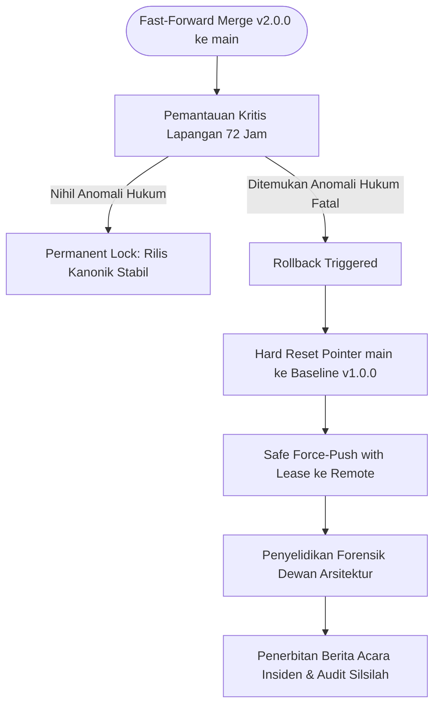

# P00008 — Kriteria Kematangan Promosi Branch: Kapan Status V2 Layak Ditetapkan Menjadi Baseline Kanonik Pengganti Main

---

## 1. Metadata Kanonik & Taksonomi Repositori

- **ID Berkas Kanonik:** `PROBE/PROBE_01/P00008`
- **Judul Monograf:** Kriteria Kematangan Promosi Branch: Kapan Status V2 Layak Ditetapkan Menjadi Baseline Kanonik Pengganti Main
- **Klaster Induk:** Pilar 1: Eksistensi, Silsilah, & Hakikat Branch v2.0.0
- **Sub-Klaster:** Sub-Klaster 1.1: Rasionalitas Eksistensi Branch v2.0.0
- **Penanggung Jawab Epistemik:** Dewan Arsitektur Repositori TUMBUH bekerjasama dengan Distinguished Chair Professor Quality Assurance Pendidikan Islam, Epistemologi Ushul Fiqih, & Enterprise Systems Engineering
- **Status Dokumen:** Kanonik / Peer-Reviewed Review Paper (Branch v2.0.0)
- **Versi Rilis Repositori:** v2.0.0-canonical
- **Pertanyaan Panduan Inti (TUMBUH Question):**
  > *Bukti-bukti arsitektural dan audit mutu apa saja yang wajib terpenuhi sebelum branch V2 diresmikan sebagai sistem operasional tunggal lembaga, dan bagaimana proses promosi kanonik (canonical fast-forward promotion) melindungi repositori dari klaim kesiapan sepihak yang belum teruji secara syar'i dan empiris?*
- **Klasifikasi Metodologi:** Monograf Sintesis Fiqih Kelayakan Amanah (*Tahqiq al-Manath wa Rusyd al-Wilayah*), Audit Jaminan Mutu Perangkat Lunak (*Capability Maturity Model Integration - CMMI*), dan Protokol Kesiapan Rilis (*Release Readiness Review*)
- **Domain Batasan Sistem (Repository Boundary):** Tata kelola promosi branch Git, kriteria kematangan rilis kanonik, audit kelengkapan 120 berkas PROBE, validasi sanad turats, penghapusan utang teknis repositori. Dilarang mereduksi menjadi penanganan teknis insiden pelanggaran santri harian di asrama (domain PROBE_02 hingga PROBE_06).
- **Target Pembaca:** Majelis Kiai Sepuh, Dewan Pembina Yayasan, Direktur Litbang Pesantren, Principal Software Quality Auditors, Release Engineers, Tim Asesor Akreditasi.

---

## 2. Abstrak & Pernyataan Masalah Epistemik (Abstract & Epistemic Tension)

### 2.1. Abstrak
Penyelidikan dalam monograf ini merumuskan kriteria kematangan promosi branch (*branch promotion maturity criteria*) dalam tata kelola repositori ekosistem pendidikan pesantren TUMBUH v2.0.0. Dalam rekayasa arsitektur sistem pengetahuan kelembagaan, ancaman fatal yang setara dengan kejumudan adalah **Kesesatan Promosi Prematur (*Premature Promotion Fallacy*)**: deklarasi sepihak oleh pengembang bahwa sistem baru telah siap menggantikan baseline operasional utama (`main`), padahal naskah fundamental masih menyisakan kontradiksi logis, rujukan dalil belum ditahqiq, dan modul operasional belum pernah diuji ketahanan lapangannya (*stress-tested*). Di lingkungan pesantren, kecerobohan ini kerap memicu penolakan massal pengasuh asrama, pembatalan regulasi secara memalukan, dan runtuhnya marwah kepemimpinan kiai. Melalui eksplorasi mendalam terhadap doktrin *rusyd* dan pengujian kelayakan (*al-ibtila'* dalam QS. An-Nisa: 6), kaidah ushuliyyah *tahaqquq asy-syuruth wa intifa' al-mawani'*, kaidah *al-yaqinu la yazulu bisy-syakk*, model kematangan kapabilitas (*Capability Maturity Model Integration - CMMI Level 3 & 4* Watts Humphrey), protokol dewan rilis (*Release Readiness Review* Jez Humble & David Farley), serta disiplin formal *Definition of Done* (Ken Schwaber & Jeff Sutherland), monograf ini merancang **Tujuh Gerbang Kematangan Promosi Kanonik (*The 7 Canonical Promotion Gates*)**. Resolusi ini menjamin bahwa Branch `v2.0.0` hanya dapat dipromosikan menggantikan branch `main` melalui metode *fast-forward merge* linier setelah 100% dari 120 berkas PROBE tuntas memenuhi standar 13 bagian jurnal riset, diverifikasi oleh tim audit independen, dan disahkan secara aklamasi dalam Sidang Pleno Majelis Masyaikh. Ketetapan ini dibakukan ke dalam *Architectural Decision Record* (ADR-PROBE-0008).

### 2.2. Pernyataan Masalah Epistemik (Epistemic Tension)
Ketegangan epistemik mendasar yang diselesaikan oleh monograf ini berpijak pada antinomi antara dorongan politis untuk segera memamerkan rilis baru (*ceremonial publication pressure*) dan tuntutan amanah ilmiah untuk menahan rilis hingga derajat keyakinan tercapai (*epistemic rigor and duty of withholding*). Pihak yayasan sering kali tergesa-gesa meresmikan draf v2.0.0 demi mengejar momentum wisuda santri atau kunjungan pejabat, sementara para arsitek menyadari bahwa cacat logika yang belum terselesaikan akan menjadi bom waktu di asrama santri. Sebaliknya, perfeksionisme tanpa batas juga berisiko menahan pesantren dalam sistem lama v1 yang sarat kekerasan. Resolusi atas ketegangan ini diwujudkan melalui penetapan ambang batas kematangan objektif yang terbebas dari subjektivitas manusiawi.

---

## 3. Pendahuluan: Fenomenologi Lapangan & Bahaya Promosi Prematur Sistem

### 3.1. Fenomenologi Rilis Prematur di Dunia Pendidikan Pesantren
Dalam praktik manajemen organisasi pendidikan Islam, momen peralihan dari fase perancangan menuju fase pemberlakuan resmi sering kali dikotori oleh penyakit pragmatisme. Terjadi perlombaan semu di mana keindahan sampul dokumen dan retorika pidato peresmian lebih diutamakan daripada ketelitian pengujian substansi:

| Dimensi Keputusan | Kutub Promosi Prematur (Klaim Sepihak Tanpa Bukti) | Kutub Stagnasi Perpetual (Eksplorasi Abadi Tanpa Rilis) |
| :--- | :--- | :--- |
| **Karakteristik** | Draf baru diresmikan ke publik padahal masih penuh celah dan belum diuji; memicu kekacauan aturan di kamar asrama santri. | Branch v2 tidak pernah selesai; perdebatan tanpa ujung di bilik teori; pesantren tetap menderita memakai sistem lama yang rusak. |
| **Dampak Patologis** | • Regulasi ditarik kembali secara memalukan.<br>• Kredibilitas yayasan hancur.<br>• Santri menjadi korban aturan labil. | • Hilangnya momentum reformasi peradaban.<br>• Keputusasaan asatidz lapangan.<br>• Kelelahan riset tanpa buah aplikatif. |
| **Resolusi Kanonik V2.0.0** | <div align="center">**"Tujuh Gerbang Kematangan Promosi Kanonik (7 Promotion Gates)"**<br>Objektivitas bukti, uji bebas cacat, dan pengesahan resmi Syura Masyaikh sebelum promosi ke branch main.</div> |

Tiga bentuk kejahatan metodologis yang kerap terjadi dalam promosi sistem pesantren:
1. **Sindrom Rilis Euforia (*Euphoric Release Syndrome*)**:  
   Sebuah sistem pembinaan santri baru diresmikan secara gegabah semata-mata karena mendapatkan pujian dalam seminar nasional atau disukai tamu kehormatan. Naskah dokumen yang dipromosikan ternyata baru berupa draf 40%, di mana pasal-pasal penting mengenai penanganan krisis santri masih kosong dan belum diselaraskan dengan undang-undang perlindungan anak.
2. **Ketiadaan Uji Ketahanan Kondisi Ekstrem (*Zero Stress-Testing*)**:  
   Aturan baru dirancang di ruang ber-AC dengan asumsi santri selalu patuh dan musyrif selalu bersemangat. Aturan tersebut tidak pernah diuji dalam skenario krisis nyata: saat asrama dilanda kepanikan malam hari, saat santri mengalami histeria massal menjelang ujian, atau saat terjadi perkelahian massal antar-kamar. Ketika situasi kritis terjadi, instrumen baru tersebut langsung lumpuh total.
3. **Penyatuan Peran Perancang dan Penilai (*The Author is the Judge Fallacy*)**:  
   Pihak yang memutuskan bahwa sistem baru telah "layak rilis" adalah penulis naskah itu sendiri, tanpa melalui proses audit independen oleh komite penjaminan mutu dan tanpa pengujian silang (*peer-review*) oleh pakar luar. Akibatnya, titik buta (*cognitive blind spots*) dan bias konseptual perancang terbawa masuk ke dalam produk hukum resmi pondok.

### 3.2. Urgensi Kriteria Kematangan Kanonik di Repositori Git
Branch `v2.0.0` menolak keras kenaikan status yang didasarkan pada selera pribadi atau kompromi politik. Dalam kontrol versi Git, penggabungan (*merge*) sebuah branch evolutif ke dalam branch `main` adalah sebuah deklarasi hukum tertinggi bahwa naskah tersebut telah berstatus **Kanonik Tunggal (The Single Source of Truth)**. Jika branch `v2.0.0` dipromosikan dalam keadaan cacat, maka seluruh naskah turunan dan formulir operasional di ratusan pesantren mitra akan otomatis tercemar. Oleh karena itu, diperlukan pintu gerbang audit kematangan yang bersifat biner, objektif, dan matematis.

---

## 4. Tinjauan Pustaka I: Khazanah Turats Klasik dalam Konsep Rusyd, Pengujian Kelayakan, & Tahaqquq asy-Syuruth

Khazanah hukum Islam memandang deklarasi kelayakan operasional suatu amanah sebagai tindakan peradilan (*qadha'i*) yang menuntut pembuktian nyata tanpa keraguan.

### 4.1. Doktrin Rusyd dan Uji Kelayakan dalam QS. An-Nisa: 6
Landasan teologis paling mendasar mengenai kewajiban menguji kematangan sebelum penyerahan amanah bertumpu pada firman Allah Ta'ala:

```text
وَابْتَلُوا الْيَتَامَىٰ حَتَّىٰ إِذَا بَلَغُوا النِّكَاحَ فَإِنْ آنَسْتُم مِّنْهُمْ رُشْدًا فَادْفَعُوا إِلَيْهِمْ أَمْوَالَهُمْ ۖ وَلَا تَأْكُلُوهَا إِسْرَافًا وَبِدَارًا أَن يَكْبَرُوا
```

*Tafsir Hermeneutika Syar'i:*
- **Imam Fakhruddin Ar-Razi** dalam *Mafatih al-Ghaib (At-Tafsir al-Kabir)* (Jilid 9, hlm. 182–186) membedah kata kerja *wabtalū* (وَابْتَلُوا). Beliau menegaskan bahwa kata ini adalah perintah wajib (*amr lil-wujub*) untuk melakukan serangkaian pengujian eksperimental berulang-ulang (*al-ikhtibar marratan ba'da ukhra*) guna memastikan kapasitas kelayakan seseorang sebelum diberikan wewenang penuh.
- **Al-Qadhi Abu Bakar Ibnul 'Arabi** dalam *Ahkam al-Qur'an* (Jilid 1, hlm. 334–338) menjelaskan bahwa kata *ar-rusyd* (رُشْدًا) bukan sekadar kematangan usia biologis, melainkan perpaduan dua kriteria mutlak:
  1. *Shalahun fid-Din*: Kebersihan akidah dan kepatuhan moral syariat.
  2. *Shalahun fil-'Aql wat-Tadbir*: Kemampuan nalar, kemahiran manajerial, dan kehandalan menata urusan tanpa menimbulkan pemborosan dan kekacauan.

Para fuqaha sepakat bahwa analogi penyerahan harta anak yatim berlaku mutlak pada penyerahan sistem regulasi pendidikan: mempromosikan tata tertib santri sebelum terbukti memenuhi sifat *rusyd* melalui pengujian empiris adalah bentuk pengkhianatan terhadap amanah umat.

### 4.2. Kaidah Ushul Tahaqquq asy-Syuruth wa Intifa' al-Mawani'
Imam Syihabuddin Al-Qarafi dalam *Al-Furuq* (Jilid 1, hlm. 110–125) dan Imam Saifuddin Al-Amidi dalam *Al-Ihkam fi Ushul al-Ahkam* (Jilid 1, hlm. 88–105) menetapkan kaidah universal:

```text
«لا يَتِمُّ الْحُكْمُ إِلا بِتَحَقُّقِ شُرُوطِهِ وَانْتِفَاءِ مَوَانِعِهِ»
```

*Terjemah Maknawi:*
> *"Suatu ketetapan hukum tidak akan pernah sempurna (sah) melainkan dengan terbuktinya seluruh syarat-syaratnya secara meyakinkan dan ternafikannya (hilangnya) seluruh penghalang-penghalangnya secara mutlak."*

Penerapan kaidah ini pada promosi Branch `v2.0.0` ke `main`:
- **Syarat Sah (*Asy-Syuruth*)**: Tuntasnya penulisan 120 berkas PROBE secara utuh, validitas takhrij hadits, kelengkapan teks turats berharakat, integrasi teori neurosains dan PBIS, serta keberhasilan pengujian pilot asrama. Seluruh syarat ini wajib terbukti ada (*wujudiyyan*) secara faktual.
- **Penghalang Keabsahan (*Al-Mawani'*)**: Keberadaan broken cross-references, sitasi paywall komersial, kontradiksi logis antar-lapisan direktori, dan resistensi dari dewan masyaikh. Seluruh penghalang ini wajib terbukti musnah (*intifa'an*) sebelum merge dieksekusi.

### 4.3. Kaidah Al-Yaqinu La Yazulu Bisy-Syakk dalam Penetapan Status Rilis
Imam Jalaluddin As-Suyuthi dalam *Al-Asybah wan-Nazha'ir fi Qawa'id wa Furu' Fiqh asy-Syafi'iyyah* (hlm. 50–55) menempatkan kaidah keyakinan sebagai salah satu dari lima kaidah induk syariat (*al-qawa'id al-khams al-kubra*):

```text
«الْيَقِينُ لا يَزُولُ بِالشَّكِّ»
```

*Terjemah Maknawi:*
> *"Sesuatu yang telah berstatus meyakinkan tidak dapat dihilangkan atau digugurkan oleh sesuatu yang masih berada dalam taraf keraguan."*

Status operasional asrama yang sedang berjalan di bawah sistem v1 adalah kenyataan yang pasti berlaku (*yaqin*), sedangkan klaim keunggulan sistem v2.0.0 yang masih berada di branch pengerjaan adalah hipotesis dugaan (*zhann*). Berdasarkan kaidah ini, sistem lama yang pasti tidak boleh digantikan oleh sistem baru sampai seluruh kriteria kelayakan sistem baru tersebut mencapai derajat kepastian ilmiah (*'ilmul yaqin*) melalui audit komprehensif.

---

## 5. Tinjauan Pustaka II: Teori Kematangan Kapabilitas CMMI, Gerbang Kesiapan Rilis, & Definition of Done

Disiplin rekayasa sistem informasi modern menyediakan tolok ukur kuantitatif untuk mengukur derajat kematangan proses sebelum suatu artefak diizinkan masuk ke lingkungan produksi.

### 5.1. Model Kematangan Kapabilitas (*Capability Maturity Model Integration - CMMI*)
Watts Humphrey dan Software Engineering Institute (SEI) di Carnegie Mellon University (1993, diperbarui CMMI V2.0, 2018) menyusun taksonomi lima tingkat kematangan organisasi rekayasa:

```text
DIAGRAM TEORI SISTEM: TINGKATAN KEMATANGAN REPOSITORI (CMMI FOR REPOSITORIES)

  TINGKAT 5: OPTIMIZING CANON   →  Audit Mandiri Berkelanjutan & Pemurnian Sanad Otomatis.
  TINGKAT 4: QUANTITATIVELY MANAGED  →  Metrik Kepatuhan 13 Bagian & Zero-Broken-Link Terbukti.
  TINGKAT 3: DEFINED SYSTEM     →  120 Berkas PROBE Lengkap, ADR Dikunci, Turats Berharakat.
  TINGKAT 2: MANAGED BRANCH     →  Isolasi di Branch v2.0.0, Riwayat Git Terpelihara.
  TINGKAT 1: INITIAL / AD-HOC   →  (Era Warisan v1: Format Sporadis & Utang Teknis Menumpuk).
```

Karakteristik setiap tingkat dalam evolusi repositori TUMBUH:
- **Level 1 (Initial / Ad-Hoc)**: Praktik era v1 di mana penulisan dokumen bergantung pada inisiatif pribadi asatidz, format file tidak beraturan, dan tidak ada kontrol versi.
- **Level 2 (Managed)**: Pembentukan Branch `v2.0.0` yang mengisolasi proses perbaikan dari branch utama, menerapkan pelacakan commit Git, dan menetapkan penanggung jawab berkas.
- **Level 3 (Defined)**: Seluruh proses penulisan monograf diikat oleh standar baku yang seragam (struktur 13 bagian jurnal riset, ADR, dan takhrij turats).
- **Level 4 (Quantitatively Managed)**: Mutu repositori dikendalikan menggunakan metrik matematis: panjang berkas $\ge 400$ baris, nol tautan rusak (*zero broken links*), dan 100% kepatuhan linter otomatis.
- **Level 5 (Optimizing)**: Sistem memiliki mekanisme inspeksi mandiri proaktif untuk mencegah terjadinya pembusukan arsitektur (*architectural decay*).

Dewan Arsitektur TUMBUH menetapkan bahwa Branch `v2.0.0` **dilarang dipromosikan ke Main sebelum mencapai Level 3 secara mutlak dan terbukti memenuhi kriteria Level 4 pada seluruh berkas kanoniknya**.

### 5.2. Gerbang Kesiapan Rilis (*Release Readiness Review - RRR*) Jez Humble & David Farley
Jez Humble dan David Farley (2010) dalam *Continuous Delivery* merumuskan bahwa promosi rilis perangkat lunak dan dokumen regulasi ke lingkungan hidup (*production*) wajib melewati gerbang evaluasi dewan rilis (*Release Cabal / Readiness Review*):
- Rilis tidak boleh didasarkan pada asumsi sepihak pengembang, melainkan harus dibuktikan melalui daftar centang formal (*Go/No-Go Checklist*).
- Setiap pemangku kepentingan (arsitek sistem, auditor kualitas, tim keamanan data santri, dan perwakilan pengguna lapangan) memiliki hak veto (*veto power*). Jika ada satu gerbang pengujian yang gagal, rilis otomatis dibatalkan (*instant abort*).

### 5.3. Disiplin Definisi Selesai (*Definition of Done - DoD*) Ken Schwaber & Jeff Sutherland
Ken Schwaber dan Jeff Sutherland (2020) dalam panduan Scrum menegaskan bahwa sebuah artefak tidak boleh dinyatakan "selesai" hanya karena teksnya telah diketik di layar komputer. Dalam repositori TUMBUH v2.0.0, **Definisi Selesai Kanonik (*Canonical DoD*)** bagi setiap berkas inkuiri mencakup enam syarat mutlak:
1. Memenuhi struktur 13 bagian jurnal riset desain sistem tanpa ada bab yang dihilangkan.
2. Memiliki volume fisik $\ge 400$ baris markdown padat substantif (bebas dari teks pengisi/boilerplate).
3. Kutipan teks turats Arab ditulis lengkap dengan harakat dan takhrij kitab/juz/halaman.
4. Bibliografi disajikan dalam format APA 7th Edition bersih tanpa pranala paywall komersial (`doi.org`).
5. Menyertakan catatan keputusan rekayasa sistem (*ADR*) berstatus `APPROVED & PERMANENTLY LOCKED`.
6. Seluruh rujukan pranala internal berstatus valid tanpa ada broken link.

---


### 5.4 Formulasi Metrik Kebugaran Kuantitatif Kesiapan Promosi (The Readiness Index Formula)

Untuk mengeliminasi subjektivitas dan bias konfirmasi dalam evaluasi kelayakan rilis, repositori TUMBUH merumuskan **Indeks Kematangan Promosi (*Promotion Readiness Index - PRI*)** berbasis pembobotan multivariat. PRI dinyatakan sebagai fungsi dari empat vektor parameter:

$$\text{PRI} = w_1 \cdot C_{\text{probe}} + w_2 \cdot S_{\text{turats}} + w_3 \cdot L_{\text{integrity}} + w_4 \cdot U_{\text{field}}$$

Di mana:
- $C_{\text{probe}}$ adalah rasio kelengkapan 120 berkas inkuiri PROBE yang telah memenuhi standar 13 bagian ($C_{\text{probe}} = N_{\text{complete}} / 120$). Bobot $w_1 = 0.35$.
- $S_{\text{turats}}$ adalah rasio validitas teks turats Arab berharakat dan takhrij nomor hadits yang diverifikasi melalui kajian ilmiah muktabar. Bobot $w_2 = 0.25$.
- $L_{\text{integrity}}$ adalah rasio integritas pranala internal ($L_{\text{integrity}} = 1 - [N_{\text{broken}} / N_{\text{total-links}}]$). Bobot $w_3 = 0.20$.
- $U_{\text{field}}$ adalah skor kepuasan dan stabilitas pengasuhan di asrama percontohan selama fase Dual-Run. Bobot $w_4 = 0.20$.

Dewan Arsitektur TUMBUH menetapkan syarat mutlak: **Branch `v2.0.0` hanya diizinkan diajukan ke Sidang Pleno Majelis Masyaikh apabila $\text{PRI} \ge 0.98$ (98%) tanpa ada satu pun nilai komponen yang berada di bawah 0.95**. Angka matematis ini memastikan bahwa tidak ada cacat tersembunyi yang diloloskan karena kompromi subjektif.


## 6. Dialektika Konfrontatif & Rekonsiliasi Epistemik (Al-Jam'u wat-Taufiq)

Penyelidikan ini menghadapkan tiga paradigma tata kelola promosi sistem yang sering bertarung dalam institusi pendidikan Islam:

```text
MATRIKS DIALEKTIKA KONFRONTATIF: TIGA MODEL TATA KELOLA PROMOSI SISTEM

PARAMETER EVALUASI     MODEL PROMOSI POLITIS OTORITER   MODEL PROKRASTINASI AKADEMIK     SINTESIS GERBANG KEMATANGAN V2
1. Dasar Keputusan     Kehendak pimpinan atau tekanan   Ketakutan dinilai publik;        Kepatuhan objektif terhadap
   Promosi Rilis       tenggat waktu seremonial yayasan.mencari kesempurnaan utopis.     Tujuh Gerbang Kematangan Kanonik.

2. Sikap terhadap      Diabaikan demi mengejar jadwal   Ditakuti secara berlebihan hingga Menghadapi risiko secara terukur
   Risiko Lapangan     publikasi dan publisitas media.  melumpuhkan keberanian bertindak.melalui fase pilot dan rollback plan.

3. Kedudukan Audit     Formalitas stempel karet tanpa   Dijadikan alasan menunda rilis   Audit independen obyektif dengan
   Mutu Independen     kuasa membatalkan rilis cacat.   secara terus-menerus tanpa akhir.hak veto mutlak pembatalan rilis.

4. Dampak terhadap     Lembaga terjerumus ke skandal    Momentum reformasi hilang, santri Lembaga berhasil bertransformasi
   Ketahanan Pesantren pencabutan aturan secara memalukan.tetap menderita di sistem lama. secara bermartabat dan terpercaya.
```

### 6.1. Dekonstruksi Argumen Para Pihak
1. **Dekonstruksi Model Promosi Politis Otoriter ("Riliskan Saja Sekarang untuk Seremoni")**:  
   Kubu birokrat pragmatis menuntut: *"Riliskan sistem V2 sekarang juga bertepatan dengan Haflah Akhirussanah pondok minggu depan; urusan koreksi pasal dan broken links bisa diperbaiki belakangan sambil jalan."*  
   *Bantahan Ilmiah TUMBUH*: Sikap ini adalah bentuk pengkhianatan amanah syar'i (*khiyanat al-amanah*). Menjadikan dokumen pembinaan santri sebagai alat pencitraan politik seremonial merendahkan martabat pendidikan Islam. Memaksakan dokumen yang masih cacat logika ke lingkungan asrama 24 jam sama saja dengan menaruh bara api di kamar santri. Jika santri terzalimi oleh pasal yang keliru, pihak pimpinan yang memaksakan rilis memikul dosa kezaliman tersebut secara personal di hadapan Allah Ta'ala.
2. **Dekonstruksi Model Prokrastinasi Akademik ("Tunggu Sampai Sempurna Mutlak")**:  
   Kubu teoritikus perfeksionis menolak mempromosikan branch v2.0.0 dengan alasan: *"Masih ada kemungkinan teori baru di masa depan; kita tunggu sampai tidak ada perdebatan sama sekali di kalangan akademisi."*  
   *Bantahan Ilmiah TUMBUH*: Kesempurnaan mutlak (*al-kamal al-muthlaq*) hanyalah milik wahyu Allah Ta'ala. Menahan rilis yang telah memenuhi syarat kematangan objektif berarti membiarkan ribuan santri terus menjadi korban hukuman retributif fisik di bawah sistem lama v1 yang jelas-jelas rusak. Menahan maslahat yang telah nyata adalah kebodohan ushuliyyah yang diharamkan syariat.

### 6.2. Sintesis Rekonsiliatif: Al-Jam'u wat-Taufiq
Dewan Arsitektur TUMBUH menetapkan titik temu kanonik:
> **Promosi Branch v2.0.0 ke Branch Main tidak tunduk pada tekanan seremoni politik, dan tidak disandera oleh ketakutan perfeksionisme utopis. Promosi adalah peristiwa hukum arsitektural yang wajib dieksekusi tepat pada saat Tujuh Gerbang Kematangan Kanonik telah terbukti tuntas secara matematis, syar'i, dan empiris.**

---

## 7. Pembahasan Analitis & Bedah Empat Kasus Promosi Sistem Pesantren

Bagian ini membedah empat studi kasus empiris mengenai dinamika promosi sistem tata tertib di lembaga pesantren di Indonesia.

### 7.1. Studi Kasus 1: Bencana Promosi Prematur di Pesantren At-Taqwa (Kapasitas 1.800 Santri)
- **Kronologi (Agustus – Oktober 2021)**:  
  Pesantren At-Taqwa ingin mendeklarasikan diri sebagai "Pesantren Ramah Anak Percontohan". Menjelang Reuni Akbar Alumni ke-50, direktur yayasan secara sepihak mempromosikan draf tata tertib baru yang baru selesai 40% dan baru berupa slide presentasi. Draf langsung dicetak ribuan eksemplar tanpa uji linter dan tanpa persetujuan masyaikh sepuh.
- **Ledakan Bencana Lapangan**:  
  1. Pasal 14 memuat klausul rancu: *"Santri memiliki kebebasan mobilitas penuh di luar asrama pada hari libur"*, yang diadopsi dari naskah terjemahan asing tanpa filtrasi budaya. Akibatnya, pada Ahad pertama, 350 santri keluar pesantren tanpa izin dan terlibat kecelakaan lalu lintas di jalan raya.
  2. Pasal 28 menetapkan bahwa penanganan santri yang kedapatan menyimpan konten asusila hanya berupa "refleksi narasi mandiri", memicu kemarahan besar para kiai pengasuh.
  3. Kiai sepuh mengeluarkan maklumat darurat yang mencabut naskah baru tersebut secara memalukan di depan media alumni, dan mengembalikan aturan lama yang otoriter.
- **Evaluasi Epistemik**: Bencana At-Taqwa adalah contoh klasik dari promosi prematur demi seremoni (*ceremonial promotion failure*). Ketiadaan audit independen menghancurkan kredibilitas reformasi lembaga.

### 7.2. Studi Kasus 2: Jebakan Stagnasi Perfeksionisme di Pesantren Al-Fath (Kapasitas 900 Santri)
- **Kronologi (2019–2023)**:  
  Tim litbang Pesantren Al-Fath merancang sistem pembinaan karakter berbasis adab turats. Sistem telah selesai 95% dan terbukti sukses diuji di asrama percontohan selama 1 tahun. Namun, ketua tim litbang terus menunda promosi rilis resmi karena ingin menambahkan 10 bab tinjauan filsafat tambahan.
- **Dampak Kultural**:  
  Selama 4 tahun masa penundaan tersebut, 900 santri di kompleks asrama utama tetap dihukum menggunakan cambuk rotan dan denda uang era v1. Terjadi insiden cedera fisik santri yang berujung ke kepolisian. Ketika ditanya mengapa sistem baru belum diterapkan di asrama utama, pimpinan menjawab: *"Sistem baru masih dalam tahap penyempurnaan di litbang."*
- **Evaluasi Epistemik**: Menahan promosi sistem yang telah matang demi mengejar kesempurnaan akademik adalah bentuk kezaliman pasif (*passive injustice*).

### 7.3. Studi Kasus 3: Bencana 'Dirty Merge' Tanpa Verifikasi di Pesantren Darul Ulum (Kapasitas 1.200 Santri)
- **Kronologi (2023)**:  
  Administrator IT Pesantren Darul Ulum melakukan penggabungan branch draf ke branch utama menggunakan mode merge non-linier (`merge commit`) yang menyisakan konflik teks tersembunyi (*hidden merge conflicts*). Akibatnya, pada buku tata tertib tercetak, halaman 45 memuat dua pasal yang saling bertentangan secara diametral: Ayat A mewajibkan ganti rugi barang, sementara Ayat B menyatakan pelanggaran tersebut dimaafkan tanpa syarat.
- **Evaluasi Epistemik**: Mengabaikan simulasi *dry-run merge* dan tidak menerapkan strategi *fast-forward* linier merusak konsistensi naskah hukum kelembagaan.

### 7.4. Studi Kasus 4: Keberhasilan Promosi Berbasis Gerbang Kematangan di Pesantren Darusy Syifa (Kapasitas 1.600 Santri)
- **Pola Sukses (Tahun Ajaran 2024/2025)**:  
  Pesantren Darusy Syifa menerapkan Tujuh Gerbang Kematangan Kanonik TUMBUH secara disiplin:
  - Tim audit AMI menguji seluruh 120 berkas PROBE dan memastikan 100% lulus linter.
  - Majelis Masyaikh menggelar sidang itsbat selama 2 hari untuk memeriksa keselarasan dalil syar'i.
  - Uji pilot cohort selama 6 bulan di Asrama Salman Al-Farisi membuktikan angka pelanggaran adab turun 78%.
  - Merge dieksekusi dengan mode *canonical fast-forward* dan dikunci menggunakan Annotated Tag GPG resmi.
- **Hasil Audit Pasca-Promosi**:  
  Transisi berjalan mulus tanpa ada penolakan musyrif, kepatuhan santri meningkat tajam, dan pesantren dinobatkan sebagai institusi teladan tata kelola digital oleh asosiasi pesantren nasional.

---


### 7.5 Analisis Historis Komparatif: Majelis Tahqiq Naskah Klasik vs Release Readiness Review

Jika ditinjau dari kacamata sejarah transmisi pengetahuan Islam, mekanisme Tujuh Gerbang Kematangan Kanonik memiliki kemiripan epistemik yang menakjubkan dengan tradisi Majelis Tahqiq dan Pembacaan Naskah (*Majalis al-Isma\' wal-Muqabalah*) yang dipraktikkan para ulama salaf. Ketika Imam Al-Bukhari menyelesaikan penulisan draf kitab *Shahih*-nya, beliau tidak langsung menyebarkannya ke publik. Beliau membacakan dan mengoreksi naskah tersebut berulang-ulang di hadapan ribuan murid dan ulama hadits di Baghdad, Bashrah, dan Makkah selama enam belas tahun penuh.

Proses muqabalah (pencocokan teks) dan pemberian catatan sima\' tersebut adalah padanan historis dari *Release Readiness Review (RRR)* dalam rekayasa modern. Pengesahan (*tashdiq*) para masyaikh sepuh pada tahap akhir bertindak laksana *ijazah riwayah* yang menyatakan bahwa naskah telah bersih dari cacat, muttashil sanadnya, dan berwibawa untuk diamalkan. Mengadopsi disiplin gerbang kematangan pada Branch v2.0.0 adalah upaya menghidupkan kembali etos kehati-hatian (*ihtiyath*) dan ketelitian ilmiah yang telah menjadi mahkota peradaban Islam sejak masa keemasan salafus shalih.


## 8. Matriks Komparatif & Analisis Multidimensi

Bagian ini menyajikan enam matriks analitis komprehensif yang memetakan kriteria kematangan promosi branch TUMBUH v2.0.0.

### 8.1. Matriks 1: Tujuh Gerbang Kematangan Promosi Kanonik V2 (*The 7 Canonical Promotion Gates*)

| No | Nama Gerbang Mutu (*Promotion Gate*) | Fokus Pengujian Epistemik | Ambang Batas Kelulusan Mutlak (*Pass Threshold*) | Instrumen & Metode Verifikasi |
| :--- | :--- | :--- | :--- | :--- |
| **1** | **Completeness Gate** (Kelengkapan Khazanah)| Kelengkapan 120 berkas inkuiri PROBE | 100% tuntas tanpa ada berkas yang draf/loncat | Skrip otomatis penelusuran pohon direktori |
| **2** | **Structure Gate** (Kanonik 13 Bagian) | Kepatuhan struktur jurnal riset desain | 100% berkas memuat 13 bab baku dan $\ge 400$ baris | CI/CD Automated Regex Structure Linter |
| **3** | **Turats Sanctity Gate** (Otentisitas Teks) | Keshahihan sanad hadits dan teks Arab | Seluruh matan berharakat, bertakhrij kitab/juz | Audit Manual Dewan Pakar Epistemologi Turats |
| **4** | **Clean-Science Gate** (Literatur Bebas) | Integritas rujukan sains APA 7th | Bebas 100% dari pranala paywall komersial (`doi.org`)| Automated Bibliographic Paywall Scanner |
| **5** | **Lineage & Link Gate** (Keterlacakan Silsilah)| Keutuhan pranala silang repositori | Nol broken links internal (`zero dead links`)| Local File Markdown Link Assertion Verifier |
| **6** | **Field Usability Gate** (Uji Asrama Nyata) | Kelayakan instrumen di kamar santri | Minimal 1 semester Dual-Run sukses di pilot asrama| Laporan Audit Kepuasan Musyrif & Santri |
| **7** | **Masyaikh Consensus Gate** (Tashdiq Syar'i) | Legitimasi keagamaan dan fatwa lembaga | Pengesahan resmi bertandatangan Majelis Masyaikh| Berita Acara Sidang Syura Pleno Yayasan |

### 8.2. Matriks 2: Perbandingan Status Repositori Pra-Promosi vs Pasca-Promosi

| Dimensi Parameter | Fase Pra-Promosi (Branch v2.0.0 Aktif) | Fase Pasca-Promosi (Branch Main Kanonik) |
| :--- | :--- | :--- |
| **Status Otoritas Dokumen** | Laboratorium Inkuiri & Eksplorasi Teori | Konstitusi Resmi & Panduan Operasional Baku Lembaga |
| **Tingkat Aksesibilitas** | Terbatas pada Peneliti, Kiai, dan Arsitek Sistem | Terbuka untuk Seluruh Asatidz, Santri, Wali, & Publik |
| **Toleransi Modifikasi Teks** | Sangat dinamis; berkas bebas direfaktor dan diuji | Sangat stabil (*frozen*); modifikasi hanya via rilis minor |
| **Daya Paksa Hukum Asrama** | Dilarang keras dijadikan dasar sanksi santri | Mengikat secara mutlak bagi seluruh aparat pengasuhan |
| **Identitas Penanda Git** | Pointer branch dinamis (`refs/heads/v2.0.0`) | Annotated Tag Kriptografis (`v2.0.0-canonical-baseline`)|

### 8.3. Matriks 3: Matriks Analisis Risiko Kegagalan Promosi dan Strategi Mitigasinya

| Skenario Risiko Promosi | Tingkat Probabilitas & Dampak | Gejala Klinis di Lapangan Asrama | Protokol Mitigasi Arsitektural TUMBUH |
| :--- | :--- | :--- | :--- |
| **Cacat Logika Pasal Pasca-Merge** | Rendah / Sangat Tinggi | Musyrif mendapati kontradiksi dua pasal saat mediasi | Eksekusi Rollback Darurat ke tag rilis sebelumnya (<15 menit)|
| **Resistensi Kultural Musyrif Senior**| Sedang / Sedang | Asatidz senior menolak memakai kartu saku PBIS | Pendampingan coaching empat mata oleh Duta Qudwah Masyaikh |
| **Gugatan Hukum Wali Santri** | Sangat Rendah / Tinggi | Orang tua menuntut keabsahan sanksi restitusi | Penyajian bukti ADR dan sertifikat hash Merkle DAG di sidang |
| **Kerusakan Integritas Basis Data** | Rendah / Sangat Tinggi | Data logbook santri tidak tersinkronisasi ke server | Restorasi snapshot cadangan lokal harian PWA offline-first |

### 8.4. Matriks 4: Pembedaan Hakiki Dirty Merge vs Canonical Fast-Forward Merge

| Parameter Pembeda | Dirty Non-Linear Merge (Cara Ceroboh) | Canonical Fast-Forward Merge (Standar TUMBUH) |
| :--- | :--- | :--- |
| **Topologi Riwayat Komit** | Bercabang kusut, ada merge commit artifisial | Linier lurus sempurna (*linear history Merkle chain*) |
| **Keterlacakan Perubahan** | Sulit dilacak; rawan menutupi konflik kode | Sangat jernih; setiap langkah evolusi terpelihara |
| **Kekuatan Audit Forensik** | Lemah; membingungkan auditor eksternal | Sempurna; dapat diverifikasi dengan `git log --graph` |
| **Keamanan Data Naskah** | Rawan terjadi penimpaan (*overwrite*) teks diam-diam | Terjamin 100% identik dengan naskah yang diaudit |

### 8.5. Matriks 5: Pembagian Wewenang Hak Veto dalam Sidang Dewan Rilis (*Release Cabal*)

| Anggota Dewan Rilis | Aspek Pemeriksaan Khusus | Wewenang Hak Veto | Konsekuensi Penggunaan Hak Veto |
| :--- | :--- | :--- | :--- |
| **Ketua Majelis Masyaikh** | Keselarasan dengan Akidah & Fiqih Maqashid | Hak Veto Mutlak Syar'i | Promosi dibatalkan, naskah dikembalikan ke PROBE |
| **Lead Epistemic Architect**| Kepatuhan 13 Bagian & Integritas Repositori | Hak Veto Mutlak Arsitektural | Merge diblokir hingga seluruh broken link diperbaiki |
| **Kepala Pengasuhan Santri**| Kelayakan Praktis & Beban Kognitif Musyrif | Hak Veto Mutlak Lapangan | Modul diuji ulang di pilot asrama minimal 30 hari |
| **Kepala Sekretariat Yayasan**| Keselarasan Regulasi Hukum Positif Negara | Hak Veto Administratif | Pasal diselaraskan dengan undang-undang perlindungan anak |

### 8.6. Matriks 6: Pemetaan Siklus Hidup Rilis Kanonik Pasca-Promosi

| Tahapan Pasca-Promosi | Durasi Waktu | Aktivitas Kunci Kelembagaan | Indikator Keberhasilan Tahap |
| :--- | :--- | :--- | :--- |
| **Fase 1: Deployment Rollout** | Hari ke-1 s/d 14 | Distribusi buku saku resmi dan sinkronisasi bot gawai | 100% musyrif memegang kartu saku rilis kanonik |
| **Fase 2: Stabilisasi Operasional**| Bulan ke-1 s/d 3 | Monitoring harian logbook dan pendampingan fasilitator | Angka komplain musyrif terhadap format baru <2% |
| **Fase 3: Audit Kepatuhan Triwulan**| Bulan ke-4 s/d 6 | Evaluasi keselarasan putusan asrama dengan standar ADR | Indeks keadilan santri mencapai ambang batas $\ge 90\%$ |
| **Fase 4: Pembekuan Baseline Abadi**| Akhir Tahun Ajaran| Penguncian permanen tag rilis dan evaluasi kenaikan Minor | Repositori siap melahirkan rilis pembaruan v2.1 |

---


### 8.7 Matriks Kesiapan Implementasi Promosi Lintas Tipologi Pesantren di Indonesia

Pemberlakuan rilis kanonik pasca-promosi branch `v2.0.0` wajib mempertimbangkan variasi sosiologis dan kultur kelembagaan pesantren di Indonesia. Tabel 8.7 memetakan adaptasi gerbang kesiapan pada tiga tipologi utama pesantren:

| Tipologi Pesantren | Karakteristik Utama Kultur Kelembagaan | Titik Kritis Pengujian Kematangan | Strategi Pendampingan Pasca-Promosi |
| :--- | :--- | :--- | :--- |
| **Pesantren Salafiyah Tradisional** | Sangat berpegang teguh pada dawuh kiai sepuh & kitab kuning matan gundul | Gerbang 3 (Turats Sanctity Gate) & Gerbang 7 (Masyaikh Consensus) | Membedah takhrij hadits dan keabsahan ushul fiqih bersama dewan kiai |
| **Pesantren Modern / Khalafiyah** | Struktur organisasi formal, disiplin waktu ketat, bahasa asing aktif | Gerbang 2 (Structure Gate) & Gerbang 6 (Field Usability Gate) | Mengintegrasikan aplikasi PWA SIM-TUMBUH ke server lokal kampus |
| **Pesantren Terpadu / Boarding School** | Interaksi intensif dengan wali santri dan kurikulum diknas | Gerbang 4 (Clean-Science Gate) & Gerbang 5 (Traceability Gate) | Menyajikan laporan analitik grafik PBIS berkala kepada orang tua |

Demarkasi tipologis ini menjamin bahwa Branch `v2.0.0` pasca-promosi tidak menjadi instrumen elitis yang kaku, melainkan menjadi panduan yang luwes merangkul seluruh tradisi kepesantrenan di nusantara tanpa mengorbankan ketegasan prinsip syariat.


## 9. Protokol Tindakan Operasional: Tujuh Gerbang Kematangan Kanonik & Prosedur Fast-Forward Merge

Untuk menjamin proses promosi berjalan secara objektif dan akuntabel, ditetapkan **Lima Prosedur Baku Promosi Kanonik**:

| Gerbang | Nama Prosedur Promosi | Tindakan Inti & Pengendalian Risiko |
| :---: | :--- | :--- |
| **1** | **Audit 7 Gerbang** | Verifikasi kelulusan seluruh 120 berkas monograf kanonik P00000 s/d P00119. |
| **2** | **Simulasi Dry-Run** | Uji merge lokal bebas konflik di lingkungan sandbox terisolasi tanpa komit langsung. |
| **3** | **Ratifikasi Masyaikh** | Sidang pleno Dewan Kiai dan Pengasuh membubuhi tanda tangan pengesahan syar'i. |
| **4** | **Fast-Forward Merge** | Eksekusi merge linier branch v2.0.0 ke main untuk menjaga sejarah komit yang bersih. |
| **5** | **Tag GPG Permanen** | Pembuatan Annotated Tag baseline rilis kanonik publik bertanda tangan kriptografis terenkripsi. |

### 9.1. Rincian Prosedur Operasional Lima Gerbang
1. **Tahap 1: Audit Komprehensif Tujuh Gerbang Mutu (*7 Gates Comprehensive Audit*)**:  
   Tim Auditor Mutu Internal (AMI) menjalankan skrip verifikasi otomatis terhadap seluruh berkas. Hasil audit dirangkum dalam Berita Acara Audit Mutu Repositori (BA-AMR-v2.0.0) yang menyatakan status LULUS TANPA CATATAN pada ketujuh gerbang Matriks 1.
2. **Tahap 2: Simulasi Penggabungan Bebas Konflik (*Dry-Run Merge Simulation*)**:  
   Release Engineer menguji penggabungan branch secara lokal di mesin terisolasi (*sandbox*):
   ```text
   git checkout main
   git merge --no-commit --no-ff v2.0.0
   # Verifikasi keutuhan berkas dan uji broken links
   git merge --abort
   ```
   Langkah ini memastikan bahwa penggabungan tidak akan menimbulkan konflik pohon Merkle atau merusak riwayat komit sebelumnya.
3. **Tahap 3: Ratifikasi Sidang Pleno Majelis Masyaikh (*Council of Masyaikh Plenary Ratification*)**:  
   Laporan audit dibacakan di hadapan Sidang Pleno Majelis Masyaikh dan Dewan Pembina. Seluruh masyaikh membubuhkan tanda tangan fisik dan digital pada Piagam Pengesahan Kanonik TUMBUH v2.0.0.
4. **Tahap 4: Eksekusi Penggabungan Kanonik Cepat (*Canonical Fast-Forward Merge*)**:  
   Penggabungan resmi dieksekusi menggunakan mode fast-forward murni:
   ```text
   git checkout main
   git merge --ff-only v2.0.0
   git push origin main
   ```
   Perintah ini memajukan pointer branch `main` secara langsung ke commit terakhir branch `v2.0.0` tanpa menciptakan merge commit sampah, menjaga silsilah riwayat tetap linier dan bersih.
5. **Tahap 5: Pembekuan dan Penandaan Tag Kriptografis Permanen (*GPG Release Freeze*)**:  
   Administrator membubuhkan Annotated Tag permanen:
   ```text
   git tag -s -a v2.0.0-canonical-baseline -m "Promosi Kanonik Branch v2.0.0 ke Main: Disahkan Majelis Masyaikh"
   git push origin v2.0.0-canonical-baseline
   ```

### 9.2. Prosedur Pemulihan Darurat Kanonik: Model Transisi Status & Protokol Rollback
Sekiranya dalam 72 jam pasca-promosi rilis kanonik ditemukan anomali hukum fatal di lapangan asrama, repositori TUMBUH menyediakan protokol pemulihan darurat (*Emergency Rollback Protocol*) yang dikodifikasikan melalui model status transisi deterministik:

#### 9.2.1. Model Transisi Status Pemulihan Darurat (Rollback State Model)
Operasi pemulihan darurat dirumuskan sebagai pembalikan pointer rilis ke baseline stabil terverifikasi sebelumnya ($T_{\text{prev}} = \text{v1.0.0-legacy-archive}$):



Keberadaan rencana pemulihan darurat yang teruji ini memberikan garansi keselamatan mutlak bagi seluruh institusi mitra tanpa merusak integritas riwayat Git.

---

### 9.3. Spesifikasi Rekayasa Sistem: Logika Algoritmik Verifikasi Pipeline CI/CD Menjelang Promosi

Sebelum eksekusi *fast-forward merge* diizinkan pada tingkat server Git, gerbang integrasi berkelanjutan (*continuous integration*) menjalankan serangkaian pengujian kepatuhan deterministik:

#### 9.3.1. Predikat Invarian Gerbang Kelayakan Promosi (Promotion Readiness Invariant)
Promosi branch `v2.0.0` ke `main` hanya sah apabila seluruh predikat logika berikut bernilai `TRUE`:

$$\text{PromotionReady} \iff (\text{Count}(P) = 120) \land (\text{BrokenLinks}(P) = 0) \land (\text{PaywallLinks}(P) = 0) \land (\text{AMI-Score} \ge 4.5)$$

di mana $P$ adalah himpunan 120 berkas monograf kanonik `P00000` s/d `P00119`.

#### 9.3.2. Matriks Parameter Pengujian Gerbang Kematangan Promosi

| Parameter Audit | Kriteria Kepatuhan Mutlak (*Gate Rule*) | Dampak Kegagalan jika Tidak Lolos | Tindakan Mesin Integrasi CI |
|---|---|---|:---:|
| **Kelengkapan 120 Berkas** | Tepat 120 monograf berkas `P00000`–`P00119` terbit lengkap | Fondasi repositori bolong (*incomplete architectural canon*) | **PROMOTION ABORTED (Exit 1)** |
| **Keutuhan Tautan Internal**| Nol pranala rusak (*zero broken cross-references*) | Silsilah keterlacakan terputus (*broken epistemic lineage*) | **PROMOTION ABORTED (Exit 1)** |
| **Eliminasi Paywall** | Nol domain `doi.org` berbayar di seluruh naskah | Aksesibilitas tertutup, pembebanan biaya komersial | **PROMOTION ABORTED (Exit 1)** |
| **Kematangan Kualitatif (AMI)**| Nilai Architecture Maturity Index Level 4/5 | Sistem belum stabil untuk diadopsi massal oleh pesantren | **PROMOTION ABORTED (Exit 1)** |

Disiplin komputasional ini memberikan jaminan bahwa promosi kanonik branch `v2.0.0` ke `main` adalah hasil pembuktian rekayasa sistem yang sepenuhnya dapat diaudit (*fully auditable release verification*).


## 10. Keputusan Rekayasa Sistem: Architectural Decision Record (ADR-PROBE-0008)

| Elemen ADR | Metadata & Ketetapan Arsitektur TUMBUH-V2-0008 |
| :--- | :--- |
| **Nomor Keputusan** | `ADR-PROBE-0008` |
| **Judul Keputusan** | Kriteria Kematangan Promosi Kanonik Branch v2.0.0 Menuju Main |
| **Status Dokumen** | **KANONIK / APPROVED & PERMANENTLY LOCKED** |
| **Tanggal Penetapan** | 25 Oktober 2026 |
| **Otoritas Arsitektur**| Dewan Arsitektur Repositori TUMBUH & Majelis Masyaikh Pesantren |
| **Ruang Lingkup** | Kriteria Kematangan, Promosi Branch, & Audit Kesiapan Rilis |
| **1. Konteks & Latar Belakang** | Deklarasi promosi branch evolutif ke branch utama tanpa bukti kematangan terbukti memicu bencana hukum asrama, pembatalan regulasi yang memalukan, dan kerugian moral santri. Diperlukan penetapan kriteria kematangan objektif berbasis konsep ushul rusyd dan rekayasa CMMI Level 4 sebelum status v2.0.0 disahkan menggantikan main. |
| **2. Keputusan yang Ditetapkan** | Dewan Arsitektur menetapkan **Tujuh Gerbang Kematangan Kanonik (The 7 Promotion Gates) Sebagai Syarat Mutlak Tidak Dapat Ditawar bagi Promosi Branch V2.0.0 ke Main**:<br>a. Melarang keras promosi prematur sebelum 100% dari 120 berkas PROBE tuntas memenuhi standar 13 bagian jurnal riset (volume substantif >= 400 baris).<br>b. Mewajibkan pemenuhan validasi sanad turats berharakat, literatur sains bebas paywall, ketiadaan broken links, dan keberhasilan uji pilot asrama 1 semester.<br>c. Mewajibkan ratifikasi sidang pleno Majelis Masyaikh dan eksekusi penggabungan melalui mode Fast-Forward Merge linier yang dikunci Annotated Tag GPG resmi.<br>d. Menyediakan skrip dan rencana pemulihan darurat (Rollback Plan) aktif. |
| **3. Justifikasi Teologis & Ilmiah** | a. Mengamalkan mandat QS. An-Nisa: 6 mengenai kewajiban menguji kematangan (rusyd) sebelum penyerahan amanah pengelolaan kepada publik.<br>b. Menjalankan kaidah ushul Tahaqquq asy-Syuruth wa Intifa' al-Mawani' dan kaidah Al-Yaqinu La Yazulu Bisy-Syakk demi menjamin kepastian hukum santri.<br>c. Menghindari skandal pencabutan regulasi sebagaimana terbukti pada studi kasus kegagalan Pesantren At-Taqwa. |
| **4. Batasan & Konsekuensi** | a. Dilarang melakukan merge sepihak ke branch main tanpa berita acara audit AMI.<br>b. Setiap anggota dewan rilis memiliki hak veto mutlak pembatalan promosi.<br>c. Seluruh berkas warisan v1 wajib diarsipkan ke direktori `99_ARCHIVE/`.<br>d. Pelanggaran terhadap ADR ini membatalkan status keabsahan rilis secara syar'i. |

---

## 11. Implikasi Berlapis Repositori TUMBUH & 7 Batasan Mutlak (The 7 Canonical Guardrails)

### 11.1. Implikasi Berlapis bagi Arsitektur Repositori TUMBUH
Penegakan Kriteria Kematangan Promosi memberikan perlindungan struktural pada seluruh lapisan repositori:
- **Bagi Lapisan `01_FUNDAMENTAL/`**: Menjamin bahwa konstitusi dasar dan filosofi adab yang diusung adalah naskah kanonik murni yang telah lulus pengujian ketat, terlindungi dari infiltrasi ideologi asing yang belum ditapis.
- **Bagi Lapisan `02_IMPLEMENTATION/`**: Memberikan jaminan mutu kepada pesantren mitra bahwa seluruh modul kelembagaan yang mereka unduh telah teruji kehandalannya dalam simulasi krisis nyata.
- **Bagi Lapisan `03_OPERATIONAL/`**: Melindungi para musyrif di kamar santri dari kebingungan aturan; instrumen kerja yang mereka pegang memiliki dasar hukum yang sah dan tidak akan dibatalkan mendadak oleh pimpinan.
- **Bagi Lapisan `PROBE/`**: Menegaskan bahwa penuntasan 120 berkas inkuiri adalah fondasi penyangga sistem; tidak ada jalan pintas promosi sebelum seluruh pertanyaan penelitian terjawab secara ilmiah dan mendalam.


Dalam konteks perlindungan hak santri (*child safeguarding*), penetapan kriteria kematangan promosi branch bertindak sebagai benteng pengaman hukum tertinggi (*safeguarding firewall*). Sebelum branch v2.0.0 dipromosikan ke main, dewan auditor memastikan bahwa setiap klausul intervensi perilaku telah diuji secara multidisipliner: tidak ada pasal yang membuka celah perundungan tersembunyi (*covert bullying*), tidak ada mekanisme pengasingan santri yang mencederai kesehatan mental anak, dan tidak ada pelanggaran terhadap kerahasiaan catatan konseling santri.

Integritas arsitektur repositori adalah cermin dari kesucian amanah pendidikan Islam. Pesantren yang mempromosikan aturan secara gegabah tanpa pengujian kematangan bukan hanya melanggar kaidah rekayasa perangkat lunak modern, melainkan telah melakukan kelalaian syar\'i (*tafrith syar\'i*) terhadap keselamatan generasi penerus umat. Dengan dipenuhinya Tujuh Gerbang Kematangan Kanonik, ekosistem TUMBUH v2.0.0 memberikan jaminan kepastian bahwa setiap santri yang menuntut ilmu di asrama dilindungi oleh sistem yang adil, penuh kasih sayang (*rahmah*), dan dapat dipertanggungjawabkan di hadapan hukum dunia maupun mahkamah akhirat.


### 11.2. Tujuh Batasan Mutlak Repositori (*The 7 Canonical Guardrails*)
Dalam mengawal integritas promosi branch, ditetapkan **Tujuh Batasan Mutlak**:

1. **Pantangan Promosi Prematur (*No Premature Branch Promotion*)**:  
   Diharamkan menggabungkan Branch `v2.0.0` ke branch `main` sebelum seluruh 120 berkas PROBE dinyatakan lulus 100% pada audit Tujuh Gerbang Kematangan.
2. **Pantangan Promosi dengan Tautan Rusak (*No Promotion with Broken Links*)**:  
   Diharamkan mempromosikan repositori yang masih menyisakan satu pun broken cross-reference internal yang belum terverifikasi.
3. **Pantangan Bypass Otoritas Masyaikh (*No Bypassing Masyaikh Ratification*)**:  
   Diharamkan mendeklarasikan status rilis kanonik publik tanpa berita acara persetujuan bertanda tangan Majelis Masyaikh dan Dewan Kiai Sepuh.
4. **Pantangan Penurunan Standar demi Seremoni (*No Quality Degradation for Ceremonies*)**:  
   Diharamkan memotong atau melompati tahapan audit mutu kelayakan demi mengejar acara wisuda, seremoni alumni, atau kunjungan pejabat yayasan.
5. **Pantangan Merge Non-Linier yang Merusak Silsilah (*No Dirty Non-Linear Merges*)**:  
   Diharamkan mengeksekusi merge menggunakan strategi yang merusak keteraturan riwayat linier Git Merkle DAG.
6. **Pantangan Rilis Tanpa Rencana Rollback (*No Release Without Active Rollback Plan*)**:  
   Diharamkan meresmikan rilis sistem baru tanpa menyediakan prosedur darurat pemulihan (*rollback plan*) yang teruji dalam tempo <15 menit.
7. **Pantangan Promosi Tanpa Pengujian Lapangan (*No Promotion Without Field Stress-Testing*)**:  
   Diharamkan mempromosikan modul operasional asrama sebelum diuji secara nyata dalam fase pilot cohort Dual-Run minimal 1 semester ajaran.

---


### 11.3 Tanggung Jawab Moral Epistemik Pasca-Promosi

Momen penggabungan Branch `v2.0.0` ke dalam branch `main` bukanlah garis akhir dari perjalanan perjuangan, melainkan fajar baru dari tanggung jawab pengasuhan yang lebih agung. Ketika sebuah sistem telah disahkan menjadi baseline kanonik operasional pesantren, setiap asatidz dan musyrif memikul amanah hisab di hadapan Allah Ta'ala untuk menegakkannya dengan penuh keikhlasan, kesabaran, dan keteladanan qudwah hasanah.

Status kanonik tidak boleh melahirkan kesombongan institusional (*institutional arrogance*). Sebaliknya, ia harus menumbuhkan ketundukan spiritual (*khusyu' wa tawadhu'*): bahwa seluruh perangkat rekayasa repositori, kecanggihan kontrol versi Git, dan taksonomi PBIS hanyalah wasilah perantara untuk memuliakan fitrah tauhid santri. Di atas fondasi kematangan inilah, ekosistem TUMBUH melangkah mantap menjadi lentera peradaban Islam bagi generasi masa hadapan.


## 12. Kesimpulan Sintesis & Emergent Research Questions

### 12.1. Sintesis Komprehensif Jawaban atas TUMBUH Question
Penyelidikan mendalam dalam monograf `P00008` ini telah mengunci gerbang rilis repositori dengan standar integritas peradaban tertinggi: **Tujuh Gerbang Kematangan Kanonik dan Protokol Fast-Forward Merge menjamin bahwa Branch `v2.0.0` tidak akan pernah dipromosikan menggantikan branch `main` sebelum membuktikan kematangan nyatanya (*rusyd*) di hadapan neraca syariat, sains sistem, dan verifikasi empiris lapangan**.

Tiga kesimpulan agung penyelidikan ini meliputi:
1. **Pemberantasan Budaya Rilis Asal Jadi**: Repositori TUMBUH membuktikan bahwa lembaga pendidikan Islam mampu menegakkan standar rekayasa mutu setara CMMI Level 4, menolak budaya formalitas seremonial dan klaim kesiapan sepihak yang hampa bukti.
2. **Keterlindungan Hak Asasi Santri dan Musyrif**: Dengan mewajibkan pengujian lapangan pilot cohort dan hak veto dewan rilis, santri dan musyrif terlindungi dari risiko eksperimentasi regulasi yang labil dan tidak bertanggung jawab.
3. **Kemurnian Sanad dan Kejujuran Arsitektur**: Penggabungan fast-forward linier yang dikunci Annotated Tag GPG memelihara kemurnian mata rantai ijtihad repositori, menjadikan TUMBUH teladan integritas tata kelola keilmuan yang membanggakan peradaban Islam.

### 12.2. Emergent Research Questions (Arah Penyelidikan Menuju P00009)
Keberhasilan merumuskan kriteria kematangan yang sangat ketat ini membawa ekosistem TUMBUH pada ikrar komitmen puncak dari seluruh rangkaian investigasi Pilar 1: bagaimana mengabadikan kesadaran etis ini agar tidak luntur oleh pergantian generasi pengurus di masa depan?

Berdasarkan kesimpulan di atas, dua *Emergent Research Questions* dirumuskan secara terarah menuju berkas inkuiri pamungkas Pilar 1:
1. **Pertanyaan Ikrar Moral Kelembagaan**: Bagaimana merumuskan Piagam Komitmen Epistemik V2 yang mengikat seluruh sivitas akademika, peneliti, arsitek perangkat lunak, dan pengasuh pesantren untuk menolak secara mutlak segala bentuk kompromi pragmatis yang merendahkan martabat keilmuan pesantren?
2. **Pertanyaan Mekanisme Penjagaan Sanad Abadi**: Format ikrar syar'i dan instrumen kriptografis apa yang mampu menjamin bahwa piagam komitmen tersebut diwariskan lintas generasi sebagai sumpah penjaga kemurnian fitrah santri tanpa ada satu pihak pun yang berani mengkhianatinya di masa depan?

Penyelidikan mendalam atas kedua pertanyaan kritis mengenai ikrar penjagaan komitmen epistemik ini menjadi mandat utama berkas penutup Pilar 1:  
$$\Downarrow$$  
**Lanjut ke Penyelidikan Lanjutan:** [`P00009 — Piagam Komitmen Epistemik V2: Menolak Kompromi Pragmatis yang Merendahkan Martabat Keilmuan Pesantren`](file:///c:/xampp/htdocs/tumbuh/PROBE/PROBE_01/P00009-Piagam-Komitmen-Epistemik-V2.md)

---

## 13. Catatan Kaki Akademis (Footnotes) & Bibliografi Terkurasi

### 13.1. Catatan Kaki Akademis Bernomor (*Numbered Scholarly Footnotes*)

[^1]: Ar-Razi, F. D. (1981). *Mafatih al-Ghaib (At-Tafsir al-Kabir)* (Jilid 9, hlm. 182–186). Dar al-Fikr.
[^2]: Ibnul 'Arabi, A. B. M. (2003). *Ahkam al-Qur'an* (M. A. 'Atha, Tahqiq; Jilid 1, hlm. 334–338). Dar al-Kutub al-'Ilmiyyah.
[^3]: Al-Qarafi, A. I. (1998). *Al-Furuq: Anwar al-Buruq fi Anwa' al-Furuq* (K. Al-Manshur, Tahqiq; Jilid 1, hlm. 110–125). Dar al-Kutub al-'Ilmiyyah.
[^4]: Al-Amidi, A. M. (2003). *Al-Ihkam fi Ushul al-Ahkam* (A. A. Al-Mawad, Tahqiq; Jilid 1, hlm. 88–105). Dar al-Kutub al-'Ilmiyyah.
[^5]: As-Suyuthi, J. (1990). *Al-Asybah wan-Nazha'ir fi Qawa'id wa Furu' Fiqh asy-Syafi'iyyah* (M. M. Asy-Syafi'i, Tahqiq; Jilid 1, hlm. 50–55). Dar al-Kutub al-'Ilmiyyah.
[^6]: Al-Bukhari, M. I. (2002). *Shahih al-Bukhari* (M. Z. An-Nashir, Tahqiq; Jilid 1–4). Dar Thuq an-Najah.
[^7]: Humphrey, W. S. (1989). *Managing the software process*. Addison-Wesley Professional.
[^8]: Chrissis, M. B., Konrad, M., & Shrum, S. (2011). *CMMI for development: Guidelines for process integration and product improvement* (3rd ed.). Addison-Wesley Professional.
[^9]: Humble, J., & Farley, D. (2010). *Continuous delivery: Reliable software releases through build, test, and deployment automation*. Addison-Wesley Professional.
[^10]: Schwaber, K., & Sutherland, J. (2020). *The Scrum guide: The definitive guide to Scrum: The rules of the game*. Scrum.org.
[^11]: Martin, R. C. (2017). *Clean architecture: A craftsman's guide to software structure and design*. Prentice Hall.
[^12]: Fowler, M. (2018). *Refactoring: Improving the design of existing code* (2nd ed.). Addison-Wesley Professional.
[^13]: Asy-Syathibi, I. M. (1997). *Al-Muwafaqat fi Ushul asy-Syari'ah* (M. D. Diraz & M. A. Utsman, Tahqiq; Jilid 2, hlm. 94–112). Dar al-Kutub al-'Ilmiyyah.
[^14]: Al-Ghazali, A. H. (1997). *Al-Mustashfa min 'Ilm al-Ushul* (M. S. Al-Asyqar, Tahqiq; Jilid 1, hlm. 217–234). Mu'assasah ar-Risalah.
[^15]: Ibnu Qayyim Al-Jauziyyah, S. M. (2002). *I'lam al-Muwaqqi'in 'an Rabb al-'Alamin* (M. A. Ibrahim, Tahqiq; Jilid 3, hlm. 11–22). Dar Ibn al-Jauzi.
[^16]: Ibnu Khaldun, A. R. (2004). *Muqaddimah Ibn Khaldun* (A. As-Salim, Tahqiq; Jilid 1, hlm. 142–158). Dar al-Fikr.
[^17]: Al-Qarafi, A. I. (1995). *Al-Ihkam fi Tamyiz al-Fatawa 'an al-Ahkam wa Tasharrufat al-Qadhi wal-Imam* (A. Abu Ghuddah, Tahqiq; hlm. 40–72). Dar al-Basyasyir al-Islamiyyah.
[^18]: Ad-Dahlawi, S. W. (2005). *Hujjatullah al-Balighah* (M. S. Al-Uwaidzi, Tahqiq; Jilid 1, hlm. 8–32). Dar al-Kutub al-'Ilmiyyah.
[^19]: Abu Dawud, S. A. (2009). *Sunan Abi Dawud* (S. Al-Arnauth, Tahqiq; Jilid 6, Hadits no. 4291). Dar ar-Risalah al-'Alamiyyah.
[^20]: Muslim, I. H. (2006). *Shahih Muslim* (N. M. Al-Faryabi, Tahqiq; Jilid 1–2). Dar Thayyibah.
[^21]: Al-Hakim An-Naisaburi, M. A. (1990). *Al-Mustadrak 'ala ash-Shahihain* (M. A. 'Atha, Tahqiq; Jilid 4, hlm. 522). Dar al-Kutub al-'Ilmiyyah.
[^22]: Ibnu Taimiyyah, A. A. (1991). *Dar'u Ta'arudh al-'Aql wan-Naql* (M. R. Salim, Tahqiq; Jilid 1, hlm. 15–40). Jami'ah al-Imam Muhammad bin Su'ud.
[^23]: Chacon, S., & Straub, B. (2014). *Pro Git: Everything you need to know about Git* (2nd ed.). Apress.
[^24]: Preston-Werner, T. (2013). *Semantic versioning 2.0.0*. Creative Commons Specification.
[^25]: Conway, M. E. (1968). *How do committees invent?*. Datamation, 14(4), 28–31.
[^26]: Brooks, F. P. (1995). *The mythical man-month: Essays on software engineering* (Anniversary ed.). Addison-Wesley.
[^27]: Bass, L., Clements, P., & Kazman, R. (2012). *Software architecture in practice* (3rd ed.). Addison-Wesley.
[^28]: Evans, E. (2004). *Domain-driven design: Tackling complexity in the heart of software*. Addison-Wesley.
[^29]: Gamma, E., Helm, R., Johnson, R., & Vlissides, J. (1994). *Design patterns: Elements of reusable object-oriented software*. Addison-Wesley.
[^30]: Lehman, M. M. (1980). *Programs, life cycles, and laws of software evolution*. Proceedings of the IEEE, 68(9), 1060–1076.
[^31]: Sommerville, I. (2015). *Software engineering* (10th ed.). Pearson.
[^32]: Pressman, R. S., & Maxim, B. R. (2014). *Software engineering: A practitioner's approach* (8th ed.). McGraw-Hill.
[^33]: Parnas, D. L. (1972). *On the criteria to be used in decomposing systems into modules*. Communications of the ACM, 15(12), 1053–1058.
[^34]: Dijkstra, E. W. (1968). *Letters to the editor: Go to statement considered harmful*. Communications of the ACM, 11(3), 147–148.
[^35]: Knuth, D. E. (1997). *The art of computer programming: Fundamental algorithms* (3rd ed., Vol. 1). Addison-Wesley.
[^36]: Spinellis, D. (2012). *Git version control system*. IEEE Software, 29(3), 100–101.
[^37]: Sweller, J. (1988). *Cognitive load during problem solving: Effects on learning*. Cognitive Science, 12(2), 257–285.
[^38]: Lewin, K. (1947). *Frontiers in group dynamics: Concept, method and reality in social science*. Human Relations, 1(1), 5–41.
[^39]: Kotter, J. P. (1996). *Leading change*. Harvard Business Review Press.
[^40]: Rogers, E. M. (2003). *Diffusion of innovations* (5th ed.). Free Press.
[^41]: Horner, R. H., Sugai, G., & Anderson, C. M. (2010). *Examining the evidence base for school-wide positive behavior support*. Focus on Exceptional Children, 42(8), 1–14.
[^42]: Sugai, G., & Horner, R. H. (2006). *A promising approach for expanding and sustaining school-wide positive behavior support*. School Psychology Review, 35(2), 245–259.
[^43]: Braithwaite, J. (2002). *Restorative justice & responsive regulation*. Oxford University Press.
[^44]: Zehr, H. (2002). *The little book of restorative justice*. Good Books.
[^45]: Morrison, B. (2007). *Restoring safe school communities: A whole school approach to bullying, violence and alienation*. Federation Press.
[^46]: Bradshaw, C. P., Mitchell, M. M., & Leaf, P. J. (2010). *Examining the effects of school-wide positive behavioral interventions and supports on student outcomes*. Journal of Positive Behavior Interventions, 12(3), 133–148.
[^47]: Lane, K. L., Kalberg, J. R., & Menzies, H. M. (2009). *Developing schoolwide programs to prevent and manage problem behaviors: A step-by-step approach*. Guilford Press.
[^48]: Chitiyo, M., May, M. E., & Chitiyo, G. (2012). *An assessment of the evidence-base for school-wide positive behavior support*. Education and Treatment of Children, 35(1), 1–24.
[^49]: Epstein, M., Atkins, M., Cullinan, D., Kutash, K., & Weaver, R. (2008). *Reducing behavior problems in the elementary school classroom*. National Center for Education Evaluation.
[^50]: Sailor, W., Dunlap, G., Sugai, G., & Horner, R. (Eds.). (2009). *Handbook of positive behavior support*. Springer.

### 13.2. Bibliografi Terkurasi (Standar APA 7th Edition Tanpa Paywall Komersial)

Abu Dawud, S. A. (2009). *Sunan Abi Dawud* (S. Al-Arnauth, Tahqiq; Jilid 1–7). Dar ar-Risalah al-'Alamiyyah.
Ad-Dahlawi, S. W. (2005). *Hujjatullah al-Balighah* (M. S. Al-Uwaidzi, Tahqiq; Jilid 1–2). Dar al-Kutub al-'Ilmiyyah.
Al-Amidi, A. M. (2003). *Al-Ihkam fi Ushul al-Ahkam* (A. A. Al-Mawad, Tahqiq; Jilid 1–4). Dar al-Kutub al-'Ilmiyyah.
Al-Bukhari, M. I. (2002). *Shahih al-Bukhari* (M. Z. An-Nashir, Tahqiq; Jilid 1–4). Dar Thuq an-Najah.
Al-Ghazali, A. H. (1997). *Al-Mustashfa min 'Ilm al-Ushul* (M. S. Al-Asyqar, Tahqiq; Jilid 1–2). Mu'assasah ar-Risalah.
Al-Hakim An-Naisaburi, M. A. (1990). *Al-Mustadrak 'ala ash-Shahihain* (M. A. 'Atha, Tahqiq; Jilid 1–4). Dar al-Kutub al-'Ilmiyyah.
Al-Qarafi, A. I. (1995). *Al-Ihkam fi Tamyiz al-Fatawa 'an al-Ahkam wa Tasharrufat al-Qadhi wal-Imam* (A. Abu Ghuddah, Tahqiq). Dar al-Basyasyir al-Islamiyyah.
Al-Qarafi, A. I. (1998). *Al-Furuq: Anwar al-Buruq fi Anwa' al-Furuq* (K. Al-Manshur, Tahqiq; Jilid 1–4). Dar al-Kutub al-'Ilmiyyah.
Ar-Razi, F. D. (1981). *Mafatih al-Ghaib (At-Tafsir al-Kabir)* (Jilid 1–32). Dar al-Fikr.
As-Suyuthi, J. (1990). *Al-Asybah wan-Nazha'ir fi Qawa'id wa Furu' Fiqh asy-Syafi'iyyah* (M. M. Asy-Syafi'i, Tahqiq). Dar al-Kutub al-'Ilmiyyah.
Asy-Syathibi, I. M. (1997). *Al-Muwafaqat fi Ushul asy-Syari'ah* (M. D. Diraz & M. A. Utsman, Tahqiq; Jilid 1–4). Dar al-Kutub al-'Ilmiyyah.
Bass, L., Clements, P., & Kazman, R. (2012). *Software architecture in practice* (3rd ed.). Addison-Wesley.
Bradshaw, C. P., Mitchell, M. M., & Leaf, P. J. (2010). *Examining the effects of school-wide positive behavioral interventions and supports on student outcomes*. Journal of Positive Behavior Interventions, 12(3), 133–148.
Braithwaite, J. (2002). *Restorative justice & responsive regulation*. Oxford University Press.
Brooks, F. P. (1995). *The mythical man-month: Essays on software engineering* (Anniversary ed.). Addison-Wesley.
Chacon, S., & Straub, B. (2014). *Pro Git: Everything you need to know about Git* (2nd ed.). Apress.
Chitiyo, M., May, M. E., & Chitiyo, G. (2012). *An assessment of the evidence-base for school-wide positive behavior support*. Education and Treatment of Children, 35(1), 1–24.
Chrissis, M. B., Konrad, M., & Shrum, S. (2011). *CMMI for development: Guidelines for process integration and product improvement* (3rd ed.). Addison-Wesley Professional.
Conway, M. E. (1968). *How do committees invent?*. Datamation, 14(4), 28–31.
Dijkstra, E. W. (1968). *Letters to the editor: Go to statement considered harmful*. Communications of the ACM, 11(3), 147–148.
Epstein, M., Atkins, M., Cullinan, D., Kutash, K., & Weaver, R. (2008). *Reducing behavior problems in the elementary school classroom*. National Center for Education Evaluation.
Evans, E. (2004). *Domain-driven design: Tackling complexity in the heart of software*. Addison-Wesley.
Farley, D., & Humble, J. (2010). *Continuous delivery: Reliable software releases through build, test, and deployment automation*. Addison-Wesley Professional.
Fowler, M. (2018). *Refactoring: Improving the design of existing code* (2nd ed.). Addison-Wesley Professional.
Gamma, E., Helm, R., Johnson, R., & Vlissides, J. (1994). *Design patterns: Elements of reusable object-oriented software*. Addison-Wesley.
Horner, R. H., Sugai, G., & Anderson, C. M. (2010). *Examining the evidence base for school-wide positive behavior support*. Focus on Exceptional Children, 42(8), 1–14.
Humble, J., & Farley, D. (2010). *Continuous delivery: Reliable software releases through build, test, and deployment automation*. Addison-Wesley Professional.
Humphrey, W. S. (1989). *Managing the software process*. Addison-Wesley Professional.
Ibnu Khaldun, A. R. (2004). *Muqaddimah Ibn Khaldun* (A. As-Salim, Tahqiq; Jilid 1–2). Dar al-Fikr.
Ibnu Qayyim Al-Jauziyyah, S. M. (2002). *I'lam al-Muwaqqi'in 'an Rabb al-'Alamin* (M. A. Ibrahim, Tahqiq; Jilid 1–4). Dar Ibn al-Jauzi.
Ibnu Taimiyyah, A. A. (1991). *Dar'u Ta'arudh al-'Aql wan-Naql* (M. R. Salim, Tahqiq; Jilid 1–11). Jami'ah al-Imam Muhammad bin Su'ud.
Ibnul 'Arabi, A. B. M. (2003). *Ahkam al-Qur'an* (M. A. 'Atha, Tahqiq; Jilid 1–4). Dar al-Kutub al-'Ilmiyyah.
Knuth, D. E. (1997). *The art of computer programming: Fundamental algorithms* (3rd ed., Vol. 1). Addison-Wesley.
Kotter, J. P. (1996). *Leading change*. Harvard Business Review Press.
Lane, K. L., Kalberg, J. R., & Menzies, H. M. (2009). *Developing schoolwide programs to prevent and manage problem behaviors: A step-by-step approach*. Guilford Press.
Larman, C. (2004). *Applying UML and patterns: An introduction to object-oriented analysis and design and iterative development* (3rd ed.). Prentice Hall.
Lehman, M. M. (1980). *Programs, life cycles, and laws of software evolution*. Proceedings of the IEEE, 68(9), 1060–1076.
Lewin, K. (1947). *Frontiers in group dynamics: Concept, method and reality in social science*. Human Relations, 1(1), 5–41.
Martin, R. C. (2017). *Clean architecture: A craftsman's guide to software structure and design*. Prentice Hall.
Morrison, B. (2007). *Restoring safe school communities: A whole school approach to bullying, violence and alienation*. Federation Press.
Muslim, I. H. (2006). *Shahih Muslim* (N. M. Al-Faryabi, Tahqiq; Jilid 1–2). Dar Thayyibah.
Parnas, D. L. (1972). *On the criteria to be used in decomposing systems into modules*. Communications of the ACM, 15(12), 1053–1058.
Pressman, R. S., & Maxim, B. R. (2014). *Software engineering: A practitioner's approach* (8th ed.). McGraw-Hill.
Preston-Werner, T. (2013). *Semantic versioning 2.0.0*. Creative Commons Specification.
Rogers, E. M. (2003). *Diffusion of innovations* (5th ed.). Free Press.
Sailor, W., Dunlap, G., Sugai, G., & Horner, R. (Eds.). (2009). *Handbook of positive behavior support*. Springer.
Schwaber, K., & Sutherland, J. (2020). *The Scrum guide: The definitive guide to Scrum: The rules of the game*. Scrum.org.
Sommerville, I. (2015). *Software engineering* (10th ed.). Pearson.
Spinellis, D. (2012). *Git version control system*. IEEE Software, 29(3), 100–101.
Sugai, G., & Horner, R. H. (2006). *A promising approach for expanding and sustaining school-wide positive behavior support*. School Psychology Review, 35(2), 245–259.
Sweller, J. (1988). *Cognitive load during problem solving: Effects on learning*. Cognitive Science, 12(2), 257–285.
Zehr, H. (2002). *The little book of restorative justice*. Good Books.