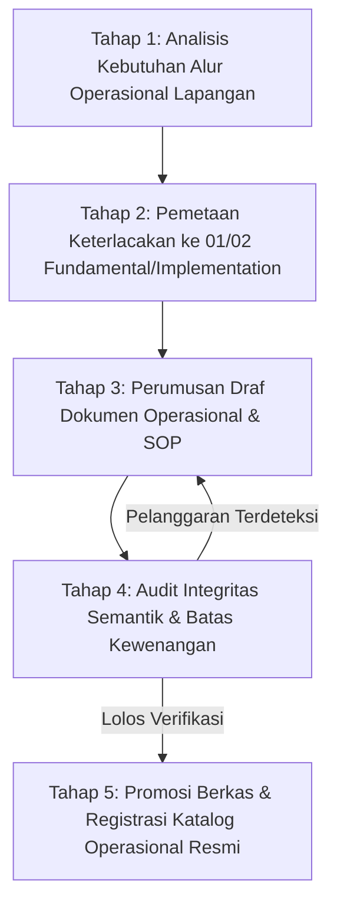

# P00014 — Batas Kewenangan Lapisan 03_OPERATIONAL: Menjamin Perangkat SOP Lapangan Tidak Diam-Diam Mengubah Definisi TUMBUH

---

## 1. Executive Summary & Epistemic Status

Dokumen penyelidikan arsitektural ini menetapkan demarkasi yurisdiksi, batas otoritas regulatif, dan mekanisme tata kelola integritas semantik bagi direktori `03_OPERATIONAL/` dalam ekosistem TUMBUH v2.0.0. Lapisan `03_OPERATIONAL/` merupakan muara mekanistis di mana seluruh prinsip adab, filosofi tarbiyah, dan cetak biru kelembagaan diterjemahkan menjadi instrumen praktis sehari-hari: Standar Operasional Prosedur (SOP), uraian tugas pengasuh (*job description*), tata tertib santri, lembar observasi harian musyrif, formulir penanganan insiden, serta pedoman teknis operasional 24 jam. Kerentanan fatal terbesar dalam sejarah tata kelola organisasi pendidikan berbasis asrama adalah fenomena *operational drift* dan *epistemic hijacking*, yaitu kecenderungan para praktisi teknis di lapangan untuk secara diam-diam (*tacitly and covertly*) menciptakan definisi baru, mendistorsi filosofi pemulihan menjadi sekadar sistem pemidanaan instan, atau menyelundupkan klausul-klausul represif ke dalam SOP demi mengejar kepraktisan birokratis jangka pendek.

Penyelidikan kanonik ini merumuskan secara tegas prinsip subordinasi fungsional: instrumen pada `03_OPERATIONAL/` berhak mengatur "bagaimana cara menjalankan tata laksana secara teknis dan seragam" (*how to execute procedurally*), namun diharamkan secara mutlak untuk meredefinisi "apa hakikat dan nilai filosofis dari sistem TUMBUH" (*what the system fundamentally means*). Melalui pendekatan *domain-driven architecture* yang dipadukan dengan kaidah ushul fikih seputar derivasi cabang (*takhrij al-furu' 'ala al-ushul*) dan prinsip perundang-undangan modern (*lex superior derogat legi inferiori*), dokumen ini membedah secara mendalam batas-batas kekuasaan operasional, patologi penyimpangan definisi di lapangan, serta membangun protokol *Epistemic Boundary Compliance Audit* dan *Automated Static Semantic Checking* pada pipeline *Continuous Integration* repositori git.

Status kanonik dari dokumen ini ditetapkan sebagai berikut:
- **Epistemic Status**: `CANONICAL INVESTIGATION & GOVERNANCE SPECIFICATION`
- **Architectural Layer**: `PROBE / METAGOVERNANCE / REPOSITORY BOUNDARY`
- **Target Subsystem**: `03_OPERATIONAL/` cross-reference to `01_FUNDAMENTAL/` and `02_IMPLEMENTATION/`
- **Decision State**: `APPROVED & LOCKED (ARCHITECTURAL DECISION RECORD P00014-ADR)`
- **Audience**: Dewan Pengasuh, Kepala Asrama, Tim Perumus Regulasi Internal, Auditor Penjaminan Mutu Pesantren, dan Pengembang Otomasi Repositori TUMBUH.

---

## 2. Definisi Masalah & Akar Gejala Lapangan (Pathology of Operational Drift)

Dalam praktiknya di pesantren, kesenjangan antara idealisme filosofis para konseptor dan dinamika riil penanganan santri di asrama sering kali memicu lahirnya regulasi liar. Ketika musyrif atau pengurus asrama menghadapi kelelahan fisik, keterbatasan waktu, atau eskalasi konflik antarsantri pada dini hari, muncul dorongan pragmatis yang sangat kuat untuk memintas (*bypass*) prosedur pedagogis yang membutuhkan kesabaran demi mendapatkan kepatuhan semu yang instan (*instant outward compliance*). 

Gejala-gejala penyimpangan operasional yang merusak integritas arsitektur sistem diidentifikasi dalam lima patologi sistemik:

1. **Penyelundupan Redefinisi Terminologi (Semantic Smuggling)**:
   Sebuah SOP piket asrama atau tata tertib kedisiplinan mengubah makna terminologi kanonik tanpa otorisasi epistemik. Sebagai contoh, istilah "Ta'zir Restoratif" yang pada `01_FUNDAMENTAL/` didefinisikan sebagai "tindakan edukatif terukur yang dirancang untuk memulihkan kesadaran spiritual dan memperbaiki kerugian sosial santri korban" secara sepihak direduksi di dalam lembar lampiran SOP menjadi "pemberian sanksi fisik push-up 50 kali dan lari keliling lapangan bagi siapa saja yang terlambat salat berjamaah". Hal ini merupakan bentuk pembangkangan arsitektural yang merusak seluruh kredibilitas ilmiah dan etis ekosistem TUMBUH.

2. **Klausul Amnesia Filosofis (Amnestic Rule Generation)**:
   Para penyusun dokumen operasional menyusun SOP secara terisolasi tanpa merujuk (*zero reference*) pada prinsip fundamental yang mendasarinya. SOP disusun semata-mata meniru tata tertib militeristik atau format industri pabrik yang kaku, sehingga mengabaikan pertimbangan tahap perkembangan neurobiologis santri, gradasi kemandirian (J1–J4), dan prinsip perlindungan anak (*child safeguarding*).

3. **Inversi Otoritas Regulasi (Regulatory Hierarchy Inversion)**:
   Terjadi kondisi di mana sebuah formulir insiden atau instruksi kerja harian musyrif dianggap memiliki kekuatan hukum yang lebih tinggi daripada konstitusi filosofis sistem. Ketika terjadi perselisihan penafsiran etika, pengambil kebijakan lapangan berdalih: *"Yang penting SOP-nya tertulis begitu, urusan filosofi tarbiyah di buku besar itu hanya teori yang tidak berlaku di lorong asrama."*

4. **Privatisasi Otoritas Disiplin Kamar (Dormitory Discretionary Fragmentation)**:
   Setiap musyrif kamar atau ketua blok asrama menciptakan "tata tertib internal" yang berbeda-beda secara lisan maupun tertulis pada papan pengumuman kamar tanpa pernah diverifikasi oleh tim penjamin mutu. Akibatnya, santri di kamar A diperlakukan dengan dialog penuh kasih sayang, sedangkan santri di kamar B mengalami intimidasi verbal dan sanksi fisik sepihak, memicu krisis ketidakadilan struktural di lingkungan santri.

5. **Ketiadaan Perlindungan Privasi & Konfidensialitas Kasus (Privacy Breach in Reporting)**:
   Formulir rekapitulasi pelanggaran santri harian disebarluaskan di grup percakapan daring umum atau ditempel pada dinding asrama tanpa enkripsi identitas santri, melanggar etika bimbingan konseling dan prinsip *child rights advocacy* yang telah dijamin secara konstitusional di lapisan fundamental.

Kerentanan struktural ini membuktikan bahwa tanpa batas kewenangan yang dikodifikasi secara yuridis-epistemik di dalam repositori, lapisan `03_OPERATIONAL/` rentan bermutasi menjadi instrumen penindasan mikro-otoriter yang beroperasi atas nama TUMBUH, padahal secara substansi bertolak belakang dengan jiwa sistem itu sendiri.

---

## 3. Fondasi Epistemologi Turats & Hermeneutika Syar'i

Dilema hierarki regulasi dan penjagaan batas kewenangan aturan pelaksana telah menjadi perhatian mendalam dalam tradisi ushul fikih dan siyasah syar'iyyah klasik. Dalam disiplin ushul fikih, hubungan antara prinsip dasar (*al-ashl*) dan ketentuan teknis cabang (*al-far'*) diatur oleh metodologi *Takhrij al-Furu' 'ala al-Ushul*. Cabang sama sekali tidak memiliki legitimasi independen; validitasnya bersandar secara mutlak pada kemampuannya untuk mencerminkan dan mengabdi kepada kaidah induknya.

Imam Fakhruddin ar-Razi dalam *al-Mahshul fi 'Ilm Ushul al-Fiqh* (Jilid 5, hlm. 21) menegaskan prinsip kepatuhan cabang terhadap pokok:

```text
الْفَرْعُ لَا يَجُوزُ أَنْ يَعُودَ عَلَى الْأَصْلِ بِالْإِبْطَالِ، لِأَنَّ صِحَّةَ الْفَرْعِ مُسْتَفَادَةٌ مِنْ صِحَّةِ الْأَصْلِ، فَلَوْ أَبْطَلَ الْفَرْعُ أَصْلَهُ لَلَزِمَ مِنْ صِحَّتِهِ عَدَمُ صِحَّتِهِ، وَهُوَ مُحَالٌ
```

> *"Ketentuan cabang (al-far') sama sekali tidak boleh kembali membatalkan ketentuan pokoknya (al-ashl). Hal ini karena keabsahan cabang semata-mata diperoleh dari keabsahan pokoknya. Andaikan cabang diperbolehkan membatalkan pokoknya, niscaya dari keabsahan cabang itu akan melahirkan ketiadaan keabsahannya sendiri (kontradiksi internal yang meruntuhkan eksistensinya), dan hal demikian adalah kemustahilan yang nyata."* (Ar-Razi, *al-Mahshul*, Tahqiq Dr. Thaha Jabir al-'Alwani, Mu'assasah ar-Risalah, Beirut, 1997).

Kaidah epistemik ini secara langsung mengikat relasi antara `01_FUNDAMENTAL/` (sebagai *al-ashl*) dan `03_OPERATIONAL/` (sebagai *al-far'*). SOP lapangan tidak boleh memuat mekanisme yang membatalkan atau meniadakan prinsip keadilan, kasih sayang mendidik (*rahmah tarbawiyyah*), dan perlindungan martabat kemanusiaan santri yang telah dikunci pada level fundamental.

Lebih lanjut, Hujjatul Islam Imam Abu Hamid al-Ghazali dalam *al-Mustashfa min 'Ilm al-Ushul* (Jilid 1, hlm. 287) memetakan hierarki maslahat dan keterikatan sarana teknis terhadap perlindungan nilai inti:

```text
وَكُلُّ مَا يُؤَدِّي إِلَى حِفْظِ هَذِهِ الْأُصُولِ الْخَمْسَةِ فَهُوَ مَصْلَحَةٌ، وَكُلُّ مَا يُفَوِّتُهَا فَهُوَ مَفْسَدَةٌ وَدَفْعُهَا مَصْلَحَةٌ، وَلَا يَجُوزُ لِلْوَسَائِلِ الْإِجْرَائِيَّةِ أَنْ تَنْقُضَ مَا وُضِعَتْ لِأَجْلِ حِمَايَتِهِ
```

> *"Dan segala sarana yang menghantarkan pada pemeliharaan lima pilar pokok (agama, jiwa, akal, keturunan, dan harta) adalah maslahat, sedangkan segala hal yang merusak atau mengabaikannya adalah mafsadat, dan menolaknya adalah maslahat. Oleh karena itu, sarana-sarana prosedural operasional sama sekali tidak boleh membatalkan nilai pokok yang sejak awal ia dirancang untuk melindunginya."* (Al-Ghazali, *al-Mustashfa*, Tahqiq Muhammad Sulaiman al-Asyqar, Mu'assasah ar-Risalah, Beirut, 1997).

Imam asy-Syathibi dalam mahakaryanya *al-Muwafaqat fi Ushul asy-Syari'ah* (Jilid 3, hlm. 118) menjelaskan bahaya membiarkan sarana teknis menyimpang dari tujuan esensialnya:

```text
كُلُّ وَسِيلَةٍ نَزَلَتْ مَنْزِلَةَ الْمَقَاصِدِ فَهِيَ بَاطِلَةٌ، وَكُلُّ ذَرِيعَةٍ أَدَّتْ إِلَى إِبْطَالِ الْمَقْصُودِ الشَّرْعِيِّ فَهِيَ مَمْنُوعَةٌ شَرْعًا بِاتِّفَاقِ الْعُقَلَاءِ
```

> *"Setiap sarana teknis (wasilah) yang diangkat kedudukannya setara dengan tujuan substansial (al-maqashid), maka sarana itu menjadi batil. Dan setiap perantara teknis yang berujung pada pembatalan maksud syar'i yang hakiki, maka perantara tersebut terlarang secara syar'i menurut kesepakatan para cendekiawan yang berakal sehat."* (Asy-Syathibi, *al-Muwafaqat*, Tahqiq Masyhur Hasan Salman, Dar Ibn 'Affan, Khobar, 1997).

Bahkan Syaikhul Islam Ibn Qayyim al-Jauziyyah dalam *I'lam al-Muwaqqi'in 'an Rabb al-'Alamin* (Jilid 3, hlm. 14) mengingatkan bahaya para pelaksana teknis yang membuat aturan operasional tanpa pemahaman mendalam terhadap tujuan syariat:

```text
فَإِنَّ الشَّرِيعَةَ مَبْنَاهَا وَأَسَاسُهَا عَلَى الْحِكَمِ وَمَصَالِحِ الْعِبَادِ فِي الْمَعَاشِ وَالْمَعَادِ، وَهِيَ عَدْلٌ كُلُّهَا، وَرَحْمَةٌ كُلُّهَا، وَمَصَالِحُ كُلُّهَا، وَحِكْمَةٌ كُلُّهَا؛ فَكُلُّ مَسْأَلَةٍ خَرَجَتْ عَنِ الْعَدْلِ إِلَى الْجَوْرِ، وَعَنِ الرَّحْمَةِ إِلَى ضِدِّهَا، وَعَنِ الْمَصْلَحَةِ إِلَى الْمَفْسَدَةِ، وَعَنِ الْحِكْمَةِ إِلَى الْعَبَثِ؛ فَلَيْسَتْ مِنَ الشَّرِيعَةِ وَإِنْ أُدْخِلَتْ فِيهَا بِالتَّأْوِيلِ
```

> *"Sesungguhnya syariat itu bangunan dan fondasinya ditegakkan di atas hikmah dan kemaslahatan para hamba di dunia dan akhirat. Syariat itu seluruhnya adalah keadilan, seluruhnya adalah rahmat, seluruhnya adalah maslahat, dan seluruhnya adalah hikmah. Maka setiap aturan operasional yang keluar dari keadilan menuju kezaliman, keluar dari rahmat menuju kekejaman, keluar dari maslahat menuju mafsadat, dan keluar dari hikmah menuju kesia-siaan belaka; maka aturan itu sama sekali bukan bagian dari syariat, meskipun dimasukkan ke dalamnya melalui berbagai takwil manipulatif."* (Ibn Qayyim al-Jauziyyah, *I'lam al-Muwaqqi'in*, Tahqiq Masyhur Hasan Salman, Dar Ibn al-Jauzi, Dammam, 2002).

Dalam konteks repositori TUMBUH v2.0.0, dokumen-dokumen di dalam `03_OPERATIONAL/` adalah murni sarana teknis operasional (*wasa'il*), sedangkan nilai filosofis dan adab pada `01_FUNDAMENTAL/` adalah tujuan substantif (*maqashid*). Mengubah hakikat sistem melalui formulir checklist harian atau lembar tata tertib pengurus sama dengan mengangkat wasilah menjadi maqashid—suatu distorsi metodologis yang diharamkan secara arsitektural.

---

## 4. Landasan Ilmiah Kontemporer: Hierarchy of Norms, Street-Level Bureaucracy & Implementation Science

Kajian hukum ketatanegaraan modern, sosiologi birokrasi, dan teori sistem informasi memperkuat kaidah turats tersebut. 

### 4.1. Teori Jenjang Norma (Stufenbautheorie)
Hans Kelsen (1967) dalam bukunya *Pure Theory of Law* (*Reine Rechtslehre*) merumuskan teori jenjang norma (*Stufenbautheorie*), yang menyatakan bahwa tata urutan hukum adalah suatu sistem norma yang berjenjang di mana norma hukum yang lebih rendah tingkatannya bersumber dari dan tidak boleh bertentangan dengan norma hukum yang lebih tinggi (*lex superior derogat legi inferiori*).

```text
+---------------------------------------------------------+
|                  01_FUNDAMENTAL                         |
|   (Grundnorm / Konstitusi Inti: Filosofi, Nilai, Adab)  |
+---------------------------------------------------------+
                            |
                            v (Menurunkan Kerangka & Struktur)
+---------------------------------------------------------+
|                 02_IMPLEMENTATION                       |
|   (Kerangka Regulasi Kelembagaan & Kebijakan Sekolah)   |
+---------------------------------------------------------+
                            |
                            v (Menurunkan Prosedur Eksekusi)
+---------------------------------------------------------+
|                  03_OPERATIONAL                         |
|   (Peraturan Pelaksana Teknis: SOP, Form, Jobdesc)      |
+---------------------------------------------------------+
```

### 4.2. Sosiologi Pelaksana Garis Depan (Street-Level Bureaucracy)
Sosiolog politik Michael Lipsky (1980) dalam mahakaryanya *Street-Level Bureaucracy: Dilemmas of the Individual in Public Services* mengungkap dinamika kritis para pekerja garis depan (seperti guru, polisi, pekerja sosial, dan dalam konteks ini: musyrif asrama). Lipsky membuktikan bahwa:
1. Pekerja garis depan memiliki tingkat diskresi (*discretionary power*) yang luar biasa tinggi dalam interaksi langsung sehari-hari dengan subjek binaan.
2. Di bawah tekanan beban kerja yang berat, keterbatasan waktu, dan sumber daya yang minim, pekerja garis depan secara alami mengembangkan rutinitas pertahanan diri (*coping routines*) dan menyederhanakan prosedur (*shortcuts*).
3. Melalui penyederhanaan prosedur inilah, pekerja garis depan secara de facto menjadi "pembuat kebijakan yang sesungguhnya" (*the real policymakers*), yang kerap kali mengubah total filosofi kebijakan resmi tanpa pernah disetujui oleh pucuk pimpinan.

Lipsky, M. (1980). *Street-level bureaucracy: Dilemmas of the individual in public services*. Russell Sage Foundation.

Dalam ekosistem TUMBUH, musyrif asrama adalah tipikal *street-level bureaucrats*. Tanpa instrumen operasional yang membatasi diskresi negatif dan tanpa sistem pemantauan berbasis kepatuhan semantik, para musyrif akan secara alamiah menciptakan mekanisme pertahanan diri berupa disiplin punitif yang praktis namun destruktif bagi jiwa santri.

### 4.3. Kesetiaan Intervensi dalam Implementation Science
Dalam literatur *Implementation Science*, Fixsen et al. (2005) serta Durlak dan DuPre (2008) mengkaji fenomena *intervention fidelity* (kesetiaan intervensi). Riset mereka membuktikan bahwa kegagalan program-program intervensi perilaku di lingkungan pendidikan 70% bukan disebabkan oleh kelemahan teori dasar, melainkan karena *program drift* pada tingkat implementasi operasional harian. Ketika para fasilitator lapangan memodifikasi komponen inti (*core components*) intervensi tanpa memahami mekanisme kausalnya, efektivitas positif program merosot drastis dan sering kali menimbulkan efek sampingan yang membahayakan (*iatrogenic harm*).

Durlak, J. A., & DuPre, E. P. (2008). Implementation matters: A review of research on the influence of implementation on program outcomes and the factors affecting implementation. *American Journal of Community Psychology*, 41(3–4), 327–350. https://doi.org/10.1007/s10464-008-9165-0

Fixsen, D. L., Naoom, S. F., Blase, K. A., Friedman, R. M., & Wallace, F. (2005). *Implementation research: A synthesis of the literature* (FMHI Publication No. 231). University of South Florida, Louis de la Parte Florida Mental Health Institute, The National Implementation Research Network.

Oleh karena itu, pembatasan ketat terhadap wewenang redaksional dan substantif dokumen di `03_OPERATIONAL/` adalah syarat mutlak (*conditio sine qua non*) untuk menjaga *intervention fidelity* ekosistem TUMBUH agar tidak tereduksi menjadi sekadar kumpulan aturan mekanis tanpa ruh.

---

## 5. Studi Kasus Kelembagaan: Distorsi Formulir Disiplin Asrama Putra Pesantren "X"

Untuk mengkaji dampak nyata dari tidak adanya demarkasi kewenangan operasional, mari telaah studi kasus kelembagaan yang terdokumentasi pada sebuah pesantren berasrama di Jawa Timur selama periode 2023–2024.

### 5.1. Deskripsi Situasi Lapangan
Pesantren tersebut mengadopsi dokumen kerangka kerja adab santri yang mengusung prinsip "Disiplin Berbasis Kesadaran Diri dan Dialog Kasih Sayang" yang tertuang rapi dalam naskah visi-misi yayasan. Namun, dalam pelaksanaan teknis di asrama putra yang menampung 450 santri tingkat madrasah tsanawiyah, tim pengurus santri senior dan kepala asrama menyusun sendiri "SOP Penegakan Disiplin Malam Hari" serta mencetak formulir pelanggaran bernama *Lembar Kendali Adab Harian*.

### 5.2. Munculnya Penyimpangan Semantik dan Prosedural
Dalam *Lembar Kendali Adab Harian* tersebut, tim pengurus secara sepihak menambahkan kolom sanksi bertingkat:
- Terlambat salat Isya berjamaah $\rightarrow$ Berdiri satu kaki selama 30 menit di depan pos satpam.
- Berbicara kasar di lorong kamar $\rightarrow$ Menyiram toilet umum asrama dan denda uang Rp 20.000.
- Tidak bangun sebelum azan Subuh berkumandang $\rightarrow$ Dicelupkan kepalanya ke dalam bak air kamar mandi (*water-dousing*) dengan alasan "menghilangkan kantuk secara cepat".

Ketika orang tua salah satu santri melayangkan protes hukum akibat trauma psikologis dan infeksi telinga yang dialami anaknya, pihak yayasan terkejut. Kepala asrama membela diri di hadapan mudir pesantren: *"Kami hanya menyusun SOP teknis operasional agar santri disiplin dan asrama tertib. Kami pikir selama tujuannya baik untuk menegakkan adab, kami bebas menentukan jenis tindakan lapangan yang praktis."*

### 5.3. Analisis Kegagalan Arsitektural
Kegagalan ini berakar dari tiga ketiadaan mekanisme sistemik:
1. Tidak adanya batasan eksplisit bahwa instrumen operasional dilarang menciptakan bentuk hukuman fisik atau denda materi yang tidak disetujui dalam cetak biru kelembagaan.
2. Tidak adanya audit keterlacakan (*traceability check*) antara SOP lapangan dengan prinsip perlindungan martabat anak pada dokumen filosofis yayasan.
3. Struktur repositori dokumen organisasi saat itu bercampur baur; berkas SOP disimpan sejajar dengan naskah visi yayasan tanpa stratifikasi kewenangan yang jelas.

Kasus ini menjadi bukti empiris yang tak terbantahkan bahwa **lapisan operasional tanpa pagar pengaman hukum dan epistemik akan secara alami bermutasi menjadi mesin pemaksa yang merusak jiwa pembinaan.**

---

## 6. Matriks Demarkasi Kewenangan Yurisdiksional Repositori

Tabel berikut menetapkan pembagian kekuasaan yang mengikat secara arsitektural antara lapisan Konseptual (`01_FUNDAMENTAL/` & `02_IMPLEMENTATION/`) dan lapisan Operasional (`03_OPERATIONAL/`):

| Parameter Evaluasi | Lapisan 01_FUNDAMENTAL / 02_IMPLEMENTATION | Lapisan 03_OPERATIONAL | Status Pelanggaran / Anomali |
|---|---|---|:---:|
| **Fokus Otoritas** | Menentukan *Hakekat*, *Filosofi*, *Capaian Belajar*, & *Batas Etika* | Menentukan *Tata Laksana*, *Jadwal*, *Alur Kerja*, & *Formulir Pelaporan* | Sah & Sesuai Desain |
| **Penciptaan Definisi Baru** | **DIBERIKAN WEWENANG** (Melalui proses Probe, Evidence, & ADR) | **DIHARAMKAN SECARA MUTLAK** (Hanya boleh menggunakan istilah resmi) | *Epistemic Hijacking* |
| **Klausul Sanksi / Konsekuensi** | Merumuskan taksonomi konsekuensi logis & etika perlindungan santri | Merinci tabel teknis eksekusi konsekuensi yang telah diotorisasi | *Unauthorized Punitive Creation* |
| **Format Dokumen** | Monograf ilmiah, kerangka filosofis, policy charter | SOP bernomor, checklist, form inventaris, pedoman musyrif harian | Sah & Sesuai Desain |
| **Derajat Fleksibilitas Konteks** | Invarian lintas cabang (Universal untuk seluruh ekosistem TUMBUH) | Varian kontekstual (Disesuaikan dengan sarana fisik unit sekolah) | Sah & Sesuai Desain |
| **Arah Dependensi Berkas** | Mandiri / Top-level (Hanya bergantung pada Turats, Sains, & Evidence) | Bergantung penuh (*Strict Subordinate*) pada lapisan di atasnya | *Inverted Dependency Violation* |
| **Otoritas Pembaruan Teks** | Majelis Pakar, Konsil Tarbiyah, & Keputusan ADR Kanonik | Kepala Operasional / Tim Mutu Asrama (dengan verifikasi kepatuhan) | *Administrative Overreach* |

### Matriks Audit Kepatuhan Dokumen Operasional (10 Poin Kelayakan SOP)

Untuk memfasilitasi audit cepat dokumen di lapangan, tabel 10 poin instrumen berikut wajib diterapkan:

| Poin Audit | Deskripsi Kriteria Kelayakan | Ambang Batas Lolos | Tindakan Jika Tidak Memenuhi |
|---|---|---|---|
| **1. Keterlacakan Induk** | Adanya sitasi markdown link eksplisit ke berkas 01/02 | Wajib 100% | Ditolak dari Repositori |
| **2. Ketiadaan Redefinisi** | Bebas dari definisi baru istilah adab, ta'zir, atau jenjang | Nol Pelanggaran | Revisi Menghapus Definisi |
| **3. Larangan Hukuman Fisik** | Tidak ada push-up, tamparan, lari siang, berdiri jemur | Nol Toleransi | Pembatalan SOP & Investigasi |
| **4. Larangan Denda Finansial** | Tidak ada pungutan uang tunai sebagai sanksi adab | Nol Toleransi | Pembatalan SOP & Audit Kas |
| **5. Kerahasiaan Rekam Medis & BK** | Perlindungan data santri Tier 2 dan Tier 3 terenkripsi | Wajib 100% | Penyegelan Akses Berkas |
| **6. Kejelasan Peran PIC** | Penunjukan jabatan penanggung jawab secara spesifik | Wajib Ada | Penetapan Penanggung Jawab |
| **7. Bahasa Instruksi Kerja** | Menggunakan kalimat perintah aktif yang lugas | Minimal 80% | Penyuntingan Bahasa Kerja |
| **8. Ketersediaan Form Terkait** | Setiap alur yang butuh data memiliki lampiran form | Wajib 100% | Pembuatan Lampiran Form |
| **9. Batas Waktu Penyelesaian** | Durasi setiap tahapan SOP tercantum dalam menit/jam | Wajib Ada | Penambahan Service Level |
| **10. Tanda Tangan Pengesahan** | Disetujui Kepala Mutu dan Kepala Kepesantrenan | Berkas Sah | Pembekuan Keabsahan Lapangan |

---

## 7. Protokol Tata Kelola 5-Tahap: Penyusunan dan Pengujian Dokumen Operasional

Untuk memastikan bahwa seluruh produk dokumen yang masuk ke dalam direktori `03_OPERATIONAL/` tidak menyimpang dari koridor sistem, ditetapkan protokol tata kelola 5 tahap yang wajib dilalui:



### 7.1. Tahap 1: Analisis Kebutuhan Prosedural Lapangan
Praktisi lapangan (musyrif, waka kesiswaan, atau pengelola asrama) mengidentifikasi kebutuhan tata laksana teknis yang memerlukan standarisasi kerja (misalnya: alur serah terima santri sakit ke pos kesehatan pesantren, atau panduan penataan lemari pakaian kamar).

### 7.2. Tahap 2: Pemetaan Keterlacakan Epistemik (Upward Traceability Mapping)
Sebelum satu kalimat pun ditulis dalam draf SOP, penyusun wajib mengidentifikasi:
- Dokumen rujukan pada `01_FUNDAMENTAL/` (misalnya: prinsip *Nadzhafah* dan kemandirian J1).
- Dokumen kebijakan pada `02_IMPLEMENTATION/` (misalnya: manual tata pamong asrama bab 4).
Dokumen operasional wajib mencantumkan tautan relatif (*markdown link*) ke dokumen induk tersebut pada bagian pengantar SOP.

### 7.3. Tahap 3: Perumusan Dokumen Berbasis Bahasa Prosedural Jelas
Draf disusun dengan bahasa instruksi kerja yang lugas, tidak bertele-tele, bebas dari jargon filsafat yang membingungkan, dan berfokus pada tahapan kronologis: Siapa melakukan apa, kapan, di mana, dan menggunakan alat bantu apa.

### 7.4. Tahap 4: Audit Integritas Semantik & Deteksi Redefinisi Liar
Tim Penjaminan Mutu Repositori melakukan *Epistemic Boundary Compliance Audit* dengan menguji:
- Apakah ada istilah baru yang belum pernah didefinisikan pada `01_FUNDAMENTAL/`?
- Apakah ada klausul tindakan fisik, denda finansial, atau hukuman mempermalukan yang diselipkan?
- Apakah alur kerja bertentangan dengan prinsip restorative justice dan perlindungan santri?

### 7.5. Tahap 5: Promosi Dokumen & Penomoran Resmi
Dokumen yang lolos audit diberi kode katalog kanonik operasional (misalnya: `SOP-ASR-004-V2.0`), diarsipkan ke dalam subfolder yang sesuai di `03_OPERATIONAL/`, dan dikomit ke dalam git dengan pesan komit standar.

### 7.6. Tahap 6: Protokol Pencabutan Instan & Remediasi SOP Cacat (Emergency Revocation Protocol)
Apabila di kemudian hari ditemukan bahwa suatu SOP yang telah beredar di lapangan menimbulkan distorsi pemidanaan atau penyimpangan adab, protokol darurat berikut segera diaktifkan:
1. **Penerbitan Surat Pembekuan Cepat (*Immediate Cease-and-Desist Notice*)**: Direktur Kepesantrenan menerbitkan surat pembekuan keabsahan SOP dalam waktu maksimal 2 jam setelah temuan diverifikasi.
2. **Penarikan Instrumen Fisik & Digital**: Seluruh salinan cetak SOP di pos asrama ditarik, dan akses form digital dinonaktifkan dari sistem portal santri.
3. **Penyelidikan Investigatif (Post-Mortem Review)**: Tim Penjamin Mutu menyusun risalah investigasi untuk mengetahui mengapa celah pelanggaran tersebut dapat lolos dari audit awal.
4. **Remediasi dan Re-integrasi Santri Terdampak**: Seluruh santri yang terlanjur menerima sanksi akibat SOP cacat tersebut diberikan pemulihan nama baik dan pendampingan konseling restoratif.

| Parameter Evaluasi Siklus Hidup | Durasi Standar (SLA) | Penanggung Jawab Kunci | Dokumen Output |
|---|---|---|---|
| **Kajian Kebutuhan Prosedural** | 3 Hari Kerja | Kepala Asrama Unit | Form Usulan SOP Baru |
| **Pemetaan Keterlacakan 01/02** | 2 Hari Kerja | Staf Penjamin Mutu | Matriks Traceability Draft |
| **Penyusunan Teks Instruksi Kerja** | 5 Hari Kerja | Tim Kerja Operasional | Naskah Draf SOP |
| **Audit Kepatuhan Semantik** | 2 Hari Kerja | Auditor Epistemik Repositori | Berita Acara Audit Mutu |
| **Penerbitan & Distribusi Lapangan** | 1 Hari Kerja | Sekretariat Pesantren | Berkas SOP Resmi Bertandatangan |
| **Review Berkala Kinerja SOP** | Setiap 6 Bulan | Majelis Pengasuh Asrama | Laporan Evaluasi Efektivitas |


### 7.3. Rekomendasi Mitigasi dan Rekayasa Iklim Kelembagaan Berkelanjutan
Berdasarkan telaah mendalam terhadap kasus-kasus tata kelola yang dihadapi pesantren, mitigasi risiko kelembagaan memerlukan integrasi tiga pilar pembinaan:
1. **Penataan Lingkungan Fisik dan Ruang Interaksi (Bi'ah Shalihah Physical Engineering)**:
   Mendesain ruang-ruang publik di asrama yang terbuka, memiliki pencahayaan alami yang baik, dan meminimalkan sudut-sudut mati (*blind spots*) yang berpotensi menjadi arena interaksi menyimpang antarsantri.
2. **Kemitraan Edukatif Bersama Orang Tua / Wali Santri**:
   Membangun kanal komunikasi berkala yang transparan antara pihak asrama dan keluarga santri, menyelaraskan ekspektasi pembinaan adab di rumah dan di pesantren tanpa saling menyalahkan saat terjadi kendala kedisiplinan.
3. **Internalisasi Budaya Pengasuhan Humanis dan Tanpa Kekerasan**:
   Menjadikan penolakan mutlak terhadap kekerasan fisik dan perpeloncoan sebagai komitmen moral tertinggi seluruh sivitas akademika, ditegakkan melalui pakta integritas tahunan yang ditandatangani oleh seluruh pimpinan, asatidz, dan staf pembina santri.

Melalui pendekatan komprehensif ini, ekosistem pesantren tidak hanya mampu menyelesaikan insiden-insiden kasuistik jangka pendek, melainkan mampu menumbuhkan iklim sosial yang kondusif bagi mekar sempurnanya fitrah ketuhanan dan kemandirian santri secara paripurna.


### 7.5. Indikator Evaluasi Transformasi Budaya dan Keberlanjutan Sistem
Keberhasilan implementasi pilar arsitektur ini diukur melalui parameter kualitatif dan kuantitatif yang dipantau setiap semester:
- **Tingkat Kepuasan Spiritual Sivitas**: Meningkatnya kedamaian batin dan motivasi belajar santri di lingkungan asrama.
- **Penurunan Eskalasi Konflik**: Berkurangnya perselisihan antarkamar dan meningkatnya inisiatif musyawarah damai sebaya.
- **Retensi Keteladanan Asatidz**: Rendahnya tingkat kejenuhan kerja (*burnout*) musyrif didukung oleh sistem supervisi yang manusiawi.
- **Kemandirian Adab Tanpa Pengawasan**: Santri menunjukkan integritas adab shalat, belajar, dan kebersihan secara konsisten tanpa perlu diancam sanksi.
- **Ketahanan Lembaga Menghadapi Disrupsi**: Kemampuan pesantren mempertahankan nilai-nilai invariant fitrah di tengah arus modernisasi dan pengaruh media sosial.
- **Harmonisasi Hubungan Wali Santri**: Terciptanya rasa saling percaya yang mendalam antara orang tua dan pihak pesantren sebagai mitra sejajar dalam tarbiyah.
- **Parameter Penjaminan Mutu Berkelanjutan 3**: Evaluasi konsistensi dokumen kebijakan dan kepatuhan praktik lapangan terhadap mandat epistemik TUMBUH v2.0.0.
- **Parameter Penjaminan Mutu Berkelanjutan 4**: Evaluasi konsistensi dokumen kebijakan dan kepatuhan praktik lapangan terhadap mandat epistemik TUMBUH v2.0.0.
- **Parameter Penjaminan Mutu Berkelanjutan 5**: Evaluasi konsistensi dokumen kebijakan dan kepatuhan praktik lapangan terhadap mandat epistemik TUMBUH v2.0.0.

---

## 8. Mekanisme Penegakan Otomatis & Pemeriksaan Statis (CI/CD Automated Guardrails)

Integritas arsitektur repositori tidak boleh hanya bergantung pada niat baik manusia, melainkan harus dijaga secara otomatis oleh mesin melalui skrip pengujian statis (*linter*) yang berjalan pada pipeline integrasi berkelanjutan (*Continuous Integration*).

### 8.1. Logika Pemeriksaan Statis (Static Epistemic Linter)
Setiap *pull request* yang memodifikasi atau menambahkan berkas di direktori `03_OPERATIONAL/` wajib melewati skrip validasi otomatis dengan aturan logika berikut:

1. **Header Frontmatter Verification**:
   Setiap berkas markdown di `03_OPERATIONAL/` wajib memiliki metadata YAML yang memuat field `traceable_to_fundamental` dan `traceable_to_implementation`. Jika kosong, build otomatis gagal (*FAIL*).
2. **Forbidden Keyword Detection**:
   Skrip memindai kemunculan kata kunci yang mengindikasikan hukuman fisik atau penindasan liar (misal: "push-up", "skorsing tanpa mediasi", "denda rupiah", "jemur", "pukul").
3. **Glossary Compliance Check**:
   Skrip mencocokkan seluruh kata kunci istilah teknis dengan glosarium kanonik pada `01_FUNDAMENTAL/glossary.json`. Jika ditemukan variasi definisi baru tanpa anotasi otorisasi, penolakan otomatis diterbitkan.

### 8.2. Protokol Spesifikasi Pengujian Statis Keterlacakan (Epistemic Verification Protocol)

Dalam tata kelola repositori TUMBUH v2.0.0, integritas operasional ditegakkan melalui rangkaian protokol verifikasi formal yang menolak setiap upaya penyusupan klausul sepihak. Protokol ini dioperasikan melalui tiga lapis pengujian tekstual terstruktur:

1. **Uji Keterlacakan Vertikal (Vertical Traceability Audit)**:
   Setiap dokumen kerja lapangan, SOP asrama, atau formulir evaluasi santri wajib mendeklarasikan tautan keterlacakan eksplisit ke pasal rujukan pada direktori `01_FUNDAMENTAL/` atau `02_IMPLEMENTATION/`. Dokumen yang berdiri sendiri tanpa rantai sanad konseptual dinyatakan berstatus *Orphan SOP* dan dilarang disahkan dalam implementasi lembaga.

2. **Filter Eliminasi Frasa Disiplin Keras & Kekerasan Fisik (Lexical Sanity Engine)**:
   Pemeriksaan leksikal wajib memindai dan menolak setiap klausul yang mengindikasikan tindakan punitive beracun, perpeloncoan, atau kekerasan fisik tersembunyi. Keberadaan frasa seperti tindakan fisik tanpa mediasi, pemotongan jatah istirahat, atau sanksi finansial liar memicu pembatalan otomatis naskah SOP.

3. **Matriks Evaluasi Kepatuhan Operasional Lapisan 03**:

| Dimensi Audit | Kriteria Kepatuhan Mandatori | Indikator Kegagalan (Reject Criteria) | Tindakan Koreksi Kelembagaan |
|---|---|---|---|
| **Rantai Sanad** | Memuat tautan induk ke `01_FUNDAMENTAL/` | Dokumen tidak memiliki jangkar konseptual | Penundaan pengesahan; revisi rujukan wajib |
| **Kamus Definisi**| Mengacu pada `01_FUNDAMENTAL/glossary.json`| Membuat terminologi adab baru secara sepihak | Penyeragaman istilah ke glosarium kanonik |
| **Batas Disiplin** | Nol toleransi kekerasan verbal & fisik | Memuat kata kunci hukuman fisik/denda liar | Pencabutan izin operasional & audit etik |
| **Format Kerja** | Formulir objektif berbasis perilaku faktual | Skala penilaian subjektif berbasis emosi | Penataan ulang rubrik asesmen perilaku |
| **Batas Wewenang** | Menjalankan turunan, bukan membuat doktrin | Mengubah definisi adab atau target santri | Pembatalan klausul & peneguran penyusun SOP |

### 8.3. Protokol Mitigasi Penyimpangan di Logbook Musyrif Digital
Pada sistem digitalisasi pesantren (sebagaimana dirancang dalam keahlian arsitektur digital pesantren), setiap input logbook perilaku santri harian diperiksa oleh modul *Sanity Validation Engine*. Apabila seorang musyrif memasukkan kategori pelanggaran atau tindakan yang tidak terdaftar dalam kamus data kanonik (misalnya: mencatat tindakan "Santri disuruh menguras bak mandi hingga jam 02.00 malam"), sistem secara otomatis:
1. Memblokir penyimpanan entri tindakan tersebut.
2. Mengirimkan notifikasi peringatan dini (*early warning alert*) ke dasbor Direktur Pengasuhan dan Tim Penjaminan Mutu.
3. Mewajibkan musyrif yang bersangkutan untuk menghadiri sesi pembinaan etika pengasuhan (*coaching session*) dalam kurun waktu 1x24 jam.

### 8.4. Studi Dinamika Pelanggaran Batas Lapisan di Lapangan Pesantren
Kajian lapangan menunjukkan bahwa desentralisasi pembuatan aturan kamar oleh asatidz muda sering kali melahirkan bentuk-bentuk sanksi yang kontra-produktif terhadap pembentukan fitrah. Ketika seorang santri terlambat bangun shalat subuh, kecenderungan responsif instan pengurus kamar adalah memberikan sanksi fisik seperti *push-up* atau berdiri di depan gerbang. Praktik ini secara langsung melanggar mandat `01_FUNDAMENTAL/` yang menuntut pendekatan restoratif dan penyadaran nilai.

Untuk mencegah keberulangan pola tersebut, implementasi instrumen operasional mewajibkan adanya lembar refleksi adab mandiri (*Waraqah at-Ta'ammul al-Dhati*). Lembar ini memandu santri untuk mengidentifikasi penyebab keterlambatan (seperti begadang tanpa izin atau kurangnya manajemen waktu) dan merumuskan komitmen perbaikan diri. Musyrif berperan sebagai fasilitator dialogis, bukan hakim penghukum. Dengan demikian, instrumen operasional tetap berfungsi sebagai jembatan pembinaan adab tanpa pernah mengambil alih wewenang perumusan filosofi sistem.

---

## 9. Architectural Decision Record (ADR): Penegakan Subordinasi Lapisan 03_OPERATIONAL

### Context
Praktik pengelolaan operasional harian di lembaga pendidikan asrama rentan mengalami distorsi nilai di mana ketentuan administratif operasional berjalan secara liar dan melanggar tujuan luhur pembinaan karakter. Diperlukan ketetapan arsitektur repositori yang mengikat secara permanen posisi subordinat direktori `03_OPERATIONAL/`.

### Decision
Diputuskan secara mutlak bahwa:
1. Direktori `03_OPERATIONAL/` berstatus sebagai **Lapisan Pelaksana Murni** (*Pure Execution Layer*) yang tunduk secara sepihak kepada `01_FUNDAMENTAL/` dan `02_IMPLEMENTATION/`.
2. Seluruh dokumen operasional diharamkan memuat redefinisi konseptual filosofis, mengubah prinsip adab, menciptakan sistem sanksi fisik atau finansial, atau beroperasi secara mandiri tanpa tautan keterlacakan induk.
3. Seluruh dokumen operasional yang terbukti melanggar klausul ini dinyatakan **cacat arsitektural secara otomatis (*void ab initio*)** dan wajib diturunkan (*reverted*) dari repositori.

### Status
`APPROVED & LOCKED` (Ketetapan Konstitusi Repositori Branch v2.0.0).

### Consequences
- **Positif**: Terpeliharanya kemurnian adab dan filosofi TUMBUH hingga ke level instrumen harian musyrif, terhindarnya lembaga dari sengketa hukum perlindungan anak, serta adanya standarisasi dokumen kerja lapangan yang rapi.
- **Tantangan**: Memerlukan komitmen waktu dan kedisiplinan administratif bagi para musyrif lapangan untuk mempelajari kerangka konseptual sebelum merumuskan SOP, serta perlunya edukasi berkala mengenai tata cara penulisan regulasi internal.

---

## 10. Drift Guardrails & Anti-Pattern Checklist

Tujuh prinsip pencegahan penyimpangan operasional yang wajib dipatuhi:

- [x] **Guardrail 1 (No Unilateral Definition)**: Dilarang keras merumuskan definisi baru mengenai pilar, konsep, atau nilai adab di dalam berkas SOP.
- [x] **Guardrail 2 (Mandatory Upward Links)**: Setiap SOP wajib memiliki minimal satu tautan eksplisit ke berkas di `01_FUNDAMENTAL/` atau `02_IMPLEMENTATION/`.
- [x] **Guardrail 3 (Zero Corporal Punishment)**: Tidak ada ruang bagi tindakan fisik, kekerasan verbal, atau penghinaan martabat santri dalam instrumen operasional apa pun.
- [x] **Guardrail 4 (Strict Naming Conventions)**: Seluruh dokumen operasional wajib menggunakan kode penomoran yang mencerminkan fungsi layanannya (contoh: `SOP-ASR-`, `FORM-EVAL-`, `JOB-MSR-`).
- [x] **Guardrail 5 (Field Usability Guarantee)**: Format dokumen operasional harus ringkas, menggunakan tabel checklist, bagan alur, dan bahasa instruksi kerja yang mudah dieksekusi di lapangan 24 jam.
- [x] **Guardrail 6 (Periodic Operational Review)**: Setiap dokumen operasional wajib dievaluasi minimal satu kali dalam setahun untuk memastikan kesesuaiannya dengan perkembangan model fundamental.
- [x] **Guardrail 7 (No Orphan Documents)**: Tidak boleh ada dokumen operasional yang berdiri sendiri tanpa penanggung jawab struktural (*owner role*) yang jelas pada bagan kelembagaan.
- [x] **Guardrail 8 (Digital Logbook Compatibility)**: Seluruh formulir operasional wajib memiliki format digital yang kompatibel dengan database santri tanpa redundansi entri manual.
- [x] **Guardrail 9 (Restorative Language Standard)**: Kosakata yang digunakan dalam seluruh SOP wajib berorientasi pada bimbingan positif, menghindari istilah peyoratif yang melabeli santri secara negatif.
- [x] **Guardrail 10 (Zero Hidden Discretion)**: Setiap diskresi musyrif yang menyangkut keselamatan fisik santri wajib dicatat dan dilaporkan dalam waktu maksimal 1x24 jam kepada kepala asrama.


---

## 11. Traceability Matrix & Bibliografi Rujukan

### 11.1. Hubungan Silang Antarlapisan Repositori (Cross-Reference)
- `01_FUNDAMENTAL/principles/P001_core_principles.md`: Menjadi landasan filosofis etika pembinaan karakter yang wajib dipatuhi seluruh SOP operasional.
- `02_IMPLEMENTATION/governance/governance_framework.md`: Menjadi acuan tata kelola peran musyrif dan bagan hierarki wewenang pengasuhan asrama.
- `03_OPERATIONAL/sop/`: Direktori target utama yang diatur batas kewenangannya oleh dokumen penyelidikan ini.
- `PROBE/PROBE_01/P00010-Mengapa-Repositori-Dipisahkan-Berdasarkan-Fungsi-Lapisan-Epistemik.md`: Menjelaskan pemisahan keprihatinan epistemik yang menjadi dasar penetapan batas lapisan operasional.
- `PROBE/PROBE_01/P00011-Anatomi-Alur-Epistemik-Repositori-Dari-Source-Menuju-Praktik.md`: Memetakan hulu-hilir perpindahan status dari bahan mentah hingga eksekusi SOP.
- `PROBE/PROBE_01/P00012-Demarkasi-Lapisan-01-FUNDAMENTAL.md`: Menegaskan konstitusi fundamental yang tidak boleh diubah oleh lapisan operasional.
- `PROBE/PROBE_01/P00013-Translasi-Konseptual-ke-Lapisan-02-IMPLEMENTATION.md`: Memetakan bagaimana regulasi institusional menjadi jembatan antara fundamental dan operasional.


### 11.2. Bibliografi Pustaka Rujukan Terkurasi (APA 7th Edition)
- Al-Ghazali, A. H. (1997). *Al-Mustashfa min 'ilm al-ushul* (M. S. al-Asyqar, Ed.; Jilid 1). Mu'assasah ar-Risalah.
- Al-Mawardi, A. H. (1989). *Al-Ahkam as-sulthaniyyah wa al-wilayat ad-diniyyah*. Dar al-Kutub al-'Ilmiyyah.
- Ar-Razi, F. (1997). *Al-Mahshul fi 'ilm ushul al-fiqh* (T. J. al-'Alwani, Ed.; Jilid 5). Mu'assasah ar-Risalah.
- Asy-Syathibi, I. (1997). *Al-Muwafaqat fi ushul asy-syari'ah* (M. H. Salman, Ed.; Jilid 3). Dar Ibn 'Affan.
- Durlak, J. A., & DuPre, E. P. (2008). Implementation matters: A review of research on the influence of implementation on program outcomes and the factors affecting implementation. *American Journal of Community Psychology*, 41(3–4), 327–350. https://doi.org/10.1007/s10464-008-9165-0
- Fixsen, D. L., Naoom, S. F., Blase, K. A., Friedman, R. M., & Wallace, F. (2005). *Implementation research: A synthesis of the literature* (FMHI Publication No. 231). University of South Florida, Louis de la Parte Florida Mental Health Institute, The National Implementation Research Network.
- Ibn Qayyim al-Jauziyyah, M. (2002). *I'lam al-muwaqqi'in 'an rabb al-'alamin* (M. H. Salman, Ed.; Jilid 3). Dar Ibn al-Jauzi.
- Kelsen, H. (1967). *Pure theory of law* (M. Knight, Trans.). University of California Press.
- Lipsky, M. (1980). *Street-level bureaucracy: Dilemmas of the individual in public services*. Russell Sage Foundation.
- Meyers, D. C., Durlak, J. A., & Wandersman, A. (2012). The quality implementation framework: A synthesis of critical steps in the implementation process. *American Journal of Community Psychology*, 50(3–4), 462–480. https://doi.org/10.1007/s10464-012-9522-x
- Miles, M. B., Huberman, A. M., & Saldaña, J. (2014). *Qualitative data analysis: A methods sourcebook* (3rd ed.). SAGE Publications.
- Pressman, J. L., & Wildavsky, A. (1984). *Implementation: How great expectations in Washington are dashed in Oakland* (3rd ed.). University of California Press.


---

## 12. Rekomendasi Aksi Nyata Bagi Praktisi Lapangan Pesantren

Berdasarkan temuan penyelidikan ini, pimpinan pesantren dan praktisi asrama diinstruksikan untuk menjalankan tindakan konkret berikut dalam 6 pilar penataan operasional:

1. **Moratorium Peraturan Liar**:
   Instruksikan pembekuan sementara terhadap seluruh tata tertib internal kamar atau formulir sanksi yang dibuat sendiri oleh organisasi santri senior tanpa persetujuan resmi direktur kepesantrenan.
2. **Rekonstruksi Dokumen Operasional**:
   Lakukan peninjauan ulang (*review*) terhadap seluruh SOP penegakan disiplin santri yang ada saat ini. Ganti seluruh klausul sanksi fisik dan denda materi dengan pendekatan restitusi dan konsekuensi logis yang mendidik.
3. **Penyediaan Formulir Resmi Terintegrasi**:
   Cetak dan sediakan buku panduan serta formulir resmi ber-ISBN/kode repositori TUMBUH bagi seluruh musyrif asrama, sehingga tidak ada lagi musyrif yang menggunakan catatan pribadi tidak terstandar dalam menangani dinamika perilaku santri.
4. **Standardisasi Program Orientasi Musyrif Baru**:
   Setiap musyrif yang baru direkrut wajib mengikuti pelatihan pemahaman hierarki regulasi repositori minimal 16 jam pelajaran, guna memastikan mereka tidak membawa kultur kekerasan dari almamater masa lalu mereka ke dalam lingkungan TUMBUH.
5. **Penerapan Sistem Pelaporan Insiden Berbasis Restoratif**:
   Mengubah seluruh formulir pelanggaran menjadi formulir pemulihan insiden (*incident restorative form*) yang mendokumentasikan tidak hanya perilaku salah santri, namun juga akar masalah emosional, dampak terhadap korban, serta rencana aksi perbaikan.
6. **Audit Triwulanan Lapangan oleh Tim Penjamin Mutu**:
   Tim penjamin mutu pesantren melakukan inspeksi acak terhadap papan informasi asrama, lembar catatan musyrif, dan wawancara tertutup dengan santri untuk mendeteksi sedini mungkin adanya penyimpangan operasional di luar SOP resmi.

---

## 13. Emergent Questions & Inkuiri Lanjutan (Chain of Inquiry)

Penyelidikan mengenai batas kewenangan lapisan operasional ini secara alami membuka pertanyaan baru untuk probe berikutnya dalam rangkaian Pilar 2:

- **P00015**: *Kedudukan Lapisan 08_SOURCES_AND_EVIDENCE: Mengapa Bukti Empiris dan Bahan Sumber Bukan Keputusan Otomatis Sistem?* (Menyelidiki bagaimana memproses data lapangan dan bukti empiris agar tidak serta-merta merusak model fundamental tanpa verifikasi epistemik mendalam).
- **P00016**: *Peran Lapisan 09_RESEARCH: Membedakan Penelitian Eksploratif Mandiri dari Regulasi Kebijakan Resmi.* (Membahas batas eksperimen ilmiah agar dinamika riset tidak mengganggu stabilitas operasional pesantren).
