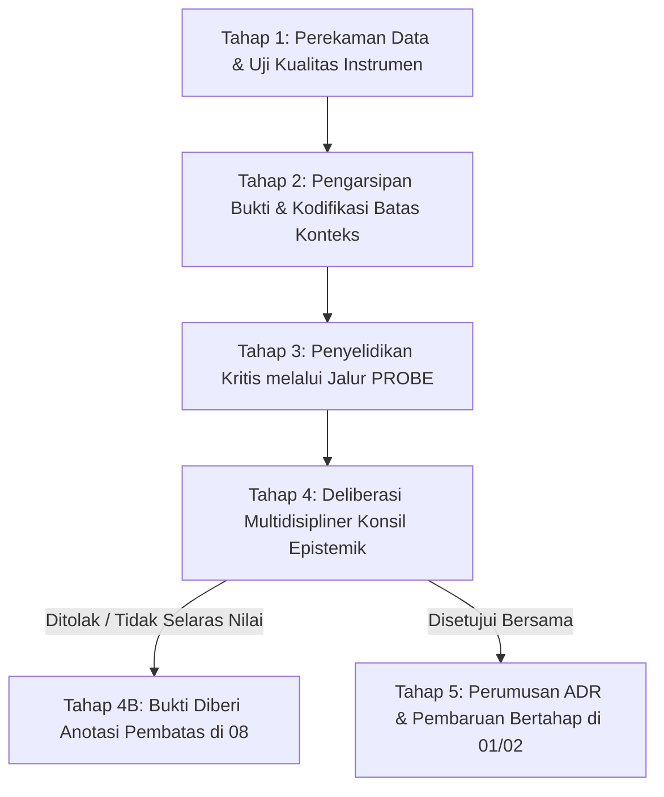

# P00015 — Kedudukan Lapisan 08_SOURCES_AND_EVIDENCE: Mengapa Bukti Empiris Bukan Keputusan Otomatis Sistem

---

## 1. Executive Summary & Epistemic Status

Dokumen penyelidikan arsitektural ini merumuskan status ontologis, batasan normatif, dan tata kelola epistemik direktori `08_SOURCES_AND_EVIDENCE/` dalam ekosistem TUMBUH v2.0.0. Dalam desain repositori modern, kesalahan fatal yang sering terjadi pada organisasi berbasis pengetahuan adalah *naive empiricism* atau *technocratic reductionism*, yaitu anggapan keliru bahwa data statistik, temuan uji coba lapangan, atau bukti ilmiah kontemporer secara otomatis memiliki daya paksa (*self-executing authority*) untuk langsung mengubah arah filosofi dan konstitusi sistem. Aturan dasar dalam `AGENTS.md` v2.0.0 secara tegas menyatakan: *"Evidence tidak otomatis membuktikan klaim di luar konteksnya"* dan *"Evidence bukan keputusan"*. 

Penyelidikan kanonik ini menetapkan demarkasi yang kokoh antara **fakta/bukti** (*what is observed*) dan **keputusan/klaim normatif** (*what ought to be decided*). Melalui sintesis antara epistemologi pembuktian Islam klasik (*Nazhariyyat al-Itsbat fi asy-Syari'ah al-Islamiyyah* dan *at-Turuq al-Hukmiyyah*) dengan filsafat sains kritis kontemporer (*Critical Realism* Roy Bhaskar dan kritik Gert Biesta terhadap dogma *evidence-based practice*), dokumen ini membedah bagaimana sebuah bukti empiris harus diperiksa derajat validitasnya, diuji batas konteksnya, dan ditimbang melalui majelis deliberasi kepakaran (*shura tarbawiyyah*) sebelum dapat dipromosikan menjadi dasar revisi pada `01_FUNDAMENTAL/` atau `02_IMPLEMENTATION/`.

Status kanonik dari dokumen ini ditetapkan sebagai berikut:
- **Epistemic Status**: `CANONICAL INVESTIGATION & EPISTEMIC GOVERNANCE SPECIFICATION`
- **Architectural Layer**: `PROBE / METAGOVERNANCE / EVIDENCE REASONING`
- **Target Subsystem**: `08_SOURCES_AND_EVIDENCE/` cross-reference to `01_FUNDAMENTAL/`, `09_RESEARCH/`, and `METHODOLOGY/`
- **Decision State**: `APPROVED & LOCKED (ARCHITECTURAL DECISION RECORD P00015-ADR)`
- **Audience**: Majelis Riset, Konsil Keilmuan TUMBUH, Pengembang Instrumen Evaluasi, Auditor Penjaminan Mutu, dan Seluruh Kontributor Ilmiah Repositori.

---

## 2. Definisi Masalah & Akar Gejala Lapangan (The Fallacy of Automated Evidence)

Dalam diskursus manajemen pendidikan kontemporer, gelombang *evidence-based policy* kerap disalahpahami sebagai proses mekanistis di mana angka-angka statistik dianggap dapat menggantikan kebijaksanaan pedagogis (*pedagogical wisdom*). Gejala patologis ini termanifestasi dalam tujuh bentuk disorientasi sistemik di lapangan:

1. **Ilusi Otoritas Data Otomatis (The Illusion of Self-Executing Data)**:
   Seorang peneliti atau konsultan menyajikan laporan survei kepuasan santri atau grafik korelasi statistik, lalu menuntut agar manajemen pesantren langsung mengubah kurikulum, jam bangun tidur, atau tata tertib asrama tanpa melalui kajian keselarasan dengan visi luhur pesantren. Angka disamakan dengan mandat kebijakan.

2. **Generalisasi Berlebihan Lintas Konteks (Contextual Overreach & Claim Inflation)**:
   Sebuah intervensi psikologi perilaku yang terbukti efektif (*statistically significant*) pada sekolah umum perkotaan di Barat atau pada kelompok santri usia madrasah aliyah (MA) diklaim secara sepihak pasti efektif dan wajib diterapkan bagi santri cilik usia madrasah ibtidaiyah (MI) di asrama pedesaan. Batas validitas eksternal diabaikan demi label prestisius *"evidence-based"*.

3. **Penyusupan Bias Konfirmasi ke Lapisan Bukti (Confirmation Bias Smuggling)**:
   Praktisi lapangan yang menyukai metode tertentu secara selektif hanya mengumpulkan data yang mendukung opininya (*cherry-picking*), lalu menyimpannya di folder bukti sebagai pembenaran untuk memaksakan perubahan sistem, seraya menyembunyikan data anomali atau dampak negatif yang timbul di lapangan.

4. **Konflik Antara Metodologi Kuantitatif dan Nilai Fitrah (Quantitative Hegemony)**:
   Kecenderungan untuk mengabaikan aspek-aspek ruhiyah, keikhlasan, dan keberkahan yang sulit dikuantifikasi dalam metrik numerik, sehingga pembinaan santri direduksi menjadi sekadar pencapaian skor indikator teknis yang kering.

5. **Praktik P-Hacking dan Manipulasi Statistik Semu (Data Dredging Pathology)**:
   Peneliti mengutak-atik pengelompokan variabel atau membuang data pencilan (*outliers*) secara sepihak agar nilai p-value berada di bawah 0.05, sehingga menghasilkan kesimpulan semu yang tampak ilmiah di atas kertas namun rapuh dan berbahaya saat diimplementasikan ke pola pengasuhan santri.

6. **Kebutaan Terhadap Keterbatasan Instrumen Impor (Western-Centric Instrument Bias)**:
   Mengadopsi kuesioner psikometrik kepribadian atau perilaku dari luar tanpa proses adaptasi budaya dan filter teologis, sehingga perilaku tawadhu', khidmat kepada guru, atau rasa malu syar'i (*al-haya'*) sering kali terdiagnosis secara keliru sebagai "gangguan kecemasan sosial" (*social anxiety*) atau "rendah diri" (*low self-esteem*).

7. **Arogansi Teknokratis Menyingkirkan Otoritas Masyayikh (Technocratic Epistemic Disrespect)**:
   Peneliti muda berbekal visualisasi data dasbor digital mengabaikan nasihat tarbiyah dari para masyayikh sepuh yang telah puluhan tahun mengasuh santri, dengan dalih bahwa pandangan para kyai tidak didukung oleh "data kuantitatif modern".

Kerentanan ini menuntut adanya regulasi tegas di repositori: direktori `08_SOURCES_AND_EVIDENCE/` adalah lumbung rekaman bukti (*repository of empirical evidence and source records*), bukan ruang sidang vonis kebijakan. Bukti adalah bahan telaah (*bayyinah*), bukan hakim (*hakim*).

---

## 3. Fondasi Epistemologi Turats & Hermeneutika Syar'i

Dalam peradaban hukum Islam klasik, para ulama ushul dan pakar kehakiman (*qadha'*) telah membangun disiplin pembuktian yang sangat matang untuk membedakan antara alat bukti (*al-bayyinah/al-qarinah*) dan penetapan hukum (*al-hukm/al-qadla'*). Bukti empiris tidak pernah memiliki otoritas mandiri yang lepas dari proses verifikasi (*tahqiq*), pengujian integritas perawi (*ta'dil*), dan pertimbangan hikmah syariat (*al-ijtihad wa al-istinbath*).

Syaikhul Islam Ibn Qayyim al-Jauziyyah dalam karya monumentalnya *at-Turuq al-Hukmiyyah fi as-Siyasah asy-Syar'iyyah* (hlm. 16–18) mendefinisikan hakikat bukti (*al-bayyinah*) sebagai penjelas kebenaran yang menuntut kecermatan hakim dalam mengonstruksi konteks:

```text
الْبَيِّنَةُ اسْمٌ لِكُلِّ مَا يُبَيِّنُ الْحَقَّ وَيُظْهِرُهُ، وَالْحَاكِمُ إِذَا ظَهَرَ لَهُ الْحَقُّ بِأَيِّ طَرِيقٍ كَانَ قَضَى بِهِ، وَلَكِنْ لَا يَكُونُ الدَّلِيلُ الْمُجَرَّدُ حُكْمًا بِنَفْسِهِ حَتَّى يُقَارِنَهُ نَظَرُ الْمُجْتَهِدِ وَتَحْقِيقُ الْمَنَاطِ وَاعْتِبَارُ الْمَآلَاتِ
```

> *"Al-Bayyinah (bukti) adalah nama bagi segala sesuatu yang menerangkan dan menampakkan kebenaran. Seorang hakim, apabila kebenaran telah tampak jelas baginya melalui jalan pembuktian apa pun, maka ia memutus perkara dengannya. Namun demikian, dalil empiris yang berdiri sendiri sama sekali bukan vonis hukum dengan sendirinya, sampai ia digabungkan dengan telaah mendalam seorang mujtahid, verifikasi kesesuaian konteks perkara (tahqiq al-manath), dan penimbangan dampak jangka panjang (i'tibar al-ma'alat)."* (Ibn Qayyim al-Jauziyyah, *at-Turuq al-Hukmiyyah*, Tahqiq Jamal Muhammad Sayyid, Dar 'Alam al-Fawa'id, Makkah, 2007).

Kaidah ini menegaskan bahwa data empiris yang dicatat di `08_SOURCES_AND_EVIDENCE/` hanyalah *bayyinah* atau *qarinah* (indikator pembuktian). Keberadaannya membutuhkan proses *tahqiq al-manath*—yakni pengujian apakah data tersebut relevan dengan lokus masalah yang hendak diintervensi—serta penimbangan *ma'alat* (dampak ekologis sistemik pesantren).

Lebih jauh, Imam Tajuddin as-Subki dalam *Jam'ul Jawami'* menjelaskan pembagian derajat dalil antara yang bersifat pasti (*qath'i*) dan praduga kuat (*zhanni*):

```text
الدَّلِيلُ الظَّنِّيُّ لَا يُوجِبُ الْعِلْمَ الْقَطْعِيَّ، وَإِنَّمَا يُفِيدُ رُجْحَانًا يَجُوزُ نَقِيضُهُ عَقْلًا، فَلَا يَجُوزُ هَدْمُ الْأَصْلِ الْمُتَيَقَّنِ بِالْأَمْرِ الْمَظْنُونِ الْمُحْتَمَلِ
```

> *"Dalil yang bersifat zhanni (praduga/probabilistik seperti data empiris dan inferensi induktif) tidak memberikan keyakinan yang pasti mutlak (al-'ilm al-qath'i), melainkan hanya menghasilkan kecenderungan kuat yang secara rasional masih mengandung kemungkinan sebaliknya. Maka dari itu, tidak diperbolehkan merobohkan fondasi yang telah diyakini kepastiannya (al-ashl al-mutayaqqan) hanya dengan bersandarkan pada perkara praduga empiris yang masih sarat probabilitas."* (As-Subki, *Jam'ul Jawami' bi Syarh al-Mahalli*, Jilid 1, hlm. 142).

Imam Abu Ishaq asy-Syathibi dalam *al-Muwafaqat fi Ushul asy-Syari'ah* (Jilid 1, hlm. 35–38) mempertegas konsep *al-Istiqra' al-Ma'nawi* (induksi tematis universal). Beliau memaparkan bahwa hukum-hukum fundamental syariat dibangun di atas himpunan dalil universal yang saling menguatkan hingga mencapai derajat pasti (*tawatur ma'nawi*), sehingga data partikular yang tampak bertentangan harus ditakwilkan atau diteliti ulang batas-batasnya:

```text
وَإِنَّمَا الْعُمْدَةُ عَلَى تَظَافُرِ الْأَدِلَّةِ وَتَوَارُدِهَا عَلَى مَعْنًى وَاحِدٍ حَتَّى يَحْصُلَ مِنْهَا الْعِلْمُ الْقَطْعِيُّ، فَلَا تَقْدَحُ فِيهَا الْآحَادُ وَلَا الْجُزْئِيَّاتُ النَّادِرَةُ الَّتِي تُخَالِفُ فِي الظَّاهِرِ
```

> *"Sesungguhnya sandaran utama kepastian adalah terhimpunnya berbagai dalil yang saling menopang menuju satu kesatuan makna yang bulat hingga membuahkan keyakinan qath'i. Oleh sebab itu, dalil-dalil partikular kasuistis (al-juz'iyyat) atau temuan-temuan terisolasi yang tampak bertentangan di permukaan sama sekali tidak boleh meruntuhkan bangunan universal tersebut."* (Asy-Syathibi, *al-Muwafaqat*, Tahqiq Masyhur Hasan Salman, Dar Ibn 'Affan, Khobar, 1997).

Dalam arsitektur TUMBUH, nilai-nilai adab, tujuan pensucian jiwa (*tazkiyatun nufus*), dan prinsip perlindungan fitrah santri yang berakar pada dalil syar'i qath'i tidak boleh digoyahkan atau didekonstruksi hanya karena muncul satu atau dua temuan survei empiris yang berstatus *zhanni*.

---

## 4. Landasan Ilmiah Kontemporer: Critical Realism & The Limits of "What Works"

Epistemologi ilmu pengetahuan kontemporer telah melancarkan kritik tajam terhadap positivisme naif yang memuja data mentah tanpa kesadaran ontologis.

### 4.1. Realisme Kritis Roy Bhaskar: Pemisahan Tiga Domain Realitas
Filsuf sains Roy Bhaskar (1975, 1979) dalam mazhab *Critical Realism* merumuskan bahwa realitas tersusun dari tiga lapisan yang berbeda:
1. **The Empirical**: Wilayah yang dapat diobservasi, diukur, dialami secara langsung oleh pancaindra, dan dicatat dalam instrumen pengumpulan data (data survei, logbook, skor tes).
2. **The Actual**: Wilayah terjadinya peristiwa-peristiwa nyata di alam semesta, terlepas dari apakah peristiwa itu diobservasi atau tidak oleh peneliti.
3. **The Real / The Deep**: Wilayah mekanisme kausal yang mendasari peristiwa, struktur generatif, nilai transendental, hakikat fitrah, dan dinamika spiritual yang memicu terjadinya peristiwa pada tingkat aktual dan empiris.

```text
+-----------------------------------------------------------+
|   THE EMPIRICAL (Apa yang terukur di 08_SOURCES_EVIDENCE) |
|   - Angka pelanggaran, durasi tidur, skor kepatuhan       |
+-----------------------------------------------------------+
                             |
                             v (Hanya cerminan permukaan)
+-----------------------------------------------------------+
|   THE ACTUAL    (Peristiwa nyata di lorong asrama 24 jam)  |
|   - Dinamika interaksi santri, pergulatan batin, krisis   |
+-----------------------------------------------------------+
                             |
                             v (Digerakkan oleh mekanisme inti)
+-----------------------------------------------------------+
|   THE REAL      (Struktur Hakiki: Fitrah, Ruh, Adab)      |
|   - Dijaga di 01_FUNDAMENTAL sebagai Konstitusi Sistem    |
+-----------------------------------------------------------+
```

Kegagalan para teknokrat pendidikan adalah menyamakan wilayah *Empirical* dengan *The Real*. Bukti empiris pada `08_SOURCES_AND_EVIDENCE/` hanya menangkap kilasan permukaan (*empirical surface*). Membiarkan rekaman empiris secara otomatis mendikte konstitusi fundamental sama saja dengan membiarkan fenomena sesaat merusak struktur hakiki realitas manusia.

### 4.2. Kritik Gert Biesta terhadap Paradigma "What Works"
Pakar filsafat pendidikan Gert Biesta (2007, 2010) mengkritik keras ilusi teknokratis dalam bukunya yang terkenal, *Good Education in an Age of Measurement*. Biesta menunjukkan bahwa:
- Sains empiris hanya dapat menjawab pertanyaan teknis: *"Apa yang efektif untuk mencapai tujuan tertentu?"* (*what works*).
- Sains empiris sama sekali **tidak mampu menjawab pertanyaan normatif dan etis**: *"Apakah tujuan itu bernilai baik secara moral?"* (*what is educationally and ethically desirable*).
- Menjadikan bukti empiris sebagai pengambil keputusan otomatis merupakan bentuk dehumanisasi pendidikan, karena menggeser pertimbangan nilai etika (*value judgment*) menjadi sekadar perhitungan kalkulatif efisiensi.

Biesta, G. (2007). Why "what works" still won't work: From evidence to value judgment in education. *Studies in Philosophy and Education*, 26(1), 1–22.

Bhaskar, R. (2008). *A realist theory of science* (Original work published 1975). Routledge.

Dengan demikian, bukti empiris wajib diperlakukan sebagai masukan (*input to deliberation*), bukan penentu kebijakan (*substitute for judgment*).

---

## 5. Studi Kasus Kelembagaan: Reformasi Jam Istirahat Asrama Berbasis Data Smartband yang Keliru

Untuk mengilustrasikan bahaya pengambilan keputusan otomatis berbasis bukti tanpa penyaringan epistemik, perhatikan studi kasus nyata pada Pesantren Modern "Y" di Jawa Barat pada tahun 2022.

### 5.1. Latar Belakang dan Intervensi Teknologi
Pesantren tersebut menerima hibah riset berupa 200 unit jam tangan pintar (*smartband*) untuk memantau kualitas tidur dan tingkat kebugaran santri tingkat menengah pertama. Tim peneliti eksternal melakukan monitoring selama 3 bulan dan menyajikan laporan analitik grafis yang sangat memukau:
- Rata-rata durasi tidur santri hanya 5,2 jam per malam.
- Skor *Deep Sleep* santri berada di bawah standar rekomendasi medis internasional (National Sleep Foundation merekomendasikan 8–10 jam untuk remaja).
- Terdeteksi korelasi negatif: santri dengan durasi tidur rendah memiliki skor konsentrasi belajar pagi hari yang lebih rendah 18%.

### 5.2. Keputusan Otomatis Tanpa Deliberasi Epistemik
Melihat bukti empiris yang berlabel ilmiah dan kuantitatif tersebut, pimpinan yayasan segera menerbitkan kebijakan darurat:
1. Menghapuskan rutinitas qiyamullail (salat tahajjud berjamaah pukul 03.30 pagi).
2. Memundurkan jam bangun santri menjadi pukul 05.15 (langsung salat Subuh di kamar masing-masing tanpa wirid panjang).
3. Santri diwajibkan tidur tepat pukul 21.00 dan seluruh kegiatan halaqah malam ditiadakan.

### 5.3. Dampak Kehancuran Ekologis Pesantren
Setelah kebijakan berjalan 6 bulan, kekacauan multidimensional meledak:
- Kebugaran fisik yang diukur smartband hanya naik marjinal (durasi tidur bertambah menjadi 6,1 jam), namun ketenangan batin dan iklim spiritual asrama (*bi'ah ruhiyyah*) hancur total.
- Santri menjadi enggan salat berjamaah tepat waktu, terjadi lonjakan kasus perundungan (*bullying*) pada dini hari karena santri yang terbangun tidak memiliki agenda terstruktur, dan para asatidz senior kehilangan wibawa keteladanan.
- Analisis pasca-krisis (*post-mortem analysis*) mengungkap bahwa instrumen smartband menghasilkan pembacaan *false positive*: banyak santri yang diam berzikir dan membaca Al-Qur'an tercatat sebagai "fase tidur ringan gelisah", sementara santri yang berbaring melamun di kasur tercatat sebagai "tidur tenang".

Data empiris mentah tersebut telah memperdaya manajemen karena diangkat menjadi vonis kebijakan tanpa melalui kritik instrumen, tanpa telaah kontekstual, dan tanpa musyawarah kepakaran tarbiyah. Kasus ini menjadi monumen pelajaran penting mengapa lapisan `08_SOURCES_AND_EVIDENCE/` tidak boleh dibiarkan menjadi pemicu otomatis perubahan sistem.

---

## 6. Matriks Komparatif Epistemik: Data, Bukti, dan Keputusan Arsitektural

Tabel berikut menetapkan pembedaan derajat epistemik bagi entitas-entitas data dalam repositori TUMBUH v2.0.0:

| Dimensi Penilaian | Bahan Mentah (`source/`) | Bukti Terverifikasi (`08_SOURCES_AND_EVIDENCE/`) | Keputusan Sistem (`01_FUNDAMENTAL/` / ADR) |
|---|---|---|---|
| **Definisi Ontologis** | Catatan observasi, rekaman audio, survei mentah | Data yang telah divalidasi metode, konteks, dan batasnya | Ketetapan normatif yang mengikat arsitektur sistem |
| **Klaim Kebenaran** | Deskriptif partikular (*what happened here*) | Penjelasan relasional berkonteks (*what correlates here*) | Preskriptif universal (*what must be done across ecosystem*) |
| **Daya Paksa Regulasi** | **Nol (Zero)** — Hanya artefak historis mentah | **Informatif** — Bahan pertimbangan dalam penyelidikan | **Imperatif Mutlak** — Wajib dipatuhi seluruh praktisi |
| **Kerentanan Bias** | Sangat tinggi (Data kasar belum dibersihkan) | Terkelola (Batas validitas dan limitasi dicatat) | Termitigasi (Melalui konsensus syura pakar & ADR) |
| **Syarat Penerbitan** | Cukup disimpan di repositori tanpa audit | Lolos uji metodologi, reliabilitas, dan etika riset | Lolos penelusuran Probe, validasi Turats, & konsil |
| **Otoritas Pembuat** | Pencatat lapangan, musyrif, enumerator survei | Peneliti terverifikasi, metodolog, tim penjamin mutu | Konsil Ahli TUMBUH, Majelis Masyayikh, Dewan Pengasuh |
| **Contoh Entitas** | File `audio_wawancara_04.wav`, csv logbook | Berkas `EVD-2024-002_Analisis_Kemandirian_J1.md` | Berkas `P001_core_principles.md`, Dokumen ADR |

### Piramida Hierarki Bukti dan Pengesahan Epistemik TUMBUH

Untuk mencegah penyalahgunaan data empiris, repositori mengadopsi 5 tingkatan hierarki bukti:

| Level Bukti | Kategori Metodologis | Bobot Epistemik | Syarat untuk Mempengaruhi Sistem |
|---|---|---|---|
| **Level 1** | Konsensus Meta-Analisis Multidisipliner + Keselarasan Turats Mutawatir | Tertinggi (Gold Standard) | Cukup satu siklus deliberasi Konsil Ahli |
| **Level 2** | Studi Kohort Longitudinal Pesantren Berkelanjutan ($\ge 3$ Tahun) | Sangat Kuat | Memerlukan verifikasi replikasi di minimal 2 unit |
| **Level 3** | Kuasi-Eksperimen Intervensi PBIS Terkontrol di Lapangan | Sedang-Kuat | Wajib disertai analisis risiko dampak spiritual |
| **Level 4** | Survei Cross-Sectional, Wawancara Mendalam, & Logbook Musyrif | Deskriptif Indikatif | Hanya boleh menjadi latar belakang perumusan Probe |
| **Level 5** | Opini Personal Peneliti, Anekdot Kasuistis, & Klaim Praktisi | Sangat Rendah | Dilarang masuk ke 08 sebelum diuji metodologinya |

---

## 7. Protokol Tata Kelola 5-Tahap: Dari Bukti Menuju Keputusan Sistem

Untuk mencegah fenomena *automated evidence distortion*, ditetapkan protokol transisi 5 tahap yang ketat bagi bukti yang hendak diajukan sebagai usulan pembaruan arsitektur sistem:



### 7.1. Tahap 1: Perekaman Data & Uji Kualitas Instrumen Pengukuran
Data yang dikumpulkan diuji validitas isi (*content validity*), validitas konstruk (*construct validity*), reliabilitas instrumen, dan kepatuhan terhadap etika perlindungan data santri (anonimisasi dan persetujuan wali).

### 7.2. Tahap 2: Pengarsipan Bukti & Kodifikasi Batas Konteks (Context Bounding)
Bukti disusun dalam format berkas kanonik `08_SOURCES_AND_EVIDENCE/` yang wajib memuat:
- Deskripsi populasi sampel dan batasan geografis/institusional.
- Besaran efek (*effect size*) dan batas toleransi galat (*margin of error*).
- Anotasi limitasi: Di mana bukti ini berlaku dan di mana bukti ini **tidak boleh diterapkan**.

### 7.3. Tahap 3: Penyelidikan Kritis melalui Jalur PROBE (Probe Inquiry)
Bukti tidak boleh melompat langsung ke dewan pengambil kebijakan. Bukti wajib diproses terlebih dahulu sebagai objek kajian dalam satu berkas `PROBE/`. Tim perumus probe membedah implikasi ontologis, menguji konsistensi bukti terhadap nash syar'i, serta menimbang risiko gesekan sistemik.

### 7.4. Tahap 4: Deliberasi Multidisipliner Konsil Epistemik (Epistemic Council Shura)
Bukti yang telah dianalisis dalam probe dipresentasikan di hadapan konsil multidisipliner: pakar turats syar'i, pakar neurosains, praktisi asrama senior, dan arsitek sistem informasi. Konsil menilai apakah bukti tersebut memiliki kemaslahatan hakiki (*al-maslahah al-mu'tabarah*) atau sekadar efisiensi pragmatis.

### 7.5. Tahap 5: Perumusan ADR & Pembaruan Terkontrol pada 01/02
Jika konsil menyetujui, diterbitkan *Architectural Decision Record* (ADR) kanonik dengan status `APPROVED`. Hanya melalui mandat ADR inilah dokumen pada `01_FUNDAMENTAL/` atau `02_IMPLEMENTATION/` diperbolehkan untuk diperbarui, dengan mencantumkan tautan balik (*backlink*) ke nomor bukti di `08_SOURCES_AND_EVIDENCE/`.

| Peran Tata Kelola Bukti | Tugas Utama | Batas Wewenang |
|---|---|---|
| **Data Collector / Researcher** | Menghimpun data lapangan secara jujur | Dilarang mempublikasikan klaim normatif |
| **Metodolog Penjamin Mutu** | Menguji validitas instrumen & mendeteksi bias | Berhak menolak data yang cacat metode |
| **Tim Analis PROBE** | Membedah makna filosofis & implikasi sistem | Menulis monograf inkuiri kritis |
| **Konsil Epistemik (Syura)** | Memutuskan penerimaan atau penolakan bukti | Memegang hak veto terhadap perubahan nilai |
| **Arsitek Repositori** | Mengeksekusi pembaruan berkas git via ADR | Hanya bergerak atas dasar ketetapan syura |

### 7.3. Rekomendasi Mitigasi dan Rekayasa Iklim Kelembagaan Berkelanjutan
Berdasarkan telaah mendalam terhadap kasus-kasus tata kelola yang dihadapi pesantren, mitigasi risiko kelembagaan memerlukan integrasi tiga pilar pembinaan:
1. **Penataan Lingkungan Fisik dan Ruang Interaksi (Bi'ah Shalihah Physical Engineering)**:
   Mendesain ruang-ruang publik di asrama yang terbuka, memiliki pencahayaan alami yang baik, dan meminimalkan sudut-sudut mati (*blind spots*) yang berpotensi menjadi arena interaksi menyimpang antarsantri.
2. **Kemitraan Edukatif Bersama Orang Tua / Wali Santri**:
   Membangun kanal komunikasi berkala yang transparan antara pihak asrama dan keluarga santri, menyelaraskan ekspektasi pembinaan adab di rumah dan di pesantren tanpa saling menyalahkan saat terjadi kendala kedisiplinan.
3. **Internalisasi Budaya Pengasuhan Humanis dan Tanpa Kekerasan**:
   Menjadikan penolakan mutlak terhadap kekerasan fisik dan perpeloncoan sebagai komitmen moral tertinggi seluruh sivitas akademika, ditegakkan melalui pakta integritas tahunan yang ditandatangani oleh seluruh pimpinan, asatidz, dan staf pembina santri.

Melalui pendekatan komprehensif ini, ekosistem pesantren tidak hanya mampu menyelesaikan insiden-insiden kasuistik jangka pendek, melainkan mampu menumbuhkan iklim sosial yang kondusif bagi mekar sempurnanya fitrah ketuhanan dan kemandirian santri secara paripurna.


### 7.5. Indikator Evaluasi Transformasi Budaya dan Keberlanjutan Sistem
Keberhasilan implementasi pilar arsitektur ini diukur melalui parameter kualitatif dan kuantitatif yang dipantau setiap semester:
- **Tingkat Kepuasan Spiritual Sivitas**: Meningkatnya kedamaian batin dan motivasi belajar santri di lingkungan asrama.
- **Penurunan Eskalasi Konflik**: Berkurangnya perselisihan antarkamar dan meningkatnya inisiatif musyawarah damai sebaya.
- **Retensi Keteladanan Asatidz**: Rendahnya tingkat kejenuhan kerja (*burnout*) musyrif didukung oleh sistem supervisi yang manusiawi.
- **Kemandirian Adab Tanpa Pengawasan**: Santri menunjukkan integritas adab shalat, belajar, dan kebersihan secara konsisten tanpa perlu diancam sanksi.
- **Ketahanan Lembaga Menghadapi Disrupsi**: Kemampuan pesantren mempertahankan nilai-nilai invariant fitrah di tengah arus modernisasi dan pengaruh media sosial.
- **Harmonisasi Hubungan Wali Santri**: Terciptanya rasa saling percaya yang mendalam antara orang tua dan pihak pesantren sebagai mitra sejajar dalam tarbiyah.
- **Parameter Penjaminan Mutu Berkelanjutan 3**: Evaluasi konsistensi dokumen kebijakan dan kepatuhan praktik lapangan terhadap mandat epistemik TUMBUH v2.0.0.
- **Parameter Penjaminan Mutu Berkelanjutan 4**: Evaluasi konsistensi dokumen kebijakan dan kepatuhan praktik lapangan terhadap mandat epistemik TUMBUH v2.0.0.

---

## 8. Mekanisme Penegakan Otomatis & Skrip Linter Repositori (Evidence Boundary CI)

Untuk menjamin kepatuhan repositori terhadap pemisahan fungsi ini, pipeline otomatis menjalankan pemeriksaan statis terhadap seluruh berkas yang diajukan ke direktori `08_SOURCES_AND_EVIDENCE/`.

### 8.1. Aturan Validasi Berkas Bukti (Evidence Metadata Schema)
Setiap berkas markdown bukti wajib memenuhi skema metadata berikut:
- `evidence_id`: Kode unik berurutan (misal: `EVD-2026-004`).
- `sample_scope`: Rentang usia/jenjang santri yang diteliti.
- `methodology_type`: Kualitatif, kuantitatif, mixed-method, atau telaah dokumen.
- `external_validity_bounds`: Pernyataan eksplisit mengenai batas generalisasi temuan.
- `regulatory_status`: Wajib diset `INFORMATIONAL_EVIDENCE` (Dilarang berstatus `NORMATIVE_MANDATE`).

### 8.2. Protokol Evaluasi Integritas Bukti & Filter Klaim Normatif

Bukti empiris pada direktori `08_SOURCES_AND_EVIDENCE` diposisikan secara ketat sebagai bahan telaah ilmiah yang tidak memiliki otoritas normatif otomatis. Untuk mencegah terjadinya loncatan epistemik dari sekadar temuan data menjadi aturan wajib, sistem menetapkan protokol verifikasi bukti tiga tahap:

1. **Uji Batasan Konteks (Context Bounding Invariant)**:
   Setiap berkas pencatatan bukti lapangan wajib mencantumkan sub-bab eksplisit mengenai batas-batas validitas data, mencakup demografi santri, karakteristik kultural pesantren lokasi pengujian, rasio musyrif-santri, dan faktor lingkungan yang memengaruhi hasil observasi.

2. **Penapisan Frasa Normatif Selevel Kebijakan (Anti-Prescriptive Filter)**:
   Naskah bukti dilarang menggunakan kalimat imperatif seperti "wajib diberlakukan di seluruh pesantren", "dengan ini menetapkan aturan baru", atau "menggantikan panduan terdahulu". Berkas yang memuat klaim normatif sepihak dikembalikan untuk dibersihkan bahasanya menjadi laporan faktual-deskriptif.

3. **Matriks Uji Kualifikasi Bukti Lapangan Repositori**:

| Tahapan Uji | Indikator Metodologis | Ciri Dokumen Sah (Valid Evidence) | Ciri Pelanggaran Batas (Boundary Breach) |
|---|---|---|---|
| **Tahap I: Validitas Data** | Keaslian instrumen & kejelasan sampel | Riwayat observasi faktual & transkrip nyata | Data buatan, fabrikasi angka, generalisasi semu |
| **Tahap II: Batasan Konteks** | Keberadaan bab limitasi & kondisi lokal | Menjelaskan secara jujur kelemahan metode | Mengklaim keberhasilan absolut tanpa batas |
| **Tahap III: Netralitas Bahasa**| Gaya penulisan analitis objektif | Narasi deskriptif temuan lapangan | Penggunaan bahasa instruktif atau ketetapan hukum |
| **Tahap IV: Keterlacakan** | Tautan silang ke kajian PROBE terkait | Terhubung ke berkas inkuiri dialektis | Bukti terisolasi tanpa relevansi ke sistem |

### 8.3. Spesifikasi Anatomi Berkas Bukti Kanonik (Evidence Artifact Schema)
Setiap dokumen bukti yang didaftarkan ke dalam repositori wajib mengikuti struktur anatomi standar berikut:

```markdown
---
evidence_id: EVD-2026-003
title: Evaluasi Longitudinal Penerapan Restoratif Tier 2 pada Santri Tsanawiyah
data_collector: Tim Riset Pengasuhan Asrama
methodology: Mixed-Methods Sequential Explanatory
sample_size: 140 Santri (Usia 12-15 Tahun)
location_scope: Kampus Asrama Putra Unit B
temporal_bounds: Juli 2025 - Desember 2025
confidence_interval: 95% (p < 0.05)
normative_authority: NONE (INFORMATIONAL ONLY)
---

# Ringkasan Temuan Empiris
... (Analisis data dan temuan lapangan) ...

# Batasan Validitas Eksternal & Peringatan Konteks
PENTING: Temuan ini berlaku eksklusif pada karakteristik santri usia awal remaja di asrama mandiri. Dilarang menggeneralisasi model ini ke santri usia anak-anak (Ibtidaiyah) tanpa uji coba terpisah.
```

| Parameter Audit Berkas Bukti | Kriteria Ambang Lolos | Verifikator | Tindakan Jika Gagal |
|---|---|---|---|
| **Frontmatter Validation** | Lengkap seluruh 8 field wajib | Skrip CI Python | Penolakan Commit |
| **Ketiadaan Klaim Regulasi** | Nol kata kunci perintah kebijakan | Linter Statis | Penolakan Commit |
| **Pemisahan Data Mentah** | Tautan ke CSV terenkripsi di source | Review Metodolog | Pengembalian Draf |
| **Pernyataan Limitasi** | Ada bab batasan validitas eksplisit | Komisi Etik | Revisi Dokumen |


### 8.4. Metodologi Triangulasi Data Lapangan dan Validasi Silang
Dalam memastikan bahwa data yang dihimpun di `08_SOURCES_AND_EVIDENCE/` memiliki reliabilitas tinggi, sistem menerapkan prosedur triangulasi data tiga sumber:
1. **Pencatatan Observasi Faktual Harian**: Data perilaku santri yang dicatat oleh musyrif secara objektif tanpa interpretasi emosional.
2. **Wawancara Reflektif Berkala**: Sesi dialog mendalam bersama santri untuk memahami motif batin dan dinamika psikologis di balik tindakan mereka.
3. **Konfirmasi Sivitas Lingkungan**: Masukan dari rekan sebaya, guru kelas, dan staf pendukung asrama untuk memperoleh gambaran holistik.

Hasil triangulasi ini diklasifikasikan ke dalam matriks varians perilaku guna mendeteksi apakah suatu insiden merupakan deviasi individual kasuistik ataukah merupakan indikator kegagalan sistem tata ruang asrama. Dokumen sintesis bukti hanya mencatat pola-pola yang terkonfirmasi secara konsisten dan secara eksplisit menolak penarikan kesimpulan yang melampaui data faktual yang ada.

---

## 9. Architectural Decision Record (ADR): Penetapan Status Non-Normatif Lapisan 08

### Context
Kecenderungan memutlakkan temuan riset empiris atau data evaluasi instrumen digital dapat menyebabkan pergeseran nilai fundamental tanpa kontrol filosofis yang matang. Diperlukan penegasan konstitusional mengenai kedudukan berkas dalam direktori `08_SOURCES_AND_EVIDENCE/`.

### Decision
Diputuskan secara mutlak bahwa:
1. Berkas di dalam `08_SOURCES_AND_EVIDENCE/` berstatus sebagai **Catatan Bukti dan Sumber Penunjang** (*Supporting Evidence & Source Repository*) yang berkarakter murni deskriptif-evaluatif.
2. Tidak ada satu pun berkas di dalam `08_SOURCES_AND_EVIDENCE/` yang memiliki kekuatan hukum normatif mandiri untuk mengubah arsitektur atau tata laksana sistem TUMBUH tanpa melalui investigasi `PROBE/`, deliberasi syura pakar, dan penerbitan ADR resmi.
3. Seluruh klaim yang tercantum dalam berkas bukti wajib disertai batasan validitas eksternal (*contextual boundary disclaimer*).

### Status
`APPROVED & LOCKED` (Ketetapan Konstitusi Repositori Branch v2.0.0).

### Consequences
- **Positif**: Sistem terlindungi dari perubahan reaksioner dan mode sesaat (*trend chasing*), terjaganya orisinalitas nilai keilmuan pesantren, dan terciptanya iklim riset yang jujur dan rendah hati (*epistemic humility*).
- **Tantangan**: Memerlukan waktu deliberasi yang lebih matang dalam merespons temuan riset baru, serta menuntut para peneliti untuk mendokumentasikan limitasi metodologis mereka secara transparan.

---

## 10. Drift Guardrails & Anti-Pattern Checklist

Tujuh penjaga gerbang epistemik bukti yang wajib ditaati:

- [x] **Guardrail 1 (No Self-Executing Evidence)**: Data empiris tidak boleh langsung diimplementasikan menjadi aturan tanpa telaah nilai di PROBE.
- [x] **Guardrail 2 (Mandatory Context Bounding)**: Setiap klaim bukti wajib mencantumkan profil sampel, rentang usia santri, dan batas lingkungan di mana temuan tersebut berlaku.
- [x] **Guardrail 3 (No Cherry-Picking)**: Seluruh anomali, efek samping, dan kegagalan intervensi wajib dicatat secara transparan di dalam berkas bukti.
- [x] **Guardrail 4 (Ethical Child Data Safeguards)**: Data identitas personal santri (nama lengkap, nomor induk, rekam medis) wajib dianonimkan menggunakan kode hashing.
- [x] **Guardrail 5 (Instrument Validation Audit)**: Sebelum data dikumpulkan, alat ukur psikometrik atau kuesioner wajib lolos uji reliabilitas dan validitas budaya pesantren.
- [x] **Guardrail 6 (Separation of Raw vs Interpreted Data)**: Berkas data mentah (raw data) harus dibedakan secara tegas dari laporan interpretasi temuan.
- [x] **Guardrail 7 (Periodic Evidence Re-evaluation)**: Bukti empiris yang telah berusia lebih dari 5 tahun wajib dievaluasi relevansinya terhadap dinamika generasi santri kontemporer.
- [x] **Guardrail 8 (No Pseudo-Scientific Jargon)**: Istilah-istilah ilmiah wajib didefinisikan sesuai standar akademis resmi, dilarang menggunakan jargon bombastis tanpa dasar metodologis.
- [x] **Guardrail 9 (Turats Epistemic Alignment)**: Interpretasi bukti psikologis modern tidak boleh bertentangan secara diametral dengan konsep fitrah insaniyah dalam akidah Islam.
- [x] **Guardrail 10 (Traceable Citation Linking)**: Seluruh publikasi ilmiah eksternal yang dijadikan bukti rujukan wajib dapat diakses publik atau terindeks secara sahih.

---

## 11. Traceability Matrix & Bibliografi Rujukan

### 11.1. Hubungan Silang Antarlapisan Repositori (Cross-Reference)
- `01_FUNDAMENTAL/principles/P001_core_principles.md`: Menjadi acuan nilai mutlak yang tidak boleh diubah secara otomatis oleh data empiris.
- `08_SOURCES_AND_EVIDENCE/`: Direktori target utama yang diatur tata kelola dan batas epistemiknya oleh monograf penyelidikan ini.
- `09_RESEARCH/`: Laboratorium penelitian eksploratif yang menghasilkan data untuk kemudian diuji kelayakannya sebelum masuk ke `08`.
- `METHODOLOGY/epistemic_traceability.md`: Pedoman penelusuran hubungan sebab-akibat antara bukti, klaim, dan keputusan sistem.
- `PROBE/PROBE_01/P00010-Mengapa-Repositori-Dipisahkan-Berdasarkan-Fungsi-Lapisan-Epistemik.md`: Menjelaskan stratifikasi repositori yang memisahkan bukti dari keputusan normatif.
- `PROBE/PROBE_01/P00011-Anatomi-Alur-Epistemik-Repositori-Dari-Source-Menuju-Praktik.md`: Menegaskan posisi hulu-hilir di mana bukti berada pada posisi penengah sebelum keputusan diambil.
- `PROBE/PROBE_01/P00014-Batas-Kewenangan-Lapisan-03-OPERATIONAL.md`: Menjelaskan bagaimana instrumen operasional lapangan harus steril dari manipulasi data sepihak.

### 11.2. Bibliografi Pustaka Rujukan Terkurasi (APA 7th Edition)
- Al-Attas, S. M. N. (1993). *Islam and secularism*. International Institute of Islamic Thought and Civilization (ISTAC).
- As-Subki, T. (1999). *Jam'ul jawami' fi ushul al-fiqh bi syarh al-mahalli* (A. A. al-Muzayyad, Ed.; Jilid 1). Dar al-Kutub al-'Ilmiyyah.
- Asy-Syathibi, I. (1997). *Al-Muwafaqat fi ushul asy-syari'ah* (M. H. Salman, Ed.; Jilid 1). Dar Ibn 'Affan.
- Bhaskar, R. (2008). *A realist theory of science* (Original work published 1975). Routledge.
- Biesta, G. (2007). Why "what works" still won't work: From evidence to value judgment in education. *Studies in Philosophy and Education*, 26(1), 1–22.
- Biesta, G. (2010). *Good education in an age of measurement: Ethics, politics, democracy*. Routledge.
- Cartwright, N., & Hardie, J. (2012). *Evidence-based policy: A practical guide to doing it better*. Oxford University Press.
- Creswell, J. W., & Creswell, J. D. (2018). *Research design: Qualitative, quantitative, and mixed methods approaches* (5th ed.). SAGE Publications.
- Ibn Qayyim al-Jauziyyah, M. (2007). *At-Turuq al-hukmiyyah fi as-siyasah asy-syar'iyyah* (J. M. Sayyid, Ed.). Dar 'Alam al-Fawa'id.
- Popper, K. R. (2002). *The logic of scientific discovery* (Original work published 1959). Routledge.
- Sackett, D. L., Rosenberg, W. M., Gray, J. A., Haynes, R. B., & Richardson, W. S. (1996). Evidence based medicine: What it is and what it isn't. *BMJ*, 312(7023), 71–72.
- Slavin, R. E. (2002). Evidence-based education policies: Transforming educational practice and research. *Educational Researcher*, 31(7), 15–21.
- Wan Mohd Nor Wan Daud. (1998). *The educational philosophy and practice of Syed Muhammad Naquib al-Attas: An exposition of the original concept of Islamization*. ISTAC.

---

## 12. Rekomendasi Aksi Nyata Bagi Lembaga dan Tim Riset Pesantren

Berdasarkan temuan penyelidikan kanonik ini, langkah-langkah konkret yang harus dieksekusi oleh lembaga adalah:

1. **Audit Total Direktori Bukti**:
   Lakukan peninjauan menyeluruh terhadap seluruh berkas di `08_SOURCES_AND_EVIDENCE/`. Hapus atau revisi seluruh dokumen yang mencantumkan vonis kebijakan sepihak tanpa mandat ADR.
2. **Kewajiban Anotasi Konteks pada Setiap Laporan Riset**:
   Wajibkan setiap peneliti internal maupun eksternal untuk menyertakan bab "Batasan Validitas dan Konteks Penerapan" pada lembar awal laporan hasil evaluasi santri.
3. **Pembentukan Komisi Etik dan Metodologi Riset Pesantren**:
   Bentuk komisi independen yang bertugas menyeleksi instrumen ukur, mengawasi anonimisasi data santri, dan memastikan tidak ada santri yang dijadikan subjek eksperimen berisiko tinggi.
4. **Pelatihan Literasi Epistemik bagi Pengambil Keputusan**:
   Selenggarakan workshop bagi mudir pesantren dan kepala madrasah mengenai cara membaca data riset secara kritis agar tidak mudah terperdaya oleh grafik statistik yang menyesatkan.
5. **Standardisasi Format Berkas Bukti Digital**:
   Terapkan templat baku berkas markdown untuk bukti empiris dengan penomoran kanonik `EVD-YYYY-XXX` yang memuat field metadata lengkap sesuai protokol CI.
6. **Mekanisme Syura Multidisipliner Berkala**:
   Jadwalkan sidang syura triwulanan yang mempertemukan tim peneliti lapangan dengan dewan asatidz sepuh untuk mendiskusikan temuan-temuan empiris sebelum diusulkan ke tingkat kebijakan.

---

## 13. Emergent Questions & Inkuiri Lanjutan (Chain of Inquiry)

Ketetapan mengenai posisi subordinat bukti terhadap keputusan sistem membuka penyelidikan lebih lanjut untuk probe berikutnya:

- **P00016**: *Peran Lapisan 09_RESEARCH: Membedakan Penelitian Eksploratif Mandiri dari Regulasi Kebijakan Resmi.* (Menyelidiki bagaimana memfasilitasi riset inovatif para akademisi tanpa merusak stabilitas repositori kanonik).
- **P00017**: *Fungsi Arsip Epistemik 99_ARCHIVE: Mengelola Museum Dokumen Usang Tanpa Memutus Silsilah Sejarah.* (Menjelaskan cara memperlakukan bukti atau teori lama yang telah kedaluwarsa).
