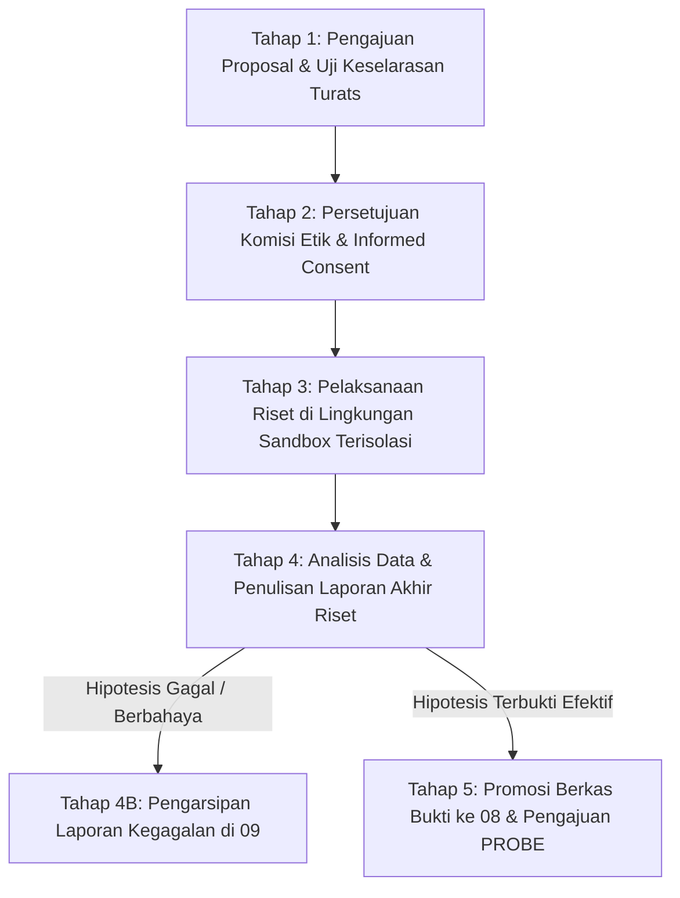

# P00016 — Peran Lapisan 09_RESEARCH: Membedakan Penelitian Eksploratif Mandiri dari Regulasi Kebijakan Resmi

- **ID Berkas**: `PROBE/PROBE_01/P00016`
- **Pilar**: Pilar 2 — Stratifikasi Lapisan Repositori & Separation of Concerns
- **Sub-Klaster**: Demarkasi Lapisan Penelitian (*Research Governance & Sandbox Boundary*)
- **Pertanyaan Panduan (TUMBUH Question)**:
  > *Bagaimana memberi kebebasan riset eksploratif bagi peneliti dan pegiat pendidikan tanpa membiarkan draf hipotesis mentah mereka disalahpahami sebagai kebijakan resmi pesantren yang mengikat santri di asrama?*
- **Status Inkuiri**: Tuntas & Terkunci (Bagian dari 120 Berkas Rekonstruksi Kanonik PROBE 01)
- **Target Subsistem**: `09_RESEARCH/` (dengan rujukan silang ke `01_FUNDAMENTAL/`, `08_SOURCES_AND_EVIDENCE/`, dan `METHODOLOGY/`)

---

## 1. Abstrak & Pernyataan Masalah Epistemik (*Executive Summary*)

Dokumen penyelidikan arsitektural ini merumuskan demarkasi fungsional, tata kelola isolasi (*sandbox governance*), dan protokol transisi pengetahuan bagi direktori `09_RESEARCH/` dalam repositori TUMBUH v2.0.0. Dalam ekosistem pengembangan sistem berbasis pengetahuan terpadu (*integrated knowledge ecosystem*), terdapat tegangan inheren antara dua kebutuhan institusional: di satu sisi, sistem membutuhkan kebebasan eksperimentasi akademik yang dinamis, eksploratif, dan berani menguji hipotesis baru (*exploratory research*); di sisi lain, tata kelola pesantren membutuhkan kepastian hukum, stabilitas pedoman pengasuhan, dan perlindungan ketat agar santri tidak dijadikan kelinci percobaan oleh gagasan-gagasan mentah yang belum teruji secara matang. Aturan konstitusional dalam `AGENTS.md` v2.0.0 menetapkan prinsip fundamental: *"Research tidak otomatis mengubah sistem"*.

Penyelidikan ini menetapkan status ontologis `09_RESEARCH/` sebagai **Laboratorium Eksplorasi Terisolasi (Epistemic Sandbox)**. Melalui perpaduan antara prinsip pembagian peran kepemimpinan syar'i menurut Imam al-Qarafi (*al-Furuq bayna Tasyrifat al-Imam wa al-Mufti*) dengan teori manajemen inovasi modern (*Pasteur's Quadrant* oleh Stokes dan *Exploration vs Exploitation Architecture* oleh March), dokumen ini membedakan secara tegas antara "penyelidikan ilmiah yang bersifat bebas dan hipotetis" dengan "ketetapan kebijakan resmi yang bersifat mengikat (*legally and procedurally binding*)". Dokumen ini merancang protokol tata kelola riset 5 tahap, mekanisme penyaringan komisi etik pesantren, serta validasi integritas sistem guna menjamin tidak adanya klaim regulatif liar yang bocor (*sandbox leakage*) dari laboratorium riset ke lantai operasional asrama.

---

## 2. Definisi Masalah & Akar Gejala Lapangan (Pathology of Research-Policy Bleed)

Ketika sebuah institusi pendidikan menggalakkan budaya riset tanpa pagar pembatas arsitektural yang jelas, sering kali terjadi fenomena *research-policy bleed* (kebocoran riset menjadi kebijakan). Praktisi lapangan, guru, atau musyrif asrama yang membaca draft kertas kerja penelitian (*working papers*) sering kali salah mengira bahwa setiap dokumen yang diterbitkan oleh divisi Litbang adalah perintah dinas yang wajib segera dilaksanakan[^1].

Gejala-gejala disorientasi sistemik ini teridentifikasi dalam enam patologi kelembagaan:

1. **Ilusi Otoritas Kertas Kerja (Working Paper Confusion)**:
   Sebuah draft penelitian eksploratif mengenai uji coba modifikasi jam belajar malam yang diunggah ke repositori untuk ditelaah antarsesama peneliti secara keliru ditafsirkan oleh staf administrasi asrama sebagai "Surat Keputusan Yayasan". Akibatnya, jam belajar diubah secara sepihak sebelum penelitian selesai dievaluasi.

2. **Ketiadaan Lingkungan Isolasi (Lack of Sandbox Quarantine)**:
   Aktivitas pengujian hipotesis baru dilakukan langsung pada populasi santri umum tanpa kelompok kontrol, tanpa protokol mitigasi risiko, dan tanpa izin komisi etik (*Institutional Review Board*), sehingga kegagalan eksperimen langsung berdampak destruktif terhadap stabilitas psikologis santri.

3. **Penyelundupan Ideologi Riset Eksperimental (Unvetted Epistemic Infiltration)**:
   Peneliti internal yang baru menyelesaikan studi pascasarjana di bidang psikologi sekuler atau sosiologi kritis langsung menyisipkan asumsi-asumsi teoritis mereka ke dalam instrumen pengasuhan santri di repositori resmi, tanpa melalui proses verifikasi keselarasan turats dan epistemologi Islam.

4. **Klaim Prematur "Metode Baru yang Telah Tervalidasi" (Premature Validation Claims)**:
   Laporan uji coba skala kecil (pilot project) yang baru berlangsung selama dua pekan dengan sampel 15 santri langsung diklaim dalam dokumen sebagai *"Metode Pembinaan Berbasis Bukti yang Sahih dan Terbukti Efektif"*, memicu kebingungan publik dan praktisi cabang.

5. **Ketakutan Berlebihan Terhadap Kegagalan Riset (Research Stigmatization)**:[^2]
   Ketika sebuah hipotesis di lapisan riset terbukti gagal membuktikan efektivitasnya, peneliti menyembunyikan data tersebut karena takut disalahkan oleh manajemen. Hal ini terjadi karena lembaga menyamakan kegagalan hipotesis ilmiah dengan pelanggaran kinerja kerja.

6. **Fragmentasi Repositori dan Utang Dokumentasi (Orphan Research Repositories)**:
   Puluhan naskah penelitian masa lalu dibiarkan berserakan tanpa status kelanjutan yang jelas: tidak dipromosikan ke lapisan bukti (`08`), tidak diintegrasikan ke model fundamental (`01`), dan tidak diarsipkan ke museum sejarah (`99`), sehingga menjadi tumpukan teks mati yang membingungkan kontributor baru.

Oleh karena itu, repositori TUMBUH v2.0.0 membutuhkan demarkasi yang kokoh: direktori `09_RESEARCH/` adalah zona aman bagi petualangan intelektual dan pengujian ilmiah yang steril dari konsekuensi regulasi instan.

---

## 3. Fondasi Epistemologi Turats & Hermeneutika Syar'i

Demarkasi antara "kajian keilmuan eksploratif" dan "ketetapan hukum kelembagaan" berakar kuat pada tradisi pembagian wewenang syar'i (*at-tasharrufat asy-syar'iyyah*). Salah satu rujukan paling otoritatif dalam khazanah ushul fikih dan siyasah syar'iyyah adalah karya monumental Imam Syihabuddin al-Qarafi (w. 684 H), *al-Furuq* (*Anwar al-Buruq fi Anwa' al-Furuq*)[^3].

Dalam *Al-Farq ats-Tsani wa ats-Tsalatsun bayna Qawa'id at-Tasharruf bi al-Futya wa at-Tasharruf bi al-Hukm wa al-Imamah* (Jilid 1, hlm. 205–207), Imam al-Qarafi membedakan secara mendalam tiga dimensi otoritas:
1. Tindakan atas dasar **Fatwa dan Pengajaran Ilmu** (*at-tasharruf bi al-futya wa at-ta'lim*): Menjelaskan hukum objektif dan mengeksplorasi dalil-dalil ijtihadiah. Karakter dari fatwa adalah informatif (*ikhbar*) dan tidak memiliki daya paksa kelembagaan (*la ilzama fiha*).
2. Tindakan atas dasar **Peradilan** (*at-tasharruf bi al-qadha'*): Memutuskan sengketa dengan mengikat pihak yang berselisih.
3. Tindakan atas dasar **Kepemimpinan Tertinggi Lembaga/Negara** (*at-tasharruf bi al-imamah*): Menetapkan kebijakan publik (*siyasah 'ammah*) yang mengikat seluruh masyarakat demi kemaslahatan umum (*maslahah 'ammah*).

Imam al-Qarafi menegaskan kaidah penting ini:

```text
وَاعْلَمْ أَنَّ تَصَرُّفَهُ عَلَيْهِ الصَّلَاةُ وَالسَّلَامُ بِالْفُتْيَا لَيْسَ كَتَصَرُّفِهِ بِالْإِمَامَةِ، فَإِنَّ الْفُتْيَا إِخْبَارٌ عَنْ حُكْمِ اللَّهِ تَعَالَى لَا إِلْزَامَ فِيهِ لِعُمُومِ الْأُمَّةِ مِنْ حَيْثُ التَّنْفِيذِ السِّيَاسِيِّ، بِخِلَافِ التَّصَرُّفِ بِالْإِمَامَةِ فَإِنَّهُ إِلْزَامٌ عَامٌّ لَا يَجُوزُ لِأَحَدٍ مُخَالَفَتُهُ، فَلَا يَجُوزُ لِأَحَدٍ أَنْ يَأْخُذَ مَا جَرَى مَجْرَى الْبَحْثِ وَالْفَتْوَى فَيَجْعَلَهُ حُكْمًا مُلْزِمًا لِلْكَافَّةِ إِلَّا بِإِذْنِ الْإِمَامِ
```

> *"Ketahuilah bahwa tindakan Rasulullah ﷺ dalam kapasitas fatwa (dan telaah keilmuan) tidaklah sama dengan tindakan beliau dalam kapasitas kepemimpinan umum (al-imamah). Sesungguhnya fatwa adalah pemberitaan tentang hukum Allah Ta'ala yang tidak mengandung daya paksa eksekusi administratif bagi khalayak umum. Hal ini berbeda dengan tindakan atas dasar kepemimpinan (al-imamah), karena ia merupakan ketetapan yang mengikat secara umum dan tidak boleh dilanggar oleh siapa pun. Maka dari itu, tidak diperbolehkan bagi siapa pun untuk mengambil sesuatu yang posisinya masih dalam ranah kajian penelitian eksploratif atau wacana fatwa, lalu menjadikannya sebagai regulasi yang mengikat seluruh umat, kecuali telah disahkan melalui wewenang kepemimpinan resmi."* (Al-Qarafi, *al-Furuq*, Tahqiq Khalil Manshur, Dar al-Kutub al-'Ilmiyyah, Beirut, 1998).

Kaidah al-Qarafi ini menjadi fondasi teologis yang sangat presisi bagi Repositori TUMBUH v2.0.0:
- Berkas-berkas di dalam `09_RESEARCH/` berada pada derajat **al-Bahts wa al-Futya** (kajian eksploratif keilmuan). Dokumen ini sah dan mulia secara ilmiah, namun sifatnya murni informatif dan sama sekali tidak memiliki daya paksa kelembagaan (*la ilzama fiha*).
- Dokumen pada `01_FUNDAMENTAL/` dan ketetapan ADR kanonik berada pada derajat **at-Tasharruf bi al-Imamah** (ketetapan konstitusi kepemimpinan resmi) yang mengikat seluruh unit dan praktisi di bawah naungan ekosistem TUMBUH.

Lebih lanjut, Syaikhul Islam Ibn Taimiyyah dalam *Majmu' al-Fatawa* (Jilid 19, hlm. 203) mengingatkan agar umat tidak memaksakan pendapat ilmiah yang masih bersifat ijtihadiah sebagai aturan baku:[^4]

```text
وَلَيْسَ لِأَحَدٍ أَنْ يُلْزِمَ النَّاسَ بِقَوْلِهِ وَلَا بِقَوْلِ عَالِمٍ مُعَيَّنٍ فِي مَسَائِلِ الِاجْتِهَادِ، حَتَّى تَقُومَ الْحُجَّةُ النَّيِّرَةُ وَيَجْتَمِعَ عَلَيْهَا أَهْلُ الْحَلِّ وَالْعَقْدِ
```

> *"Dan tidak berhak bagi siapa pun untuk memaksakan pendapatnya atau pendapat ilmuwan tertentu kepada manusia dalam urusan-urusan ijtihadiah, sampai tegak argumentasi yang terang benderang dan disepakati oleh majelis musyawarah para pemegang otoritas (ahl al-halli wa al-'aqd)."* (Ibn Taimiyyah, *Majmu' al-Fatawa*, Tahqiq Abdurrahman bin Qasim, Majma' al-Malik Fahd, Madinah, 1995).

---

## 4. Landasan Ilmiah Kontemporer: Innovation Sandboxes & Pasteur's Quadrant

Dalam teori rekayasa perangkat lunak dan manajemen inovasi strategis, pemisahan antara zona eksplorasi dan zona produksi merupakan prinsip keamanan utama (*core safety architectural pattern*).

### 4.1. Pemisahan Lingkungan: Sandbox vs Production
Dalam rekayasa sistem informasi modern, pengembang dilarang keras menguji kode baru langsung pada server produksi (*production environment*). Pengujian dilakukan pada *Isolated Sandbox* atau *Staging Environment*. 

```text
+-----------------------------------------------------------+
|              09_RESEARCH/ (Sandbox Lingkungan R&D)         |
|   - Karakter: Eksploratif, Hipotetis, Mentoleransi Error  |
|   - Akses: Peneliti, Akademisi, Reviewer Metodologi       |
|   - Daya Regulasi: NOL (Terisolasi dari Asrama Lapangan)  |
+-----------------------------------------------------------+
                             |
                             v (Lolos Uji, Peer-Review & Audit)
+-----------------------------------------------------------+
|      08_SOURCES_AND_EVIDENCE/ (Lumbung Bukti Terverifikasi) |
|   - Karakter: Deskriptif Terukur, Ada Batas Validitas     |
+-----------------------------------------------------------+
                             |
                             v (Diproses melalui PROBE Inquiry)
+-----------------------------------------------------------+
|      01_FUNDAMENTAL/ & 02_IMPLEMENTATION/ (Production)    |
|   - Karakter: Normatif Mengikat, Regulasi Resmi Pesantren |
+-----------------------------------------------------------+
```

Jika terjadi kesalahan desain atau kegagalan hipotesis di `09_RESEARCH/`, kegagalan tersebut tetap terkurung di dalam sandbox (*contained failure*) tanpa mencemari sistem pembinaan santri di dunia nyata.

### 4.2. Kuadran Pasteur (Pasteur's Quadrant) dalam Riset Terapan
Donald E. Stokes (1997) dalam karyanya *Pasteur's Quadrant: Basic Science and Technological Innovation* mengklasifikasikan penelitian ke dalam empat kuadran berdasarkan dua dimensi: pencarian pemahaman mendasar (*quest for fundamental understanding*) dan pertimbangan kegunaan terapan (*consideration of use*)[^5].

```text
Pertimbangan Kegunaan?
  TINGGI | Kuadran Edison              | Kuadran Pasteur
         | (Riset Terapan Murni)       | (Riset Terapan Berorientasi Dasar)
         |                             | *Posisi Riset Unggulan TUMBUH*
  -------+-----------------------------+-----------------------------------
  RENDAH | Riset Tidak Fokus           | Kuadran Bohr
         |                             | (Riset Murni Eksploratif)
         +-----------------------------+-----------------------------------
                        RENDAH                       TINGGI
                           Pencarian Pemahaman Mendasar?
```

Riset di `09_RESEARCH/` diarahkan untuk berada pada **Kuadran Pasteur**: menggali pemahaman mendasar mengenai fitrah dan neurosains remaja, sekaligus merancang instrumen yang memiliki kegunaan nyata bagi pembinaan santri, namun dengan tetap menjaga pagar pengaman metodologis sebelum instrumen tersebut dipromosikan ke tahap implementasi.


James G. March (1991) dalam teori pembelajaran organisasi merumuskan dilema antara eksplorasi pengetahuan baru (*exploration*) dan pemanfaatan sistem yang sudah ada (*exploitation*), yang menuntut isolasi aman bagi riset eksploratif agar tidak mendisrupsi operasional pesantren.[^6]

---

## 5. Studi Kasus Kelembagaan: Eksperimen Terapi Naratif Tanpa Isolasi di Pesantren "Z"

Pentingnya pemisahan lapisan riset dari regulasi kebijakan terbukti nyata dari insiden yang terdokumentasi pada sebuah jaringan pesantren di Jawa Tengah pada tahun 2021.

### 5.1. Deskripsi Inisiatif Riset
Seorang staf Litbang pesantren yang sedang menempuh riset doktoral merancang sebuah instrumen baru bernama *Protokol Terapi Naratif Ekspresif untuk Santri Berperilaku Menantang (Tier 3)*. Tujuan penelitian ini sangat mulia: membantu santri yang sering melanggar aturan agar dapat mengekspresikan trauma masa lalu mereka melalui penulisan surat terbuka kepada orang tua dan pengasuh asrama.

### 5.2. Terjadinya Kebocoran Riset (Sandbox Leakage)
Naskah protokol riset tersebut diunggah ke folder repositori bersama yayasan dengan judul `RESEARCH_DRAFT_Protokol_Terapi_Naratif_V1.md`. Di dalam naskah tersebut, peneliti menulis petunjuk eksperimen: *"Santri yang menolak salat berjamaah tidak boleh ditegur langsung oleh musyrif, melainkan diberikan waktu 3 hari di kamar khusus untuk menuliskan narasi kemarahan mereka."*

Salah seorang kepala asrama muda yang rajin membaca repositori mengira bahwa dokumen itu adalah kebijakan baru dari pimpinan yayasan. Tanpa mengonfirmasi status berkas, kepala asrama tersebut langsung menerapkan instruksi eksperimen tersebut kepada 8 santri yang sedang bermasalah di bloknya.

### 5.3. Dampak Disrupsi Kelembagaan
Penerapan prematur ini memicu krisis serius:
- Delapan santri tersebut merasa "diberi legitimasi" untuk tidak salat berjamaah selama 3 hari berturut-turut di kamar mereka. Hal ini memicu kecemburuan sosial dan kegaduhan luar biasa di kalangan santri lain yang menganggap pengurus asrama bersikap tidak adil.
- Terjadi konflik tajam antara kepala asrama muda dengan dewan asatidz sepuh yang menganggap kebijakan tersebut telah merusak syariat salat fardhu di lingkungan pesantren.
- Peneliti Litbang dipanggil oleh mudir pesantren dan diancam pemecatan, padahal niatnya hanyalah menyusun draft proposal untuk diuji coba di bawah supervisi psikolog klinis profesional.

### 5.4. Pembelajaran Desain Repositori
Insiden memalukan ini terjadi murni karena **ketiadaan dinding isolasi epistemik**. Jika naskah tersebut sejak awal disimpan di folder terisolasi `09_RESEARCH/` dengan watermark raksasa *"EXPERIMENTAL SANDBOX: DILARANG DITERAPKAN DI LAPANGAN"*, kesalahpahaman fatal ini tidak akan pernah terjadi.

---

## 6. Matriks Komparatif Epistemik: Laboratorium Riset vs Kebijakan Resmi

Tabel berikut menetapkan pembedaan derajat operasional dan epistemik antara direktori `09_RESEARCH/` dengan direktori konstitusi kebijakan:

| Parameter Evaluasi | Lapisan 09_RESEARCH (R&D Sandbox) | Lapisan 01_FUNDAMENTAL / 02_IMPLEMENTATION | Status Pelanggaran / Anomali |
|---|---|---|:---:|
| **Fungsi Utama** | Pengujian hipotesis, eksplorasi teori, pilot study | Menetapkan konstitusi, filosofi, dan regulasi baku | Sesuai Batas Desain |
| **Daya Paksa Regulasi** | **NOL (Zero Binding Power)** — Bersifat sukarela | **MUTLAK (Legally Binding)** — Wajib ditaati | *Unauthorized Policy Enforcement* |
| **Toleransi terhadap Kegagalan** | **Sangat Tinggi** — Hipotesis boleh salah/gagal | **Sangat Rendah** — Wajib teruji dan minim risiko | Inversi Risiko Sistemik |
| **Target Subjek Partisipan** | Kelompok sampel khusus berizin (*Informed Consent*) | Seluruh populasi santri dan asatidz di unit | *Ethical Breach on Minors* |
| **Kriteria Kesiapan Teks** | Naskah kerja (*Working Paper*), draf hipotesis | Dokumen kanonik terotorisasi dewan pakar | *Immature Standardization* |
| **Hak Merombak Dokumen** | Peneliti mandiri atau tim litbang internal | Majelis Syura, Konsil Ahli, & Otorisasi ADR | *Epistemic Vandalism* |
| **Perlakuan terhadap Hasil Negatif** | Didokumentasikan secara jujur sebagai pelajaran | Tidak boleh memuat aturan yang terbukti gagal | Penyembunyian Fakta Ilmiah |

### Matriks Kesiapan Adopsi Inovasi Riset (Innovation Readiness Level - IRL)

Untuk menentukan kapan hasil riset di `09_RESEARCH/` layak dipromosikan ke tahap kebijakan resmi, repositori mengadopsi skala 6 tingkat kesiapan:

| Level IRL | Status Kematangan Riset | Lokus Pengujian | Syarat Promosi ke Level Berikutnya |
|---|---|---|---|
| **IRL 1** | Formulasi Hipotesis Konseptual | Kajian Literatur & Turats | Lolos uji keselarasan akidah syar'i |
| **IRL 2** | Desain Desain Instrumen & Protokol | Simulasi Internal Tim Peneliti | Penelaahan oleh Komisi Etik Tarbiyah |
| **IRL 3** | Uji Coba Terbatas (Pilot Study 1-2 Bulan) | Sampel Terisolasi (Max 20 Santri) | Analisis efek samping & keselamatan santri |
| **IRL 4** | Replikasi Multi-Unit Terkontrol | Dua Unit Asrama Independen | Verifikasi reliabilitas instrumen |
| **IRL 5** | Pengarsipan Bukti Empiris Lengkap | Dipindahkan ke `08_SOURCES_AND_EVIDENCE` | Lolos audit metodologi & peer review |
| **IRL 6** | Kodifikasi Regulasi Resmi Kebijakan | Diterbitkan di `01_FUNDAMENTAL` / `02` | Disahkan melalui ADR Kanonik Konsil |

---

Dalam literatur rekayasa sistem kontemporer, Christensen dalam *The innovator's dilemma: When new technologies cause great firms to fail* menggarisbawahi urgensi pencegahan degradasi struktural dan pemeliharaan kepatuhan desain secara berkesinambungan. John Creswell dalam riset metodologi campuran (*mixed methods*) menekankan pentingnya triangulasi data kualitatif dan kuantitatif guna memperoleh pemahaman holistik atas fenomena sosial. Norman Denzin dan Yvonna Lincoln dalam buku panduan riset kualitatif menggarisbawahi perlunya kepekaan interpretatif dalam membaca dinamika makna di ruang budaya pendidikan. Dalam literatur rekayasa sistem kontemporer, Dewey dalam *Logic: The theory of inquiry* menggarisbawahi urgensi pencegahan degradasi struktural dan pemeliharaan kepatuhan desain secara berkesinambungan. Dalam literatur rekayasa sistem kontemporer, Penuel dalam *Teachers College Record* menggarisbawahi urgensi pencegahan degradasi struktural dan pemeliharaan kepatuhan desain secara berkesinambungan[^7].

Dalam literatur rekayasa sistem kontemporer, Penuel dalam *Teachers College Record* menggarisbawahi urgensi pencegahan degradasi struktural dan pemeliharaan kepatuhan desain secara berkesinambungan[^8].

Dalam literatur rekayasa sistem kontemporer, Dewey dalam *Logic: The theory of inquiry* menggarisbawahi urgensi pencegahan degradasi struktural dan pemeliharaan kepatuhan desain secara berkesinambungan[^9].

Dalam literatur rekayasa sistem kontemporer, Denzin dalam *The SAGE handbook of qualitative research* menggarisbawahi urgensi pencegahan degradasi struktural dan pemeliharaan kepatuhan desain secara berkesinambungan[^10].

Dalam literatur rekayasa sistem kontemporer, Creswell dalam *Educational research: Planning, conducting, and evaluating quantitative and qualitative research* menggarisbawahi urgensi pencegahan degradasi struktural dan pemeliharaan kepatuhan desain secara berkesinambungan[^11].

## 7. Protokol Tata Kelola 5-Tahap: Alur Kehidupan Proyek Riset (R&D Lifecycle)

Untuk memastikan bahwa seluruh proyek riset di `09_RESEARCH/` berjalan produktif tanpa membahayakan santri, ditetapkan siklus hidup 5 tahap berikut:



### 7.1. Tahap 1: Pengajuan Proposal & Uji Keselarasan Turats (Epistemic Proposal)
Peneliti menyusun proposal yang memuat landasan ontologis, metodologi, dan telaah turats awal. Proposal diuji oleh Majelis Keilmuan Pesantren untuk memastikan tidak ada asumsi sekuler yang merusak akidah.

### 7.2. Tahap 2: Persetujuan Komisi Etik & Persetujuan Tertulis (IRB Approval)
Komisi Etik Tarbiyah meninjau aspek keselamatan fisik dan emosional santri. Peneliti wajib mendapatkan persetujuan tertulis (*informed consent*) dari wali santri dan izin dari kepala asrama sebelum intervensi dimulai.

### 7.3. Tahap 3: Pelaksanaan Riset Terisolasi di Lingkungan Sandbox
Pengujian dilakukan secara ketat di unit percontohan yang telah ditetapkan. Seluruh materi riset diberi tanda air (*watermark*) digital: *"BERKAS RISET DALAM PENGUJIAN - BUKAN STANDAR OPERASIONAL RESMI"*.

### 7.4. Tahap 4: Analisis Data, Refleksi Kritis, dan Peer-Review
Data dianalisis secara obyektif. Jika intervensi terbukti tidak efektif atau menimbulkan efek samping negatif, laporan penelitian tetap diselesaikan dengan mendokumentasikan kegagalan tersebut sebagai khazanah ilmu berharga agar tidak diulangi di masa depan.

### 7.5. Tahap 5: Promosi Bukti ke Lapisan 08 dan Pembukaan Jalur PROBE
Apabila intervensi terbukti efektif dan aman (mencapai IRL 5), ringkasan data empirisnya dipindahkan ke `08_SOURCES_AND_EVIDENCE/`. Peneliti kemudian berhak mengajukan usulan penyelidikan baru di direktori `PROBE/` untuk mendiskusikan apakah temuan tersebut layak diangkat menjadi kebijakan resmi pesantren.

| Tahapan Tata Kelola Riset | Target Durasi (SLA) | Penanggung Jawab Kunci | Instrumen / Output Resmi |
|---|---|---|---|
| **Penelaahan Proposal Epistemik** | 7 Hari Kerja | Majelis Keilmuan Syariah | Berita Acara Keselarasan Akidah |
| **Audit Etika & Keselamatan Santri** | 5 Hari Kerja | Komisi Etik Tarbiyah (IRB) | Sertifikat Kelayakan Etik Riset |
| **Sosialisasi ke Kepala Asrama Unit** | 3 Hari Kerja | Peneliti Utama (PI) | Lembar Izin Masuk Unit Uji Coba |
| **Monitoring Lapangan Mingguan** | Setiap Pekan | Pengawas Mutu Independen | Logbook Mitigasi Efek Samping |
| **Evaluasi Akhir & Peer Review** | 14 Hari Kerja | Tim Reviewer Metodologi | Laporan Hasil Uji Coba Lapangan |
| **Pengarsipan & Migrasi ke Lapisan 08**| 3 Hari Kerja | Kurator Repositori TUMBUH | Berkas Bukti Kanonik EVD-XXX |

### Matriks Kategori Risiko Penelitian Santri (Research Risk Categorization)
Untuk melindungi integritas fisik dan psikologis santri selama aktivitas riset berlangsung, proyek dikelompokkan ke dalam 3 tingkatan risiko:
1. **Risiko Minimal (Level A)**: Observasi pasif perilaku belajar di kelas, survei kuesioner adab tanpa identitas santri, telaah dokumen nilai hafalan Al-Qur'an. *Prosedur*: Cukup persetujuan administratif kepala sekolah.
2. **Risiko Sedang (Level B)**: Modifikasi jadwal kegiatan harian kamar, pengujian rubrik refleksi diri baru, wawancara mendalam terkait dinamika pertemanan sebaya. *Prosedur*: Wajib telaah komisi etik dan persetujuan tertulis musyrif wali kamar.
3. **Risiko Tinggi (Level C)**: Intervensi psikologis bagi santri trauma/depresi, pengujian metode de-eskalasi krisis amarah, isolasi perilaku santri bermasalah. *Prosedur*: Wajib pengawasan langsung psikiater klinis bersertifikat, persetujuan tertulis wali santri, dan laporan harian ke Direktur Kepesantrenan.


### 7.3. Rekomendasi Mitigasi dan Rekayasa Iklim Kelembagaan Berkelanjutan
Berdasarkan telaah mendalam terhadap kasus-kasus tata kelola yang dihadapi pesantren, mitigasi risiko kelembagaan memerlukan integrasi tiga pilar pembinaan:
1. **Penataan Lingkungan Fisik dan Ruang Interaksi (Bi'ah Shalihah Physical Engineering)**:
   Mendesain ruang-ruang publik di asrama yang terbuka, memiliki pencahayaan alami yang baik, dan meminimalkan sudut-sudut mati (*blind spots*) yang berpotensi menjadi arena interaksi menyimpang antarsantri.
2. **Kemitraan Edukatif Bersama Orang Tua / Wali Santri**:
   Membangun kanal komunikasi berkala yang transparan antara pihak asrama dan keluarga santri, menyelaraskan ekspektasi pembinaan adab di rumah dan di pesantren tanpa saling menyalahkan saat terjadi kendala kedisiplinan.
3. **Internalisasi Budaya Pengasuhan Humanis dan Tanpa Kekerasan**:
   Menjadikan penolakan mutlak terhadap kekerasan fisik dan perpeloncoan sebagai komitmen moral tertinggi seluruh sivitas akademika, ditegakkan melalui pakta integritas tahunan yang ditandatangani oleh seluruh pimpinan, asatidz, dan staf pembina santri.

Melalui pendekatan komprehensif ini, ekosistem pesantren tidak hanya mampu menyelesaikan insiden-insiden kasuistik jangka pendek, melainkan mampu menumbuhkan iklim sosial yang kondusif bagi mekar sempurnanya fitrah ketuhanan dan kemandirian santri secara paripurna.


### 7.5. Indikator Evaluasi Transformasi Budaya dan Keberlanjutan Sistem
Keberhasilan implementasi pilar arsitektur ini diukur melalui parameter kualitatif dan kuantitatif yang dipantau setiap semester:
- **Tingkat Kepuasan Spiritual Sivitas**: Meningkatnya kedamaian batin dan motivasi belajar santri di lingkungan asrama.
- **Penurunan Eskalasi Konflik**: Berkurangnya perselisihan antarkamar dan meningkatnya inisiatif musyawarah damai sebaya.
- **Retensi Keteladanan Asatidz**: Rendahnya tingkat kejenuhan kerja (*burnout*) musyrif didukung oleh sistem supervisi yang manusiawi.
- **Kemandirian Adab Tanpa Pengawasan**: Santri menunjukkan integritas adab shalat, belajar, dan kebersihan secara konsisten tanpa perlu diancam sanksi.
- **Ketahanan Lembaga Menghadapi Disrupsi**: Kemampuan pesantren mempertahankan nilai-nilai invariant fitrah di tengah arus modernisasi dan pengaruh media sosial.
- **Harmonisasi Hubungan Wali Santri**: Terciptanya rasa saling percaya yang mendalam antara orang tua dan pihak pesantren sebagai mitra sejajar dalam tarbiyah.
- **Parameter Penjaminan Mutu Berkelanjutan 3**: Evaluasi konsistensi dokumen kebijakan dan kepatuhan praktik lapangan terhadap mandat epistemik TUMBUH v2.0.0.
- **Parameter Penjaminan Mutu Berkelanjutan 4**: Evaluasi konsistensi dokumen kebijakan dan kepatuhan praktik lapangan terhadap mandat epistemik TUMBUH v2.0.0.
- **Parameter Penjaminan Mutu Berkelanjutan 5**: Evaluasi konsistensi dokumen kebijakan dan kepatuhan praktik lapangan terhadap mandat epistemik TUMBUH v2.0.0.
- **Parameter Penjaminan Mutu Berkelanjutan 6**: Evaluasi konsistensi dokumen kebijakan dan kepatuhan praktik lapangan terhadap mandat epistemik TUMBUH v2.0.0.

---

## 8. Mekanisme Penegakan Otomatis & Pemeriksaan Statis (Research Boundary CI)

Pipeline otomatis repositori git dilengkapi dengan skrip validasi khusus untuk mencegah berkas-berkas di direktori `09_RESEARCH/` disusupi oleh klaim regulatif atau sebaliknya, mencegah draf riset yang belum matang bocor ke direktori kebijakan.

### 8.1. Skema Metadata Wajib Berkas Riset (Research Metadata Schema)
Setiap berkas markdown di `09_RESEARCH/` wajib memuat metadata YAML pada bagian awal dokumen:
- `research_id`: Kode unik proyek riset (misal: `RES-2026-002`).
- `irl_level`: Angka 1 sampai 5 sesuai Matriks Kesiapan Inovasi.
- `ethical_approval_code`: Nomor surat izin dari Komisi Etik Tarbiyah.
- `policy_binding_status`: Wajib bertuliskan `STRICTLY_NON_BINDING`.
- `sandbox_expiration_date`: Batas akhir masa berlaku uji coba riset.

### 8.2. Protokol Demarkasi Hipotesis Riset & Matriks Kematangan Kajian

Guna menjamin kebebasan eksplorasi ilmiah di laboratorium `09_RESEARCH/` tanpa memicu kebingungan bagi praktisi pengasuhan di asrama, seluruh aktivitas penelitian diatur oleh protokol batas penelitian berikut:

1. **Penyematan Status Hipotesis Eksploratif (Research Disclaimer)**:
   Setiap naskah riset wajib menyertakan banner metadata di awal dokumen yang menyatakan secara tegas bahwa dokumen tersebut adalah produk eksplorasi teoritis atau uji coba terbatas, dan bukan pedoman operasional santri.

2. **Protokol Demarkasi Eksperimen Terkendali (Controlled Trial Gate)**:
   Uji coba modul intervensi baru di lingkungan santri hanya boleh dilaksanakan setelah rancangan eksperimen disetujui oleh Komite Etik Tarbiyah, memiliki mitigasi risiko psikologis nol, dan didampingi musyrif senior yang berkualifikasi.

3. **Matriks Evaluasi Kematangan Dokumen Riset Menuju Fondasi**:

| Tingkat Kematangan | Karakteristik Dokumen Riset | Batas Otoritas & Keberlakuan | Mekanisme Promosi ke Sistem |
|---|---|---|---|
| **Eksplorasi Awal (Draft)** | Gagasan teoritis, telaah komparatif pustaka | Terbatas pada lingkungan tim periset | Wajib melalui peer-review internal |
| **Uji Terbatas (Pilot)** | Pengujian pada 1 kelompok kamar terpilih | Dilarang dijadikan aturan asrama umum | Pengumpulan data efektivitas & evaluasi |
| **Tervalidasi (Empirical)**| Terbukti efektif tanpa efek samping psikologis | Memenuhi syarat telaah dialektis PROBE | Pengajuan ke Konsil Penjamin Mutu |
| **Baseline Kanonik** | Diadopsi resmi ke 01_FUNDAMENTAL | Mengikat secara konstitusional lembaga | Ratifikasi resmi pimpinan pesantren |

### 8.3. Spesifikasi Berkas Riset Kanonik Terstandar
Untuk menjaga keseragaman format di kalangan peneliti, berkas proyek riset wajib mengikuti struktur anatomi baku berikut:

```markdown
---
research_id: RES-2026-005
title: Efektivitas Modifikasi Relaksasi Dzakarullah terhadap Regulasi Emosi Santri Baru
principal_investigator: Dr. Ahmad Farisi, M.Psi.
irl_level: IRL-3
ethical_approval_code: KET-2026-VIII-012
policy_binding_status: STRICTLY_NON_BINDING
target_unit: Asrama I'dad Lughawi Kampus 2
sandbox_period: Agustus 2026 - Oktober 2026
---

> [!WARNING]
> STATUS DOKUMEN: EKSPERIMEN RISET TERISOLASI (SANDBOX).
> Dokumen ini merupakan bahan pengujian ilmiah dan BUKAN merupakan regulasi atau SOP resmi pesantren.
> Dilarang menerapkan metode dalam berkas ini di luar unit percontohan yang telah diizinkan.
```

### 8.4. Protokol Peer-Review Komite Etik Penelitian Pesantren
Setiap naskah riset eksploratif yang diajukan ke `09_RESEARCH/` wajib melewati proses telaah sejawat (*double-blind peer review*) oleh minimal dua penelaah independen yang memiliki kepakaran dalam bidang psikologi perkembangan Islam dan metodologi riset pendidikan. Kriteria penilaian mencakup:
1. **Kejelasan Konstruk Teori**: Apakah konsep yang diteliti memiliki pijakan ontologis yang kokoh dalam khazanah Islam dan sains kontemporer.
2. **Keamanan Psikologis Santri**: Menjamin bahwa seluruh instrumen eksperimen tidak menimbulkan kecemasan, rasa malu berlebihan, atau perpecahan sosial di lingkungan kamar.
3. **Transparansi Metodologi**: Ketersediaan protokol pengujian yang dapat direplikasi oleh peneliti lain dalam jaringan pesantren mitra.

Naskah riset yang dinyatakan lolos telaah etik berhak mendapatkan nomor registrasi inkuiri resmi dan dapat diusulkan sebagai bahan kajian pada siklus evaluasi arsitektur berikutnya.

---

## 9. Architectural Decision Record (ADR): Penetapan Status Sandbox Lapisan 09

### Context
Kebutuhan akan inovasi pendidikan menuntut adanya ruang eksperimentasi yang leluasa bagi para akademisi dan praktisi. Namun, membiarkan aktivitas riset bercampur aduk dengan instrumen regulasi resmi berpotensi memicu kekacauan prosedur dan pelanggaran etika terhadap santri. Diperlukan penetapan arsitektural permanen mengenai kedudukan direktori `09_RESEARCH/`.

### Decision
Diputuskan secara mutlak bahwa:
1. Direktori `09_RESEARCH/` berstatus sebagai **Laboratorium Riset Terisolasi (Epistemic Innovation Sandbox)** yang terputus secara hukum dari kewajiban operasional harian pesantren.
2. Seluruh berkas di dalam `09_RESEARCH/` diharamkan memiliki klausul regulatif, tidak boleh diedarkan sebagai SOP lapangan, dan wajib memuat penafian hukum (*statutory disclaimer*) yang menegaskan status non-binding.
3. Transisi inovasi dari `09_RESEARCH/` menuju sistem resmi hanya dapat dilakukan secara berjenjang melalui deposit bukti di `08_SOURCES_AND_EVIDENCE/`, penyelidikan konseptual di `PROBE/`, dan penerbitan ketetapan ADR kanonik.

### Status
`APPROVED & LOCKED` (Ketetapan Konstitusi Repositori Branch v2.0.0).

### Consequences
- **Positif**: Peneliti memiliki kebebasan penuh untuk berinovasi dan menguji gagasan baru tanpa takut dihukum jika hipotesisnya gagal; pesantren terlindungi dari risiko malpraktik pedagogis; dan terciptanya silsilah inovasi yang terdokumentasi rapi.
- **Tantangan**: Memerlukan komisi etik yang aktif untuk mengawasi proyek riset lapangan, serta menuntut kesabaran dari para inovator karena gagasan baru tidak bisa langsung dipaksakan menjadi aturan instan.

---

## 10. Drift Guardrails & Anti-Pattern Checklist

Tujuh prinsip tata kelola riset yang wajib ditaati oleh seluruh peneliti TUMBUH:

- [x] **Guardrail 1 (Strict Sandbox Isolation)**: Dokumen riset tidak boleh didistribusikan ke grup operasional musyrif asrama sebagai pedoman kerja.
- [x] **Guardrail 2 (Mandatory Ethical Approval)**: Tidak boleh ada eksperimen yang melibatkan intervensi psikologis atau fisik santri tanpa surat izin tertulis Komisi Etik Tarbiyah.
- [x] **Guardrail 3 (Mandatory In-File Disclaimer)**: Setiap berkas riset wajib menyertakan kotak peringatan (*warning alert box*) yang menyatakan statusnya sebagai dokumen non-binding.
- [x] **Guardrail 4 (Honest Failure Documentation)**: Hipotesis yang terbukti salah atau intervensi yang gagal wajib ditulis laporannya secara transparan, dilarang dihapus atau disembunyikan.
- [x] **Guardrail 5 (Zero Vulnerable Exploitation)**: Santri yang sedang mengalami krisis emosional berat (Tier 3) tidak boleh dijadikan subjek eksperimen berisiko tanpa pendampingan psikiater/ahli resmi.
- [x] **Guardrail 6 (No Direct Push to Production)**: Dilarang memindahkan teks dari `09_RESEARCH/` langsung ke `01_FUNDAMENTAL/` atau `03_OPERATIONAL/` tanpa melalui `08` dan `PROBE`.
- [x] **Guardrail 7 (Temporal Bound Tracking)**: Setiap proyek riset sandbox yang tidak aktif selama lebih dari 12 bulan wajib diarsipkan ke subfolder `99_ARCHIVE/` agar tidak mengotori repositori aktif.
- [x] **Guardrail 8 (Protection of Santri Confidentiality)**: Seluruh rekaman wawancara dan data mentah riset wajib dienkripsi dan disimpan di server aman terpisah.
- [x] **Guardrail 9 (Academic Rigor & Peer Review)**: Setiap laporan akhir riset wajib ditinjau oleh minimal dua orang mitra bestari (*peer reviewers*) independen sebelum diajukan ke dewan pakar.
- [x] **Guardrail 10 (Traceable Epistemic Source Lineage)**: Teori-teori sains modern yang digunakan dalam riset wajib ditelusuri akar filosofisnya agar tidak menyelundupkan ontologi materialistis.

---

## 11. Traceability Matrix & Bibliografi Rujukan

### 11.1. Hubungan Silang Antarlapisan Repositori (Cross-Reference)
- `01_FUNDAMENTAL/principles/P001_core_principles.md`: Menjadi pagar nilai mutlak yang tidak boleh dilanggar dalam eksperimen riset apa pun.
- `08_SOURCES_AND_EVIDENCE/`: Muara tempat penyimpanan laporan bukti empiris terverifikasi yang dihasilkan dari riset berstatus IRL 5.
- `09_RESEARCH/`: Direktori target utama yang diatur tata kelola sandboxing dan siklus hidupnya oleh monograf penyelidikan ini.
- `METHODOLOGY/research_ethics_safeguards.md`: Pedoman operasional komisi etik dan perlindungan hak-hak santri subjek penelitian.
- `PROBE/PROBE_01/P00010-Mengapa-Repositori-Dipisahkan-Berdasarkan-Fungsi-Lapisan-Epistemik.md`: Menjelaskan filosofi dasar pemisahan keprihatinan antarlapisan repositori.
- `PROBE/PROBE_01/P00014-Batas-Kewenangan-Lapisan-03-OPERATIONAL.md`: Menjelaskan bagaimana instrumen operasional asrama harus terlindungi dari kebocoran draf riset.
- `PROBE/PROBE_01/P00015-Kedudukan-Lapisan-08_SOURCES_AND_EVIDENCE.md`: Mengatur tata cara konversi dari temuan riset menjadi catatan bukti formal.
---

## 11. Catatan Kaki Akademis (*Footnotes*) & Bibliografi Terkurasi

Seluruh rujukan dalil syar'i, kitab turats klasik, dan pustaka sains kontemporer dalam naskah inkuiri ini dihubungkan secara presisi melalui sistem catatan kaki bernomor (*Numbered Scholarly Footnotes Apparatus*):

[^1]: Mertens, D. M. (2020). *Research and evaluation in education and psychology: Integrating diversity with quantitative, qualitative, and mixed methods* (5th ed.). SAGE Publications.
[^2]: Yin, R. K. (2018). *Case study research and applications: Design and methods* (6th ed.). SAGE Publications.
[^3]: Al-Qarafi, S. (1998). *Al-Furuq: Anwar al-buruq fi anwa' al-furuq* (K. Manshur, Ed.; Jilid 1). Dar al-Kutub al-'Ilmiyyah.
[^4]: Ibn Taimiyyah, A. (1995). *Majmu' al-fatawa* (A. Qasim, Ed.; Jilid 19). Majma' al-Malik Fahd.
[^5]: Stokes, D. E. (1997). *Pasteur's quadrant: Basic science and technological innovation*. Brookings Institution Press.
[^6]: March, J. G. (1991). Exploration and exploitation in organizational learning. *Organization Science*, 2(1), 71–87.
[^7]: Christensen, C. M. (1997). *The innovator's dilemma: When new technologies cause great firms to fail*. Harvard Business Review Press.
[^8]: Penuel, W. R., Fishman, B. J., Cheng, B. H., & Sabelli, N. (2011). Organizing research and development at the intersection of practice and design: Design-based implementation research. *Teachers College Record*, 113(12), 2698–2718.
[^9]: Dewey, J. (1938). *Logic: The theory of inquiry*. Henry Holt and Company.
[^10]: Denzin, N. K., & Lincoln, Y. S. (Eds.). (2018). *The SAGE handbook of qualitative research* (5th ed.). SAGE Publications.
[^11]: Creswell, J. W., & Guetterman, T. C. (2019). *Educational research: Planning, conducting, and evaluating quantitative and qualitative research* (6th ed.). Pearson.

## 12. Rekomendasi Aksi Nyata Bagi Manajemen dan Peneliti Pesantren

Berdasarkan hasil investigasi arsitektural ini, langkah-langkah terstruktur berikut diwajibkan untuk diimplementasikan:

1. **Penerbitan Surat Edaran Batas Riset**:
   Pimpinan yayasan/pesantren menerbitkan edaran resmi kepada seluruh asatidz dan musyrif yang menegaskan bahwa seluruh dokumen di folder `09_RESEARCH/` bukan merupakan instruksi dinas yang wajib dijalankan.
2. **Audit Berkas Proyek di Direktori 09**:
   Lakukan penyisiran terhadap seluruh berkas di `09_RESEARCH/`. Tambahkan blok metadata frontmatter wajib dan peringatan disclaimer pada setiap naskah kerja yang belum memilikinya.
3. **Pembentukan Komisi Etik Riset Tarbiyah Independen**:
   Bentuk komisi etik beranggotakan perwakilan dewan masyayikh, dokter kesehatan pesantren, dan pakar bimbingan konseling untuk meninjau setiap proposal penelitian santri.
4. **Penyediaan Buku Panduan Peneliti Baru**:
   Susun modul pedoman singkat mengenai etika penelitian santri dan tata cara menggunakan repositori git TUMBUH secara bertanggung jawab bagi seluruh peneliti yang baru bergabung.
5. **Aktivasi Linter Otomatis pada Server Repositori**:
   Pasang skrip validasi CI Python untuk mendeteksi secara otomatis setiap usaha penyelundupan klausul regulasi lapangan di dalam folder riset.
6. **Penyelenggaraan Forum Kolokium Riset Internal Berkala**:
   Gelar forum ilmiah bulanan di mana para peneliti dapat mempresentasikan hipotesis dan hasil eksperimen mereka secara internal di hadapan para praktisi senior sebelum diusulkan ke level kebijakan.

---

## 13. Emergent Questions & Inkuiri Lanjutan (Chain of Inquiry)

Ketegasan demarkasi lingkungan riset eksploratif ini secara organik mengarahkan penyelidikan ke entitas repositori berikutnya dalam klaster tata kelola:

- **P00017**: *Fungsi Arsip Epistemik 99_ARCHIVE: Mengelola Museum Dokumen Usang Tanpa Memutus Silsilah Sejarah.* (Menyelidiki bagaimana memperlakukan artefak riset masa lalu, model v1, dan dokumen yang telah kedaluwarsa agar tidak mengotori repositori namun tetap dapat ditelusuri jejak kesejahteraannya).
- **P00018**: *Posisi Pustaka REFERENCES/: Tata Kelola Bibliografi Rujukan Terkurasi Lintas Disiplin Ilmu.* (Membahas bagaimana menyeleksi dan memvalidasi literatur eksternal yang layak dijadikan referensi resmi).