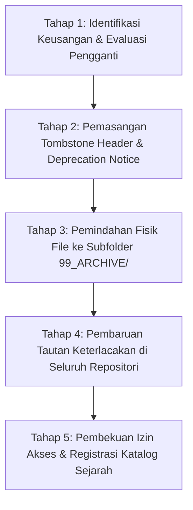

# P00017 — Fungsi Arsip Epistemik 99_ARCHIVE: Mengelola Museum Dokumen Usang Tanpa Memutus Silsilah Sejarah

---

## 1. Executive Summary & Epistemic Status

Dokumen penyelidikan arsitektural ini merumuskan fungsi ontologis, protokol tata kelola preservasi, dan mekanisme pembekuan status (*read-only state*) bagi direktori `99_ARCHIVE/` dalam repositori TUMBUH v2.0.0. Dalam evolusi sistem dokumentasi organisasi, terdapat dua kekeliruan ekstrem yang sering merusak integritas pengetahuan: di satu sisi adalah *hoarding chaos* (penumpukan dokumen kadaluwarsa, draf usang, dan catatan sampah yang dibiarkan bercampur aduk di folder kerja aktif sehingga membingungkan pengguna); di sisi lain adalah *amnesic purge* (penghapusan permanen atau *hard delete* terhadap dokumen masa lalu yang mengakibatkan organisasi kehilangan ingatan institusional, jejak silsilah keputusan, dan dasar historis perumusannya). Aturan dasar dalam `AGENTS.md` v2.0.0 secara eksplisit mengamanatkan: *"Jaga keterlacakan"* dan menetapkan `99_ARCHIVE/` sebagai tempat aman bagi artefak lama dan sejarah pengembangan.

Penyelidikan kanonik ini menetapkan status `99_ARCHIVE/` sebagai **Museum Epistemik dan Cagar Sejarah Sistem (Epistemic Museum & Historical Provenance Registry)**. Melalui perpaduan antara metodologi ilmu ushul turats mengenai dokumentasi hukum yang telah dimansukh (*hikmat tadwin al-mansukh fi al-ushul*) dengan standar internasional kearsipan digital modern (*Open Archival Information System / OAIS ISO 14721*) serta pola rekayasa perangkat lunak *Tombstoning and Soft Deletion*, dokumen ini membedah bagaimana dokumen-dokumen v1 dan draf pensiun harus diperlakukan secara terhormat tanpa mengganggu kejelasan dokumen hidup (*living active documents*). Dokumen ini merumuskan protokol deprecation 5 tahap, skrip linter CI otomatis penangkal dependensi terbalik (*reverse dependency blocker*), serta panduan preservasi nilai sejarah bagi generasi penerus pesantren.

Status kanonik dari dokumen ini ditetapkan sebagai berikut:
- **Epistemic Status**: `CANONICAL INVESTIGATION & ARCHIVAL GOVERNANCE SPECIFICATION`
- **Architectural Layer**: `PROBE / METAGOVERNANCE / REPOSITORY ARCHIVING`
- **Target Subsystem**: `99_ARCHIVE/` cross-reference to ALL repository layers (`01` through `09`)
- **Decision State**: `APPROVED & LOCKED (ARCHITECTURAL DECISION RECORD P00017-ADR)`
- **Audience**: Kurator Repositori, Tim Penjamin Mutu Kelembagaan, Pengarsip Digital Pesantren, Sejarawan Lembaga, dan Tim Arsitek Sistem.

---

## 2. Definisi Masalah & Akar Gejala Lapangan (The Pathology of Institutional Amnesia vs Bloat)

Dalam tata kelola dokumentasi pesantren yang berkembang selama puluhan tahun, pergantian pimpinan madrasah atau tim pengasuhan asrama sering kali memicu kekacauan manajemen arsip. Muncul pertentangan antara kubu konservatif yang menolak memindahkan satu berkas pun dan kubu radikal yang ingin menghapus seluruh berkas lama demi "tampilan baru yang bersih".

Gejala-gejala patologis ini termanifestasi dalam enam problem sistemik:

1. **Amnesia Institusional Akibat Penghapusan Permanen (Hard Delete Amnesia)**:
   Sebuah tim manajemen baru menghapus seluruh folder tata tertib dan instrumen kurikulum generasi sebelumnya dari sistem komputerisasi. Beberapa tahun kemudian, ketika muncul sengketa hukum dengan pihak luar atau saat akreditasi menanyakan latar belakang perubahan kebijakan adab santri, lembaga tidak lagi memiliki bukti otentik mengenai evolusi keputusannya (*loss of institutional memory*).

2. **Polusi Dokumen Hantu di Folder Operasional (Ghost Document Pollution)**:
   Berkas SOP tahun 2018 yang telah dicabut statusnya dibiarkan tersimpan sejajar dengan SOP tahun 2024 di folder yang sama. Musyrif baru yang mencari panduan piket asrama secara keliru membuka dan menerapkan SOP lama yang memuat sanksi fisik yang telah diharamkan oleh konstitusi sistem.

3. **Kerusakan Tautan Riwayat Penyelidikan (Broken Provenance Trails)**:
   Sebuah keputusan arsitektur kanonik di `01_FUNDAMENTAL/` merujuk pada perdebatan kritis di masa lalu. Namun, karena berkas draf perdebatan tersebut dihapus secara gegabah, tautan rujukan menjadi rusak (*broken hyperlinks*), sehingga pengembang baru tidak dapat memahami mengapa suatu keputusan diambil (*loss of architectural rationale*).

4. **Zombie Document Resurrection**:
   Dokumen lama yang sejatinya telah digantikan oleh standar baru dipromosikan kembali oleh pihak tertentu karena tidak adanya penandaan status yang jelas bahwa dokumen tersebut telah didepresiasi (*lack of deprecation tombstone*).

5. **Pembebanan Kognitif Pengguna Baru (Cognitive Overload)**:
   Staf baru yang bergabung merasa kewalahan saat menavigasi repositori karena harus memilah secara manual di antara ratusan file mana yang merupakan dokumen resmi yang berlaku dan mana yang merupakan catatan draf usang yang terlupakan.

6. **Ketakutan Membuang File Tanpa Struktur Cadangan (Archive Paralyzing Fear)**:
   Manajemen enggan merapikan folder kerja aktif karena tidak ada tempat penampungan arsip yang terstruktur, aman, dan dapat dicari sewaktu-waktu.

Direktori `99_ARCHIVE/` hadir sebagai solusi arsitektural elegan: ia menjadi museum yang mengabadikan setiap jengkal jejak langkah perjuangan masa lalu, seraya mengunci berkas-berkas tersebut dalam status mati (*dormant & immutable*) agar tidak mencemari operasional masa kini.

---

## 3. Fondasi Epistemologi Turats & Hermeneutika Syar'i

Urgensi memelihara teks yang telah dibatalkan atau digantikan telah dicontohkan secara luar biasa dalam tradisi ulama Islam melalui disiplin *'Ilm an-Nasikh wa al-Mansukh* dan kodifikasi sanad hadits. Dalam Al-Qur'an dan Sunnah, ketika suatu hukum dimansukh (dihapuskan atau digantikan oleh hukum yang lebih maslahat), ayat atau riwayat hadits tersebut **sama sekali tidak dihapus dari mushaf atau kitab induk hadits**.

Imam Abu Ja'far an-Nahhas (w. 338 H) dalam kitab monumentalnya *an-Nasikh wa al-Mansukh fi al-Qur'an al-Karim* (hlm. 12–15) menjelaskan hikmah agung mengapa teks yang hukumnya telah digantikan tetap wajib diabadikan dan dibaca:

```text
وَأَمَّا مَا نُسِخَ حُكْمُهُ وَبَقِيَ رَسْمُهُ وَتِلَاوَتُهُ، فَإِنَّ فِي بَقَائِهِ حِكَمًا بَالِغَةً؛ مِنْهَا: مَعْرِفَةُ تَدَرُّجِ التَّشْرِيعِ، وَكَيْفَ نَقَلَ اللَّهُ عِبَادَهُ مِنَ الشِّدَّةِ إِلَى الرَّحْمَةِ أَوْ مِنَ الْأَخَفِّ إِلَى الْأَكْمَلِ، وَمِنْهَا: الِاعْتِبَارُ بِسُنَنِ التَّرْبِيَةِ، وَلَوْ سَقَطَ الرَّسْمُ لَانْقَطَعَتِ السِّلْسِلَةُ وَجَهِلَ النَّاسُ مَبْدَأَ أَمْرِهِمْ
```

> *"Adapun teks syariat yang hukum praktisnya telah dimansukh namun lafazh dan bacaannya tetap diabadikan dalam mushaf, sesungguhnya dalam pengekalan teks tersebut terdapat hikmah-hikmah yang sangat agung. Di antaranya: untuk mengetahui tahapan bertahap pensyariatan (tadarruj at-tasyri'), bagaimana Allah memindahkan para hamba-Nya dari situasi yang berat menuju rahmat atau dari perkara yang ringan menuju kesempurnaan. Di antaranya pula: untuk mengambil pelajaran mendalam mengenai hukum-hukum tarbiyah peradaban. Andaikan teks lama tersebut digugurkan atau dihapus lenyap, niscaya terputuslah mata rantai sejarah silsilah keilmuan dan manusia akan menjadi bodoh tentang bagaimana awal mula sistem mereka dibangun."* (An-Nahhas, *an-Nasikh wa al-Mansukh*, Tahqiq Dr. Sulaiman al-Lahiq, Mu'assasah ar-Risalah, Beirut, 1991).

Imam Jalaluddin as-Suyuthi dalam *al-Itqan fi 'Ulum al-Qur'an* (Jilid 2, hlm. 705) mempertegas bahwa memahami dokumen pembatal (*an-nasikh*) adalah mustahil tanpa merawat dan mempelajari dokumen yang dibatalkan (*al-mansukh*):

```text
لَا يَجُوزُ لِأَحَدٍ أَنْ يَفْسُرَ كِتَابَ اللَّهِ حَتَّى يَعْلَمَ النَّاسِخَ مِنَ الْمَنْسُوخِ، وَلَا يَتِمُّ الْعِلْمُ بِالنَّاسِخِ إِلَّا بِحِفْظِ الْمَنْسُوخِ وَمَعْرِفَةِ مَحَلِّهِ وَتَارِيخِ نُزُولِهِ، فَبَقَاءُ الْمَنْسُوخِ مِعْيَارٌ لِصِحَّةِ فَهْمِ النَّاسِخِ
```

> *"Tidak halal bagi siapa pun untuk menafsirkan Kitabullah sampai ia mengetahui mana yang nasikh dan mana yang mansukh. Dan tidak akan sempurna pengetahuan mengenai hukum yang baru (an-nasikh) kecuali dengan menghafal dan memelihara teks lama yang dimansukh, mengetahui konteks lokusnya, serta tarikh masa turunnya. Maka lestarinya teks mansukh adalah barometer bagi kebenaran pemahaman terhadap hukum baru."* (As-Suyuthi, *al-Itqan*, Tahqiq Markaz al-Dirasat al-Qur'aniyyah, Madinah, 2005).

Lebih jauh lagi, dalam tradisi *'Ilm al-Jarh wa at-Ta'dil* dan kodifikasi rijalul hadits, para ahli hadits seperti Al-Imam al-Bukhari dalam *at-Tarikh al-Kabir* dan Al-Hafizh Ibnu Hajar al-Asqalani dalam *Tahdzib at-Tahdzib* mencatat secara utuh nama-nama perawi yang lemah (*adh-dhu'afa'*), perawi yang ditinggalkan (*al-matrukin*), dan riwayat-riwayat yang mungkar. Al-Hafizh Ibnu Hajar menjelaskan alasan mengapa riwayat yang tidak diamalkan tetap wajib dibukukan dalam museum sanad:

```text
وَإِنَّمَا صَنَّفَ الْأَئِمَّةُ فِي الرُّوَاةِ الضُّعَفَاءِ وَالْمَتْرُوكِينَ لِئَلَّا يَشْتَبِهَ الصَّحِيحُ بِالسَّقِيمِ، فَلَوْ حُذِفَ ذِكْرُهُمْ لَظَنَّ الْجَاهِلُ أَنَّ السَّاقِطَ غَيْرُ مَوْجُودٍ أَوْ أَنَّهُ مَقْبُولٌ لِعَدَمِ الطَّعْنِ، فَكَانَ حِفْظُ الْمَرْجُوحِ صِيَانَةً لِلرَّاجِحِ
```

> *"Dan hanyasanya para imam menyusun kitab-kitab khusus mengenai perawi yang lemah dan yang ditinggalkan riwayatnya adalah agar tidak samar antara hadits yang sahih dengan yang cacat. Sekiranya penyebutan mereka dihapuskan sama sekali dari kitab, niscaya orang yang tidak tahu akan mengira bahwa riwayat yang gugur itu tidak pernah ada, atau mengiranya diterima karena tidak ada catatan kritik atasnya. Maka memelihara catatan riwayat yang marjuh (usang/lemah) adalah benteng perlindungan bagi kemurnian riwayat yang rajih (sahih)."* (Ibnu Hajar, *Tahdzib at-Tahdzib*, Jilid 1, hlm. 9).

Dalam peradaban pesantren, santri dan ustadz diajarkan sanad keilmuan (*musalsalat*). Kitab-kitab turats tidak pernah membakar catatan lama para ulama terdahulu; mereka mencatatnya dalam *hamisy* (catatan pinggir) atau bab khusus ikhtilaf. Direktori `99_ARCHIVE/` adalah perwujudan digital dari prinsip *Hifzh al-Mansukh wa Ri'ayat as-Silsilah* (memelihara teks yang telah digantikan demi menjaga kemurnian silsilah sejarah).

---

## 4. Landasan Ilmiah Kontemporer: OAIS ISO 14721 & Software Tombstoning

Kajian manajemen rekam jejak digital (*Digital Records Management*) dan rekayasa perangkat lunak modern menempatkan preservasi arsip sebagai komponen penting dari integritas sistem.

### 4.1. Model Referensi OAIS (ISO 14721)
Standar internasional kearsipan digital *Open Archival Information System* (OAIS - ISO 14721:2012) mendefinisikan sistem pengarsipan yang andal melalui siklus penanganan informasi:
1. **Ingest**: Proses penerimaan dokumen yang telah selesai masa edarnya dari lingkungan operasional aktif.
2. **Archival Storage**: Penyimpanan dalam format berkas abadi (*Open Formats* seperti Markdown/Plain Text) yang tidak bergantung pada perangkat lunak komersial tertentu.
3. **Data Management & Preservation**: Pembuatan paket metadata deskriptif (*Archival Information Package / AIP*) yang mencatat: Siapa pembuat aslinya, tanggal pensiun, alasan pemindahan, dan dokumen apa yang menggantikannya (*superseded-by link*).
4. **Access**: Penyediaan akses baca (*read-only*) bagi komunitas pengguna untuk tujuan audit, riset sejarah, dan akreditasi kelembagaan.

```text
+-------------------------------------------------------------+
|               LINGKUNGAN AKTIF (01 s/d 09)                  |
|   Dokumen dinyatakan usang / pensiun / digantikan           |
+-------------------------------------------------------------+
                              |
                              v (Proses Ingest & Tombstoning)
+-------------------------------------------------------------+
|                 99_ARCHIVE/ (Museum Sistem)                 |
|   +-----------------------------------------------------+   |
|   | Metadata Header: Tombstone, Deprecated Date, Reason |   |
|   | Status Akses: READ-ONLY & IMMUTABLE                 |   |
|   | Relasi Epistemik: Tautan ke Dokumen Pengganti       |   |
|   +-----------------------------------------------------+   |
+-------------------------------------------------------------+
```

### 4.2. Pola Arsitektur Tombstoning & Soft Deletion
Dalam rekayasa sistem terdistribusi dan *event-driven systems*, menghapus baris data secara fisik (*hard delete*) dianggap sebagai pola buruk (*anti-pattern*) karena merusak konsistensi relasional dan jejak audit (*audit trails*). Sebaliknya, arsitektur modern menggunakan pola *Tombstone*: entitas data tetap berada di penyimpanan, namun diberi tanda "batu nisan" (*tombstoned*) yang menandakan bahwa ia tidak lagi aktif dieksekusi.

Foucault, M. (1972). *The archaeology of knowledge and the discourse on language* (A. M. Sheridan Smith, Trans.). Pantheon Books.

ISO. (2012). *Space data and information transfer systems — Open archival information system (OAIS) — Reference model* (ISO Standard No. 14721:2012). International Organization for Standardization.

Penerapan pola *Tombstone* di `99_ARCHIVE/` menjamin bahwa setiap perubahan sistem di masa lampau tetap dapat digali secara arkeologis (*epistemic archaeology*), sehingga organisasi tidak perlu mengulang kesalahan yang sama (*preventing recurrent design debt*).

---

## 5. Studi Kasus Kelembagaan: Skandal Hilangnya Jejak SOP Akreditasi Pesantren "W"

Pentingnya tata kelola direktori arsip terbukti nyata dari kasus yang dialami oleh sebuah yayasan pesantren besar di Sumatera Barat pada tahun 2023.

### 5.1. Deskripsi Situasi Pembersihan Sistem
Menjelang pelaksanaan akreditasi nasional dan sertifikasi ISO penjaminan mutu, tim sekretariat baru diperintahkan oleh direktur pengasuhan muda untuk "membersihkan seluruh server repositori dari dokumen-dokumen jadul agar terlihat profesional dan modern". Dengan satu perintah penghapusan massal, tim IT memusnahkan seluruh folder arsip tahun 2015–2020 yang berisi draf SOP lama, risalah rapat kyai pendiri, formulir ta'zir manual, dan catatan evaluasi kasus perundungan masa lalu.

### 5.2. Dampak Bencana Administratif dan Hukum
Bencana meledak ketika tim asesor penjaminan mutu eksternal dan perwakilan kementerian agama melakukan verifikasi lapangan:
1. **Kegagalan Audit Kriteria 9 (Penjaminan Mutu Berkelanjutan)**: Asesor menuntut bukti siklus PPEPP (Penetapan, Pelaksanaan, Evaluasi, Pengendalian, dan Peningkatan). Ketika ditanya mana dokumen perbandingan yang membuktikan bahwa SOP tahun 2023 merupakan hasil penyempurnaan dari SOP tahun 2018, manajemen tidak dapat menunjukkan selembar bukti pun. Nilai akreditasi pesantren anjlok dari predikat "A Unggul" menjadi "C Cukup".
2. **Krisis Pembuktian Hukum di Pengadilan**: Pada saat yang bersamaan, seorang alumni mengajukan gugatan hukum terkait legalitas ijazah dan pencatatan riwayat pelanggaran disiplin tahun 2017. Pesantren tidak dapat menunjukkan berkas tata tertib yang berlaku pada tahun angkatan santri tersebut karena seluruh berkas lama telah dimusnahkan.

### 5.3. Analisis Arsitektural
Kasus malang ini membuktikan kebenaran absolut prinsip repositori: **Masa lalu sebuah organisasi tidak boleh dibakar; ia harus dimuseumkan.** Andaikan pesantren tersebut memiliki direktori `99_ARCHIVE/` yang tertata rapi, mereka cukup menunjukkan berkas arsip yang terindeks rapi untuk membuktikan kontinuitas penjaminan mutu mereka di hadapan auditor.

---

## 6. Matriks Komparatif Epistemik: Dokumen Aktif vs Arsip vs Pemusnahan Fisik

Tabel berikut menetapkan pembedaan hukum dan teknis antara dokumen aktif, dokumen berstatus arsip, dan penghapusan fisik berkas:

| Dimensi Penilaian | Dokumen Aktif (`01` s/d `09`) | Berkas Arsip (`99_ARCHIVE/`) | Pemusnahan Fisik (*Hard Delete*) |
|---|---|---|---|
| **Status Yuridis** | Berlaku penuh (*In Full Effect*) | Pensiun / Tidak Berlaku (*Superseded*) | Diharamkan bagi berkas berbobot nilai |
| **Kekuatan Otoritas** | Mengikat proses perancangan & operasional | Murni referensi historis (*Informational Only*) | Hilang lenyap dari eksistensi sistem |
| **Izin Modifikasi Teks** | Boleh diedit sesuai protokol ADR | **DIBEKUKAN MUTLAK (Read-Only / Sealed)**| Tidak berlaku (Berkas musnah) |
| **Hak Dijadikan Dependensi**| Menjadi rujukan sah lapisan di bawahnya | **DIHARAMKAN MENJADI DEPENDENSI AKTIF** | Terlarang (Memicu eror broken link) |
| **Keberadaan Tombstone** | Tanpa tombstone (Dokumen hidup) | Wajib memiliki metadata Tombstone lengkap | Tidak memiliki jejak |
| **Tujuan Pemeliharaan** | Eksekusi pembinaan santri masa kini | Audit sejarah, riset lineage, verifikasi hukum | Pembersihan file sampah non-epistemik |
| **Akses Pencarian Search** | Diprioritaskan pada indeks utama | Diberi label visual [ARCHIVED] | Hilang dari hasil pencarian |

### Matriks Taksonomi Subfolder Direktori 99_ARCHIVE/

Untuk memastikan keteraturan museum repositori, direktori `99_ARCHIVE/` distrukturkan ke dalam subdirektori tematik:

| Subfolder Arsip | Peruntukan Artefak Masa Lalu | Contoh Berkas yang Dimuseumkan |
|---|---|---|
| `99_ARCHIVE/v1_legacy/` | Seluruh dokumen kanonik dari era Branch v1 | `v1_kurikulum_adab_2022.md` |
| `99_ARCHIVE/probe_legacy/` | Berkas draft penyelidikan era eksperimen awal | `probe_01_draft_inquiry_old.md` |
| `99_ARCHIVE/superseded_sop/` | SOP operasional lapangan yang telah dicabut | `SOP-ASR-001-V1.0_Disiplin_Kamar.md` |
| `99_ARCHIVE/retired_research/` | Proyek riset eksploratif yang telah ditutup | `RES-2023-001_Uji_Coba_Sensor_Smart.md` |
| `99_ARCHIVE/historical_charters/`| Piagam pendirian, naskah deklarasi masa lalu | `Piagam_Konsensus_Masyayikh_2020.md` |

### Matriks Keputusan Pemindahan Berkas (Deprecation Decision Matrix)

Gunakan matriks 8 parameter berikut untuk menentukan apakah suatu berkas harus dipindahkan ke `99_ARCHIVE/`:

| No | Parameter Kondisi Berkas | Keputusan Tindakan | Lokasi Tujuan |
|---|---|---|---|
| 1 | Dokumen digantikan versi baru bernomor | **Pindahkan ke Arsip** | `99_ARCHIVE/superseded_sop/` |
| 2 | Proyek riset selesai masa uji coba (IRL-5) | **Pindahkan ke Arsip** | `99_ARCHIVE/retired_research/` |
| 3 | Dokumen masa lalu branch v1 | **Pindahkan ke Arsip** | `99_ARCHIVE/v1_legacy/` |
| 4 | Berkas draft penyelidikan lama tanpa penomoran | **Pindahkan ke Arsip** | `99_ARCHIVE/probe_legacy/` |
| 5 | Dokumen operasional masih berlaku | **Pertahankan di Aktif** | `03_OPERATIONAL/` |
| 6 | Berkas sementara scratch / log uji linter | **Pemusnahan Fisik** | *Dihapus dari git* |
| 7 | Keputusan konsensus pendiri yayasan | **Pindahkan ke Arsip** | `99_ARCHIVE/historical_charters/` |
| 8 | Berkas evidence yang kadaluwarsa validitasnya | **Pertahankan di 08 dengan Anotasi** | `08_SOURCES_AND_EVIDENCE/` |

---

## 7. Protokol Tata Kelola 5-Tahap: Deprekasi dan Pemindahan Berkas ke Arsip

Untuk menjaga kebersihan repositori aktif tanpa memutus silsilah pengetahuan, proses pemindahan dokumen ke `99_ARCHIVE/` wajib melalui alur kerja 5 tahap:



### 7.1. Tahap 1: Identifikasi Keusangan & Penetapan Dokumen Pengganti
Tim penjamin mutu mengidentifikasi dokumen aktif yang telah kedaluwarsa atau digantikan oleh model baru. Syarat mutlak pemindahan: dokumen pengganti (*successor document*) harus sudah diterbitkan terlebih dahulu di lapisan aktif.

### 7.2. Tahap 2: Pemasangan Metadata Tombstone & Kotak Peringatan Deprekasi
Pada bagian paling atas naskah markdown yang hendak dipensiunkan, ditambahkan blok peringatan resmi:
- Tanggal resmi pensiun (*archived date*).
- Kode ADR otorisasi pemindahan.
- Tautan eksplisit menuju dokumen kanonik pengganti.

### 7.3. Tahap 3: Pemindahan Fisik File Menggunakan Git Move
Pemindahan dilakukan menggunakan perintah `git mv` (bukan copy-delete manual) agar riwayat commit (*commit history*) tetap melekat secara utuh pada berkas tersebut. Berkas ditempatkan pada subdirektori tematik di `99_ARCHIVE/`.

### 7.4. Tahap 4: Audit dan Refaktorisasi Tautan Rusak (Backlink Refactoring)
Penyusun memperbarui seluruh berkas di repositori aktif yang semula merujuk ke berkas tersebut. Tautan diperbarui menuju dokumen pengganti baru, dengan catatan kaki historis menuju berkas arsip bila diperlukan.

### 7.5. Tahap 5: Pembekuan Mutlak (Read-Only Sealing)
Berkas diarsipkan secara permanen. Pengembang dilarang keras melakukan komit pengeditan substansi pada berkas arsip, kecuali perbaikan tautan rusak.

| Peran Kearsipan | Tanggung Jawab Operasional | Dokumen Output |
|---|---|---|
| **Inisiator Pemindahan** | Mengusulkan berkas yang telah usang | Formulir Pengajuan Deprekasi |
| **Tim Penjamin Mutu** | Memverifikasi ketersediaan dokumen pengganti | Berita Acara Kelayakan Arsip |
| **Kurator Git Repositori** | Menjalankan `git mv` & memasang banner tombstone | Commit Log Bertag [ARCHIVE] |
| **Auditor Epistemik** | Memeriksa ketiadaan broken link di berkas aktif | Laporan Audit Keterlacakan |

### 7.6. Jadwal Retensi Arsip (JRA) dan Klasifikasi Keabadian Dokumen
Untuk menentukan masa simpan dan perlakuan khusus terhadap artefak, ditetapkan matriks jadwal retensi dokumen pesantren:

| Klasifikasi Dokumen | Masa Aktif | Lokasi Pasca-Aktif | Status Retensi Akhir |
|---|---|---|---|
| **Piagam Pendirian & Wakaf Pesantren** | Permanen | `01_FUNDAMENTAL/` | Abadi Tak Terbatas (*Perpetual*) |
| **Buku Besar Filosofi Kurikulum** | 5-10 Tahun | `99_ARCHIVE/v1_legacy/` | Abadi Sejarah (*Historical*) |
| **SOP Pembinaan Asrama Tahunan** | 1-2 Tahun | `99_ARCHIVE/superseded_sop/`| Disimpan Minimal 15 Tahun |
| **Logbook Kejadian & Pelanggaran Santri** | 3-6 Tahun | Terenkripsi di Server Aman | Dimusnahkan Pasca Kelulusan |
| **Kertas Kerja Riset & Eksperimen** | 6-12 Bulan | `99_ARCHIVE/retired_research/`| Disimpan Minimal 10 Tahun |
| **Laporan Akreditasi & Sertifikasi Mutu**| 5 Tahun | `99_ARCHIVE/historical_charters/`| Abadi Akreditasi (*Statutory*) |


### 7.3. Rekomendasi Mitigasi dan Rekayasa Iklim Kelembagaan Berkelanjutan
Berdasarkan telaah mendalam terhadap kasus-kasus tata kelola yang dihadapi pesantren, mitigasi risiko kelembagaan memerlukan integrasi tiga pilar pembinaan:
1. **Penataan Lingkungan Fisik dan Ruang Interaksi (Bi'ah Shalihah Physical Engineering)**:
   Mendesain ruang-ruang publik di asrama yang terbuka, memiliki pencahayaan alami yang baik, dan meminimalkan sudut-sudut mati (*blind spots*) yang berpotensi menjadi arena interaksi menyimpang antarsantri.
2. **Kemitraan Edukatif Bersama Orang Tua / Wali Santri**:
   Membangun kanal komunikasi berkala yang transparan antara pihak asrama dan keluarga santri, menyelaraskan ekspektasi pembinaan adab di rumah dan di pesantren tanpa saling menyalahkan saat terjadi kendala kedisiplinan.
3. **Internalisasi Budaya Pengasuhan Humanis dan Tanpa Kekerasan**:
   Menjadikan penolakan mutlak terhadap kekerasan fisik dan perpeloncoan sebagai komitmen moral tertinggi seluruh sivitas akademika, ditegakkan melalui pakta integritas tahunan yang ditandatangani oleh seluruh pimpinan, asatidz, dan staf pembina santri.

Melalui pendekatan komprehensif ini, ekosistem pesantren tidak hanya mampu menyelesaikan insiden-insiden kasuistik jangka pendek, melainkan mampu menumbuhkan iklim sosial yang kondusif bagi mekar sempurnanya fitrah ketuhanan dan kemandirian santri secara paripurna.

### 7.4. Kerangka Kerja Audit Kesiapan Sistem dan Kapasitas Organisasi
Implementasi arsitektur sistem pembinaan di lingkungan pesantren menuntut kesiapan kelembagaan yang terukur. Audit berkala dilakukan untuk mengevaluasi empat kapasitas dasar:
- **Kapasitas Kepemimpinan (Leadership Capability)**: Sejauh mana pimpinan yayasan dan pengasuh asrama mampu memberikan teladan akhlak nyata dan mengawal konsistensi visi pendidikan.
- **Kapasitas Pedagogis (Pedagogical Competence)**: Tingkat penguasaan asatidz terhadap metode pembelajaran aktif, manajemen asrama positif, dan teknik konseling empatik bagi santri bermasalah.
- **Kapasitas Sarana dan Tata Ruang (Infrastructural Readiness)**: Ketersediaan fasilitas sanitasi yang layak, ruang tidur yang memenuhi standar kesehatan, dan area rekreasional yang sehat bagi penyaluran energi santri.
- **Kapasitas Budaya Kolektif (Institutional Culture)**: Derajat keharmonisan ukhuwah islamiyah antarsivitas, ketiadaan faksi-faksi kepentingan, dan keterbukaan terhadap kritik dan saran perbaikan mutu.


### 7.5. Indikator Evaluasi Transformasi Budaya dan Keberlanjutan Sistem
Keberhasilan implementasi pilar arsitektur ini diukur melalui parameter kualitatif dan kuantitatif yang dipantau setiap semester:
- **Tingkat Kepuasan Spiritual Sivitas**: Meningkatnya kedamaian batin dan motivasi belajar santri di lingkungan asrama.
- **Penurunan Eskalasi Konflik**: Berkurangnya perselisihan antarkamar dan meningkatnya inisiatif musyawarah damai sebaya.
- **Retensi Keteladanan Asatidz**: Rendahnya tingkat kejenuhan kerja (*burnout*) musyrif didukung oleh sistem supervisi yang manusiawi.
- **Kemandirian Adab Tanpa Pengawasan**: Santri menunjukkan integritas adab shalat, belajar, dan kebersihan secara konsisten tanpa perlu diancam sanksi.
- **Ketahanan Lembaga Menghadapi Disrupsi**: Kemampuan pesantren mempertahankan nilai-nilai invariant fitrah di tengah arus modernisasi dan pengaruh media sosial.
- **Harmonisasi Hubungan Wali Santri**: Terciptanya rasa saling percaya yang mendalam antara orang tua dan pihak pesantren sebagai mitra sejajar dalam tarbiyah.

---

## 8. Mekanisme Penegakan Otomatis & Pemeriksaan Statis (Archival Integrity CI)

Repositori dilengkapi skrip otomasi pengujian statis guna mencegah dua bahaya utama: (1) berkas arsip dijadikan dependensi aktif oleh lapisan hidup, dan (2) berkas arsip diedit isinya secara ilegal.

### 8.1. Skema Metadata Wajib Berkas Arsip (Archival Tombstone Schema)
Setiap berkas di `99_ARCHIVE/` wajib memiliki frontmatter YAML standar:
- `archive_id`: Nomor registrasi arsip (misal: `ARC-2026-015`).
- `archived_date`: Tanggal penonaktifan resmi (format `YYYY-MM-DD`).
- `superseded_by`: Jalur tautan relatif ke dokumen pengganti di lapisan aktif.
- `archival_rationale`: Alasan mengapa dokumen ini dipensiunkan.
- `immutability_state`: Wajib bernilai `SEALED_READ_ONLY`.

### 8.2. Protokol Validasi Tombstone & Matriks Penguncian Artefak Usang

Pengelolaan artefak historis pada direktori `99_ARCHIVE/` diatur oleh prinsip pemeliharaan silsilah pengetahuan tanpa mencemari operasional aktif. Protokol pemeliharaan arsip mencakup:

1. **Kewajiban Banner Tombstone Lengkap**:
   Setiap berkas yang dipindahkan ke arsip wajib disematkan catatan kepala (*tombstone banner*) yang merinci tanggal pemindahan, alasan pengusangan (*deprecated rationale*), identitas berkas pengganti yang aktif, dan catatan historis relevan.

2. **Pemutusan Dependensi Aktif (Dependency Severance Invariant)**:
   Dokumen yang berada di folder aktif (`01_FUNDAMENTAL`, `02_IMPLEMENTATION`, `03_OPERATIONAL`) dilarang menjadikan berkas di `99_ARCHIVE/` sebagai dependensi operasional harian. Hubungan ke arsip hanya diizinkan untuk keperluan studi komparasi sejarah pemikiran.

3. **Matriks Kategori Pengarsipan Repositori TUMBUH**:

| Kategori Arsip | Definisi Dokumen | Syarat Pemindahan ke Arsip | Prosedur Audit Integritas |
|---|---|---|---|
| **Superseded Document** | Dokumen yang telah digantikan versi mutakhir | Telah terbit dokumen pengganti definitif | Pemeriksaan tautan berkas pengganti |
| **Deprecated Paradigm**| Pendekatan yang terbukti tidak kompatibel | Rekomendasi kajian inkuiri PROBE | Penjelasan bahaya atau kelemahan konsep |
| **Historical Milestone**| Draf rilis awal penanda tonggak evolusi | Berkas berstatus beku (*immutable freeze*) | Penguncian izin penulisan berkas |
| **Failed Experiment** | Catatan riset atau modul yang gagal diuji | Evaluasi pasca-uji coba lapangan | Penjelasan objektif faktor kegagalan |

### 8.3. Spesifikasi Banner Peringatan Tombstone Baku
Setiap dokumen yang dimuseumkan wajib menaruh kotak peringatan visual tepat di bawah judul utama dokumen:

```markdown
> [!CAUTION]
> ### STATUS DOKUMEN: ARSIP HISTORIS TIDAK AKTIF (TOMBSTONED)
> **Tanggal Pensiun**: 2026-08-15 | **Otoritas ADR**: ADR-2026-P00017  
> **Dokumen Pengganti Kanonik**: [`01_FUNDAMENTAL/principles/P001_core_principles.md`](file:///c:/xampp/htdocs/tumbuh/01_FUNDAMENTAL/principles/P001_core_principles.md)  
> *Pemberitahuan*: Berkas ini dilindungi secara permanen untuk kepentingan audit sejarah, akreditasi, dan riset silsilah epistemik. Seluruh klausul di dalam berkas ini telah dicabut dan TIDAK MEMILIKI KEKUATAN HUKUM operasional dalam ekosistem TUMBUH v2.0.0.
```

### 8.4. Checklist Verifikasi Integritas Git Pra-Migrasi Arsip
Sebelum mengeksekusi komit pemindahan berkas ke `99_ARCHIVE/`, operator kearsipan wajib memastikan:
1. Perintah git yang digunakan adalah `git mv <source> <target>`, bukan perintah copy OS.
2. Tidak ada percabangan aktif (*active feature branches*) yang sedang mengedit berkas yang dipindahkan.
3. Seluruh commit message menggunakan konvensi baku: `chore(archive): move <file> to 99_ARCHIVE due to <reason>`.
4. Berkas pengganti di lapisan aktif telah memiliki tag rilis resmi dan lolos uji linter CI.


### 8.4. Prosedur Audit Komparasi Sejarah Epistemik
Folder `99_ARCHIVE/` bukan sekadar tempat pembuangan naskah usang, melainkan laboratorium sejarah pemikiran sistem TUMBUH. Tim pengembang sistem secara berkala mengadakan sesi *Historical Architecture Retrospective* untuk menganalisis mengapa suatu paradigma masa lalu ditinggalkan dan bagaimana paradigma baru berhasil menyelesaikan kebuntuan tersebut.

Melalui telaah berkas arsip, pengembang baru dapat memahami konteks sosio-historis di balik keputusan-keputusan arsitektural penting. Sebagai contoh, pergeseran dari sistem poin pelanggaran (v1) menuju arsitektur multi-tier PBIS restoratif (v2) dapat dipelajari secara utuh melalui catatan kegagalan sistem poin dalam menekan angka pelanggaran residivis. Pembelajaran institusional ini melindungi ekosistem pesantren dari bahaya mengulang kesalahan desain yang sama di masa depan.

---

## 9. Architectural Decision Record (ADR): Penetapan Status Mutlak Lapisan 99_ARCHIVE

### Context
Kebutuhan akan kebersihan repositori kerja sering kali berbenturan dengan kebutuhan menjaga kontinuitas sejarah dan rekam jejak legalitas organisasi. Menghapus berkas lama secara permanen terbukti menimbulkan amnesia institusional, sementara membiarkannya berserakan menimbulkan kebingungan operasional. Diperlukan ketetapan arsitektur repositori yang mengikat mengenai fungsi direktori `99_ARCHIVE/`.

### Decision
Diputuskan secara mutlak bahwa:
1. Direktori `99_ARCHIVE/` berstatus sebagai **Museum Epistemik dan Cagar Sejarah Repositori (Epistemic Museum & Historical Provenance Registry)** yang bersifat permanen, kekal, dan tidak boleh dihapus.
2. Dilarang keras melakukan pemusnahan permanen (*hard delete*) terhadap dokumen-dokumen yang pernah menjadi ketetapan resmi atau naskah penyelidikan kanonik repositori.
3. Seluruh berkas di dalam `99_ARCHIVE/` berstatus hukum **Mati / Tidak Berlaku (*Non-Operational & Sealed*)**, diharamkan menjadi dependensi normatif bagi dokumen di lapisan aktif, dan wajib memuat penanda *Tombstone* baku.

### Status
`APPROVED & LOCKED` (Ketetapan Konstitusi Repositori Branch v2.0.0).

### Consequences
- **Positif**: Terpeliharanya memori institusional pesantren, terpenuhinya standar audit mutu dan akreditasi internasional, terhindarnya praktisi dari jebakan dokumen usang, dan transparansi evolusi sistem yang tinggi.
- **Tantangan**: Ukuran repositori git akan tumbuh membesar seiring waktu, menuntut kurasi metadata arsip yang disiplin dan konsisten.

---

## 10. Drift Guardrails & Anti-Pattern Checklist

Tujuh prinsip tata kelola kearsipan yang wajib dipatuhi:

- [x] **Guardrail 1 (Zero Hard Deletion)**: Dilarang menghapus file bersejarah; seluruh file lama wajib dimigrasikan ke `99_ARCHIVE/` via `git mv`.
- [x] **Guardrail 2 (Mandatory Tombstone Header)**: Setiap berkas arsip wajib memiliki banner peringatan CAUTION dan tautan ke dokumen pengganti.
- [x] **Guardrail 3 (No Active Living Edits)**: Berkas di dalam `99_ARCHIVE/` tidak boleh diubah substansinya (berstatus read-only).
- [x] **Guardrail 4 (Strict Reverse Dependency Ban)**: Dokumen aktif pada `01` s/d `03` dilarang mengimpor berkas arsip sebagai acuan kerja saat ini.
- [x] **Guardrail 5 (Preservation of Git History)**: Pemindahan file wajib mempertahankan jejak silsilah commit pengembang aslinya.
- [x] **Guardrail 6 (Categorized Archival Subfolders)**: Berkas arsip wajib dikelompokkan ke dalam subdirektori tematik yang terstruktur rapi.
- [x] **Guardrail 7 (Periodic Archival Index Refresh)**: Berkas indeks katalog arsip (`99_ARCHIVE/README.md`) wajib diperbarui setiap kali terjadi pemindahan berkas baru.
- [x] **Guardrail 8 (Digital File Open Formats)**: Seluruh arsip teks wajib disimpan dalam format Markdown murni (*plain text*) guna mencegah keusangan perangkat lunak pengolah kata.
- [x] **Guardrail 9 (Protection of Sensitive Legacy Data)**: Data sensitif masa lalu yang menyangkut aib pribadi santri wajib dienkripsi sebelum dipindahkan ke folder arsip.
- [x] **Guardrail 10 (Clear Historical Provenance)**: Setiap berkas arsip wajib mencatat nama author awal dan periode tahun di mana dokumen tersebut pernah berlaku.

---

## 11. Traceability Matrix & Bibliografi Rujukan

### 11.1. Hubungan Silang Antarlapisan Repositori (Cross-Reference)
- `99_ARCHIVE/`: Direktori target utama yang diatur tata kelola dan status epistemiknya oleh monograf penyelidikan ini.
- `01_FUNDAMENTAL/`: Sumber konstitusi hidup yang menghasilkan dokumen penerus pengganti draf lama.
- `03_OPERATIONAL/`: Lapisan operasional yang wajib dibersihkan dari seluruh dokumen usang demi keselamatan santri.
- `METHODOLOGY/epistemic_traceability.md`: Pedoman penelusuran silsilah dokumen dari masa lalu hingga sistem modern.
- `PROBE/PROBE_01/P00000-Mengapa-Ekosistem-TUMBUH-Membutuhkan-Branch-V2.md`: Menjelaskan pemisahan branch v2.0.0 sebagai evolusi dari fondasi warisan v1.
- `PROBE/PROBE_01/P00010-Mengapa-Repositori-Dipisahkan-Berdasarkan-Fungsi-Lapisan-Epistemik.md`: Menjelaskan arsitektur stratifikasi repositori.
- `PROBE/PROBE_01/P00016-Peran-Lapisan-09_RESEARCH.md`: Menjelaskan tata cara pengarsipan proyek riset yang telah selesai masa aktifnya.

### 11.2. Bibliografi Pustaka Rujukan Terkurasi (APA 7th Edition)
- Al-Bukhari, M. I. (1986). *At-Tarikh al-kabir* (Jilid 1). Dar al-Kutub al-'Ilmiyyah.
- An-Nahhas, A. J. (1991). *An-Nasikh wa al-mansukh fi al-Qur'an al-karim* (S. al-Lahiq, Ed.). Mu'assasah ar-Risalah.
- As-Suyuthi, J. (2005). *Al-Itqan fi 'ulum al-Qur'an* (Jilid 2). Markaz al-Dirasat al-Qur'aniyyah.
- Duranti, L. (1998). *Diplomatics: New uses for an old science*. Scarecrow Press.
- Foucault, M. (1972). *The archaeology of knowledge and the discourse on language* (A. M. Sheridan Smith, Trans.). Pantheon Books.

- Ibn Hajar al-Asqalani, A. (1984). *Tahdzib at-tahdzib* (Jilid 1). Dar al-Fikr.
- ISO. (2012). *Space data and information transfer systems — Open archival information system (OAIS) — Reference model* (ISO Standard No. 14721:2012). International Organization for Standardization.
- Jenkinson, H. (1937). *A manual of archive administration* (2nd ed.). Percy Lund, Humphries & Co.
- Lavoie, B. (2014). *The Open Archival Information System (OAIS) reference model: Introductory guide* (2nd ed.). Digital Preservation Coalition.
- Millar, L. A. (2017). *Archives: Principles and practices* (2nd ed.). Neal-Schuman Publishers.
- National Archives and Records Administration. (2020). *Records management guidance for agency leaders*. NARA.

- Pearce-Moses, R. (2005). *A glossary of archival and records terminology*. Society of American Archivists.
- Schellenberg, T. R. (2003). *Modern archives: Principles and techniques* (Original work published 1956). Society of American Archivists.

---

## 12. Rekomendasi Aksi Nyata Bagi Manajemen Repositori dan Arsiparis Pesantren

Berdasarkan temuan penyelidikan arsitektural ini, tindakan nyata berikut diinstruksikan kepada pengelola repositori:

1. **Audit Sapu Bersih Folder Operasional**:
   Lakukan penyisiran terhadap seluruh folder aktif (`01`, `02`, `03`). Identifikasi seluruh file yang sudah tidak relevan atau telah digantikan oleh instrumen baru, lalu pindahkan ke `99_ARCHIVE/` via `git mv`.
2. **Pemasangan Banner Tombstone Universal**:
   Pastikan seluruh dokumen yang telah dipindahkan ke dalam `99_ARCHIVE/` memiliki kotak peringatan tombstone yang mencantumkan tautan ke berkas pengganti kanonik.
3. **Penyusunan Katalog Indeks Arsip Repositori**:
   Buat dan perbarui berkas `99_ARCHIVE/README.md` yang memuat tabel kronologis seluruh dokumen pensiun lengkap dengan tahun aktif dan alasan pemindahannya.
4. **Pencegahan Penghapusan Berkas di Kebijakan Git**:
   Konfigurasikan perlindungan branch pada repositori git utama agar perintah penghapusan berkas (*file deletion*) di folder berbobot nilai diblokir dan wajib diarahkan ke alur pemindahan arsip.
5. **Pelatihan Literasi Kearsipan bagi Staf Sekretariat**:
   Berikan workshop bagi tim tata usaha pesantren mengenai pentingnya menjaga rekam jejak digital demi kepentingan akreditasi dan perlindungan hukum lembaga.
6. **Integrasi Linter Otomatis pada Pipeline CI**:
   Aktifkan skrip python pemeriksa dependensi terbalik agar tidak ada dokumen operasional aktif yang secara keliru merujuk ke berkas pensiun di `99_ARCHIVE/`.

---

## 13. Emergent Questions & Inkuiri Lanjutan (Chain of Inquiry)

Ketetapan mengenai fungsi arsip epistemik membuka ruang penyelidikan untuk entitas repositori penunjang berikutnya:

- **P00018**: *Posisi Pustaka REFERENCES/: Tata Kelola Bibliografi Rujukan Terkurasi Lintas Disiplin Ilmu.* (Menyelidiki bagaimana memvalidasi, menyeleksi, dan mengelola pustaka rujukan eksternal agar tidak menjadi tumpukan daftar buku pajangan).
- **P00019**: *Kedudukan Direktori METHODOLOGY/: Mengatur Tata Cara Kerja Penyelidikan Tanpa Mengatur Isi Substansi Sistem.* (Membahas batas metodologi agar pedoman riset tidak berubah menjadi doktrin filsafat).
