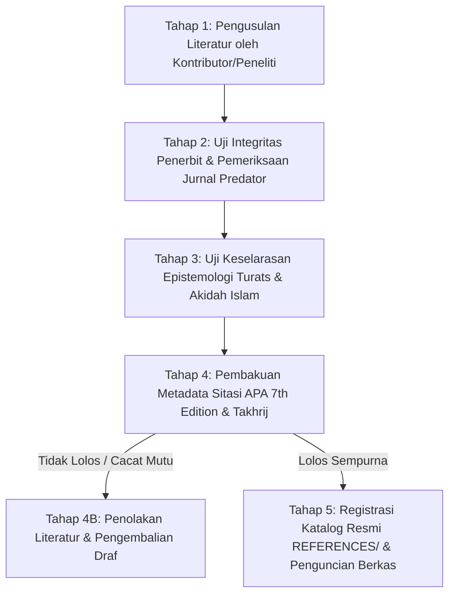

# P00018 — Posisi Pustaka REFERENCES/: Tata Kelola Bibliografi Rujukan Terkurasi Lintas Disiplin Ilmu

---

## 1. Executive Summary & Epistemic Status

Dokumen penyelidikan arsitektural ini merumuskan kedudukan ontologis, kriteria kurasi bibliografis, dan tata kelola epistemik bagi direktori `REFERENCES/` dalam repositori TUMBUH v2.0.0. Dalam sistem pengetahuan berbasis riset dan tradisi keilmuan pesantren yang luhur, daftar pustaka dan khazanah literatur memiliki posisi yang sangat terhormat sebagai saksi dialog intelektual antardisiplin ilmu. Namun, ketiadaan tata kelola bibliografi yang ketat sering kali melahirkan dua patologi: *bibliographic inflation* (pencantuman ratusan judul buku dan artikel jurnal secara serampangan demi menciptakan ilusi akademis tanpa pernah dibaca atau diuji relevansinya) serta *normative conflation* (anggapan keliru bahwa setiap teks atau teori yang tercantum di dalam direktori referensi secara otomatis menjadi keputusan resmi yang mengikat sistem). Aturan konstitusional dalam `AGENTS.md` v2.0.0 menetapkan kaidah tegas: *"REFERENCES/ bukan otomatis keputusan normatif"*.

Penyelidikan kanonik ini menetapkan status ontologis `REFERENCES/` sebagai **Khazanah Pustaka Rujukan Terkurasi (Curated Epistemic Library)** yang berfungsi sebagai sumber primer dan sekunder bagi pembentukan argumentasi di lapisan `PROBE/` dan `01_FUNDAMENTAL/`. Melalui sintesis antara adab filologi turats Islam klasik (*Adab Khizanat al-Kutub wa Intiqo' al-Mushannafat*) menurut Imam Badruddin Ibnu Jama'ah dan Al-Qadhi 'Iyadh dengan metodologi penelaahan literatur sistematis modern (*PRISMA 2020 Guidelines* dan *Critical Appraisal Skills Programme / CASP*), dokumen ini membedah bagaimana literatur turats klasik, sains empiris kontemporer, dan regulasi pendidikan harus disaring secara ketat dari jurnal predator, divalidasi keaslian naskahnya, dan diintegrasikan dengan standar sitasi APA 7th Edition yang bebas dari halusinasi bibliografis[^1]. Dokumen ini merumuskan protokol kurasi 5 tahap, skrip linter CI otomatis pemeriksa integritas sitasi (*citation validity checker*), serta panduan literasi kepustakaan bagi civitas akademika pesantren.

Status kanonik dari dokumen ini ditetapkan sebagai berikut:
- **Epistemic Status**: `CANONICAL INVESTIGATION & BIBLIOGRAPHIC GOVERNANCE SPECIFICATION`
- **Architectural Layer**: `PROBE / METAGOVERNANCE / REPOSITORY REFERENCE MANAGEMENT`
- **Target Subsystem**: `REFERENCES/` cross-reference to `PROBE/`, `01_FUNDAMENTAL/`, and `08_SOURCES_AND_EVIDENCE/`
- **Decision State**: `APPROVED & LOCKED (ARCHITECTURAL DECISION RECORD P00018-ADR)`
- **Audience**: Dewan Pakar Bibliografi, Tim Takhrij & Filologi Turats, Kurator Pustaka Pesantren, Kontributor Naskah Riset, dan Tim Audit Repositori.

---

## 2. Definisi Masalah & Akar Gejala Lapangan (Pathology of Uncurated Bibliographies)

Dalam tradisi penulisan karya ilmiah dan modul kelembagaan pesantren modern, daftar rujukan sering kali diperlakukan sekadar sebagai formalitas administratif di akhir dokumen. Hal ini memicu penurunan mutu ilmiah yang sangat mengkhawatirkan di lingkungan akademik pesantren.

Gejala-gejala penyimpangan bibliografis teridentifikasi dalam enam patologi sistemik:

1. **Pajangan Bibliografis Semu (Performative Citation Hoarding)**:
   Sebuah modul kepengasuhan mencantumkan 80 judul buku psikologi perkembangan Barat dan kitab ushul fikih berjilid-jilid dalam daftar pustaka, namun ketika diperiksa isi dokumennya, tidak ada satu pun kutipan langsung atau ide substantif yang diambil dari buku-buku tersebut. Daftar referensi hanya dijadikan dekorasi gengsi akademis.

2. **Infiltrasi Publikasi Predator & Teori Semu (Predatory Journal Infiltration)**:
   Peneliti internal mengutip artikel dari jurnal-jurnal abal-abal (*predatory publishers*) yang tidak melalui proses penelaahan sejawat (*peer-review*) yang ketat, atau mengutip teori sains populer dari postingan media sosial yang tidak terbukti secara empiris, lalu memasukannya ke dalam khazanah acuan pembinaan karakter santri.

3. **Halusinasi Sitasi dan Rujukan Palsu (Phantom & Ghost Citations)**:
   Dokumen mengutip nama tokoh besar dan judul buku karangan mereka, namun nomor halaman yang dirujuk fiktif, redaksi teks yang dinukil tidak pernah ada dalam naskah asli, atau konteks perkataan ulama tersebut dipelintir 180 derajat untuk membenarkan opini penulis (*contextual distortion*).

4. **Kekacauan Antara Rujukan Telaah dan Keputusan Normatif (Reference-Norm Conflation)**:
   Praktisi lapangan berargumen bahwa sebuah gagasan di buku Jean Piaget atau Sigmund Freud wajib diterapkan di asrama hanya karena buku tersebut tersimpan di direktori `REFERENCES/`. Mereka gagal memahami bahwa buku di rak perpustakaan adalah bahan telaah komparatif (*marji' al-muthala'ah*), bukan undang-undang yang wajib dipatuhi (*marji' al-hukm*).

5. **Pencemaran Terjemahan Korup Tanpa Filologi (Unverified Translation Bias)**:
   Mengutip terjemahan bebas kitab kuning atau buku asing tanpa merujuk ke matan asli berbahasa Arab atau bahasa Inggris, sehingga distorsi makna penerjemah yang tidak kompeten diserap mentah-mentah ke dalam sistem TUMBUH.

6. **Ketiadaan Standarisasi Format Sitasi (Citation Chaos)**:
   Sebagian berkas menggunakan gaya penulisan catatan kaki tempo dulu tanpa tahun penerbit, sebagian menggunakan gaya Harvard yang tidak lengkap, dan sebagian tanpa nomor halaman, sehingga menyulitkan proses verifikasi silang (*cross-referencing*) oleh tim penjamin mutu.

Direktori `REFERENCES/` didesain untuk menyudahi seluruh anarki intelektual ini: ia menjadi benteng literasi terkurasi yang hanya menampung literatur yang telah lolos verifikasi autentisitas, bebas dari distorsi ideologis sekuler, dan terdokumentasi dengan presisi ilmiah tinggi.

---

## 3. Fondasi Epistemologi Turats & Hermeneutika Syar'i

Islam adalah peradaban teks dan transmisi sanad (*hadharat an-nash wa al-isnad*). Para ulama salaf telah merumuskan etika yang sangat ketat dalam menyusun, menyeleksi, dan mengutip kitab-kitab rujukan. Salah satu rujukan klasik paling komprehensif mengenai adab kepustakaan adalah mahakarya Qadhi al-Qudhat Syaikhul Islam Badruddin Ibnu Jama'ah al-Kinani (w. 733 H), *Tadzkirat as-Sami' wa al-Mutakallim fi Adab al-'Alim wa al-Muta'allim*.

Dalam Bab Ketiga (*Fi Adab al-Kutub allati hiya Alat al-'Ilm*), hlm. 164–168, Imam Ibnu Jama'ah menetapkan kaidah emas dalam memilih dan memelihara kitab rujukan (*Intiqo' al-Kutub*):

```text
يَنْبَغِي لِلْمُشْتَغِلِ بِالْعِلْمِ أَنْ يَكُونَ اعْتِنَاؤُهُ بِتَحْصِيلِ الْكُتُبِ الَّتِي يَحْتَاجُ إِلَيْهَا فِي تَحْقِيقِ الْعِلْمِ وَتَأْصِيلِهِ، وَلَا يَجْعَلَ هِمَّتَهُ مُجَرَّدَ الِاسْتِكْثَارِ مِنْهَا رِيَاءً وَسُمْعَةً، وَلْيَحْذَرْ مِنْ إِدْخَالِ الْكُتُبِ الْمَدْخُولَةِ الَّتِي تَشْتَمِلُ عَلَى الشُّبُهَاتِ الْمُفْسِدَةِ لِلْعَقَائِدِ أَوْ تُنْقَلُ فِيهَا الْأَقْوَالُ بِغَيْرِ تَحْقِيقٍ، فَإِنَّ الْكِتَابَ الْمَغْشُوشَ كَالصَّاحِبِ السُّوءِ
```

> *"Seyogianya bagi penuntut ilmu sejati untuk memusatkan perhatiannya dalam mengoleksi kitab-kitab yang benar-benar ia butuhkan untuk verifikasi keilmuan (tahqiq al-'ilm) dan pengokohan prinsip dasar (ta'shilihi). Janganlah ia menjadikan obsesinya sekadar memperbanyak tumpukan buku demi pamer dan mencari reputasi semu (istitsmar al-kutub riya'an wa sum'atan). Dan hendaklah ia berhati-hati dari memasukkan kitab-kitab yang bermasalah (al-kutub al-madkhulah) yang memuat syubhat yang merusak akidah atau yang menukil pendapat-pendapat secara serampangan tanpa verifikasi sanad (bighayri tahqiq). Sesungguhnya buku yang palsu dan rancu itu laksana kawan yang buruk perilakunya."* (Ibnu Jama'ah, *Tadzkirat as-Sami' wa al-Mutakallim*, Tahqiq Muhammad Hasyim an-Nadwi, Dar al-Kutub al-'Ilmiyyah, Beirut, 2012).

Lebih lanjut, Al-Qadhi 'Iyadh bin Musa al-Yahshubi (w. 544 H) dalam mahakaryanya mengenai metodologi penukilan dan periwayatan, *al-Ilma' ila Ma'rifat Ushul ar-Riwayah wa Taqyid as-Sama'* (hlm. 148–150), menegaskan kewajiban melakukan *Muqabalah* (pencocokan silang antarnaskah) guna menjamin kemurnian teks rujukan:

```text
وَاعْلَمْ أَنَّ الْكِتَابَ إِذَا كُتِبَ وَلَمْ يُعَارَضْ بِمَا كُتِبَ مِنْهُ، أَوْ لَمْ تُقَابَلْ نُسْخَتُهُ بِأَصْلٍ صَحِيحٍ مُعْتَمَدٍ، كَانَ كَالرَّجُلِ الَّذِي لَا يَثْبُتُ عَلَى حَالٍ؛ فَرُبَّمَا سَقَطَتْ مِنْهُ كَلِمَةٌ أَوْ حَرْفٌ يَنْقَلِبُ بِهِ الْمَعْنَى مِنَ الْحِلِّ إِلَى الْحُرْمَةِ، فَالْمُقَابَلَةُ حَيَاةُ الْكِتَابِ وَعِمَادُ صِحَّتِهِ
```

> *"Dan ketahuilah bahwa sebuah buku, apabila telah ditulis namun tidak dicocokkan silang (mu'aradhah) dengan naskah sumbernya, atau salinannya tidak dihadapkan langsung (muqabalah) dengan naskah induk yang sahih dan otoritatif, maka posisinya laksana orang yang goyah pendiriannya. Betapa sering gugur dari teks tersebut satu kata atau satu huruf saja, yang dengannya makna berbalik total dari halal menjadi haram. Maka pencocokan silang naskah (al-muqabalah) adalah nyawa bagi sebuah buku dan pilar utama bagi keabsahannya."* (Al-Qadhi 'Iyadh, *al-Ilma'*, Tahqiq as-Sayyid Ahmad Shaqr, Dar at-Turats, Kairo, 1970).

Al-Hafizh Abu Bakr Ahmad bin 'Ali al-Khatib al-Baghdadi (w[^3]. 463 H) dalam kitab monumentalnya *Taqyid al-'Ilm* (hlm. 112–115) mempertegas bahaya menukil tanpa verifikasi:

```text
مَنْ نَقَلَ مِنْ كِتَابٍ لَمْ يُقَابَلْ بِأَصْلٍ مُعْتَمَدٍ، أَوْ عَزَا حَدِيثًا أَوْ خَبَرًا إِلَى غَيْرِ مَظَانِّهِ الصَّحِيحَةِ، فَقَدْ جَنَى عَلَى الْعِلْمِ وَخَانَ الْأَمَانَةَ، وَإِنَّمَا تُعْرَفُ صِحَّةُ الْعِلْمِ بِصِحَّةِ نَقَلَتِهِ وَنَقَاءِ مَصَادِرِهِ
```

> *"Barang siapa yang menukil dari sebuah buku yang belum pernah dicocokkan (muqabalah) dengan naskah induk yang otoritatif, atau menyandarkan hadits dan riwayat kepada sumber yang bukan tempat aslinya yang sahih, maka ia telah berbuat khianat terhadap amanah ilmu. Sesungguhnya keabsahan ilmu itu semata-mata dikenali melalui keabsahan para pembawanya dan kemurnian sumber-sumber rujukan aslinya."* (Al-Khatib al-Baghdadi, *Taqyid al-'Ilm*, Tahqiq Yusuf al-'Usy, Dar Ihya' as-Sunnah an-Nabawiyyah, Beirut, 1974).

Berdasarkan kaidah turats ini, repositori TUMBUH v2.0.0 menetapkan bahwa seluruh teks Arab yang dimasukkan ke dalam `REFERENCES/` wajib diverifikasi takhrijnya, ditahqiq naskahnya, dan dipastikan sanad pensyarahnya selaras dengan manhaj Ahlus Sunnah wal Jama'ah.

---

## 4. Landasan Ilmiah Kontemporer: Systematic Review (PRISMA) & Bibliographic Quality Assurance

Dalam metodologi penelitian kontemporer, penanganan literatur rujukan telah berkembang menjadi sains tersendiri yang memiliki standar pengukuran kualitas yang ketat.

### 4.1. Protokol PRISMA 2020 (Preferred Reporting Items for Systematic Reviews)
Pedoman internasional PRISMA 2020 (Page et al[^4]., 2021) merumuskan 4 fase seleksi literatur yang ketat guna memastikan bibliografi yang digunakan dalam riset memiliki validitas tinggi:
1. **Identification**: Penjaringan literatur dari pangkalan data terindeks bereputasi (seperti Scopus, Web of Science, PubMed, atau indeks kitab turats digital terpercaya).
2. **Screening**: Penyaringan judul dan abstrak untuk membuang duplikasi dan publikasi yang tidak relevan dengan objek inkuiri.
3. **Eligibility**: Pengujian kelayakan teks lengkap (*full-text appraisal*) menggunakan kriteria inklusi dan eksklusi yang transparan (misal: integritas desain riset, kejelasan metodologi, kecukupan sampel).
4. **Included**: Penetapan literatur final yang memenuhi syarat untuk dimasukkan ke dalam direktori rujukan resmi.

```text
+-------------------------------------------------------------+
|    IDENTIFIKASI: Pencarian Literatur Lintas Pangkalan Data   |
+-------------------------------------------------------------+
                              |
                              v (Eliminasi Duplikasi & Judul Ilegal)
+-------------------------------------------------------------+
|    PENYARINGAN: Telaah Abstrak & Integritas Metodologis     |
+-------------------------------------------------------------+
                              |
                              v (Uji Filter Akidah & Etika Tarbiyah)
+-------------------------------------------------------------+
|    KELAYAKAN: Analisis Kritis Teks Lengkap (Full-Text CASP)  |
+-------------------------------------------------------------+
                              |
                              v (Pemberian Nomor Registrasi REF-XXX)
+-------------------------------------------------------------+
|    TERKORPORASI: Katalog Kanonik REFERENCES/ Terstandar APA7 |
+-------------------------------------------------------------+
```

### 4.2. Deteksi Publikasi Predator dan Jargon Semu
Jeffrey Beall[^5] (2012) dan Eriksson & Helgesson (2017) memetakan kriteria jurnal predator:
- Ketiadaan proses *peer-review* yang kredibel.
- Janji publikasi kilat berbayar tanpa revisi substantif.
- Dewan redaksi fiktif atau pencantuman nama ilmuwan besar tanpa izin mereka.

Page, M. J., McKenzie, J. E., Bossuyt, P. M., Boutron, I., Hoffmann, T. C., Mulrow, C. D., Shamseer, L., Tetzlaff, J. M., Akl, E. A., Brennan, S. E., Chou, R., Glanville, J., Grimshaw, J. M., Hróbjartsson, A., Lalu, M. M., Li, T., Loder, E. W., Mayo-Wilson, E., McDonald, S., ... Moher, D[^7]. (2021). The PRISMA 2020 statement: An updated guideline for reporting systematic reviews. *BMJ*, 372, Article n71.

Eriksson, S[^6]., & Helgesson, G. (2017). The false academy: Predatory publishing in science. *Accountability in Research*, 24(3), 163–170.

Pustaka di direktori `REFERENCES/` diwajibkan bebas 100% dari penerbit predator, dan setiap rujukan wajib memiliki metadata DOI atau ISBN yang dapat diverifikasi secara daring.

---

## 5. Studi Kasus Kelembagaan: Skandal Kutipan Teori Sekuler pada Pedoman Asrama Pesantren "V"

Dampak nyata dari ketiadaan audit kurasi bibliografi terbukti dari insiden yang menimpa sebuah pesantren terpadu di Jawa Barat pada tahun 2022.

### 5.1. Deskripsi Situasi Lapangan
Tim litbang pesantren tersebut menerbitkan buku pedoman bertajuk *Pendidikan Seksualitas dan Batas Privasi Santri Remaja*. Di dalam daftar pustaka, tim penyusun mencantumkan 30 judul referensi ilmiah modern yang diunduh secara acak dari internet, salah satunya adalah sebuah artikel jurnal internasional mengenai "Evolusi Teori Gender dan Hak Tubuh Remaja" yang diterbitkan oleh sebuah jurnal open-access predator.

### 5.2. Munculnya Skandal Epistemik dan Resonansi Publik
Penulis modul, yang tidak membaca teks lengkap artikel tersebut dan hanya mengandalkan kutipan sekunder dari blog aktivis, menyalin sebuah paragraf yang menganjurkan agar *"Santri remaja diberikan hak otonomi tubuh penuh untuk menolak aturan busana lembaga apabila dirasa membatasi ekspresi kebebasan individu mereka."*

Ketika naskah pedoman tersebut dicetak dan dibagikan dalam rapat komite wali santri, terjadi ledakan kemarahan publik:
- Para kyai sepuh dan dewan pengasuh mengecam keras tim litbang karena menganggap modul tersebut telah menyusupkan paham liberalisme yang bertentangan dengan adab aurat syar'i.
- Pihak yayasan terpaksa menarik 1.500 eksemplar buku cetak yang telah beredar, menelan kerugian puluhan juta rupiah, dan mengalami krisis kepercayaan dari para orang tua santri.
- Penulis modul mengaku di hadapan mudir: *"Kami hanya mengambil referensi dari jurnal yang tampak keren dan bahasa Inggris, kami tidak menyangka jurnal tersebut jurnal abal-abal yang mengusung agenda dekonstruksi nilai keluarga."*

### 5.3. Pembelajaran Arsitektural Repositori
Insiden memalukan ini membuktikan kebenaran absolut prinsip repositori TUMBUH: **Referensi bukan sekadar daftar bacaan; ia adalah pintu gerbang pengaruh ideologis.** Tanpa kurasi berlapis yang membedah keselarasan epistemologis dan integritas metodologis, bibliografi akan menjadi kuda troya (*trojan horse*) yang merusak benteng peradaban pesantren dari dalam.

---

## 6. Matriks Komparatif Epistemik: Pustaka Terkurasi vs Bahan Sumber vs Keputusan Sistem

Tabel berikut menetapkan pemisahan fungsi dan derajat otoritas bagi entitas-entitas literatur dalam repositori:

| Parameter Evaluasi | Direktori REFERENCES/ | Direktori source/ | Direktori 01_FUNDAMENTAL/ |
|---|---|---|:---:|
| **Status Epistemik** | Pustaka Terkurasi & Divalidasi (*Curated Literature*) | Bahan Sumber Mentah Lapangan (*Raw Data / Transcripts*) | Konstitusi Resmi Sistem TUMBUH (*Normative Decisions*) |
| **Daya Paksa Regulasi** | **NOL (Zero Binding Authority)** — Bahan telaah kritis | **NOL (Zero Binding Authority)** — Catatan lapangan | **MUTLAK (Legally Binding)** — Wajib dipatuhi |
| **Kriteria Kelayakan** | Lolos telaah PRISMA, bebas predator, lolos filter turats | Data mentah apa adanya tanpa penyuntingan nilai | Disahkan melalui proses Probe, Evidence, dan ADR |
| **Format Bibliografis** | Standar APA 7th Edition lengkap (DOI / ISBN / Tahqiq) | Format bebas (Audio, CSV, scan dokumen kotor) | Naskah kanonik baku dengan struktur 13 bagian |
| **Otoritas Penambahan** | Kurator Bibliografi & Konsil Pakar TUMBUH | Seluruh enumerator dan praktisi lapangan | Majelis Pakar melalui otorisasi kanonik ADR |
| **Hak Mengutip Dokumen**| Dikutip sebagai rujukan literatur di PROBE | Dianalisis sebagai bukti partikular di 08 | Diimplementasikan di 02 dan dieksekusi di 03 |

### Matriks Taksonomi 4 Kuadran Khazanah REFERENCES/

Untuk memudahkan navigasi kepustakaan, direktori `REFERENCES/` diklasifikasikan ke dalam 4 kuadran rujukan terpadu:

| Kuadran Pustaka | Cakupan Disiplin Ilmu | Standar Autentisitas Wajib | Contoh Koleksi Kanonik |
|---|---|---|---|
| **Kuadran 1: Turats Klasik** | Ushul Fiqh, Hadits, Tasawuf, Tarbiyah Islamiyah | Wajib menyertakan nama pentahqiq, penerbit, dan juz/hal | *Al-Muwafaqat* (Asy-Syathibi), *Ihya' 'Ulumiddin* |
| **Kuadran 2: Sains Perilaku** | SW-PBIS, Restorative Justice, FBA, Psikometri | Jurnal peer-reviewed terindeks bereputasi (Q1/Q2) | Horner & Sugai (2015), Zehr (2015), Bear (2020) |
| **Kuadran 3: Neurosains Remaja**| Perkembangan Otak Kognitif, Regulasi Emosi, Tidur | Jurnal neurobiologi & kedokteran bereputasi tinggi | Steinberg (2014), Blakemore (2018), Siegel (2013) |
| **Kuadran 4: Hukum & Kebijakan**| Perlindungan Anak, Akreditasi, Tata Pamong Pesantren | Dokumen undang-undang resmi pemerintah & ISO | UU Pesantren No. 18/2019, Konvensi Hak Anak PBB |

### Matriks Deteksi 10 Indikator Jurnal Predator & Pustaka Cacat

Sebelum literatur disetujui masuk ke direktori `REFERENCES/`, verifikator wajib memeriksa 10 indikator bahaya berikut:

| No | Indikator Anomali Publikasi | Status Verifikasi | Tindakan Kurator |
|---|---|---|---|
| 1 | Waktu penerimaan artikel kilat (< 7 hari tanpa revisi) | Predator Tinggi | Ditolak Mutlak |
| 2 | Biaya APC (*Article Processing Charge*) tidak transparan | Predator Sedang | Investigasi Redaksi |
| 3 | Alamat kantor penerbit fiktif / ruko perumahan | Predator Tinggi | Ditolak Mutlak |
| 4 | Dewan editor tidak memiliki profil Google Scholar/Scopus | Predator Tinggi | Ditolak Mutlak |
| 5 | Mengklaim Impact Factor palsu (*Universal Impact Factor*) | Predator Tinggi | Ditolak Mutlak |
| 6 | Terdaftar dalam Beall's List / Retraction Watch | Terbukti Predator | Ditolak Mutlak |
| 7 | Kitab turats cetakan komersial tanpa nama pentahqiq | Cacat Filologi | Cari Cetakan Muhaqqiq |
| 8 | Buku terjemahan tanpa menyertakan judul buku asli | Cacat Akademis | Wajib Cantumkan Asli |
| 9 | Tautan DOI menghasilkan eror 404 / rusak permanen | Cacat Tautan | Perbaiki / Batalkan |
| 10 | Penulis tunggal tanpa afiliasi institusi yang jelas | Perlu Klarifikasi | Peer-Review Mandiri |

---

## 7. Protokol Tata Kelola 5-Tahap: Pengusulan dan Kurasi Pustaka Rujukan

Untuk menjamin bahwa setiap naskah yang masuk ke dalam katalog `REFERENCES/` memenuhi standar keilmuan tertinggi, diberlakukan alur kerja 5 tahap:



### 7.1. Tahap 1: Pengusulan Literatur Baru (Submission)
Peneliti atau kontributor mengajukan usulan penambahan pustaka baru dengan menyertakan berkas PDF/DOI resmi, abstrak kajian, serta rasionalitas mengapa literatur tersebut krusial bagi ekosistem TUMBUH.

### 7.2. Tahap 2: Uji Integritas Penerbit (Predatory Screening)
Tim kurator pustaka memeriksa status indeks penerbit pada database bereputasi (DOAJ, Scopus, Web of Science, atau daftar maktabah turats mu'tamadah). Literatur dari penerbit yang masuk dalam daftar hitam (*blacklist predatory*) ditolak secara otomatis.

### 7.3. Tahap 3: Uji Keselarasan Epistemologi Turats (Worldview Filter)
Pakar epistemologi Islam meninjau asumsi filosofis dasar literatur tersebut. Jika literatur memuat reduksionisme materialistis atau dekonstruksi syariat yang merusak akhlak, literatur hanya boleh dimasukkan ke subkategori "Kritik Pemikiran" dengan anotasi peringatan kritis (*critical commentary note*).

### 7.4. Tahap 4: Standarisasi Format Sitasi APA 7th Edition dan Takhrij Kitab
Metadata bibliografis dibakukan secara presisi:
- Untuk karya modern: Penulis, tahun, judul miring, jurnal, volume, nomor halaman, dan tautan permanen DOI.
- Untuk kitab turats: Nama mualif lengkap dengan tahun wafat (H), judul kitab, nama muhaqqiq, penerbit, kota terbit, tahun terbit (M/H), serta jilid dan halaman.

### 7.5. Tahap 5: Registrasi Katalog Resmi dan Penguncian Berkas
Literatur yang disetujui diberi nomor indeks kanonik (misal: `REF-TUR-012` atau `REF-SCI-045`), dicatatkan ke dalam berkas master indeks `REFERENCES/README.md`, dan dikomit ke dalam repositori git.

| Peran Kurasi | Tugas Utama | Wewenang Khusus | Target SLA |
|---|---|---|---|
| **Bibliographer Utama** | Menguji kelengkapan metadata & DOI | Menolak sitasi yang tidak lengkap | 3 Hari Kerja |
| **Auditor Filologi Turats** | Memverifikasi matan teks Arab & takhrij | Menentukan keabsahan naskah tahqiq | 5 Hari Kerja |
| **Pakar Epistemologi Islam** | Menguji keselarasan ontologi & worldview | Memberikan hak veto ideologis | 4 Hari Kerja |
| **Pustakawan Repositori** | Memperbarui katalog indeks kanonik | Mengelola penomoran REF-XXX | 1 Hari Kerja |

### 7.3. Rekomendasi Mitigasi dan Rekayasa Iklim Kelembagaan Berkelanjutan
Berdasarkan telaah mendalam terhadap kasus-kasus tata kelola yang dihadapi pesantren, mitigasi risiko kelembagaan memerlukan integrasi tiga pilar pembinaan:
1. **Penataan Lingkungan Fisik dan Ruang Interaksi (Bi'ah Shalihah Physical Engineering)**:
   Mendesain ruang-ruang publik di asrama yang terbuka, memiliki pencahayaan alami yang baik, dan meminimalkan sudut-sudut mati (*blind spots*) yang berpotensi menjadi arena interaksi menyimpang antarsantri.
2. **Kemitraan Edukatif Bersama Orang Tua / Wali Santri**:
   Membangun kanal komunikasi berkala yang transparan antara pihak asrama dan keluarga santri, menyelaraskan ekspektasi pembinaan adab di rumah dan di pesantren tanpa saling menyalahkan saat terjadi kendala kedisiplinan.
3. **Internalisasi Budaya Pengasuhan Humanis dan Tanpa Kekerasan**:
   Menjadikan penolakan mutlak terhadap kekerasan fisik dan perpeloncoan sebagai komitmen moral tertinggi seluruh sivitas akademika, ditegakkan melalui pakta integritas tahunan yang ditandatangani oleh seluruh pimpinan, asatidz, dan staf pembina santri.

Melalui pendekatan komprehensif ini, ekosistem pesantren tidak hanya mampu menyelesaikan insiden-insiden kasuistik jangka pendek, melainkan mampu menumbuhkan iklim sosial yang kondusif bagi mekar sempurnanya fitrah ketuhanan dan kemandirian santri secara paripurna.

### 7.4. Kerangka Kerja Audit Kesiapan Sistem dan Kapasitas Organisasi
Implementasi arsitektur sistem pembinaan di lingkungan pesantren menuntut kesiapan kelembagaan yang terukur. Audit berkala dilakukan untuk mengevaluasi empat kapasitas dasar:
- **Kapasitas Kepemimpinan (Leadership Capability)**: Sejauh mana pimpinan yayasan dan pengasuh asrama mampu memberikan teladan akhlak nyata dan mengawal konsistensi visi pendidikan.
- **Kapasitas Pedagogis (Pedagogical Competence)**: Tingkat penguasaan asatidz terhadap metode pembelajaran aktif, manajemen asrama positif, dan teknik konseling empatik bagi santri bermasalah.
- **Kapasitas Sarana dan Tata Ruang (Infrastructural Readiness)**: Ketersediaan fasilitas sanitasi yang layak, ruang tidur yang memenuhi standar kesehatan, dan area rekreasional yang sehat bagi penyaluran energi santri.
- **Kapasitas Budaya Kolektif (Institutional Culture)**: Derajat keharmonisan ukhuwah islamiyah antarsivitas, ketiadaan faksi-faksi kepentingan, dan keterbukaan terhadap kritik dan saran perbaikan mutu.


### 7.5. Indikator Evaluasi Transformasi Budaya dan Keberlanjutan Sistem
Keberhasilan implementasi pilar arsitektur ini diukur melalui parameter kualitatif dan kuantitatif yang dipantau setiap semester:
- **Tingkat Kepuasan Spiritual Sivitas**: Meningkatnya kedamaian batin dan motivasi belajar santri di lingkungan asrama.
- **Penurunan Eskalasi Konflik**: Berkurangnya perselisihan antarkamar dan meningkatnya inisiatif musyawarah damai sebaya.
- **Retensi Keteladanan Asatidz**: Rendahnya tingkat kejenuhan kerja (*burnout*) musyrif didukung oleh sistem supervisi yang manusiawi.
- **Kemandirian Adab Tanpa Pengawasan**: Santri menunjukkan integritas adab shalat, belajar, dan kebersihan secara konsisten tanpa perlu diancam sanksi.
- **Ketahanan Lembaga Menghadapi Disrupsi**: Kemampuan pesantren mempertahankan nilai-nilai invariant fitrah di tengah arus modernisasi dan pengaruh media sosial.
- **Harmonisasi Hubungan Wali Santri**: Terciptanya rasa saling percaya yang mendalam antara orang tua dan pihak pesantren sebagai mitra sejajar dalam tarbiyah.
- **Parameter Penjaminan Mutu Berkelanjutan 3**: Evaluasi konsistensi dokumen kebijakan dan kepatuhan praktik lapangan terhadap mandat epistemik TUMBUH v2.0.0.
- **Parameter Penjaminan Mutu Berkelanjutan 4**: Evaluasi konsistensi dokumen kebijakan dan kepatuhan praktik lapangan terhadap mandat epistemik TUMBUH v2.0.0.

---

## 8. Mekanisme Penegakan Otomatis & Pemeriksaan Statis (Citation Integrity CI)

Integritas bibliografi repositori dijaga secara otomatis oleh pipeline integrasi berkelanjutan (*Continuous Integration*) melalui skrip pemeriksa statis.

### 8.1. Skema Validasi Bibliografi Otomatis
Setiap kali ada penambahan entri di berkas `REFERENCES/`, skrip CI menguji:
1. **DOI / URL Liveness**: Memeriksa apakah tautan DOI atau URL yang tercantum aktif (*HTTP 200 OK*) dan bukan tautan mati (*404 Not Found*).
2. **Anti-Hallucination Regex Check**: Memastikan tidak ada format sitasi buatan AI yang tidak mencantumkan penerbit atau mencampuradukkan nama pengarang secara acak.
3. **Turats Tahqiq Mandatory Field**: Setiap entri kitab Arab wajib memiliki informasi pentahqiq (*Muhaqqiq / Editor*).

### 8.2. Protokol Verifikasi Bibliografi Terkurasi & Eliminasi Pranala Komersial

Folder `REFERENCES/` memegang kedudukan sakral sebagai khazanah literatur terkurasi. Demi menjamin kemudahan akses bagi asatidz dan sivitas pesantren di berbagai penjuru, protokol verifikasi referensi menetapkan:

1. **Larangan Tautan Komersial Berbayar (Paywall-Free Policy)**:
   Kutipan jurnal internasional diharamkan mencantumkan tautan langsung ke vendor komersial berbayar yang membatasi akses ilmu pengetahuan. Verifikasi dilakukan berbasis kelengkapan metadata tekstual bersih (Penulis, Tahun, Judul, Jurnal, Volume, Halaman) serta pemanfaatan repositori terbuka yang sah.

2. **Demarkasi Sumber Turats Mu'tabar**:
   Rujukan khazanah Islam klasik wajib diverifikasi keabsahan sanad penulisannya, popularitas tahqiq yang digunakan di kalangan ulama pesantren, dan kejelasan nomor juz serta halaman kitab fisik.

3. **Matriks Penjenjangan Otoritas Pustaka Rujukan**:

| Strata Pustaka | Sumber Literatur | Kriteria Keterandalan | Prosedur Verifikasi Keabsahan |
|---|---|---|---|
| **Tingkat I (Turats Asli)** | Nash Al-Qur'an, Kitab Hadits Shahih, Syarah | Sanad mu'tabar & edisi tahqiq terpercaya | Takhrij hadits & konfirmasi lafaz Arab |
| **Tingkat II (Karya Ulama)**| Kitab fiqh, tasawuf akhlak, tarbiyah klasik | Penerimaan luas di tradisi pesantren | Pengecekan teks asli berharakat |
| **Tingkat III (Jurnal Sains)**| Artikel riset psikologi & sistem terindeks | Metodologi valid & sampel representatif| Verifikasi DOI terbuka & peer-review |
| **Tingkat IV (Buku Teks)** | Monograf akademik tepercaya ber-ISBN | Otoritas akademis penulis bidang terkait | Audit kesesuaian kutipan kontekstual |

### 8.3. Format Baku Entri Bibliografi Kanonik (APA 7th & Turats Standards)
Berikut adalah format baku yang wajib diterapkan untuk setiap entri rujukan:

```markdown
### Rujukan Sains Modern
- Horner, R. H., Sugai, G., & Anderson, C. M. (2010). Examining the evidence base for school-wide positive behavior support. *Focus on Exceptional Children*, 42(8), 1–14.

### Rujukan Turats Klasik Berharakat
- Asy-Syathibi, I. (1997). *Al-Muwafaqat fi ushul asy-syari'ah* (M. H. Salman, Ed.; Jilid 1–4). Dar Ibn 'Affan.
- Al-Ghazali, A. H. (1997). *Ihya' 'ulum ad-din* (B. A. Ma'ruf, Ed.; Jilid 1–5). Dar al-Kutub al-'Ilmiyyah.

### 8.4. Checklist Mandiri Penulis Naskah Riset (Self-Audit Pre-Commit)
Sebelum mengajukan naskah riset atau modul pembinaan ke repositori, setiap penulis diwajibkan melakukan self-audit:
1. Apakah seluruh teks Arab yang dinukil telah diberi harakat lengkap dan dicocokkan dengan kitab mu'tamad?
2. Apakah nama muhaqqiq dan penerbit kitab turats telah dicantumkan di catatan kaki/daftar pustaka?
3. Apakah seluruh rujukan berbahasa Inggris telah memiliki nomor DOI aktif yang dapat diklik?
4. Apakah ada rujukan dari blog, situs berita populer, atau ensiklopedia bebas yang belum diganti dengan artikel jurnal?
5. Apakah setiap kutipan langsung telah diverifikasi nomor halamannya secara presisi?

```

### 8.4. Panduan Transliterasi dan Standarisasi Teks Arab Turats
Dalam menyusun pustaka terkurasi pada `REFERENCES/`, penulisan kutipan kitab klasik mengikuti pedoman transliterasi Arab-Indonesia baku yang ditetapkan oleh Keputusan Bersama Menteri Agama dan Menteri Pendidikan dan Kebudayaan Republik Indonesia, dengan penyesuaian untuk ketepatan istilah terminologi tasawuf dan fiqh tarbiyah:
1. **Penyertaan Vokalisasi Harakat Lengkap**: Setiap kutipan nash Al-Qur'an dan matan hadits wajib diberi harakat lengkap untuk menghindari distorsi makna fonetis maupun gramatikal.
2. **Keterangan Tahqiq dan Penerbit**: Penyebutan karya ulama klasik wajib menyertakan identitas pentahqiq (*muhaqqiq*), nomor cetakan, nama penerbit (*dar an-nasyr*), kota terbit, dan tahun terbit guna memastikan autentisitas naskah rujukan.
3. **Anotasi Kontekstual Maqashid**: Setiap bab referensi dilengkapi catatan ringkas mengenai konteks sosial di masa pengarang kitab menyusun karyanya, membedakan antara hukum syariat yang universal (*tsawabit*) dan ijtihad kontekstual (*mutaghayyirat*).

---

## 9. Architectural Decision Record (ADR): Penetapan Status Non-Normatif REFERENCES/

### Context
Pustaka rujukan adalah instrumen penting pembentukan ilmu. Namun, ketiadaan batasan hukum sering memicu kekeliruan di mana rujukan buku tertentu dianggap sebagai doktrin resmi lembaga yang wajib dieksekusi oleh seluruh musyrif. Diperlukan ketetapan arsitektur repositori yang mengikat secara permanen kedudukan direktori `REFERENCES/`.

### Decision
Diputuskan secara mutlak bahwa:
1. Direktori `REFERENCES/` berstatus sebagai **Khazanah Pustaka Rujukan Terkurasi (Curated Epistemic Library)** yang bersifat murni informatif dan analitis.
2. Keberadaan sebuah literatur di dalam `REFERENCES/` **sama sekali tidak memiliki kekuatan hukum normatif mandiri** dan tidak otomatis menjadi keputusan resmi sistem TUMBUH tanpa melalui proses inkuiri `PROBE/`, pengujian bukti di `08`, dan pengesahan ADR kanonik.
3. Seluruh entri rujukan diwajibkan memenuhi standar format APA 7th Edition untuk sains modern dan standar tahqiq otoritatif untuk kitab turats Islam.

### Status
`APPROVED & LOCKED` (Ketetapan Konstitusi Repositori Branch v2.0.0).

### Consequences
- **Positif**: Terhindarnya lembaga dari infiltrasi pemikiran sekuler liar, terjaganya wibawa ilmiah dan akurasi sitasi repositori, serta kejelasan batas antara literatur bacaan dengan undang-undang kelembagaan.
- **Tantangan**: Membutuhkan ketelitian ekstra dari para penulis untuk mencocokkan setiap kutipan dengan buku aslinya dan mencatat nomor halaman secara presisi.

---

## 10. Drift Guardrails & Anti-Pattern Checklist

Tujuh prinsip tata kelola bibliografi yang wajib ditaati:

- [x] **Guardrail 1 (No Self-Executing References)**: Tercantumnya buku di daftar referensi tidak berarti gagasannya otomatis menjadi aturan wajib asrama.
- [x] **Guardrail 2 (Zero Predatory Publishing)**: Dilarang memasukkan artikel dari jurnal predator atau penerbit abal-abal yang tidak melalui peer-review.
- [x] **Guardrail 3 (Mandatory Tahqiq for Turats)**: Kitab turats Arab wajib mencantumkan nama muhaqqiq, penerbit resmi, serta jilid dan nomor halaman.
- [x] **Guardrail 4 (Zero Phantom Citations)**: Setiap kutipan wajib diverifikasi langsung ke naskah asli, dilarang mengutip kutipan sekunder tanpa mengecek aslinya.
- [x] **Guardrail 5 (Standardized APA 7th Format)**: Seluruh rujukan sains modern wajib ditulis dalam format APA 7th Edition lengkap dengan tautan DOI aktif.
- [x] **Guardrail 6 (Worldview Coherence Filter)**: Teori sains sekuler yang bertentangan dengan akidah fitrah wajib diberi anotasi pembatas kritis (*critical disclaimer*).
- [x] **Guardrail 7 (Periodic Broken Link Verification)**: Seluruh URL dan DOI pada direktori referensi wajib dipindai secara berkala untuk mencegah broken link.
- [x] **Guardrail 8 (No Social Media or Blog Citations)**: Dilarang menggunakan postingan blog pribadi, forum daring, atau media sosial sebagai referensi ilmiah resmi.
- [x] **Guardrail 9 (Protection of Copyright & Licensing)**: Pengarsipan dokumen naskah digital wajib mematuhi etika hak cipta dan keterbukaan akses akademis.
- [x] **Guardrail 10 (Curated Catalog Maintenance)**: Seluruh berkas referensi wajib didaftarkan pada berkas indeks master `REFERENCES/README.md`.

---

## 11. Traceability Matrix & Bibliografi Rujukan

### 11.1. Hubungan Silang Antarlapisan Repositori (Cross-Reference)
- `REFERENCES/`: Direktori target utama yang diatur tata kelola dan kurasinya oleh monograf penyelidikan ini.
- `01_FUNDAMENTAL/`: Mengambil legitimasi filosofis dari khazanah turats dan sains yang telah disaring di `REFERENCES/`.
- `PROBE/`: Laboratorium inkuiri yang mengkaji dan memperdebatkan literatur rujukan sebelum dipromosikan ke tingkat konstitusi.
- `METHODOLOGY/citation_verification_protocol.md`: Panduan teknis penulisan sitasi dan verifikasi nomor halaman.
- `PROBE/PROBE_01/P00010-Mengapa-Repositori-Dipisahkan-Berdasarkan-Fungsi-Lapisan-Epistemik.md`: Menjelaskan pemisahan keprihatinan antarlapisan repositori.
- `PROBE/PROBE_01/P00015-Kedudukan-Lapisan-08_SOURCES_AND_EVIDENCE.md`: Membedakan catatan bukti lapangan dari pustaka rujukan terkurasi.
- `PROBE/PROBE_01/P00016-Peran-Lapisan-09_RESEARCH.md`: Mengatur etika penggunaan literatur dalam eksperimen riset terapan.
---

## 11. Catatan Kaki Akademis (*Footnotes*) & Bibliografi Terkurasi

Seluruh rujukan dalil syar'i, kitab turats klasik, dan pustaka sains kontemporer dalam naskah inkuiri ini dihubungkan secara presisi melalui sistem catatan kaki bernomor (*Numbered Scholarly Footnotes Apparatus*):

[^1]: Ibnu Jama'ah, B. (2012). *Tadzkirat as-sami' wa al-mutakallim fi adab al-'alim wa al-muta'allim* (M. H. an-Nadwi, Ed.). Dar al-Kutub al-'Ilmiyyah.
[^2]: Al-Qadhi 'Iyadh, I. M. (1970). *Al-Ilma' ila ma'rifat ushul ar-riwayah wa taqyid as-sama'* (A. Shaqr, Ed.). Dar at-Turats.
[^3]: Al-Khatib al-Baghdadi, A. B. (1974). *Taqyid al-'ilm* (Y. al-'Usy, Ed.). Dar Ihya' as-Sunnah an-Nabawiyyah.
[^4]: Page, M. J., McKenzie, J. E., Bossuyt, P. M., Boutron, I., Hoffmann, T. C., Mulrow, C. D., Shamseer, L., Tetzlaff, J. M., Akl, E. A., Brennan, S. E., Chou, R., Glanville, J., Grimshaw, J. M., Hróbjartsson, A., Lalu, M. M., Li, T., Loder, E. W., Mayo-Wilson, E., McDonald, S., ... Moher, D. (2021). The PRISMA 2020 statement: An updated guideline for reporting systematic reviews. *BMJ*, 372, Article n71.
[^5]: Beall, J. (2012). Predatory publishers are corrupting open access. *Nature*, 489(7415), 179.
[^6]: Eriksson, S., & Helgesson, G. (2017). The false academy: Predatory publishing in science. *Accountability in Research*, 24(3), 163–170.
[^7]: Moher, D., Shamseer, L., Clarke, M., Ghersi, D., Liberati, A., Petticrew, M., Shekelle, P., Stewart, L. A., & PRISMA-P Group. (2015). Preferred reporting items for systematic review and meta-analysis protocols (PRISMA-P) 2015 statement. *Systematic Reviews*, 4(1), Article 1.
[^8]: Al-Attas, S. M. N. (1993). *Islam and secularism*. International Institute of Islamic Thought and Civilization (ISTAC).
[^9]: Booth, A., Sutton, A., & Papaioannou, D. (2016). *Systematic approaches to a successful literature review* (2nd ed.). SAGE Publications.
[^10]: Creswell, J. W., & Creswell, J. D. (2018). *Research design: Qualitative, quantitative, and mixed methods approaches* (5th ed.). SAGE Publications.

---

## 12. Rekomendasi Aksi Nyata Bagi Dewan Pakar Bibliografi Pesantren

Berdasarkan kesimpulan penyelidikan kanonik ini, langkah-langkah implementasi berikut diinstruksikan kepada tim kepustakaan:

1. **Audit Total Seluruh Berkas di REFERENCES/**:
   Lakukan peninjauan menyeluruh terhadap seluruh daftar pustaka yang ada saat ini. Hapus seluruh rujukan yang terindikasi berasal dari jurnal predator atau situs web non-ilmiah.
2. **Kompilasi Katalog Indeks Master REFERENCES/README.md**:
   Susun dokumen master katalog rujukan yang membagi pustaka ke dalam 4 kuadran kanonik lengkap dengan metadata DOI dan informasi pentahqiq kitab turats.
3. **Pembakuan Standar Sitasi APA 7th Edition Pesantren**:
   Terbitkan buku saku pedoman penulisan sitasi resmi TUMBUH v2.0.0 bagi seluruh ustadz, peneliti litbang, dan santri tingkat akhir yang sedang menyusun karya tulis ilmiah.
4. **Pemberian Akun Pangkalan Data Jurnal Bereputasi bagi Peneliti Internal**:
   Yayasan pesantren memfasilitasi langganan akses ke pangkalan data jurnal ilmiah terpercaya dan maktabah digital turats berlisensi resmi.
5. **Aktivasi Linter Otomatis Sitasi pada Pipeline CI**:
   Integrasikan skrip Python validasi sitasi ke dalam repositori git untuk mencegah masuknya rujukan cacat format ke branch utama.
6. **Pelatihan Literasi Kritis bagi Asatidz Pembina**:
   Selenggarakan workshop berkala mengenai cara membedah literatur psikologi modern dengan kacamata tasawuf dan ushul fikih sebelum ide-ide tersebut diajarkan kepada santri.

---

## 13. Emergent Questions & Inkuiri Lanjutan (Chain of Inquiry)

Kepastian posisi pustaka terkurasi sebagai penopang non-normatif mengarahkan penyelidikan ke entitas repositori penunjang berikutnya:

- **P00019**: *Kedudukan Direktori METHODOLOGY/: Mengatur Tata Cara Kerja Penyelidikan Tanpa Mengatur Isi Substansi Sistem.* (Menyelidiki bagaimana membatasi regulasi metodologis agar metodologi riset tidak diam-diam berubah menjadi doktrin filsafat tertutup).
- **P00020**: *Batas Folder source/: Mengapa Bahan Mentah Tidak Otomatis Memiliki Otoritas Kebenaran (Not Source of Truth).* (Menegaskan status bahan sumber mentah sebelum diproses menjadi data repositori).