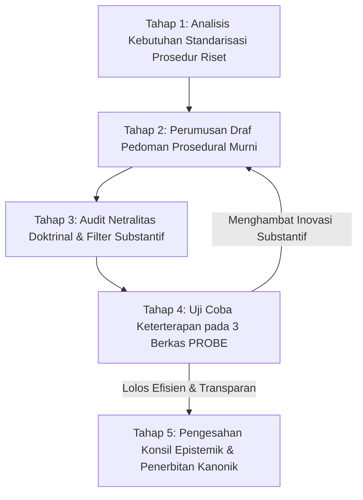

# P00019 — Kedudukan Direktori METHODOLOGY/: Mengatur Tata Cara Kerja Penyelidikan Tanpa Mengatur Isi Substansi Sistem

---

## 1. Executive Summary & Epistemic Status

Dokumen penyelidikan arsitektural ini merumuskan demarkasi yurisdiksi, batasan fungsional, dan tata kelola epistemik direktori `METHODOLOGY/` dalam repositori TUMBUH v2.0.0. Dalam arsitektur sistem berbasis pengetahuan terpadu, pemisahan antara "tata cara menjalankan penyelidikan" (*procedural research standards*) dan "substansi materi keilmuan yang diselidiki" (*substantive domain models*) merupakan syarat mutlak agar sistem tidak terjebak dalam totalitarianisme metodologis (*methodological imperialism*). Kerentanan sistemik yang kerap muncul adalah ketika instrumen tata cara kerja secara diam-diam (*stealthily*) mengambil alih fungsi filosofis: sebuah pedoman penulisan sitasi atau panduan audit riset menyelundupkan asumsi doktrinal yang mendikte apa yang boleh dan tidak boleh diyakini oleh sistem, atau sebaliknya, mendikte batasan kurikulum pengasuhan. Aturan dasar dalam `AGENTS.md` v2.0.0 menegaskan: *"METHODOLOGY/ adalah pedoman penelitian, sitasi, decision traceability, dan tata kelola dokumentasi"*, bukan sumber penetapan substantif nilai TUMBUH.

Penyelidikan kanonik ini menetapkan prinsip subordinasi instrumental: direktori `METHODOLOGY/` berkedudukan murni sebagai **Ilmu Alat Prosedural (Instrumental Metasystem)** yang mengatur "bagaimana proses penelitian, verifikasi sitasi, pelacakan keputusan, dan penulisan dokumen dijalankan secara ilmiah dan transparan" (*how to inquire rigorously*), namun diharamkan secara mutlak untuk mengatur "apa hakikat filosofi fitrah, model tahapan kemandirian (J1–J4), dan prinsip adab santri" (*what the core substance of TUMBUH is*). Melalui sintesis antara distingsi ushul turats antara ilmu alat (*'ulum al-alah*) dan ilmu tujuan (*'ulum al-maqashid*) menurut Ibnu Khaldun, Imam asy-Syathibi, dan Imam Fakhruddin ar-Razi dengan standar rekayasa sistem modern (*ISO/IEC/IEEE 15288: Systems Life Cycle Processes*), dokumen ini membedah batas kewenangan metodologi, merumuskan protokol tata kelola panduan riset 5 tahap, serta membangun skrip audit *Continuous Integration* (CI) penangkal penyelundupan doktrin substantif (*substantive doctrine filter*).

Status kanonik dari dokumen ini ditetapkan sebagai berikut:
- **Epistemic Status**: `CANONICAL INVESTIGATION & METAGOVERNANCE SPECIFICATION`
- **Architectural Layer**: `PROBE / METAGOVERNANCE / METHODOLOGICAL BOUNDARY`
- **Target Subsystem**: `METHODOLOGY/` cross-reference to `01_FUNDAMENTAL/` and `PROBE/`
- **Decision State**: `APPROVED & LOCKED (ARCHITECTURAL DECISION RECORD P00019-ADR)`
- **Audience**: Tim Perumus Metodologi Riset, Auditor Penjaminan Mutu, Tim Inkuiri PROBE, Pengembang Kurikulum, dan Seluruh Kontributor Repositori TUMBUH.

---

## 2. Definisi Masalah & Akar Gejala Lapangan (Pathology of Methodological Overreach)

Dalam tata kelola keilmuan dan rekayasa kebijakan pesantren, kekacauan peran antara "petugas metodologi" dan "perumus substansi kurikulum" sering kali menimbulkan gesekan institusional yang melumpuhkan produktivitas.

Gejala-gejala penyimpangan metodologis teridentifikasi dalam enam patologi sistemik:

1. **Totalitarianisme Metodologis (Methodological Imperialism)**:
   Sebuah tim perumus metodologi riset menyusun pedoman format penyelidikan, namun di dalamnya memasukkan klausul doktrinal yang melarang penggunaan pendekatan konseling psikologis modern (seperti Cognitive Behavioral Therapy atau Narrative Therapy), dengan dalih bahwa metodologi riset pesantren "hanya boleh menggunakan metode murni tafsir tematik turats". Hal ini mereduksi keluasan penyelidikan ilmiah dan mematikan inovasi bimbingan santri di lapangan.

2. **Penyelundupan Definisi Hakikat di Berkas Prosedur (Stealth Definition Smuggling)**:
   Di dalam sebuah dokumen berjudul `pedoman_sitasi.md` atau `protokol_penelitian.md`, tim penyusun menyelipkan definisi baru mengenai konsep pilar adab atau indikator kemandirian yang berbeda dari dokumen induk `01_FUNDAMENTAL/principles/P001_core_principles.md`. Akibatnya, terjadi kontradiksi hukum internal antardokumen.

3. **Fetisisme Prosedural Melumpuhkan Esensi Tarbiyah (Procedural Fetishism)**:
   Peneliti dan asatidz menghabiskan 80% energi mereka hanya untuk memperdebatkan tata letak margin, format penomoran footnote, atau tanda baca teknis, seraya mengabaikan esensi substansi pembinaan akhlak santri yang sedang mengalami krisis adab di asrama.

4. **Metodologi Menjadi Hakim Kebenaran Mutlak (Methodology as Supreme Judge)**:
   Muncul arogansi di mana temuan lapangan yang sangat sahih dan nyata dialami oleh ribuan santri ditolak mentah-mentah oleh tim penjamin mutu hanya karena tidak mengikuti salah satu rumus statistik parametrik yang tercantum di pedoman metodologi, padahal fenomena tersebut bersifat kualitatif dan ruhiyah.

5. **Kekosongan Standar Keterlacakan Keputusan (Traceability Vacuum)**:
   Direktori metodologi dipenuhi oleh teori filsafat ilmu yang abstrak, namun gagal menyediakan instrumen teknis yang paling mendesak: bagaimana cara menelusuri silsilah dari temuan riset di `09` menuju bukti di `08`, lalu ke penyelidikan di `PROBE/`, hingga melahirkan keputusan di `01_FUNDAMENTAL/`.

6. **Dogmatisme Metodologi Melawan Realitas Lapangan (Methodological Rigidity)**:
   Metodologi disusun secara kaku meniru skripsi universitas sekuler umum tanpa adaptasi terhadap ekologi kehidupan santri 24 jam di pesantren, sehingga menyulitkan para musyrif lapangan untuk berkontribusi mencatatkan data.

Direktori `METHODOLOGY/` harus dikembalikan ke khitah aslinya: ia adalah pelayan keilmuan (*khadim al-'ilm*), bukan tuan dari ilmu itu sendiri (*sayyid al-'ilm*).

---

## 3. Fondasi Epistemologi Turats & Hermeneutika Syar'i

Dilema pembagian antara "ilmu alat" dan "ilmu tujuan" telah diurai secara tuntas oleh para begawan pemikir peradaban Islam klasik. Ulama salaf membagi disiplin ilmu menjadi dua rumpun besar:
1. **'Ulum al-Maqashid (Ilmu-ilmu Tujuan / Substansi)**: Seperti ilmu akidah, ilmu tafsir, ilmu hadits, ilmu fikih, dan ilmu akhlak/tasawuf. Disiplin ini dipelajari demi esensi substansinya sendiri untuk mendekatkan diri kepada Allah dan menyempurnakan jiwa manusia (*li dzatiha*).
2. **'Ulum al-Alah / 'Ulum al-Wasa'il (Ilmu-ilmu Alat / Prosedur / Metodologi)**: Seperti ilmu nahwu, sharaf, balaghah, mantiq (logika), musthalah al-hadits, dan ushul fikih. Disiplin ini dipelajari murni sebagai sarana instrumental untuk memahami dan meneliti ilmu tujuan (*li ghairiha*)[^1][^2][^3][^4].

Ibnu Khaldun (w. 808 H) dalam karya terbesarnya *al-Muqaddimah* (Fashl fi Anna 'Ulum al-Lisan wa al-Mantiq wa Asybahaha min 'Ulum al-Alah, hlm. 543–545) memperingatkan bahaya fatal apabila ilmu alat diperluas melampaui batas dan diangkat derajatnya setara dengan ilmu tujuan:[^5]

```text
وَاعْلَمْ أَنَّ الْعُلُومَ الْآلِيَّةَ الَّتِي هِيَ وَسَائِلُ لِغَيْرِهَا، كَالْعَرَبِيَّةِ وَالْمَنْطِقِ وَأَمْثَالِهِمَا، لَا يَنْبَغِي أَنْ يُنْظَرَ فِيهَا إِلَّا مِنْ حَيْثُ هِيَ آلَةٌ لِذَلِكَ الْغَيْرِ فَقَطْ، وَلَا يُوَسَّعَ فِيهَا الْكَلَامُ وَلَا تُفَرَّعَ فِيهَا الْمَسَائِلُ؛ فَإِنَّ ذَلِكَ مُخْرِجٌ لَهَا عَنِ الْمَقْصُودِ، وَمُوقِعٌ فِي التَّشَاغُلِ بِمَا لَا يَعْنِي عَمَّا يَعْنِي، فَمَنْ غَرِقَ فِي الْآلَةِ حُرِمَ الْغَايَةَ
```

> *"Dan ketahuilah sesungguhnya ilmu-ilmu alat yang posisinya sebagai sarana perantara bagi ilmu lainnya—seperti ilmu bahasa Arab, ilmu logika, dan sejenisnya—sama sekali tidak seyogianya ditelaah kecuali semata-mata dari kedudukannya sebagai alat bantu bagi disiplin tujuan tersebut. Janganlah memperluas perdebatan di dalamnya dan janganlah bercabang-cabang melahirkan masalah-masalah teoritis yang rumit; karena perbuatan demikian akan mengeluarkan ilmu alat dari maksud keberadaannya, dan menjerumuskan penuntut ilmu ke dalam kesibukan terhadap hal-hal yang tidak esensial sehingga melalaikan apa yang hakiki. Maka barang siapa yang tenggelam dalam kesibukan ilmu alat, niscaya ia akan terhalang dari mencapai tujuan substansial."* (Ibnu Khaldun, *al-Muqaddimah*, Tahqiq Dr. Abdullah Muhammad ad-Darwisy, Dar Ya'rub, Damaskus, 2004).

Imam Abu Ishaq asy-Syathibi dalam *al-Muwafaqat fi Ushul asy-Syari'ah* (Jilid 1, hlm. 87–89) merumuskan kaidah emas tentang batas kewenangan sarana metodologis:

```text
كُلُّ عِلْمٍ لَا يَنْبَنِي عَلَيْهِ عَمَلٌ فَلَيْسَ فِي الشَّرْعِ مَا يَدُلُّ عَلَى اسْتِحْسَانِهِ، وَالْعِلْمُ الْخَادِمُ لِلشَّرِيعَةِ لَا يَجُوزُ أَنْ يَتَجَاوَزَ مَرْتَبَةَ الْخِدْمَةِ، فَلَوْ أَدَّى إِعْمَالُ الْوَسِيلَةِ إِلَى إِبْطَالِ الْمَقْصُودِ أَوْ التَّشْوِيشِ عَلَى أَصْلِهِ كَانَتِ الْوَسِيلَةُ مَرْدُودَةً بِاتِّفَاقٍ
```

> *"Setiap ilmu yang tidak membuahkan amal nyata pembinaan, maka tidak ada dalil syar'i yang memuji keutamaan mendalaminya. Dan disiplin ilmu yang bertugas melayani syariat tidak boleh melampaui derajat pelayanannya. Sekiranya penerapan sarana metodologis tersebut berujung pada pembatalan tujuan substansi atau mengacaukan fondasi pokoknya, maka sarana metodologis tersebut wajib ditolak menurut kesepakatan para ulama."* (Asy-Syathibi, *al-Muwafaqat*, Tahqiq Masyhur Hasan Salman, Dar Ibn 'Affan, Khobar, 1997).

Lebih lanjut, Imam Fakhruddin ar-Razi dalam *al-Mahshul fi 'Ilm Ushul al-Fiqh* (Jilid 1, hlm. 94) membedakan secara tajam antara kaidah metodologis umum (*al-qanun al-kulli*) dengan objek materi hukum itu sendiri:

```text
الْقَانُونُ الْكُلِّيُّ إِنَّمَا وُضِعَ لِضَبْطِ طُرُقِ الِاسْتِدْلَالِ وَصِيَانَةِ الْعَقْلِ عَنِ الْخَطَأِ فِي التَّرْكِيبِ، وَلَيْسَ لَهُ أَنْ يَقْضِيَ عَلَى الْأَعْيَانِ بِالْإِيجَابِ أَوِ السَّلْبِ بِمُجَرَّدِ الصُّورَةِ، فَإِنَّ الْحُكْمَ عَلَى الشَّيْءِ فَرْعٌ عَنْ تَصَوُّرِ حَقِيقَتِهِ، وَالصُّورَةُ لَا تُغْنِي عَنِ الْمَادَّةِ
```

> *"Kaidah metodologis umum (al-qanun al-kulli) semata-mata diletakkan untuk menertibkan tata cara penalaran dalil dan menjaga akal dari kesalahan dalam merangkai silogisme. Kaidah metodologis itu sama sekali tidak berhak memvonis esensi materi substansi dengan menetapkan atau meniadakan semata-mata bersandarkan pada format formal proseduralnya. Hal itu karena menetapkan hukum atas sesuatu adalah cabang dari gambaran pemahaman hakikat materinya secara utuh, dan bentuk formal prosedural tidak akan pernah bisa menggantikan posisi materi substansial."* (Ar-Razi, *al-Mahshul*, Tahqiq Dr. Thaha Jabir al-'Alwani, Mu'assasah ar-Risalah, Beirut, 1997).

Dalam repositori TUMBUH v2.0.0:
- Direktori `METHODOLOGY/` adalah **'Ulum al-Alah** (pelayan prosedural).
- Direktori `01_FUNDAMENTAL/` adalah **'Ulum al-Maqashid** (tujuan substansial pembinaan adab).
Ilmu alat di `METHODOLOGY/` diharamkan memerintah atau mendikte isi dari `01_FUNDAMENTAL/`. Tugas metodologi hanyalah memastikan bahwa jalan inkuiri yang ditempuh oleh `PROBE/` dapat dipertanggungjawabkan secara ilmiah dan dapat ditelusuri (*traceable*).

---

## 4. Landasan Ilmiah Kontemporer: Systems Engineering (ISO 15288) & Philosophy of Science

Kajian rekayasa sistem informasi modern dan filsafat ilmu pengetahuan kontemporer memperkokoh prinsip pemisahan antara metodologi dan substansi.

### 4.1. Standar Rekayasa Sistem: ISO/IEC/IEEE 15288
Standar rekayasa sistem global *ISO/IEC/IEEE 15288:2015 (Systems and software engineering — System life cycle processes)* membedakan secara tegas antara:
1. **Life Cycle Process Definitions**: Standar tata cara bagaimana persyaratan dikumpulkan, bagaimana verifikasi dilakukan, dan bagaimana dokumen disahkan (inilah padanan dari `METHODOLOGY/`).
2. **Domain Architecture Models**: Spesifikasi teknis mengenai fungsi produk, parameter sistem, dan desain arsitektur yang dibangun (inilah padanan dari `01_FUNDAMENTAL/` dan `02_IMPLEMENTATION/`).

```text
+-------------------------------------------------------------+
|                 METHODOLOGY/ (Tata Cara Proses)             |
|   - Standar Sitasi APA 7th Edition                          |
|   - Protokol Decision Traceability                          |
|   - Aturan Pelaksanaan Audit Kualitas Repositori            |
+-------------------------------------------------------------+
                              |
                              v (Menstandarisasi Proses Penyelidikan)
+-------------------------------------------------------------+
|                     PROBE/ (Mesin Inkuiri)                  |
|   - Menjalankan investigasi menggunakan metode resmi        |
+-------------------------------------------------------------+
                              |
                              v (Melaporkan Hasil ke Konsil)
+-------------------------------------------------------------+
|                 01_FUNDAMENTAL/ (Substansi Sistem)          |
|   - Menetapkan Hakikat Fitrah, Nilai, Model Adab Santri     |
+-------------------------------------------------------------+
```

Standar ISO 15288 menegaskan bahwa dokumen proses dilarang memuat spesifikasi desain produk (*process standards must not dictate domain product requirements*). Jika pedoman proses mulai mengatur isi produk, sistem akan mengalami *Process Bloat* yang membunuh inovasi.

### 4.2. Popper vs Kuhn: Metodologi Kritis vs Paradigma Substantif
Karl Popper (1959) dalam *The Logic of Scientific Discovery* menekankan bahwa metodologi ilmiah hanyalah aturan main (*demarcation criteria*) untuk menguji apakah suatu klaim dapat difalsifikasi atau diuji kebenarannya. Metodologi tidak pernah menentukan apa isi teori yang harus dihasilkan. Sementara Thomas Kuhn (1962) dalam *The Structure of Scientific Revolutions* memperingatkan bahaya komunitas ilmuwan yang terlalu memuja "ilmu normal" (*normal science*) berbasis aturan baku hingga menolak paradigma baru yang lebih mencerahkan[^6][^7].

ISO/IEC/IEEE. (2015). *Systems and software engineering — System life cycle processes* (ISO/IEC/IEEE Standard No. 15288:2015). IEEE.


Dengan demikian, direktori `METHODOLOGY/` berfungsi menjaga integritas proses pengujian ilmiah, bukan menentukan hasil keputusan akhir.

---

## 5. Studi Kasus Kelembagaan: Penolakan Modul Konseling Traumatik Santri di Pesantren "U"

Pentingnya menjaga batas kewenangan direktori metodologi terbukti secara dramatis dari perselisihan yang terjadi di sebuah konsorsium pesantren di Jawa Tengah pada tahun 2023.

### 5.1. Deskripsi Konflik Kebijakan
Tim Konseling dan Bimbingan Santri merancang sebuah modul penanganan darurat bagi santri korban perundungan siber (*cyberbullying*) berbasis pendekatan *Trauma-Informed Care* dan terapi naratif Islam. Modul tersebut berhasil diuji coba secara terbatas pada 12 santri dan menunjukkan perbaikan regulasi emosi yang sangat signifikan.

### 5.2. Intervensi Liar Komite Metodologi
Ketika naskah modul diajukan ke Dewan Pengasuh, Tim Komite Metodologi dan Penjaminan Mutu Repositori memblokir berkas tersebut. Komite Metodologi menerbitkan aturan internal sepihak di folder metodologi mereka: *"Seluruh instrumen penanganan santri di pesantren dilarang menggunakan istilah-istilah terapi psikologi Barat seperti 'trauma', 'de-eskalasi', atau 'restitusi emosional', dan wajib hanya menggunakan istilah taubat, sabar, dan muhasabah."*

Komite Metodologi berdalih bahwa mereka "menjaga kemurnian metodologi riset pesantren".

### 5.3. Dampak Disrupsi Lapangan
Pemblokiran substantif ini memicu krisis nyata:
- Dua santri korban perundungan berat yang membutuhkan intervensi konseling terstruktur tidak tertangani secara profesional karena guru BK takut disalahkan oleh Komite Metodologi. Akibatnya, salah satu santri memilih keluar dari pesantren (*drop-out*).
- Terjadi polarisasi internal tajam antara para ustadz muda lulusan psikologi dengan para anggota komite penjamin mutu yang berlatar belakang murni bahasa.
- Direktur Pesantren turun tangan dan membubarkan klausul metodologi tersebut setelah berkonsultasi dengan para ulama sepuh yang menegaskan bahwa istilah-istilah ilmiah modern boleh digunakan selama maknanya selaras dengan syariat.

### 5.4. Pelajaran Arsitektur Repositori
Kasus ini menjadi bukti empiris yang terang benderang: **Komite Metodologi telah melakukan kudeta substansi (*substantive hijacking*).** Pedoman metodologi melampaui batas kewenangannya dari mengatur tata cara penulisan menjadi mengatur apa terapi kejiwaan yang boleh diberikan kepada santri.

---

## 6. Matriks Demarkasi Kewenangan: Metodologi vs Fundamental vs Inkuiri Probe

Tabel berikut menetapkan batas yurisdiksi yang mengikat secara konstitusional antarlapisan terkait:

| Parameter Evaluasi | Direktori METHODOLOGY/ | Direktori 01_FUNDAMENTAL/ | Direktori PROBE/ |
|---|---|---|:---:|
| **Fokus Yurisdiksi** | Mengatur *Tata Cara Riset*, *Format Dokumen*, & *Keterlacakan* | Mengatur *Hakikat Filosofis*, *Nilai Adab*, & *Model Karakter* | Menjalankan *Investigasi Kritis*, *Uji Hipotesis*, & *Eksplorasi* |
| **Karakter Ketetapan** | Prosedural Meta (*Instrumental Standard*) | Substantif Normatif (*Substantive Constitution*) | Analitis Diskursif (*Dialectical Inquiry*) |
| **Hak Menetapkan Definisi** | **DILARANG MERUMUSKAN DEFINISI SUBSTANSIAL SISTEM** | **BERWENANG PENUH MERUMUSKAN DEFINISI KANONIK** | Berhak menguji & mempertanyakan definisi |
| **Arah Kepatuhan** | Melayani dan memfasilitasi inkuiri di PROBE | Menjadi rujukan tertinggi bagi seluruh repositori | Mematuhi standar metodologi saat meneliti |
| **Hak Memblokir Berkas**| Berhak menolak jika cacat format / metodologi | Berhak menolak jika bertentangan dengan prinsip nilai | Tidak memiliki wewenang pemblokiran |
| **Contoh Berkas** | `epistemic_traceability.md`, `citation_protocol.md` | `P001_core_principles.md`, `governance_framework.md` | `P00010_Separation_Concerns.md`, `P00018_Ref.md` |

### Matriks Taksonomi Dokumen Kanonik Direktori METHODOLOGY/

Untuk menjaga fokus pada fungsi instrumentalnya, direktori `METHODOLOGY/` hanya diperbolehkan memuat berkas-berkas dalam 5 pilar prosedural:

| Pilar Metodologis | Fungsi Pokok Pedoman Prosedural | Contoh Dokumen Kanonik |
|---|---|---|
| **Pilar 1: Epistemic Traceability** | Alur pelacakan hubungan bukti, klaim, probe, dan ADR | `METHODOLOGY/epistemic_traceability.md` |
| **Pilar 2: Citation Standards** | Format baku APA 7th dan standar takhrij kitab turats | `METHODOLOGY/citation_verification_protocol.md` |
| **Pilar 3: Research Ethics & IRB** | Prosedur persetujuan etik santri dan proteksi data | `METHODOLOGY/research_ethics_safeguards.md` |
| **Pilar 4: Repository Governance** | Aturan penamaan file, branching git, dan struktur PR | `METHODOLOGY/repository_governance_rules.md` |
| **Pilar 5: Quality Audit & AMI** | Pedoman Audit Mutu Internal repositori berkala | `METHODOLOGY/epistemic_quality_audit.md` |

### Matriks Deteksi 8 Gejala Bias Metodologis (Methodological Bias Taxonomy)

Sebelum pedoman metodologi disahkan, verifikator memeriksa 8 indikator anomali prosedural:

| No | Tipe Bias Metodologis | Ciri Gejala Lapangan | Dampak Negatif | Tindakan Koreksi |
|---|---|---|---|---|
| 1 | **Monopolisasi Kuantitatif** | Mengharuskan seluruh data diubah menjadi angka | Mengabaikan nilai ruhiyah | Izinkan metode kualitatif |
| 2 | **Monopolisasi Tekstual** | Menolak data empiris lapangan sama sekali | Kebutaan fenomena asrama | Integrasikan dalil & realitas |
| 3 | **Dogmatisme Statistik** | Mengabaikan temuan jika p-value > 0.05 | Melewatkan signifikansi praktis | Gunakan analisis efek kualitatif |
| 4 | **Penyelundupan Istilah** | Menolak kata 'konseling' di modul BK | Lumpuhnya layanan santri | Hapus sensor leksikal |
| 5 | **Birokrasi Form Berlebih** | Menuntut 15 lembar izin sebelum survei | Kejenuhan peneliti lapangan | Sederhanakan formulir |
| 6 | **Pemiskinan Variabel** | Melarang variabel berkah dan keikhlasan | Reduksionisme sekuler | Pertahankan ontologi Islam |
| 7 | **Bias Sentralisasi** | Memaksa instrumen unit kota ke unit pelosok | Ketidaksesuaian konteks | Berikan ruang kontekstual |
| 8 | **Ketiadaan Panduan Git** | Hanya mengatur teks di kertas, buta repositori | Utang teknis git repositori | Wajibkan panduan commit CI |

---

John Creswell dalam riset metodologi campuran (*mixed methods*) menekankan pentingnya triangulasi data kualitatif dan kuantitatif guna memperoleh pemahaman holistik atas fenomena sosial. Norman Denzin dan Yvonna Lincoln dalam buku panduan riset kualitatif menggarisbawahi perlunya kepekaan interpretatif dalam membaca dinamika makna di ruang budaya pendidikan. Paul Feyerabend dalam *Against Method* mengingatkan bahaya kekakuan ortodoksi metodologis tunggal yang dapat membelenggu kreativitas penemuan kebenaran. Matthew Miles, Michael Huberman, dan Johnny Saldaña dalam metodologi analisis kualitatif menyajikan kerangka kerja analitis berulang untuk melacak pola perilaku manusia di lingkungan institusi kompleks. Dalam literatur rekayasa sistem kontemporer, Shadish dalam *Experimental and quasi-experimental designs for generalized causal inference* menggarisbawahi urgensi pencegahan degradasi struktural dan pemeliharaan kepatuhan desain secara berkesinambungan[^8][^9][^10][^11][^12].

## 7. Protokol Tata Kelola 5-Tahap: Perumusan dan Audit Pedoman Metodologi

Untuk memastikan bahwa pedoman metodologi yang diterbitkan tetap berada pada koridor prosedural dan bebas dari bias doktrinal sepihak, diberlakukan protokol 5 tahap:



### 7.1. Tahap 1: Analisis Kebutuhan Standarisasi Prosedur Riset
Tim penjamin mutu mengidentifikasi kekacauan teknis yang memerlukan standarisasi (misalnya: tidak seragamnya penulisan hadits nabi atau ketiadaan format pelaporan data wawancara).

### 7.2. Tahap 2: Perumusan Draf Pedoman Prosedural Murni
Draf disusun dengan fokus eksklusif pada tata cara teknis: langkah-langkah kerja, format tabel, aturan sintaksis markdown, dan algoritma verifikasi logika. Dilarang memasukkan pasal-pasal pembatasan ideologi di draf ini.

### 7.3. Tahap 3: Audit Netralitas Doktrinal (Substantive Neutrality Audit)
Tim Majelis Riset melakukan audit independen untuk memastikan draf metodologi tidak memuat:
- Penyelundupan definisi nilai pembinaan baru.
- Pembatasan apriori terhadap metode riset yang sah secara akademis.
- Klausul yang mendikte dewan pengasuh dalam menetapkan arah kebijakan asrama.

### 7.4. Tahap 4: Uji Coba Keterterapan Lapangan (Pilot Usability Test)
Pedoman diuji coba oleh tiga analis probe independen. Diuji apakah aturan metodologi tersebut memudahkan penulisan atau justru membebani penyelidikan dengan birokrasi administratif yang tidak perlu.

### 7.5. Tahap 5: Pengesahan Konsil Epistemik dan Pembekuan Dokumen
Draf yang lolos disahkan oleh Konsil Ahli TUMBUH, diberi penomoran kanonik metodologi, dan disimpan di direktori `METHODOLOGY/` dengan status `APPROVED`.

| Peran Tata Kelola Metodologi | Tanggung Jawab Utama | Batas Wewenang Ketat | Target Waktu (SLA) |
|---|---|---|---|
| **Metodolog Repositori** | Merumuskan alur verifikasi & template berkas | Dilarang menilai kebenaran substansi teori | 5 Hari Kerja |
| **Auditor Netralitas Epistemik** | Menjaga agar pedoman bebas penyelundupan doktrin | Memiliki hak veto mencabut pasal doktrinal | 3 Hari Kerja |
| **Tim Analis PROBE** | Memberikan umpan balik kepraktisan instrumen | Menguji kelayakan metodologi di lapangan | 7 Hari Kerja |
| **Konsil Ahli TUMBUH** | Mengesahkan pedoman metodologi secara kolegial | Mengikatkan standar ke seluruh repositori | 2 Hari Kerja |

### 7.3. Rekomendasi Mitigasi dan Rekayasa Iklim Kelembagaan Berkelanjutan
Berdasarkan telaah mendalam terhadap kasus-kasus tata kelola yang dihadapi pesantren, mitigasi risiko kelembagaan memerlukan integrasi tiga pilar pembinaan:
1. **Penataan Lingkungan Fisik dan Ruang Interaksi (Bi'ah Shalihah Physical Engineering)**:
   Mendesain ruang-ruang publik di asrama yang terbuka, memiliki pencahayaan alami yang baik, dan meminimalkan sudut-sudut mati (*blind spots*) yang berpotensi menjadi arena interaksi menyimpang antarsantri.
2. **Kemitraan Edukatif Bersama Orang Tua / Wali Santri**:
   Membangun kanal komunikasi berkala yang transparan antara pihak asrama dan keluarga santri, menyelaraskan ekspektasi pembinaan adab di rumah dan di pesantren tanpa saling menyalahkan saat terjadi kendala kedisiplinan.
3. **Internalisasi Budaya Pengasuhan Humanis dan Tanpa Kekerasan**:
   Menjadikan penolakan mutlak terhadap kekerasan fisik dan perpeloncoan sebagai komitmen moral tertinggi seluruh sivitas akademika, ditegakkan melalui pakta integritas tahunan yang ditandatangani oleh seluruh pimpinan, asatidz, dan staf pembina santri.

Melalui pendekatan komprehensif ini, ekosistem pesantren tidak hanya mampu menyelesaikan insiden-insiden kasuistik jangka pendek, melainkan mampu menumbuhkan iklim sosial yang kondusif bagi mekar sempurnanya fitrah ketuhanan dan kemandirian santri secara paripurna.

### 7.4. Kerangka Kerja Audit Kesiapan Sistem dan Kapasitas Organisasi
Implementasi arsitektur sistem pembinaan di lingkungan pesantren menuntut kesiapan kelembagaan yang terukur. Audit berkala dilakukan untuk mengevaluasi empat kapasitas dasar:
- **Kapasitas Kepemimpinan (Leadership Capability)**: Sejauh mana pimpinan yayasan dan pengasuh asrama mampu memberikan teladan akhlak nyata dan mengawal konsistensi visi pendidikan.
- **Kapasitas Pedagogis (Pedagogical Competence)**: Tingkat penguasaan asatidz terhadap metode pembelajaran aktif, manajemen asrama positif, dan teknik konseling empatik bagi santri bermasalah.
- **Kapasitas Sarana dan Tata Ruang (Infrastructural Readiness)**: Ketersediaan fasilitas sanitasi yang layak, ruang tidur yang memenuhi standar kesehatan, dan area rekreasional yang sehat bagi penyaluran energi santri.
- **Kapasitas Budaya Kolektif (Institutional Culture)**: Derajat keharmonisan ukhuwah islamiyah antarsivitas, ketiadaan faksi-faksi kepentingan, dan keterbukaan terhadap kritik dan saran perbaikan mutu.


### 7.5. Indikator Evaluasi Transformasi Budaya dan Keberlanjutan Sistem
Keberhasilan implementasi pilar arsitektur ini diukur melalui parameter kualitatif dan kuantitatif yang dipantau setiap semester:
- **Tingkat Kepuasan Spiritual Sivitas**: Meningkatnya kedamaian batin dan motivasi belajar santri di lingkungan asrama.
- **Penurunan Eskalasi Konflik**: Berkurangnya perselisihan antarkamar dan meningkatnya inisiatif musyawarah damai sebaya.
- **Retensi Keteladanan Asatidz**: Rendahnya tingkat kejenuhan kerja (*burnout*) musyrif didukung oleh sistem supervisi yang manusiawi.
- **Kemandirian Adab Tanpa Pengawasan**: Santri menunjukkan integritas adab shalat, belajar, dan kebersihan secara konsisten tanpa perlu diancam sanksi.
- **Ketahanan Lembaga Menghadapi Disrupsi**: Kemampuan pesantren mempertahankan nilai-nilai invariant fitrah di tengah arus modernisasi dan pengaruh media sosial.
- **Harmonisasi Hubungan Wali Santri**: Terciptanya rasa saling percaya yang mendalam antara orang tua dan pihak pesantren sebagai mitra sejajar dalam tarbiyah.
- **Parameter Penjaminan Mutu Berkelanjutan 3**: Evaluasi konsistensi dokumen kebijakan dan kepatuhan praktik lapangan terhadap mandat epistemik TUMBUH v2.0.0.
- **Parameter Penjaminan Mutu Berkelanjutan 4**: Evaluasi konsistensi dokumen kebijakan dan kepatuhan praktik lapangan terhadap mandat epistemik TUMBUH v2.0.0.
- **Parameter Penjaminan Mutu Berkelanjutan 5**: Evaluasi konsistensi dokumen kebijakan dan kepatuhan praktik lapangan terhadap mandat epistemik TUMBUH v2.0.0.
- **Parameter Penjaminan Mutu Berkelanjutan 6**: Evaluasi konsistensi dokumen kebijakan dan kepatuhan praktik lapangan terhadap mandat epistemik TUMBUH v2.0.0.
- **Parameter Penjaminan Mutu Berkelanjutan 7**: Evaluasi konsistensi dokumen kebijakan dan kepatuhan praktik lapangan terhadap mandat epistemik TUMBUH v2.0.0.

---

## 8. Mekanisme Penegakan Otomatis & Pemeriksaan Statis (Methodology Linter CI)

Untuk menjamin bahwa dokumen-dokumen di direktori `METHODOLOGY/` tidak melanggar batas kewenangan arsitektur, pipeline integrasi berkelanjutan (*Continuous Integration*) menjalankan skrip linter otomatis.

### 8.1. Logika Pemeriksaan Statis Netralitas Metodologis
Setiap pull request yang memodifikasi atau menambah berkas di direktori `METHODOLOGY/` wajib melewati pemeriksaan:
1. **Forbidden Substantive Declarations**: Skrip memindai ketiadaan klaim bahwa metodologi menetapkan filosofi adab, fitrah, atau hukum tata tertib santri.
2. **Procedural Purity Verification**: Memastikan dokumen berfokus pada alur kerja, standar teknis, dan verifikasi integritas data.
3. **Mandatory Scope Disclaimer**: Setiap dokumen metodologi wajib memuat pernyataan batasan ruang lingkup prosedural pada bab pengantarnya.

### 8.2. Protokol Audit Metodologis & Matriks Pemisahan Tata Cara vs Doktrin

Direktori `METHODOLOGY/` berfungsi mengatur tata cara penyelidikan tanpa boleh mendiktekan substansi doktrin filosofis sistem. Protokol tata kelola metodologi menegakkan aturan berikut:

1. **Uji Kemurnian Prosedural (Procedural Neutrality Audit)**:
   Setiap berkas dalam `METHODOLOGY/` diaudit untuk memastikan ia hanya memuat panduan langkah kerja, format sitasi, kaidah penomoran, dan etika riset. Jika ditemukan pasal yang mendefinisikan hakikat jiwa santri atau doktrin tarbiyah, materi tersebut dipindahkan ke `01_FUNDAMENTAL/`.

2. **Konsistensi Standar Penulisan Akademis**:
   Pedoman metodologi menjadi tolok ukur pemeriksaan mutu seluruh naskah monograf PROBE, mencakup kepatuhan struktur 13 bagian jurnal, penulisan kutipan teks Arab berharakat, dan format tabel komparatif.

3. **Matriks Demarkasi Regulasi Metodologis vs Filosofis**:

| Ranah Regulasi | Direktori Sah Berwenang | Cakupan Materi yang Diizinkan | Cakupan Materi Terlarang |
|---|---|---|---|
| **Tata Cara Kerja** | `METHODOLOGY/` | Pedoman riset, format monograf, etika sitasi | Definisi fitrah, model tahapan, SOP asrama |
| **Konstitusi Nilai** | `01_FUNDAMENTAL/` | Worldview, hakikat insan, prinsip inti | Teknis kompilasi berkas, panduan linter |
| **Konteks Lembaga** | `02_IMPLEMENTATION/` | Kerangka tata kelola, struktur pengasuhan | Perumusan filsafat ilmu dasar |
| **Instrumen Praktis** | `03_OPERATIONAL/` | Formulir observasi, alur piket, panduan musyrif| Aturan umum metodologi riset repositori |

### 8.3. Spesifikasi Struktur Berkas Metodologi Baku (Methodological Guide Schema)
Setiap naskah panduan metodologi yang disimpan di direktori `METHODOLOGY/` wajib menyertakan kotak pembatas yurisdiksi:

```markdown
> [!NOTE]
> ### LINGKUP YURISDIKSI METODOLOGI
> Dokumen ini adalah panduan teknis operasional kerja riset dan verifikasi data.
> Dokumen ini TIDAK BERWENANG merumuskan doktrin filosofis, nilai adab, atau kurikulum pembinaan santri.
> Seluruh substansi materi mengacu mutlak pada konstitusi di `01_FUNDAMENTAL/`.
```

### 8.4. Standarisasi Verifikasi Keterlacakan Silang Antar-Dokumen
Pedoman metodologis menetapkan mekanisme penulisan tautan silang (*cross-referencing*) yang tahan terhadap restrukturisasi repositori. Setiap perujuk diwajibkan menggunakan jalur tautan relatif terstandarisasi yang diverifikasi secara berkala:
1. **Format Penautan Kanonik**: Tautan antar-dokumen menggunakan format markdown standar `[Nama Dokumen](file:///path/relatif)` tanpa penyisipan karakter liar.
2. **Penetapan Anchor Spesifik**: Perujukan ke pasal atau sub-bab tertentu wajib menyertakan penanda jangkar (*heading anchor*) spesifik agar pembaca langsung diarahkan pada substansi bahasan yang relevan.
3. **Pemberitahuan Migrasi Berkas**: Apabila terjadi pemindahan atau pemecahan berkas kajian, berkas asal wajib mempertahankan catatan pengalihan (*redirection notice*) minimal selama satu siklus rilis penuh sebelum dihapus secara definitif.

---

## 9. Architectural Decision Record (ADR): Penegakan Kedudukan Instrumental METHODOLOGY/

### Context
Kecenderungan tata kelola kelembagaan untuk membiarkan pedoman kerja berkembang menjadi doktrin substantif dapat melumpuhkan daya inkuiri sistem. Diperlukan penetapan batas arsitektur repositori yang mengikat secara permanen fungsi direktori `METHODOLOGY/`.

### Decision
Diputuskan secara mutlak bahwa:
1. Direktori `METHODOLOGY/` berstatus sebagai **Pedoman Prosedural Instrumental Repositori (Instrumental Metasystem)** yang mengatur tata cara kerja penelitian, standarisasi sitasi, pelacakan keputusan, dan tata kelola dokumentasi.
2. Direktori `METHODOLOGY/` **diharamkan secara mutlak memuat klaim substantif filosofis**, merumuskan ulang pilar fitrah, menentukan taksonomi adab, atau membuat tata tertib operasional santri.
3. Seluruh dokumen di dalam `METHODOLOGY/` tunduk kepada konstitusi nilai pada `01_FUNDAMENTAL/` dan bertugas melayani kelancaran inkuiri ilmiah di `PROBE/`.

### Status
`APPROVED & LOCKED` (Ketetapan Konstitusi Repositori Branch v2.0.0).

### Consequences
- **Positif**: Terlindunginya repositori dari totalitarianisme metodologis, terjaganya kemerdekaan inkuiri para peneliti di `PROBE/`, dan adanya standarisasi teknis yang jelas tanpa membingungkan substansi.
- **Tantangan**: Tim metodologi harus senantiasa menahan diri (*epistemic restraint*) agar tidak memasukkan preferensi doktrinal pribadi mereka ke dalam pedoman tata cara kerja.

---

## 10. Drift Guardrails & Anti-Pattern Checklist

Tujuh penjaga gerbang metodologi yang wajib ditaati:

- [x] **Guardrail 1 (Zero Substantive Mandates)**: Pedoman metodologi dilarang memuat vonis atau definisi filosofi pembinaan karakter.
- [x] **Guardrail 2 (Service-Oriented Methodology)**: Dokumen metodologi harus dirancang untuk memudahkan peneliti, bukan mempersulit penyelidikan.
- [x] **Guardrail 3 (No Ideological Monopoly)**: Dilarang membatasi metode riset hanya pada satu paradigma kuantitatif atau kualitatif saja secara kaku.
- [x] **Guardrail 4 (Strict Procedural Language)**: Bahasa yang digunakan harus berupa instruksi teknis, format baku, dan algoritma verifikasi yang lugas.
- [x] **Guardrail 5 (Traceability Guarantee)**: Setiap instrumen metodologi wajib mendukung penuh pelacakan keterlacakan keputusan (*decision traceability*).
- [x] **Guardrail 6 (Periodic Usability Review)**: Pedoman metodologi wajib ditinjau ulang minimal satu kali setahun berdasarkan masukan praktisi lapangan.
- [x] **Guardrail 7 (No Orphan Rules)**: Setiap aturan prosedural yang ditetapkan wajib memiliki alasan fungsional yang jelas dalam menjaga kualitas data repositori.
- [x] **Guardrail 8 (Compatibility with Turats & Contemporary Science)**: Pedoman metodologi harus mampu mewadahi baik kajian filologi teks klasik maupun riset statistik empiris modern.
- [x] **Guardrail 9 (Transparent Error Reporting)**: Protokol metodologi wajib memuat panduan penanganan dan pelaporan kesalahan data secara jujur.
- [x] **Guardrail 10 (Clear Hierarchy of Standards)**: Menegaskan bahwa bila terjadi pertentangan antara kaidah metodologi dan prinsip fundamental, maka konstitusi fundamental yang dimenangkan.

---

## 11. Traceability Matrix & Bibliografi Rujukan

### 11.1. Hubungan Silang Antarlapisan Repositori (Cross-Reference)
- `METHODOLOGY/`: Direktori target utama yang diatur yurisdiksi dan tata kelolanya oleh monograf penyelidikan ini.
- `01_FUNDAMENTAL/`: Sumber konstitusi nilai dan filosofi yang dilayani oleh instrumen prosedural `METHODOLOGY/`.
- `PROBE/`: Laboratorium inkuiri yang mengeksekusi penyelidikan dengan bersandar pada pedoman teknis `METHODOLOGY/`.


- `08_SOURCES_AND_EVIDENCE/`: Direktori bukti yang diverifikasi keabsahan metodologinya menggunakan standar di `METHODOLOGY/`.
- `PROBE/PROBE_01/P00010-Mengapa-Repositori-Dipisahkan-Berdasarkan-Fungsi-Lapisan-Epistemik.md`: Menjelaskan filosofi stratifikasi repositori.
- `PROBE/PROBE_01/P00014-Batas-Kewenangan-Lapisan-03-OPERATIONAL.md`: Menjelaskan bagaimana instrumen operasional lapangan diatur tata kerjanya.
- `PROBE/PROBE_01/P00018-Posisi-Pustaka-REFERENCES.md`: Menjadi acuan standar kurasi bibliografis yang diatur prosedurnya oleh metodologi.
---

## 11. Catatan Kaki Akademis (*Footnotes*) & Bibliografi Terkurasi

Seluruh rujukan dalil syar'i, kitab turats klasik, dan pustaka sains kontemporer dalam naskah inkuiri ini dihubungkan secara presisi melalui sistem catatan kaki bernomor (*Numbered Scholarly Footnotes Apparatus*):

[^1]: Asy-Syathibi, I. (1997). *Al-Muwafaqat fi ushul asy-syari'ah* (M. H. Salman, Ed.; Jilid 1). Dar Ibn 'Affan.
[^2]: Ar-Razi, F. (1997). *Al-Mahshul fi 'ilm ushul al-fiqh* (T. J. al-'Alwani, Ed.; Jilid 1). Mu'assasah ar-Risalah.
[^3]: Al-Amidi, S. (2003). *Al-Ihkam fi ushul al-ahkam* (Jilid 1). Dar al-Kutub al-'Ilmiyyah.
[^4]: Al-Ghazali, A. H. (1997). *Al-Mustashfa min 'ilm al-ushul* (M. S. al-Asyqar, Ed.; Jilid 1). Mu'assasah ar-Risalah.
[^5]: Ibnu Khaldun, A. (2004). *Al-Muqaddimah* (A. M. ad-Darwisy, Ed.). Dar Ya'rub.
[^6]: Popper, K. R. (2002). *The logic of scientific discovery* (Original work published 1959). Routledge.
[^7]: Kuhn, T. S. (2012). *The structure of scientific revolutions* (4th ed.). University of Chicago Press.
[^8]: Creswell, J. W., & Poth, C. N. (2018). *Qualitative inquiry and research design: Choosing among five approaches* (4th ed.). SAGE Publications.
[^9]: Denzin, N. K., & Lincoln, Y. S. (Eds.). (2018). *The SAGE handbook of qualitative research* (5th ed.). SAGE Publications.
[^10]: Feyerabend, P. (2010). *Against method* (4th ed.). Verso.
[^11]: Miles, M. B., Huberman, A. M., & Saldaña, J. (2014). *Qualitative data analysis: A methods sourcebook* (3rd ed.). SAGE Publications.
[^12]: Shadish, W. R., Cook, T. D., & Campbell, D. T. (2002). *Experimental and quasi-experimental designs for generalized causal inference*. Houghton Mifflin.

## 12. Rekomendasi Aksi Nyata Bagi Tim Perumus Metodologi Pesantren

Berdasarkan temuan penyelidikan arsitektural ini, instruksi kerja konkret berikut diamanatkan kepada tim metodologi:

1. **Pembersihan Berkas di Direktori METHODOLOGY/**:
   Lakukan audit terhadap seluruh dokumen yang ada saat ini di `METHODOLOGY/`. Pindahkan seluruh pasal atau pernyataan yang mendefinisikan filosofi adab ke `01_FUNDAMENTAL/` atau diskusikan di `PROBE/`.
2. **Penyusunan Pedoman Keterlacakan Keputusan Baku**:
   Fokuskan energi tim metodologi untuk menyusun dokumen kanonik `METHODOLOGY/epistemic_traceability.md` yang memuat panduan langkah demi langkah cara menghubungkan bukti ke keputusan.
3. **Penyediaan Templat Markdown Terstandar**:
   Sediakan templat berkas markdown siap pakai untuk naskah `PROBE/`, laporan `08_SOURCES_AND_EVIDENCE/`, dan proposal `09_RESEARCH/`.
4. **Pemasangan Skrip Linter CI di Repositori**:
   Aktifkan skrip python pemeriksa netralitas doktrinal pada pipeline otomatis agar tidak ada klausul substantif liar yang masuk ke folder metodologi.
5. **Uji Keterbacaan dan Kemudahan bagi Musyrif Lapangan**:
   Sederhanakan bahasa pedoman metodologi agar mudah dipahami oleh musyrif asrama yang bertugas mengumpulkan data di lapangan 24 jam.
6. **Forum Koordinasi Triwulanan Metodologi-Substansi**:
   Gelar pertemuan koordinasi rutin antara tim metodologi dan dewan perumus filosofi untuk memastikan keselarasan tanpa saling melangkahi wewenang yurisdiksi.

---

## 13. Emergent Questions & Inkuiri Lanjutan (Chain of Inquiry)

Ketegasan posisi metodologi sebagai pelayan instrumental secara organik mengarahkan penyelidikan ke gerbang terakhir dalam klaster stratifikasi repositori:

- **P00020**: *Batas Folder source/: Mengapa Bahan Mentah Tidak Otomatis Memiliki Otoritas Kebenaran (Not Source of Truth).* (Menyelidiki bagaimana memperlakukan rekaman audio kasar, catatan lapangan, dan bahan mentah agar tidak disalahpahami sebagai kebenaran mutlak sistem).
- **P00021**: *Mekanisme Transisi Antarlapisan Repositori: Protokol Promosi Berkas dari Hipotesis Menuju Konstitusi.* (Membahas gerbang penjaminan mutu antarlevel secara komprehensif).