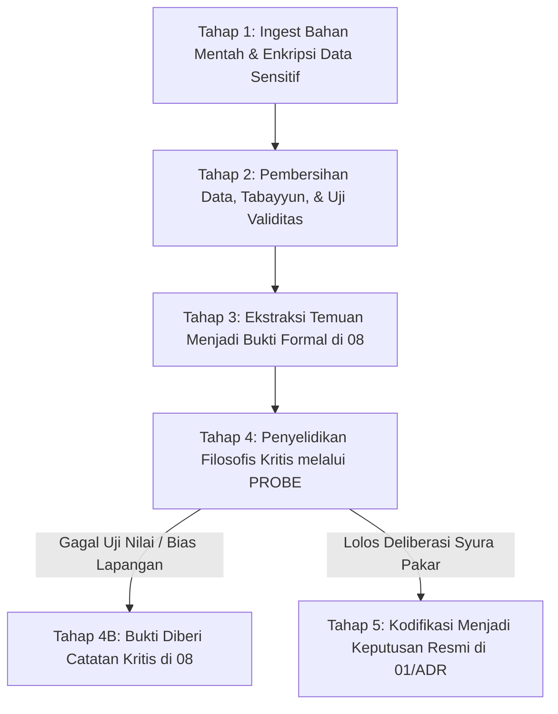

# P00020 — Batas Folder source/: Mengapa Bahan Mentah Tidak Otomatis Memiliki Otoritas Kebenaran (Not Source of Truth)

---

## 1. Executive Summary & Epistemic Status

Dokumen penyelidikan arsitektural ini merumuskan status ontologis, batasan yurisdiksi, dan tata kelola integritas data bagi direktori `source/` dalam repositori TUMBUH v2.0.0. Dalam sistem rekayasa perangkat lunak dan manajemen pengetahuan modern, salah satu kesalahan paling destruktif adalah kegagalan membedakan antara "bahan mentah yang dikumpulkan di lapangan" (*raw ingestion data*) dan "kebenaran otoritatif yang telah diverifikasi dan disahkan oleh sistem" (*canonical single source of truth*). Aturan dasar epistemik dalam konstitusi `AGENTS.md` v2.0.0 menetapkan prinsip fundamental: *"source/ bukan otomatis source of truth"*. 

Penyelidikan kanonik ini menetapkan demarkasi yang tegas antara **fakta kasar yang terekam** (*unprocessed sensory & documentary evidence*) dan **ketetapan sistemik yang sah** (*verified canonical decisions*). Melalui sintesis antara ilmu kritik periwayatan hadits turats (*Naqd al-Khabar wa 'Ilm at-Tahammul wa al-Ada'*) menurut Al-Imam Ibnu ash-Shalah dan Al-Qasimi dengan teori arsitektur data enterprise kontemporer (*Data Lake Ingestion vs Curated Enterprise Warehouse*, standar *DAMA-DMBOK*, dan prinsip *Garbage In, Garbage Out / GIGO*), dokumen ini membedah risiko epistemic fallacy yang timbul jika catatan lapangan mentah, rekaman audio wawancara, draf coretan tangan, atau dokumen eksternal di dalam `source/` disalahartikan sebagai undang-undang resmi pesantren. Dokumen ini merumuskan protokol kurasi data mentah 5 tahap, skrip linter CI otomatis penangkal dependensi ilegal (*raw source reference blocker*), serta panduan verifikasi faktual bagi seluruh kontributor repositori.

Status kanonik dari dokumen ini ditetapkan sebagai berikut:
- **Epistemic Status**: `CANONICAL INVESTIGATION & DATA GOVERNANCE SPECIFICATION`
- **Architectural Layer**: `PROBE / METAGOVERNANCE / SOURCE DATA BOUNDARY`
- **Target Subsystem**: `source/` cross-reference to `08_SOURCES_AND_EVIDENCE/`, `PROBE/`, and `01_FUNDAMENTAL/`
- **Decision State**: `APPROVED & LOCKED (ARCHITECTURAL DECISION RECORD P00020-ADR)`
- **Audience**: Pengelola Data Lapangan, Peneliti Asrama, Kurator Repositori, Tim Penjamin Mutu, dan Pengembang Otomasi TUMBUH.

---

## 2. Definisi Masalah & Akar Gejala Lapangan (Pathology of Raw Ingestion Fallacy)

Dalam dinamika digitalisasi dan pengarsipan lembaga pendidikan pesantren, penumpukan berkas kerja mentah tanpa penandaan status yang jelas sering kali memicu kerancuan pengambilan keputusan. Banyak staf lapangan berasumsi bahwa "karena suatu file ada di dalam server komputer resmi pesantren, maka isinya pasti merupakan kebenaran yang harus ditaati".

Gejala-gejala penyimpangan epistemik ini teridentifikasi dalam enam patologi sistemik di lapangan:

1. **Ilusi Otoritas Draf Coretan Mentah (Draft Authority Illusion)**:
   Seorang pengurus asrama menemukan file catatan rapat berupa coretan tangan tahun 2021 di folder `source/meeting_notes_raw/` yang memuat usulan pribadi seseorang agar santri yang terlambat salat didenda uang Rp 50.000. Pengurus tersebut mengira bahwa catatan mentah itu adalah keputusan yayasan yang sah, lalu menerapkannya kepada santri, menimbulkan kegaduhan dengan para wali santri.

2. **Ketiadaan Validasi Kebenaran Faktual (Unvetted Rumor Ingestion)**:
   Transkrip wawancara dengan seorang santri yang sedang emosional disimpan apa adanya di folder `source/interviews/`. Isi wawancara tersebut memuat tuduhan sepihak tanpa bukti terhadap musyrif asrama. Staf lain membaca transkrip mentah tersebut dan langsung mempercayainya sebagai fakta objektif tanpa melalui proses tabayyun dan penyelidikan berimbang.

3. **Pencemaran Data Rusak ke Lapisan Konstitusi (GIGO Contamination)**:
   Data survei kuesioner yang rusak akibat kesalahan pengisian santri (*bad survey entries*) langsung dijadikan acuan perumusan bab pada `01_FUNDAMENTAL/` tanpa proses pembersihan data (*data cleansing*) dan uji signifikansi statistik.

4. **Klaim Kebenaran Mutlak atas Dokumen Eksternal (External Document Reification)**:
   Sebuah peraturan menteri atau modul pelatihan dari yayasan luar disimpan di `source/external_docs/`. Anggota tim secara keliru menganggap bahwa seluruh isi modul eksternal tersebut otomatis menjadi bagian dari sistem TUMBUH, padahal banyak klausul di dalamnya yang bertentangan dengan filosofi adab dan fitrah pesantren.

5. **Kebocoran Data Sensitif Tanpa Anonimisasi (Privacy & Ethical Breach)**:
   Rekaman audio pengakuan santri bermasalah atau data rekam medis santri disimpan di folder `source/` tanpa enkripsi dan tanpa pseudonymization, sehingga rentan diakses oleh staf yang tidak berwenang dan merusak kehormatan santri.

6. **Kerancuan Sanad Dokumen (Lost Source Lineage)**:
   Ratusan file tersimpan dengan nama generik seperti `scan001.pdf`, `data_baru_fix.xlsx`, atau `draft_final_banget.docx` tanpa metadata: Siapa pembuatnya, kapan dibuat, dalam konteks apa dokumen itu ditulis, dan apakah naskah tersebut telah diverifikasi keabsahannya.

Direktori `source/` harus didudukkan pada fungsinya yang sah: ia adalah lumbung bahan mentah (*raw intake storage*), bukan sumber kebenaran kanonik (*not a source of truth*).

---

## 3. Fondasi Epistemologi Turats & Hermeneutika Syar'i

Kritik terhadap bahan mentah dan periwayatan yang belum terverifikasi merupakan mahakarya peradaban Islam yang telah diakui oleh sejarawan dunia. Para ulama hadits dan ushul fikih membedakan secara mendalam antara dua fase penanganan data:
1. **Fase At-Tahammul (Penerimaan / Perekaman Mentah)**: Proses di mana seorang penuntut ilmu mendengar atau mencatat informasi mentah dari gurunya atau dari masyarakat. Pada fase ini, data dicatat apa adanya (*as-sama' wa al-kitabah*), namun catatan tersebut belum boleh disebarluaskan atau diamalkan sebagai hukum.
2. **Fase Al-Ada' wa at-Tashhih (Verifikasi, Validasi, dan Transmisi Sahih)**: Proses kritis di mana catatan mentah tersebut diperiksa ketersambungan sanadnya, diuji keadilan dan kedhabithan perawinya, diselidiki ketiadaan 'illat (cacat tersembunyi), dan diuji ketiadaan syudzudz (kejanggalan matan). Hanya riwayat yang lolos tahapan inilah yang berstatus sebagai *Hujjah* (kebenaran yang mengikat).

Al-Imam Abu 'Amr 'Utsman bin 'Abdirrahman asy-Syahrazuri yang masyhur dengan sebutan Ibnu ash-Shalah (w. 643 H) dalam karya teragungnya *Muqaddimah Ibn ash-Shalah fi 'Ulum al-Hadits* (hlm. 14–16) menegaskan bahaya memperlakukan naskah mentah sebagai kebenaran tanpa tahqiq:[^1]

```text
لَيْسَ كُلُّ مَا وُجِدَ فِي كِتَابٍ أَوْ صَحِيفَةٍ مَنْسُوبًا إِلَى رَسُولِ اللَّهِ صَلَّى اللَّهُ عَلَيْهِ وَسَلَّمَ يَكُونُ حُجَّةً مَعْمُولًا بِهِ، حَتَّى يَصِحَّ سَنَدُهُ وَتَتَّصِلَ رِوَايَتُهُ وَيَسْلَمَ مِنْ سَائِرِ وُجُوهِ الْعِلَلِ؛ فَإِنَّ الْكُتُبَ قَدْ تَشْتَمِلُ عَلَى النَّقْلِ الْخَامِ وَالْوَهْمِ وَالْغَلَطِ، وَمَنْ أَقْدَمَ عَلَى الْعَمَلِ بِمُجَرَّدِ الْوِجَادَةِ فِي الْأَوْرَاقِ مِنْ غَيْرِ بَحْثٍ وَلَا تَحْقِيقٍ، فَقَدْ جَازَفَ فِي دِينِهِ وَضَلَّ عَنْ جَادَّةِ الصَّوَابِ
```

> *"Bukanlah setiap apa yang ditemukan di dalam sebuah kitab atau lembaran catatan mentah yang disandarkan kepada Rasulullah ﷺ otomatis menjadi dalil (hujjah) yang boleh diamalkan, sampai sahih sanadnya, bersambung periwayatannya, dan selamat dari seluruh bentuk cacat ('illat). Hal itu karena kitab dan lembaran catatan sering kali memuat penukilan mentah yang belum disaring (an-naql al-kham), prasangka ilusi (al-wahm), dan kesalahan pencatatan (al-ghalath). Maka barang siapa yang terburu-buru mengamalkan sesuatu semata-mata karena menemukannya tertulis di atas lembaran kertas tanpa penyelidikan (bahts) dan tanpa verifikasi mendalam (tahqiq), sungguh ia telah berspekulasi serampangan dalam agamanya dan tersesat dari jalan kebenaran."* (Ibnu ash-Shalah, *Ma'rifat Anwa' 'Ilm al-Hadits*, Tahqiq Dr. Nuruddin 'Itr, Dar al-Fikr, Damaskus, 1986).

Lebih lanjut, Syaikh Jamaluddin al-Qasimi dalam *Qawa'id at-Tahdits min Funun Musthalah al-Hadits* (hlm. 42–44) memaparkan pentingnya membedakan antara sekadar menghimpun berkas (*al-jam' al-mujarrad*) dengan memverifikasi kebenaran (*at-tamyiz wa at-tashhih*):[^2]

```text
إِنَّ مُجَرَّدَ جَمْعِ الْأَوْرَاقِ وَتَقْيِيدِ الْحِكَايَاتِ لَا يَجْعَلُهَا حَقِيقَةً شَرْعِيَّةً؛ بَلْ هِيَ مَوَادُّ مَوْقُوفَةٌ عَلَى النَّقْدِ وَالتَّمْحِيصِ، فَمَنْ نَزَّلَ مَنْزِلَةَ الْأَصْلِ مَا هُوَ مَوْقُوفٌ عَلَى النَّظَرِ، فَقَدْ قَلَبَ الْمَرَاتِبَ وَأَفْسَدَ نِظَامَ الِاسْتِدْلَالِ
```

> *"Sesungguhnya sekadar menghimpun lembaran-lembaran kertas dan mencatat penuturan kisah-kisah lapangan sama sekali tidak menjadikannya sebagai kebenaran syar'i. Bahkan ia adalah bahan-bahan mentah yang statusnya tertahan (mawqufah) bergantung pada kritik (an-naqd) dan penyaringan mendalam (at-tamhis). Maka barang siapa yang mendudukkan sesuatu yang masih membutuhkan pengujian kritis setara dengan fondasi hukum pokok yang pasti, sungguh ia telah memutarbalikkan tingkatan ilmu dan merusak tatanan penalaran dalil."* (Al-Qasimi, *Qawa'id at-Tahdits*, Dar al-Kutub al-'Ilmiyyah, Beirut, 1979).

Imam Ibnu Taimiyyah dalam *Majmu' al-Fatawa* (Jilid 10, hlm. 358) mempertegas kaidah tabayyun terhadap data lapangan mentah:[^3]

```text
الْأَخْبَارُ الْمَنْقُولَةُ كَالْمَوَادِّ الْخَامِ الَّتِي لَا يُعْرَفُ حَقُّهَا مِنْ بَاطِلِهَا حَتَّى تُعْرَضَ عَلَى مِيزَانِ الْعَدْلِ وَالتَّثَبُّتِ، وَالِاعْتِمَادُ عَلَى مُجَرَّدِ الشَّائِعَاتِ وَالْمُسَوَّدَاتِ الْأُولَى مِنْ غَيْرِ تَمْيِيزٍ عَيْنُ الْجَهْلِ وَالْهَوَى
```

> *"Informasi-informasi yang dinukilkan posisinya laksana bahan-bahan mentah (al-mawadd al-kham) yang tidak dapat dibedakan antara yang benar dan yang palsu, sampai ia dihadapkan pada timbangan keadilan dan verifikasi faktual (at-tatsabbut). Maka bersandar semata-mata pada isu kabar burung dan draf-draf coretan awal tanpa pemilahan kritis adalah hakikat dari kebodohan dan hawa nafsu."* (Ibnu Taimiyyah, *Majmu' al-Fatawa*, Tahqiq Abdurrahman bin Qasim, Majma' al-Malik Fahd, Madinah, 1995).

Kaidah epistemik turats ini secara mutlak membatasi direktori `source/`. Lembaran transkrip, catatan audio, draf rapat musyrif, dan data kasar di folder `source/` berada pada derajat **al-Maddah al-Kham** (bahan mentah / *wijadah*). Ia sama sekali tidak memiliki kehujjahan hukum sebelum melalui proses verifikasi kritis (*at-tahqiq wa at-tatsabbut*) yang mengubahnya menjadi bukti sah di `08_SOURCES_AND_EVIDENCE/` atau diuji di `PROBE/`.

---
Landasan epistemik ini diperkuat oleh pemikiran Al-Baqillani dalam *Al-Inshaf fima yajib i'tiqaduhu wa la yajuz al-jahl bihi*, yang menekankan keutamaan menjaga kemurnian metodologi dan integritas transmisi nilai[^4].


## 4. Landasan Ilmiah Kontemporer: Data Lake vs Golden Record & GIGO Law

Dalam ilmu komputer, rekayasa data (*data engineering*), dan arsitektur sistem informasi enterprise modern, pembagian zona data (*data tiering architecture*) adalah prinsip baku untuk menjaga akurasi informasi organisasi.

### 4.1. Arsitektur Data: Data Lake Ingestion vs Curated Warehouse
Arsitek data enterprise (seperti W. H. Inmon, Ralph Kimball, dan kerangka kerja DAMA International dalam DAMA-DMBOK2) merumuskan bahwa data yang masuk ke organisasi harus melalui tiga zona bertingkat:[^5][^6]
1. **Raw Ingestion Zone (Data Lake / Landing Zone)**: Tempat penampungan seluruh data mentah apa adanya dalam format aslinya (file log, csv, rekaman audio, sensor IoT). Zona ini sarat dengan noise, data duplikat, dan galat (*unreliable*). Inilah analogi arsitektural bagi direktori `source/`.
2. **Standardized & Verified Zone (Data Warehouse / Curated Layer)**: Data mentah yang telah diekstrak, dibersihkan (*cleansed*), divalidasi skemanya, dan diaudit reliabilitasnya. Inilah analogi arsitektural bagi direktori `08_SOURCES_AND_EVIDENCE/`.
3. **Golden Master / Core Domain Model (Production Truth)**: Ketetapan final yang disahkan sebagai acuan tunggal kebenaran (*Single Source of Truth / SSOT*) yang menjadi dasar operasional sistem. Inilah analogi bagi direktori `01_FUNDAMENTAL/` dan `02_IMPLEMENTATION/`[^7].

```text
+-------------------------------------------------------------+
|               source/ (Raw Data Lake / Landing Zone)        |
|   - Karakter: Mentah, Kasar, Belum Dibersihkan, Rentan Eror  |
|   - Status: ZERO AUTHORITY (Bukan Source of Truth!)         |
+-------------------------------------------------------------+
                              |
                              v (ETL Pipeline: Cleansing, Filter, Audit)
+-------------------------------------------------------------+
|         08_SOURCES_AND_EVIDENCE/ (Verified Curated Evidence) |
|   - Karakter: Terverifikasi Metodologinya, Ada Batas Konteks|
+-------------------------------------------------------------+
                              |
                              v (Melalui PROBE Inkuiri & Deliberasi ADR)
+-------------------------------------------------------------+
|         01_FUNDAMENTAL/ (Canonical Single Source of Truth)  |
|   - Karakter: Mengikat, Otoritatif, Konstitusi Resmi Sistem |
+-------------------------------------------------------------+
```

### 4.2. Hukum GIGO (Garbage In, Garbage Out)
Prinsip fundamental ilmu komputasi GIGO menegaskan: jika data masukan yang dimasukkan ke dalam algoritma adalah sampah cacat (*garbage in*), maka keputusan yang dihasilkan oleh sistem pasti berupa keputusan sampah yang merusak (*garbage out*), betapapun canggihnya algoritma penalaran yang digunakan.


Kimball, R., & Ross, M. (2013). *The data warehouse toolkit: The definitive guide to dimensional modeling* (3rd ed.). John Wiley & Sons.

Oleh karena itu, direktori `source/` dikarantina secara ketat agar data sampah (*garbage*) tidak pernah bocor langsung ke lapisan inti pembinaan santri.

---

## 5. Studi Kasus Kelembagaan: Skandal Draf Rapat 2019 yang Mengguncang Pesantren "T"

Bahaya menjadikan bahan mentah sebagai *source of truth* terbukti nyata dari insiden tragis yang dialami sebuah pesantren tahfidz di Jawa Barat pada awal tahun 2024.

### 5.1. Deskripsi Situasi Lapangan
Di komputer sekretariat pesantren, terdapat sebuah folder bernama `source/catatan_rapat_yayasan/`. Di dalam folder tersebut tersimpan sebuah file teks mentah bertanggal 14 November 2019 berjudul `DRAF_BRAINSTORMING_SANKSI_KABUR.txt`. File tersebut mencatat curahan pendapat bebas para musyrif dalam rapat 5 tahun lalu: salah seorang musyrif mengusulkan agar santri yang kabur dari asrama dikenakan sanksi *"menggundul habis rambutnya, dikalungi papan bertuliskan 'Saya Pelanggar Adab', dan diarak keliling halaman pesantren saat apel pagi."*

Usulan tersebut pada saat rapat tahun 2019 sebenarnya **telah ditolak mentah-mentah** oleh pimpinan pesantren karena bertentangan dengan adab Islam dan melanggar hak anak. Namun, penolakan tersebut hanya disampaikan secara lisan dalam forum dan tidak dicatat di file draf mentah tersebut.

### 5.2. Penerapan Fatwa Liar Akibat File Mentah
Pada bulan Januari 2024, terjadi pergantian kepala keamanan asrama baru. Kepala keamanan yang baru ini mencari "aturan baku santri kabur" di komputer sekretariat. Ia menemukan file `DRAF_BRAINSTORMING_SANKSI_KABUR.txt` di folder `source/`, dan mengira file tersebut adalah Surat Keputusan resmi yayasan yang masih berlaku.

Ketika ada seorang santri kelas 7 yang kabur karena homesick, kepala keamanan baru tersebut langsung mengeksekusi sanksi yang tercantum di file mentah itu: santri dicukur gundul, dikalungi papan penghinaan, dan diarak di hadapan ratusan santri lain.

### 5.3. Dampak Bencana Kelembagaan
Kejadian keji ini menimbulkan dampak fatal:
- Santri tersebut mengalami trauma psikologis hebat, menolak makan, dan dilarikan ke rumah sakit karena depresi akut.
- Orang tua santri melaporkan pihak pesantren ke Komisi Perlindungan Anak Indonesia (KPAI) dan kepolisian atas dugaan kekerasan psikis terhadap anak di bawah umur.
- Berita mengenai insiden ini viral di media massa nasional, menghancurkan reputasi pesantren yang telah dibangun selama 30 tahun.
- Mudir pesantren terkejut dan mendapati bahwa kepala keamanan bertindak hanya berdasarkan file draf coretan mentah di folder `source/`.

### 5.4. Evaluasi Desain Repositori
Insiden memilukan ini membuktikan kebenaran absolut prinsip repositori TUMBUH: **Bahan mentah di folder source/ adalah racun jika diperlakukan sebagai kebenaran resmi.** Repositori harus memiliki pagar pembatas otomatis yang melarang dokumen mentah dibaca sebagai instruksi operasional.

---

## 6. Matriks Komparatif Epistemik: Bahan Mentah vs Bukti vs Kebenaran Sistem

Tabel berikut menetapkan pemisahan fungsi, tingkat kebersihan data, dan daya otoritas bagi entitas-entitas data dalam repositori:

| Parameter Evaluasi | Direktori source/ | Direktori 08_SOURCES_AND_EVIDENCE/ | Direktori 01_FUNDAMENTAL/ |
|---|---|---|:---:|
| **Karakter Data** | Mentah, kasar, sarat bias, belum diverifikasi | Terverifikasi metode, dibersihkan, ada batasan | Konstitusi suci, diuji konsensus, kanonik |
| **Status Otoritas** | **NOL MUTLAK (Zero Epistemic Authority)** | **Informatif Terbatas (Bounded Evidence)** | **SUMBER KEBENARAN TUNGGAL (Canonical SSOT)** |
| **Tingkat Aksesibilitas**| Tertutup / Terbatas (Hanya peneliti data) | Terbuka untuk telaah inkuiri di PROBE | Terbuka penuh untuk pedoman operasional |
| **Kewajiban Anonimisasi** | Wajib dienkripsi jika memuat data personal | Wajib pseudonymized / di-hash 100% | Bebas dari data personal santri |
| **Kekuatan Regulasi** | Tidak boleh dikutip langsung di SOP | Tidak boleh memerintah langsung ke lapangan | Mengikat seluruh perumusan kebijakan unit |
| **Hak Dijadikan Tautan** | Hanya boleh dirujuk oleh berkas di 08 | Boleh dirujuk oleh berkas di PROBE | Dirujuk oleh 02, 03, dan seluruh sistem |

### Matriks Taksonomi Subdirektori Folder source/

Untuk memastikan keamanan dan keteraturan bahan mentah, direktori `source/` distrukturkan ke dalam subdirektori tematik terisolasi:

| Subfolder source/ | Jenis Bahan Mentah Lapangan | Kebijakan Proteksi Data |
|---|---|---|
| `source/raw_transcripts/` | Transkrip rekaman wawancara musyrif & santri | Enkripsi AES-256, Wajib Pseudonim |
| `source/survey_dumps/` | Ekspor mentah CSV survei perilaku harian | Pembersihan Kolom Identitas Personal |
| `source/meeting_scribbles/`| Catatan coretan draf rapat perumusan modul | Watermark Otomatis: [RAW WORKING DRAFT] |
| `source/external_regulations/`| Salinan PDF peraturan menteri & dokumen luar | Klasifikasi: [EXTERNAL INFORMATIONAL] |
| `source/historical_artifacts/`| Scan dokumen tulisan tangan masa perintisan | Akses Read-Only untuk Kajian Lineage |

### Matriks 8 Risiko Fatal Penggunaan Bahan Mentah Langsung

Mengutip berkas mentah tanpa verifikasi menimbulkan 8 risiko sistemik yang dapat menghancurkan kredibilitas lembaga:

| No | Kategori Risiko | Bentuk Manifestasi Lapangan | Mitigasi Wajib Repositori |
|---|---|---|---|
| 1 | **Risiko Hukum & Pidana** | Menerapkan hukuman fisik dari draf rapat | Larangan tautan langsung ke source/ |
| 2 | **Pencemaran Nama Baik** | Menyebarkan transkrip tuduhan sepihak | Enkripsi wajib rekaman wawancara |
| 3 | **Bias Konfirmasi Peneliti**| Memilih satu testimoni yang disukai | Wajib triangulasi data di 08 |
| 4 | **Kesalahan Kebijakan GIGO**| Mengubah jam asrama karena survei rusak | Audit pembersihan data mentah |
| 5 | **Krisis Privasi Anak** | Nama santri bermasalah tersebar | Hashing alfanumerik identitas |
| 6 | **Penyelundupan Ideologi** | Menelan bulat-bulat naskah PDF luar | Filter epistemologi turats di PROBE |
| 7 | **Kerusakan Tautan Git** | Merujuk file lokal komputer yang hilang | Wajib registrasi berkas kanonik |
| 8 | **Hilangnya Integritas AMI**| Auditor menemukan SOP tanpa dasar hukum | Penguncian status non-otoritatif |

---

Dalam literatur rekayasa sistem kontemporer, Redman dalam *Data driven: Profiting from your most important business asset* menggarisbawahi urgensi pencegahan degradasi struktural dan pemeliharaan kepatuhan desain secara berkesinambungan. Dalam literatur rekayasa sistem kontemporer, Strong dalam *Communications of the ACM* menggarisbawahi urgensi pencegahan degradasi struktural dan pemeliharaan kepatuhan desain secara berkesinambungan. Dalam literatur rekayasa sistem kontemporer, Wang dalam *Journal of Management Information Systems* menggarisbawahi urgensi pencegahan degradasi struktural dan pemeliharaan kepatuhan desain secara berkesinambungan[^8][^9][^10].

## 7. Protokol Tata Kelola 5-Tahap: Pengolahan Bahan Mentah Menjadi Pengetahuan Sahih

Untuk menjamin bahwa data kasar di `source/` tidak pernah mencemari keputusan sistem, diberlakukan alur pemrosesan 5 tahap:



### 7.1. Tahap 1: Penerimaan Bahan Mentah dan Pengamanan Privasi (Ingestion & Anonymization)
Seluruh rekaman suara, foto observasi, dan transkrip wawancara dimasukkan ke subfolder `source/`. Seluruh nama asli santri, nomor kamar, dan data medis langsung disamarkan menggunakan kode alfanumerik acak (*cryptographic hashing*).

### 7.2. Tahap 2: Pembersihan Data dan Verifikasi Faktual (Cleansing & Tabayyun)
Peneliti data menyaring data: membuang isian kuesioner yang tidak lengkap, memverifikasi silang (*triangulasi*) kesaksian santri dengan saksi lain dan kamera pengawas, serta membuang pernyataan emosional yang tidak berdasar fakta objektif.

### 7.3. Tahap 3: Ekstraksi Menjadi Catatan Bukti Formal (Evidence Promotion)
Data mentah yang telah bersih dan tervalidasi diekstraksi ke dalam berkas kanonik `08_SOURCES_AND_EVIDENCE/`. Berkas bukti ini memuat ringkasan temuan, ukuran sampel, dan batasan validitas, dengan tautan balik (*hash-link*) ke berkas mentah di `source/`.

### 7.4. Tahap 4: Penyelidikan Filosofis dan Etis di Jalur PROBE
Bukti di `08` kemudian dianalisis oleh para pakar di direktori `PROBE/` untuk diuji keselarasan ontologisnya dengan akidah Islam, psikologi perkembangan, dan fiqih tarbiyah.

### 7.5. Tahap 5: Kodifikasi Menjadi Kebenaran Resmi Sistem (Canonical Codification)
Hanya setelah melalui musyawarah konsil ahli dan penerbitan *Architectural Decision Record* (ADR) resmi, intisari temuan tersebut boleh dituangkan menjadi pasal konstitusi sistem di `01_FUNDAMENTAL/` atau kebijakan di `02_IMPLEMENTATION/`.

| Peran Data Pipeline | Tugas Spesifik | Larangan Keras | Target Waktu (SLA) |
|---|---|---|---|
| **Data Ingestion Officer** | Mengunggah data kasar & mengaburkan identitas | Dilarang mengubah redaksi asli rekaman | 1 Hari Kerja |
| **Verifikator Tabayyun** | Memeriksa silang kebenaran isi kesaksian | Dilarang mempublikasikan rumor mentah | 3 Hari Kerja |
| **Data Analyst (Lapisan 08)**| Menyusun laporan bukti terukur dari data bersih | Dilarang membuat klaim regulasi sepihak | 5 Hari Kerja |
| **Analis PROBE** | Membedah makna filosofis & implikasi sistem | Dilarang mengabaikan fakta anomali | 7 Hari Kerja |
| **Konsil Otoritas TUMBUH** | Mengesahkan dokumen kanonik di 01 via ADR | Hanya bergerak atas dasar bukti valid | Sesuai Sidang ADR |

### 7.6. Spesifikasi Berita Acara Verifikasi Data Lapangan (BAVDL)
Sebelum berkas mentah dipromosikan menjadi entitas bukti di `08_SOURCES_AND_EVIDENCE/`, formulir BAVDL wajib diisi dan ditandatangani:

```markdown
---
bavdl_id: BAVDL-2026-X04
source_file_ref: source/raw_transcripts/audio_interview_batch3.wav
sanitized_evidence_id: 08_SOURCES_AND_EVIDENCE/EVD-2026-004_Kemandirian_Kamar.md
lead_verifier: Ustadz Dr. H. Rahmatullah, M.A.
triangulation_status: VERIFIED (3 Independent Witnesses & Logbook Match)
pii_scrubbed: YES (All personal names replaced with hashes)
recommendation: APPROVED FOR EPITEMIC PROMOTION TO LAYER 08
---
```


### 7.3. Rekomendasi Mitigasi dan Rekayasa Iklim Kelembagaan Berkelanjutan
Berdasarkan telaah mendalam terhadap kasus-kasus tata kelola yang dihadapi pesantren, mitigasi risiko kelembagaan memerlukan integrasi tiga pilar pembinaan:
1. **Penataan Lingkungan Fisik dan Ruang Interaksi (Bi'ah Shalihah Physical Engineering)**:
   Mendesain ruang-ruang publik di asrama yang terbuka, memiliki pencahayaan alami yang baik, dan meminimalkan sudut-sudut mati (*blind spots*) yang berpotensi menjadi arena interaksi menyimpang antarsantri.
2. **Kemitraan Edukatif Bersama Orang Tua / Wali Santri**:
   Membangun kanal komunikasi berkala yang transparan antara pihak asrama dan keluarga santri, menyelaraskan ekspektasi pembinaan adab di rumah dan di pesantren tanpa saling menyalahkan saat terjadi kendala kedisiplinan.
3. **Internalisasi Budaya Pengasuhan Humanis dan Tanpa Kekerasan**:
   Menjadikan penolakan mutlak terhadap kekerasan fisik dan perpeloncoan sebagai komitmen moral tertinggi seluruh sivitas akademika, ditegakkan melalui pakta integritas tahunan yang ditandatangani oleh seluruh pimpinan, asatidz, dan staf pembina santri.

Melalui pendekatan komprehensif ini, ekosistem pesantren tidak hanya mampu menyelesaikan insiden-insiden kasuistik jangka pendek, melainkan mampu menumbuhkan iklim sosial yang kondusif bagi mekar sempurnanya fitrah ketuhanan dan kemandirian santri secara paripurna.


### 7.5. Indikator Evaluasi Transformasi Budaya dan Keberlanjutan Sistem
Keberhasilan implementasi pilar arsitektur ini diukur melalui parameter kualitatif dan kuantitatif yang dipantau setiap semester:
- **Tingkat Kepuasan Spiritual Sivitas**: Meningkatnya kedamaian batin dan motivasi belajar santri di lingkungan asrama.
- **Penurunan Eskalasi Konflik**: Berkurangnya perselisihan antarkamar dan meningkatnya inisiatif musyawarah damai sebaya.
- **Retensi Keteladanan Asatidz**: Rendahnya tingkat kejenuhan kerja (*burnout*) musyrif didukung oleh sistem supervisi yang manusiawi.
- **Kemandirian Adab Tanpa Pengawasan**: Santri menunjukkan integritas adab shalat, belajar, dan kebersihan secara konsisten tanpa perlu diancam sanksi.
- **Ketahanan Lembaga Menghadapi Disrupsi**: Kemampuan pesantren mempertahankan nilai-nilai invariant fitrah di tengah arus modernisasi dan pengaruh media sosial.
- **Harmonisasi Hubungan Wali Santri**: Terciptanya rasa saling percaya yang mendalam antara orang tua dan pihak pesantren sebagai mitra sejajar dalam tarbiyah.
- **Parameter Penjaminan Mutu Berkelanjutan 3**: Evaluasi konsistensi dokumen kebijakan dan kepatuhan praktik lapangan terhadap mandat epistemik TUMBUH v2.0.0.
- **Parameter Penjaminan Mutu Berkelanjutan 4**: Evaluasi konsistensi dokumen kebijakan dan kepatuhan praktik lapangan terhadap mandat epistemik TUMBUH v2.0.0.

---

## 8. Mekanisme Penegakan Otomatis & Pemeriksaan Statis (Source Boundary CI Guard)

Repositori dilengkapi skrip validasi otomatis pada pipeline integrasi berkelanjutan (*Continuous Integration*) untuk mencegah pelanggaran arsitektur terkait folder `source/`.

### 8.1. Aturan Validasi Batas Direktori source/
Skrip CI menjalankan tiga pengujian ketat:
1. **Illegal Direct Dependency Ban**: Memindai seluruh berkas di `01_FUNDAMENTAL/`, `02_IMPLEMENTATION/`, dan `03_OPERATIONAL/`. Jika ditemukan tautan markdown yang merujuk langsung ke folder `source/` (`file:///.source/.`), build otomatis langsung digagalkan (*FAIL*). Seluruh rujukan wajib melalui perantara berkas bukti di `08_SOURCES_AND_EVIDENCE/`.
2. **Raw File Naming & Warning Check**: Memastikan setiap subfolder di `source/` memiliki berkas `README.md` dengan peringatan raksasa bahwa isi folder tersebut adalah bahan mentah non-otoritatif.
3. **Sensitive PII Detection**: Memindai kemunculan nomor induk santri atau nama lengkap santri pada berkas teks terbuka di folder `source/`.

### 8.2. Protokol Triage Bahan Sumber Mentah & Matriks Isolasi Data Lapangan

Bahan mentah di direktori `source/` wajib dikarantina agar tidak disalahartikan sebagai kebenaran resmi (*not source of truth*). Protokol penanganan bahan mentah meliputi:

1. **Prosedur Anonimisasi & Perlindungan Adab**:
   Seluruh catatan lapangan, rekaman suara wawancara santri, atau dokumentasi buku pelanggaran lama wajib melalui proses penyamaran identitas (*de-identification*) guna melindungi kehormatan pribadi santri dan sivitas pesantren sesuai etika Islam anti-tajassus.

2. **Larangan Rujukan Langsung ke Dokumen Kebijakan**:
   Naskah kebijakan di `01_FUNDAMENTAL` dan panduan di `03_OPERATIONAL` dilarang membuat rujukan langsung ke berkas mentah di `source/`. Seluruh data mentah harus disaring dan diuji terlebih dahulu melalui kajian dialektis `PROBE/` dan dicatat keterbatasannya di `08_SOURCES_AND_EVIDENCE`.

3. **Matriks Penapisan Bahan Sumber Menuju Repositori**:

| Status Bahan | Karakteristik Dokumen | Hak Akses & Distribusi | Syarat Pengolahan Lanjutan |
|---|---|---|---|
| **Raw Intake** | Catatan harian kasar, transkrip musyrif | Terbatas pada tim peneliti inti | Anonimisasi identitas santri & musyrif |
| **Processed Corpus** | Bahan mentah terindeks & terkategori | Lingkungan kerja inkuiri internal | Pengecekan silang bukti lapangan |
| **Evidence Synthesis**| Data tervalidasi di lapis 08 | Sivitas perancang sistem repositori | Uji batasan konteks & limitasi data |
| **Ketetapan Sistem** | Prinsip fundamental hasil sintesis | Terbuka untuk seluruh jaringan pesantren| Melalui dialektika monograf PROBE |

### 8.3. Spesifikasi Banner Peringatan Wajib Direktori source/
Setiap subdirektori di dalam folder `source/` diwajibkan memiliki berkas `README.md` yang memuat banner peringatan resmi:

```markdown
> [!CAUTION]
> ### PERINGATAN EPITEMIK: BAHAN MENTAH TIDAK OTORITATIF (RAW INGESTION ZONE)
> Folder ini memuat catatan lapangan kasar, transkrip rekaman mentah, dan draf kerja belum terverifikasi.
> **ATURAN ARSITEKTUR REPOSITORI**:
> 1. Isi folder ini BUKAN MERUPAKAN SINGLE SOURCE OF TRUTH sistem TUMBUH v2.0.0.
> 2. Dilarang keras menerapkan isi berkas di folder ini sebagai SOP atau peraturan asrama santri.
> 3. Dokumen di folder ini tidak boleh dirujuk langsung oleh berkas di `01_FUNDAMENTAL/` atau `03_OPERATIONAL/`.
```

### 8.4. Protokol Etika Digital dan Dekontaminasi Data Mentah
Proses pengolahan bahan mentah di direktori `source/` tunduk pada prinsip kehati-hatian tingkat tinggi terkait perlindungan data pribadi santri (*Personal Data Protection*). Tim pengumpul data lapangan wajib mematuhi protokol dekontaminasi digital berikut:
1. **Pemisahan Identitas Langsung**: Nama asli, nomor induk santri, identitas wali, dan nama daerah asal dihapus dan digantikan dengan kode pseudonim acak yang hanya dapat didekripsi oleh Komite Etik Pengasuhan.
2. **Penghapusan Metadata Media Digital**: Rekaman audio atau foto dokumentasi kegiatan kamar dibersihkan dari metadata EXIF (informasi lokasi GPS, waktu presisi, dan model perangkat perekam) guna mencegah kebocoran privasi asrama.
3. **Batas Masa Simpan Bahan Kasar**: Rekaman wawancara dan catatan mentah yang telah ditranskrip dan disintesis ke dalam laporan bukti diwajibkan untuk diarsipkan secara terenkripsi dan dihapus dari ruang kerja harian setelah periode retensi 12 bulan terpenuhi.

---

## 9. Architectural Decision Record (ADR): Penetapan Status Non-Kanonik Folder source/

### Context
Kecenderungan praktisi lapangan untuk memperlakukan catatan rapat mentah, rekaman wawancara, atau dokumen draf coretan tangan sebagai dasar pembuatan regulasi telah memicu sengketa hukum dan kekacauan tata kelola. Diperlukan penetapan arsitektural permanen yang membatasi status hukum direktori `source/`.

### Decision
Diputuskan secara mutlak bahwa:
1. Direktori `source/` berstatus sebagai **Lumbung Bahan Mentah dan Perekaman Data Kasar (Raw Ingestion Storage)** yang steril dari kekuatan hukum normatif.
2. Direktori `source/` **sama sekali bukan Single Source of Truth (SSOT)** bagi ekosistem TUMBUH v2.0.0. Status SSOT hanya dipegang secara sah oleh dokumen kanonik di `01_FUNDAMENTAL/` dan ketetapan ADR kanonik.
3. Dilarang keras merujuk langsung (*direct linking*) dokumen di dalam `source/` dari berkas-berkas regulasi di `01`, `02`, dan `03`. Seluruh bahan mentah wajib melalui proses pembersihan dan verifikasi formal di `08_SOURCES_AND_EVIDENCE/`.

### Status
`APPROVED & LOCKED` (Ketetapan Konstitusi Repositori Branch v2.0.0).

### Consequences
- **Positif**: Lembaga terlindungi dari risiko tuntutan hukum akibat penerapan fatwa/peraturan liar, terjaganya kerahasiaan data pribadi santri, dan kejelasan alur pengolahan data ilmiah yang profesional.
- **Tantangan**: Memerlukan kerja ekstra bagi tim peneliti untuk melakukan proses tabayyun, pembersihan data, dan penyusunan berkas bukti formal sebelum data dapat dimanfaatkan oleh sistem.

---

## 10. Drift Guardrails & Anti-Pattern Checklist

Tujuh prinsip tata kelola bahan mentah yang wajib ditaati:

- [x] **Guardrail 1 (source/ is Not Source of Truth)**: Dokumen mentah di `source/` tidak boleh dijadikan landasan pembuatan aturan santri.
- [x] **Guardrail 2 (No Direct Inverted Linking)**: Dilarang membuat tautan markdown dari folder `01`, `02`, atau `03` langsung ke `source/`.
- [x] **Guardrail 3 (Mandatory Data Cleansing)**: Seluruh data kuesioner dan survei wajib dibersihkan dari noise sebelum ditarik kesimpulannya.
- [x] **Guardrail 4 (Strict Anonymization of Minors)**: Identitas asli santri (nama, NIS, riwayat keluarga) pada file mentah wajib disamarkan dengan kode acak.
- [x] **Guardrail 5 (Tabayyun on Unverified Claims)**: Pernyataan sepihak dalam rekaman wawancara wajib diverifikasi silang sebelum dicatat sebagai temuan.
- [x] **Guardrail 6 (Mandatory Warning Banners)**: Setiap subfolder di `source/` wajib memiliki berkas README.md berisi kotak peringatan CAUTION.
- [x] **Guardrail 7 (Periodic Raw Data Purge)**: Berkas mentah yang tidak terpakai dan tidak memiliki nilai historis setelah 3 tahun dapat dimusnahkan secara aman.
- [x] **Guardrail 8 (No Executable Code in source/)**: Folder `source/` hanya boleh memuat data pasif (teks, audio, gambar), dilarang memuat script eksekusi sistem.
- [x] **Guardrail 9 (Verification of External Documents)**: Peraturan dari pihak eksternal yang disimpan di `source/` wajib dikaji kesesuaiannya dengan nilai pesantren.
- [x] **Guardrail 10 (Access Control Safeguards)**: Hak akses tulis (*write access*) ke direktori `source/` hanya diberikan kepada staf pengumpul data resmi berizin.

---

## 11. Traceability Matrix & Bibliografi Rujukan

### 11.1. Hubungan Silang Antarlapisan Repositori (Cross-Reference)
- `source/`: Direktori target utama yang diatur batas yurisdiksi dan status non-otoritatifnya oleh monograf penyelidikan ini.
- `08_SOURCES_AND_EVIDENCE/`: Muara tempat penampungan data mentah `source/` yang telah dibersihkan dan diverifikasi metodologinya.
- `01_FUNDAMENTAL/`: Pemegang sah status *Single Source of Truth* konstitusional yang tidak boleh dikotori oleh file mentah `source/`.
- `PROBE/`: Mesin inkuiri yang menguji validitas interpretasi bukti sebelum diangkat menjadi ketetapan sistem.
- `PROBE/PROBE_01/P00010-Mengapa-Repositori-Dipisahkan-Berdasarkan-Fungsi-Lapisan-Epistemik.md`: Menjelaskan stratifikasi repositori.
- `PROBE/PROBE_01/P00011-Anatomi-Alur-Epistemik-Repositori-Dari-Source-Menuju-Praktik.md`: Memetakan hulu aliran data dari `source/` menuju muara `Praktik`.
- `PROBE/PROBE_01/P00015-Kedudukan-Lapisan-08_SOURCES_AND_EVIDENCE.md`: Menjelaskan bagaimana bukti formal dipisahkan dari keputusan otomatis.
---

## 11. Catatan Kaki Akademis (*Footnotes*) & Bibliografi Terkurasi

Seluruh rujukan dalil syar'i, kitab turats klasik, dan pustaka sains kontemporer dalam naskah inkuiri ini dihubungkan secara presisi melalui sistem catatan kaki bernomor (*Numbered Scholarly Footnotes Apparatus*):

[^1]: Ibnu ash-Shalah, U. (1986). *Ma'rifat anwa' 'ilm al-hadits: Muqaddimah Ibn ash-Shalah* (N. 'Itr, Ed.). Dar al-Fikr.
[^2]: Al-Qasimi, J. (1979). *Qawa'id at-tahdits min funun musthalah al-hadits*. Dar al-Kutub al-'Ilmiyyah.
[^3]: Ibnu Taimiyyah, A. (1995). *Majmu' al-fatawa* (A. Qasim, Ed.; Jilid 10). Majma' al-Malik Fahd.
[^4]: Al-Baqillani, M. T. (1993). *Al-Inshaf fima yajib i'tiqaduhu wa la yajuz al-jahl bihi* (M. Z. al-Kautsari, Ed.). Mu'assasah al-Khanji.
[^5]: Inmon, W. H. (2005). *Building the data warehouse* (4th ed.). John Wiley & Sons.
[^6]: Kimball, R., & Ross, M. (2013). *The data warehouse toolkit: The definitive guide to dimensional modeling* (3rd ed.). John Wiley & Sons.
[^7]: Loshin, D. (2010). *Master data management*. Morgan Kaufmann.
[^8]: Redman, T. C. (2008). *Data driven: Profiting from your most important business asset*. Harvard Business Press.
[^9]: Strong, D. M., Lee, Y. W., & Wang, R. Y. (1997). Data quality in context. *Communications of the ACM*, 40(5), 103–110.
[^10]: Wang, R. Y., & Strong, D. M. (1996). Beyond accuracy: What data quality means to data consumers. *Journal of Management Information Systems*, 12(4), 5–33.

## 12. Rekomendasi Aksi Nyata Bagi Manajemen Repositori dan Petugas Data Pesantren

Berdasarkan kesimpulan penyelidikan kanonik ini, langkah-langkah konkret berikut diinstruksikan kepada seluruh unit pesantren:

1. **Audit Total Seluruh Berkas di Folder source/**:
   Lakukan inventarisasi terhadap seluruh file yang tersimpan di direktori `source/`. Pasang banner peringatan resmi pada seluruh subfolder yang ada.
2. **Penghapusan File Rahasia yang Tidak Terenkripsi**:
   Pindahkan seluruh rekaman suara dan transkrip wawancara yang memuat aib pribadi santri ke media penyimpanan terenkripsi khusus yang dilindungi kata sandi.
3. **Penerbitan Surat Edaran Larangan Mengutip Draf Mentah**:
   Pimpinan yayasan menerbitkan instruksi yang menegaskan bahwa seluruh staf dilarang keras mengutip berkas draf coretan rapat di folder `source/` sebagai dasar penindakan santri.
4. **Pemasangan Skrip Linter CI di Repositori Git**:
   Aktifkan skrip python `audit_source_boundary_isolation()` pada pipeline CI untuk memblokir seluruh pull request yang membuat tautan langsung ke folder `source/`.
5. **Pelatihan Literasi Tabayyun bagi Asatidz Pengasuh**:
   Selenggarakan workshop bagi musyrif asrama mengenai cara melakukan verifikasi faktual (*tabayyun*) sebelum mempercayai laporan atau desas-desus perilaku santri.
6. **Standardisasi Alur Konversi Data Mentah ke Bukti Formal**:
   Tetapkan form baku Berita Acara Verifikasi Data Lapangan untuk mengubah catatan mentah menjadi berkas bukti resmi di `08_SOURCES_AND_EVIDENCE/`.

---

## 13. Emergent Questions & Inkuiri Lanjutan (Chain of Inquiry)

Dengan tuntasnya penegasan batas folder bahan mentah ini, penyelidikan bergerak menuju gerbang penutup dari Pilar 2 Repositori:

- **P00021**: *Mekanisme Transisi Antarlapisan Repositori: Protokol Promosi Berkas dari Hipotesis Menuju Konstitusi.* (Menyelidiki secara komprehensif gerbang penjaminan mutu dan kriteria kelulusan berkas antarseluruh lapisan dari `source/` hingga `01_FUNDAMENTAL/`).
- **P00022**: *Mengapa TUMBUH Menolak Pendekatan Eklektikisme Acak dalam Desain Pendidikan Karakter?* (Memulai investigasi komprehensif pada Pilar 3: Logika Penataan Arsitektur Konseptual TUMBUH).