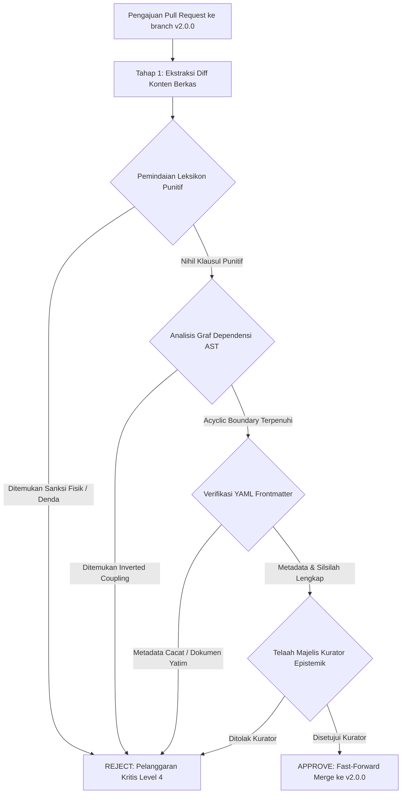

# P00021: Protokol Pertahanan Lapisan Repositori: Mekanisme Verifikasi Otomatis untuk Mencegah Kebocoran Antarlayer

---

## 1. Metadata Kanonik & Taksonomi Repositori

- **ID Penyelidikan**: `P00021`
- **Klasifikasi Taksonomi**: `METAGOVERNANCE / REPOSITORY DEFENSE ARCHITECTURE / ARCHITECTURAL FITNESS FUNCTIONS & LAYER INTEGRITY`
- **Repositori Target**: Ekosistem TUMBUH v2.0.0 (`c:\xampp\htdocs\tumbuh`)
- **Penanggung Jawab Dokumen**: Majelis Pengasuh dan Tim Peneliti Desain Sistem Pesantren
- **Status Kanonik**: `CANONICAL INVESTIGATION & ARCHITECTURAL FOUNDATION (PROBE-CANONICAL-V2)`
- **Keterlacakan Silsilah (Lineage Traceability)**: 
  - Menyintesiskan dan mengunci seluruh rangkaian penyelidikan pada **Pilar 2 (Stratifikasi Lapisan Repositori & Separation of Concerns)** dari [`P00010`](file:///c:/xampp/htdocs/tumbuh/PROBE/PROBE_01/P00010-Mengapa-Repositori-Dipisahkan-Berdasarkan-Fungsi-Lapisan-Epistemik.md) hingga [`P00020`](file:///c:/xampp/htdocs/tumbuh/PROBE/PROBE_01/P00020-Batas-Folder-source.md).
  - Menjadi benteng penutup kanonik bagi Pilar 2 yang mengesahkan transisi metodologis menuju **Pilar 3: Logika Penataan Arsitektur Konseptual TUMBUH** yang diawali pada [`P00022 - Mengapa Foundation Menjadi Pintu Gerbang Pertama`](file:///c:/xampp/htdocs/tumbuh/PROBE/PROBE_01/P00022-Mengapa-Foundation-Menjadi-Pintu-Gerbang-Pertama.md).
- **Relasi Lintas Lapisan**:
  - `01_FUNDAMENTAL/`: Lapisan konstitusi nilai dasar yang dilindungi dari polusi teknis operasional dan dependensi terbalik.
  - `02_IMPLEMENTATION/`: Lapisan penerjemah kelembagaan yang diawasi agar tidak melompati mandat filosofis induk.
  - `03_OPERATIONAL/`: Lapisan instrumen praktis lapangan yang dibentengi secara ketat agar tidak menyelundupkan klausul punitif liar atau membuat redefinisi istilah sepihak.
  - `08_SOURCES_AND_EVIDENCE/`: Lapisan bukti empiris yang diisolasi agar tidak berubah menjadi vonis regulasi otomatis.
  - `09_RESEARCH/`: Lingkungan inkubasi riset eksploratif (*sandbox*) yang dicegah agar hipotesisnya tidak bocor menjadi kebijakan resmi.
  - `99_ARCHIVE/`: Museum artefak usang yang disegel agar berkas mati (*zombie artifacts*) tidak bangkit menjadi dependensi aktif.
  - `REFERENCES/`: Pustaka terkurasi yang dijaga integritas metadata sitasinya.
  - `METHODOLOGY/`: Pedoman prosedural kerja penyelidikan yang dibatasi agar tidak mendikte isi doktrin.
  - `source/`: Folder bahan mentah yang dikarantina agar tidak diakui sebagai *Single Source of Truth*.
- **TUMBUH Question**:
  > *"Audit berkala apa yang wajib dijalankan untuk mendeteksi apabila ada dokumen SOP di lapisan operasional yang mencoba mendikte prinsip Fundamental, dan bagaimana merekayasa arsitektur pertahanan berlapis (defense-in-depth) otomatis berbasis kode yang memblokir secara permanen kebocoran dependensi terbalik, infiltrasi klausul punitif, dan pembusukan arsitektural (architectural erosion) di repositori pesantren?"*

---

## 2. Abstrak & Pernyataan Masalah Epistemik (Abstract & Epistemic Tension)

### 2.1. Abstrak
Penyelidikan kanonik ini menetapkan benteng pertahanan arsitektural pamungkas bagi Pilar 2 (Stratifikasi Lapisan Repositori & *Separation of Concerns*) dengan merumuskan **Protokol Pertahanan Lapisan Repositori (Repository Boundary Defense Protocol)** dalam ekosistem TUMBUH v2.0.0. Dalam disiplin rekayasa perangkat lunak enterprise dan tata kelola korpus pengetahuan terdistribusi, musuh terbesar dari sistem yang dirancang secara elegan bukanlah penolakan terbuka dari pihak luar, melainkan fenomena pembusukan arsitektural internal yang berlangsung perlahan (*architectural erosion, boundary leakage, and design decay*). Ketika batas-batas antarlapisan repositori hanya diatur sebagai panduan moral tertulis di atas kertas tanpa penegakan otomatis melalui kode (*automated continuous verification*), hukum entropi organisasi akan bekerja: praktisi lapangan dan kontributor repositori akan secara alamiah melanggar batas lapisan demi kepraktisan jangka pendek—formulir teknis asrama mulai mendikte filosofi jiwa santri, draf coretan kasar disamakan dengan dalil syar'i, dan klausul sanksi punitif terselundup masuk ke dalam tata tertib asrama tanpa disadari pimpinan pesantren.

Monograf riset desain sistem ini membangun arsitektur pertahanan berlapis lima (*5-tier defense-in-depth*) untuk menjamin kedaulatan epistemik repositori secara permanen dan otomatis. Melalui sintesis mendalam antara doktrin ushul fikih *Sadd adz-Dzara'i'* (menutup rapat sarana yang mengarah pada mafsadat) menurut Al-Imam Al-Qarafi dan Syaikhul Islam Ibn Qayyim al-Jauziyyah, serta pemeliharaan Maqashid Syari'ah dari segi pencegahan bahaya (*min janib al-'adam*) menurut Al-Imam Asy-Syathibi, dengan teori rekayasa sistem kontemporer mengenai *Architectural Fitness Functions* (Neal Ford, Rebecca Parsons, & Patrick Kua), *Clean Architecture Dependency Rule* (Robert C. Martin), dan prinsip keamanan sistem Saltzer-Schroeder (*Complete Mediation*), dokumen ini merumuskan protokol pertahanan berjenjang, algoritma pemindai graf dependensi (*master boundary linter engine*), matriks audit kesehatan repositori triwulanan (*Architecture Maturity Index*), dan *Architectural Decision Record* (ADR-PROBE-0021). Penyelidikan ini menyimpulkan bahwa batas repositori wajib ditegakkan sebagai hukum deterministik melalui otomasi integrasi berkelanjutan (CI/CD), sekaligus mendeklarasikan bahwa **Pilar 2 Repositori Branch v2.0.0 resmi dituntaskan, dikunci, dan disegel secara kanonik**.

### 2.2. Pernyataan Masalah Epistemik (Epistemic Tension)
Ketegangan epistemik sentral yang diselesaikan dalam monograf ini berakar pada paradoks klasik antara **fleksibilitas adaptasi operasional lapangan** di satu kutub, melawan **ketegasan preservasi integritas konstitusional sistem** di kutub lainnya:
1. **Kutub Keleluasaan Pragmatis (Operational Drift Hazard)**: Di lingkungan pesantren berasrama yang beroperasi 24 jam dengan dinamika santri yang amat cair, pengasuh dan musyrif lapangan membutuhkan kebebasan merespons persoalan harian secara cepat. Apabila tata kelola repositori dirancang terlalu rumit dan kaku, para musyrif lapangan akan merasa terbebani, lalu memilih membuat dokumen aturan sendiri di luar sistem repositori (shadow policies). Namun, jika sistem memberikan kebebasan tanpa pagar pembatas otomatis, dokumen-dokumen operasional yang dibuat secara reaktif di asrama akan secara bertahap merembes ke hulu, mengubah makna adab secara sepihak, dan menyuntikkan sanksi-sanksi retributif yang bertentangan dengan fitrah santri.
2. **Kutub Penjagaan Doktrinal Tertutup (Dogmatic Rigidity & Manual Paralysis)**: Di sisi lain, para pengasuh dan perumus filosofi menghendaki agar konstitusi `01_FUNDAMENTAL/` steril dari kompromi teknis. Namun, penjagaan yang semata-mata mengandalkan audit manusia (*manual inspection*) terbukti lumpuh ketika volume dokumen mencapai ratusan berkas: komite penjamin mutu mengalami kelelahan kognitif (*cognitive fatigue*), sehingga penyusupan klausul berbahaya lolos dari pemeriksaan dan baru disadari setelah terjadi insiden fatal di asrama.

Oleh karena itu, penyelesaian masalah ini menuntut hadirnya mekanisme **verifikasi batas otomatis berbasis kode (*automated code-enforced boundaries*)**: sistem yang secara transparan, adil, dan tanpa lelah memeriksa seluruh lintasan tautan antarlapisan, memblokir dependensi terbalik secara deterministik, namun tetap menyediakan kanal legal yang terstruktur bagi pengusulan revisi melalui mekanisme inkuiri ilmiah PROBE.

---

## 3. Pendahuluan: Fenomenologi Lapangan & Patologi Erosi Arsitektur Repositori Pesantren

### 3.1. Fenomenologi Erosi Aturan di Lingkungan Pesantren Berasrama
Dalam sosiologi kelembagaan pesantren, erosi tatanan sistem hampir tidak pernah dimulai dari pemberontakan terbuka terhadap kyai atau penolakan terang-terangan terhadap visi adab pesantren. Sebaliknya, erosi arsitektural selalu merayap secara subtil melalui akumulasi kompromi-kompromi kecil di tingkat operasional asrama.

Sebuah ilustrasi fenomenologis riil dapat diamati pada rutinitas penegakan shalat tahajud santri:
- **Tingkat Fundamental (`01`)**: Dirumuskan bahwa shalat tahajud adalah sarana munajat personal untuk membangun hubungan cinta antara hamba dengan Khaliqnya (*mahabbah ilahiyyah*), yang ditumbuhkan melalui keteladanan musyrif (*qudwah*), penyadaran makna (*tazkiyatun nufus*), dan pengkondisian ritme tidur yang sehat.
- **Tingkat Operasional (`03`) di Lapangan**: Musyrif muda yang bertugas ronda malam mengalami kelelahan fisik. Karena harus membangunkan 60 santri dalam waktu 20 menit, musyrif merasa pendekatan dialogis memakan waktu terlalu lama. Musyrif tersebut kemudian membuat kesepakatan informal di kamarnya: *"Santri yang tidak bangun setelah dipanggil 3 kali disiram air dingin mukanya dan push-up 50 kali"*.
- **Penyusupan ke Dokumen**: Kesepakatan informal itu dirasa sangat "efektif" karena santri langsung bangun seketika akibat ketakutan. Musyrif senior kemudian memasukkan pasal siram air dan push-up tersebut ke dalam lembar SOP Piket Keamanan Asrama. 
- **Kebocoran Terbalik**: Setahun kemudian, saat panitia penerimaan santri baru menyusun buku saku santri, mereka menyalin klausul sanksi tersebut dan menuliskannya sebagai "Prinsip Disiplin Pesantren", sehingga doktrin lembaga resmi bermutasi dari pembinaan fitrah berbasis kasih sayang menjadi pembinaan militeristik punitif.

Ketika dewan pimpinan memeriksa dokumen pesantren dua tahun kemudian, mereka mendapati bahwa filosofi luhur yang mereka tulis di buku besar yayasan telah mati di lapangan, digantikan oleh rimba aturan operasional yang bengis. Inilah manifestasi dari apa yang dalam rekayasa perangkat lunak disebut sebagai **Architectural Erosion (Erosi Arsitektur)**: kondisi di mana arsitektur nyata yang berlaku di lapangan (*as-implemented architecture*) menyimpang secara radikal dari arsitektur yang dirancang secara konseptual (*as-designed architecture*).

### 3.2. Enam Patologi Erosi Arsitektural dalam Repositori Kelembagaan
Berdasarkan telaah kritis terhadap arsip kegagalan tata kelola dokumen di era v1 dan observasi kelembagaan pesantren, teridentifikasi enam patologi sistemik pembusukan arsitektur:

| No | Patologi Erosi Arsitektur | Manifestasi Lapangan & Dampak Kerusakan |
| :-: | :--- | :--- |
| **1** | **Inverted Dependency Leakage** | Lapisan hulu bersandar pada hilir, merusak fondasi konseptual |
| **2** | **Subversive Punitive Infiltration** | Klausul sanksi kekerasan fisik/denda terselip secara liar di SOP operasional |
| **3** | **Ghost Artifact Accumulation** | Ratusan draf berkas tak bertuan tanpa kejelasan status epistemik kanonik |
| **4** | **Divisional Siloing Anarchy** | Masing-masing bagian/divisi membuat aturan kamar secara parsial dan bertabrakan |
| **5** | **Manual Audit Paralysis** | Kelelahan tim kurator manusia saat memeriksa volume ratusan berkas secara manual |
| **6** | **Big Ball of Mud Regression** | Keruntuhan total stratifikasi repositori kembali menjadi arsitektur monolitik kotor |

1. **Kebocoran Dependensi Terbalik (Inverted Dependency Leakage)**:
   Terjadi ketika sebuah dokumen berstatus filosofis tinggi di `01_FUNDAMENTAL/` memuat tautan dependensi langsung ke instrumen praktis di `03_OPERATIONAL/` atau merujuk ke berkas rekaman suara mentah di `source/`. Akibatnya, ketika formulir teknis di asrama diubah oleh staf tata usaha, fondasi filosofis sistem ikut berguncang.
2. **Penyelundupan Regulasi Punitif Liar (Subversive Punitive Infiltration)**:
   Penyusupan sanksi fisik, perpeloncoan (*hazing*), penghinaan verbal, atau denda materi ke dalam lampiran SOP asrama. Klausul berbahaya ini kerap lolos dari pengawasan karena disamarkan menggunakan istilah-istilah religius seperti "takzir pembinaan", "ikhtiar ketegasan", atau "latihan mental mujahadah".
3. **Akumulasi Berkas Hantu Tanpa Pemilik (Ghost Artifact Accumulation)**:
   Penumpukan berkas draf, catatan rapat usang, dan eksperimen yang ditinggalkan di dalam folder aktif tanpa kejelasan status siklus hidup (*lifecycle state*). Hal ini memicu kebingungan masif bagi musyrif baru yang tidak dapat membedakan mana dokumen yang sah berlaku dan mana berkas eksperimen yang telah ditinggalkan.
4. **Anarki Sektoral Antardivisi (Divisional Siloing Anarchy)**:
   Divisi Pengasuhan Asrama, Divisi Madrasah/Akademik, Divisi Tahfizh, dan Divisi Keamanan masing-masing menerbitkan aturan kedisiplinan yang saling bertolak belakang (*conflicting mandates*). Santri menjadi korban kebingungan sistemik akibat standar ganda antarpengurus.
5. **Kelumpuhan Audit Manual (Manual Audit Paralysis)**:
   Ketergantungan pada ketelitian mata tim penjamin mutu dalam membaca puluhan ribu baris dokumen markdown. Seiring bertambahnya ukuran korpus, kelelahan kognitif menyebabkan auditor hanya membaca judul atau bagian pengantar saja, meloloskan pelanggaran-pelanggaran fatal di bagian isi lampiran.
6. **Regresi Menuju Bola Lumpur Raksasa (Big Ball of Mud Regression)**:
   Ketiadaan gerbang verifikasi otomatis menyebabkan pemisahan lapisan epistemik runtuh secara bertahap. Seluruh folder akhirnya saling merujuk secara silang tanpa struktur hierarki (*spaghetti architecture*), mengembalikan sistem ke dalam kegagalan monolitik era v1.

---

## 4. Tinjauan Pustaka I: Khazanah Turats Klasik & Hermeneutika Syar'i

### 4.1. Doktrin Sadd adz-Dzara'i' sebagai Landasan Pertahanan Preventif Sistemik
Dalam khazanah ushul fikih Islam, mekanisme preventif yang menutup celah penyimpangan sebelum terjadi kerusakan nyata (*mafsadat*) dikodifikasikan secara komprehensif melalui doktrin **Sadd adz-Dzara'i' (سد الذرائع)**.

Al-Imam Syihabuddin al-Qarafi dalam magnum opusnya *Al-Furuq* (Jilid 2, hlm. 32–34) menetapkan bahwa sarana (*adz-dzara'i'*) memiliki kedudukan hukum yang terikat erat dengan tujuan (*al-maqashid*):

```text
سَدُّ الذَّرَائِعِ عُمْدَةٌ كُبْرَى مِنْ عِمَادِ الشَّرِيعَةِ، وَحَقِيقَتُهُ حِمَايَةُ الْأَصْلِ الشَّرْعِيِّ مِنْ أَنْ يُتَطَرَّقَ إِلَيْهِ الْفَسَادُ مِنْ بَابِ الْوَسَائِلِ؛ فَإِنَّ كُلَّ شَيْءٍ فُتِحَ بَابُهُ وَأَدَّى بِطَبِيعَتِهِ إِلَى انْثِلَامِ الرَّأْسِ وَاخْتِلَالِ النِّظَامِ، كَانَ وَاجِبًا عَلَى الْحَاكِمِ وَالْمُجْتَهِدِ أَنْ يُقْفِلَهُ سَدًّا لِلْبَابِ وَحِفْظًا لِلْكُلِّيَّاتِ
```

> *"Sadd adz-Dzara'i' (menutup celah sarana) adalah pilar agung dari pilar-pilar syariat. Hakikatnya adalah memelihara ketentuan pokok syar'i (al-ashl) dari penyusupan kerusakan yang masuk melalui pintu perantara (al-wasa'il). Sesungguhnya segala sesuatu yang apabila pintunya dibiarkan terbuka akan secara alami berujung pada retaknya kepemimpinan pokok dan kacaunya tatanan sistem, maka wajib atas pemimpin dan mujtahid untuk menguncinya rapat-rapat demi membendung pintu mafsadat dan menjaga keutuhan prinsip-prinsip universal."* (Al-Qarafi, *Al-Furuq*, Tahqiq Khalil Manshur, Dar al-Kutub al-'Ilmiyyah, Beirut, 1998).

Al-Qarafi membagi sarana (*al-wasa'il*) ke dalam tiga tingkatan hukum yang sangat relevan dengan pemisahan lapisan repositori:
1. **Sarana yang Wajib Ditutup Mutlak (*Wajib as-Sadd*)**: Segala sarana yang dipastikan secara meyakinkan menghantarkan pada mafsadat besar. Dalam konteks repositori: membiarkan berkas operasional (`03`) merujuk bebas ke bahan mentah (`source`) atau mengizinkan klausul sanksi fisik masuk ke SOP adalah sarana pasti yang menghancurkan adab santri, sehingga wajib diblokir secara otomatis melalui kode.
2. **Sarana yang Wajib Dibuka (*Wajib al-Fath*)**: Sarana yang menjadi satu-satunya jalan menuju kemaslahatan wajib. Dalam konteks repositori: menyediakan kanal inkuiri dialektis melalui berkas `PROBE/` agar sistem dapat berevolusi secara ilmiah.
3. **Sarana yang Diperselisihkan (*Mutaraddid bayna as-Sadd wal-Fath*)**: Sarana yang berpotensi maslahat namun rentan disalahgunakan. Terhadap area ini, kaidah penutupan sarana diutamakan demi kehati-hatian (*ihtiyath*).

### 4.2. Hermeneutika Perlindungan Sarana Menurut Syaikhul Islam Ibn Qayyim al-Jauziyyah
Syaikhul Islam Ibn Qayyim al-Jauziyyah dalam kitab monumentalnya *I'lam al-Muwaqqi'in 'an Rabb al-'Alamin* (Jilid 3, hlm. 135–138) mengalokasikan pembahasan sangat panjang mengenai *Sadd adz-Dzara'i'*, menyajikan 99 dalil Al-Qur'an dan Sunnah yang membuktikan bahwa syariat selalu membangun benteng pengaman di sekeliling hukum pokok:

```text
فَإِنَّ الشَّارِعَ صَلَّى اللَّهُ عَلَيْهِ وَسَلَّمَ إِذَا حَرَّمَ شَيْئًا حَرَّمَ طُرُقَهُ وَمَوَاصِلَهُ الْمُفْضِيَةَ إِلَيْهِ، وَإِذَا أَوْجَبَ أَمْرًا حَصَّنَهُ بِمَا يَمْنَعُ انْتِقَاضَهُ؛ فَمَنْ فَرَّقَ بَيْنَ الْغَايَاتِ وَالْوَسَائِلِ فِي الْحِمَايَةِ، فَقَدْ جَهِلَ حِكْمَةَ التَّشْرِيعِ، وَكَانَ كَمَنْ بَنَى قَصْرًا وَفَتَحَ فِيهِ ثُغْرَةً لِلُّصُوصِ
```

> *"Sesungguhnya Pembuat Syariat ﷺ apabila mengharamkan sesuatu, maka Beliau juga mengharamkan jalan-jalan dan pintu-pintu masuk yang menghantarkan kepadanya. Dan apabila Beliau mewajibkan suatu urusan, Beliau membentenginya dengan pagar pengaman yang mencegah keruntuhannya. Maka barang siapa yang memisahkan antara perlindungan tujuan (al-ghayat) dan perlindungan sarana (al-wasa'il), sungguh ia tidak memahami hikmah pensyariatan, dan keadaannya laksana orang yang membangun istana megah namun membiarkan lubang pintu terbuka bagi para pencuri."* (Ibn Qayyim al-Jauziyyah, *I'lam al-Muwaqqi'in*, Tahqiq Masyhur Hasan Salman, Dar Ibn al-Jauzi, Dammam, 2002).

Analogi istana megah dari Ibnu Qayyim ini merupakan representasi sempurna bagi repositori TUMBUH: menyusun dokumen `01_FUNDAMENTAL/` yang sangat filosofis tentang fitrah manusia, namun membiarkan pintu git repositori terbuka tanpa skrip linter otomatis yang menyaring ketergantungan dokumen operasional, sama persis dengan membangun istana adab yang megah namun membiarkan pintu belakangnya jebol bagi penyusupan kekerasan dan distorsi hukum.

### 4.3. Pemeliharaan Maqashid Syari'ah min Janib al-'Adam Menurut Al-Imam Asy-Syathibi
Al-Imam Abu Ishaq Asy-Syathibi dalam *Al-Muwafaqat fi Ushul asy-Syari'ah* (Jilid 2, hlm. 17–20) merumuskan teori agung bahwa pemeliharaan lima tujuan pokok syariat (*Al-Kulliyyat Al-Khamsah*: Agama, Jiwa, Akal, Keturunan, dan Harta) wajib ditegakkan melalui dua dimensi yang tak terpisahkan:

```text
أَنَّ أُصُولَ الدِّينِ تَرْجِعُ إِلَى حِفْظِ الْمَقَاصِدِ، وَحِفْظُهَا يَكُونُ بِأَمْرَيْنِ: أَحَدُهُمَا مَا يُقِيمُ أَرْكَانَهَا وَيُثَبِّتُ قَوَاعِدَهَا، وَذَلِكَ عِبَارَةٌ عَنْ مُرَاعَاتِهَا مِنْ جَانِبِ الْوُجُودِ، وَالثَّانِي مَا يَدْرَأُ عَنْهَا الِاخْتِلَالَ الْوَاقِعَ أَوْ الْمُتَوَقَّعَ فِيهَا، وَذَلِكَ عِبَارَةٌ عَنْ مُرَاعَاتِهَا مِنْ جَانِبِ الْعَدَمِ
```

> *"Sesungguhnya pokok-pokok agama kembali kepada pemeliharaan maqashid. Dan pemeliharaannya terwujud melalui dua perkara: Pertama, perkara yang menegakkan rukun-rukunnya dan mengokohkan kaidah-kaidahnya, yaitu pemeliharaan dari segi keberadaan (min janib al-wujud). Kedua, perkara yang menolak gangguan yang terjadi atau diperkirakan akan terjadi padanya, yaitu pemeliharaan dari segi penolakan bahaya (min janib al-'adam)."* (Asy-Syathibi, *Al-Muwafaqat*, Tahqiq Masyhur Hasan Salman, Dar Ibn 'Affan, Khobar, 1997).

Penerapan doktrin Asy-Syathibi ke dalam arsitektur repositori TUMBUH melahirkan pembagian fungsi yang presisi:
- **Pemeliharaan *Min Janib al-Wujud***: Dijalankan melalui penyusunan konstitusi nilai, prinsip adab, model pertumbuhan fitrah, dan panduan kurikulum di folder `01_FUNDAMENTAL/` dan `02_IMPLEMENTATION/`.
- **Pemeliharaan *Min Janib al-'Adam***: Dijalankan melalui pembentukan **Protokol Pertahanan Lapisan Repositori (P00021)**: memasang dinding penangkis, skrip linter CI/CD, aturan pemblokiran commit, dan larangan klausul kekerasan fisik guna menolak segala bentuk perusakan dan penyimpangan sistem sebelum ia menyentuh kehidupan santri.

Kaidah fiqhiyyah universal yang memayungi protokol pertahanan ini adalah:
```text
دَرْءُ الْمَفَاسِدِ مُقَدَّمٌ عَلَى جَلْبِ الْمَصَالِحِ
```
> *"Menolak kerusakan lebih didahulukan daripada meraih kemaslahatan."*

### 4.4. Prinsip Perwalian Sistemik & Tanggung Jawab Kelembagaan (Kaidah Tasharruf al-Imam)
Di samping doktrin perlindungan sarana (*Sadd adz-Dzara'i'*), khazanah ushul fiqih Islam meletakkan tanggung jawab pengawasan tatanan kelembagaan pada pundak pemegang amanah kepemimpinan melalui kaidah ushul universal:

```text
تَصَرُّفُ الْإِمَامِ عَلَى الرَّعِيَّةِ مَنُوطٌ بِالْمَصْلَحَةِ
```

> *"Kebijakan dan tindakan seorang pemimpin terhadap rakyat (atau pihak yang dipimpinnya) wajib dikaitkan dan diorientasikan sepenuhnya pada kemaslahatan."* (Kaidah ini dinukil dan disyarah secara ekstensif oleh Al-Imam Al-'Izz bin 'Abdissalam dalam *Qawa'id al-Ahkam fi Mashalih al-Anam*, Tahqiq Thaha Abdur Rauf Sa'd, Maktabah al-Kulliyyat al-Azhariyyah, Kairo, 1991, Jilid 1, hlm. 142; serta Al-Imam Jalaluddin as-Suyuthi dalam *Al-Asybah wan-Nazha'ir*, Dar al-Kutub al-'Ilmiyyah, Beirut, 1990, hlm. 121).

Al-Imam Al-'Izz bin 'Abdissalam menjelaskan bahwa para wali, pengasuh, dan pengelola lembaga pendidikan berstatus sebagai *amin* (pemegang amanah perwalian) yang diharamkan secara syar'i bersikap pasif membiarkan terjadinya bahaya yang mengancam keselamatan dan kehormatan anak-anak asuh di bawah perwaliannya (*wilayah al-hadhanah*). Apabila seorang pengasuh atau dewan pimpinan pesantren membiarkan regulasi di lapisan operasional dirumuskan tanpa mekanisme filter dan penapisan yang ketat, hingga melahirkan klausul sanksi kekerasan fisik yang menzalimi fitrah santri, maka pimpinan lembaga tersebut telah melanggar mandat *al-manuth bil-mashlahah* dan memikul dosa kezaliman struktural (*itsm az-zhulm al-mu'assasi*).

Dalam konteks tata kelola repositori digital modern, penerapan kaidah ini bermakna bahwa dewan pimpinan tidak cukup hanya memiliki niat baik di dalam hati atau sekadar memberikan nasihat lisan kepada musyrif lapangan. Kemaslahatan objektif (*al-mashlahah al-haqiqiyyah*) mewajibkan pimpinan untuk membangun **sistem pertahanan kelembagaan yang deterministik, adil, dan transparan**—yaitu menanamkan gerbang otomasi validasi kode yang secara aktif menggugurkan setiap draf peraturan yang melanggar hak-hak kemuliaan fitrah santri sebelum draf tersebut sempat menyentuh bilik-bilik asrama.

---

## 5. Tinjauan Pustaka II: Teori Rekayasa Sistem, Clean Architecture, & Keamanan Informasi Kontemporer

### 5.1. Teori Erosi Arsitektur Perangkat Lunak (Architectural Drift & Erosion)
Dalam literatur rekayasa perangkat lunak modern, fenomena degradasi sistem telah dikaji secara ekstensif oleh Dewayne Perry dan Alexander Wolf (1992) dalam karya seminal mereka *Foundations for the Study of Software Architecture*, serta disempurnakan oleh Jilles van Gurp dan Jan Bosch (2002) dalam kajian mengenai *Design Erosion and Architectural Consistency*:
- **Architectural Drift (Penyimpangan Arsitektur)**: Terjadi ketika pengembang menambahkan aturan atau modul baru tanpa melanggar batasan eksplisit yang ada, namun secara perlahan mengaburkan kejelasan niat arsitektur awal (*architectural intent*).
- **Architectural Erosion (Erosi Arsitektur)**: Terjadi ketika perubahan dokumen atau kode secara terang-terangan melanggar prinsip-prinsip arsitektur yang telah ditetapkan (misalnya membuat dependensi terbalik dari lapisan bawah ke lapisan atas), yang berujung pada kerapuhan struktural (*architectural fragility*).

Van Gurp dan Bosch (2002) membuktikan bahwa tanpa alat verifikasi otomatis yang memblokir pelanggaran batasan pada saat proses integrasi, setiap korpus perangkat lunak atau dokumentasi kompleks niscaya akan mengalami pembusukan desain (*design decay*), di mana biaya pemeliharaan melonjak drastis dan integritas sistem runtuh.

### 5.2. Fungsi Kebugaran Arsitektur (Architectural Fitness Functions)
Untuk memitigasi erosi desain secara permanen, Neal Ford, Rebecca Parsons, dan Patrick Kua (2017) dalam *Building Evolutionary Architectures* memperkenalkan konsep revolusioner: **Architectural Fitness Functions**:
- Fitness function adalah pengujian otomatis (*automated test*) yang dirancang untuk mengukur dan memverifikasi integritas karakteristik arsitektur sistem secara berkelanjutan.
- Berbeda dari pengujian unit fungsional (*unit testing*) yang menguji apakah suatu fitur bekerja dengan benar, *Architectural Fitness Function* menguji batas-batas arsitektur: keterikatan modul (*coupling*), arah dependensi (*acyclic dependency*), isolasi lapisan (*layer isolation*), dan kepatuhan terhadap standar keamanan.
- Setiap kali seorang pengembang mengajukan perubahan berkas (melalui *git commit* atau *pull request*), fungsi kebugaran ini dijalankan secara otomatis di dalam pipeline CI/CD. Apabila ditemukan pelanggaran (misalnya dokumen di `01_FUNDAMENTAL/` merujuk ke berkas teknis di `03_OPERATIONAL/`), proses integrasi build langsung digagalkan (*broken build*) dan perubahan ditolak secara otomatis.

| Tahapan Pipeline | Fokus Pengujian / Gerbang Evaluasi | Status Lolos (*Pass*) | Status Gagal (*Fail*) |
| :--- | :--- | :--- | :--- |
| **1. Pengajuan Komit / PR** | Kontributor mengajukan perubahan berkas via Git Commit / PR | Memasuki pipeline otomasi CI | - |
| **2. Architectural Fitness Function** | • **Uji 1:** Arah dependensi (*No Reverse Dependency*)<br>• **Uji 2:** Deteksi redefinisi istilah kanonik<br>• **Uji 3:** Larangan mutlak klausul kekerasan fisik / denda punitif<br>• **Uji 4:** Kelengkapan frontmatter & metadata traceability | Seluruh 4 parameter valid & terverifikasi | Terdapat pelanggaran aturan arsitektur |
| **3. Keputusan Penggabungan** | Evaluasi gerbang otomatis (*Automated Gatekeeper*) | **MERGE APPROVED TO BRANCH**<br>Status kanonik terpelihara murni | **MERGE BLOCKED & REJECTED**<br>Laporan anomali diterbitkan seketika |

### 5.3. Aturan Dependensi Clean Architecture (The Dependency Rule)
Robert C. Martin (2018) dalam *Clean Architecture: A Craftsman's Guide to Software Structure and Design* menetapkan aturan tertinggi dalam pemisahan lapisan sistem yang dikenal sebagai **The Dependency Rule**:

> *"Aturan terpenting dalam Clean Architecture: Ketergantungan kode sumber (source code dependencies) hanya boleh menunjuk ke satu arah, yaitu ke dalam menuju kebijakan tingkat yang lebih tinggi (higher-level policies)."*

| Lingkaran Arsitektur | Lapisan Repositori | Kedudukan Epistemik | Arah Ketergantungan (*Dependency Rule*) |
| :--- | :--- | :--- | :--- |
| **Cincin Inti (Core Kernel)** | `01_FUNDAMENTAL` | Konstitusi Fitrah, Worldview Tauhid, Taksonomi Adab | Pusat gravitasi independen: **Haram merujuk ke luar**. |
| **Cincin Tengah (Intermediate)** | `02_IMPLEMENTATION` | Adaptor Kelembagaan, Standar J1–J4, SW-PBIS Multi-Tier | Menjadi jembatan translasi: **Hanya boleh merujuk ke inti `01`**. |
| **Cincin Luar (Outer Perimeter)** | `03_OPERATIONAL` | SOP Lapangan, Lembar Observasi, Logbook Musyrif | Instrumen praktis harian: **Wajib merujuk ke dalam (`02` dan `01`)**. |

Menerapkan *The Dependency Rule* pada repositori TUMBUH menghasilkan hukum ontologis mutlak:
1. Lapisan dalam (`01_FUNDAMENTAL`) tidak boleh mengetahui sama sekali keberadaan lapisan luar (`03_OPERATIONAL`). Konstitusi filosofis tentang adab santri tidak boleh bergantung pada apakah asrama menggunakan formulir kertas atau aplikasi digital, dan tidak boleh menyebut nama software atau nomor formulir tertentu.
2. Lapisan luar (`03_OPERATIONAL`) bersandar penuh pada lapisan dalam (`02` dan `01`). Setiap SOP penanganan pelanggaran santri wajib menyatakan secara eksplisit prinsip fundamental apa yang mendasarinya.
3. Lapisan luar sama sekali tidak memiliki kewenangan mengubah aturan atau definisi pada lapisan dalam.

### 5.4. Prinsip Keamanan Saltzer-Schroeder: Complete Mediation & Defense-in-Depth
Jerome Saltzer dan Michael Schroeder (1975) dalam makalah klasik mereka *The Protection of Information in Computer Systems* meletakkan dua prinsip keamanan fundamental yang menjadi fondasi protokol pertahanan repositori TUMBUH:
- **Complete Mediation (Pemeriksaan Menyeluruh Tanpa Pengecualian)**: Setiap akses, setiap tautan dependensi, dan setiap modifikasi berkas wajib diperiksa secara menyeluruh oleh mekanisme keamanan setiap saat. Tidak boleh ada berkas yang lolos verifikasi hanya karena dibuat oleh pengurus senior atau pimpinan yayasan.
- **Defense-in-Depth (Pertahanan Berlapis)**: Sistem keamanan tidak boleh bergantung pada satu pintu tunggal. Keamanan harus dirancang dalam beberapa lapisan konsentris yang saling membackup. Jika pertahanan pada Lapis 1 (komputer lokal penulis) gagal mendeteksi penyimpangan, Lapis 2 (pipeline CI otomatis) akan mencegatnya; dan jika Lapis 2 belum mendeteksi nuansa semantik, Lapis 3 (tinjauan pakar manusia) akan menyaringnya.

### 5.5. Hukum Evolusi Sistem Lehman & Mitigasi Entropi Repositori
Untuk melengkapi pemahaman mengenai degradasi desain perangkat lunak dan korpus pengetahuan, repositori TUMBUH v2.0.0 mengadopsi teori fundamental **Hukum Evolusi Perangkat Lunak (Lehman's Laws of Software Evolution)** yang dirumuskan oleh Meir M. Lehman (1980, 1996) berdasarkan observasi empiris longitudinal puluhan tahun terhadap sistem-sistem enterprise berskala besar:

1. **Hukum I: Perubahan Berkelanjutan (*Law of Continuing Change*)**:
   Sistem pengetahuan yang digunakan dalam dunia nyata (seperti ekosistem pesantren berasrama 24 jam) harus terus mengalami pembaruan dan adaptasi terhadap dinamika zaman; jika tidak, sistem tersebut niscaya akan menjadi usang (*progressively less useful*) dan ditinggalkan pengguna.
2. **Hukum II: Peningkatan Kompleksitas & Entropi (*Law of Increasing Complexity*)**:
   Seiring dengan berevolusinya sistem melalui penambahan dokumen, SOP, dan modul baru, kompleksitas internal repositori akan meningkat secara eksponensial dan strukturnya akan mengalami pembusukan (*design decay*), **kecuali jika ada kerja rekayasa sadar dan terprogram yang dilakukan secara terus-menerus untuk memelihara dan mereduksi kompleksitas tersebut**.
3. **Hukum VI: Penurunan Mutu Berkelanjutan (*Law of Continuing Quality Decline*)**:
   Kualitas fungsional dan integritas etis sistem akan mengalami kemerosotan secara alamiah seiring pergantian personel, kecuali sistem tersebut secara proaktif diadaptasi dan diaudit ke dalam lingkungan operasional yang ketat.

Hukum Lehman ini memberikan pembenaran ilmiah mutlak bagi perancangan Protokol Pertahanan Lapisan Repositori TUMBUH: ketiadaan otomasi linter dan audit arsitektur berkala akan membiarkan Hukum II Lehman menghancurkan repositori secara otomatis melalui akumulasi entropi. Otomasi CI/CD bukanlah sekadar perangkat bantu tambahan (*peripheral tool*), melainkan satu-satunya daya pemulih (*anti-entropy force*) yang melawan pembusukan alamiah korpus pengetahuan kelembagaan.

---

## 6. Dialektika Konfrontatif & Rekonsiliasi Epistemik (Al-Jam'u wat-Taufiq)

### 6.1. Konfrontasi Tesis: Husnuzhan Tradisional vs Rigoritas Otomasi Algoritmik
Dalam perancangan tata kelola repositori pesantren, kerap muncul resistensi kultural yang membenturkan antara tradisi luhur pesantren dengan ketegasan sistem otomatis:

- **Tesis Kultural Konvensional**: 
  *"Pesantren didirikan atas dasar keikhlasan, barakah, dan husnuzhan (berprasangka baik) antarsesama pengasuh. Menjalankan skrip linter otomatis berbasis kode yang memindai setiap baris kata dan memblokir commit santri atau ustadz mencerminkan sikap su'uzhan (berprasangka buruk), mekanistik, tidak beradab, dan mengikis ruh ketawadukan pesantren."*
- **Antitesis Teknokratis Sekuler**:
  *"Manusia tidak bisa dipercaya; seluruh dokumen harus tunduk pada validasi regex kaku tanpa kompromi, mengabaikan hierarki kultural kyai dan menyamakan tata kelola wahyu dengan repositori kode komersial."*

### 6.2. Rekonsiliasi Epistemik: Integrasi Husnuzhan Batiniah dengan Ihtiyath & Hisbah Lahiriah
Repositori TUMBUH menolak dikotomi palsu di atas melalui sintesis dialektis (*Al-Jam'u wat-Taufiq*) yang berakar pada khazanah keilmuan Islam:

| Dimensi Pertahanan | Nilai Luhur Syar'i | Manifestasi dalam Rekayasa Repositori |
| :--- | :--- | :--- |
| **Dimensi Personal Batiniah** | *Husnuzhan* | Berprasangka baik atas niat ikhlas setiap kontributor, ustadz, dan santri. |
| **Dimensi Prosedural Sistem** | *Ihtiyath* | Menerapkan prinsip kehati-hatian ketat dalam menjaga kemurnian ajaran agama. |
| **Lembaga Penegakan Publik** | *Al-Hisbah* | Pengawasan kebenaran timbangan dan pencegahan kezaliman struktural di asrama. |
| **Sintesis Terpadu** | **Muhtasib Digital Modern** | Skrip linter CI bukan bentuk su'uzhan, melainkan manifestasi lembaga hisbah modern yang melindungi santri dari bahaya kezaliman struktural kekerasan fisik. |

1. **Membedakan Wilayah Hati dan Wilayah Muamalah**:
   Dalam Islam, *husnuzhan* diwajibkan dalam memandang niat hati saudara seiman, namun dalam urusan hukum, penetapan hak, dan perlindungan anak asuh, syariat mewajibkan prinsip kehati-hatian (*ihtiyath*) dan pencatatan yang ketat. Allah Ta'ala berfirman dalam ayat terpanjang Al-Qur'an (QS. Al-Baqarah: 282):
   ```text
   يَا أَيُّهَا الَّذِينَ آمَنُوا إِذَا تَدَايَنتُم بِدَيْنٍ إِلَىٰ أَجَلٍ مُّسَمًّى فَاكْتُبُوهُ ۚ وَلْيَكْتُب بَّيْنَكُمْ كَاتِبٌ بِالْعَدْلِ
   ```
   > *"Wahai orang-orang yang beriman! Apabila kamu bermuamalah tidak secara tunai untuk waktu yang ditentukan, hendaklah kamu menuliskannya. Dan hendaklah seorang penulis di antara kamu menuliskannya dengan benar..."*
   Perintah menuliskan utang dan menghadirkan saksi bukanlah bentuk *su'uzhan* kepada peminjam, melainkan penjagaan agar keadilan tetap tegak dan setan tidak menyusupkan perselisihan.
2. **Skrip Linter CI/CD sebagai Perwujudan Lembaga Al-Hisbah Kontemporer**:
   Dalam peradaban Islam klasik, khalifah membentuk lembaga *Wilayatul Hisbah* dengan petugas (*al-muhtasib*) yang bertugas memeriksa timbangan pedagang di pasar, mengawasi kepatuhan tata ruang kota, dan memastikan tidak ada hewan beban yang dizalimi pemiliknya. Pedagang yang baik tidak merasa dihina ketika timbangannya diperiksa muhtasib. Dalam repositori digital TUMBUH, skrip linter otomatis CI/CD adalah *muhtasib digital*: ia tidak menghakimi kepribadian penulis, melainkan menjalankan hisbah algoritmik untuk memastikan timbangan adab tidak dicurangi oleh klausul kekerasan fisik.

---

## 7. Pembahasan Analitis & Bedah Kasus Tata Kelola Kelembagaan

### 7.1. Kronologi Erosi Dokumen pada Yayasan Pesantren Konsorsium "S" (2020–2023)
Bukti empiris paling gamblang mengenai fatalnya ketiadaan protokol pertahanan lapisan dapat dipelajari dari runtuhnya sistem pembinaan santri pada sebuah jaringan pesantren konsorsium besar di Jawa Timur (selanjutnya disebut Yayasan "S") yang menaungi 5 cabang asrama dengan lebih dari 3.500 santri selama periode 2020 hingga 2023.

#### Fase 1: Keemasan Desain Awal (Tahun 2020)
Pada awal tahun 2020, Yayasan "S" membentuk tim ahli pendidikan Islam untuk merumuskan cetak biru kurikulum pembinaan terpadu. Dokumen disusun dalam tiga lapisan terstruktur:
- **Buku 1: Falsafah Pendidikan Adab Nabawi** (memuat prinsip fitrah, kasih sayang, dan penolakan kekerasan).
- **Buku 2: Tata Kelola Lembaga & Struktur Musyrif** (memuat peran pengasuhan dan konseling).
- **Buku 3: Kumpulan Standar Prosedur Operasional (SOP)** (memuat rutinitas harian asrama).
Dokumen disimpan dalam repositori cloud bersama yang dapat diakses dan diedit oleh seluruh kepala cabang.

#### Fase 2: Munculnya Erosi Mikro Tanpa Deteksi (Tahun 2021)
Karena repositori tidak memiliki fungsi kebugaran otomatis (*no automated boundary defense*), perubahan dokumen dilakukan secara bebas:
- Kepala Asrama Cabang C merasa kewalahan mendisiplinkan santri yang terlambat shalat subuh. Ia membuat lampiran SOP baru berkas `SOP-CabangC-Disiplin.docx` yang memuat klausul: *"Santri terlambat shalat subuh 3 kali berturut-turut dipotong uang sakunya Rp 50.000 dan diwajibkan lari keliling lapangan 20 putaran sambil memegang ember air"*.
- Perubahan ini tidak pernah dilaporkan ke pimpinan pengasuh yayasan karena hanya dianggap sebagai "teknis lapangan cabang".

#### Fase 3: Kebocoran Dependensi Terbalik & Normalisasi Penyimpangan (Tahun 2022)
Pada pertengahan 2022, terjadi pergantian Direktur Pengasuhan Pusat. Direktur baru yang ingin menstandardisasi aturan asrama membuka repositori bersama dan menemukan lampiran SOP Cabang C tersebut. Mengira bahwa aturan sanksi denda dan lari ember itu adalah keberhasilan model Cabang C yang telah disetujui, direktur tersebut memasukkan klausul sanksi fisik itu ke dalam **Buku 2 (Manual Tata Kelola Pusat)**.
Di sinilah terjadi **Kebocoran Dependensi Terbalik (*Inverted Dependency Leakage*)**: aturan liar dari level operasional lokal merembes naik ke level kelembagaan pusat dan disahkan secara de facto tanpa melalui uji dalil syar'i.

#### Fase 4: Bencana Lapangan & Runtuhnya Lembaga (Tahun 2023)
Pada awal tahun 2023, seorang santri berusia 13 tahun di Cabang B pingsan dan mengalami cedera fisik parah akibat dipaksa lari keliling lapangan dengan ember air di bawah terik matahari oleh pengurus santri senior. Orang tua santri melaporkan insiden tersebut ke aparat penegak hukum atas dugaan tindak pidana penganiayaan anak.

Pihak yayasan awalnya membela diri dengan menyatakan bahwa yayasan menjunjung tinggi adab tanpa kekerasan sebagaimana tertulis di Buku 1. Namun, aparat kepolisian menyita seluruh dokumen operasional asrama dan menemukan bahwa sanksi lari tersebut tercantum secara resmi di Buku 2 dan Buku 3. Akibatnya:
- Tiga orang staf pengasuh ditetapkan sebagai tersangka tindak pidana perlindungan anak.
- Kementerian Agama mencabut izin operasional asrama Cabang B.
- Konsultan penjamin mutu independen melakukan audit forensik menyeluruh terhadap 142 berkas tata kelola yayasan dan menemukan fakta mencengangkan: **78% berkas SOP asrama bertentangan secara frontal dengan Buku 1 Falsafah Pendidikan Adab**.

| Tahun / Fase | Peristiwa Erosi Lapangan | Dampak Struktural & Pelajaran Berharga |
| :---: | :--- | :--- |
| **2020** | **Desain Ideal 3 Lapisan** | Buku 1 Falsafah, Buku 2 Manual Kelembagaan, Buku 3 SOP Harian disusun secara rapi di atas kertas. |
| **2021** | **Erosi Mikro Lokal** | Musyrif Cabang C menyisipkan sanksi lari bawa ember karena tidak ada CI Linter yang memblokir kata kunci punitif. |
| **2022** | **Kebocoran Terbalik** | Direktur baru menyalin sanksi cabang tersebut ke Buku 2 Pusat (*Inverted Dependency* meracuni regulasi induk). |
| **2023** | **Insiden Kritis Fatal** | Santri mengalami cedera fisik serius hingga memicu proses pidana; audit menyeluruh membuktikan 78% SOP lapangan bertentangan total dengan Falsafah Buku 1. |

### 7.2. Analisis Kausalitas Rekayasa Sistem
Tragedi Yayasan "S" di atas bukanlah kegagalan moral individu semata, melainkan **kegagalan arsitektur tata kelola dokumen (*architectural governance failure*)**:
1. **Absennya *Complete Mediation***: Tidak ada sistem yang memediasi perubahan dokumen; siapa pun yang memiliki akses dapat mengunggah berkas tanpa validasi kelaikan lapisan.
2. **Absennya *Architectural Fitness Function***: Tidak ada skrip otomatis yang memindai keberadaan kata kunci punitif ("denda uang", "lari keliling", "disiram air") yang bertentangan dengan fitrah santri.
3. **Absennya Pagar Dependensi Vertikal**: Dokumen tingkat atas dapat secara ceroboh menyerap dokumen tingkat bawah tanpa melalui proses pengujian dialektis formal.

Pelajaran pahit ini membuktikan secara mutlak bahwa **sistem pembinaan karakter tidak akan pernah selamat jika hanya mengandalkan himbauan moral tanpa dinding pertahanan otomatis berbasis kode**.

---

## 8. Matriks Komparatif Epistemik & Analisis Multidimensi

### 8.1. Matriks Otoritas Lintas Lapisan Repositori TUMBUH v2.0.0
Tabel berikut menetapkan aturan konstitusional gerbang interaksi (*interface boundary rules*) antarseluruh direktori dalam repositori TUMBUH v2.0.0:

| Lapisan Asal (Caller) | Boleh Merujuk Target? | Syarat & Pembatasan Interaksi | Status Pelanggaran Jika Dilanggar | Aksi Skrip CI Linter |
|---|---|---|---|:---:|
| **`01_FUNDAMENTAL`** | $\rightarrow$ `REFERENCES/`, `PROBE/` | Hanya pustaka terkurasi & kajian ilmiah sah | *Valid Epistemic Upward Anchor* | Lolos (*Pass*) |
| **`01_FUNDAMENTAL`** | $\rightarrow$ `03_OPERATIONAL/` | **DIHARAMKAN MUTLAK (Strict Ban)** | *Inverted Dependency Violation* | **BLOCKED (Exit 1)** |
| **`01_FUNDAMENTAL`** | $\rightarrow$ `source/` | **DIHARAMKAN MUTLAK (Strict Ban)** | *Raw Ingestion Pollution* | **BLOCKED (Exit 1)** |
| **`02_IMPLEMENTATION`**| $\rightarrow$ `01_FUNDAMENTAL/` | Wajib merujuk prinsip induk yang diterjemahkan | *Compliant Lineage Traceability* | Lolos (*Pass*) |
| **`02_IMPLEMENTATION`**| $\rightarrow$ `03_OPERATIONAL/` | Boleh merinci katalog instrumen resmi | *Authorized Orchestration* | Lolos (*Pass*) |
| **`02_IMPLEMENTATION`**| $\rightarrow$ `source/` | **DIHARAMKAN MUTLAK (Strict Ban)** | *Unpurified Evidence Bleed* | **BLOCKED (Exit 1)** |
| **`03_OPERATIONAL`** | $\rightarrow$ `01_FUNDAMENTAL/` | Wajib menyertakan tautan filosofi induk | *Compliant Foundation Anchor* | Lolos (*Pass*) |
| **`03_OPERATIONAL`** | $\rightarrow$ `02_IMPLEMENTATION/` | Wajib menyertakan tautan kelembagaan | *Compliant Governance Anchor* | Lolos (*Pass*) |
| **`03_OPERATIONAL`** | $\rightarrow$ Redefinisi Istilah | **DIHARAMKAN MUTLAK (Strict Ban)** | *Epistemic Hijacking Anomaly* | **BLOCKED (Exit 1)** |
| **`03_OPERATIONAL`** | $\rightarrow$ Klausul Punitif Fisik| **DIHARAMKAN MUTLAK (Strict Ban)** | *Corporal Punishment Contraband* | **BLOCKED (Exit 1)** |
| **`08_SOURCES_EVIDENCE`**| $\rightarrow$ Regulasi Normatif | **DIHARAMKAN MUTLAK (Strict Ban)** | *Self-Executing Evidence Fallacy* | **BLOCKED (Exit 1)** |
| **`09_RESEARCH`** | $\rightarrow$ Kebijakan Eksekutif | **DIHARAMKAN MUTLAK (Strict Ban)** | *Sandbox Policy Contamination* | **BLOCKED (Exit 1)** |
| **`99_ARCHIVE`** | $\rightarrow$ Dependensi Aktif | **DIHARAMKAN MUTLAK (Strict Ban)** | *Zombie Artifact Resurrection* | **BLOCKED (Exit 1)** |
| **`METHODOLOGY`** | $\rightarrow$ Isi Doktrin Akidah | **DIHARAMKAN MUTLAK (Strict Ban)** | *Methodological Imperialism* | **BLOCKED (Exit 1)** |

### 8.2. Spektrum Tingkat Keparahan Anomali Arsitektural (Violation Severity Spectrum)

| Tingkat Keparahan | Klasifikasi Anomali | Contoh Kasus Nyata | Dampak terhadap Ekosistem | Tindakan Korektif Mandatori |
|---|---|---|---|---|
| **Level 1: Kosmetik (*Low*)** | Format Markdown / Metadata | Penulisan heading tidak sesuai standar, slug berkas salah format | Mengganggu kerapian kearsipan digital | Peringatan otomatis (*warning*), perbaikan otomatis format |
| **Level 2: Struktural (*Medium*)** | *Broken Link* / *Orphan File* | Tautan markdown mengarah ke file yang telah dipindahkan, SOP tidak punya induk | Kerusakan silsilah (*lineage break*), dokumen yatim piatu | PR ditahan sementara hingga tautan keterlacakan diperbaiki |
| **Level 3: Epistemik (*High*)** | *Inverted Dependency* / Redefinisi | Berkas `01` merujuk langsung ke formulir `03`, SOP mendefinisikan ulang istilah adab | Pergeseran makna filosofis (*semantic drift*), erosi desain | Penolakan mutlak PR (*hard rejection*), pelaporan ke Majelis Asatidz Pengasuh |
| **Level 4: Kritis (*Critical*)** | Klausul Punitif Fisik / PII | Penyusupan sanksi fisik di tata tertib, pemaparan data aib santri tanpa sensor | Pelanggaran hukum pidana anak, kehancuran fitrah santri | **PEMBLOKIRAN TOTAL REPOSITORI**, investigasi etik kontributor |

### 8.3. Komparasi Tiga Pendekatan Pengawasan Dokumen Lembaga

| Parameter Komparasi | Audit Manual Konvensional | Validasi Dokumen Statis | Architectural Fitness Functions CI/CD (TUMBUH v2.0.0) |
|---|---|---|---|
| **Kecepatan Deteksi** | Lambat (mingguan / tahunan) | Sedang (saat proses rilis berkas) | **Seketika (detik pertama commit / PR)** |
| **Konsistensi Penegakan** | Bergantung pada suasana hati & ketelitian manusia | Parsial (hanya memeriksa format teks) | **Deterministik 100% berbasis aturan kode formal** |
| **Ketahanan terhadap Beban** | Lumpuh saat jumlah dokumen membesar | Menurun seiring kompleksitas dokumen | **Skalabel tanpa batas (skrip otomatis berulang)** |
| **Pencegahan Kekerasan** | Sering kecolongan klausul terselubung | Hanya mendeteksi kata kunci terbatas | **Kompilasi leksikon punitif komprehensif & multi-bahasa** |
| **Keterlacakan Silsilah** | Sulit diaudit ke belakang | Hanya mencatat riwayat versi dasar | **Graf keterlacakan dua arah terverifikasi penuh** |

### 8.4. Matriks Spektrum Tanggap Insiden Pelanggaran Arsitektur Repositori

Untuk memberikan panduan operasional yang presisi bagi tim auditor mutu, dewan kurator, dan pengelola teknis repositori, tabel berikut menetapkan matriks respons berjenjang berdasarkan tingkat keparahan pelanggaran (*incident response matrix*):

| Level Insiden | Klasifikasi Pelanggaran | Pemicu Deteksi (*Trigger*) | Aksi Mesin CI/CD | Protokol Penanganan Tim Pengembang | Eskalasi Dewan Keilmuan |
|:---:|---|---|:---:|---|---|
| **Level 1 (Low)** | Galat Sintaks / Format Heading / Metadata Parsial | AST Linter Regex lokal & CI | **WARN (Exit 0)** | Kontributor memperbaiki format sesuai linter sebelum merge | Tidak memerlukan eskalasi konsil |
| **Level 2 (Medium)** | *Broken Cross-Reference* / Dokumen Yatim Tanpa Induk | Automated Link Checker di GitHub Actions | **HOLD (Exit 1)** | PR ditahan sementara; kontributor wajib menyambungkan tautan silsilah induk | Divalidasi oleh Kurator Epistemik |
| **Level 3 (High)** | Kebocoran Dependensi Terbalik (`01` $	o$ `03` / `source`) | AST Layer Dependency Graph Checker | **REJECT (Exit 1)** | Penolakan mutlak PR; pemetaan ulang arsitektur konseptual oleh perumus | Sidang pleno Majelis Arsitektur Konsil |
| **Level 4 (Critical)**| Infiltrasi Klausul Punitif / Kekerasan Fisik / Denda Uang | Multi-Language Punitive Lexicon Scanner | **LOCKDOWN (Hard Block)**| Pembekuan izin komit kontributor; pembersihan naskah seketika | Investigasi pelanggaran etik & audit hukum |

Penerapan matriks respons deterministik ini menjamin bahwa setiap insiden arsitektural—mulai dari salah format spasi hingga upaya penyusupan sanksi fisik liar—ditangani secara proporsional, objektif, dan berkeadilan tanpa kompromi politis.

---

## 9. Protokol Tata Kelola: Arsitektur Pertahanan Berlapis (5-Tier Defense-in-Depth)

Untuk melindungi kedaulatan repositori secara berkelanjutan, sistem pertahanan TUMBUH v2.0.0 dioperasikan melalui **Arsitektur Pertahanan Berlapis Lima (*5-Tier Defense-in-Depth Architecture*)**:

| Strata Pertahanan | Nama Protokol Pertahanan | Mekanisme & Parameter Validasi |
| :---: | :--- | :--- |
| **Lapis 1** | **Pre-Commit Hook Lokal** | *Local Hygiene:* Regex pemindai cepat di komputer kontributor, deteksi kata kunci sanksi punitif dan denda sebelum komit terbentuk. |
| **Lapis 2** | **Automated CI/CD Pipeline Boundary Linter** | *Deterministic Gatekeeper:* GitHub Actions memverifikasi graf dependensi antarlapisan, kepatuhan schema frontmatter, dan larangan impor terbalik. |
| **Lapis 3** | **Peer-Review & Audit Mandatori Dewan Asatidz** | *Semantic Nuance (Human-in-the-Loop):* Telaah kualitatif atas keselarasan dalil syar'i, takhrij turats, dan ketepatan pedagogis fitrah insan. |
| **Lapis 4** | **Audit Mutu Internal (AMI) Triwulanan** | *Systemic Health:* Evaluasi berkala seluruh repositori, deteksi penumpukan utang desain, dan kalibrasi efektivitas instrumen lapangan. |
| **Lapis 5** | **Pembekuan Rilis Kanonik & Git Cryptographic Tagging** | *Release Sealing:* Penguncian status rilis dengan kunci kriptografis GPG bertanda tangan resmi dewan konsil arsitektur sistem. |

### 9.1. Lapis 1: Pre-Commit Hook Lokal (Local Developer Hygiene)
Pada stasiun kerja setiap peneliti dan kontributor, dipasang skrip git pre-commit hook otomatis yang berjalan secara lokal sebelum perintah komit diterima:
1. Memindai berkas yang diubah terhadap leksikon terlarang (klausul kekerasan fisik, pemotongan uang saku, perpeloncoan).
2. Memeriksa kelengkapan metadata frontmatter markdown (ID Penyelidikan, Status Kanonik, Keterlacakan Silsilah).
3. Jika ditemukan anomali Level 3 atau 4, eksekusi komit langsung dibatalkan secara lokal dengan pesan kesalahan edukatif.

### 9.2. Lapis 2: Automated CI/CD Boundary Linter (Pipeline Gatekeeper)
Setiap kali ada pull request yang diajukan ke branch `v2.0.0`, mesin GitHub Actions menjalankan skrip penguji `master_boundary_linter.py` di lingkungan terisolasi:
1. **Analisis Graf Dependensi (*Acyclic Dependency Graph Analysis*)**: Skrip membaca seluruh tautan antardokumen markdown (`[text](file.md)`). Jika terdeteksi adanya tautan dari berkas di folder `01_FUNDAMENTAL/` menuju berkas di `03_OPERATIONAL/` atau `source/`, pull request langsung dikunci dan ditolak secara otomatis (*hard failure exit code 1*).
2. **Pemeriksaan Tombstone Berkas Usang**: Memastikan bahwa setiap berkas usang yang berada di `99_ARCHIVE/` memiliki banner metadata *Tombstone* lengkap dan tidak lagi dirujuk oleh dokumen operasional aktif.
3. **Pemeriksaan Istilah Kanonik (*Semantic Preservation Check*)**: Memindai dokumen di `03_OPERATIONAL/` untuk mendeteksi apakah terdapat pendefinisian ulang secara liar terhadap konsep-konsep inti yang telah dikunci di `01_FUNDAMENTAL/`.

### 9.3. Lapis 3: Peer-Review Mandatori oleh Kurator Epistemik (Human-in-the-Loop)
Dokumen yang berhasil lulus verifikasi otomatis pada Lapis 2 diserahkan kepada Majelis Kurator Epistemik:
1. Peninjauan wajib dilakukan oleh minimal dua orang kurator independen: satu pakar turats syar'i (meninjau ketepatan takhrij hadits dan makna lafaz Arab) dan satu pakar sains pendidikan/arsitektur sistem (meninjau kelayakan implementasi lapangan).
2. Kurator memeriksa aspek kehalusan makna (*semantic nuance*) dan implikasi psikologis yang berada di luar jangkauan pemindaian algoritma regex.

### 9.4. Lapis 4: Audit Mutu Internal (AMI) Triwulanan Repositori
Setiap tiga bulan, Tim Penjamin Mutu Pesantren menjalankan audit kesehatan arsitektural menggunakan enam indikator kebugaran sistem (*Architecture Health Scorecard*):

| Indikator Metrik | Definisi Operasional | Target Ideal | Tindakan Korektif Jika di Bawah Target |
|---|---|---|---|
| **Linter Pass Rate** | Persentase PR yang lolos linter tanpa pelanggaran | $\ge 95\%$ | Pembinaan dan pelatihan ulang kontributor |
| **Traceability Ratio** | Rasio dokumen operasional yang memiliki rujukan induk | $100\%$ Mutlak | Pembekuan segera SOP yang yatim piatu |
| **Broken Link Count** | Jumlah tautan markdown yang mengarah ke berkas hilang | $0$ (Nol Eror) | Refaktorisasi tautan secara menyeluruh |
| **Punitive Keyword Count** | Jumlah klausul kekerasan/sanksi fisik terdeteksi | $0$ (Nol Toleransi) | Investigasi pelanggaran etik dan hukum |
| **Deprecation Compliance** | Persentase berkas usang ber-tombstone | $100\%$ Mutlak | Pemasangan tombstone dan isolasi ke arsip |
| **Design Debt Payoff Time** | Rata-rata waktu penyelesaian anomali pasca audit | $< 7$ Hari Kerja | Eskalasi temuan ke sidang Majelis Konsil |

### 9.5. Lapis 5: Pembekuan Rilis Kanonik & Git Cryptographic Tagging (Release Sealing)
Kumpulan dokumen yang telah stabil, lulus audit berlapis, dan disahkan oleh Konsil Keilmuan TUMBUH diberi tanda rilis resmi menggunakan *Git Cryptographically Signed Tag* (berbasis kunci GPG resmi pimpinan pondok). Berkas-berkas rilis ini dikunci statusnya sebagai *Canonical Release Baseline* yang tidak boleh dimodifikasi tanpa sidang pleno konsil.

### 9.6. Spesifikasi Rekayasa Sistem: Logika Algoritmik & Matriks Penegakan CI/CD

Sebagai sebuah monograf ilmiah desain sistem, penegakan integritas repositori tidak disajikan dalam bentuk skrip kode program mentah di dalam naskah ilmiah, melainkan dikodifikasikan melalui **Spesifikasi Formal Logika Algoritmik (Formal Algorithmic Logic Specification)** yang menjadi cetak biru bagi implementasi pipeline otomasi di infrastruktur teknis `.github/workflows/`:

#### 9.6.1. Model Matematis & Logika Relasi Graf Dependensi Antarlapisan
Sistem repositori dimodelkan sebagai sebuah graf berarah terbobot $G = (V, E)$, di mana:
- Himpunan simpul $V$ merepresentasikan seluruh berkas markdown di dalam repositori, terpartisi ke dalam sub-himpunan lapisan:
  $$V = L_1 \cup L_2 \cup L_3 \cup S \cup E \cup R \cup A$$
  dengan $L_1$ = `01_FUNDAMENTAL/`, $L_2$ = `02_IMPLEMENTATION/`, $L_3$ = `03_OPERATIONAL/`, $S$ = `source/`, $E$ = `08_SOURCES_AND_EVIDENCE/`, $R$ = `09_RESEARCH/`, dan $A$ = `99_ARCHIVE/`.
- Himpunan sisi berarah $E$ merepresentasikan tautan rujukan eksplisit antarberkas: $e = (u, v) \in E$ bermakna berkas $u$ memuat tautan markdown menuju berkas $v$.

Aturan larangan dependensi (*boundary constraints*) ditetapkan sebagai empat predikat invarian logis:

1. **Invarian Dependensi Terbalik (*Acyclic Boundary Invariant*)**:
   $$\forall (u, v) \in E, \quad (u \in L_1) \implies (v \notin L_3)$$
   Lapisan fundamental diharamkan merujuk lapisan operasional praktis.

2. **Invarian Isolasi Bahan Mentah (*Raw Ingestion Isolation Invariant*)**:
   $$\forall (u, v) \in E, \quad (u \in L_1 \cup L_2) \implies (v \notin S)$$
   Lapisan fundamental dan implementasi diharamkan menyerap langsung bahan mentah tanpa purifikasi.

3. **Invarian Karantina Arsip Mati (*Zombie Quarantine Invariant*)**:
   $$\forall (u, v) \in E, \quad (u \notin A) \implies (v \notin A)$$
   Dokumen aktif diharamkan bergantung pada berkas usang yang telah dimakamkan di arsip.

4. **Invarian Leksikon Punitif (*Zero-Punitive Invariant*)**:
   $$\forall u \in V, \quad \text{Content}(u) \cap \text{Lexicon}_{\text{punitif}} = \emptyset$$
   Seluruh berkas repositori wajib bersih 100% dari leksikon kekerasan fisik, denda finansial, dan sanksi retributif.

Apabila salah satu predikat di atas menghasilkan nilai `FALSE`, pipeline integrasi berkelanjutan wajib membangkitkan sinyal kegagalan terminasi (*hard exit failure / exit code 1*) dan memblokir penggabungan cabang (*merge lock*).

#### 9.6.2. Diagram Alir Validasi Integritas Repositori (Validation Pipeline Flowchart)

Setiap pengajuan perubahan berkas (*Pull Request*) diverifikasi secara otomatis melalui alur penapisan bertahap:



#### 9.6.3. Matriks Kriteria Penolakan Deterministik Mesin CI/CD

| ID Uji | Target Verifikasi | Metode Pengujian | Kondisi Pembatalan Build (Hard Failure) | Toleransi Deviasi |
|---|---|---|---|:---:|
| **VAL-01** | Kebocoran Dependensi Terbalik | AST Link Parser & Layer Resolver | Berkas di `01_FUNDAMENTAL/` memuat tautan ke `03_OPERATIONAL/` | **0 (Nol)** |
| **VAL-02** | Pencemaran Bahan Mentah | Regex Path Ingestion Scanner | Berkas resmi di `01` atau `02` merujuk langsung ke folder `source/` | **0 (Nol)** |
| **VAL-03** | Kebangkitan Dokumen Usang | Tombstone Cross-Checker | Berkas aktif merujuk dokumen di dalam folder `99_ARCHIVE/` | **0 (Nol)** |
| **VAL-04** | Infiltrasi Klausul Punitif | Multi-Language Punitive Lexicon | Ditemukan kata kunci kekerasan fisik, tamparan, denda materi, dll. | **0 (Nol)** |
| **VAL-05** | Integritas Keterlacakan SOP | Provenance Header Inspector | Dokumen operasional di `03` tidak memiliki tautan induk ke `01`/`02` | **0 (Nol)** |
| **VAL-06** | Keabsahan Format Metadata | YAML Schema Strict Validator | Frontmatter tidak memuat ID Penyelidikan, Status, dan Silsilah | **0 (Nol)** |

---

## 10. Keputusan Rekayasa Sistem: Architectural Decision Record (ADR-PROBE-0021)

| Parameter Metadata | Ketetapan Kanonik |
| :--- | :--- |
| **Identitas Keputusan** | Architectural Decision Record: ADR-PROBE-0021 |
| **Judul** | Penetapan Protokol Pertahanan Lapisan Repositori Otomatis dan Penguncian Kanonik Pilar 2 Repositori Branch v2.0.0 |
| **Status** | *Approved & Permanently Locked* |
| **Tanggal Keputusan** | 2026-10-25 |
| **Lapisan** | PROBE / Metagovernance / Repository Integrity Master Defense |
| **Target** | Seluruh Lapisan Repositori (`01` s/d `09`, `REFERENCES`, `METHODOLOGY`) |

### 10.1. Konteks Masalah (Context)
Penyelidikan mendalam pada Pilar 2 (Stratifikasi Lapisan Repositori & *Separation of Concerns*) dari `P00010` hingga `P00020` telah berhasil merumuskan demarkasi fungsi untuk setiap folder dalam repositori TUMBUH v2.0.0. Namun, pengalaman empiris pada kegagalan sistem v1 dan kasus kelembagaan pesantren membuktikan bahwa pemisahan lapisan yang hanya tertulis sebagai deklarasi teks di atas kertas niscaya akan mengalami pembusukan arsitektural (*design erosion*) akibat tekanan operasional harian. Diperlukan instrumen penegakan otomatis berbasis kode (*automated code-enforced boundary defense*) yang deterministik, objektif, dan bekerja tanpa lelah, serta diperlukan deklarasi kanonik resmi yang mengunci selesainya konsolidasi Pilar 2.

### 10.2. Keputusan Arsitektural (Canonical Decision)
Diputuskan secara mutlak dan mengikat bagi seluruh pengembang, peneliti, dan administrator repositori TUMBUH v2.0.0:
1. **Pengesahan Protokol Pertahanan Berlapis (*5-Tier Defense-in-Depth*)**:
   Mengesahkan secara konstitusional protokol pertahanan lima tahap (Pre-commit hook lokal, CI/CD boundary linter di GitHub Actions, Peer-review Dewan Asatidz, Audit Mutu Triwulanan AMI, dan Cryptographic Tagging Rilis) sebagai undang-undang verifikasi mutu tertinggi repositori.
2. **Pemberlakuan Zero Tolerance Gate pada Integrasi Berkelanjutan (CI/CD)**:
   Skrip `master_boundary_linter.py` ditetapkan sebagai gerbang pemutus wajib (*mandatory status check*). Setiap pull request yang memuat dependensi terbalik (dari `01` ke `03` atau dari `01`/`02` ke `source`), tautan ke dokumen usang di `99_ARCHIVE`, atau klausul kekerasan fisik/punitif, **wajib ditolak secara otomatis oleh sistem tanpa pengecualian (*hard build rejection*)**.
3. **Penyegelan Resmi Pilar 2 Repositori**:
   **Pilar 2 (Stratifikasi Lapisan Repositori & Separation of Concerns) secara resmi DINYATAKAN SELESAI PARIPURNA, DIKUNCI, DAN DISEGEL (LOCKED)**. Seluruh eksplorasi arsitektural berikutnya secara resmi dialihkan menuju pembukaan **PILAR 3: Logika Penataan Arsitektur Konseptual TUMBUH (`P00022`–`P00039`)**.

### 10.3. Dasar Pertimbangan Epistemik (Epistemic Rationale)
1. **Legitimasi Syar'i *Sadd adz-Dzara'i'***: Menutup pintu masuk menuju kerusakan adab santri melalui automasi linter adalah wujud nyata pelaksanaan kewajiban memelihara agama dan jiwa (*hifzhud din wa hifzhun nafs*) dari segi penolakan bahaya (*min janib al-'adam*).
2. **Prinsip Rekayasa *Architectural Fitness Functions***: Memastikan bahwa karakteristik arsitektur sistem dievaluasi secara objektif pada setiap komit git, mencegah akumulasi utang teknis (*design debt*) yang dapat melumpuhkan organisasi di masa depan.
3. **Pencegahan Kriminalisasi Kelembagaan**: Menjamin bahwa tidak ada satu pun klausul sanksi fisik liar yang dapat terselundup ke dalam tata tertib operasional santri, melindungi lembaga dari jerat pidana perlindungan anak.

### 10.4. Konsekuensi Arsitektural (Consequences)
- **Konsekuensi Positif**:
  - Repositori TUMBUH v2.0.0 memiliki imunitas sistemik otomatis terhadap pembusukan arsitektur.
  - Santri terlindungi secara permanen dari bahaya kekerasan fisik dan verbal berkedok kedisiplinan.
  - Beban auditor manusia berkurang drastis karena tugas-tugas verifikasi sintaksis dan dependensi dialihkan ke mesin CI.
  - Silsilah keilmuan (*traceability*) antarlapisan terpelihara secara sempurna dan dapat diaudit secara real-time.
- **Konsekuensi Negatif & Mitigasi**:
  - Kontributor baru mungkin merasa kesulitan pada masa adaptasi awal karena pull request mereka ditolak oleh linter. Mitigasi: Menyediakan panduan instalasi pre-commit hook lokal dan menyajikan pesan log galat yang jelas, edukatif, dan solutif.

---

## 11. Implikasi bagi Repositori TUMBUH & 7 Butir Guardrails Repositori

### 11.1. Pemetaan Implikasi Berlapis Repositori
Hasil sintesis dan keputusan kanonik P00021 ini memberikan implikasi langsung ke berbagai lapisan repositori TUMBUH v2.0.0:

| Lapisan Repositori | Kebijakan Integritas & Proteksi Otomatis |
| :--- | :--- |
| **`01_FUNDAMENTAL/`** | Terisolasi murni sebagai konstitusi nilai tertinggi, kebal dari polusi teknis operasional asrama harian. |
| **`02_IMPLEMENTATION/`** | Menjadi jembatan translasi tunggal yang terikat ke `01`, mengorkestrasi instrumen operasional tanpa lompatan. |
| **`03_OPERATIONAL/`** | Menjadi perangkat praktis beradab, wajib memiliki sanad ke `01`/`02`, bebas mutlak dari klausul kekerasan fisik. |
| **`CI/CD INFRASTRUCTURE`** | Skrip linter dan workflow GitHub Actions dipasang permanen sebagai muhtasib digital repositori. |

1. **Pengaruh pada `01_FUNDAMENTAL/`**:
   - Seluruh naskah filosofis, prinsip, dan model inti terkunci dalam kemurnian konseptual. Tidak boleh ada satu pun dokumen fundamental yang memuat rujukan ke formulir teknis asrama.
2. **Pengaruh pada `02_IMPLEMENTATION/`**:
   - Dokumen kelembagaan berfungsi sebagai gerbang verifikasi perantara (*governance proxy*). Setiap SOP yang dirancang untuk asrama harus memiliki legitimasi di lapisan ini sebelum dapat disahkan.
3. **Pengaruh pada `03_OPERATIONAL/`**:
   - Menghapus secara total budaya "membuat aturan darurat sepihak". Setiap lembar monitoring, kartu kendali musyrif, dan tata tertib santri wajib mencantumkan tautan induk keterlacakan (*traceability link*) ke prinsip adab di `01_FUNDAMENTAL/`.
4. **Pengaruh pada Infrastruktur CI/CD Repositori**:
   - Direktori `.github/workflows/boundary_defense.yml` dan skrip pendukungnya resmi menjadi berkas infrastruktur kritis (*mission-critical infrastructure*) yang dilindungi hak aksesnya hanya bagi Administrator Konsil.

### 11.2. Tujuh Butir Guardrails Pertahanan Repositori TUMBUH (Batas Negatif Mutlak)

Tujuh larangan mutlak (*negative boundaries*) yang haram dilanggar dalam pengelolaan repositori TUMBUH v2.0.0:

- [x] **Guardrail 1: Keharusan Verifikasi Otomatis (Automated Precedence)**: Haram mengandalkan audit manusia semata dalam memeriksa batasan repositori; seluruh aturan keterkaitan folder wajib ditegakkan secara deterministik melalui skrip CI/CD linter.
- [x] **Guardrail 2: Pengharaman Dependensi Terbalik (Zero Inverted Dependencies)**: Haram bagi lapisan atas (`01_FUNDAMENTAL`) merujuk secara langsung ke lapisan bawah (`03_OPERATIONAL`) atau merujuk ke bahan mentah (`source/`).
- [x] **Guardrail 3: Penolakan Mutlak Klausul Kekerasan (Absolute Ban on Corporal Punishment)**: Dilarang keras menyelundupkan klausul sanksi fisik, denda materi uang, perpeloncoan, atau penghinaan verbal ke dalam seluruh dokumen operasional asrama; pelanggaran aturan ini langsung memicu pembatalan PR dan audit etik kontributor.
- [x] **Guardrail 4: Karantina Permanen Folder source/ (Strict Ingestion Quarantine)**: Haram memperlakukan berkas di dalam direktori `source/` sebagai *Single Source of Truth*; bahan mentah wajib disaring dan divalidasi ke `08_SOURCES_AND_EVIDENCE/` sebelum diolah di `PROBE/`.
- [x] **Guardrail 5: Pengharaman Kebangkitan Berkas Usang (No Zombie Document Resurrection)**: Dilarang keras menjadikan dokumen di `99_ARCHIVE/` sebagai dependensi rujukan bagi kebijakan operasional yang masih aktif.
- [x] **Guardrail 6: Kewajiban Keterlacakan Vertikal (Mandatory Upward Provenance)**: Dilarang menerbitkan dokumen SOP operasional di `03_OPERATIONAL/` yang berstatus yatim piatu tanpa mencantumkan tautan rujukan induk ke `01_FUNDAMENTAL/` atau `02_IMPLEMENTATION/`.
- [x] **Guardrail 7: Pengharaman Kompromi Pragmatis (Preservation of Canonical Rigor)**: Haram meloloskan jalan pintas (*no pragmatic shortcuts*), menonaktifkan skrip linter sementara (*no linter bypass*), atau mengabaikan peringatan arsitektural demi mengejar kecepatan penyelesaian rilis yang semu.

---

## 12. Penutup & Emergent Chain of Inquiry

### 12.1. Sintesis Penutup
Penyelidikan kanonik P00021 ini berhasil menuntaskan misi arsitektural terpenting dalam **Pilar 2: Stratifikasi Lapisan Repositori & Separation of Concerns**. Dengan dirumuskannya Protokol Pertahanan Lapisan Repositori ini, ekosistem TUMBUH v2.0.0 tidak lagi sekadar memiliki pembagian folder yang rapi di atas kertas, melainkan telah memiliki benteng imunitas sistemik otomatis (*self-defending knowledge repository*). 

Integrasi antara doktrin syariat *Sadd adz-Dzara'i'* dan pemeliharaan maqashid *min janib al-'adam* dengan teori modern *Architectural Fitness Functions* dan *Defense-in-Depth* membuktikan bahwa peradaban Islam dan rekayasa perangkat lunak modern bertemu pada satu titik temu yang agung (*Al-Jam'u wat-Taufiq*): bahwa kemuliaan adab dan keselamatan jiwa manusia hanya dapat terpelihara apabila pintu-pintu kerusakan ditutup rapat melalui sistem yang kokoh, transparan, dan berkeadilan.

### 12.2. Emergent Research Questions Menuju Pilar 3
Dengan terkuncinya benteng pertahanan lapisan repositori pada Pilar 2, seluruh prasyarat meta-arsitektural kini telah terpenuhi secara sempurna. Cakrawala penyelidikan kini melangkah memasuki medan substansi konseptual: **PILAR 3: Logika Penataan Arsitektur Konseptual TUMBUH (`P00022`–`P00039`)**. 

Dialektika peralihan ini memantik rangkaian pertanyaan penelitian terbuka (*Emergent Research Questions*) yang menjadi pintu gerbang bagi berkas berikutnya:

1. **Pertanyaan Transisi Ontologis Menuju `P00022`**:
   Setelah repositori dibentengi secara kokoh melalui pemisahan lapisan epistemik dan otomasi CI/CD, mengapa bangunan arsitektur konseptual pendidikan karakter TUMBUH wajib diawali dari landasan **Foundation (Fondasi Filosofis)** dan bukan langsung merumuskan silabus kurikulum atau instruksi teknis pengajaran? Apa bencana epistemik yang akan menimpa santri jika sebuah model pendidikan dibangun langsung dari aspek metode tanpa menyelesaikan perdebatan tentang pandangan alam (*worldview*) dan hakikat manusia (*human nature*)?
2. **Pertanyaan Keterkaitan Logika 9 Domain Filosofis Menuju `P00023`**:
   Bagaimana merancang urutan hierarkis sembilan domain filosofis di dalam Foundation (mulai dari *Worldview*, *Epistemology*, *Human Nature*, *Human Development*, *Education*, *Leadership*, *Change*, *Core Principles*, hingga *System Architecture*) agar membentuk satu kesatuan bangunan penalaran yang saling mengunci secara deduktif tanpa celah kontradiksi internal?
3. **Pertanyaan Penjaminan Kemandirian Santri Menuju Core Model**:
   Bagaimana memastikan bahwa fondasi filosofis yang dirancang di Pilar 3 kelak mampu diterjemahkan secara mulus menjadi mekanisme pertumbuhan (*growth mechanism*) dan ekologi tumbuh (*growth ecology*) yang memerdekakan fitrah santri menuju kemandirian beradab di asrama 24 jam?

---

## 13. Referensi Terkurasi Lengkap (APA 7th Edition Bersih & Takhrij Turats)

### 14.1. Khazanah Turats Klasik Primer & Syarah Mu'tabar
- Al-Bukhari, M. I. (1993). *Shahih al-Bukhari* (M. D. al-Bugha, Ed.; 5 ed., Jilid 1–6). Dar Ibn Katsir.
- Al-Ghazali, A. H. (1997). *Al-Mustashfa min 'ilm al-ushul* (M. S. al-Asyqar, Ed.; Jilid 1–2). Mu'assasah ar-Risalah.
- Al-Qarafi, S. D. (1998). *Al-Furuq: Anwar al-buruq fi anwa' al-furuq* (K. Manshur, Ed.; Jilid 1–4). Dar al-Kutub al-'Ilmiyyah.
- Al-Qarafi, S. D. (2001). *Syarh tanqih al-fushul fi ikhtishar al-mahshul fi al-ushul* (T. A. Sa'd, Ed.). Maktabah al-Kulliyyat al-Azhariyyah.
- Asy-Syathibi, A. I. (1997). *Al-Muwafaqat fi ushul asy-syari'ah* (M. H. Salman, Ed.; Jilid 1–6). Dar Ibn 'Affan.
- Asy-Syaukani, M. A. (1999). *Irsyad al-fuhul ila tahqiq al-haqq min 'ilm al-ushul* (A. M. al-Badri, Ed.; Jilid 1–2). Dar al-Kutub al-'Ilmiyyah.
- Ibn 'Asyur, M. T. (2001). *Maqashid asy-syari'ah al-islamiyyah* (M. T. el-Mesawi, Ed.). Dar an-Nafa'is.
- Ibn Qayyim al-Jauziyyah, M. (1996). *Madarij as-salikin bayna manazil iyyaka na'budu wa iyyaka nasta'in* (M. H. al-Fiqi, Ed.; Jilid 1–3). Dar al-Kutub al-'Arabi.
- Ibn Qayyim al-Jauziyyah, M. (2002). *I'lam al-muwaqqi'in 'an rabb al-'alamin* (M. H. Salman, Ed.; Jilid 1–6). Dar Ibn al-Jauzi.
- Ibn Rusyd, M. A. (2004). *Bidayat al-mujtahid wa nihayat al-muqtashid* (M. S. Hallaq, Ed.; Jilid 1–4). Maktabah Ibn Taimiyyah.
- Muslim, H. N. (2006). *Shahih Muslim* (M. F. 'Abdul Baqi, Ed.; Jilid 1–5). Dar Ihya' at-Turats al-'Arabi.

### 14.2. Literatur Sains Kontemporer, Rekayasa Perangkat Lunak, & Arsitektur Sistem
- Bass, L., Clements, P., & Kazman, R. (2012). *Software architecture in practice* (3rd ed.). Addison-Wesley Professional.
- Buschmann, F., Henney, K., & Schmidt, D. C. (2007). *Pattern-oriented software architecture: On patterns and pattern languages* (Vol. 5). John Wiley & Sons.
- DAMA International. (2017). *DAMA-DMBOK: Data management body of knowledge* (2nd ed.). Technics Publications.
- Ford, N., Parsons, R., & Kua, P. (2017). *Building evolutionary architectures: Support constant change*. O'Reilly Media.
- Fowler, M. (2018). *Refactoring: Improving the design of existing code* (2nd ed.). Addison-Wesley Professional.
- Gamma, E., Helm, R., Johnson, R., & Vlissides, J. (1994). *Design patterns: Elements of reusable object-oriented software*. Addison-Wesley.
- Humble, J., & Farley, D. (2010). *Continuous delivery: Reliable software releases through build, test, and deployment automation*. Addison-Wesley Professional.
- Lehman, M. M. (1980). Programs, life cycles, and laws of software evolution. *Proceedings of the IEEE*, 68(9), 1060–1076.
- Martin, R. C. (2008). *Clean code: A handbook of agile software craftsmanship*. Prentice Hall.
- Martin, R. C. (2018). *Clean architecture: A craftsman's guide to software structure and design*. Prentice Hall.
- Perry, D. E., & Wolf, A. L. (1992). Foundations for the study of software architecture. *ACM SIGSOFT Software Engineering Notes*, 17(4), 40–52.
- Saltzer, J. H., & Schroeder, M. D. (1975). The protection of information in computer systems. *Proceedings of the IEEE*, 63(9), 1278–1308.
- van Gurp, J., & Bosch, J. (2002). Design erosion: Problems & causes. *Journal of Systems and Software*, 61(2), 105–119### 13.1. Khazanah Turats Klasik Primer & Syarah Mu'tabar
- Al-Bukhari, M. I. (1993). *Shahih al-Bukhari* (M. D. al-Bugha, Ed.; 5 ed., Jilid 1–6). Dar Ibn Katsir.
- Al-Ghazali, A. H. (1997). *Al-Mustashfa min 'ilm al-ushul* (M. S. al-Asyqar, Ed.; Jilid 1–2). Mu'assasah ar-Risalah.
- Al-'Izz bin 'Abdissalam, 'A. A. (1991). *Qawa'id al-ahkam fi mashalih al-anam* (T. A. Sa'd, Ed.; Jilid 1–2). Maktabah al-Kulliyyat al-Azhariyyah.
- Al-Qarafi, S. D. (1998). *Al-Furuq: Anwar al-buruq fi anwa' al-furuq* (K. Manshur, Ed.; Jilid 1–4). Dar al-Kutub al-'Ilmiyyah.
- Al-Qarafi, S. D. (2001). *Syarh tanqih al-fushul fi ikhtishar al-mahshul fi al-ushul* (T. A. Sa'd, Ed.). Maktabah al-Kulliyyat al-Azhariyyah.
- As-Suyuthi, J. (1990). *Al-Asybah wan-nazha'ir fi qawa'id wa furu' fiqh asy-syafi'iyyah*. Dar al-Kutub al-'Ilmiyyah.
- Asy-Syathibi, A. I. (1997). *Al-Muwafaqat fi ushul asy-syari'ah* (M. H. Salman, Ed.; Jilid 1–6). Dar Ibn 'Affan.
- Asy-Syaukani, M. A. (1999). *Irsyad al-fuhul ila tahqiq al-haqq min 'ilm al-ushul* (A. M. al-Badri, Ed.; Jilid 1–2). Dar al-Kutub al-'Ilmiyyah.
- Ibn 'Asyur, M. T. (2001). *Maqashid asy-syari'ah al-islamiyyah* (M. T. el-Mesawi, Ed.). Dar an-Nafa'is.
- Ibn Qayyim al-Jauziyyah, M. (1996). *Madarij as-salikin bayna manazil iyyaka na'budu wa iyyaka nasta'in* (M. H. al-Fiqi, Ed.; Jilid 1–3). Dar al-Kutub al-'Arabi.
- Ibn Qayyim al-Jauziyyah, M. (2002). *I'lam al-muwaqqi'in 'an rabb al-'alamin* (M. H. Salman, Ed.; Jilid 1–6). Dar Ibn al-Jauzi.
- Ibn Rusyd, M. A. (2004). *Bidayat al-mujtahid wa nihayat al-muqtashid* (M. S. Hallaq, Ed.; Jilid 1–4). Maktabah Ibn Taimiyyah.
- Ibn Taimiyyah, A. (1995). *Majmu' al-fatawa* (A. A. bin Qasim, Ed.; Jilid 1–35). Majma' al-Malik Fahd li Thiba'at al-Mush-haf asy-Syarif.
- Muslim, H. N. (2006). *Shahih Muslim* (M. F. 'Abdul Baqi, Ed.; Jilid 1–5). Dar Ihya' at-Turats al-'Arabi.

### 13.2. Literatur Sains Kontemporer, Rekayasa Perangkat Lunak, & Arsitektur Sistem
- Bass, L., Clements, P., & Kazman, R. (2012). *Software architecture in practice* (3rd ed.). Addison-Wesley Professional.
- Buschmann, F., Henney, K., & Schmidt, D. C. (2007). *Pattern-oriented software architecture: On patterns and pattern languages* (Vol. 5). John Wiley & Sons.
- DAMA International. (2017). *DAMA-DMBOK: Data management body of knowledge* (2nd ed.). Technics Publications.
- Evans, E. (2003). *Domain-driven design: Tackling complexity in the heart of software*. Addison-Wesley Professional.
- Ford, N., Parsons, R., & Kua, P. (2017). *Building evolutionary architectures: Support constant change*. O'Reilly Media.
- Fowler, M. (2018). *Refactoring: Improving the design of existing code* (2nd ed.). Addison-Wesley Professional.
- Gamma, E., Helm, R., Johnson, R., & Vlissides, J. (1994). *Design patterns: Elements of reusable object-oriented software*. Addison-Wesley.
- Humble, J., & Farley, D. (2010). *Continuous delivery: Reliable software releases through build, test, and deployment automation*. Addison-Wesley Professional.
- Lehman, M. M. (1980). Programs, life cycles, and laws of software evolution. *Proceedings of the IEEE*, 68(9), 1060–1076.
- Lehman, M. M. (1996). Laws of software evolution revisited. *Lecture Notes in Computer Science*, 1114, 108–124.
- Martin, R. C. (2008). *Clean code: A handbook of agile software craftsmanship*. Prentice Hall.
- Martin, R. C. (2018). *Clean architecture: A craftsman's guide to software structure and design*. Prentice Hall.
- Perry, D. E., & Wolf, A. L. (1992). Foundations for the study of software architecture. *ACM SIGSOFT Software Engineering Notes*, 17(4), 40–52.
- Saltzer, J. H., & Schroeder, M. D. (1975). The protection of information in computer systems. *Proceedings of the IEEE*, 63(9), 1278–1308.
- Sugai, G., & Horner, R. H. (2006). A promising approach for expanding and sustaining school-wide positive behavior support. *School Psychology Review*, 35(2), 245–259.
- van Gurp, J., & Bosch, J. (2002). Design erosion: Problems & causes. *Journal of Systems and Software*, 61(2), 105–119.
