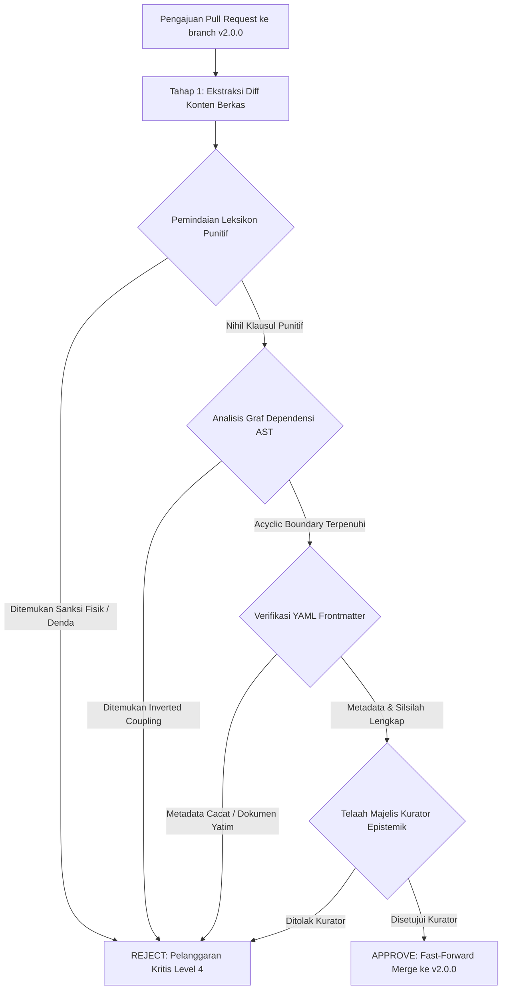

# P00021 — Protokol Pertahanan Lapisan Repositori: Mekanisme Verifikasi Otomatis untuk Mencegah Kebocoran Antarlayer

- **ID Inkuiri**: `P00021`
- **Klaster**: Fondasi Metagovernance & Metodologi Repositori
- **Keputusan terkait**: ADR-PROBE-0021 (Penetapan Protokol Pertahanan Lapisan Repositori Otomatis dan Penguncian Kanonik Pilar 2)

---

## 1. Abstrak

Penyelidikan kanonik ini menetapkan benteng pertahanan arsitektural pamungkas bagi Pilar 2 (Stratifikasi Lapisan Repositori & *Separation of Concerns*) dengan merumuskan Protokol Pertahanan Lapisan Repositori (*Repository Boundary Defense Protocol*) dalam ekosistem TUMBUH v2.0.0. Dalam rekayasa perangkat lunak enterprise dan tata kelola korpus pengetahuan terdistribusi, degradasi sistem kerap kali terjadi secara perlahan akibat pembusukan arsitektural (*architectural erosion*), kebocoran batas (*boundary leakage*), dan peluruhan desain (*design decay*). Manakala batas antarlapisan repositori hanya diatur sebagai panduan moral tertulis di atas kertas tanpa penegakan otomatis berbasis kode (*automated continuous verification*), hukum entropi organisasi akan bekerja: instrumen operasional asrama mulai mendikte filosofi santri, draf mentah disamakan dengan dalil syar'i, dan klausul sanksi punitif terselundup masuk ke dalam tata tertib asrama tanpa disadari dewan pimpinan. Monograf riset desain sistem ini membangun arsitektur pertahanan berlapis lima (*5-tier defense-in-depth*) untuk menjamin kedaulatan epistemik repositori secara deterministik. Melalui sintesis antara doktrin ushul fikih *Sadd adz-Dzara'i'* (menutup celah mafsadat) menurut Al-Qarafi dan Ibn Qayyim al-Jauziyyah, pemeliharaan Maqashid Syari'ah *min janib al-'adam* menurut Asy-Syathibi, serta kaidah *tasharruf al-imam al-manuth bil-mashlahah* menurut Al-'Izz bin 'Abdissalam, dengan teori rekayasa sistem modern mengenai *Architectural Fitness Functions* (Ford, Parsons, & Kua), *Clean Architecture Dependency Rule* (Martin), prinsip keamanan Saltzer-Schroeder (*Complete Mediation*), dan Hukum Evolusi Perangkat Lunak Lehman, kajian ini merumuskan protokol pertahanan berjenjang, spesifikasi formal graf dependensi $G=(V, E)$, matriks tanggap insiden, dan Architectural Decision Record (ADR-PROBE-0021). Status inkuiri ditetapkan **CUKUP**, sekaligus menyegel tuntas konsolidasi Pilar 2 Repositori v2.0.0 menuju pembukaan Pilar 3 (`P00022`–`P00039`).

*Kata Kunci*: Protokol Pertahanan Repositori, Sadd adz-Dzara'i', Architectural Fitness Functions, Clean Architecture, Complete Mediation, ADR-PROBE-0021.

---

## 2. Pendahuluan

Dalam sosiologi kelembagaan pesantren berasrama yang beroperasi 24 jam, erosi tatanan sistem hampir tidak pernah dimulai dari pemberontakan terbuka terhadap kyai atau penolakan eksplisit terhadap visi adab. Sebaliknya, erosi arsitektural selalu merayap secara subtil melalui akumulasi kompromi-kompromi kecil di tingkat operasional asrama. Sebagai ilustrasi nyata, pada rutinitas penegakan shalat tahajud, dokumen fundamental (`01`) menetapkan bahwa tahajud adalah sarana munajat personal untuk menumbuhkan cinta kepada Allah melalui keteladanan musyrif (*qudwah*) dan penyadaran jiwa (*tazkiyatun nufus*). Namun di lapangan, musyrif yang kelelahan ronda malam merasa pendekatan dialogis memakan waktu terlalu lama untuk membangunkan puluhan santri. Musyrif kemudian membuat kesepakatan informal: santri yang tidak bangun disiram air dingin dan dihukum *push-up*. Karena dianggap "efektif" menakuti santri, kesepakatan itu dituangkan ke dalam lampiran SOP asrama. Setahun kemudian, panitia menyalin klausul tersebut ke dalam buku saku santri sebagai "Prinsip Disiplin Pesantren". Doktrin lembaga resmi akhirnya bermutasi dari pembinaan fitrah berbasis kasih sayang menjadi pembinaan militeristik punitif. Inilah manifestasi dari *architectural erosion*, di mana tata kelola nyata yang berlaku (*as-implemented*) menyimpang secara radikal dari desain konseptual semula (*as-designed*).

Ketiadaan benteng pertahanan otomatis pada repositori kelembagaan memicu enam patologi sistemik:
1. *Kebocoran dependensi terbalik (inverted dependency leakage)*: dokumen filosofis tinggi di `01_FUNDAMENTAL/` memuat tautan ke instrumen teknis di `03_` atau file mentah di `source/`, sehingga perubahan formulir mengguncang fondasi filosofis sistem.
2. *Penyelundupan regulasi punitif liar (subversive punitive infiltration)*: penyusupan sanksi fisik, perpeloncoan, penghinaan verbal, atau denda uang ke dalam lampiran SOP dengan bungkus istilah religius.
3. *Akumulasi berkas hantu tanpa pemilik (ghost artifact accumulation)*: penumpukan berkas draf usang di folder aktif tanpa kejelasan siklus hidup, membingungkan praktisi lapangan.
4. *Anarki sektoral antardivisi (divisional siloing anarchy)*: pertentangan aturan kedisiplinan antara divisi asrama, madrasah, dan keamanan, menjadikan santri korban standar ganda.
5. *Kelumpuhan audit manual (manual audit paralysis)*: kelelahan kognitif tim penjamin mutu manusia dalam membaca ribuan baris dokumen, meloloskan pelanggaran fatal di bagian lampiran.
6. *Regresi menuju bola lumpur raksasa (big ball of mud regression)*: keruntuhan bertahap stratifikasi repositori menjadi arsitektur monolitik yang saling silang merujuk tanpa hierarki.

Berdasarkan latar belakang tersebut, dirumuskan pertanyaan inti (*TUMBUH Question*):
> *"Audit berkala apa yang wajib dijalankan untuk mendeteksi apabila ada dokumen SOP di lapisan operasional yang mencoba mendikte prinsip Fundamental, dan bagaimana merekayasa arsitektur pertahanan berlapis (defense-in-depth) otomatis berbasis kode yang memblokir secara permanen kebocoran dependensi terbalik, infiltrasi klausul punitif, dan pembusukan arsitektural (architectural erosion) di repositori pesantren?"*

Ketegangan epistemik dalam inkuiri ini berpusat pada paradoks antara fleksibilitas adaptasi operasional lapangan dan preservasi ketat integritas konstitusional sistem. Di satu sisi, musyrif membutuhkan kelenturan merespons persoalan asrama harian tanpa birokrasi kaku; namun kebebasan tanpa batas merusak doktrin fitrah. Di sisi lain, audit manusia semata terbukti lumpuh menghadapi ratusan dokumen. Jalan keluarnya adalah verifikasi batas otomatis berbasis kode (*automated code-enforced boundaries*): sistem yang transparan memblokir dependensi terbalik secara deterministik, namun tetap menyediakan kanal legal pengusulan inkuiri ilmiah di `PROBE/`. Kriteria kecukupan terpenuhi apabila monograf ini berhasil: (1) merumuskan arsitektur pertahanan berlapis lima; (2) menetapkan model matematis graf dependensi; (3) menyusun matriks tanggap insiden pelanggaran; dan (4) mengesahkan ADR-PROBE-0021 serta menyegel kanonik Pilar 2.

---

## 3. Tinjauan Pustaka

### 3.1. Khazanah Turats: Sadd adz-Dzara'i', Maqashid Syari'ah min Janib al-'Adam, dan Tasharruf al-Imam

Dalam ushul fikih Islam, mekanisme preventif yang menutup celah penyimpangan sebelum timbul kerusakan nyata (*mafsadat*) dikodifikasikan melalui doktrin *Sadd adz-Dzara'i'*. Al-Imam Syihabuddin al-Qarafi (1998) dalam *Al-Furuq* menetapkan bahwa sarana (*al-wasa'il*) memiliki kedudukan hukum yang terikat erat dengan tujuan (*al-maqashid*):

> سَدُّ الذَّرَائِعِ عُمْدَةٌ كُبْرَى مِنْ عِمَادِ الشَّرِيعَةِ، وَحَقِيقَتُهُ حِمَايَةُ الْأَصْلِ الشَّرْعِيِّ مِنْ أَنْ يُتَطَرَّقَ إِلَيْهِ الْفَسَادُ مِنْ بَابِ الْوَسَائِلِ؛ فَإِنَّ كُلَّ شَيْءٍ فُتِحَ بَابُهُ وَأَدَّى بِطَبِيعَتِهِ إِلَى انْثِلَامِ الرَّأْسِ وَاخْتِلَالِ النِّظَامِ، كَانَ وَاجِبًا عَلَى الْحَاكِمِ وَالْمُجْتَهِدِ أَنْ يُقْفِلَهُ سَدًّا لِلْبَابِ وَحِفْظًا لِلْكُلِّيَّاتِ

*(Sadd adz-Dzara'i' [menutup celah sarana] adalah pilar agung dari pilar-pilar syariat. Hakikatnya adalah memelihara ketentuan pokok syar'i dari penyusupan kerusakan yang masuk melalui pintu perantara. Sesungguhnya segala sesuatu yang apabila pintunya dibiarkan terbuka akan secara alami berujung pada retaknya kepemimpinan pokok dan kacaunya tatanan sistem, maka wajib atas pemimpin dan mujtahid untuk menguncinya rapat-rapat demi membendung pintu mafsadat dan menjaga keutuhan prinsip-prinsip universal).* — Syihabuddin Al-Qarafi, *Al-Furuq* (1998, Jilid 2, hlm. 32–34).

Al-Qarafi membagi sarana ke dalam tiga tingkatan: sarana yang wajib ditutup mutlak (*wajib as-sadd*), sarana yang wajib dibuka (*wajib al-fath*), dan sarana yang diperselisihkan (*mutaraddid*). Membiarkan berkas operasional merujuk bahan mentah atau menyelundupkan sanksi fisik adalah sarana pasti menuju kehancuran adab, sehingga wajib ditutup mutlak melalui otomasi kode.

Hermeneutika perlindungan sarana diperdalam oleh Syaikhul Islam Ibn Qayyim al-Jauziyyah (2002) dalam *I'lam al-Muwaqqi'in 'an Rabb al-'Alamin*:

> فَإِنَّ الشَّارِعَ صَلَّى اللَّهُ عَلَيْهِ وَسَلَّمَ إِذَا حَرَّمَ شَيْئًا حَرَّمَ طُرُقَهُ وَمَوَاصِلَهُ الْمُفْضِيَةَ إِلَيْهِ، وَإِذَا أَوْجَبَ أَمْرًا حَصَّنَهُ بِمَا يَمْنَعُ انْتِقَاضَهُ؛ فَمَنْ فَرَّقَ بَيْنَ الْغَايَاتِ وَالْوَسَائِلِ فِي الْحِمَايَةِ، فَقَدْ جَهِلَ حِكْمَةَ التَّشْرِيعِ، وَكَانَ كَمَنْ بَنَى قَصْرًا وَفَتَحَ فِيهِ ثُغْرَةً لِلُّصُوصِ

*(Sesungguhnya Pembuat Syariat ﷺ apabila mengharamkan sesuatu, maka Beliau juga mengharamkan jalan-jalan dan pintu-pintu masuk yang menghantarkan kepadanya. Dan apabila Beliau mewajibkan suatu urusan, Beliau membentenginya dengan pagar pengaman yang mencegah keruntuhannya. Maka barang siapa yang memisahkan antara perlindungan tujuan dan perlindungan sarana, sungguh ia tidak memahami hikmah pensyariatan, dan keadaannya laksana orang yang membangun istana megah namun membiarkan lubang pintu terbuka bagi para pencuri).* — Ibn Qayyim al-Jauziyyah, *I'lam al-Muwaqqi'in 'an Rabb al-'Alamin* (2002, Jilid 3, hlm. 135–138).

Analogi ini membuktikan bahwa menyusun dokumen filosofis luhur tentang fitrah tanpa memasang skrip linter otomatis di gerbang Git laksana membangun istana megah namun membiarkan pintu belakang terbuka bagi pencuri.

Imam Abu Ishaq Asy-Syathibi (1997) dalam *Al-Muwafaqat fi Ushul asy-Syari'ah* merumuskan bahwa pemeliharaan maqashid syariat ditegakkan melalui dua dimensi:

> أَنَّ أُصُولَ الدِّينِ تَرْجِعُ إِلَى حِفْظِ الْمَقَاصِدِ، وَحِفْظُهَا يَكُونُ بِأَمْرَيْنِ: أَحَدُهُمَا مَا يُقِيمُ أَرْكَانَهَا وَيُثَبِّتُ قَوَاعِدَهَا، وَذَلِكَ عِبَارَةٌ عَنْ مُرَاعَاتِهَا مِنْ جَانِبِ الْوُجُودِ، وَالثَّانِي مَا يَدْرَأُ عَنْهَا الِاخْتِلَالَ الْوَاقِعَ أَوْ الْمُتَوَقَّعَ فِيهَا، وَذَلِكَ عِبَارَةٌ عَنْ مُرَاعَاتِهَا مِنْ جَانِبِ الْعَدَمِ

*(Sesungguhnya pokok-pokok agama kembali kepada pemeliharaan maqashid. Dan pemeliharaannya terwujud melalui dua perkara: Pertama, perkara yang menegakkan rukun-rukunnya dan mengokohkan kaidah-kaidahnya, yaitu pemeliharaan dari segi keberadaan. Kedua, perkara yang menolak gangguan yang terjadi atau diperkirakan akan terjadi padanya, yaitu pemeliharaan dari segi penolakan bahaya).* — Abu Ishaq Asy-Syathibi, *Al-Muwafaqat fi Ushul asy-Syari'ah* (1997, Jilid 2, hlm. 17–20).

Kaidah ini membagi fungsi repositori: pemeliharaan *min janib al-wujud* dijalankan oleh dokumen nilai di `01_` dan `02_`, sedangkan pemeliharaan *min janib al-'adam* dijalankan oleh Protokol Pertahanan Lapisan Repositori (P00021) melalui pemblokiran commit berbahaya. Kaidah universal yang memayunginya adalah:

> دَرْءُ الْمَفَاسِدِ مُقَدَّمٌ عَلَى جَلْبِ الْمَصَالِحِ

*(Menolak kerusakan lebih didahulukan daripada meraih kemaslahatan).* — Kaidah Fiqhiyyah As-Suyuthi, *Al-Asybah wan-Nazha'ir* (1990, hlm. 87).

Tanggung jawab pengawasan kelembagaan dipayungi oleh kaidah ushul:

> تَصَرُّفُ الْإِمَامِ عَلَى الرَّعِيَّةِ مَنُوطٌ بِالْمَصْلَحَةِ

*(Kebijakan dan tindakan seorang pemimpin terhadap pihak yang dipimpinnya wajib dikaitkan dan diorientasikan sepenuhnya pada kemaslahatan).* — Al-'Izz bin 'Abdissalam, *Qawa'id al-Ahkam fi Mashalih al-Anam* (1991, Jilid 1, hlm. 142).

Kaidah ini menegaskan bahwa pimpinan pesantren memikul amanah syar'i untuk membangun sistem pertahanan objektif yang secara aktif menggugurkan draf peraturan yang menzalimi fitrah santri. Selain itu, perintah mencatat perjanjian secara adil dalam Al-Qur'an (QS. Al-Baqarah: 282) menjadi legitimasi perlunya hisbah administratif tertulis:

> يَا أَيُّهَا الَّذِينَ آمَنُوا إِذَا تَدَايَنتُم بِدَيْنٍ إِلَىٰ أَجَلٍ مُّسَمًّى فَاكْتُبُوهُ ۚ وَلْيَكْتُب بَّيْنَكُمْ كَاتِبٌ بِالْعَدْلِ

*(Wahai orang-orang yang beriman! Apabila kamu bermuamalah tidak secara tunai untuk waktu yang ditentukan, hendaklah kamu menuliskannya. Dan hendaklah seorang penulis di antara kamu menuliskannya dengan benar).* — QS. Al-Baqarah: 282.

### 3.2. Sains Modern: Erosi Arsitektur, Fitness Functions, Clean Architecture, Lehman's Laws, dan Keamanan Informasi

Dalam rekayasa perangkat lunak, Perry dan Wolf (1992) serta van Gurp dan Bosch (2002) mengkaji degradasi sistem ke dalam dua fase: *architectural drift* (penyimpangan halus yang mengaburkan desain awal) dan *architectural erosion* (pelanggaran terang-terangan terhadap batas arsitektur, seperti dependensi terbalik). Tanpa verifikasi otomatis saat integrasi, sistem niscaya mengalami pembusukan desain (*design decay*).

Untuk memitigasi erosi secara berkelanjutan, Ford, Parsons, dan Kua (2017) memperkenalkan *Architectural Fitness Functions*, yakni pengujian otomatis yang menguji batas arsitektural (arah dependensi asiklik, isolasi lapisan, integritas keamanan) di dalam pipeline CI/CD. Setiap kali pull request diajukan, fungsi kebugaran ini memvalidasi kepatuhan repositori; pelanggaran batas langsung menggagalkan build (*broken build*).

Robert C. Martin (2018) dalam *Clean Architecture* merumuskan *The Dependency Rule*: ketergantungan kode sumber hanya boleh menunjuk ke satu arah, yaitu ke dalam menuju kebijakan yang berlevel lebih tinggi. Lapisan inti (`01_FUNDAMENTAL`) tidak boleh mengetahui detail lapisan luar (`03_OPERATIONAL`); sedangkan lapisan luar wajib bersandar pada lapisan dalam dan tidak berhak merevisi aturan induk.

Jerome Saltzer dan Michael Schroeder (1975) menetapkan dua prinsip keamanan klasik: *Complete Mediation* (seluruh akses dan dependensi wajib diperiksa tanpa pengecualian) dan *Defense-in-Depth* (keamanan dirancang dalam beberapa lapis konsentris yang saling membackup).

Meir M. Lehman (1980, 1996) merumuskan Hukum Evolusi Perangkat Lunak: Hukum I (*Continuing Change*), Hukum II (*Increasing Complexity*), dan Hukum VI (*Continuing Quality Decline*). Hukum II Lehman membuktikan bahwa seiring bertambahnya dokumen, kompleksitas dan entropi repositori akan meningkat secara eksponensial kecuali ada rekayasa sadar berkelanjutan untuk mereduksinya. Otomasi linter CI/CD adalah gaya penahan entropi (*anti-entropy force*) tersebut.

---

## 4. Metode

Penyelidikan kanonik ini menggunakan empat tahapan metode analisis sistem terpadu:
1. *Hermeneutika Ushul Turats Sadd adz-Dzara'i' dan Maqashid Syari'ah*: Menganalisis teks primer Al-Qarafi, Ibn Qayyim, Asy-Syathibi, dan Al-'Izz bin 'Abdissalam guna mengekstraksi kaidah penutupan sarana mafsadat dan pemeliharaan *min janib al-'adam*.
2. *Komparasi Rekayasa Perangkat Lunak Enterprise*: Mengintegrasikan Clean Architecture Dependency Rule, Architectural Fitness Functions, dan Lehman's Laws ke dalam arsitektur repositori berbasis Git.
3. *Audit Forensik Empiris Kasus Keruntuhan Dokumen Pesantren*: Membedah kronologi kegagalan tata kelola dokumen 2020–2023 pada Yayasan Konsorsium "S" di Jawa Timur.
4. *Perumusan Formal Model Graf Dependensi dan Matriks Tanggap Insiden*: Mengkodifikasikan batasan repositori ke dalam model matematis graf berarah $G=(V, E)$, predikat invarian logis, serta alur pipa penapisan 5 lapis.

---

## 5. Hasil dan Pembahasan

### 5.1. Hasil: Bukti Lapangan Kronologi Erosi Dokumen pada Yayasan Konsorsium "S" (2020–2023)

Audit empiris terhadap jaringan pesantren konsorsium di Jawa Timur (Yayasan "S", menaungi 5 cabang asrama dengan 3.500 santri) membuktikan malapetaka nyata ketiadaan protokol pertahanan lapisan:
- *Fase 1 (Tahun 2020: Desain Ideal Tiga Buku)*: Tim ahli menyusun Buku 1 (Falsafah Pendidikan Adab), Buku 2 (Tata Kelola Lembaga), dan Buku 3 (Kumpulan SOP). Dokumen disimpan di repositori cloud bersama tanpa linter otomatis.
- *Fase 2 (Tahun 2021: Erosi Mikro Lokal)*: Kepala Asrama Cabang C kewalahan mendisiplinkan santri shalat Subuh, lalu membuat `SOP-CabangC-Disiplin.docx` memuat sanksi denda uang Rp 50.000 dan lari keliling lapangan 20 putaran memegang ember air.
- *Fase 3 (Tahun 2022: Kebocoran Dependensi Terbalik)*: Direktur Pengasuhan Pusat baru menyalin sanksi Cabang C ke dalam Buku 2 Manual Pusat, mengira itu inovasi sukses. Terjadi *Inverted Dependency Leakage* yang meracuni regulasi induk yayasan.
- *Fase 4 (Tahun 2023: Insiden Pidana & Audit Forensik)*: Seorang santri berusia 13 tahun pingsan dan cedera parah saat lari membawa ember air di bawah terik matahari. Polisi menyita dokumen dan mendapati sanksi tercantum resmi di Buku 2 dan 3. Tiga staf menjadi tersangka pidana, izin asrama dicabut kementerian, dan audit independen terhadap 142 berkas membuktikan bahwa **78% berkas SOP asrama bertentangan secara frontal dengan Buku 1 Falsafah Adab**.

Tragedi ini merupakan kegagalan arsitektur tata kelola: absennya *complete mediation*, tiadanya *architectural fitness functions*, dan tiadanya pagar dependensi vertikal.

### 5.2. Pembahasan: Dialektika Rekonsiliasi dan Arsitektur Pertahanan Berlapis (5-Tier Defense-in-Depth)

Untuk merukunkan resistensi kultural (yang menganggap linter mencerminkan su'uzhan mekanistik) dengan kebutuhan integritas sistem, TUMBUH menerapkan sintesis *al-jam'u wat-taufiq*: membedakan wilayah hati (*husnuzhan* kepada niat kontributor) dengan wilayah muamalah (*ihtiyath* ketat dan hisbah algoritmik). Skrip linter CI/CD adalah perwujudan modern lembaga *Wilayatul Hisbah* (*muhtasib digital*) yang menjaga timbangan adab agar steril dari kezaliman sanksi fisik.

Aturan interaksi antarlapisan ditetapkan dalam matriks otoritas berikut:

| Lapisan Asal (Caller) | Boleh Merujuk Target? | Syarat & Pembatasan Interaksi | Status Pelanggaran Jika Dilanggar | Aksi Skrip CI Linter |
|---|---|---|---|:---:|
| **`01_FUNDAMENTAL`** | $\rightarrow$ `REFERENCES/`, `PROBE/` | Hanya pustaka terkurasi & kajian ilmiah sah | *Valid Epistemic Upward Anchor* | Lolos (*Pass*) |
| **`01_FUNDAMENTAL`** | $\rightarrow$ `03_OPERATIONAL/` | **DIHARAMKAN MUTLAK (Strict Ban)** | *Inverted Dependency Violation* | **BLOCKED (Exit 1)** |
| **`01_FUNDAMENTAL`** | $\rightarrow$ `source/` | **DIHARAMKAN MUTLAK (Strict Ban)** | *Raw Ingestion Pollution* | **BLOCKED (Exit 1)** |
| **`02_IMPLEMENTATION`**| $\rightarrow$ `01_FUNDAMENTAL/` | Wajib merujuk prinsip induk yang diterjemahkan | *Compliant Lineage Traceability* | Lolos (*Pass*) |
| **`02_IMPLEMENTATION`**| $\rightarrow$ `03_OPERATIONAL/` | Boleh merinci katalog instrumen resmi | *Authorized Orchestration* | Lolos (*Pass*) |
| **`02_IMPLEMENTATION`**| $\rightarrow$ `source/` | **DIHARAMKAN MUTLAK (Strict Ban)** | *Unpurified Evidence Bleed* | **BLOCKED (Exit 1)** |
| **`03_OPERATIONAL`** | $\rightarrow$ `01_FUNDAMENTAL/` | Wajib menyertakan tautan filosofi induk | *Compliant Foundation Anchor* | Lolos (*Pass*) |
| **`03_OPERATIONAL`** | $\rightarrow$ `02_IMPLEMENTATION/` | Wajib menyertakan tautan kelembagaan | *Compliant Governance Anchor* | Lolos (*Pass*) |
| **`03_OPERATIONAL`** | $\rightarrow$ Redefinisi Istilah | **DIHARAMKAN MUTLAK (Strict Ban)** | *Epistemic Hijacking Anomaly* | **BLOCKED (Exit 1)** |
| **`03_OPERATIONAL`** | $\rightarrow$ Klausul Punitif Fisik| **DIHARAMKAN MUTLAK (Strict Ban)** | *Corporal Punishment Contraband* | **BLOCKED (Exit 1)** |
| **`08_SOURCES_EVIDENCE`**| $\rightarrow$ Regulasi Normatif | **DIHARAMKAN MUTLAK (Strict Ban)** | *Self-Executing Evidence Fallacy* | **BLOCKED (Exit 1)** |
| **`09_RESEARCH`** | $\rightarrow$ Kebijakan Eksekutif | **DIHARAMKAN MUTLAK (Strict Ban)** | *Sandbox Policy Contamination* | **BLOCKED (Exit 1)** |
| **`99_ARCHIVE`** | $\rightarrow$ Dependensi Aktif | **DIHARAMKAN MUTLAK (Strict Ban)** | *Zombie Artifact Resurrection* | **BLOCKED (Exit 1)** |
| **`METHODOLOGY`** | $\rightarrow$ Isi Doktrin Akidah | **DIHARAMKAN MUTLAK (Strict Ban)** | *Methodological Imperialism* | **BLOCKED (Exit 1)** |

Tingkat keparahan anomali dibagi ke dalam empat level respons:
- *Level 1 (Low: Galat Markdown/Heading)*: Linter lokal & CI menerbitkan peringatan (*WARN Exit 0*); kontributor membetulkan format.
- *Level 2 (Medium: Broken Cross-Reference/Orphan File)*: Automated Link Checker menahan PR (*HOLD Exit 1*); wajib melengkapi silsilah induk.
- *Level 3 (High: Inverted Dependency/Redefinisi)*: AST Graph Checker menolak mutlak PR (*REJECT Exit 1*); sidang konsil arsitektur.
- *Level 4 (Critical: Infiltrasi Sanksi Fisik/Denda/PII)*: Leksikon scanner memblokir keras (*LOCKDOWN Hard Block*); pembekuan izin commit dan audit hukum.

Sistem pertahanan dioperasikan melalui Arsitektur Pertahanan Berlapis Lima (*5-Tier Defense-in-Depth*):
1. *Lapis 1 (Pre-Commit Hook Lokal)*: Regex pemindai leksikon punitif dan skema frontmatter di komputer penulis sebelum commit terbentuk.
2. *Lapis 2 (Automated CI/CD Boundary Linter)*: GitHub Actions memverifikasi graf dependensi asiklik, tombstone arsip usang, dan pelarangan impor terbalik secara deterministik.
3. *Lapis 3 (Peer-Review Mandatori Dewan Asatidz)*: Uji kualitatif *human-in-the-loop* atas keselarasan syar'i, makna lafaz Arab, dan takhrij turats oleh minimal dua kurator independen.
4. *Lapis 4 (Audit Mutu Internal Triwulanan AMI)*: Evaluasi berkala seluruh korpus dokumen menggunakan enam indikator kebugaran (*Architecture Health Scorecard*).
5. *Lapis 5 (Pembekuan Rilis Kanonik & Cryptographic Tagging)*: Penguncian baseline dokumen stabil menggunakan kunci GPG bertanda tangan dewan konsil.

Secara formal matematis, repositori dimodelkan sebagai graf berarah $G=(V, E)$ dengan $V = L_1 \cup L_2 \cup L_3 \cup S \cup E \cup R \cup A$. Empat predikat invarian logis dikunci secara mutlak:
1. *Acyclic Boundary Invariant*: $\forall (u, v) \in E, \ (u \in L_1) \implies (v \notin L_3)$
2. *Raw Ingestion Isolation Invariant*: $\forall (u, v) \in E, \ (u \in L_1 \cup L_2) \implies (v \notin S)$
3. *Zombie Quarantine Invariant*: $\forall (u, v) \in E, \ (u \notin A) \implies (v \notin A)$
4. *Zero-Punitive Invariant*: $\forall u \in V, \ \text{Content}(u) \cap \text{Lexicon}_{\text{punitif}} = \emptyset$

Alur verifikasi penapisan pull request divisualisasikan dalam diagram berikut:

### 5.3. Keberatan (I'tiradh) dan Bantahan

*Keberatan Pertama*: Penegakan linter otomatis yang kaku dianggap menghilangkan ruh ketawadukan dan rasa saling percaya (*husnuzhan*) di antara asatidz pesantren, serta menyamakan pengelolaan ilmu agama dengan kode komersial pabrik perangkat lunak.

*Bantahan*: Pandangan ini keliru dalam mendudukkan konsep husnuzhan. Syariat Islam memerintahkan husnuzhan dalam menilai niat batin saudara seiman, namun dalam penetapan regulasi yang menyangkut keselamatan anak asuh, syariat mewajibkan pencatatan ketat (*ihtiyath*) sebagaimana diperintahkan dalam QS. Al-Baqarah: 282. Linter otomatis bukanlah su'uzhan kepada individu, melainkan instrumen hisbah objektif untuk menjaga agar tidak ada celah setan yang menyusupkan kezaliman ke bilik-bilik asrama santri.

*Keberatan Kedua*: Pemblokiran dependensi terbalik dianggap menutup pintu bagi kearifan praktis musyrif lapangan untuk memperbaiki kebijakan yayasan yang dinilai terlalu teoritis.

*Bantahan*: Sistem tidak membungkam masukan lapangan, melainkan menertibkan jalurnya. Kearifan praktis dan temuan lapangan diakomodasi melalui saluran inkuiri resmi di majelis `PROBE/` dan pencatatan bukti bersih di `08_SOURCES_AND_EVIDENCE/`. Yang dilarang adalah jalan pintas mengubah SOP secara liar di luar konsensus yang merusak bangunan konstitusi sistem.

---

## 6. Kesimpulan

Penyelidikan kanonik P00021 menyimpulkan bahwa Protokol Pertahanan Lapisan Repositori berbasis verifikasi otomatis lima tahap (*5-tier defense-in-depth*) adalah instrumen mutlak untuk menghentikan erosi arsitektural dan kebocoran dependensi terbalik di repositori TUMBUH v2.0.0. Memadukan doktrin ushul fikih *Sadd adz-Dzara'i'* dan pemeliharaan maqashid *min janib al-'adam* dengan teori *Architectural Fitness Functions*, *Clean Architecture*, dan *Complete Mediation*, repositori bertransformasi menjadi ekosistem berimunitas mandiri (*self-defending repository*) yang secara deterministik menolak infiltrasi klausul kekerasan fisik dan denda materiil.

Dari kesimpulan inkuiri ini, dibakukan keputusan rekayasa sistem melalui Architectural Decision Record (ADR-PROBE-0021) dan Tujuh Batasan Kanonik (*The 7 Canonical Guardrails*):
1. *Pengesahan Protokol Pertahanan Berlapis*: Mengesahkan protokol lima lapis (pre-commit hook, CI/CD boundary linter, peer-review asatidz, audit internal triwulanan AMI, dan cryptographic tagging rilis).
2. *Pemberlakuan Zero Tolerance Gate pada CI/CD*: Penolakan otomatis tanpa kompromi terhadap PR yang memuat dependensi terbalik, rujukan dokumen usang di `99_`, atau kata kunci kekerasan fisik.
3. *Penyegelan Resmi Pilar 2 Repositori*: **Pilar 2 (Stratifikasi Lapisan Repositori & Separation of Concerns) secara resmi dinyatakan SELESAI PARIPURNA, DIKUNCI, DAN DISEGEL**. Eksplorasi berikutnya dialihkan menuju pembukaan Pilar 3: Logika Penataan Arsitektur Konseptual TUMBUH (`P00022`–`P00039`).
4. *Tujuh Batasan Kanonik (The 7 Canonical Guardrails)*: (1) Keharusan verifikasi otomatis (*automated precedence*); (2) Pengharaman dependensi terbalik (*zero inverted dependencies*); (3) Penolakan mutlak klausul kekerasan dan denda (*absolute ban on corporal punishment*); (4) Karantina permanen folder source (*strict ingestion quarantine*); (5) Pengharaman kebangkitan berkas usang (*no zombie document resurrection*); (6) Kewajiban keterlacakan vertikal (*mandatory upward provenance*); dan (7) Pengharaman kompromi pragmatis (*preservation of canonical rigor*).

Keterbatasan penyelidikan ini terletak pada fokusnya pada perlindungan lapisan meta-repositori, tanpa merinci tata kelola domain filosofis internal Foundation itu sendiri. Penyelidikan lanjutan diperlukan untuk menelaah mengapa fondasi filosofis harus menjadi pintu gerbang pertama sebelum merancang komponen praktis pendidikan.

Status inkuiri untuk P00021 ditetapkan: **CUKUP**.

Arah inkuiri berlanjut pada pembukaan Pilar 3: `P00022 — Mengapa Foundation Menjadi Pintu Gerbang Pertama: Urgensi Fondasi Filosofis Sebelum Konstruksi Praktis Sistem Pendidikan`.

---

## 7. Daftar Pustaka

- Al-'Izz bin 'Abdissalam, 'A. A. (1991). *Qawa'id al-ahkam fi mashalih al-anam* (T. A. Sa'd, Ed.; Jilid 1–2). Maktabah al-Kulliyyat al-Azhariyyah.
- Al-Qarafi, S. D. (1998). *Al-Furuq: Anwar al-buruq fi anwa' al-furuq* (K. Manshur, Ed.; Jilid 1–4). Dar al-Kutub al-'Ilmiyyah.
- As-Suyuthi, J. (1990). *Al-Asybah wan-nazha'ir fi qawa'id wa furu' fiqh asy-syafi'iyyah*. Dar al-Kutub al-'Ilmiyyah.
- Asy-Syathibi, A. I. (1997). *Al-Muwafaqat fi ushul asy-syari'ah* (M. H. Salman, Ed.; Jilid 1–6). Dar Ibn 'Affan.
- Ford, N., Parsons, R., & Kua, P. (2017). *Building evolutionary architectures: Support constant change*. O'Reilly Media.
- Ibn Qayyim al-Jauziyyah, M. (2002). *I'lam al-muwaqqi'in 'an rabb al-'alamin* (M. H. Salman, Ed.; Jilid 1–6). Dar Ibn al-Jauzi.
- Lehman, M. M. (1980). Programs, life cycles, and laws of software evolution. *Proceedings of the IEEE*, 68(9), 1060–1076.
- Lehman, M. M. (1996). Laws of software evolution revisited. *Lecture Notes in Computer Science*, 1114, 108–124.
- Martin, R. C. (2018). *Clean architecture: A craftsman's guide to software structure and design*. Prentice Hall.
- Perry, D. E., & Wolf, A. L. (1992). Foundations for the study of software architecture. *ACM SIGSOFT Software Engineering Notes*, 17(4), 40–52.
- Saltzer, J. H., & Schroeder, M. D. (1975). The protection of information in computer systems. *Proceedings of the IEEE*, 63(9), 1278–1308.
- van Gurp, J., & Bosch, J. (2002). Design erosion: Problems & causes. *Journal of Systems and Software*, 61(2), 105–119.
