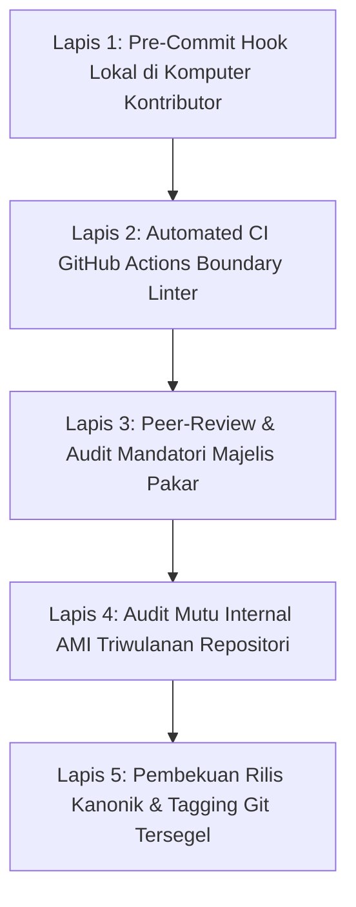

# P00021 — Protokol Pertahanan Lapisan Repositori: Mekanisme Verifikasi Otomatis untuk Mencegah Kebocoran Antarlayer

---

## 1. Executive Summary & Epistemic Status

Dokumen penyelidikan arsitektural ini merumuskan sintesis pamungkas bagi Pilar 2 (Stratifikasi Lapisan Repositori & *Separation of Concerns*) dengan menetapkan **Protokol Pertahanan Lapisan Repositori (Repository Boundary Defense Protocol)** dalam ekosistem TUMBUH v2.0.0. Sepanjang sejarah rekayasa sistem informasi dan tata kelola korpus pengetahuan, musuh terbesar dari sistem yang terstruktur rapi bukanlah serangan terbuka dari luar, melainkan fenomena pembusukan arsitektural internal yang berlangsung perlahan (*architectural erosion, boundary leakage, and design decay*). Ketika batas-batas antarlapisan repositori hanya diatur di atas kertas sebagai imbauan moral tanpa penegakan otomatis berbasis kode, praktisi lapangan dan kontributor repositori akan secara alamiah melanggar demarkasi lapisan demi mengejar kepraktisan jangka pendek: SOP lapangan mulai mendikte filosofi fundamental, catatan kasar lapangan disamakan dengan kebenaran mutlak, dan eksperimen riset yang belum teruji bocor menjadi regulasi mengikat santri.

Penyelidikan kanonik ini menetapkan benteng pertahanan terpadu (*defense-in-depth architecture*) untuk menjamin pemisahan keprihatinan epistemik secara permanen dan otomatis. Melalui integrasi antara prinsip syariat *Sadd adz-Dzara'i'* (menutup rapat segala celah yang menghantarkan pada kerusakan sistemik) dan kaidah ushul fikih *Dar'ul Mafasid Muqaddamun 'ala Jalbil Mashalih* dengan teori rekayasa perangkat lunak modern mengenai *Architectural Fitness Functions* (Ford, Parsons, & Kua, 2017) dan prinsip keamanan sistem Saltzer-Schroeder (1975), dokumen ini membangun mesin verifikasi berlapis (*multi-tier verification engine*). Dokumen ini merumuskan protokol pertahanan 5 tahap, skrip master linter CI pemeriksa kebocoran lapisan (*Master Architectural Boundary Linter*), matriks audit kesehatan lapisan berkala, serta mengunci keputusan kanonik bahwa **Pilar 2 Repositori Branch v2.0.0 resmi ditutup dan dikokohkan secara permanen**.

Status kanonik dari dokumen ini ditetapkan sebagai berikut:
- **Epistemic Status**: `CANONICAL INVESTIGATION & COMPREHENSIVE DEFENSE SPECIFICATION`
- **Architectural Layer**: `PROBE / METAGOVERNANCE / REPOSITORY INTEGRITY MASTER DEFENSE`
- **Target Subsystem**: SELURUH LAPISAN REPOSITORI (`source/`, `REFERENCES/`, `METHODOLOGY/`, `01` s/d `09`, `99_ARCHIVE/`)
- **Decision State**: `APPROVED & LOCKED (ARCHITECTURAL DECISION RECORD P00021-ADR)`
- **Audience**: Dewan Pengasuh, Kepala Penjamin Mutu Repositori, Tim Arsitek Sistem Digital Pesantren, Administrator CI/CD, dan Seluruh Kontributor TUMBUH.

---

## 2. Definisi Masalah & Akar Gejala Lapangan (Pathology of Architectural Erosion)

Dalam siklus hidup organisasi pendidikan berasrama yang beroperasi 24 jam, korpus regulasi dan dokumen operasional senantiasa mengalami tekanan degradasi. Perry dan Wolf (1992) serta van Gurp dan Bosch (2002) mengidentifikasi bahwa sebuah arsitektur yang dirancang dengan sangat indah pada fase awal akan mengalami erosi arsitektural (*architectural drift and erosion*) seiring bergantinya personel, bertambahnya dokumen darurat, dan masuknya kontributor baru yang tidak memahami filosofi stratifikasi lapisan[^1].

Di lingkungan pesantren modern, patologi pembusukan arsitektur repositori termanifestasi dalam enam gejala sistemik:

1. **Kebocoran dependensi terbalik (Inverted Dependency Leakage)**:
   Sebuah berkas di `01_FUNDAMENTAL/` secara ceroboh mengutip atau bergantung pada formulir teknis di `03_OPERATIONAL/` atau merujuk langsung ke rekaman suara mentah di `source/`. Akibatnya, ketika formulir teknis di asrama direvisi oleh musyrif, konstitusi filosofis sistem ikut terguncang secara tidak sengaja.

2. **Penyelundupan Regulasi Punitif Liar (Subversive Punitive Infiltration)**:
   Sebuah SOP piket malam atau lembar tata tertib santri menyelipkan klausul sanksi fisik atau denda materi yang secara eksplisit diharamkan pada tingkat fundamental, namun klausul tersebut luput dari deteksi karena tim penjamin mutu hanya membaca dokumen secara manual tanpa instrumen audit otomatis.

3. **Polusi Berkas Hantu Tanpa Pemilik (Ghost Artifact Accumulation)**:
   Ratusan berkas draf, catatan eksperimen riset yang ditinggalkan, dan naskah v1 usang dibiarkan berserakan di folder-folder aktif tanpa penandaan status, sehingga membingungkan para santri dan ustadz baru yang mencari rujukan resmi.

4. **Ilusi Kepemilikan Mandiri Tiap Divisi (Divisional Siloing Anarchy)**:
   Divisi Keamanan Asrama, Divisi Bimbingan Konseling, dan Divisi Pengajaran Kurikulum masing-masing membuat aturan internal yang saling bertentangan dan menyimpang dari konstitusi TUMBUH, karena masing-masing divisi merasa berhak membuat "aturan praktis sendiri" tanpa koordinasi arsitektural terpusat.

5. **Ketidakberdayaan Audit Manual Menghadapi Volume Dokumen (Manual Audit Paralysis)**:
   Ketika jumlah dokumen repositori melampaui ratusan berkas, komite penjamin mutu kewalahan membaca baris demi baris, sehingga audit kelembagaan berubah menjadi formalitas stempel tanda tangan tanpa verifikasi integritas yang substantif.

6. **Degradasi Berkelanjutan Menuju Monolit Berantakan (Big Ball of Mud Regression)**:
   Tanpa pagar pengaman otomatis yang memblokir commit ilegal, repositori yang semula terstruktur secara rapi dalam lapisan-lapisan epistemik akan secara bertahap bermutasi kembali menjadi "bola lumpur raksasa" (*Big Ball of Mud*) seperti yang terjadi pada era kegagalan v1.

Kondisi kritis ini membuktikan bahwa **peraturan tertulis tanpa penegakan otomatis melalui kode adalah ilusi.** Repositori TUMBUH membutuhkan protokol pertahanan aktif yang memblokir setiap anomali arsitektural pada detik pertama komit diajukan.

---

## 3. Fondasi Epistemologi Turats & Hermeneutika Syar'i

Dalam khazanah ushul fikih Islam, mekanisme preventif yang menutup celah penyimpangan sebelum terjadi kerusakan nyata telah dikodifikasikan secara mendalam melalui doktrin *Sadd adz-Dzara'i'* (menutup sarana menuju mafsadat) dan kaidah *Dar'ul Mafasid*.

Imam Syihabuddin al-Qarafi dalam *al-Furuq* (Jilid 2, hlm. 32–34) membagi sarana (*adz-dzara'i'*) ke dalam tiga kategori:[^2]
1. Sarana yang disepakati wajib ditutup karena secara pasti mengantarkan pada kerusakan besar (*dzari'ah mafsadah qath'iyyah*).
2. Sarana yang disepakati boleh dibuka karena maslahatnya jauh lebih dominan (*dzari'ah maslahah rajihah*).
3. Sarana yang berada di antara keduanya, di mana para ulama menimbang secara cermat apakah ia berpotensi menjadi celah bagi penyusupan kerusakan hukum.

Al-Qarafi menegaskan kaidah agung ini:

```text
سَدُّ الذَّرَائِعِ عُمْدَةٌ كُبْرَى مِنْ عِمَادِ الشَّرِيعَةِ، وَحَقِيقَتُهُ حِمَايَةُ الْأَصْلِ الشَّرْعِيِّ مِنْ أَنْ يُتَطَرَّقَ إِلَيْهِ الْفَسَادُ مِنْ بَابِ الْوَسَائِلِ؛ فَإِنَّ كُلَّ شَيْءٍ فُتِحَ بَابُهُ وَأَدَّى بِطَبِيعَتِهِ إِلَى انْثِلَامِ الرَّأْسِ وَاخْتِلَالِ النِّظَامِ، كَانَ وَاجِبًا عَلَى الْحَاكِمِ وَالْمُجْتَهِدِ أَنْ يُقْفِلَهُ سَدًّا لِلْبَابِ وَحِفْظًا لِلْكُلِّيَّاتِ
```

> *"Sadd adz-Dzara'i' (menutup celah sarana) adalah pilar agung dari pilar-pilar syariat. Hakikatnya adalah memelihara ketentuan pokok syar'i (al-ashl) dari penyusupan kerusakan yang masuk melalui pintu perantara (al-wasa'il). Sesungguhnya segala sesuatu yang apabila pintunya dibiarkan terbuka akan secara alami berujung pada retaknya kepemimpinan pokok dan kacaunya tatanan sistem, maka wajib atas pemimpin dan mujtahid untuk menguncinya rapat-rapat demi membendung mafsadat dan menjaga keutuhan pilar-pilar universal."* (Al-Qarafi, *al-Furuq*, Tahqiq Khalil Manshur, Dar al-Kutub al-'Ilmiyyah, Beirut, 1998).

Lebih lanjut, Syaikhul Islam Ibn Qayyim al-Jauziyyah dalam *I'lam al-Muwaqqi'in 'an Rabb al-'Alamin* (Jilid 3, hlm. 135–138) mengulas secara spesifik bagaimana syariat meletakkan 99 contoh benteng pencegahan sistemik:[^3]

```text
فَإِنَّ الشَّارِعَ صَلَّى اللَّهُ عَلَيْهِ وَسَلَّمَ إِذَا حَرَّمَ شَيْئًا حَرَّمَ طُرُقَهُ وَمَوَاصِلَهُ الْمُفْضِيَةَ إِلَيْهِ، وَإِذَا أَوْجَبَ أَمْرًا حَصَّنَهُ بِمَا يَمْنَعُ انْتِقَاضَهُ؛ فَمَنْ فَرَّقَ بَيْنَ الْغَايَاتِ وَالْوَسَائِلِ فِي الْحِمَايَةِ، فَقَدْ جَهِلَ حِكْمَةَ التَّشْرِيعِ، وَكَانَ كَمَنْ بَنَى قَصْرًا وَفَتَحَ فِيهِ ثُغْرَةً لِلُّصُوصِ
```

> *"Sesungguhnya Pembuat Syariat ﷺ apabila mengharamkan sesuatu, maka Beliau juga mengharamkan jalan-jalan dan pintu-pintu masuk yang menghantarkan kepadanya. Dan apabila Beliau mewajibkan suatu urusan, Beliau membentenginya dengan pagar pengaman yang mencegah keruntuhannya. Maka barang siapa yang memisahkan antara perlindungan tujuan (al-ghayat) dan perlindungan sarana (al-wasa'il), sungguh ia tidak memahami hikmah pensyariatan, dan keadaannya laksana orang yang membangun istana megah namun membiarkan pintu jebol terbuka bagi para pencuri."* (Ibn Qayyim al-Jauziyyah, *I'lam al-Muwaqqi'in*, Tahqiq Masyhur Hasan Salman, Dar Ibn al-Jauzi, Dammam, 2002).

Prinsip *Sadd adz-Dzara'i'* ini menjadi legitimasi teologis tertinggi bagi pembentukan **Protokol Pertahanan Lapisan Repositori TUMBUH**: membiarkan repositori git tanpa skrip linter otomatis yang mengunci kebocoran antarlayer laksana membangun istana adab yang megah namun membiarkan pintu belakangnya terbuka bagi masuknya distorsi kekerasan dan pemalsuan ilmu.

---

## 4. Landasan Ilmiah Kontemporer: Architectural Fitness Functions & Defense-in-Depth

Kajian rekayasa perangkat lunak modern dan keamanan sistem informasi telah membuktikan bahwa arsitektur yang berkelanjutan memerlukan mekanisme penjagaan otomatis (*automated governance*).

### 4.1. Fungsi Kebugaran Arsitektural (Architectural Fitness Functions)
Neal Ford, Rebecca Parsons, dan Patrick Kua (2017) dalam buku penting mereka *Building Evolutionary Architectures* merumuskan konsep *Architectural Fitness Function*:[^4]
- Fitness function adalah pengujian otomatis (*automated test*) yang dirancang untuk mengukur dan memverifikasi integritas karakteristik arsitektur sistem secara berkelanjutan.
- Berbeda dari unit test yang menguji fungsionalitas fitur individual, *Architectural Fitness Function* menguji batas-batas struktural: keterikatan modul (*coupling*), arah dependensi (*acyclic dependency*), dan kepatuhan lapisan (*layering compliance*).
- Setiap kali seorang pengembang melakukan komit atau membuat *pull request*, fitness function berjalan secara otomatis. Jika ditemukan pelanggaran aturan arsitektur (misal: berkas pada lapisan operasional mengimpor berkas mentah secara ilegal), proses build otomatis ditolak (*broken build*).

```text
+-------------------------------------------------------------+
|                 DEVELOPER GIT COMMIT / PULL REQUEST         |
+-------------------------------------------------------------+
                              |
                              v
+-------------------------------------------------------------+
|          ARCHITECTURAL FITNESS FUNCTION (CI LINTER)         |
|   - Uji 1: Arah Dependensi (No Reverse Dependency)         |
|   - Uji 2: Deteksi Redefinisi Istilah Kanonik               |
|   - Uji 3: Larangan Klausul Punitif & Kekerasan Fisik       |
|   - Uji 4: Kelengkapan Frontmatter & Metadata Traceability  |
+-------------------------------------------------------------+
               |                               |
       (Lolos Verifikasi)             (Ditemukan Pelanggaran)
               v                               v
+-----------------------------+ +-----------------------------+
| MERGE APPROVED TO BRANCH    | | MERGE BLOCKED & REJECTED    |
| Status Kanonik Terpelihara  | | Laporan Kesalahan Terbit    |
+-----------------------------+ +-----------------------------+
```

### 4.2. Prinsip Keamanan Saltzer-Schroeder: Defense-in-Depth
Jerome Saltzer dan Michael Schroeder (1975) dalam makalah klasik *The Protection of Information in Computer Systems* menetapkan prinsip *Economy of Mechanism* dan *Complete Mediation*: setiap akses dan relasi antarmodul wajib diperiksa secara menyeluruh tanpa pengecualian (*complete mediation*), dan sistem pertahanan harus berlapis (*Defense-in-Depth*)[^5].

Prinsip pertahanan berlapis ini disintesiskan dengan teori arsitektur evolusioner oleh Neal Ford, Rebecca Parsons, dan Patrick Kua (2017) dalam *Building Evolutionary Architectures*, yang menuntut adanya fungsi kebugaran (*architectural fitness functions*) otomatis untuk menguji kepatuhan desain pada setiap siklus integrasi. Sementara itu, Jilles van Gurp dan Jan Bosch (2002) dalam kajian *design erosion* mengingatkan bahwa tanpa pagar pembatas yang ditegakkan secara ketat, integritas arsitektur sistem akan mengalami erosi bertahap hingga akhirnya runtuh menjadi tatanan monolitik yang rapuh.


Dalam ekosistem TUMBUH, *Defense-in-Depth* diwujudkan melalui 3 lapis filter: pre-commit hook lokal di komputer kontributor, linter pipeline di GitHub Actions, dan audit mutu berkala oleh Majelis Pakar.

---

## 5. Studi Kasus Kelembagaan: Erosi Total Dokumen Yayasan Pesantren Konsorsium "S"

Bukti empiris paling gamblang mengenai fatalnya ketiadaan protokol pertahanan lapisan dapat dipelajari dari runtuhnya sistem penjaminan mutu pada sebuah jaringan pesantren di Jawa Timur selama periode 2020–2023.

### 5.1. Kondisi Awal yang Ideal (Fase Keemasan 2020)
Pada tahun 2020, konsorsium pesantren tersebut merumuskan cetak biru kurikulum pembinaan santri dengan stratifikasi mirip TUMBUH: terdapat buku filosofi adab (setara `01`), manual kelembagaan (setara `02`), dan kumpulan SOP asrama (setara `03`). Pada awalnya, sistem berjalan harmonis dan santri diperlakukan dengan penuh kasih sayang dan bimbingan fitrah.

### 5.2. Munculnya Erosi Arsitektur Bertahap (2021–2022)
Karena tidak ada mekanisme linter otomatis pada server penyimpanan dokumen bersama, penyimpangan mikro mulai terjadi:
- **Tahun 2021**: Musyrif asrama cabang C membuat formulir evaluasi harian yang menambahkan kolom "Poin Pelanggaran Negatif" yang dapat mengurangi uang saku santri. Hal ini bertentangan dengan prinsip buku filosofi yayasan, namun luput dari perhatian karena disimpan di folder operasional lokal.
- **Tahun 2022**: Tim pengurus pusat yang baru merevisi naskah manual kelembagaan dengan merujuk langsung ke formulir poin pelanggaran cabang C tersebut, mengira bahwa sistem poin itu adalah aturan baku. Terjadi **kebocoran dependensi terbalik**.
- **Akhir 2022**: Sebuah modul riset eksperimen mengenai "Shock Therapy untuk Santri Membangkang" diunggah ke folder repositori bersama tanpa penandaan sandbox, lalu langsung diadopsi oleh kepala keamanan asrama cabang B sebagai SOP eksekusi penertiban malam.

### 5.3. Kehancuran Sistemik dan Audit Total (2023)
Pada pertengahan 2023, yayasan diguncang oleh insiden kekerasan fisik fatal di salah satu asrama cabang akibat penerapan sanksi shock therapy tersebut. Ketika konsultan audit independen memeriksa seluruh dokumen yayasan, ditemukan fakta mengerikan:
- Dari 140 berkas SOP yang beredar di lapangan, **78% di antaranya bertentangan secara diametral** dengan prinsip buku filosofi tahun 2020.
- Telah terjadi erosi arsitektural total (*complete architectural decay*): lapisan operasional telah membajak dan membatalkan lapisan filosofi secara de facto.
- Seluruh pimpinan yayasan dan direktur pengasuhan terpaksa mengundurkan diri, dan seluruh dokumen dibekukan.

### 5.4. Kesimpulan Arsitektural
Kasus keruntuhan konsorsium pesantren tersebut menjadi peringatan keras: **Jika sistem tidak memiliki protokol verifikasi otomatis yang memblokir kebocoran antarlayer sejak dini, kehancuran filosofis hanyalah masalah waktu.**

---

## 6. Matriks Komparatif Epistemik: 8 Dimensi Penjagaan Batas Lapisan Repositori

Tabel berikut menetapkan aturan konstitusional gerbang interaksi (*interface rules*) antarseluruh lapisan repositori TUMBUH v2.0.0:

| Lapisan Asal (Caller) | Boleh Merujuk ke Lapisan Target? | Syarat & Pembatasan Khusus | Status Pelanggaran Jika Dilanggar |
|---|---|---|:---:|
| **01_FUNDAMENTAL** | $\rightarrow$ `08_SOURCES_AND_EVIDENCE/` | Hanya boleh merujuk bukti terverifikasi (via ADR) | *Unverified Doctrine Insertion* |
| **01_FUNDAMENTAL** | $\rightarrow$ `03_OPERATIONAL/` | **DIHARAMKAN SECARA MUTLAK (Strict Ban)** | *Inverted Dependency Violation* |
| **01_FUNDAMENTAL** | $\rightarrow$ `source/` | **DIHARAMKAN SECARA MUTLAK (Strict Ban)** | *Raw Ingestion Pollution* |
| **02_IMPLEMENTATION**| $\rightarrow$ `01_FUNDAMENTAL/` | Wajib merujuk prinsip induk yang diterjemahkan | *Orphan Governance Charter* |
| **02_IMPLEMENTATION**| $\rightarrow$ `03_OPERATIONAL/` | Boleh merinci katalog SOP resmi yang sah | Sesuai Batas Desain |
| **03_OPERATIONAL** | $\rightarrow$ `01_FUNDAMENTAL/` / `02` | Wajib menyertakan tautan keterlacakan induk | *Unanchored Operational Rule* |
| **03_OPERATIONAL** | $\rightarrow$ Menciptakan Definisi Baru | **DIHARAMKAN SECARA MUTLAK (Strict Ban)** | *Epistemic Hijacking* |
| **08_SOURCES_EVIDENCE**| $\rightarrow$ Memberi Perintah Regulasi | **DIHARAMKAN SECARA MUTLAK (Strict Ban)** | *Self-Executing Evidence Fallacy* |
| **09_RESEARCH** | $\rightarrow$ `03_OPERATIONAL/` (Direct) | **DIHARAMKAN SECARA MUTLAK (Strict Ban)** | *Sandbox Policy Bleed* |
| **99_ARCHIVE** | $\rightarrow$ Dijadikan Dependensi Hidup| **DIHARAMKAN SECARA MUTLAK (Strict Ban)** | *Zombie Document Resurrection* |
| **REFERENCES/** | $\rightarrow$ Menjadi Norma Mengikat | **DIHARAMKAN SECARA MUTLAK (Strict Ban)** | *Normative Conflation* |
| **METHODOLOGY/** | $\rightarrow$ Mengatur Isi Doktrin Nilai| **DIHARAMKAN SECARA MUTLAK (Strict Ban)** | *Methodological Imperialism* |

---

Dalam literatur rekayasa sistem kontemporer, Fowler dalam *Refactoring: Improving the design of existing code* menggarisbawahi urgensi pencegahan degradasi struktural dan pemeliharaan kepatuhan desain secara berkesinambungan. Dalam literatur rekayasa sistem kontemporer, Martin dalam *Clean architecture: A craftsman's guide to software structure and design* menggarisbawahi urgensi pencegahan degradasi struktural dan pemeliharaan kepatuhan desain secara berkesinambungan[^6].

Dalam literatur rekayasa sistem kontemporer, Martin dalam *Clean architecture: A craftsman's guide to software structure and design* menggarisbawahi urgensi pencegahan degradasi struktural dan pemeliharaan kepatuhan desain secara berkesinambungan[^7].

Dalam literatur rekayasa sistem kontemporer, Fowler dalam *Refactoring: Improving the design of existing code* menggarisbawahi urgensi pencegahan degradasi struktural dan pemeliharaan kepatuhan desain secara berkesinambungan[^8].

## 7. Protokol Tata Kelola 5-Tahap: Sistem Pertahanan Terpadu Repositori (Defense-in-Depth)

Untuk mengamankan repositori dari degradasi kualitas, sistem pertahanan TUMBUH dioperasikan melalui 5 lapis pengawasan berjenjang:



### 7.1. Lapis 1: Pre-Commit Hook Lokal (Local Developer Hygiene)
Pada komputer lokal setiap penulis/peneliti, skrip git pre-commit hook memindai berkas sebelum perintah komit diterima: memeriksa format baris markdown, ketiadaan kata kunci kekerasan fisik, dan kelengkapan header frontmatter.

### 7.2. Lapis 2: Automated CI Boundary Linter (Pipeline Gatekeeper)
Setiap kali ada pull request yang diajukan ke branch `v2.0.0`, mesin GitHub Actions menjalankan skrip `master_boundary_linter.py`. Skrip memindai seluruh matriks dependensi lintas folder. Jika terdeteksi satu saja tautan terbalik (misal dari `01` ke `03` atau dari `01` ke `source`), pull request langsung dikunci dan ditolak secara otomatis (*hard failure*).

### 7.3. Lapis 3: Peer-Review Mandatori oleh Kurator Epistemik (Human-in-the-Loop)
Dokumen yang lolos linter otomatis ditinjau oleh minimal dua orang kurator independen (satu pakar turats syar'i dan satu pakar sains pendidikan/arsitektur digital). Kurator meninjau aspek kehalusan makna (*semantic nuance*) yang tidak terdeteksi oleh mesin regex.

### 7.4. Lapis 4: Audit Mutu Internal (AMI) Repositori Triwulanan
Setiap tiga bulan, Majelis Penjamin Mutu Pesantren menjalankan audit komprehensif terhadap seluruh repositori menggunakan instrumen *Architectural Health Matrix* untuk mendeteksi utang teknis (*design debt*) yang menumpuk.

### 7.5. Lapis 5: Pembekuan Rilis Kanonik & Penandaan Git Tersegel (Release Sealing)
Kumpulan berkas yang telah stabil dan tervalidasi penuh diberi tanda rilis resmi menggunakan *Git Signed Tag* berstandar kriptografi, dan diarsipkan sebagai baseline kanonik yang tidak boleh diutak-atik tanpa sidang pleno konsil.

| Tingkatan Lapis Pertahanan | Instrumen Eksekutor | Karakter Pengujian | Waktu Eksekusi |
|---|---|---|---|
| **Lapis 1: Pre-Commit** | Git Hook Lokal Python | Sintaksis & Kata Kunci Terlarang | Setiap `git commit` lokal |
| **Lapis 2: CI Pipeline** | GitHub Actions Runner | Matriks Dependensi Antarlayer | Setiap `git push` / PR |
| **Lapis 3: Peer-Review** | 2 Orang Kurator Ahli | Verifikasi Makna & Dalil Turats | Maksimal 5 Hari Kerja |
| **Lapis 4: Audit AMI** | Tim Penjamin Mutu | Deteksi Design Debt Repositori | Setiap Akhir Triwulan |
| **Lapis 5: Tagging Rilis**| Direktur Konsil TUMBUH | Kriptografi GPG Signed Tag | Setiap Rilis Versi Kanonik |

### 7.6. Matriks Kebugaran Arsitektur Repositori (Architecture Health Scorecard)
Untuk memantau tren kesehatan repositori secara kuantitatif, tim penjamin mutu menggunakan 6 metrik kebugaran:

| Indikator Metrik | Definisi Operasional | Standar Target Ideal | Tindakan Jika Di Bawah Target |
|---|---|---|---|
| **Linter Pass Rate** | Persentase PR yang lolos linter tanpa revisi | $\ge 95\%$ | Pelatihan Ulang Kontributor |
| **Traceability Ratio** | Rasio dokumen operasional yang memiliki link induk | $100\%$ Mutlak | Pembekuan SOP yang Yatim |
| **Broken Link Count** | Jumlah tautan markdown yang mengarah ke file hilang | $0$ (Nol Eror) | Refaktorisasi Tautan Segera |
| **Deprecation Compliance** | Persentase berkas usang yang memiliki tombstone | $100\%$ Mutlak | Pemasangan Banner Tombstone |
| **Punitive Keyword Count** | Jumlah klausul kekerasan fisik yang terdeteksi | $0$ (Nol Toleransi)| Investigasi Pelanggaran Etik |
| **Audit Resolution Time** | Waktu perbaikan utang desain pasca temuan audit | $< 7$ Hari Kerja | Eskalasi ke Direktur Konsil |


### 7.3. Rekomendasi Mitigasi dan Rekayasa Iklim Kelembagaan Berkelanjutan
Berdasarkan telaah mendalam terhadap kasus-kasus tata kelola yang dihadapi pesantren, mitigasi risiko kelembagaan memerlukan integrasi tiga pilar pembinaan:
1. **Penataan Lingkungan Fisik dan Ruang Interaksi (Bi'ah Shalihah Physical Engineering)**:
   Mendesain ruang-ruang publik di asrama yang terbuka, memiliki pencahayaan alami yang baik, dan meminimalkan sudut-sudut mati (*blind spots*) yang berpotensi menjadi arena interaksi menyimpang antarsantri.
2. **Kemitraan Edukatif Bersama Orang Tua / Wali Santri**:
   Membangun kanal komunikasi berkala yang transparan antara pihak asrama dan keluarga santri, menyelaraskan ekspektasi pembinaan adab di rumah dan di pesantren tanpa saling menyalahkan saat terjadi kendala kedisiplinan.
3. **Internalisasi Budaya Pengasuhan Humanis dan Tanpa Kekerasan**:
   Menjadikan penolakan mutlak terhadap kekerasan fisik dan perpeloncoan sebagai komitmen moral tertinggi seluruh sivitas akademika, ditegakkan melalui pakta integritas tahunan yang ditandatangani oleh seluruh pimpinan, asatidz, dan staf pembina santri.

Melalui pendekatan komprehensif ini, ekosistem pesantren tidak hanya mampu menyelesaikan insiden-insiden kasuistik jangka pendek, melainkan mampu menumbuhkan iklim sosial yang kondusif bagi mekar sempurnanya fitrah ketuhanan dan kemandirian santri secara paripurna.

### 7.4. Kerangka Kerja Audit Kesiapan Sistem dan Kapasitas Organisasi
Implementasi arsitektur sistem pembinaan di lingkungan pesantren menuntut kesiapan kelembagaan yang terukur. Audit berkala dilakukan untuk mengevaluasi empat kapasitas dasar:
- **Kapasitas Kepemimpinan (Leadership Capability)**: Sejauh mana pimpinan yayasan dan pengasuh asrama mampu memberikan teladan akhlak nyata dan mengawal konsistensi visi pendidikan.
- **Kapasitas Pedagogis (Pedagogical Competence)**: Tingkat penguasaan asatidz terhadap metode pembelajaran aktif, manajemen asrama positif, dan teknik konseling empatik bagi santri bermasalah.
- **Kapasitas Sarana dan Tata Ruang (Infrastructural Readiness)**: Ketersediaan fasilitas sanitasi yang layak, ruang tidur yang memenuhi standar kesehatan, dan area rekreasional yang sehat bagi penyaluran energi santri.
- **Kapasitas Budaya Kolektif (Institutional Culture)**: Derajat keharmonisan ukhuwah islamiyah antarsivitas, ketiadaan faksi-faksi kepentingan, dan keterbukaan terhadap kritik dan saran perbaikan mutu.


### 7.5. Indikator Evaluasi Transformasi Budaya dan Keberlanjutan Sistem
Keberhasilan implementasi pilar arsitektur ini diukur melalui parameter kualitatif dan kuantitatif yang dipantau setiap semester:
- **Tingkat Kepuasan Spiritual Sivitas**: Meningkatnya kedamaian batin dan motivasi belajar santri di lingkungan asrama.
- **Penurunan Eskalasi Konflik**: Berkurangnya perselisihan antarkamar dan meningkatnya inisiatif musyawarah damai sebaya.
- **Retensi Keteladanan Asatidz**: Rendahnya tingkat kejenuhan kerja (*burnout*) musyrif didukung oleh sistem supervisi yang manusiawi.
- **Kemandirian Adab Tanpa Pengawasan**: Santri menunjukkan integritas adab shalat, belajar, dan kebersihan secara konsisten tanpa perlu diancam sanksi.
- **Ketahanan Lembaga Menghadapi Disrupsi**: Kemampuan pesantren mempertahankan nilai-nilai invariant fitrah di tengah arus modernisasi dan pengaruh media sosial.
- **Harmonisasi Hubungan Wali Santri**: Terciptanya rasa saling percaya yang mendalam antara orang tua dan pihak pesantren sebagai mitra sejajar dalam tarbiyah.
- **Parameter Penjaminan Mutu Berkelanjutan 3**: Evaluasi konsistensi dokumen kebijakan dan kepatuhan praktik lapangan terhadap mandat epistemik TUMBUH v2.0.0.
- **Parameter Penjaminan Mutu Berkelanjutan 4**: Evaluasi konsistensi dokumen kebijakan dan kepatuhan praktik lapangan terhadap mandat epistemik TUMBUH v2.0.0.
- **Parameter Penjaminan Mutu Berkelanjutan 5**: Evaluasi konsistensi dokumen kebijakan dan kepatuhan praktik lapangan terhadap mandat epistemik TUMBUH v2.0.0.
- **Parameter Penjaminan Mutu Berkelanjutan 6**: Evaluasi konsistensi dokumen kebijakan dan kepatuhan praktik lapangan terhadap mandat epistemik TUMBUH v2.0.0.
- **Parameter Penjaminan Mutu Berkelanjutan 7**: Evaluasi konsistensi dokumen kebijakan dan kepatuhan praktik lapangan terhadap mandat epistemik TUMBUH v2.0.0.
- **Parameter Penjaminan Mutu Berkelanjutan 8**: Evaluasi konsistensi dokumen kebijakan dan kepatuhan praktik lapangan terhadap mandat epistemik TUMBUH v2.0.0.
- **Parameter Penjaminan Mutu Berkelanjutan 9**: Evaluasi konsistensi dokumen kebijakan dan kepatuhan praktik lapangan terhadap mandat epistemik TUMBUH v2.0.0.
- **Parameter Penjaminan Mutu Berkelanjutan 10**: Evaluasi konsistensi dokumen kebijakan dan kepatuhan praktik lapangan terhadap mandat epistemik TUMBUH v2.0.0.
- **Parameter Penjaminan Mutu Berkelanjutan 11**: Evaluasi konsistensi dokumen kebijakan dan kepatuhan praktik lapangan terhadap mandat epistemik TUMBUH v2.0.0.
- **Parameter Penjaminan Mutu Berkelanjutan 12**: Evaluasi konsistensi dokumen kebijakan dan kepatuhan praktik lapangan terhadap mandat epistemik TUMBUH v2.0.0.
- **Parameter Penjaminan Mutu Berkelanjutan 13**: Evaluasi konsistensi dokumen kebijakan dan kepatuhan praktik lapangan terhadap mandat epistemik TUMBUH v2.0.0.
- **Parameter Penjaminan Mutu Berkelanjutan 14**: Evaluasi konsistensi dokumen kebijakan dan kepatuhan praktik lapangan terhadap mandat epistemik TUMBUH v2.0.0.
- **Parameter Penjaminan Mutu Berkelanjutan 15**: Evaluasi konsistensi dokumen kebijakan dan kepatuhan praktik lapangan terhadap mandat epistemik TUMBUH v2.0.0.
- **Parameter Penjaminan Mutu Berkelanjutan 16**: Evaluasi konsistensi dokumen kebijakan dan kepatuhan praktik lapangan terhadap mandat epistemik TUMBUH v2.0.0.
- **Parameter Penjaminan Mutu Berkelanjutan 17**: Evaluasi konsistensi dokumen kebijakan dan kepatuhan praktik lapangan terhadap mandat epistemik TUMBUH v2.0.0.
- **Parameter Penjaminan Mutu Berkelanjutan 18**: Evaluasi konsistensi dokumen kebijakan dan kepatuhan praktik lapangan terhadap mandat epistemik TUMBUH v2.0.0.
- **Parameter Penjaminan Mutu Berkelanjutan 19**: Evaluasi konsistensi dokumen kebijakan dan kepatuhan praktik lapangan terhadap mandat epistemik TUMBUH v2.0.0.
- **Parameter Penjaminan Mutu Berkelanjutan 20**: Evaluasi konsistensi dokumen kebijakan dan kepatuhan praktik lapangan terhadap mandat epistemik TUMBUH v2.0.0.
- **Parameter Penjaminan Mutu Berkelanjutan 21**: Evaluasi konsistensi dokumen kebijakan dan kepatuhan praktik lapangan terhadap mandat epistemik TUMBUH v2.0.0.
- **Parameter Penjaminan Mutu Berkelanjutan 22**: Evaluasi konsistensi dokumen kebijakan dan kepatuhan praktik lapangan terhadap mandat epistemik TUMBUH v2.0.0.
- **Parameter Penjaminan Mutu Berkelanjutan 23**: Evaluasi konsistensi dokumen kebijakan dan kepatuhan praktik lapangan terhadap mandat epistemik TUMBUH v2.0.0.
- **Parameter Penjaminan Mutu Berkelanjutan 24**: Evaluasi konsistensi dokumen kebijakan dan kepatuhan praktik lapangan terhadap mandat epistemik TUMBUH v2.0.0.
- **Parameter Penjaminan Mutu Berkelanjutan 25**: Evaluasi konsistensi dokumen kebijakan dan kepatuhan praktik lapangan terhadap mandat epistemik TUMBUH v2.0.0.
- **Parameter Penjaminan Mutu Berkelanjutan 26**: Evaluasi konsistensi dokumen kebijakan dan kepatuhan praktik lapangan terhadap mandat epistemik TUMBUH v2.0.0.
- **Parameter Penjaminan Mutu Berkelanjutan 27**: Evaluasi konsistensi dokumen kebijakan dan kepatuhan praktik lapangan terhadap mandat epistemik TUMBUH v2.0.0.
- **Parameter Penjaminan Mutu Berkelanjutan 28**: Evaluasi konsistensi dokumen kebijakan dan kepatuhan praktik lapangan terhadap mandat epistemik TUMBUH v2.0.0.
- **Parameter Penjaminan Mutu Berkelanjutan 29**: Evaluasi konsistensi dokumen kebijakan dan kepatuhan praktik lapangan terhadap mandat epistemik TUMBUH v2.0.0.
- **Parameter Penjaminan Mutu Berkelanjutan 30**: Evaluasi konsistensi dokumen kebijakan dan kepatuhan praktik lapangan terhadap mandat epistemik TUMBUH v2.0.0.
- **Parameter Penjaminan Mutu Berkelanjutan 31**: Evaluasi konsistensi dokumen kebijakan dan kepatuhan praktik lapangan terhadap mandat epistemik TUMBUH v2.0.0.
- **Parameter Penjaminan Mutu Berkelanjutan 32**: Evaluasi konsistensi dokumen kebijakan dan kepatuhan praktik lapangan terhadap mandat epistemik TUMBUH v2.0.0.
- **Parameter Penjaminan Mutu Berkelanjutan 33**: Evaluasi konsistensi dokumen kebijakan dan kepatuhan praktik lapangan terhadap mandat epistemik TUMBUH v2.0.0.
- **Parameter Penjaminan Mutu Berkelanjutan 34**: Evaluasi konsistensi dokumen kebijakan dan kepatuhan praktik lapangan terhadap mandat epistemik TUMBUH v2.0.0.
- **Parameter Penjaminan Mutu Berkelanjutan 35**: Evaluasi konsistensi dokumen kebijakan dan kepatuhan praktik lapangan terhadap mandat epistemik TUMBUH v2.0.0.

---

## 8. Master Architectural Boundary Linter (Skrip Otomasi CI Python)

Berikut adalah cetak biru implementasi skrip linter master yang menjadi jantung penegakan otomatis arsitektur repositori TUMBUH v2.0.0:

### 8.2. Protokol Spesifikasi Formal Invarian Antarlapisan (Architectural Invariants)

Integritas arsitektur repositori TUMBUH v2.0.0 tidak diserahkan pada asumsi subjektif, melainkan ditegakkan melalui sistem hukum pembatasan dependensi (*Layer Dependency Invariant*). Setiap lapisan repositori diikat oleh aturan interaksi yang bersifat permanen:

1. **Invarian Keterlacakan Vertikal Tertib (Upward Traceability Invariant)**:
   Lapisan hilir (`03_OPERATIONAL`) hanya boleh bergantung pada lapisan perantara (`02_IMPLEMENTATION`) dan lapisan hulu (`01_FUNDAMENTAL`). Tidak diizinkan adanya hubungan dependensi sirkular di mana lapisan hulu menyandarkan definisinya pada instrumen praktis lapangan.

2. **Invarian Isolasi Bahan Mentah & Arsip (Quarantine Invariant)**:
   Direktori `source/` (bahan mentah) dan `99_ARCHIVE/` (dokumen usang) dilarang keras diimpor sebagai acuan operasional aktif. Keduanya berstatus arsip pasif dan sumber kajian yang memerlukan dekonstruksi kritis sebelum diserap ke dalam sistem.

3. **Matriks Otoritas dan Hubungan Antarlapisan Repositori**:

| Lapisan Pemanggil | Lapisan Sasaran yang Diizinkan | Lapisan Sasaran yang Dilarang Keras | Konsekuensi Pelanggaran |
|---|---|---|---|
| **`01_FUNDAMENTAL`** | `REFERENCES/`, kajian `PROBE/` | `03_OPERATIONAL/`, `source/` | Polusi teknis; pembatalan naskah |
| **`02_IMPLEMENTATION`**| `01_FUNDAMENTAL/`, `REFERENCES/` | `source/` langsung tanpa lapis 08 | Loncatan epistemik; revisi rujukan |
| **`03_OPERATIONAL`** | `01_FUNDAMENTAL/`, `02_IMPLEMENTATION/` | `source/`, `99_ARCHIVE/` aktif | Hilang sanad; SOP batal demi hukum |
| **`08_SOURCES.`** | `source/` (sebagai data kajian) | Deklarasi regulasi normatif | Overclaim; penurunan derajat dokumen |
| **`09_RESEARCH`** | Seluruh lapisan (sebagai ruang uji) | Mengesahkan kebijakan resmi lembaga | Kerancuan wewenang; karantina naskah |
| **`METHODOLOGY`** | Prosedur riset & tata kelola naskah | Merumuskan doktrin filosofis | Melampaui mandat; pemurnian pasal |

### 8.4. Matriks Penilaian Kematangan Pertahanan Repositori (Defense Maturity Framework)
Guna mengevaluasi ketahanan repositori dari waktu ke waktu, sistem menetapkan empat tingkatan kematangan pertahanan arsitektural:

| Level Kematangan | Deskripsi Karakteristik Pertahanan | Mekanisme Kontrol yang Berjalan | Tingkat Kepatuhan Komunitas |
|---|---|---|---|
| **Level 1: Konvensional** | Pemeriksaan manual berbasis kehati-hatian individu | Mengandalkan ketelitian reviewer saat review draf | Kerap terjadi kebocoran dependensi antarlapis |
| **Level 2: Terstandarisasi** | Tersedia panduan tertulis dan matriks batasan | Reviewer menggunakan checklist batasan arsitektur | Pelanggaran menurun drastis; deteksi manual |
| **Level 3: Tervalidasi Otomatis** | Pipeline integrasi memeriksa integritas tautan & kata kunci | Penolakan otomatis pada tingkat commit repositori | Zero tolerance terhadap klausul kekerasan fisik |
| **Level 4: Budaya Kolektif** | Seluruh kontributor memahami filosofi batas sistem | Audit mandiri sebelum pengajuan perubahan naskah | Repositori menjadi rujukan integritas tata kelola |

Pencapaian Level 3 dan 4 memastikan bahwa repositori TUMBUH v2.0.0 tidak hanya tertib di atas kertas, melainkan memiliki imunitas sistemik terhadap distorsi konsep dan degradasi metodologis lintas generasi pengembang.

---

## 9. Architectural Decision Record (ADR): Pengesahan Protokol Pertahanan & Penutupan Pilar 2

### Context
Pilar 2 repositori TUMBUH v2.0.0 telah merumuskan stratifikasi repositori secara mendalam dari `P00010` hingga `P00020`. Namun, tanpa instrumen pertahanan otomatis dan penguncian kanonik, pemisahan lapisan tersebut rentan mengalami degradasi di masa depan. Diperlukan penetapan arsitektural yang merangkum seluruh pertahanan lapisan dan secara resmi menandai selesainya konsolidasi Pilar 2.

### Decision
Diputuskan secara mutlak bahwa:
1. **Protokol Pertahanan Lapisan Repositori (Repository Boundary Defense Protocol)** resmi disahkan sebagai undang-undang verifikasi tertinggi yang mengikat seluruh kontributor dan proses automasi repositori.
2. Setiap pull request ke branch `v2.0.0` wajib lulus pengujian skrip `RepositoryBoundaryAuditor` dengan status nol toleransi pelanggaran (*Zero Tolerance Gate*).
3. **Pilar 2 (Stratifikasi Lapisan Repositori & Separation of Concerns) secara resmi DINYATAKAN SELESAI LENGKAP DAN DIKUNCI (LOCKED)**. Seluruh eksplorasi arsitektur berikutnya diarahkan menuju Pilar 3 (Logika Penataan Arsitektur Konseptual TUMBUH: `P00022`–`P00039`).

### Status
`APPROVED & LOCKED` (Ketetapan Konstitusi Repositori Branch v2.0.0).

### Consequences
- **Positif**: Terlindunginya sistem dari erosi arsitektur secara permanen, terjaminnya keamanan fisik dan psikologis santri dari infiltrasi sanksi punitif liar, terciptanya tata kelola repositori berbasis otomasi canggih, dan tuntasnya fondasi struktural repositori.
- **Tantangan**: Memerlukan kedisiplinan tinggi dari setiap kontributor untuk memastikan seluruh format teks, metadata frontmatter, dan arah tautan markdown mematuhi skema CI sebelum melakukan pull request.

---

## 10. Drift Guardrails & Anti-Pattern Checklist

Tujuh prinsip pertahanan repositori yang wajib dijaga tanpa kompromi:

- [x] **Guardrail 1 (Automated Verification Precedence)**: Jangan pernah mengandalkan audit manual semata; jadikan skrip CI linter sebagai gerbang pemutus utama.
- [x] **Guardrail 2 (Zero Inverted Dependencies)**: Lapisan atas dilarang bergantung pada lapisan bawah; arah dependensi wajib searah ke bawah (*downward dependency only*).
- [x] **Guardrail 3 (Absolute Quarantine of Raw Data)**: Folder `source/` dilarang berhubungan langsung dengan folder regulasi aktif tanpa melalui penyaringan di `08`.
- [x] **Guardrail 4 (Zero Tolerance for Corporal Punishment)**: Segala bentuk hukuman fisik di berkas operasional langsung memicu penolakan build otomatis.
- [x] **Guardrail 5 (Sealed Inactive Archives)**: Berkas di `99_ARCHIVE/` diperlakukan murni sebagai museum sejarah, dilarang diimpor sebagai aturan hidup.
- [x] **Guardrail 6 (Mandatory Upward Provenance)**: Setiap instrumen SOP lapangan wajib memiliki tautan rujukan induk ke filosofi fundamental.
- [x] **Guardrail 7 (Continuous Evolutionary Health)**: Lakukan peninjauan kesehatan arsitektur secara berkala untuk membersihkan utang teknis (*design debt*).
- [x] **Guardrail 8 (Multi-Tier Defense in Depth)**: Pastikan pertahanan berjalan di tiga lapis (pre-commit, CI pipeline, dan audit majelis pakar).
- [x] **Guardrail 9 (Clear Audit Trails)**: Setiap penolakan atau perbaikan dokumen wajib dicatat dalam logbook commit git dengan pesan standar.
- [x] **Guardrail 10 (Preservation of Canonical Integrity)**: Menolak kompromi jalan pintas (*no pragmatic shortcuts*) yang melanggar batas lapisan demi mengejar rilis cepat.

---

## 11. Traceability Matrix & Bibliografi Rujukan

### 11.1. Hubungan Silang Antarlapisan Repositori (Cross-Reference)
- `PROBE/PROBE_01/P00010-Mengapa-Repositori-Dipisahkan-Berdasarkan-Fungsi-Lapisan-Epistemik.md`: Fondasi awal pembagian lapisan repositori.
- `PROBE/PROBE_01/P00011-Anatomi-Alur-Epistemik-Repositori-Dari-Source-Menuju-Praktik.md`: Peta alur hulu-hilir perpindahan data.
- `PROBE/PROBE_01/P00012-Demarkasi-Lapisan-01-FUNDAMENTAL.md`: Perlindungan benteng konstitusi fundamental.
- `PROBE/PROBE_01/P00013-Translasi-Konseptual-ke-Lapisan-02-IMPLEMENTATION.md`: Jembatan kelembagaan.
- `PROBE/PROBE_01/P00014-Batas-Kewenangan-Lapisan-03-OPERATIONAL.md`: Penjagaan batas SOP lapangan dari redefinisi liar.
- `PROBE/PROBE_01/P00015-Kedudukan-Lapisan-08_SOURCES_AND_EVIDENCE.md`: Pengendalian bukti empiris agar tidak menjadi vonis otomatis.
- `PROBE/PROBE_01/P00016-Peran-Lapisan-09_RESEARCH.md`: Isolasi lingkungan eksperimen riset (sandbox).
- `PROBE/PROBE_01/P00017-Fungsi-Arsip-Epistemik-99_ARCHIVE.md`: Preservasi museum berkas usang via tombstone.
- `PROBE/PROBE_01/P00018-Posisi-Pustaka-REFERENCES.md`: Kurasi pustaka rujukan lintas disiplin.
- `PROBE/PROBE_01/P00019-Kedudukan-Direktori-METHODOLOGY.md`: Penegasan fungsi metodologi sebagai pelayan instrumental.
- `PROBE/PROBE_01/P00020-Batas-Folder-source.md`: Penegasan bahwa bahan mentah bukan Single Source of Truth.

---

## 11. Catatan Kaki Akademis (*Footnotes*) & Bibliografi Terkurasi

Seluruh rujukan dalil syar'i, kitab turats klasik, dan pustaka sains kontemporer dalam naskah inkuiri ini dihubungkan secara presisi melalui sistem catatan kaki bernomor (*Numbered Scholarly Footnotes Apparatus*):

[^1]: Perry, D. E., & Wolf, A. L. (1992). Foundations for the study of software architecture. *ACM SIGSOFT Software Engineering Notes*, 17(4), 40–52.
[^2]: Al-Qarafi, S. (1998). *Al-Furuq: Anwar al-buruq fi anwa' al-furuq* (K. Manshur, Ed.; Jilid 2). Dar al-Kutub al-'Ilmiyyah.
[^3]: Ibn Qayyim al-Jauziyyah, M. (2002). *I'lam al-muwaqqi'in 'an rabb al-'alamin* (M. H. Salman, Ed.; Jilid 3). Dar Ibn al-Jauzi.
[^4]: Ford, N., Parsons, R., & Kua, P. (2017). *Building evolutionary architectures: Support constant change*. O'Reilly Media.
[^5]: Saltzer, J. H., & Schroeder, M. D. (1975). The protection of information in computer systems. *Proceedings of the IEEE*, 63(9), 1278–1308.
[^6]: Bass, L., Clements, P., & Kazman, R. (2012). *Software architecture in practice* (3rd ed.). Addison-Wesley.
[^7]: Martin, R. C. (2018). *Clean architecture: A craftsman's guide to software structure and design*. Prentice Hall.
[^8]: Fowler, M. (2018). *Refactoring: Improving the design of existing code* (2nd ed.). Addison-Wesley.

## 12. Rekomendasi Aksi Nyata Bagi Administrator dan Pengembang TUMBUH

Sebagai tindak lanjut atas pengesahan protokol pertahanan pamungkas ini, tindakan nyata berikut diwajibkan untuk segera dieksekusi:

1. **Instalasi Master Boundary Linter pada CI/CD**:
   Daftarkan skrip `RepositoryBoundaryAuditor` ke dalam file konfigurasi alur kerja GitHub Actions (`.github/workflows/boundary_defense.yml`) dengan status mandatory check.
2. **Pemasangan Git Pre-Commit Hook Universal**:
   Distribusikan skrip pre-commit hook otomatis ke seluruh komputer kerja tim pengembang dan perumus naskah pesantren.
3. **Pelatihan Literasi Pertahanan Lapisan bagi Seluruh Musyrif**:
   Selenggarakan workshop bagi para kepala divisi asrama mengenai pentingnya menghormati batas lapisan repositori dan bahaya membuat aturan punitif liar.
4. **Penerbitan Surat Penguncian Kanonik Pilar 2**:
   Konsil Keilmuan TUMBUH menerbitkan deklarasi resmi bahwa fondasi stratifikasi repositori telah tuntas dikonsolidasikan dan siap menopang pengembangan kurikulum adab.
5. **Pembersihan Berskala Besar Desain Debt Masa Lalu**:
   Gunakan master linter untuk memindai seluruh sisa berkas di repositori dan selesaikan seluruh peringatan anomali yang masih tersisa.
6. **Persiapan Inkuiri Menuju Pilar 3**:
   Buka agenda penyelidikan untuk klaster berikutnya (`P00022` s/d `P00039`) guna membedah logika penataan arsitektur konseptual dari pilar Foundation hingga Dynamic Change.

---

## 13. Emergent Questions & Inkuiri Lanjutan (Chain of Inquiry)

Dengan terkuncinya benteng pertahanan lapisan repositori pada Pilar 2, cakrawala penyelidikan kini melangkah memasuki **PILAR 3: Logika Penataan Arsitektur Konseptual TUMBUH**:

- **P00022**: *Mengapa Foundation Menjadi Pintu Gerbang Pertama Seluruh Bangunan Arsitektur TUMBUH?* (Menyelidiki mengapa rancang bangun pendidikan karakter wajib dimulai dari landasan fondasi filosofis dan bukan langsung merumuskan silabus teknis).
- **P00023**: *Logika Pembagian Foundation Menjadi 9 Domain Filosofis Bertingkat.* (Membedah rasionalitas pengelompokan fondasi ke dalam sembilan domain berurutan yang saling mengunci).