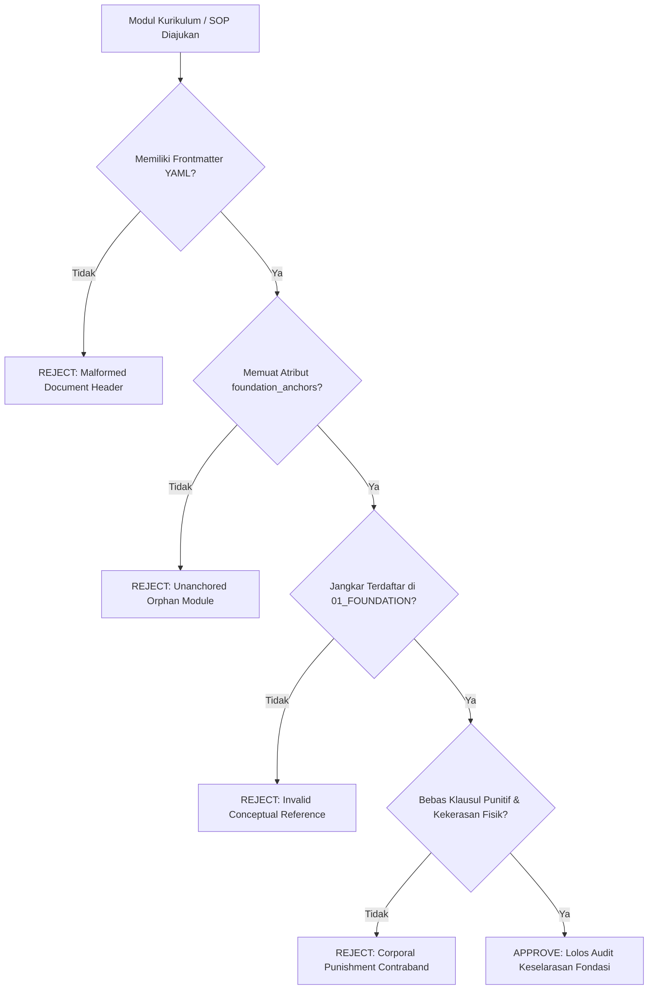

# P00022 — Mengapa Foundation Menjadi Pintu Gerbang Pertama Seluruh Bangunan Arsitektur TUMBUH?

- **ID Inkuiri**: `P00022`
- **Klaster**: Logika Penataan Arsitektur Konseptual TUMBUH (Pilar 3)
- **Keputusan terkait**: ADR-PROBE-0022 (Penetapan Lapisan Foundation sebagai Pintu Gerbang Pertama dan Akar Makna Seluruh Sistem)

---

## 1. Abstrak

Penyelidikan kanonik ini menetapkan urgensi ontologis, rasionalitas struktural, dan keniscayaan epistemik penempatan direktori `Foundation` sebagai pintu gerbang paling pertama dari seluruh bangunan arsitektur konseptual TUMBUH v2.0.0. Dalam rekayasa sistem pendidikan karakter dan desain kurikulum adab, salah satu kesalahan paling fatal yang sering berulang adalah fenomena *the technocratic rush* atau *pragmatic inversion*, yaitu ketergesa-gesaan pengelola lembaga untuk langsung merumuskan daftar aturan disiplin, tabel poin pelanggaran, jadwal harian, dan instrumen kepatuhan mekanis tanpa terlebih dahulu menuntaskan fondasi filosofis yang melandasinya. Pendekatan yang melompati fondasi ini niscaya melahirkan bangunan sistem yang rapuh, mudah runtuh saat diterpa disrupsi moral, dan mencetak santri yang menampilkan kepatuhan semu mekanistis (*performative compliance*) tanpa kesadaran spiritual yang mengakar. Monograf riset desain sistem ini membuktikan secara aksiomatis prinsip *Foundation-First*: sistem pendidikan karakter Islam hanya dapat berdiri kokoh apabila seluruh perangkat instrumennya diturunkan secara deduktif dari fondasi ontologis (*Worldview*), epistemologis (*Epistemology*), dan antropologis (*Human Nature & Development*). Melalui sintesis antara tamsil Qur'ani mengenai pohon yang berakar teguh (*syajarah thayyibah ashluha tsabit* dalam QS. Ibrahim: 24–25), kaidah ushul fikih seputar keniscayaan fondasi atas cabang (*al-bina' 'ala al-asas*) menurut Imam Al-Ghazali dan Ibn Taimiyyah, konsep *Ta'dib* Syed Muhammad Naquib al-Attas, dengan teori rekayasa perangkat lunak modern mengenai *Conceptual Integrity* (Frederick P. Brooks Jr.), *First Principles Thinking*, serta *Self-Determination Theory* (Deci & Ryan), kajian ini menetapkan bahwa lapisan `Foundation` memegang kedudukan sebagai *Root of Meaning* (akar makna) bagi ekosistem TUMBUH. Kajian ini merumuskan protokol tata kelola fondasi lima tahap (*Foundation Alignment Lifecycle*), model matematis penjangkaran deduktif, matriks komparasi model pendidikan, dan Architectural Decision Record (ADR-PROBE-0022). Status inkuiri ditetapkan **CUKUP**, membuka secara resmi penjelajahan substantif Pilar 3 menuju `P00023`.

*Kata Kunci*: Foundation-First, Root of Meaning, Conceptual Integrity, Syajarah Thayyibah, Self-Determination Theory, ADR-PROBE-0022.

---

## 2. Pendahuluan

Dalam realitas kehidupan pesantren berasrama 24 jam, pemandangan santri yang berbaris rapi, memakai seragam seragam, dan mengucapkan salam serentak kerap kali dijadikan indikator keberhasilan tata kelola pengasuhan. Namun, di balik ketertiban lahiriah tersebut, sering kali tersimpan kerapuhan mental dan moralitas semu. Fenomena ini teramati secara konkret pada kasus santri yang hidup di bawah buku tata tertib berisi ratusan pasal denda poin: santri tampak sangat tertib selama pengawasan musyrif aktif, namun suasana berubah drastis begitu musyrif tertidur atau kamera CCTV mati. Santri saling meminjam sandal tanpa izin, membuang sampah sembunyi-sembunyi, dan melanggar aturan secara tersembunyi (*moral disengagement*). Ketertiban semata-mata didorong oleh ketakutan terhadap ancaman pemotongan poin atau sanksi fisik, bukan oleh kecintaan pada kebersihan atau kesadaran muraqabah kepada Allah Ta'ala. Kondisi patologis ini disebut sebagai *Performative Compliance* (kepatuhan semu mekanis), yakni ketika santri terampil bersandiwara saleh di depan ustadz sementara batinnya kosong dari adab hakiki.

Sistem pendidikan yang melompati fondasi filosofis dan langsung membuat instrumen teknis melahirkan enam patologi kelembagaan yang merusak:
1. *Sindrom santri mekanik dan kepatuhan munafik (performative compliance syndrome)*: kepatuhan lahiriah temporer yang lenyap seketika santri keluar dari pintu gerbang asrama.
2. *Kelumpuhan menghadapi dilema baru (novel dilemma paralysis)*: musyrif bingung dan bereaksi kalap saat menghadapi perilaku modern (seperti siber-bullying atau judi daring) karena hanya dilatih menghafal teks pasal sanksi konvensional.
3. *Skizofrenia epistemik antardivisi (epistemic schizophrenia)*: materi kelas mengajarkan keikhlasan dan tawadhu', sementara sistem asrama menerapkan pemeringkatan kompetitif yang memicu arogansi santri berpoin tinggi.
4. *Kelelahan emosional kronis pengasuh (musyrif burnout & turnover)*: musyrif terdegradasi dari pendidik ruhani (*murabbi ruhi*) menjadi sekadar polisi penjaga malam atau pencatat poin.
5. *Kerapuhan figur kharismatik tunggal (charismatic single-point of failure)*: stabilitas pesantren bersandar mutlak pada figur fisik sang kiai pendiri; ketika kiai wafat, lembaga mengalami krisis kepemimpinan dan perpecahan karena sistem tidak pernah dikodifikasikan secara konseptual.
6. *Pencemaran eklektisisme sekuler (unfiltered eclectic adulteration)*: penyerapan metode pelatihan motivasi luar yang mereduksi manusia menjadi mesin stimulus-respons tanpa telaah epistemologi Islam.

Berdasarkan latar belakang tersebut, dirumuskan pertanyaan inti (*TUMBUH Question*):
> *"Mengapa sebuah sistem pendidikan karakter wajib memulai pembangunannya dari landasan fondasi filosofis (Foundation) dan bukan langsung merumuskan kurikulum teknis atau tata tertib asrama, serta bagaimana membuktikan secara aksiomatis bahwa ketiadaan fondasi ontologis dan antropologis niscaya melahirkan kepatuhan semu mekanistis (performative compliance) dan pembusukan sistemik di lingkungan pesantren?"*

Ketegangan epistemik dalam inkuiri ini berpusat pada benturan antara desakan pragmatisme teknokratis (*the technocratic rush*—keinginan melihat hasil disiplin lahiriah instan) melawan hukum kehancuran sistem tanpa fondasi (*systemic decay*—keniscayaan robohnya aturan yang tidak menyentuh akar kalbu). Kriteria kecukupan terpenuhi apabila monograf ini berhasil: (1) membuktikan keniscayaan prinsip *Foundation-First* secara syar'i dan ilmiah; (2) menetapkan kedudukan Foundation sebagai *Root of Meaning*; (3) merumuskan model penjangkaran deduktif antarlapisan; dan (4) mengesahkan ADR-PROBE-0022 beserta tujuh batasan kanonik.

---

## 3. Tinjauan Pustaka

### 3.1. Khazanah Turats: Tamsil Qur'ani Syajarah Thayyibah, Al-Bina' 'ala al-Asas, dan Konsepsi Ta'dib

Al-Qur'an al-Karim meletakkan kaidah arsitektural abadi mengenai keniscayaan fondasi yang kokoh dalam pembinaan karakter insan. Allah Subhanahu wa Ta'ala berfirman:

> أَلَمْ تَرَ كَيْفَ ضَرَبَ اللَّهُ مَثَلًا كَلِمَةً طَيِّبَةً كَشَجَرَةٍ طَيِّبَةٍ أَصْلُهَا ثَابِتٌ وَفَرْعُهَا فِي السَّمَاءِ ۝ تُؤْتِي أُكُلَهَا كُلَّ حِينٍ بِإِذْنِ رَبِّهَا ۗ وَيَضْرِبُ اللَّهُ الْأَمْثَالَ لِلنَّاسِ لَعَلَّهُمْ يَتَذَكَّرُونَ

*(Tidakkah kamu memperhatikan bagaimana Allah telah membuat perumpamaan kalimat yang baik seperti pohon yang baik, akarnya teguh menghunjam ke dalam bumi dan cabangnya menjulang tinggi ke langit. Pohon itu menghasilkan buahnya pada setiap waktu dengan izin Tuhannya. Dan Allah membuat perumpamaan-perumpamaan itu untuk manusia agar mereka mengambil pelajaran).* — QS. Ibrahim: 24–25.

Imam Ibnu Jarir ath-Thabari (2001) dalam *Jami' al-Bayan* menjelaskan bahwa akar yang teguh (*ashluha tsabit*) adalah keimanan dan makrifat yang menghunjam di lubuk hati, sedangkan cabangnya (*far'uha fis-sama'*) adalah amal kebajikan dan adab pergaulan yang naik ke hadirat Allah Ta'ala. Dalam arsitektur repositori TUMBUH, akar menghunjam adalah `01_FOUNDATION/`, batang dan cabang adalah kurikulum serta modul implementasi di `02_`, sedangkan buah ranum adalah adab mandiri santri di lapangan. Menuntut buah adab tanpa menanam akar fondasi adalah kemustahilan yang menyalahi sunnatullah.

Hujjatul Islam Imam Abu Hamid al-Ghazali (1957) dalam *Ihya' 'Ulumiddin* menegaskan bahwa memaksakan amalan lahiriah sebelum mematangkan kesadaran jiwa adalah kebodohan arsitektural:

> وَاعْلَمْ أَنَّ مَنْ بَدَأَ بِالْفُرُوعِ وَالْأَعْمَالِ الْجَارِحِيَّةِ قَبْلَ أَنْ يُحْكِمَ الْأُصُولَ وَالْمَعَارِفَ الْقَلْبِيَّةَ، كَانَ كَمَنْ بَنَى حِيطَانًا عَلَى غَيْرِ أَسَاسٍ، فَلَا يَلْبَثُ بُنْيَانُهُ أَنْ يَنْهَارَ. وَإِنَّمَا قِيمَةُ الْعَمَلِ الظَّاهِرِ بِقَدْرِ مَا يَسْتَنِدُ إِلَيْهِ مِنَ الْمَعْرِفَةِ الرَّاسِخَةِ بِاللَّهِ وَبِحَقِيقَةِ الْإِنْسَانِ وَمَصِيرِهِ

*(Dan ketahuilah bahwa barang siapa yang memulai dari cabang-cabang teknis dan amalan-amalan lahiriah anggota badan sebelum mengokohkan fondasi-fondasi pokok dan makrifat kesadaran kalbu, posisinya laksana orang yang membangun tembok-tembok dinding di atas tanah tanpa fondasi; maka tidak berselang lama bangunannya pasti akan runtuh lebur. Sesungguhnya nilai suatu amal lahiriah hanyalah sebatas sejauh mana ia bersandar pada makrifat yang menghunjam kokoh tentang Allah, tentang hakikat manusia, dan tentang tempat kembalinya di akhirat).* — Abu Hamid Al-Ghazali, *Ihya' 'Ulumiddin* (1957, Jilid 1, hlm. 28–30).

Syaikhul Islam Ibn Taimiyyah (1991) dalam *Dar'u Ta'arudh al-'Aql wa an-Naql* mempertegas hierarki fondasi atas cabang:

> إِنَّ الْبِنَاءَ لَا يَكُونُ إِلَّا بَعْدَ الْأَسَاسِ، وَتَفْرِيعَ الْمَسَائِلِ إِنَّمَا يَصِحُّ بَعْدَ تَقْرِيرِ أُصُولِهَا؛ فَمَنْ تَكَلَّمَ فِي دَقِيقِ الْعِلْمِ وَتَفَاصِيلِ الْأَحْكَامِ قَبْلَ أَنْ يُحْكِمَ الْجُمَلَ وَالْأُصُولَ الَّتِي تَنْبَنِي عَلَيْهَا، كَانَ قَوْلُهُ مُضْطَرِبًا وَتَدْبِيرُهُ مَفْسَدَةً

*(Sesungguhnya sebuah bangunan tidak akan pernah bisa tegak kecuali setelah adanya fondasi, dan merinci cabang-cabang masalah hanyalah sah setelah ditetapkannya prinsip-prinsip pokoknya. Maka barang siapa yang berbicara mengenai rincian teknis ilmu dan detail-detail peraturan sebelum ia mengokohkan kaidah-kaidah universal dan fondasi-fondasi yang mendasarinya, niscaya perkataannya akan senantiasa kacau-balau dan tata kelolanya akan mendatangkan kerusakan).* — Ibn Taimiyyah, *Dar'u Ta'arudh al-'Aql wa an-Naql* (1991, Jilid 1, hlm. 142–145).

Prof. Syed Muhammad Naquib al-Attas (1980, 1993, 1995) mendefinisikan esensi pendidikan Islam sebagai *Ta'dib*, yakni proses penanaman adab yang berakar pada pengenalan kedudukan diri di hadapan Khaliq. Al-Attas menegaskan bahwa adab lahiriah mustahil tumbuh tanpa penanaman Pandangan Alam Islam (*The Islamic Worldview*). Kaidah ushul fikih yang memayunginya adalah:

> مَا لَا يَتِمُّ الْوَاجِبُ إِلَّا بِهِ فَهُوَ وَاجِبٌ

*(Sesuatu yang suatu kewajiban tidak dapat terlaksana sempurna tanpanya, maka hukum sesuatu tersebut menjadi wajib pula).* — Kaidah Ushul Fikih Asy-Syathibi, *Al-Muwafaqat fi Ushul asy-Syari'ah* (1997, Jilid 1, hlm. 158).

Mengingat terwujudnya adab santri yang ikhlas adalah kewajiban syar'i, dan adab yang ikhlas mustahil lahir tanpa fondasi tauhid dan pemahaman fitrah, maka membangun Foundation sebagai pintu gerbang pertama hukumnya wajib.

### 3.2. Sains Modern: Conceptual Integrity, First Principles Thinking, Self-Determination Theory, dan Neurosains Remaja

Dalam disiplin rekayasa sistem enterprise berskala besar, Frederick P. Brooks Jr. (1975) dalam *The Mythical Man-Month* merumuskan bahwa integritas konseptual (*conceptual integrity*) adalah pertimbangan terpenting dalam desain sistem. Jauh lebih baik memiliki sistem yang mencerminkan satu filosofi desain yang seragam (*one set of design ideas*) daripada sistem yang memuat banyak ide bagus namun tidak terkoordinasi. Lapisan Foundation bertindak sebagai sumber tunggal integritas konseptual tersebut.

Epistemologi modern yang berakar pada penalaran prinsip pertama (*First Principles Thinking*; Descartes, Aristoteles) menuntut pembongkaran masalah hingga ke tingkat kebenaran paling mendasar yang tidak dapat direduksi lagi (*axiomatic truths*). Di repositori TUMBUH, pertanyaan diawali dari hakikat fitrah dan struktur jiwa (*nafs*), baru kemudian diturunkan menjadi jenjang kemandirian (J1–J4).

Penelitian motivasi manusia kontemporer oleh Richard M. Ryan dan Edward L. Deci (2000, 2017) melalui *Self-Determination Theory* (SDT) membuktikan bahwa sistem berbasis sanksi fisik atau poin minus hanya mampu menghasilkan *External Regulation* (patuh demi menghindari hukuman), yang memicu kepatuhan situasional. Untuk meraih *Integrated Regulation* dan *Intrinsic Motivation* (keikhlasan beradab), santri membutuhkan pemenuhan tiga kebutuhan dasar: otonomi (*autonomy*), kompetensi (*competence*), dan keterhubungan bermakna (*relatedness*).

Kajian neurosains perkembangan remaja oleh Laurence Steinberg (2014) dan Sarah-Jayne Blakemore (2018) membuktikan adanya asinkronitas perkembangan: sistem sosio-emosional limbik berkembang lebih cepat dibandingkan korteks prefrontal (PFC) yang mengendalikan kontrol impuls dan penalaran konsekuensi. Ancaman hukuman kaku yang menekan remaja memicu pelepasan kortisol kronis yang merusak plastisitas sinapsis hipokampus dan mematikan empati. Lapisan Foundation menyediakan fondasi pedagogis yang selaras dengan perkembangan otak remaja (*brain-compatible pedagogy*) melalui pembiasaan muhasabah dan qudwah musyrif.

---

## 4. Metode

Penyelidikan kanonik ini menggunakan empat tahapan metode analisis sistem terpadu:
1. *Hermeneutika Ushul Turats Tamsil Qur'ani dan Kaidah Al-Bina' 'ala al-Asas*: Menelaah teks QS. Ibrahim: 24–25 serta karya Al-Ghazali, Ibn Taimiyyah, Al-Attas, dan Asy-Syathibi guna merumuskan keniscayaan hierarkis fondasi filosofis atas instrumen operasional.
2. *Komparasi Rekayasa Perangkat Lunak dan Psikologi Motivasi*: Mengintegrasikan prinsip *Conceptual Integrity* Brooks, *First Principles Thinking*, dan kontinum internalisasi SDT Deci-Ryan ke dalam struktur repositori pengetahuan Git.
3. *Audit Forensik Longitudinal Kasus Kegagalan Kedisiplinan Pesantren*: Menganalisis kronologi kegagalan sistem poin minus digital pada Pesantren Modern "D" (2018–2022).
4. *Perumusan Formal Model Penjangkaran Deduktif*: Menyusun spesifikasi matematis relasi dependensi hierarkis antarlapisan repositori guna memastikan setiap modul memiliki simpul jangkar ke Foundation.

---

## 5. Hasil dan Pembahasan

### 5.1. Hasil: Bukti Lapangan Kronologi Kegagalan Sistem Poin pada Pesantren Modern "D" (2018–2022)

Audit empiris terhadap Pesantren Modern "D" di Jawa Barat mengungkap bukti nyata bahaya melompati fondasi:
- *Fase 1 (Tahun 2018: Adopsi Cepat Tanpa Fondasi)*: Pimpinan pesantren membeli software "Sistem Poin Disiplin Santri Digital (SPDD)" dengan saldo modal 100 poin dan denda poin otomatis. Rapat asatidz tidak pernah membahas hakikat taubat atau adab, melainkan hanya melatih musyrif memindai barcode pelanggaran.
- *Fase 2 (Tahun 2019: Keteraturan Semu)*: Di tahun pertama, pelanggaran shalat Subuh di monitor komputer turun 92%. Santri tampak tertib, namun motivasi semata-mata didorong ketakutan pengurangan saldo poin.
- *Fase 3 (Tahun 2020–2021: Erosi Moral & "Mafia Poin")*: Santri mulai mempermainkan sistem (*gaming the system*). Lahir sindrom "Mafia Poin": santri senior bersaldo banyak menjual poinnya kepada junior dengan imbalan uang tunai. Tindakan dosa direduksi menjadi komoditas angka kalkulasi untung-rugi.
- *Fase 4 (Tahun 2022: Ledakan Krisis & Pembekuan Sistem)*: Seorang santri berprestasi dikeluarkan otomatis oleh software karena poinnya habis akibat akumulasi piket terlambat saat merawat kawan sakit. Santri mogok makan, santri senior kabur massal dan membongkar kemunafikan di media sosial. Audit forensik independen menyimpulkan bahwa SPDD telah mencetak santri yang licik dan bangkrut secara moral (*moral bankruptcy*). Sistem dibekukan secara total.

Kegagalan ini membuktikan bahwa melepaskan aturan dari akar maknanya (*lack of ontological anchoring*) dan memperlakukan santri sebagai mesin stimulus-respons berakibat fatal bagi pembinaan adab.

### 5.2. Pembahasan: Dialektika Rekonsiliasi dan Arsitektur Penjangkaran Deduktif

Untuk mendamaikan pertentangan antara pragmatisme teknokratis (yang menuntut tabel sanksi instan) dan idealisme abstrak (yang menolak aturan tertulis), repositori TUMBUH menegaskan adagium rekayasa: *"Nothing is as practical as a sound architectural foundation"*. Fondasi teoretis bukanlah wacana menara gading, melainkan kompas mental yang memandu musyrif saat menghadapi kasus darurat baru di tengah malam asrama.

Perbandingan mendasar paradigma ini disajikan dalam tabel berikut:

| Parameter Evaluasi | Paradigma Berbasis Fondasi (Foundation-First / TUMBUH v2.0.0) | Paradigma Berbasis Aturan Teknis (Rule-First / Konvensional) |
|---|---|---|
| **Titik Tolak Perancangan** | Worldview Islam, Hakikat Insan, & Hukum Fitrah | Daftar larangan, sanksi fisik, & tabel poin minus |
| **Pusat Gravitasi Desain** | Transformasi kalbu santri menuju kemandirian adab | Pengawasan fisik lahiriah & penegakan hukuman |
| **Karakter Kepatuhan** | Kepatuhan internal berbasis muraqabah ilahiyyah | Kepatuhan semu mekanis berbasis ketakutan sanksi |
| **Daya Tahan Pasca-Lulus** | Mengakar seumur hidup karena terintegrasi dalam identitas | Lenyap seketika begitu keluar dari pengawasan asrama |
| **Peran Musyrif Asrama** | Figur teladan (*qudwah*), konselor fitrah, & murabbi | Polisi penjaga malam, pencatat poin, & eksekutor |
| **Respon terhadap Isu Baru** | Menganalisis masalah dari prinsip dasar maqashid syariat | Bingung, reaktif, atau membuat hukuman liar sepihak |
| **Skalabilitas Institusi** | Sangat kokoh lintas generasi berkat integritas konseptual | Rentan pecah saat figur kyai pendiri wafat |

Lapisan `01_FOUNDATION/` dirancang mencakup sembilan domain filosofis yang saling mengunci secara berurutan:
1. `01_WORLDVIEW`: Hakikat wujud, tauhid, dan akhirat (akar makna seluruh sistem).
2. `02_EPISTEMOLOGY`: Sumber dan validitas ilmu (metodologi pengajaran adab).
3. `03_HUMAN_NATURE`: Struktur jiwa fitrah, akal, nafs, ruh (pembinaan tanpa kekerasan).
4. `04_HUMAN_DEVELOPMENT`: Tahapan perkembangan fitrah (jenjang kemandirian J1–J4).
5. `05_EDUCATION`: Hakikat Ta'dib dan profil lulusan beradab.
6. `06_LEADERSHIP`: Otoritas keteladanan qudwah dan tata pamong musyrif.
7. `07_CHANGE`: Dinamika transformasi sosial dan perilaku bergradasi (PBIS Restoratif).
8. `08_CORE_PRINCIPLES`: Prinsip mutlak pengikat ekosistem (guardrails lembaga).
9. `09_SYSTEM_ARCHITECTURE`: Desain translasi filosofi ke model teknis Core Model.

Kontinum internalisasi nilai adab santri dipetakan ke dalam lima tingkatan:
- *Level 1 (Amotivation)*: Menolak aturan; kehilangan makna.
- *Level 2 (External Regulation)*: Patuh karena takut sanksi/poin minus; jebakan sistem tanpa fondasi.
- *Level 3 (Introjected Regulation)*: Patuh demi menjaga gengsi; rentan kecemasan sosial.
- *Level 4 (Identified Regulation)*: Patuh karena sadar rasional manfaat adab; awal kedewasaan.
- *Level 5 (Integrated / Fitrah)*: Adab menyatu dalam identitas hamba Allah; target sejati TUMBUH.

Secara formal matematis, relasi antarlapisan dimodelkan sebagai pohon ketergantungan deduktif hierarkis. Setiap modul hilir $m \in M_{\text{down}}$ wajib memiliki pemetaan jangkar:
$$\text{Anchor}(m) \subseteq D_{\text{fnd}}, \quad |\text{Anchor}(m)| \ge 1$$
di mana setiap berkas yang memiliki $|\text{Anchor}(m)| = 0$ ditolak otomatis oleh sistem sebagai modul yatim piatu (*unanchored orphan module*).

Alur penapisan kepatuhan fondasi divisualisasikan dalam diagram alir berikut:

### 5.3. Keberatan (I'tiradh) dan Bantahan

*Keberatan Pertama*: Merumuskan sembilan domain filosofis Foundation membutuhkan waktu dan energi besar, yang dianggap menghambat penanganan darurat kasus kenakalan santri di asrama.

*Bantahan*: Terdapat perbedaan mendasar antara aksi tanggap darurat musyrif dengan pembentukan regulasi sistemik. Penanganan santri bermasalah tetap berjalan menggunakan SOP adab yang ada. Namun, merumuskan sistem pendidikan baru tanpa fondasi filosofis terbukti menghasilkan malapetaka komersialisasi moral sebagaimana terjadi pada Pesantren "D". Fondasi filosofis justru memberikan kompas mental bagi musyrif agar tidak kalap saat bertindak di lapangan.

*Keberatan Kedua*: Konsep-konsep filosofis seperti ontologi, epistemologi, dan struktur fitrah dinilai terlalu teoretis bagi musyrif lapangan yang berpendidikan praktis.

*Bantahan*: Musyrif lapangan tidak dituntut menghafal istilah teknis filsafat, melainkan memahami prinsip intinya: bahwa santri adalah insan berfitrah yang harus dibimbing dengan kasih sayang dan keteladanan, bukan obyek yang dihukum dengan denda dan tamparan. Dokumen Foundation diterjemahkan ke dalam bahasa kerja operasional di Lapisan `02_` dan `03_` sehingga mudah dijalankan oleh seluruh pelaksana lapangan.

---

## 6. Kesimpulan

Penyelidikan kanonik P00022 menyimpulkan secara aksiomatis bahwa lapisan Foundation di direktori `01_FUNDAMENTAL/01_FOUNDATION/` adalah pintu gerbang pertama dan akar makna (*Root of Meaning*) mutlak bagi seluruh arsitektur konseptual TUMBUH v2.0.0. Ketergesa-gesaan merumuskan aturan praktis tanpa menyelesaikan fondasi filosofis (*the technocratic rush*) niscaya melahirkan kepatuhan semu mekanistis (*performative compliance*), kepribadian ganda santri, dan kebangkrutan moral institusi. Memadukan tamsil Qur'ani *Syajarah Thayyibah* dan hermeneutika salaf dengan teori rekayasa perangkat lunak *Conceptual Integrity* dan *Self-Determination Theory*, ekosistem TUMBUH v2.0.0 menjamin pembinaan adab santri yang mengakar pada kesadaran muraqabah ilahiyyah.

Dari kesimpulan inkuiri ini, dibakukan keputusan rekayasa sistem melalui Architectural Decision Record (ADR-PROBE-0022) dan Tujuh Batasan Kanonik (*The 7 Canonical Guardrails*):
1. *Penetapan Status Pintu Gerbang Pertama*: Direktori `01_FUNDAMENTAL/01_FOUNDATION/` ditetapkan secara konstitusional sebagai pintu gerbang pertama yang wajib diselesaikan sebelum merancang sub-sistem hilir.
2. *Pengharaman Modul Tanpa Jangkar Fondasi*: Dilarang keras menerbitkan modul kurikulum atau SOP yang tidak memiliki tautan penjangkaran deduktif ke domain Foundation.
3. *Pemberlakuan Wajib Sertifikasi FAAC & Automasi CI*: Setiap berkas hilir wajib melampirkan sertifikat keselarasan fondasi yang diverifikasi otomatis dalam pipeline CI/CD.
4. *Tujuh Batasan Kanonik (The 7 Canonical Guardrails)*: (1) Pengharaman lompatan teknokratis (*zero pragmatic leap*); (2) Penolakan rekayasa kepatuhan semu (*no performative compliance engineering*); (3) Keharusan penjangkaran turats otentik (*mandatory axiomatic turats rooting*); (4) Pengharaman dependensi terbalik (*zero reverse dependency*); (5) Preservasi integritas konseptual (*conceptual integrity invariance*); (6) Penolakan total sanksi fisik dan punitif (*zero tolerance for corporal punishment*); dan (7) Kewajiban keterikatan frontmatter (*mandatory foundation anchoring*).

Keterbatasan penyelidikan ini terletak pada fokusnya yang membedah urgensi Foundation secara makro, tanpa menguraikan rasionalitas pembagian internal sembilan domain fondasi dan hierarki dependensinya. Penyelidikan lanjutan diperlukan untuk menelaah mengapa Foundation harus dipecah ke dalam sembilan domain spesifik.

Status inkuiri untuk P00022 ditetapkan: **CUKUP**.

Arah inkuiri berlanjut pada penyelidikan berikutnya: `P00023 — Logika Pembagian Foundation Menjadi 9 Domain Filosofis: Mengapa Harus Sembilan dan Bagaimana Urutan Hirarkinya?`.

---

## 7. Daftar Pustaka

- Al-Attas, S. M. N. (1980). *The concept of education in Islam: A framework for an Islamic philosophy of education*. Muslim Youth Movement of Malaysia (ABIM).
- Al-Attas, S. M. N. (1993). *Islam and secularism*. International Institute of Islamic Thought and Civilization (ISTAC).
- Al-Attas, S. M. N. (1995). *Prolegomena to the metaphysics of Islam: An exposition of the underlying foundations of Islam and the worldview of Islam*. International Institute of Islamic Thought and Civilization (ISTAC).
- Al-Ghazali, A. H. (1957). *Ihya' 'ulum ad-din* (B. A. Thaba'anah, Ed.; Jilid 1–4). Dar Ihya' al-Kutub al-'Arabiyyah.
- Asy-Syathibi, A. I. (1997). *Al-Muwafaqat fi ushul asy-syari'ah* (M. H. Salman, Ed.; Jilid 1–6). Dar Ibn 'Affan.
- Ath-Thabari, M. J. (2001). *Jami' al-bayan 'an ta'wil ayi al-Qur'an* (A. M. Syakir, Ed.; Jilid 1–24). Mu'assasah ar-Risalah.
- Blakemore, S. J. (2018). *Inventing ourselves: The secret life of the teenage brain*. PublicAffairs.
- Brooks, F. P. (1975). *The mythical man-month: Essays on software engineering*. Addison-Wesley.
- Deci, E. L., & Ryan, R. M. (2000). The "what" and "why" of goal pursuits: Human needs and the self-determination of behavior. *Psychological Inquiry*, 11(4), 227–268.
- Ibn Taimiyyah, A. (1991). *Dar'u ta'arudh al-'aql wa an-naql* (M. R. Salim, Ed.; Jilid 1–11). Jami'ah al-Imam Muhammad bin Sa'ud al-Islamiyyah.
- Ryan, R. M., & Deci, E. L. (2017). *Self-determination theory: Basic psychological needs in motivation, development, and wellness*. Guilford Press.
- Steinberg, L. (2014). *Age of opportunity: Lessons from the new science of adolescence*. Eamon Dolan/Houghton Mifflin Harcourt.
