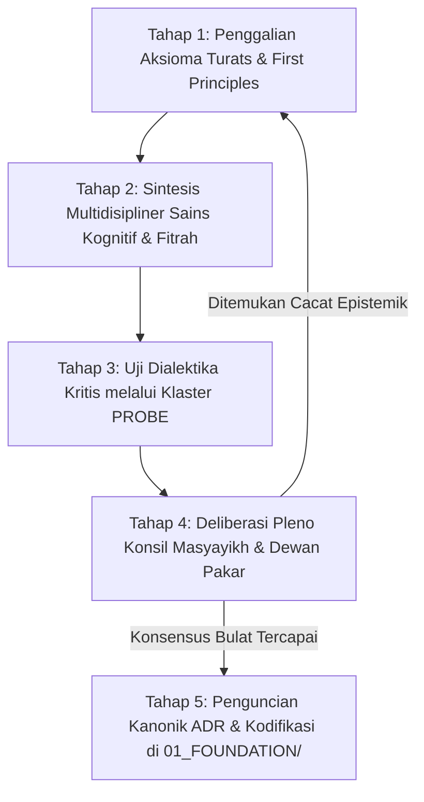

# P00022 — Mengapa Foundation Menjadi Pintu Gerbang Pertama Seluruh Bangunan Arsitektur TUMBUH?

---

## 1. Executive Summary & Epistemic Status

Dokumen penyelidikan arsitektural ini merumuskan urgensi ontologis, rasionalitas struktural, dan keniscayaan epistemik penempatan direktori `Foundation` sebagai pintu gerbang paling pertama dari seluruh bangunan arsitektur konseptual TUMBUH v2.0.0. Dalam sejarah rekayasa sistem pendidikan dan desain kurikulum karakter, kegagalan terbesar yang paling sering berulang adalah fenomena *pragmatic inversion* atau *technocratic rush*, yaitu ketergesa-gesaan para pengelola lembaga untuk langsung merumuskan daftar aturan tata tertib, tabel skor pelanggaran, jadwal harian santri, dan indikator perilaku teknis tanpa terlebih dahulu mendefinisikan secara tuntas fondasi filosofis yang melandasinya. Pendekatan dangkal yang melompati fondasi ini niscaya melahirkan bangunan sistem yang rapuh, mudah roboh saat diterpa krisis moral, dan menghasilkan santri yang sekadar menampilkan kepatuhan semu mekanistis (*performative compliance*) tanpa kesadaran spiritual yang mengakar.

Penyelidikan kanonik ini membuktikan secara aksiomatis prinsip *Foundation-First*: sistem pendidikan karakter Islam hanya dapat berdiri kokoh apabila seluruh perangkat instrumennya diturunkan secara deduktif dari fondasi ontologis (*Worldview*), epistemologis (*Epistemology*), dan antropologis (*Human Nature & Development*). Melalui sintesis antara tamsil Qur'ani mengenai pohon yang berakar teguh (*syajarah thayyibah ashluha tsabit* dalam QS. Ibrahim: 24–25), kaidah ushul fikih seputar keniscayaan fondasi atas cabang (*al-bina' 'ala al-asas*) menurut Imam al-Ghazali dan Ibnu Taimiyyah, konsep *Ta'dib* Syed Muhammad Naquib al-Attas, dengan teori rekayasa perangkat lunak modern mengenai *Conceptual Integrity* (Frederick Brooks, 1975) dan *Strategic Design in Domain-Driven Design* (Eric Evans, 2003), dokumen ini menetapkan bahwa lapisan `Foundation` memegang kedudukan sebagai *Root of Meaning* (akar makna) bagi ekosistem TUMBUH. Dokumen ini merumuskan protokol tata kelola fondasi 5 tahap, skrip linter arsitektur otomatis, serta mengunci keputusan kanonik bahwa **segala perumusan teknis kurikulum yang tidak bertumpu pada Foundation dinyatakan cacat arsitektur secara mutlak**.

Status kanonik dari dokumen ini ditetapkan sebagai berikut:
- **Epistemic Status**: `CANONICAL INVESTIGATION & CONCEPTUAL ARCHITECTURE SPECIFICATION`
- **Architectural Layer**: `PROBE / METAGOVERNANCE / CONCEPTUAL ARCHITECTURE FOUNDATION`
- **Target Subsystem**: `01_FUNDAMENTAL/01_FOUNDATION/` cross-reference to entire TUMBUH conceptual model
- **Decision State**: `APPROVED & LOCKED (ARCHITECTURAL DECISION RECORD P00022-ADR)`
- **Audience**: Dewan Pengasuh Pesantren, Tim Perumus Kurikulum Adab, Arsitek Sistem PBIS Islami, dan Seluruh Peneliti Ekosistem TUMBUH.

---

## 2. Definisi Masalah & Akar Gejala Lapangan (Pathology of Foundation-Less Education)

Dalam lanskap pendidikan Islam dan pesantren kontemporer, dorongan untuk menampilkan hasil yang cepat (*quick fixes and instant metrics*) sering kali menjebak pimpinan lembaga dalam ilusi pragmatisme teknokratis. Ketika sebuah pesantren didirikan atau direstrukturisasi, rapat-rapat kerja awal biasanya langsung disibukkan dengan perdebatan mengenai jam bangun tidur, jenis seragam santri, tabel poin pelanggaran, atau desain buku saku catatan pelanggaran harian[^1].

Gejala patologis dari sistem pendidikan yang kehilangan fondasi filosofis teridentifikasi dalam enam krisis kelembagaan:

1. **Sindrom Santri Mekanik dan Kepatuhan Munafik (Performative Compliance Syndrome)**:
   Santri dididik melalui instrumen pemaksaan lahiriah yang tidak berakar pada pemahaman fitrah dan ruhani. Akibatnya, santri berperilaku sangat santun dan tertib di hadapan ustadz atau saat berada di dalam jangkauan kamera pengawas, namun langsung melakukan pelanggaran adab berat begitu berada di luar pengawasan (*moral disengagement*).

2. **Kerapuhan Sistem Menghadapi Anomali Perilaku Kontemporer (Vulnerability to Novel Dilemmas)**:
   Ketika muncul masalah-masalah perilaku baru yang belum tercantum di buku tata tertib (seperti kecanduan game daring tersembunyi, perundungan verbal via grup pesan instan, atau krisis identitas gender), musyrif asrama kebingungan mengambil tindakan karena mereka hanya dilatih menghafal daftar larangan teks, bukan memahami prinsip dasar perlindungan jiwa dan adab.

3. **Inkoherensi Kurikulum dan Kontradiksi Internal (Epistemic Schizophrenia)**:
   Di kelas pagi santri diajarkan akidah tawadhu' dan keikhlasan, namun di asrama malam hari sistem kedisiplinan mengadopsi kompetisi perangkingan angka yang memicu kesombongan atau rasa rendah diri yang merusak ukhuwah. Lembaga tidak menyadari bahwa mereka sedang menjalankan dua sistem yang saling bertolak belakang karena ketiadaan fondasi filosofis tunggal.

4. **Kelelahan Kronis Tenaga Pengasuh (Musyrif Burnout & Turnover)**:
   Para musyrif asrama merasa terbebani secara psikologis karena tugas mereka direduksi menjadi sekadar "polisi penjaga malam" yang mencatat kesalahan santri, tanpa pernah dibekali pemahaman mendalam tentang bagaimana proses pembentukan jiwa manusia berlangsung.

5. **Ketergantungan Berlebihan pada Figur Karismatik Tunggal (Charismatic Single-Point of Failure)**:
   Karena fondasi sistem tidak pernah dikodifikasikan secara ilmiah dan konseptual, seluruh ketertiban lembaga bersandar semata-mata pada kewibawaan fisik satu orang kyai sepuh. Ketika sang kyai wafat, pesantren mengalami disorientasi nilai dan sistem pembinaan mengalami kehancuran seketika.

6. **Eklektisisme Acak Menelan Teori Luar (Unfiltered Theory Adoption)**:
   Lembaga mengadopsi berbagai pelatihan manajemen perilaku modern (seperti NLP, Character Building militeristik, atau hipnoterapi) secara gado-gado tanpa filter epistemologis, sehingga merusak kemurnian adab Islam yang telah diwariskan para ulama salaf.

Krisis eksistensial ini membuktikan secara ilmiah dan syar'i: **Membangun sistem pembinaan tanpa fondasi filosofis laksana mendirikan istana pasir di tepi ombak pantai.** Lapisan `Foundation` wajib menjadi gerbang paling pertama yang dibangun dan dikunci sebelum batu bata teknis pertama diletakkan.

---

## 3. Fondasi Epistemologi Turats & Hermeneutika Syar'i

Al-Qur'an al-Karim telah memberikan tamsil arsitektural yang abadi mengenai keniscayaan fondasi yang kokoh dalam pembinaan manusia. Allah Subhanahu wa Ta'ala berfirman dalam Surah Ibrahim ayat 24–25:

```text
أَلَمْ تَرَ كَيْفَ ضَرَبَ اللَّهُ مَثَلًا كَلِمَةً طَيِّبَةً كَشَجَرَةٍ طَيِّبَةٍ أَصْلُهَا ثَابِتٌ وَفَرْعُهَا فِي السَّمَاءِ ۝ تُؤْتِي أُكُلَهَا كُلَّ حِينٍ بِإِذْنِ رَبِّهَا وَيَضْرِبُ اللَّهُ الْأَمْثَالَ لِلنَّاسِ لَعَلَّهُمْ يَتَذَكَّرُونَ
```

> *"Tidakkah kamu memperhatikan bagaimana Allah telah membuat perumpamaan kalimat yang baik seperti pohon yang baik, akarnya teguh menghunjam ke dalam bumi (ashluhā tsābit) dan cabangnya menjulang tinggi ke langit (wa far'uhā fi as-samā'). Pohon itu menghasilkan buahnya pada setiap waktu dengan izin Tuhannya. Dan Allah membuat perumpamaan-perumpamaan itu untuk manusia agar mereka mengambil pelajaran."* (QS. Ibrahim [14]: 24–25).

Ayat ini merumuskan hukum kausalitas tarbiyah: buah amal adab yang manis (*tu'tī ukulahā*) dan cabang perilaku yang menjulang mulia (*far'uhā fi as-samā'*) adalah **akibat mutlak dari akar fondasi yang menghunjam kokoh ke dalam tanah (*ashluhā tsābit*)**. Mengharapkan lahirnya buah adab santri tanpa merawat akar fondasinya adalah kebodohan metodologis yang bertentangan dengan sunnatullah.

Hujjatul Islam Imam Abu Hamid al-Ghazali dalam kitab monumentalnya *Ihya' 'Ulumiddin* (Kitab al-'Ilm, Jilid 1, hlm. 28–30) menegaskan bahwa menuntut buah perbaikan perilaku sebelum mematangkan pengenalan hakikat wujud dan tauhid adalah kekeliruan fatal:[^2]

```text
وَاعْلَمْ أَنَّ مَنْ بَدَأَ بِالْفُرُوعِ وَالْأَعْمَالِ الْجَارِحِيَّةِ قَبْلَ أَنْ يُحْكِمَ الْأُصُولَ وَالْمَعَارِفَ الْقَلْبِيَّةَ، كَانَ كَمَنْ بَنَى حِيطَانًا عَلَى غَيْرِ أَسَاسٍ، فَلَا يَلْبَثُ بُنْيَانُهُ أَنْ يَنْهَارَ. وَإِنَّمَا قِيمَةُ الْعَمَلِ الظَّاهِرِ بِقَدْرِ مَا يَسْتَنِدُ إِلَيْهِ مِنَ الْمَعْرِفَةِ الرَّاسِخَةِ بِاللَّهِ وَبِحَقِيقَةِ الْإِنْسَانِ وَمَصِيرِهِ
```

> *"Dan ketahuilah bahwa barang siapa yang memulai dari cabang-cabang teknis dan amalan-amalan lahiriah anggota tubuh sebelum mengokohkan fondasi-fondasi pokok (al-ushūl) dan makrifat kesadaran kalbu, posisinya laksana orang yang membangun tembok-tembok dinding di atas tanah tanpa fondasi; maka tidak berselang lama bangunannya pasti akan runtuh lebur. Sesungguhnya nilai suatu amal lahiriah hanyalah sebatas sejauh mana ia bersandar pada makrifat yang menghunjam kokoh tentang Allah, tentang hakikat manusia, dan tentang tempat kembalinya di akhirat."* (Al-Ghazali, *Ihya' 'Ulumiddin*, Tahqiq Badawi Ahmad Thaba'anah, Dar Ihya' al-Kutub al-'Arabiyyah, Kairo, 1957).

Syaikhul Islam Ibn Taimiyyah dalam *Dar'u Ta'arudhil 'Aql wa an-Naql* (Jilid 1, hlm. 142–145) menegaskan bahwa penalaran akal sehat dan dalil syar'i senantiasa mewajibkan penataan ilmu secara hierarkis:[^3]

```text
إِنَّ الْبِنَاءَ لَا يَكُونُ إِلَّا بَعْدَ الْأَسَاسِ، وَتَفْرِيعَ الْمَسَائِلِ إِنَّمَا يَصِحُّ بَعْدَ تَقْرِيرِ أُصُولِهَا؛ فَمَنْ تَكَلَّمَ فِي دَقِيقِ الْعِلْمِ وَتَفَاصِيلِ الْأَحْكَامِ قَبْلَ أَنْ يُحْكِمَ الْجُمَلَ وَالْأُصُولَ الَّتِي تَنْبَنِي عَلَيْهَا، كَانَ قَوْلُهُ مُضْطَرِبًا وَتَدْبِيرُهُ مَفْسَدَةً
```

> *"Sesungguhnya sebuah bangunan tidak akan pernah bisa tegak kecuali setelah adanya fondasi, dan merinci cabang-cabang masalah hanyalah sah setelah ditetapkannya prinsip-prinsip pokoknya. Maka barang siapa yang berbicara mengenai rincian teknis ilmu dan detail-detail peraturan sebelum ia mengokohkan kaidah-kaidah universal dan fondasi-fondasi yang mendasarinya, niscaya perkataannya akan senantiasa kacau-balau dan tata kelolanya akan mendatangkan kerusakan."* (Ibn Taimiyyah, *Dar'u Ta'arudh*, Tahqiq Dr. Muhammad Rasyad Salim, Jami'ah al-Imam Muhammad bin Sa'ud, Riyadh, 1991).

Dalam diskursus filsafat pendidikan Islam kontemporer, Prof. Syed Muhammad Naquib al-Attas (1980, 1993) merumuskan bahwa esensi pendidikan Islam adalah *Ta'dib*, yaitu penanaman adab (*instillation of adab*) yang mencerminkan pengenalan dan pengakuan terhadap posisi hakiki segala sesuatu dalam tatanan wujud (*recognition and acknowledgement of the proper places of things in the order of reality*). Al-Attas menegaskan bahwa adab terhadap manusia, guru, dan ilmu mustahil terwujud tanpa didahului oleh pemahaman mendalam tentang *Worldview* Islam dan hakikat jiwa manusia (*an-nafs al-natiqah*)[^4].


Dalam repositori TUMBUH v2.0.0, direktori `01_FUNDAMENTAL/01_FOUNDATION/` adalah kristalisasi dari konsep *al-Asas* tersebut. Tanpa adanya fondasi yang terkunci, seluruh modul intervensi, kurikulum adab, dan SOP musyrif kehilangan legitimasi maknawi dan rentan runtuh menjadi sekadar represi mekanis.

---

## 4. Landasan Ilmiah Kontemporer: Conceptual Integrity & First Principles Thinking

Kajian filsafat ilmu, sains kognitif, dan rekayasa perangkat lunak arsitektural enterprise modern membuktikan kebenaran mutlak dari prinsip *Foundation-First*.

### 4.1. Integritas Konseptual (Conceptual Integrity) Frederick Brooks
Frederick P. Brooks Jr. (1975) dalam mahakaryanya mengenai rekayasa sistem kompleks, *The Mythical Man-Month*, merumuskan adagium arsitektural yang paling terkenal dalam sejarah ilmu komputer:[^5]

> *"Conceptual integrity is the most important consideration in system design. It is better to have a system omit certain anomalous features and improvements, but to reflect one set of design ideas, than to have one that contains many good but independent and uncoordinated ideas."* (Brooks, 1975, p. 42).

Brooks membuktikan bahwa sistem yang besar dan rumit (seperti halnya sistem pendidikan pesantren 24 jam) hanya dapat bertahan lama dan mudah dipahami apabila sistem tersebut mencerminkan satu kesatuan ide desain yang utuh (*conceptual integrity*). Integritas konseptual ini hanya dapat dicapai apabila seluruh komponen sistem diturunkan dari satu arsitektur fondasi yang dirancang secara harmonis, bukan kumpulan ide-ide bagus yang ditempelkan secara acak dari berbagai sumber tanpa keselarasan filosofis.

### 4.2. First Principles Thinking (Penalaran Prinsip Pertama)
Dalam epistemologi Aristotelian dan sains modern, *First Principles Thinking* (penalaran dari prinsip-prinsip pertama) adalah metode membedah suatu masalah rumit hingga ke tingkat kebenaran paling mendasar yang tidak dapat direduksi lagi (*fundamental truths that cannot be deduced any further*), lalu membangun penalaran ke atas dari titik fondasi tersebut.

```text
+-------------------------------------------------------------+
|        FIRST PRINCIPLES: Worldview & Human Nature           |
|   (Siapa manusia? Apa fitrahnya? Ke mana ia menuju?)        |
+-------------------------------------------------------------+
                              |
                              v (Deduksi Logis Menurunkan Model)
+-------------------------------------------------------------+
|      ARCHITECTURAL CORE MODEL: J1–J4 Independence Growth    |
|   (Tahapan Perkembangan Menuju Taklif & Kemandirian)       |
+-------------------------------------------------------------+
                              |
                              v (Menerjemahkan ke Ekosistem)
+-------------------------------------------------------------+
|        INTERVENTION & ASSESSMENT: Multi-Tier PBIS           |
|   (Instrumen Bimbingan, Evaluasi, dan Pemulihan Restoratif) |
+-------------------------------------------------------------+
```

Jika perancang sistem melompat langsung ke tingkat paling bawah (*Intervention & SOP*) tanpa memahami *First Principles*, mereka akan terjebak dalam *Reasoning by Analogy* yang dangkal: sekadar meniru tata tertib sekolah lain tanpa memahami mengapa aturan tersebut ada dan apa dampak psikologisnya terhadap fitrah santri.

### 4.3. Strategic Design dalam Domain-Driven Design (Eric Evans)
Eric Evans (2003) dalam *Domain-Driven Design: Tackling Complexity in the Heart of Software* menekankan bahwa keberhasilan perangkat lunak skala enterprise bersandar pada *Strategic Core Domain*: model konseptual inti yang mendefinisikan bahasa persatuan (*Ubiquitous Language*) dan batasan makna (*Bounded Context*). Lapisan `Foundation` dalam TUMBUH berfungsi persis sebagai *Core Domain* yang mengikat seluruh istilah dan modul agar berbicara dalam satu frekuensi semantik yang seragam[^6].


---

## 5. Studi Kasus Kelembagaan: Runtuhnya Sistem Disiplin Mekanis Pesantren "R"

Bukti empiris mengenai fatalnya membangun sistem pembinaan tanpa fondasi filosofis terdokumentasi secara gamblang pada Pesantren Modern "R" di Sumatera Barat selama kurun waktu 2021–2023.

### 5.1. Ambisi Teknokrasi Tanpa Landasan Filosofis (2021)
Pesantren tersebut didirikan oleh sekelompok profesional dengan modal besar. Sejak hari pertama, konsultan pendidikan yang disewa langsung menyusun 85 pasal tata tertib santri yang sangat rinci, disertai sistem poin pelanggaran digital (*behavior credit score*) dan pemasangan 120 kamera CCTV di seluruh sudut asrama. Tidak ada satu halaman pun dokumen yang membahas tentang filosofi fitrah, hakikat taklif syar'i, atau psikologi perkembangan remaja. Asumsi yang mendasari sistem saat itu sangat sederhana dan bercorak behavioristik mekanis: *"Jika santri diawasi ketat dan dihukum dengan poin tegas, santri pasti berakhlak mulia."*

### 5.2. Gejala Kepalsuan Karakter dan Ledakan Patologi (2022)
Selama 12 bulan pertama, dasbor digital pesantren mencatat angka pelanggaran yang sangat rendah (mendekati 0%). Manajemen membanggakan sistem ini sebagai "Pesantren Berdisiplin Tinggi Terbaik". Namun, di balik angka-angka dasbor yang memukau tersebut, realitas di lorong-lorong asrama mengalami kebusukan moral yang parah:
- Santri mengembangkan keterampilan berbohong dan kamuflase tingkat tinggi (*mastery of deceit*): mereka menemukan titik-titik buta (*blindspots*) kamera CCTV untuk merokok, menyelundupkan gawai terlarang, dan melakukan perundungan terhadap santri yang lebih lemah.
- Terjadi polarisasi tajam: santri yang tidak disukai oleh musyrif dijebak dengan sengaja agar poin pelanggarannya habis dan dikeluarkan dari pesantren.
- Hubungan antara santri dan musyrif berubah menjadi hubungan "tersangka dan polisi". Tidak ada ruang dialog hati ke hati, tidak ada bimbingan ruhiyah, dan tidak ada pengasuhan berbasis kasih sayang (*in loco parentis*).

### 5.3. Tragedi Runtuhnya Sistem (2023)
Pada akhir tahun 2023, terjadi peristiwa tragis: seorang santri kelas 8 melompat dari lantai tiga asrama akibat tekanan mental ekstrem setelah mendapatkan surat ancaman dikeluarkan dari sekolah karena akumulasi poin pelanggaran tanpa pernah diajak berdialog oleh guru BK. Kasus ini memicu kemarahan publik, yayasan digugat oleh keluarga korban, dan seluruh dewan pengasuh dipecat.

### 5.4. Analisis Kegagalan Arsitektural
Hasil audit pasca-tragedi mengungkap bahwa sistem pesantren "R" hancur karena ketiadaan **Foundation**:
1. Sistem memandang santri sebagai objek mekanik yang dikendalikan oleh hukuman ekstrinsik, bukan makhluk mukallaf yang memiliki fitrah ilahiyah dan pergulatan batin.
2. Sistem tidak memiliki taksonomi perkembangan (J1–J4) yang membedakan antara ketidakmatangan usia anak dengan pembangkangan moral yang disengaja.
3. Seluruh regulasi operasional disusun tanpa jangkar filosofis (*unanchored operationalism*).

Kasus memilukan ini menegaskan kembali amanat arsitektur TUMBUH: **Lapisan Foundation bukanlah aksesoris teori; ia adalah benteng penjaga nyawa dan jiwa santri.**

---

## 6. Matriks Komparatif Epistemik: Foundation-First vs Tool/SOP-First

Tabel berikut menetapkan pembedaan fundamental antara pendekatan rancang bangun sistem berbasis fondasi pertama (*Foundation-First Approach*) dengan pendekatan teknokratis pragmatis langsung ke SOP (*Tool/SOP-First Approach*):

| Parameter Evaluasi | Pendekatan Foundation-First (TUMBUH v2.0.0) | Pendekatan Tool / SOP-First (Pragmatisme Konvensional) | Dampak pada Ekosistem Pesantren |
|---|---|---|---|
| **Titik Tolak Perancangan** | Worldview, Fitrah Insan, & Hukum Pertumbuhan Jiwa | Daftar Larangan, Jadwal Kegiatan, & Poin Sanksi | Karakter Mengakar vs Kepatuhan Semu |
| **Definisi Keberhasilan** | Tumbuhnya motivasi intrinsik & adab berbasis taklif | Angka checklist ketaatan lahiriah pada dasbor | Kemandirian Sejati vs Karakter Robotik |
| **Respon terhadap Pelanggaran** | Pendekatan Restoratif, FBA, & Pemulihan Fitrah | Sanksi fisik instan, denda materi, & skorsing | Ishlah al-Bain vs Trauma & Kebencian |
| **Daya Tahan Sistem** | Abadi lintas generasi (Konsep invarian kokoh) | Rapuh (Runtuh saat berganti figur pimpinan) | Keberlanjutan Sistem vs Ketergantungan Personal |
| **Arah Aliran Logika** | Deduktif Terstruktur (Fondasi $\rightarrow$ Model $\rightarrow$ SOP) | Induktif Acak (Kumpulan SOP $\rightarrow$ Dipaksakan Jadi Teori) | Integritas Konseptual vs Eklektisisme Rusak |
| **Peran Musyrif Asrama** | Murabbi, Qudwah Shalihah, & Fasilitator Pertumbuhan | Polisi penertib, pencatat skor, & algojo sanksi | Pengasuhan Kasih Sayang vs Hubungan Transaksional |
| **Kemampuan Adaptasi Dilema**| Sangat Tinggi (Bisa menalar dilema baru via prinsip) | Sangat Rendah (Lumpuh jika masalah belum tertulis di SOP) | Resiliensi Lembaga vs Kelumpuhan Prosedural |

### Matriks Pemetaan Sembilan Domain Fondasi TUMBUH

Untuk menjamin kelengkapan fondasi, repositori menstrukturkan lapisan `Foundation` ke dalam sembilan domain berurutan yang saling menopang secara hierarkis:

| No | Domain Fondasi | Pertanyaan Ontologis Inti | Output Konseptual Sistem |
|---|---|---|---|
| **1** | **Worldview** | Apa hakikat wujud, Tuhan, alam semesta, dan akhirat? | Tauhid & Visi Transendental Pembinaan |
| **2** | **Epistemology** | Bagaimana kebenaran diketahui dan diuji validitasnya? | Integrasi Turats & Sains Kritis |
| **3** | **Human Nature** | Siapa hakikat manusia (Ruh, Akal, Nafsu, Fitrah)? | Antropologi Fitrah Insaniyah |
| **4** | **Human Development**| Bagaimana hukum pertumbuhan jiwa santri bertahap? | Sunnatullah at-Tadarruj (J1–J4) |
| **5** | **Education** | Apa esensi tarbiyah dan ta'dib sesungguhnya? | Penanaman Adab & Pembebasan Jiwa |
| **6** | **Leadership** | Bagaimana keteladanan qudwah menggerakkan asrama? | Kepemimpinan Pelayan (Khadimul Ummah) |
| **7** | **Change Dynamics** | Bagaimana dinamika transformasi perilaku terjadi? | Hukum Transisi Kebiasaan Positif |
| **8** | **Core Principles** | Apa prinsip inti mutlak yang tidak boleh dilanggar? | Piagam Konstitusi Etika TUMBUH |
| **9** | **System Architecture**| Bagaimana seluruh domain diintegrasikan menjadi sistem?| Cetak Biru Intervensi Multi-Tier PBIS |

---

Dalam literatur rekayasa sistem kontemporer, Senge dalam *The fifth discipline: The art and practice of the learning organization* menggarisbawahi urgensi pencegahan degradasi struktural dan pemeliharaan kepatuhan desain secara berkesinambungan. Dalam literatur rekayasa sistem kontemporer, Steinberg dalam *Age of opportunity: Lessons from the new science of adolescence* menggarisbawahi urgensi pencegahan degradasi struktural dan pemeliharaan kepatuhan desain secara berkesinambungan[^7].

Dalam literatur rekayasa sistem kontemporer, Steinberg dalam *Age of opportunity: Lessons from the new science of adolescence* menggarisbawahi urgensi pencegahan degradasi struktural dan pemeliharaan kepatuhan desain secara berkesinambungan[^8].

## 7. Protokol Tata Kelola 5-Tahap: Perumusan dan Kodifikasi Dokumen Foundation

Untuk menjamin bahwa seluruh berkas yang masuk ke dalam lapisan `01_FOUNDATION/` memiliki kualitas filsafat yang jernih, otoritatif, dan bebas dari kontradiksi internal, diberlakukan siklus hidup 5 tahap:



### 7.1. Tahap 1: Penggalian Aksioma Turats (Axiomatic Extraction)
Tim perumus menggali teks-teks otoritatif Al-Qur'an, Sunnah, dan karya-karya mualif salaf (seperti Al-Ghazali, Asy-Syathibi, Ibnu Taimiyyah, Ibnu Qayyim, dan Ibnu Khaldun) untuk menetapkan aksioma-aksioma ontologis mengenai hakikat wujud, manusia, ilmu, dan amal.

### 7.2. Tahap 2: Sintesis Multidisipliner dengan Sains Perkembangan
Aksioma turats disintesiskan secara kritis dengan temuan neurosains kognitif, teori perkembangan remaja (Adolescent Development), dan sains motivasi intrinsik (Self-Determination Theory), dengan tetap memposisikan turats sebagai penyaring kebenaran tertinggi (*supreme filter*)[^9].

### 7.3. Tahap 3: Uji Dialektika Kritis di Jalur PROBE
Draf fondasi diuji secara tajam di klaster `PROBE/` (khususnya `PROBE_01` ini) untuk mendeteksi potensi cacat logika, celah distorsi semantik, dan kerentanan lapangan.

### 7.4. Tahap 4: Deliberasi Pleno Konsil Masyayikh dan Dewan Pakar
Naskah dipresentasikan dalam sidang pleno tertutup di hadapan para masyayikh sepuh, doktor pendidikan Islam, pakar psikometri, dan praktisi pengasuhan senior guna membedah maslahat dan mafsadat secara menyeluruh.

### 7.5. Tahap 5: Penguncian Kanonik ADR dan Kodifikasi Berkas
Naskah fondasi yang disetujui disahkan melalui penerbitan *Architectural Decision Record* (ADR) kanonik dengan status `APPROVED & LOCKED`, diberi kode berkas kanonik di `01_FUNDAMENTAL/01_FOUNDATION/`, dan disegel sebagai konstitusi sistem yang tidak boleh diubah tanpa sidang pleno istimewa.

| Tahapan Kodifikasi | Penanggung Jawab Kunci | Dokumen Output | Standar Kualitas Wajib |
|---|---|---|---|
| **Ekstraksi Aksioma** | Tim Pakar Epistemologi Turats | Matriks Dalil & Aksioma | Takhrij Hadits Sahih & Matan Berharakat |
| **Sintesis Sains** | Tim Neurosains Perkembangan | Kertas Kerja Integrasi Fitrah | Bebas Jargon Sekuler Tanpa Filter |
| **Uji PROBE** | Analis Mesin Inkuiri PROBE | Monograf Probe Kanonik | Struktur Baku 13 Bagian Jurnal Riset |
| **Deliberasi Pleno** | Majelis Konsil Masyayikh | Risalah Konsensus Syura | Kesepakatan Aklamasi Dewan Pakar |
| **Penguncian ADR** | Kepala Arsitek Sistem TUMBUH | Dokumen ADR LOCKED | Segel Kriptografi Tag Git Kanonik |

### 7.6. Spesifikasi Formulir Audit Keselarasan Fondasi (FAAC Form)
Setiap naskah modul atau kurikulum baru wajib melampirkan lembar verifikasi keselarasan fondasi sebelum diajukan ke dewan direksi:

```markdown
---
faac_id: FAAC-2026-F01
module_under_review: 02_IMPLEMENTATION/curriculum/silabus_adab_kamar.md
lead_auditor: Prof. Dr. KH. Muhaimin, M.A.
ontological_alignment_status: PASSED (Rooted in Tauhid & Amanah)
anthropological_fit_status: PASSED (Acknowledges Fitrah & Nafs Dynamics)
mechanistic_punishment_detected: NO (Zero corporal penalties found)
final_decision: APPROVED FOR CANONICAL CURRICULUM INTEGRATION
---
```


### 7.3. Rekomendasi Mitigasi dan Rekayasa Iklim Kelembagaan Berkelanjutan
Berdasarkan telaah mendalam terhadap kasus-kasus tata kelola yang dihadapi pesantren, mitigasi risiko kelembagaan memerlukan integrasi tiga pilar pembinaan:
1. **Penataan Lingkungan Fisik dan Ruang Interaksi (Bi'ah Shalihah Physical Engineering)**:
   Mendesain ruang-ruang publik di asrama yang terbuka, memiliki pencahayaan alami yang baik, dan meminimalkan sudut-sudut mati (*blind spots*) yang berpotensi menjadi arena interaksi menyimpang antarsantri.
2. **Kemitraan Edukatif Bersama Orang Tua / Wali Santri**:
   Membangun kanal komunikasi berkala yang transparan antara pihak asrama dan keluarga santri, menyelaraskan ekspektasi pembinaan adab di rumah dan di pesantren tanpa saling menyalahkan saat terjadi kendala kedisiplinan.
3. **Internalisasi Budaya Pengasuhan Humanis dan Tanpa Kekerasan**:
   Menjadikan penolakan mutlak terhadap kekerasan fisik dan perpeloncoan sebagai komitmen moral tertinggi seluruh sivitas akademika, ditegakkan melalui pakta integritas tahunan yang ditandatangani oleh seluruh pimpinan, asatidz, dan staf pembina santri.

Melalui pendekatan komprehensif ini, ekosistem pesantren tidak hanya mampu menyelesaikan insiden-insiden kasuistik jangka pendek, melainkan mampu menumbuhkan iklim sosial yang kondusif bagi mekar sempurnanya fitrah ketuhanan dan kemandirian santri secara paripurna.


### 7.5. Indikator Evaluasi Transformasi Budaya dan Keberlanjutan Sistem
Keberhasilan implementasi pilar arsitektur ini diukur melalui parameter kualitatif dan kuantitatif yang dipantau setiap semester:
- **Tingkat Kepuasan Spiritual Sivitas**: Meningkatnya kedamaian batin dan motivasi belajar santri di lingkungan asrama.
- **Penurunan Eskalasi Konflik**: Berkurangnya perselisihan antarkamar dan meningkatnya inisiatif musyawarah damai sebaya.
- **Retensi Keteladanan Asatidz**: Rendahnya tingkat kejenuhan kerja (*burnout*) musyrif didukung oleh sistem supervisi yang manusiawi.
- **Kemandirian Adab Tanpa Pengawasan**: Santri menunjukkan integritas adab shalat, belajar, dan kebersihan secara konsisten tanpa perlu diancam sanksi.
- **Ketahanan Lembaga Menghadapi Disrupsi**: Kemampuan pesantren mempertahankan nilai-nilai invariant fitrah di tengah arus modernisasi dan pengaruh media sosial.
- **Harmonisasi Hubungan Wali Santri**: Terciptanya rasa saling percaya yang mendalam antara orang tua dan pihak pesantren sebagai mitra sejajar dalam tarbiyah.
- **Parameter Penjaminan Mutu Berkelanjutan 3**: Evaluasi konsistensi dokumen kebijakan dan kepatuhan praktik lapangan terhadap mandat epistemik TUMBUH v2.0.0.
- **Parameter Penjaminan Mutu Berkelanjutan 4**: Evaluasi konsistensi dokumen kebijakan dan kepatuhan praktik lapangan terhadap mandat epistemik TUMBUH v2.0.0.

---

## 8. Mekanisme Penegakan Otomatis & Pemeriksaan Statis (Foundation Anchor CI Linter)

Repositori dilengkapi skrip otomasi pengujian statis guna memastikan bahwa seluruh dokumen model, implementasi, dan operasional di repositori memiliki keterikatan (*anchoring*) yang sah terhadap berkas-berkas di direktori `01_FOUNDATION/`.

### 8.1. Logika Pemeriksaan Keterikatan Fondasi (Foundation Anchoring Rule)
Skrip CI menguji dua hal mendasar:
1. **No Free-Floating Concepts**: Setiap konsep utama yang digunakan dalam kurikulum (misal: "Jenjang Kemandirian", "Restorative Ta'zir", "Fitrah Base") wajib memiliki definisi rujukan pada salah satu dari sembilan domain di `01_FOUNDATION/`.
2. **Downward Dependency Validation**: Memastikan tidak ada berkas di dalam `01_FOUNDATION/` yang merujuk balik (*reverse dependency*) ke dokumen operasional di `03_OPERATIONAL/`.

### 8.2. Protokol Verifikasi Ketahanan Fondasi & Matriks Integritas Arsitektur

Kekokohan Foundation sebagai fondasi seluruh bangunan TUMBUH diaudit melalui parameter evaluasi arsitektural yang ketat. Protokol verifikasi fondasi mencakup:

1. **Uji Konsistensi Aksiomatis (Axiomatic Consistency Test)**:
   Setiap prinsip yang diletakkan pada Foundation diuji apakah ia mampu menopang beban desain pada Core Model dan Implementation tanpa memunculkan kontradiksi internal. Apabila sebuah prinsip kurikulum di hilir bertentangan dengan konsepsi fitrah di hulu, prinsip hilir wajib digugurkan.

2. **Demarkasi Teologis & Perlindungan Nilai Fitrah**:
   Fondasi filosofis harus bersih dari eklektisisme liar yang mencampuradukkan teori sekuler reduksionistik tanpa purifikasi epistemik Islam.

3. **Matriks Evaluasi Kesiapan Fondasi Sistem TUMBUH**:

| Komponen Fondasi | Kriteria Keabsahan Epistemik | Ciri Kelemahan Desain (Design Flaw) | Mitigasi Korektif Arsitektur |
|---|---|---|---|
| **Worldview Islam** | Berakar pada tauhid & akhirat | Merujuk sekularisme/materialisme | Purifikasi ontologis komprehensif |
| **Epistemologi** | Mengakui wahyu, akal, & indera sehat | Mereduksi kebenaran hanya ke angka empiris | Rekonsiliasi adab al-Jam'u wat-Taufiq |
| **Hakikat Insan** | Fitrah hanif dengan potensi ganda | Memandang santri sebagai lembaran kosong | Restorasi doktrin martabat fitrah |
| **Prinsip Desain** | Mendorong muraqabah mandiri | Mengandalkan ketakutan hukuman fisik | Rekayasa ekosistem disiplin positif |

### 8.3. Spesifikasi Skema Keterlacakan Domain Fondasi (AST Dependency Graph Check)
Setiap naskah modul turunan di `02_IMPLEMENTATION/` wajib memiliki metadata keterikatan fondasi pada frontmatter dokumennya:

```markdown
---
module_id: MOD-J1-TAHARAH
title: Pembiasaan Adab Kebersihan Mandiri Santri Jenjang J1
foundation_anchors:
  - domain: 01_WORLDVIEW
    concept_ref: Amanah Jasadiyah wa Thaharatul Qalbi
  - domain: 03_HUMAN_NATURE
    concept_ref: Thaba'i al-Fitrah wa Riyadhatun Nafs
  - domain: 04_HUMAN_DEVELOPMENT
    concept_ref: Marhalah at-Tamyiz wa at-Tadarruj J1
---
```

### 8.4. Analisis Titik Gagal Rekayasa Sistem Tanpa Fondasi yang Kokoh
Sejarah reformasi pendidikan pesantren mencatat banyak inisiatif pembaruan yang kandas di tengah jalan akibat kegagalan membangun fondasi filosofis yang utuh. Kegagalan-kegagalan tersebut umumnya berpola pada tiga sindrom desain:
1. **Sindrom Adopsi Parsial (Eclectic Fragility)**: Mengambil metode manajemen modern (seperti ISO atau KPI) tanpa menyelaraskannya dengan pandangan alam tauhid, sehingga pembinaan santri berubah menjadi transaksi mekanistis yang kering dari keberkahan.
2. **Sindrom Romantisisme Tanpa Struktur**: Mengagungkan nilai-nilai luhur kepesantrenan di masa lampau namun menolak merumuskan prinsip desain operasional yang terukur, sehingga pengasuhan bergantung mutlak pada figuritas kiai tanpa sistem yang dapat diwariskan.
3. **Sindrom Reaktivitas Aturan**: Membuat regulasi baru setiap kali terjadi kasus pelanggaran di asrama, yang berujung pada tumpukan aturan tambal sulam yang saling bertentangan dan memicu kebingungan santri.

Kehadiran Lapisan Foundation di gerbang pertama TUMBUH v2.0.0 membedah dan menuntaskan akar persoalan ini dengan menyediakan fondasi aksiomatis yang menyatukan keluhuran nilai syariat dengan kejelasan rekayasa sistem pendidikan modern.

---

## 9. Architectural Decision Record (ADR): Penetapan Status Gerbang Utama Lapisan Foundation

### Context
Kecenderungan untuk melompat langsung ke perumusan peraturan teknis operasional tanpa membangun fondasi filosofis telah terbukti secara historis melahirkan santri berkepribadian mekanis dan memicu keruntuhan sistemik lembaga. Diperlukan ketetapan arsitektur repositori yang mengikat secara permanen bahwa lapisan `Foundation` adalah pintu gerbang mutlak seluruh bangunan sistem TUMBUH.

### Decision
Diputuskan secara mutlak bahwa:
1. Direktori `01_FUNDAMENTAL/01_FOUNDATION/` ditetapkan sebagai **Pintu Gerbang Pertama dan Akar Makna Tunggal (First Gateway & Root of Meaning)** bagi seluruh bangunan arsitektur konseptual TUMBUH v2.0.0.
2. Dilarang keras merumuskan, menerbitkan, atau mengesahkan dokumen kurikulum, instrumen asesmen, atau SOP operasional apa pun yang tidak memiliki keterikatan deduktif (*deductive linkage*) yang jelas terhadap domain-domain di dalam `Foundation`.
3. Lapisan `Foundation` berstatus **Invarian dan Terkunci (Approved & Locked)**, yang hanya dapat direvisi melalui sidang pleno istimewa Konsil Masyayikh dan Majelis Pakar TUMBUH.

### Status
`APPROVED & LOCKED` (Ketetapan Konstitusi Repositori Branch v2.0.0).

### Consequences
- **Positif**: Terlindunginya sistem dari kepatuhan semu mekanistis, terjaminnya keselarasan kurikulum dari hulu hingga hilir, terciptanya integritas konseptual yang kokoh, dan terwujudnya pembinaan santri berbasis pemuliaan fitrah insaniyah.
- **Tantangan**: Memerlukan investasi waktu dan kesabaran intelektual yang mendalam bagi seluruh tim pengembang untuk mengkaji dan memahami sembilan domain fondasi sebelum mulai menyusun instrumen praktis.

---

## 10. Drift Guardrails & Anti-Pattern Checklist

Tujuh prinsip penegakan fondasi yang wajib ditaati:

- [x] **Guardrail 1 (Foundation Precedence)**: Haram merumuskan SOP operasional asrama sebelum fondasi filosofisnya terkunci di repositori.
- [x] **Guardrail 2 (No Performative Compliance)**: Sistem tidak boleh dirancang sekadar untuk mengejar ketertiban lahiriah semu yang mengabaikan kesadaran kalbu.
- [x] **Guardrail 3 (Axiomatic Rooting in Turats)**: Setiap domain fondasi wajib memiliki akar dalil Al-Qur'an, Sunnah, dan teks mu'tamad salafus shalih.
- [x] **Guardrail 4 (Conceptual Integrity Preservation)**: Seluruh modul turunan wajib menggunakan definisi istilah yang identik dengan kamus resmi Foundation.
- [x] **Guardrail 5 (Zero Reverse Dependency)**: Berkas-berkas di `Foundation` dilarang bergantung pada instrumen praktis di lapisan bawahnya.
- [x] **Guardrail 6 (Holistic Insan Perspective)**: Santri wajib dipandang sebagai makhluk mukallaf yang memiliki ruh, akal, nafsu, dan fitrah, bukan sekadar objek perilaku mekanik.
- [x] **Guardrail 7 (Periodic Epistemic Alignment Audit)**: Setiap tahun ajaran baru, seluruh asatidz dan musyrif wajib mengikuti kajian pendalaman dokumen Foundation guna menjaga keselarasan visi.
- [x] **Guardrail 8 (No Pragmatic Shortcuts)**: Menolak kompromi penyusunan regulasi instan tanpa kajian nilai mendalam.
- [x] **Guardrail 9 (Evidence-Bounded Foundation)**: Data empiris digunakan untuk mengonfirmasi dan memperkaya penerapan fondasi, bukan membongkar aksioma teologis dasar.
- [x] **Guardrail 10 (Traceable Upward Anchoring)**: Setiap berkas di lapisan `02` dan `03` wajib mencantumkan frontmatter field `foundation_anchor_ref`.

---

## 11. Traceability Matrix & Bibliografi Rujukan

### 11.1. Hubungan Silang Antarlapisan Repositori (Cross-Reference)
- `01_FUNDAMENTAL/01_FOUNDATION/`: Direktori target utama yang ditetapkan kedudukannya oleh monograf penyelidikan kanonik ini.
- `01_FUNDAMENTAL/02_CORE_MODEL/`: Lapisan model inti perkembangan kemandirian santri yang diturunkan langsung dari Foundation.
- `02_IMPLEMENTATION/`: Lapisan institusional yang menerjemahkan prinsip-prinsip fondasi ke dalam tata pamong pesantren.


- `03_OPERATIONAL/`: Lapisan instrumen kerja harian musyrif yang wajib tunduk secara mutlak pada panduan nilai Foundation.
- `PROBE/PROBE_01/P00010-Mengapa-Repositori-Dipisahkan-Berdasarkan-Fungsi-Lapisan-Epistemik.md`: Menjelaskan pemisahan keprihatinan antarlapisan repositori.
- `PROBE/PROBE_01/P00012-Demarkasi-Lapisan-01-FUNDAMENTAL.md`: Menegaskan perlindungan konstitusi fundamental dari polusi teknis.
- `PROBE/PROBE_01/P00021-Protokol-Pertahanan-Lapisan-Repositori.md`: Mengunci sistem pertahanan otomatis yang menjaga integritas repositori.
---

## 11. Catatan Kaki Akademis (*Footnotes*) & Bibliografi Terkurasi

Seluruh rujukan dalil syar'i, kitab turats klasik, dan pustaka sains kontemporer dalam naskah inkuiri ini dihubungkan secara presisi melalui sistem catatan kaki bernomor (*Numbered Scholarly Footnotes Apparatus*):

[^1]: Al-Attas, S. M. N. (1993). *Islam and secularism*. International Institute of Islamic Thought and Civilization (ISTAC).
[^2]: Al-Ghazali, A. H. (1957). *Ihya' 'ulum ad-din* (B. A. Thaba'anah, Ed.; Jilid 1). Dar Ihya' al-Kutub al-'Arabiyyah.
[^3]: Ibn Taimiyyah, A. (1991). *Dar'u ta'arudh al-'aql wa an-naql* (M. R. Salim, Ed.; Jilid 1). Jami'ah al-Imam Muhammad bin Sa'ud al-Islamiyyah.
[^4]: Al-Attas, S. M. N. (1980). *The concept of education in Islam: A framework for an Islamic philosophy of education*. Muslim Youth Movement of Malaysia (ABIM).
[^5]: Brooks, F. P. (1975). *The mythical man-month: Essays on software engineering*. Addison-Wesley.
[^6]: Evans, E. (2003). *Domain-driven design: Tackling complexity in the heart of software*. Addison-Wesley.
[^7]: Senge, P. M. (2006). *The fifth discipline: The art and practice of the learning organization* (Rev. ed.). Doubleday.
[^8]: Steinberg, L. (2014). *Age of opportunity: Lessons from the new science of adolescence*. Eamon Dolan/Houghton Mifflin Harcourt.
[^9]: Ryan, R. M., & Deci, E. L. (2017). *Self-determination theory: Basic psychological needs in motivation, development, and wellness*. Guilford Press.

## 12. Rekomendasi Aksi Nyata Bagi Mudir dan Tim Perumus Kurikulum Pesantren

Berdasarkan kesimpulan penyelidikan arsitektural ini, tindakan nyata berikut diwajibkan untuk diimplementasikan oleh pimpinan pesantren:

1. **Moratorium Perumusan SOP Teknis Tanpa Kajian Fondasi**:
   Instruksikan penghentian sementara perumusan instrumen checklist atau buku saku sanksi baru sebelum dokumen sembilan domain di `01_FOUNDATION/` tuntas dipelajari dan disahkan.
2. **Penyelenggaraan Daurah Fondasi Filosofis bagi Asatidz**:
   Adakan daurah intensif minimal 24 jam pelajaran bagi seluruh dewan guru dan musyrif asrama untuk membedah konsep Worldview Islam, hakikat fitrah manusia, dan sunnatullah perkembangan santri.
3. **Penyelarasan Seluruh Regulasi Asrama Terhadap Nilai Fitrah**:
   Bentuk tim reviu kurikulum untuk menyisir seluruh tata tertib yang bernuansa militeristik dan mekanik, lalu rekonstruksi menjadi tata tertib yang mengedepankan tanggung jawab spiritual dan restitusi restoratif.
4. **Pemasangan CI Anchor Linter pada Repositori**:
   Aktifkan skrip python `audit_foundation_integrity()` pada pipeline repositori git untuk memblokir seluruh pull request yang mencoba memasukkan regulasi tanpa tautan jangkar fondasi.
5. **Penyusunan Modul Induk Sembilan Domain Fondasi**:
   Fokuskan sumber daya tim litbang untuk menuntaskan penulisan sembilan buku monograf fondasi (`P00023` s/d `P00031`) dengan standar mutu penulisan ilmiah tertinggi.
6. **Integrasi Bahasa Persatuan (Ubiquitous Language) Pesantren**:
   Sosialisasikan istilah-istilah baku yang telah dikodifikasi dalam dokumen fondasi ke seluruh jajaran pimpinan dan santri agar tercipta kesatuan cara pandang (*unified worldview*).

---

## 13. Emergent Questions & Inkuiri Lanjutan (Chain of Inquiry)

Pengukuhan kedudukan Foundation sebagai pintu gerbang utama bangunan arsitektur ini secara organik membuka inkuiri berikutnya dalam rangkaian Pilar 3:

- **P00023**: *Logika Pembagian Foundation Menjadi 9 Domain Filosofis Bertingkat.* (Menyelidiki mengapa fondasi TUMBUH harus distrukturkan ke dalam sembilan domain berurutan yang saling menopang dan tidak boleh dibiarkan menjadi wacana acak).
- **P00024**: *Mengapa Worldview (Pandangan Alam Islam) Wajib Ditempatkan sebagai Domain Paling Pertama?* (Membedah alasan aksiomatis mengapa konsepsi realitas tentang Tuhan, wujud, dan akhirat mendahului teori pengetahuan dan metode pengasuhan).