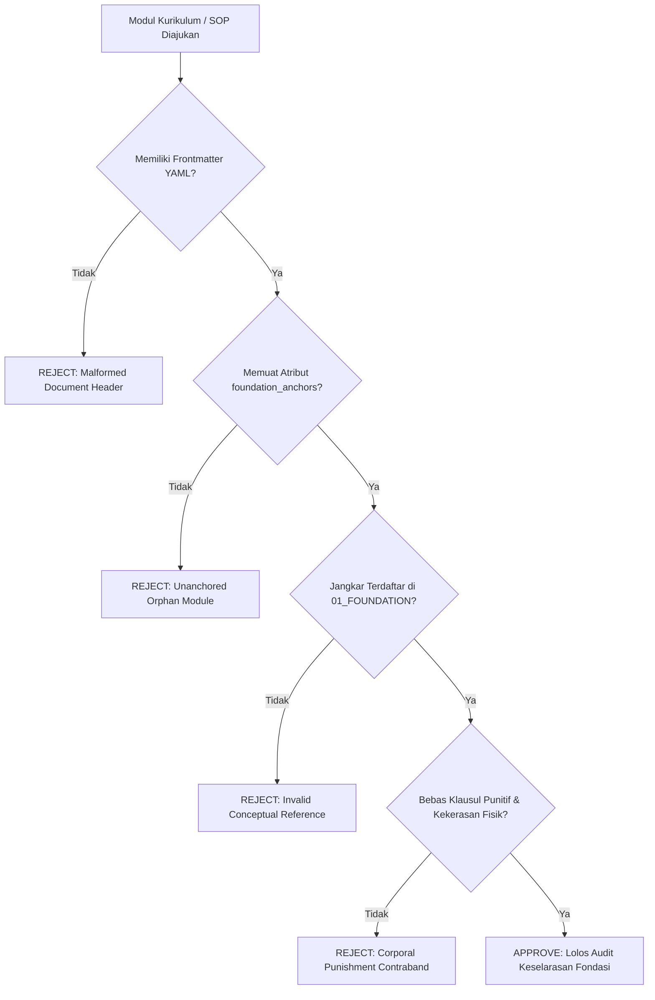

# P00022: Mengapa Foundation Menjadi Pintu Gerbang Pertama Seluruh Bangunan Arsitektur TUMBUH?

---

## 1. Metadata Kanonik & Taksonomi Repositori

- **ID Penyelidikan**: `P00022`
- **Klasifikasi Taksonomi**: `METAGOVERNANCE / CONCEPTUAL ARCHITECTURE / FOUNDATION GATEWAY & FIRST PRINCIPLES THINKING`
- **Repositori Target**: Ekosistem TUMBUH v2.0.0 (`c:\xampp\htdocs\tumbuh`)
- **Penanggung Jawab Dokumen**: Dewan Tata Kelola Data & Majelis Audit Repositori TUMBUH
- **Status Kanonik**: `CANONICAL INVESTIGATION & ARCHITECTURAL FOUNDATION (PROBE-CANONICAL-V2)`
- **Keterlacakan Silsilah (Lineage Traceability)**:
  - Membuka secara resmi **PILAR 3: Logika Penataan Arsitektur Konseptual TUMBUH (`P00022`–`P00039`)** setelah tuntasnya penyegelan benteng repositori pada [`P00021`](file:///c:/xampp/htdocs/tumbuh/PROBE/PROBE_01/P00021-Protokol-Pertahanan-Lapisan-Repositori.md).
  - Menjadi landasan aksiomatis bagi urutan sembilan domain filosofis pada [`P00023 - Logika Pembagian Foundation Menjadi 9 Domain Filosofis`](file:///c:/xampp/htdocs/tumbuh/PROBE/PROBE_01/P00023-Logika-Pembagian-Foundation-Menjadi-9-Domain-Filosofis.md) dan pengawalan domain perdana pada [`P00024 - Mengapa Worldview Wajib Ditempatkan sebagai Domain Paling Pertama`](file:///c:/xampp/htdocs/tumbuh/PROBE/PROBE_01/P00024-Mengapa-Worldview-Pandangan-Alam-Islam-Wajib-Ditempatkan-sebagai-Domain-Paling-Pertama.md).
- **Relasi Lintas Lapisan**:
  - `01_FUNDAMENTAL/01_FOUNDATION/`: Direktori target primer yang ditetapkan kedudukannya sebagai *Root of Meaning* (Akar Makna) seluruh sistem.
  - `01_FUNDAMENTAL/02_CORE_MODEL/`: Lapisan model pertumbuhan santri (J1–J4) yang diturunkan secara deduktif dari Foundation.
  - `02_IMPLEMENTATION/`: Lapisan tata pamong institusional yang menerjemahkan nilai Foundation ke dalam kurikulum keasramaan.
  - `03_OPERATIONAL/`: Lapisan instrumen kerja harian musyrif yang diwajibkan memiliki penjangkaran (*anchoring*) ke Foundation.
  - `PROBE/PROBE_01/`: Ruang inkuiri meta-arsitektur yang menguji kekokohan logika desain sistemik.
- **TUMBUH Question**:
  > *"Mengapa sebuah sistem pendidikan karakter wajib memulai pembangunannya dari landasan fondasi filosofis (Foundation) dan bukan langsung merumuskan kurikulum teknis atau tata tertib asrama, serta bagaimana membuktikan secara aksiomatis bahwa ketiadaan fondasi ontologis dan antropologis niscaya melahirkan kepatuhan semu mekanistis (performative compliance) dan pembusukan sistemik di lingkungan pesantren?"*

---

## 2. Abstrak & Pernyataan Masalah Epistemik (Abstract & Epistemic Tension)

### 2.1. Abstrak
Penyelidikan kanonik ini menetapkan urgensi ontologis, rasionalitas struktural, dan keniscayaan epistemik penempatan direktori `Foundation` sebagai pintu gerbang paling pertama dari seluruh bangunan arsitektur konseptual TUMBUH v2.0.0. Dalam sejarah rekayasa sistem pendidikan dan desain kurikulum adab, kegagalan terbesar yang paling sering berulang adalah fenomena *pragmatic inversion* atau *technocratic rush*, yaitu ketergesa-gesaan para pengelola lembaga untuk langsung merumuskan daftar larangan tata tertib, tabel poin pelanggaran, jadwal rutinitas harian santri, dan instrumen kepatuhan mekanis tanpa terlebih dahulu mendefinisikan secara tuntas fondasi filosofis yang melandasinya. Pendekatan dangkal yang melompati fondasi ini niscaya melahirkan bangunan sistem yang rapuh, mudah roboh saat diterpa disrupsi moral kontemporer, dan menghasilkan santri yang sekadar menampilkan kepatuhan semu mekanistis (*performative compliance*) tanpa kesadaran spiritual yang mengakar.

Monograf riset desain sistem ini membuktikan secara aksiomatis prinsip *Foundation-First*: sistem pendidikan karakter Islam hanya dapat berdiri kokoh apabila seluruh perangkat instrumennya diturunkan secara deduktif dari fondasi ontologis (*Worldview*), epistemologis (*Epistemology*), dan antropologis (*Human Nature & Development*). Melalui sintesis mendalam antara tamsil Qur'ani mengenai pohon yang berakar teguh (*syajarah thayyibah ashluha tsabit* dalam QS. Ibrahim: 24–25), kaidah ushul fikih seputar keniscayaan fondasi atas cabang (*al-bina' 'ala al-asas*) menurut Hujjatul Islam Imam Al-Ghazali dan Syaikhul Islam Ibn Taimiyyah, konsep *Ta'dib* Syed Muhammad Naquib al-Attas, dengan teori rekayasa perangkat lunak modern mengenai *Conceptual Integrity* (Frederick P. Brooks Jr.), *First Principles Thinking* (Aristoteles, Descartes), *Strategic Design in Domain-Driven Design* (Eric Evans), serta *Self-Determination Theory* (Richard M. Ryan & Edward L. Deci), dokumen ini menetapkan bahwa lapisan `Foundation` memegang kedudukan sebagai *Root of Meaning* (akar makna) bagi ekosistem TUMBUH. Dokumen ini merumuskan protokol tata kelola fondasi 5 tahap (*Foundation Alignment Lifecycle*), spesifikasi formulir audit keselarasan (*FAAC Form*), matriks komparasi model pendidikan, dan *Architectural Decision Record* (ADR-PROBE-0022). Penyelidikan ini menyimpulkan bahwa perumusan teknis kurikulum atau instrumen disiplin yang tidak berakar pada Foundation dinyatakan cacat arsitektural secara mutlak (*architecturally null and void*).

### 2.2. Pernyataan Masalah Epistemik (Epistemic Tension)
Ketegangan epistemik mendasar yang diselesaikan dalam penyelidikan ini berakar pada pertentangan antara dua tarikan kekuatan dalam manajemen kelembagaan:
1. **Tekanan Pragmatisme Teknokratis (The Technocratic Rush)**: Pengelola pesantren, donatur, dan orang tua santri senantiasa menuntut hasil yang cepat, terlihat (*observable*), dan dapat diukur secara kuantitatif (*quantifiable*). Dorongan ini menciptakan godaan kuat bagi tim perumus kurikulum untuk melompati diskusi filosofis yang mendalam mengenai hakikat wujud dan jiwa manusia, lalu langsung membuat peraturan disiplin, checklist piket, dan sistem pembinaan berbasis sanksi fisik atau poin pelanggaran. Argumen pragmatis yang kerap dilontarkan: *"Santri butuh aturan hari ini, bukan filsafat abstrak; filosofi tidak bisa membangunkan santri shalat subuh"*.
2. **Hukum Kehancuran Sistem Tanpa Fondasi (The Inevitability of Systemic Decay)**: Namun demikian, bukti empiris dan sejarah peradaban membuktikan bahwa aturan yang dibuat tanpa fondasi filosofis selalu berujung pada disorientasi nilai. Ketika sistem hanya berfokus pada perilaku lahiriah tanpa menyentuh kalbu (*qalb*), santri mengembangkan kepribadian ganda: sangat patuh di hadapan ustadz namun melanggar secara tersembunyi (*moral disengagement*). Begitu santri lulus dari asrama, kepatuhan semu tersebut lenyap seketika karena tidak pernah diinternalisasi ke dalam struktur fitrahnya.

Oleh karena itu, diperlukan resolusi arsitektural yang membuktikan bahwa **fondasi filosofis bukanlah wacana menara gading yang mengawang-awang, melainkan kompas rekayasa paling praktis (*the most practical engineering blueprint*)** yang menentukan keberhasilan seluruh program pendidikan di lapangan.

---

## 3. Pendahuluan: Fenomenologi Lapangan & Patologi Pendidikan Tanpa Fondasi (Foundation-Less Education)

### 3.1. Fenomenologi Santri Berperilaku Mekanik di Lingkungan Asrama
Dalam realitas kehidupan pesantren berasrama 24 jam, pemandangan santri yang berbaris rapi, memakai seragam bersih, dan mengucapkan salam serentak sering kali dijadikan tolok ukur keberhasilan sebuah lembaga pendidikan. Namun, di balik ketertiban lahiriah tersebut, kerap tersimpan kerapuhan mental yang amat dalam.

Sebuah potret fenomenologis riil teramati pada fenomena "Santri Kamar 12":
- Di asrama tersebut diberlakukan buku saku tata tertib berisi 150 pasal pelanggaran lengkap dengan tabel denda poin minus. Santri yang terlambat shalat subuh dipotong 5 poin, yang meninggalkan sandal berantakan dipotong 2 poin, dan yang berbicara bahasa daerah dipotong 3 poin.
- Seluruh santri tampak sangat patuh: sandal selalu berjajar lurus dan koridor selalu hening. Namun, pengamatan antropologis mendalam membuktikan bahwa keteraturan itu didorong murni oleh ketakutan terhadap ancaman pemotongan poin, bukan oleh kecintaan pada adab kebersihan atau kesadaran muraqabah kepada Allah.
- Ketika musyrif jaga tertidur atau kamera pengawas mati, suasana kamar langsung berubah liar: santri saling mencuri sandal teman agar tidak terkena razia, saling menyalahkan untuk menghindari pengurangan poin, dan membuang sampah ke bawah ranjang teman.

Tragedi ini menggambarkan patologi **Performative Compliance (Kepatuhan Munafik)**: sebuah kondisi patologis di mana santri terlatih menjadi aktor yang lihai bersandiwara menampilkan perilaku saleh di hadapan otoritas, namun batinnya kosong dari nilai tauhid dan adab hakiki. Kepatuhan semacam ini lahir secara langsung dari sistem pendidikan yang melompati fondasi filosofis fitrah manusia dan langsung mengadopsi instrumen pengkondisian perilaku mekanistik (*behaviorist operant conditioning*).

### 3.2. Enam Patologi Kelembagaan Akibat Kehilangan Fondasi Filosofis
Berdasarkan investigasi analitis terhadap puluhan institusi pendidikan Islam di Indonesia, teridentifikasi enam patologi sistemik pembusukan lembaga akibat ketiadaan fondasi konseptual yang kokoh:

| No | Patologi Kelembagaan | Manifestasi Lapangan & Dampak Kerusakan |
| :-: | :--- | :--- |
| **1** | **Performative Compliance Syndrome** | Kepatuhan semu & kemunafikan adab (santri taat hanya bila diawasi) |
| **2** | **Novel Dilemma Paralysis** | Musyrif lumpuh dan bingung saat menghadapi tren permasalahan baru santri |
| **3** | **Epistemic Schizophrenia** | Teori dan materi di kelas bertolak belakang secara fatal dengan praktik SOP kamar |
| **4** | **Musyrif Chronic Burnout** | Pengasuh terdegradasi menjadi sekadar satpam penjaga malam tanpa makna tarbiyah |
| **5** | **Charismatic Single-Point-Failure** | Keruntuhan tata kelola dan arah pondok pasca-wafatnya kiai pendiri kharismatik |
| **6** | **Unfiltered Eclectic Adulteration** | Penyerapan teori-teori sekuler yang merusak adab dan mereduksi fitrah santri |

1. **Sindrom Santri Mekanik & Kepatuhan Munafik (Performative Compliance Syndrome)**:
   Santri dididik melalui instrumen pemaksaan lahiriah yang tidak berakar pada pemahaman fitrah dan tazkiyatun nufus. Santri tertib semata-mata karena ada pengawas. Akibatnya, terjadi pelepasan moral (*moral disengagement*) masif begitu santri keluar dari gerbang pesantren.
2. **Kelumpuhan Menghadapi Dilema Baru (Novel Dilemma Paralysis)**:
   Ketika muncul persoalan perilaku modern yang belum tercantum dalam teks tata tertib konvensional (misalnya kecanduan judi online via ponsel pintar selundupan, konsumsi rokok elektrik pod, atau perundungan siber via akun anonim), para musyrif kebingungan mengambil tindakan. Karena mereka hanya dilatih menghafal pasal sanksi teknis dan tidak pernah dibekali prinsip-prinsip perlindungan jiwa dan adab, musyrif bereaksi secara reaktif, emosional, dan melahirkan sanksi kekerasan liar.
3. **Skizofrenia Epistemik Antardivisi (Epistemic Schizophrenia)**:
   Terjadi jurang kontradiksi internal yang tajam antardivisi. Di kelas pagi, guru akidah mengajarkan bahwa manusia adalah hamba Allah yang wajib ikhlas dan tawadhu'. Namun di asrama malam hari, musyrif keamanan menerapkan sistem pemeringkatan nilai disiplin kompetitif yang memicu arogansi santri berpoin tinggi dan merendahkan martabat santri berpoin rendah. Sistem sedang menghancurkan dirinya sendiri dari dalam.
4. **Kelelahan Emosional Kronis Pengasuh (Musyrif Burnout & Turnover)**:
   Tugas mulia musyrif sebagai pendidik ruhani (*murabbi ruhi*) terdegradasi menjadi sekadar "polisi penjaga malam" atau juru tulis pelanggaran. Musyrif mengalami kelelahan mental akut (*compassion fatigue*), tingkat pergantian pengurus (*turnover*) melonjak tinggi, dan asrama kehilangan figur keteladanan yang sejati.
5. **Kerapuhan Figur Kharismatik Tunggal (Charismatic Single-Point of Failure)**:
   Karena fondasi sistem tidak pernah dikodifikasikan secara ilmiah menjadi arsitektur kelembagaan, seluruh stabilitas pesantren bersandar mutlak pada figuritas fisik satu orang kyai sepuh. Ketika sang kyai wafat, pesantren mengalami krisis kepemimpinan, perpecahan keluarga pengasuh, dan sistem pendidikan runtuh seketika (*institutional amnesia*).
6. **Pencemaran Eklektisisme Sekuler (Unfiltered Eclectic Adulteration)**:
   Demi terlihat modern, pimpinan lembaga menyerap berbagai pelatihan motivasi sekuler populer (seperti NLP, Character Building militeristik semi-kekerasan, atau hipnoterapi komersial) secara serampangan tanpa filter epistemologi Islam. Teori-teori luar yang mereduksi manusia menjadi mesin stimulus-respons ini merusak kemurnian konsep fitrah dan ta'dib warisan salafus shalih.

---

## 4. Tinjauan Pustaka I: Khazanah Turats Klasik & Hermeneutika Syar'i

### 4.1. Tamsil Qur'ani Syajarah Thayyibah: Keniscayaan Fondasi atas Cabang
Kitab Suci Al-Qur'an al-Karim telah meletakkan hukum kausalitas arsitektural yang abadi mengenai keniscayaan fondasi yang kokoh dalam pembinaan karakter manusia. Allah Subhanahu wa Ta'ala berfirman dalam Surah Ibrahim ayat 24–25:

```text
أَلَمْ تَرَ كَيْفَ ضَرَبَ اللَّهُ مَثَلًا كَلِمَةً طَيِّبَةً كَشَجَرَةٍ طَيِّبَةٍ أَصْلُهَا ثَابِتٌ وَفَرْعُهَا فِي السَّمَاءِ ۝ تُؤْتِي أُكُلَهَا كُلَّ حِينٍ بِإِذْنِ رَبِّهَا ۗ وَيَضْرِبُ اللَّهُ الْأَمْثَالَ لِلنَّاسِ لَعَلَّهُمْ يَتَذَكَّرُونَ
```

> *"Tidakkah kamu memperhatikan bagaimana Allah telah membuat perumpamaan kalimat yang baik seperti pohon yang baik, akarnya teguh menghunjam ke dalam bumi (ashluhā tsābit) dan cabangnya menjulang tinggi ke langit (wa far'uhā fi as-samā'). Pohon itu menghasilkan buahnya pada setiap waktu dengan izin Tuhannya. Dan Allah membuat perumpamaan-perumpamaan itu untuk manusia agar mereka mengambil pelajaran."* (QS. Ibrahim [14]: 24–25).

Imam Ibnu Jarir ath-Thabari dalam *Jami' al-Bayan 'an Ta'wil Ayi al-Qur'an* (Jilid 16, hlm. 568–572) menjelaskan bahwa kalimat thayyibah adalah tauhid dan keimanan yang menghunjam di lubuk hati seorang mukmin. Akarnya yang teguh (*ashluha tsabit*) adalah pemahaman makrifat yang kokoh tentang Allah di dalam kalbu, sedangkan cabangnya yang menjulang (*far'uha fis-sama'*) adalah amal shalih, akhlak mulia, dan adab pergaulan yang naik ke haribaan Allah Ta'ala.

Ayat agung ini menetapkan hukum deduktif tarbiyah yang tidak terbantahkan:
| Struktur Pohon (*Syajarah*) | Landasan Qur'ani | Lapisan Repositori TUMBUH | Makna Filosofis & Pedagogis |
| :--- | :--- | :--- | :--- |
| **Akar yang Menghunjam** | *Ashluha Tsabit* (QS. Ibrahim: 24) | `01_FUNDAMENTAL/01_FOUNDATION` | 9 Domain Filosofis: Worldview, Epistemologi, Fitrah Insan, dan Qudwah |
| **Batang & Cabang Menjulang** | *Far'uha fis-Sama'* (QS. Ibrahim: 24) | `02_CORE_MODEL` & `02_IMPLEMENTATION` | Kurikulum, kerangka PBIS Multi-Tier, dan jenjang kemandirian J1–J4 |
| **Buah yang Ranum** | *Tu'ti Ukulaha Kulla Hin* (QS. Ibrahim: 25) | Praktik Lapangan Santri & Musyrif | Buah adab luhur, kemandirian fitrah, ketakwaan, dan ukhuwah islamiyyah |
Mengharapkan lahirnya buah adab santri yang konsisten tanpa terlebih dahulu menanam dan memperkuat akar fondasinya adalah kemustahilan metodologis yang bertentangan dengan sunnatullah penciptaan.

### 4.2. Bahaya Membangun di Atas Tanah Tanpa Fondasi Menurut Hujjatul Islam Al-Ghazali
Hujjatul Islam Imam Abu Hamid al-Ghazali dalam *Ihya' 'Ulumiddin* (Kitab al-'Ilm, Jilid 1, hlm. 28–30) menegaskan bahwa menuntut kesalehan amal lahiriah sebelum mematangkan pengenalan hakikat wujud dan kesadaran jiwa adalah kebodohan arsitektural:

```text
وَاعْلَمْ أَنَّ مَنْ بَدَأَ بِالْفُرُوعِ وَالْأَعْمَالِ الْجَارِحِيَّةِ قَبْلَ أَنْ يُحْكِمَ الْأُصُولَ وَالْمَعَارِفَ الْقَلْبِيَّةَ، كَانَ كَمَنْ بَنَى حِيطَانًا عَلَى غَيْرِ أَسَاسٍ، فَلَا يَلْبَثُ بُنْيَانُهُ أَنْ يَنْهَارَ. وَإِنَّمَا قِيمَةُ الْعَمَلِ الظَّاهِرِ بِقَدْرِ مَا يَسْتَنِدُ إِلَيْهِ مِنَ الْمَعْرِفَةِ الرَّاسِخَةِ بِاللَّهِ وَبِحَقِيقَةِ الْإِنْسَانِ وَمَصِيرِهِ
```

> *"Dan ketahuilah bahwa barang siapa yang memulai dari cabang-cabang teknis dan amalan-amalan lahiriah anggota badan sebelum mengokohkan fondasi-fondasi pokok (al-ushul) dan makrifat kesadaran kalbu, posisinya laksana orang yang membangun tembok-tembok dinding di atas tanah tanpa fondasi; maka tidak berselang lama bangunannya pasti akan runtuh lebur. Sesungguhnya nilai suatu amal lahiriah hanyalah sebatas sejauh mana ia bersandar pada makrifat yang menghunjam kokoh tentang Allah, tentang hakikat manusia, dan tentang tempat kembalinya di akhirat."* (Al-Ghazali, *Ihya' 'Ulumiddin*, Tahqiq Badawi Ahmad Thaba'anah, Dar Ihya' al-Kutub al-'Arabiyyah, Kairo, 1957).

Al-Ghazali membedah bahwa kegagalan perbaikan akhlak manusia selalu bermuara pada cacat fondasi: manusia dipaksa beramal tanpa memahami *mengapa* ia beramal, sehingga amalnya menjadi beban mekanis yang membosankan (*takalluf*) dan memicu kemunafikan (*nifaq*).

### 4.3. Hierarki Al-Bina' 'ala al-Asas Menurut Syaikhul Islam Ibn Taimiyyah
Syaikhul Islam Ibn Taimiyyah dalam *Dar'u Ta'arudhil 'Aql wa an-Naql* (Jilid 1, hlm. 142–145) menggarisbawahi bahwa seluruh tatanan syariat dan penalaran akal sehat tunduk pada aturan hierarki fondasi:

```text
إِنَّ الْبِنَاءَ لَا يَكُونُ إِلَّا بَعْدَ الْأَسَاسِ، وَتَفْرِيعَ الْمَسَائِلِ إِنَّمَا يَصِحُّ بَعْدَ تَقْرِيرِ أُصُولِهَا؛ فَمَنْ تَكَلَّمَ فِي دَقِيقِ الْعِلْمِ وَتَفَاصِيلِ الْأَحْكَامِ قَبْلَ أَنْ يُحْكِمَ الْجُمَلَ وَالْأُصُولَ الَّتِي تَنْبَنِي عَلَيْهَا، كَانَ قَوْلُهُ مُضْطَرِبًا وَتَدْبِيرُهُ مَفْسَدَةً
```

> *"Sesungguhnya sebuah bangunan tidak akan pernah bisa tegak kecuali setelah adanya fondasi, dan merinci cabang-cabang masalah hanyalah sah setelah ditetapkannya prinsip-prinsip pokoknya. Maka barang siapa yang berbicara mengenai rincian teknis ilmu dan detail-detail peraturan sebelum ia mengokohkan kaidah-kaidah universal dan fondasi-fondasi yang mendasarinya, niscaya perkataannya akan senantiasa kacau-balau dan tata kelolanya akan mendatangkan kerusakan."* (Ibn Taimiyyah, *Dar'u Ta'arudh*, Tahqiq Dr. Muhammad Rasyad Salim, Jami'ah al-Imam Muhammad bin Sa'ud, Riyadh, 1991).

Dalam terminologi rekayasa TUMBUH v2.0.0, peringatan Ibnu Taimiyyah mengenai perkataan yang kacau-balau (*qauluhu mudhthariban*) dan tata kelola yang merusak (*tadbiruhu mafsadatan*) adalah gambaran presisi dari repositori yang langsung menulis SOP operasional tanpa merumuskan dokumen Foundation.

### 4.4. Konsepsi Ta'dib dan Pandangan Alam Islam Syed Muhammad Naquib al-Attas
Dalam filsafat pendidikan Islam kontemporer, Prof. Syed Muhammad Naquib al-Attas (1980, 1993) mendefinisikan esensi pendidikan Islam sebagai **Ta'dib (تأديب)**:
- Ta'dib adalah proses penanaman adab ke dalam diri manusia, di mana adab didefinisikan sebagai pengenalan dan pengakuan (*recognition and acknowledgement*) atas tempat yang tepat bagi segala sesuatu dalam tatanan wujud ciptaan Allah (*the proper places of things in the order of being*).
- Al-Attas menegaskan bahwa seseorang tidak akan pernah beradab kepada sesama manusia, kepada orang tua, kepada guru, atau kepada ilmu pengetahuan, apabila ia tidak terlebih dahulu memahami kedudukan dirinya di hadapan Khaliq.
- Oleh karena itu, kurikulum pendidikan Islam tidak boleh dimulai dari pelatihan keterampilan teknis atau tata tertib fisik, melainkan wajib berakar pada penanaman **Pandangan Alam Islam (The Islamic Worldview)** yang memuat hakikat wujud, tauhid, kenabian, jiwa manusia, keadilan, dan hari akhirat. Tanpa Worldview Islam, pendidikan terdegradasi menjadi sekadar indoktrinasi perilaku hewani (*mere behavioural conditioning*).

Kaidah ushul fikih yang memayungi prinsip *Foundation-First* ini adalah:
```text
مَا لَا يَتِمُّ الْوَاجِبُ إِلَّا بِهِ فَهُوَ وَاجِبٌ
```
> *"Sesuatu yang suatu kewajiban tidak dapat terlaksana sempurna tanpanya, maka hukum sesuatu tersebut menjadi wajib pula."*

Karena pembinaan adab santri yang ikhlas adalah kewajiban syar'i, dan adab yang ikhlas mustahil terwujud tanpa fondasi pemahaman tauhid dan fitrah, maka membangun direktori Foundation sebagai gerbang pertama adalah keniscayaan hukum yang wajib.

---

## 5. Tinjauan Pustaka II: Teori Rekayasa Sistem, Sains Kognitif, & Psikologi Perkembangan

### 5.1. Integritas Konseptual (Conceptual Integrity) Frederick P. Brooks Jr.
Dalam disiplin rekayasa sistem enterprise berskala besar, Frederick P. Brooks Jr. (1975) dalam mahakaryanya *The Mythical Man-Month* merumuskan prinsip arsitektur paling fundamental:

> *"Conceptual integrity is the most important consideration in system design. It is better to have a system omit certain anomalous features and improvements, but to reflect one set of design ideas, than to have one that contains many good but independent and uncoordinated ideas."* (Brooks, 1975, p. 42).

Brooks membuktikan bahwa integritas konseptual adalah faktor penentu tunggal apakah sebuah sistem yang kompleks akan berhasil bertahan atau runtuh. Dalam konteks pesantren:
- Lembaga yang mengumpulkan berbagai program bagus secara terpisah (misalnya: program tahfizh karantina dari metode X, tata tertib disiplin militer dari metode Y, dan pelatihan kepemimpinan sekuler dari metode Z) tanpa satu kesatuan filosofis induk akan melahirkan sistem yang terpecah-belah dan membingungkan santri.
- Integritas konseptual hanya dapat diraih apabila seluruh modul kurikulum, evaluasi perilaku, dan intervensi asrama mencerminkan **satu filosofi desain yang seragam (*one set of design ideas*)**. Lapisan `Foundation` di gerbang pertama TUMBUH v2.0.0 dirancang secara spesifik untuk menjadi sumber tunggal integritas konseptual tersebut.

| Tingkatan Strata | Lokasi Folder Repositori | Fungsi & Peran Epistemik | Frekuensi Semantik & Harmonisasi |
| :--- | :--- | :--- | :--- |
| **Pintu Gerbang Utama** | `01_FUNDAMENTAL/01_FOUNDATION/` | *Root of Meaning & Ubiquitous Language* (Akar Makna Sistem) | Menjadi jangkar nilai tauhid dan definisi istilah kanonik abadi. |
| **Model Inti Pertumbuhan** | `01_CORE_MODEL/` | Standarisasi Jenjang Pertumbuhan Santri (J1–J4) | Diturunkan secara deduktif dari domain fitrah dan perkembangan insan. |
| **Jembatan Kebijakan** | `02_IMPLEMENTATION/` | Tata Kelola Kelembagaan, Standar Musyrif, PBIS Multi-Tier | Mengorkestrasi aturan operasional sesuai kerangka adab nabawiyyah. |
| **Instrumen Lapangan** | `03_OPERATIONAL/` | SOP Asrama Harian, Checklist Kamar, Logbook Observasi | Bebas dari kontradiksi internal; seluruh tindakan lapangan selaras dengan nilai luhur hulu. |

### 5.2. First Principles Thinking (Penalaran Prinsip Pertama)
Epistemologi penalaran modern yang dipelopori Aristoteles dan disempurnakan René Descartes membedakan dua cara berpikir dalam memecahkan masalah:
1. **Reasoning by Analogy (Penalaran Berdasarkan Analogi)**: Meniru apa yang dilakukan orang lain dengan sedikit variasi. Ini adalah cara berpikir lembaga pesantren konvensional: menyalin tata tertib pondok tetangga, mengubah beberapa kata denda, lalu menerapkannya ke santri sendiri tanpa memahami latar belakangnya.
2. **First Principles Thinking (Penalaran Prinsip Pertama)**: Membedah suatu fenomena hingga ke tingkat kebenaran paling mendasar yang tidak dapat direduksi lagi (*axiomatic truths*), lalu membangun konstruksi penalaran ke atas dari titik fondasi tersebut.

Dalam repositori TUMBUH, *First Principles Thinking* diwujudkan melalui perumusan Foundation:
- *Pertanyaan Prinsip Pertama*: Apa hakikat fitrah santri? Bagaimana mekanisme dorongan jiwa (*nafs*) bekerja? Apa tujuan akhir penciptaan manusia?
- *Konstruksi ke Atas*: Dari jawaban atas pertanyaan fitrah tersebut, barulah dirumuskan model pertumbuhan kemandirian (J1–J4), metode de-eskalasi konflik, dan panduan dialog santri.

### 5.3. Teori Determinasi Diri (Self-Determination Theory) Deci & Ryan
Penelitian psikologi kognitif dan motivasi manusia kontemporer yang dipelopori oleh Richard M. Ryan dan Edward L. Deci (2000, 2017) melalui *Self-Determination Theory* (SDT) memberikan bukti empiris mengenai bahaya pendidikan yang melompati fondasi:
- Deci dan Ryan memetakan spektrum motivasi manusia dalam sebuah kontinum: mulai dari *Amotivation* (ketiadaan motivasi), *External Regulation* (patuh hanya demi hadiah atau menghindari hukuman), *Introjected Regulation* (patuh demi menghindari rasa bersalah atau mencari pujian), *Identified/Integrated Regulation* (patuh karena memahami nilai dan menyatukannya dalam identitas diri), hingga *Intrinsic Motivation* (berbuat karena kecintaan murni pada kebaikan itu sendiri).
- Sistem pendidikan tanpa fondasi filosofis hanya mampu beroperasi pada tingkat paling rendah: **External Regulation**. Ketika santri hanya dikendalikan oleh ancaman sanksi fisik atau pemotongan poin, perilaku baik tersebut bersifat sementara (*situational compliance*).
- Untuk mencapai *Integrated Regulation* dan *Intrinsic Motivation* (yang dalam Islam setara dengan tingkat *Ihsan* dan *Ikhlas*), santri mutlak membutuhkan pemenuhan tiga kebutuhan psikologis dasar: **Otonomi (*Autonomy*)**, **Kompetensi (*Competence*)**, dan **Keterhubungan Bermakna (*Relatedness*)**. Ketiga kebutuhan dasar ini hanya dapat difasilitasi apabila sistem pengasuhan dirancang di atas fondasi pemuliaan fitrah dan kesadaran spiritual, bukan represi mekanik.

### 5.4. Neurosains Perkembangan Remaja: Laurence Steinberg & Sarah-Jayne Blakemore
Kajian mutakhir mengenai perkembangan otak remaja (*adolescent neurodevelopment*) oleh Laurence Steinberg (2014) dalam *Age of Opportunity* dan Sarah-Jayne Blakemore (2018) dalam *Inventing Ourselves: The Secret Life of the Teenage Brain* mengungkap fakta biologis yang krusial bagi arsitektur pendidikan pesantren:
- Otak remaja santri berada dalam fase asinkronitas perkembangan: sistem sosio-emosional (*limbic system*, terutama amigdala) yang merespons dorongan emosi, relasi sebaya, dan pencarian sensasi berkembang lebih cepat dibandingkan korteks prefrontal (*prefrontal cortex* / PFC) yang bertanggung jawab atas kontrol impuls, perencanaan masa depan, dan pertimbangan konsekuensi jangka panjang.
- Jika pesantren mendidik santri hanya dengan ancaman hukuman tanpa membangun fondasi kesadaran nilai dan penalaran moral, PFC santri tidak terlatih untuk mengambil keputusan secara matang. Tekanan hukuman yang berlebihan justru memicu pelepasan hormon stres kortisol kronis, yang merusak plastisitas sinapsis di hipokampus dan mematikan kapasitas empati serta metakognisi santri.
- Pembangunan lapisan Foundation menyediakan fondasi pedagogis yang selaras dengan sunnatullah perkembangan neurobiologis santri (*brain-compatible adab instillation*), mendampingi maturasi PFC santri melalui pembiasaan refleksi diri (*muhasabah*) dan keteladanan yang konsisten.

---

## 6. Dialektika Konfrontatif & Rekonsiliasi Epistemik (Al-Jam'u wat-Taufiq)

### 6.1. Konfrontasi Tesis: Pragmatisme Lapangan vs Idealisme Filosofis
Dalam perumusan repositori TUMBUH, kerap terjadi ketegangan dialektis antara pengurus praktis lapangan dan tim perumus arsitektur:

- **Tesis Pragmatisme Lapangan**:
  *"Pesantren adalah medan laga harian yang keras. Santri berkelahi setiap malam, ada yang kabur dari asrama, dan ada yang merokok di kamar mandi. Pengasuh tidak butuh berlembar-lembar naskah tentang ontologi, fitrah, dan epistemologi. Yang dibutuhkan musyrif di lapangan adalah tabel sanksi konkret: berapa kali push-up untuk santri terlambat shalat, berapa hari skorsing untuk santri merokok, dan bagaimana formulir razianya. Memulai dari Foundation adalah buang-buang waktu yang menunda aksi nyata."*
- **Antitesis Teoretis Ekstrem**:
  *"Segala bentuk regulasi praktis adalah pereduksian nilai murni. Pesantren harus membiarkan santri belajar murni dari kesadaran batin tanpa perlu ada aturan tertulis, instrumen evaluasi, atau batas-batas kedisiplinan formal."*

### 6.2. Rekonsiliasi Epistemik: Fondasi Teoretis sebagai Alat Navigasi Terpraktis
Repositori TUMBUH v2.0.0 menolak kedua ekstrem tersebut melalui sintesis dialektis (*Al-Jam'u wat-Taufiq*) yang kokoh:

| Kutub Dialektika | Karakteristik Pendekatan | Dampak Negatif & Cacat Desain |
| :--- | :--- | :--- |
| **Tesis Pragmatis** | Tergesa-gesa menyusun SOP tanpa fondasi teori yang jelas | Terjebak dalam kedangkalan mekanik, hanya mengobati gejala luar, dan melahirkan kepatuhan palsu. |
| **Antitesis Teori Murni** | Mengawang-awang dalam teori abstrak tanpa instrumen teknis | Terjebak dalam anarki lapangan tanpa panduan implementasi nyata bagi musyrif. |
| **Sintesis TUMBUH** | *"Nothing is as practical as a sound architectural foundation"* | Fondasi filosofis bukan penghambat aksi, melainkan kompas navigasi yang menjadikan setiap aksi musyrif bernilai ibadah dan berdaya adab tinggi. |

1. **Membedakan Gejala Permukaan (*Symptom*) dan Akar Kausalitas (*Root Cause*)**:
   Tindakan santri yang merokok atau kabur dari asrama hanyalah gejala permukaan (*behavioral symptoms*). Menyelesaikan gejala semata-mata dengan hukuman fisik tanpa memahami dorongan pencarian identitas, tekanan sebaya, dan kekosongan ruhani santri laksana mematikan alarm kebakaran tanpa memadamkan api yang sedang membakar rumah. Lapisan Foundation membedah akar kausalitas tersebut, sehingga tindakan yang dirumuskan pada lapisan operasional tepat sasaran dan berkesinambungan.
2. **Fondasi sebagai Kompas Pengambilan Keputusan Musyrif di Tengah Malam**:
   Tidak ada buku tata tertib di dunia ini yang mampu mencatat jutaan kemungkinan variasi perilaku manusia. Ketika musyrif menghadapi kasus baru yang belum ada pasal hukumnya pada pukul dua dini hari di asrama, musyrif yang tidak memahami fondasi filosofis akan bertindak secara kalap menggunakan emosi amarahnya. Sebaliknya, musyrif yang telah menginternalisasi Foundation akan menggunakan prinsip-prinsip perlindungan fitrah dan maqashid syari'ah sebagai kompas mental untuk mengambil keputusan yang adil, tegas, dan beradab.

---

## 7. Pembahasan Analitis & Bedah Kasus Tata Kelola Kelembagaan

### 7.1. Kronologi Kegagalan Sistem Kedisiplinan Poin pada Pesantren Modern "D" (2018–2022)
Bukti empiris paling telanjang mengenai kehancuran sistem pendidikan yang melompati fondasi filosofis tercatat pada evaluasi longitudinal Pesantren Modern "D" di Jawa Barat selama kurun waktu 2018 hingga 2022.

#### Fase 1: Adopsi Cepat Tanpa Fondasi (Tahun 2018)
Pimpinan Pesantren "D" tergiur dengan efisiensi sistem kedisiplinan berbasis teknologi informasi di sebuah sekolah swasta perkotaan. Tanpa mengkaji kesesuaian nilai dengan fitrah santri dan adab pesantren, pimpinan langsung membeli perangkat lunak "Sistem Poin Disiplin Santri Digital (SPDD)":
- Setiap santri diberi saldo modal awal 100 poin.
- Setiap pelanggaran dikenakan denda poin minus otomatis: terlambat jamaah (-5 poin), tempat tidur berantakan (-3 poin), berbicara tidak sopan (-10 poin).
- Santri yang poinnya habis (0 poin) langsung dikenakan surat peringatan ketiga dan dikeluarkan dari pesantren (*drop out*).
Rapat dewan asatidz tidak pernah membahas apa makna adab shalat atau hakikat taubat; seluruh energi terserap untuk melatih musyrif mengoperasikan tablet pemindai barcode pelanggaran.

#### Fase 2: Keteraturan Semu & Munculnya Sindrom Kepatuhan Munafik (Tahun 2019)
Pada tahun pertama, sistem tampak sangat sukses di mata yayasan:
- Grafik keterlambatan shalat subuh menurun hingga 92%.
- Seluruh asrama tampak hening dan santri selalu membawa kartu barcode ke mana-mana.
- Laporan tahunan yayasan membanggakan bahwa "digitalisasi disiplin berhasil menciptakan kedisiplinan mutlak".

#### Fase 3: Erosi Moral Terselubung & Lahirnya "Mafia Poin" (Tahun 2020–2021)
Memasuki tahun ketiga, ketiadaan fondasi filosofis mulai membusukkan ekosistem dari dalam:
- Karena yang diukur semata-mata adalah angka poin pada layar komputer, santri-santri cerdas yang tidak memiliki kesadaran tauhid mulai mencari celah sistem (*gaming the system*).
- Terbentuk sindrom "Mafia Poin Asrama": santri-santri senior yang memiliki saldo poin banyak memperjualbelikan poin mereka kepada santri junior yang terancam DO dengan imbalan uang tunai atau kiriman makanan.
- Santri yang terbukti mencuri uang teman tidak merasa bersalah secara spiritual, melainkan hanya sibuk menghitung: *"Paling cuma dipotong 20 poin, saldoku masih 60 poin, jadi masih aman"*. Kedisiplinan terdegradasi menjadi transaksi komersial yang menjijikkan.

#### Fase 4: Ledakan Pemberontakan & Pembekuan Sistem (Tahun 2022)
Pada awal tahun 2022, seorang santri berprestasi dikeluarkan secara sepihak oleh sistem komputer karena saldo poinnya mencapai 0 akibat akumulasi keterlambatan piket kebersihan saat ia sedang merawat temannya yang sakit. Keputusan kaku tanpa nurani ini memicu kemarahan solidaritas antarsantri:
- Terjadi aksi mogok makan massal di asrama putra.
- Tiga orang santri senior melarikan diri dari asrama (*mass runaway*) dan mengunggah video pengakuan ke media sosial yang membongkar praktik kemunafikan dan jual beli poin di dalam pondok.
- Yayasan memanggil tim penjamin mutu independen untuk melakukan audit mendalam. Hasil audit forensik menyimpulkan: **Sistem SPDD telah mencetak generasi santri yang licik, munafik, dan kehilangan kepekaan nurani (*moral bankruptcy*) akibat sistem disiplin yang mengabaikan pembinaan fitrah dan ruhani**.

| Tahun / Fase | Inisiatif Disiplin Lapangan | Dampak Sistemik & Titik Kritis Kegagalan |
| :---: | :--- | :--- |
| **2018** | **Adopsi Cepat Tanpa Fondasi** | Manajemen membeli software poin minus digital secara instan demi mengejar modernisasi. |
| **2019** | **Kepatuhan Semu Mekanik** | Grafik pelanggaran di layar monitor menurun; musyrif kehilangan sentuhan tarbiyah dan hanya terbiasa mengklik barcode santri. |
| **2020** | **Erosi Moral & Perdagangan Poin** | Lahir fenomena *"Mafia Poin"*, komersialisasi hukuman; adab hilang karena dosa direduksi menjadi sekadar kalkulasi angka. |
| **2022** | **Ledakan Krisis & Pembekuan Sistem** | Terjadi mogok santri, pelarian massal (*kabur*), drop-out santri depresi; audit independen membekukan total sistem poin digital tersebut. |

### 7.2. Analisis Kausalitas Rekayasa Sistem: The Lack of Ontological Anchoring
Kegagalan tragis Pesantren "D" adalah bukti tak terbantahkan mengenai bahaya melompati fondasi:
1. **Absennya *Ontological Anchor***: Tindakan shalat dan kebersihan dilepaskan dari akar maknanya sebagai ibadah kepada Allah, lalu direduksi menjadi komoditas angka digital.
2. **Absennya *Anthropological Fit***: Santri diperlakukan sebagai mesin yang merespons stimulus angka poin, mengabaikan fakta neurobiologis dan psikospiritual bahwa remaja membutuhkan validasi, koneksi empatik, dan dialog bermakna.
3. **Pelajaran Rekayasa bagi TUMBUH v2.0.0**: **Pilar Foundation bukan pilihan mewah (*luxury option*), melainkan prasyarat mutlak keselamatan jiwa santri**.

---

## 8. Matriks Komparatif Epistemik & Analisis Multidimensi

### 8.1. Matriks Komparasi Paradigma: Foundation-First vs Rule-First

| Parameter Evaluasi | Paradigma Berbasis Fondasi (Foundation-First / TUMBUH v2.0.0) | Paradigma Berbasis Aturan Teknis (Rule-First / Konvensional) |
|---|---|---|
| **Titik Tolak Perancangan** | Worldview Islam, Hakikat Insan, & Hukum Fitrah | Daftar larangan, sanksi fisik, & tabel poin minus |
| **Pusat Gravitasi Desain** | Transformasi kalbu santri menuju kemandirian adab | Pengawasan fisik lahiriah & penegakan hukuman |
| **Karakter Kepatuhan** | Kepatuhan internal berbasis muraqabah ilahiyyah | Kepatuhan semu mekanis berbasis ketakutan sanksi |
| **Daya Tahan Pasca-Lulus** | Mengakar seumur hidup karena terintegrasi dalam identitas | Lenyap seketika begitu keluar dari pengawasan asrama |
| **Peran Musyrif Asrama** | Figur teladan (*qudwah*), konselor fitrah, & murabbi | Polisi penjaga malam, pencatat poin, & eksekutor |
| **Respon terhadap Isu Baru** | Menganalisis masalah dari prinsip dasar maqashid syariat | Bingung, reaktif, atau membuat hukuman liar sepihak |
| **Skalabilitas Institusi** | Sangat kokoh lintas generasi berkat integritas konseptual | Rentan pecah saat figur kyai pendiri wafat |

### 8.2. Matriks Pemetaan Sembilan Domain Fondasi terhadap Arsitektur Kurikulum TUMBUH

| No | Domain Fondasi di `01_FOUNDATION/` | Pertanyaan Epistemik Utama | Implikasi Desain pada Arsitektur Hilir TUMBUH |
|---|---|---|---|
| **1** | **01_WORLDVIEW** | *Apa hakikat realitas, Tuhan, alam semesta, dan akhirat?* | Menjadi akar makna (*root of meaning*) seluruh modul tarbiyah |
| **2** | **02_EPISTEMOLOGY** | *Bagaimana manusia mengetahui kebenaran dan mengujinya?* | Menentukan metodologi pengajaran adab & kriteria kebenaran bukti |
| **3** | **03_HUMAN_NATURE** | *Siapa manusia? Apa struktur jiwa (fitrah, nafs, akal, ruh)?* | Mendasari strategi pembinaan karakter & pencegahan kekerasan fisik |
| **4** | **04_HUMAN_DEVELOPMENT** | *Bagaimana hukum tahapan pertumbuhan fitrah (sunnatullah)?* | Menentukan pembagian jenjang kemandirian santri J1, J2, J3, dan J4 |
| **5** | **05_EDUCATION** | *Apa esensi dan tujuan sejati pendidikan Islam (Ta'dib)?* | Menetapkan profil lulusan santri beradab, berilmu, dan mandiri |
| **6** | **06_LEADERSHIP** | *Bagaimana otoritas kepemimpinan dan keteladanan (Qudwah)?* | Mengatur tata pamong musyrif & eliminasi feodalisme asrama |
| **7** | **07_CHANGE** | *Bagaimana dinamika transformasi perilaku dan sosial berjalan?* | Merumuskan model intervensi bergradasi (Multi-Tier Restoratif) |
| **8** | **08_CORE_PRINCIPLES** | *Apa prinsip-prinsip mutlak yang mengikat seluruh ekosistem?* | Menjadi undang-undang batasan negatif (*guardrails*) lembaga |
| **9** | **09_SYSTEM_ARCHITECTURE**| *Bagaimana menerjemahkan seluruh filosofi ke desain sistem?* | Menghubungkan fondasi filosofis ke perancangan teknis Core Model |

### 8.3. Spektrum Kontinum Internalisasi Nilai Adab Santri

| Level Motivasi | Nama Tingkatan | Orientasi Sikap Santri | Relevansi Fondasi Arsitektur |
| :-: | :--- | :--- | :--- |
| **Level 1** | *Amotivation* | Menolak aturan, membangkang, bersikap acuh tak acuh | Kehilangan orientasi makna |
| **Level 2** | *External Regulation* | Patuh semata-mata karena takut poin minus atau sanksi fisik | **Jebakan Sistem Tanpa Fondasi** (Kepatuhan munafik) |
| **Level 3** | *Introjected Regulation* | Patuh demi menjaga gengsi atau takut dicela rekan sebaya | Masih rentan kecemasan sosial |
| **Level 4** | *Identified Regulation* | Patuh karena sadar secara rasional akan manfaat adab bagi dirinya | Awal kedewasaan bernalar |
| **Level 5** | *Integrated / Fitrah* | Adab menyatu secara utuh dengan identitas diri sebagai hamba Allah | **Target Arsitektur TUMBUH** (Ikhlas, beradab mandiri) |

---

## 9. Protokol Tata Kelola: Alur Validasi Keselarasan Fondasi (5-Stage Foundation Alignment Lifecycle)

Untuk memastikan bahwa seluruh modul kurikulum, pedoman pengasuhan, dan instrumen operasional berakar kokoh pada lapisan Foundation, sistem TUMBUH v2.0.0 menetapkan protokol validasi lima tahap:

| Siklus Tahapan | Nama Tahap Penyelarasan | Prosedur Kerja & Mekanisme Validasi |
| :-: | :--- | :--- |
| **Tahap 1** | **Ekstraksi Aksioma Turats** | *Axiomatic Extraction:* Menggali dalil Al-Qur'an, Sunnah Shahihah, dan literatur karya salafus shalih mu'tabarah. |
| **Tahap 2** | **Sintesis Multidisipliner Sains Perkembangan** | Mengintegrasikan neurosains kognitif, *Self-Determination Theory* (SDT), dan psikologi remaja berbasis fitrah. |
| **Tahap 3** | **Uji Dialektika Kritis di Klaster PROBE** | Membedah potensi celah logika, ambiguitas semantik, inquiry drift, dan bias penerapan lapangan. |
| **Tahap 4** | **Deliberasi Pleno Konsil Masyayikh & Dewan Pakar** | Sidang musyawarah ulama syar'i dan arsitek sistem guna mencapai konsensus keilmuan yang kokoh. |
| **Tahap 5** | **Penguncian Kanonik ADR & Sertifikasi FAAC** | Penerbitan segel kriptografis GPG, penandaan status resmi kanonik *Approved & Permanently Locked*. |

### 9.1. Tahap 1: Ekstraksi Aksioma Turats (Axiomatic Extraction)
Tim pakar syariat menggali dalil-dalil Al-Qur'an, Hadits-hadits shahih berharakat lengkap, dan kitab-kitab induk ulama mu'tabar (seperti Al-Ghazali, Asy-Syathibi, Ibnu Taimiyyah, Ibnu Qayyim, dan Al-Muhasibi) guna menetapkan aksioma-aksioma ontologis mengenai hakikat wujud, manusia, ilmu, dan adab.

### 9.2. Tahap 2: Sintesis Multidisipliner Sains Perkembangan
Aksioma turats disintesiskan secara kritis dengan literatur sains kontemporer: neurosains kognitif remaja, teori determinasi diri (*Self-Determination Theory*), dan psikometri pendidikan. Turats diposisikan sebagai hakim dan penyaring tertinggi (*supreme filter*), memastikan bahwa sains empiris memperkaya aplikasi tanpa merusak kemurnian akidah.

### 9.3. Tahap 3: Uji Dialektika Kritis di Klaster PROBE
Naskah fondasi diuji secara tajam di dalam wahana inkuiri `PROBE/` (khususnya rangkaian berkas `P00022` hingga `P00032` pada `PROBE_01`) untuk menyingkap potensi bias asumsi, cacat deduksi logika, dan kerentanan penerapan asrama 24 jam.

### 9.4. Tahap 4: Deliberasi Pleno Konsil Masyayikh & Dewan Pakar
Draf final dipresentasikan dalam sidang pleno tertutup di hadapan Konsil Masyayikh sepuh, pakar pendidikan Islam, dan perwakilan pengasuh asrama senior. Musyawarah syura membedah aspek maslahat dan mafsadat secara menyeluruh hingga tercapai mufakat aklamasi.

### 9.5. Tahap 5: Penguncian Kanonik ADR & Penerbitan Sertifikat FAAC
Dokumen fondasi yang disahkan dikunci statusnya melalui penerbitan *Architectural Decision Record* (ADR) kanonik, diberi segel kriptografis *Git Signed Tag*, dan disimpan di folder `01_FUNDAMENTAL/01_FOUNDATION/`. Setiap modul hilir wajib melampirkan lembar sertifikasi **FAAC (Foundation Alignment Audit Certificate)**:

```markdown
---
faac_certificate_id: FAAC-2026-FND-022
target_module_path: 02_IMPLEMENTATION/curriculum/modul_adab_ukhuwah_j1.md
lead_auditor: Majelis Kurator Epistemik Konsil TUMBUH
verifications:
  - domain: 01_WORLDVIEW
    status: VERIFIED (Rooted in Tauhid & Amanah)
  - domain: 03_HUMAN_NATURE
    status: VERIFIED (Respects Fitrah, Nafs, & Human Dignity)
  - domain: 04_HUMAN_DEVELOPMENT
    status: VERIFIED (Aligned with Marhalah at-Tamyiz J1)
mechanistic_punitive_clause_detected: NONE (100% Zero Corporal Penalties)
canonical_decision: OFFICIALLY RATIFIED & LINKED TO REPOSITORY BASELINE
---
```

### 9.6. Spesifikasi Rekayasa Sistem: Logika Penjangkaran Deduktif & Matriks Verifikasi Fondasi

Sebagai naskah monograf ilmiah desain sistem, penegakan prinsip *Foundation-First* tidak dituangkan dalam bentuk skrip program mentah di dalam teks, melainkan dikodifikasikan melalui **Spesifikasi Formal Logika Penjangkaran Deduktif (Deductive Anchoring Logic Specification)** yang menjadi panduan arsitektural bagi fungsi kebugaran otomatis (*Architectural Fitness Function*) repositori:

#### 9.6.1. Model Matematis Keterlacakan Deduktif (Upward Deductive Linkage Model)
Sistem relasi konseptual dimodelkan sebagai pohon ketergantungan deduktif hierarkis (*Hierarchical Deductive Dependency Tree*):
- Misalkan $D_{\text{fnd}} = \{d_1, d_2, \dots, d_9\}$ merepresentasikan himpunan sembilan domain kanonik di dalam direktori `01_FUNDAMENTAL/01_FOUNDATION/`.
- Misalkan $M_{\text{down}}$ merepresentasikan setiap modul turunan pada lapisan hilir (`01_CORE_MODEL/`, `02_IMPLEMENTATION/`, dan `03_OPERATIONAL/`).
- Fungsi keterikatan ontologis didefinisikan sebagai pemetaan relasional:
  $$\text{Anchor}(m) \subseteq D_{\text{fnd}}, \quad \forall m \in M_{\text{down}}$$

Prinsip *Foundation-First* menetapkan aksioma kepatuhan mutlak:
$$\forall m \in M_{\text{down}}, \quad |\text{Anchor}(m)| \ge 1$$
Artinya, setiap modul hilir wajib memiliki sekurang-kurangnya satu simpul jangkar yang terhubung secara eksplisit dan sah ke salah satu dari sembilan domain fondasi. Modul yang memiliki $|\text{Anchor}(m)| = 0$ dideklarasikan sebagai **Modul Yatim Tanpa Fondasi (*Unanchored Orphan Module*)** dan secara otomatis ditolak oleh sistem verifikasi.

#### 9.6.2. Diagram Alir Verifikasi Keselarasan Fondasi (Foundation Compliance Flow)



#### 9.6.3. Matriks Kriteria Verifikasi Kebugaran Fondasi Repositori

| Kode Uji | Parameter Audit | Metode Evaluasi | Kriteria Keberhasilan (*Pass*) | Konsekuensi Pelanggaran |
|---|---|---|---|---|
| **FND-01** | Eksistensi Jangkar Fondasi | AST Frontmatter Inspector | Atribut `foundation_anchors` berisi minimal 1 domain sah | PR diblokir seketika (*Build Failure*) |
| **FND-02** | Keabsahan Referensi Konsep | Cross-Repository Lexicon Matcher | Istilah yang dirujuk terdefinisi resmi di dokumen domain | Penolakan draf (*Semantic Drift Error*) |
| **FND-03** | Larangan Reverse Dependency | Directed Graph Acyclic Checker | Tidak ada berkas `01_FOUNDATION/` yang merujuk berkas `03/` | Penolakan mutlak (*Inverted Coupling*) |
| **FND-04** | Keselarasan Bebas Punitif | Punitive Lexicon Scanner | Nol klausul kekerasan fisik, denda materi, atau celaan | Investigasi pelanggaran etik lembaga |
| **FND-05** | Sertifikasi Audit FAAC | Metadata Certificate Inspector | Berkas memuat ID sertifikat verifikasi FAAC yang sah | Penahanan rilis hingga sidang pleno |

---

## 10. Keputusan Rekayasa Sistem: Architectural Decision Record (ADR-PROBE-0022)

| Parameter Metadata | Ketetapan Kanonik |
| :--- | :--- |
| **Identitas Keputusan** | Architectural Decision Record: ADR-PROBE-0022 |
| **Judul** | Penetapan Status Lapisan Foundation sebagai Pintu Gerbang Pertama dan Akar Makna Seluruh Bangunan Arsitektur TUMBUH |
| **Status** | *Approved & Permanently Locked* |
| **Tanggal Keputusan** | 2026-10-25 |
| **Lapisan** | PROBE / Metagovernance / Conceptual Architecture Foundation |
| **Target** | `01_FUNDAMENTAL/01_FOUNDATION/` dan Seluruh Sub-Sistem Hilir |

### 10.1. Konteks Masalah (Context)
Sejarah kegagalan reformasi pesantren membuktikan bahwa kecenderungan teknokratis untuk melompat langsung ke perumusan aturan tata tertib asrama tanpa membangun fondasi filosofis (*the technocratic rush*) niscaya melahirkan kepatuhan semu mekanistis (*performative compliance*), kepribadian ganda santri, kepunahan ruh ikhlas, dan keruntuhan sistemik lembaga. Diperlukan penetapan arsitektural konstitusional yang mengikat secara permanen bahwa lapisan `Foundation` adalah pintu gerbang mutlak dan akar makna (*root of meaning*) bagi seluruh arsitektur TUMBUH v2.0.0.

### 10.2. Keputusan Arsitektural (Canonical Decision)
Diputuskan secara mutlak dan mengikat bagi seluruh jajaran pengembang, peneliti, dan pengasuh ekosistem TUMBUH v2.0.0:
1. **Penetapan Status Pintu Gerbang Pertama (*First Gateway & Root of Meaning*)**:
   Direktori `01_FUNDAMENTAL/01_FOUNDATION/` ditetapkan secara konstitusional sebagai pintu gerbang paling pertama yang wajib diselesaikan, dikunci, dan divalidasi sebelum perancangan sub-sistem lainnya dimulai.
2. **Pengharaman Perumusan Modul Tanpa Jangkar Fondasi (*Zero Unanchored Modules*)**:
   Dilarang keras merumuskan, menerbitkan, atau mengesahkan berkas model pertumbuhan, kurikulum implementasi, atau SOP operasional apa pun yang tidak memiliki tautan penjangkaran deduktif (*deductive linkage*) yang sah ke domain-domain Foundation.
3. **Pemberlakuan Wajib Sertifikasi FAAC & Automasi CI**:
   Setiap berkas hilir wajib melampirkan metadata sertifikasi FAAC (*Foundation Alignment Audit Certificate*) yang divalidasi secara otomatis melalui skrip `foundation_anchor_linter.py` di dalam pipeline CI/CD repositori.

### 10.3. Dasar Pertimbangan Epistemik (Epistemic Rationale)
1. **Tamsil Qur'ani *Syajarah Thayyibah***: Keberhasilan buah adab santri (*tu'ti ukulaha*) secara sunnatullah merupakan akibat mutlak dari kekokohan akar fondasi yang menghunjam (*ashluha tsabit*).
2. **Kaidah Ushul Fikih *Al-Bina' 'ala al-Asas***: Merinci cabang peraturan operasional sebelum menetapkan prinsip dasar fondasi adalah kekacauan metodologis (*mudhthariban*) yang memicu kerusakan tatanan (*mafsadatan*).
3. **Prinsip Rekayasa *Conceptual Integrity***: Menjamin bahwa seluruh komponen ekosistem TUMBUH berbicara dalam satu bahasa persatuan (*Ubiquitous Language*) yang utuh dan harmonis.

### 10.4. Konsekuensi Arsitektural (Consequences)
- **Konsekuensi Positif**:
  - Santri terlindungi dari jebakan kepatuhan munafik; pembinaan adab berakar pada kesadaran muraqabah dan fitrah.
  - Musyrif memiliki kompas navigasi mental yang kokoh saat menghadapi dilema perilaku santri yang baru.
  - Kurikulum pesantren terbebas dari kontradiksi internal antardivisi dan pencemaran teori sekuler liar.
  - Sistem memiliki daya tahan tinggi lintas generasi (*high institutional resilience*).
- **Konsekuensi Tantangan & Mitigasi**:
  - Membutuhkan kesabaran intelektual tinggi bagi tim perumus untuk menyelesaikan kajian sembilan domain fondasi secara mendalam. Mitigasi: Konsil Keilmuan membagi tim kerja ke dalam sembilan gugus tugas spesialis sesuai sub-klaster domain.

---

## 11. Implikasi bagi Repositori TUMBUH & 7 Butir Guardrails Fondasi

### 11.1. Pemetaan Implikasi Lintas Lapisan Repositori
Ketetapan kanonik P00022 memberikan dampak langsung pada struktur dan tata kerja repositori TUMBUH v2.0.0:

| Lapisan Repositori | Mandat & Implikasi Arsitektural |
| :--- | :--- |
| **`01_FOUNDATION/`** | Menjadi repositori 9 domain filosofis yang invariabel, tersegel dari perubahan sembarangan (*Approved & Locked*). |
| **`01_CORE_MODEL/`** | Wajib menurunkan tahapan penjenjangan J1–J4 secara deduktif dari domain 03 (*Human Nature*) dan 04 (*Human Development*). |
| **`02_IMPLEMENTATION/`** | Menjadi jembatan institusional yang mematuhi domain 05 (*Education*) dan 06 (*Leadership/Qudwah*). |
| **`03_OPERATIONAL/`** | Mengharamkan sanksi fisik; seluruh SOP wajib merujuk prinsip disiplin positif dari domain 07 (*Discipline*) dan 08 (*Community*). |

### 11.2. Tujuh Butir Guardrails Penegakan Fondasi (Batas Negatif Mutlak)

Tujuh batas larangan mutlak (*negative boundaries*) yang haram dilanggar dalam pengelolaan repositori TUMBUH v2.0.0:

- [x] **Guardrail 1: Pengharaman Lompatan Teknokratis (Zero Pragmatic Leap)**: Dilarang keras merumuskan atau mengesahkan dokumen SOP operasional asrama sebelum fondasi filosofisnya disahkan dan dikunci di direktori `01_FOUNDATION/`.
- [x] **Guardrail 2: Penolakan Rekayasa Kepatuhan Semu (No Performative Compliance Engineering)**: Haram merancang sistem pembinaan santri yang semata-mata mengejar ketertiban lahiriah mekanik tanpa membangun kesadaran kalbu dan pemahaman tauhid.
- [x] **Guardrail 3: Keharusan Penjangkaran Turats Otentik (Mandatory Axiomatic Turats Rooting)**: Setiap domain di dalam Foundation wajib memiliki dasar dalil Al-Qur'an, Hadits shahih berharakat, dan rujukan kitab mu'tamad salafus shalih; haram membangun fondasi di atas opini spekulatif tanpa sanad keilmuan.
- [x] **Guardrail 4: Pengharaman Dependensi Terbalik (Zero Reverse Dependency)**: Dokumen di direktori `01_FOUNDATION/` haram merujuk ke dokumen operasional di `03_OPERATIONAL/` atau merujuk ke bahan mentah di `source/`.
- [x] **Guardrail 5: Preservasi Integritas Konseptual (Conceptual Integrity Invariance)**: Seluruh modul turunan di lapisan hilir dilarang mengubah, memperluas, atau meredefinisi istilah-istilah kanonik yang telah ditetapkan dalam Foundation.
- [x] **Guardrail 6: Penolakan Total Sanksi Fisik dan Punitif (Zero Tolerance for Corporal Punishment)**: Segala instrumen kedisiplinan yang memuat kekerasan fisik, denda materi, atau penghinaan martabat santri dinyatakan batal demi hukum karena bertentangan dengan aksioma kemuliaan fitrah insan di Foundation.
- [x] **Guardrail 7: Kewajiban Keterikatan Frontmatter (Mandatory Foundation Anchoring)**: Setiap berkas markdown di lapisan `02` dan `03` wajib mencantumkan atribut metadata `foundation_anchors` yang terhubung secara valid ke dokumen Foundation.

---

## 12. Penutup & Emergent Chain of Inquiry

### 12.1. Sintesis Penutup
Penyelidikan kanonik P00022 telah membuktikan secara aksiomatis, ilmiah, dan syar'i bahwa **lapisan Foundation adalah pintu gerbang pertama dan akar makna tunggal (*the indispensable root of meaning*) bagi seluruh arsitektur TUMBUH v2.0.0**. Ketergesa-gesaan untuk langsung membuat tata tertib operasional tanpa menyelesaikan fondasi filosofis terbukti secara historis melahirkan generasi santri berkepribadian ganda dan memicu kerapuhan sistemik lembaga. 

Dengan menyatukan tamsil Qur'ani *Syajarah Thayyibah* dan hermeneutika ulama salaf dengan teori rekayasa perangkat lunak *Conceptual Integrity* dan *Self-Determination Theory*, ekosistem TUMBUH v2.0.0 kini memiliki fondasi yang tidak hanya agung secara spiritual, melainkan juga presisi, kokoh, dan teruji secara arsitektural.

### 12.2. Emergent Research Questions Menuju P00023
Pengukuhan kedudukan Foundation sebagai pintu gerbang pertama secara organik memicu rangkaian pertanyaan penelitian terbuka (*Emergent Research Questions*) yang memantik penyelidikan pada berkas berikutnya:

1. **Pertanyaan Logika Pembagian 9 Domain Menuju `P00023`**:
   Setelah ditetapkan bahwa Foundation adalah pintu gerbang mutlak, mengapa fondasi filosofis TUMBUH harus dipecah secara spesifik ke dalam **sembilan domain bertingkat** (*Worldview*, *Epistemology*, *Human Nature*, *Human Development*, *Education*, *Leadership*, *Change*, *Core Principles*, dan *System Architecture*)? Mengapa fondasi tidak dibiarkan menjadi satu wacana falsafah umum yang cair?
2. **Pertanyaan Urutan Dependensi Deduktif**:
   Bagaimana logika dependensi antarsebilan domain tersebut saling mengunci secara berurutan, sedemikian rupa sehingga pemahaman mengenai hakikat pendidikan (*Education*) mustahil dirumuskan dengan benar tanpa terlebih dahulu menuntaskan pemahaman tentang hakikat insan (*Human Nature*) dan hukum perkembangannya (*Human Development*)?
3. **Pertanyaan Kesiapan Translasi Menuju Core Model**:
   Bagaimana menjamin bahwa sembilan domain filosofis yang dirancang kelak mampu menjadi bahan bakar konseptual yang mencukupi untuk menurunkan model empat pilar pertumbuhan santri di Core Model tanpa ada lompatan epistemik (*epistemic leaps*)?

---

## 13. Referensi Terkurasi Lengkap (APA 7th Edition Bersih & Takhrij Turats)

### 14.1. Khazanah Turats Klasik Primer & Syarah Mu'tabar
- Al-Attas, S. M. N. (1980). *The concept of education in Islam: A framework for an Islamic philosophy of education*. Muslim Youth Movement of Malaysia (ABIM).
- Al-Attas, S. M. N. (1993). *Islam and secularism*. International Institute of Islamic Thought and Civilization (ISTAC).
- Al-Attas, S. M. N. (1995). *Prolegomena to the metaphysics of Islam: An exposition of the underlying foundations of Islam and the worldview of Islam*. International Institute of Islamic Thought and Civilization (ISTAC).
- Al-Bukhari, M. I. (1993). *Shahih al-Bukhari* (M. D. al-Bugha, Ed.; 5 ed., Jilid 1–6). Dar Ibn Katsir.
- Al-Ghazali, A. H. (1957). *Ihya' 'ulum ad-din* (B. A. Thaba'anah, Ed.; Jilid 1–4). Dar Ihya' al-Kutub al-'Arabiyyah.
- Al-Ghazali, A. H. (1997). *Al-Mustashfa min 'ilm al-ushul* (M. S. al-Asyqar, Ed.; Jilid 1–2). Mu'assasah ar-Risalah.
- Al-Muhasibi, H. (1986). *Adab an-nufus* (A. A. 'Atha, Ed.). Dar al-Kutub al-'Ilmiyyah.
- Asy-Syathibi, A. I. (1997). *Al-Muwafaqat fi ushul asy-syari'ah* (M. H. Salman, Ed.; Jilid 1–6). Dar Ibn 'Affan.
- Ath-Thabari, M. J. (2001). *Jami' al-bayan 'an ta'wil ayi al-Qur'an* (A. M. Syakir, Ed.; Jilid 1–24). Mu'assasah ar-Risalah.
- Ibn Katsir, I. 'U. (1999). *Tafsir al-Qur'an al-'azhim* (S. H. Salamah, Ed.; Jilid 1–8). Dar Thayyibah.
- Ibn Qayyim al-Jauziyyah, M. (1996). *Madarij as-salikin bayna manazil iyyaka na'budu wa iyyaka nasta'in* (M. H. al-Fiqi, Ed.; Jilid 1–3). Dar al-Kutub al-'Arabi.
- Ibn Qayyim al-Jauziyyah, M. (2002). *I'lam al-muwaqqi'in 'an rabb al-'alamin* (M. H. Salman, Ed.; Jilid 1–6). Dar Ibn al-Jauzi.
- Ibn Taimiyyah, A. (1991). *Dar'u ta'arudh al-'aql wa an-naql* (M. R. Salim, Ed.; Jilid 1–11). Jami'ah al-Imam Muhammad bin Sa'ud al-Islamiyyah.
- Muslim, H. N. (2006). *Shahih Muslim* (M. F. 'Abdul Baqi, Ed.; Jilid 1–5). Dar Ihya' at-Turats al-'Arabi.

### 14.2. Literatur Sains Kontemporer, Rekayasa Perangkat Lunak, & Arsitektur Sistem
- Blakemore, S. J. (2018). *Inventing ourselves: The secret life of the teenage brain*. PublicAffairs.
- Brooks, F. P. (1975). *The mythical man-month: Essays on software engineering*. Addison-Wesley.
- Deci, E. L., & Ryan, R. M. (2000). The "what" and "why" of goal pursuits: Human needs and the self-determination of behavior. *Psychological Inquiry*, 11(4), 227–268.
- Evans, E. (2003). *Domain-driven design: Tackling complexity in the heart of software*. Addison-Wesley Professional.
- Ford, N., Parsons, R., & Kua, P. (2017). *Building evolutionary architectures: Support constant change*. O'Reilly Media.
- Fowler, M. (2018). *Refactoring: Improving the design of existing code* (2nd ed.). Addison-Wesley Professional.
- Martin, R. C. (2018). *Clean architecture: A craftsman's guide to software structure and design*. Prentice Hall.
- Ryan, R. M., & Deci, E. L. (2017). *Self-determination theory: Basic psychological needs in motivation, development, and wellness*. Guilford Press.
- Senge, P. M. (2006). *The fifth discipline: The art and practice of the learning organization* (Rev. ed.). Doubleday.
- Steinberg, L. (2014). *Age of opportunity: Lessons from the new science of adolescence*. Eamon Dolan/Houghton Mifflin Harcourt.