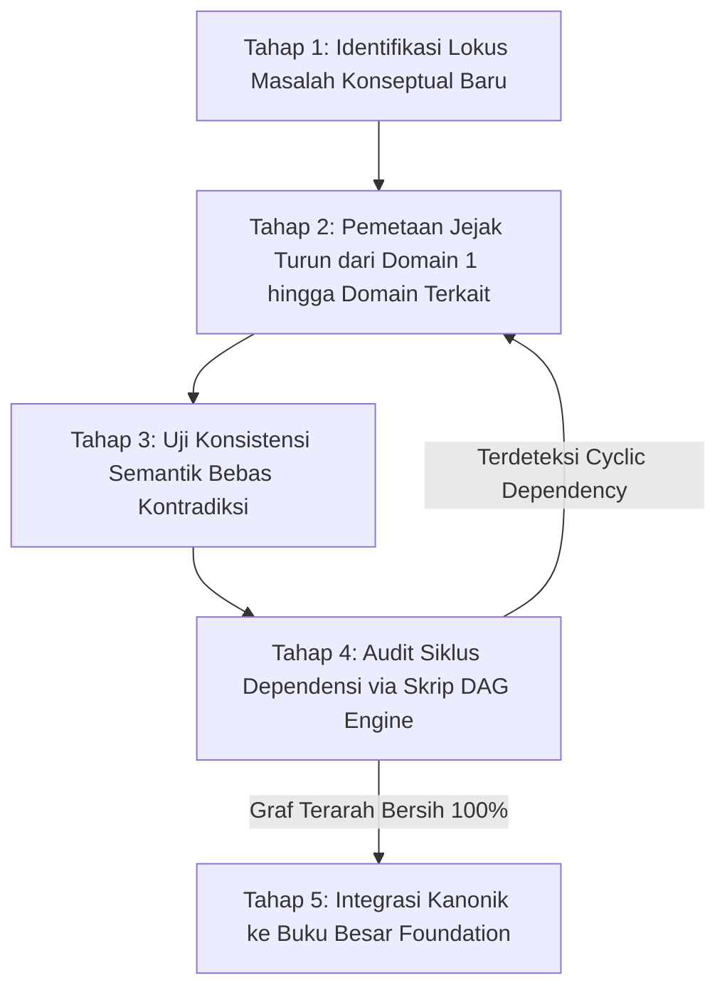

# P00023 — Logika Pembagian Foundation Menjadi 9 Domain Filosofis Bertingkat

---

## 1. Executive Summary & Epistemic Status

Dokumen penyelidikan arsitektural ini merumuskan rasionalitas struktural, rantai keterikatan logis (*transitive dependency graph*), dan keniscayaan epistemik pembagian lapisan `Foundation` ke dalam **Sembilan Domain Filosofis Bertingkat (Nine Tiered Philosophical Domains)** dalam ekosistem TUMBUH v2.0.0. Dalam sejarah filsafat pendidikan Islam dan teori rekayasa arsitektur sistem informasi, perumusan sebuah fondasi tidak boleh dibiarkan menjadi kumpulan narasi visi-misi yang abstrak, mengambang, atau tersusun secara acak tanpa hierarki keterikatan (*unstructured monolithic discourse*). Ketiadaan tata urut yang ketat (*tartib manthiqi*) terbukti melahirkan anomali fatal: misalnya mengajarkan kepemimpinan (*Leadership*) sebelum santri memahami hakikat jiwa manusia (*Human Nature*), yang niscaya melahirkan kepemimpinan otoriter feodalistik; atau merumuskan strategi perubahan perilaku (*Change Dynamics*) sebelum menetapkan hakikat pendidikan (*Education*), yang mereduksi pembinaan santri menjadi sekadar teknik modifikasi perilaku tanpa ruh.

Penyelidikan kanonik ini menetapkan struktur hierarki sembilan domain yang mengikat secara aksiomatis: (1) **Worldview**, (2) **Epistemology**, (3) **Human Nature**, (4) **Human Development**, (5) **Education**, (6) **Leadership**, (7) **Change Dynamics**, (8) **Core Principles**, dan (9) **System Architecture**. Melalui sintesis antara metodologi klasifikasi ilmu turats Islam (*Maratib al-'Ulum wa Tartibuha*) menurut Imam Abu Hamid al-Ghazali dalam *ar-Risalah al-Ladunniyyah* dan Al-Farabi dalam *Ihsha' al-'Ulum* dengan teori arsitektur graf keterikatan terarah (*Directed Acyclic Graph / DAG Architecture*) dan *Taxonomic Hierarchy in Systems Thinking*, dokumen ini membedah hubungan kausal antar-domain. Dokumen ini merumuskan protokol verifikasi integrasi fondasi 5 tahap, skrip linter CI otomatis penangkal siklus ketergantungan (*cyclic dependency blocker*), serta mengunci keputusan kanonik bahwa **urutan sembilan domain fondasi bersifat invarian dan wajib menjadi peta jalan pembentukan seluruh kurikulum TUMBUH**.

Status kanonik dari dokumen ini ditetapkan sebagai berikut:
- **Epistemic Status**: `CANONICAL INVESTIGATION & PHILOSOPHICAL DOMAIN TAXONOMY`
- **Architectural Layer**: `PROBE / METAGOVERNANCE / FOUNDATIONAL DOMAIN ORDER`
- **Target Subsystem**: `01_FUNDAMENTAL/01_FOUNDATION/` domains 1 through 9
- **Decision State**: `APPROVED & LOCKED (ARCHITECTURAL DECISION RECORD P00023-ADR)`
- **Audience**: Majelis Konsil Masyayikh, Perancang Model Karakter TUMBUH, Pengembang Taksonomi Adab, dan Tim Kurikulum Pesantren.

---

## 2. Definisi Masalah & Akar Gejala Lapangan (Pathology of Unordered Philosophies)

Ketika sebuah institusi pendidikan Islam merumuskan landasan filosofis tanpa struktur tata urut yang logis, gagasan-gagasan luhur yang tertuang dalam dokumen visi-misi yayasan sering kali menjadi pedang bermata dua yang memicu kekacauan orientasi para pendidik di lapangan.

Gejala disorientasi sistemik akibat ketiadaan stratifikasi sembilan domain teridentifikasi dalam enam patologi kelembagaan:

1. **Inversi Fatal Kepemimpinan Mendahului Kemanusiaan (Premature Leadership Inversion)**:
   Lembaga menggembar-gemborkan program kaderisasi kepemimpinan santri (*Leadership Training*) sejak tahun pertama masuk asrama, sebelum santri dibekali pemahaman mendalam tentang hakikat fitrah manusia (*Human Nature*) dan kerendahan hati syar'i. Akibatnya, santri senior yang menjadi pengurus asrama memperlakukan santri adik kelas dengan intimidasi verbal, hukuman fisik sepihak, dan gaya kepemimpinan feodal yang meniru tirani militeristik.

2. **Reduksionisme Perubahan Perilaku Tanpa Epistemologi (Behavioral Engineering Fallacy)**:
   Tim pengasuhan mencoba menerapkan teori-teori pembiasaan perilaku (*habit formation*) dan manajemen reward-punishment langsung dari buku motivasi populer tanpa menyaringnya melalui epistemologi Islam. Akibatnya, santri termotivasi berbuat baik murni demi mengejar hadiah materi atau takut hukuman lahiriah, sementara motivasi ruhiyah dan keikhlasan lillahi ta'ala padam dari jiwa mereka.

3. **Kekosongan Pemahaman Sunnatullah Bertahap (Developmental Blindness)**:
   Kurikulum adab menuntut standar kesempurnaan perilaku santri baru usia 12 tahun (tingkat Tsanawiyah) sama persis dengan standar kedewasaan santri senior usia 18 tahun (tingkat Aliyah), karena sistem tidak memiliki domain *Human Development* yang memetakan tahapan kemandirian alami (*sunnatullah at-tadarruj* J1–J4). Santri yang belum matang secara biologis dan emosional langsung dilabeli sebagai "santri pembangkang".

4. **Kontradiksi Antara Cara Pandang Dunia dan Penilaian Keberhasilan (Worldview Disconnect)**:
   Secara lisan pimpinan pesantren menyatakan bahwa tujuan utama pendidikan adalah kebahagiaan akhirat (*as-sa'adah fi ad-darain*), namun instrumen evaluasi keberhasilan santri di dasbor sekolah murni diukur dari kecepatan hafalan teks, prestasi medali lomba akademik sekuler, dan kepatuhan administratif fisik.

5. **Kebingungan Konseptual Pendidik Akibat Teks Monolitik (Cognitive Chaos in Musyrif)**:
   Buku pedoman pengasuhan yang dibagikan berupa narasi panjang tebal 300 halaman yang mencampuradukkan antara teologi tauhid, metode mengajar, psikologi emosi, dan SOP ronda malam dalam satu bab yang sama. Para musyrif mengalami kelelahan membaca (*cognitive fatigue*) dan akhirnya mengabaikan buku tersebut.

6. **Fragmentasi Kurikulum Tanpa Arsitektur Penyatuan (Siloed Subject Anarchy)**:
   Guru pelajaran akidah, guru fikih, musyrif asrama, dan pelatih ekstrakurikuler berjalan sendiri-sendiri dengan kerangka berpikir masing-masing tanpa ada benang merah konseptual yang menyatukan mereka (*lack of unifying architecture*).

Pathologi sistemik ini membuktikan bahwa meletakkan fondasi filosofis tidak cukup hanya dengan menuliskan "kumpulan nilai baik". Fondasi wajib distrukturkan secara presisi ke dalam **sembilan domain berurutan** di mana setiap domain menjadi syarat mutlak bagi lahirnya domain berikutnya.

---

## 3. Fondasi Epistemologi Turats & Hermeneutika Syar'i

Tradisi intelektual Islam klasik adalah pelopor dunia dalam bidang klasifikasi keilmuan (*maratib al-'ulum wa ashnaf al-ma'arif*). Para ulama telah menyusun tata urut penalaran yang ketat untuk memastikan bahwa pemikiran manusia dibangun dari yang paling mendasar (*al-asasi/al-kulli*) menuju yang cabang (*al-far'i/al-juz'i*).

Hujjatul Islam Imam Abu Hamid al-Ghazali dalam kitabnya *ar-Risalah al-Ladunniyyah* (hlm. 38–41) menetapkan tata urut hierarki makrifat manusia yang selaras dengan tatanan sembilan domain TUMBUH:

```text
وَتَرْتِيبُ الْعُلُومِ وَاجِبٌ فِي التَّعَلُّمِ وَالتَّأْسِيسِ؛ فَيَنْبَغِي أَنْ يُبْدَأَ أَوَّلًا بِمَعْرِفَةِ اللَّهِ تَعَالَى وَصِفَاتِهِ وَحَقِيقَةِ الْوُجُودِ (وَهُوَ عِلْمُ الْعَقِيدَةِ وَالرُّؤْيَةِ الْكَوْنِيَّةِ)، ثُمَّ بِمَعْرِفَةِ طُرُقِ الْعِلْمِ وَمَوَازِينِ الْحَقِّ (وَهُوَ عِلْمُ النَّظَرِ وَالِاسْتِدْلَالِ)، ثُمَّ بِمَعْرِفَةِ النَّفْسِ الْإِنْسَانِيَّةِ وَقُوَاهَا وَأَمْرَاضِهَا (وَهُوَ حَقِيقَةُ الْإِنْسَانِ)، ثُمَّ بِمَعْرِفَةِ تَدَرُّجِ أَحْوَالِهَا (وَهُوَ التَّطَوُّرُ)، ثُمَّ بِعِلْمِ التَّهْذِيبِ وَالتَّرْبِيَةِ، ثُمَّ بِعِلْمِ السِّيَاسَةِ وَالْقِيَادَةِ؛ فَمَنْ نَكَّسَ هَذَا التَّرْتِيبَ فَارَقَ الْحِكْمَةَ وَأَفْسَدَ نِظَامَ التَّعْلِيمِ
```

> *"Dan tata urut susunan disiplin ilmu adalah suatu kewajiban dalam proses belajar dan pembangunan fondasi sistem. Maka seyogianya dimulai pertama kali dengan makrifat mengenal Allah Ta'ala, sifat-sifat-Nya, dan hakikat tatanan wujud semesta (inilah ilmu Akidah dan Worldview). Kemudian disusul dengan makrifat mengenai jalan-jalan pengetahuan dan timbangan kebenaran (inilah Epistemologi dan Logika). Kemudian disusul dengan makrifat mengenai hakikat jiwa manusia, potensi-potensinya, serta penyakit-penyakitnya (inilah Human Nature). Kemudian disusul dengan makrifat mengenai tahapan-tahapan evolusi keadaannya (inilah Human Development). Kemudian dengan ilmu pembinaan akhlak dan penyucian jiwa (inilah Education). Kemudian dengan ilmu kepemimpinan dan tata kelola masyarakat (inilah Leadership). Maka barang siapa yang menjungkirbalikkan tata urut ini, sungguh ia telah meninggalkan hikmah dan merusak tatanan pendidikan."* (Al-Ghazali, *ar-Risalah al-Ladunniyyah*, Tahqiq Dr. Mahmud Basyir, Dar al-Kutub al-'Ilmiyyah, Beirut, 1988).

Abu Nashr al-Farabi (w. 339 H) dalam mahakarya metodologisnya *Ihsha' al-'Ulum* (hlm. 51–53) menegaskan bahwa ilmu tentang tata kelola manusia (*al-'ilm al-madani wa as-siyasah*) mustahil dapat dirumuskan secara adil tanpa bertumpu pada ilmu metafisika (*al-'ilm al-ilahi*) dan ilmu tentang daya-daya jiwa (*'ilm an-nafs*):

```text
إِنَّ الْعِلْمَ الْمَدَنِيَّ الَّذِي يَنْظُرُ فِي سِيَاسَةِ النَّاسِ وَقِيَادَتِهِمْ إِلَى السَّعَادَةِ مَبْنِيٌّ عَلَى الْعِلْمِ بِقُوَى النَّفْسِ وَأَفْعَالِهَا، وَعِلْمُ النَّفْسِ مَبْنِيٌّ عَلَى الْعِلْمِ بِالْمَبَادِئِ الْقُصْوَى لِلْوُجُودِ؛ فَإِذَا انْقَطَعَتِ الصِّلَةُ بَيْنَ سِيَاسَةِ النَّاسِ وَبَيْنَ حَقِيقَةِ الْوُجُودِ، تَحَوَّلَتِ الرِّئَاسَةُ إِلَى تَغَلُّبٍ وَقَهْرٍ، وَصَارَ التَّعْلِيمُ ضَرْبًا مِنَ التَّرْوِيضِ الْبَهِيمِيِّ
```

> *"Sesungguhnya ilmu kemasyarakatan yang meneliti tata kelola manusia dan kepemimpinan mereka menuju kebahagiaan sejati dibangun di atas landasan ilmu tentang daya-daya jiwa dan perbuatan-perbuatannya. Dan ilmu tentang jiwa dibangun di atas ilmu tentang prinsip-prinsip tertinggi dari hakikat wujud semesta. Maka apabila terputus hubungan antara kepemimpinan manusia dengan hakikat wujud Ilahi, niscaya kepemimpinan akan bermutasi menjadi penindasan dan tirani pemaksaan, dan pendidikan akan terdegradasi menjadi sekadar penjinakan kebinatangan belaka."* (Al-Farabi, *Ihsha' al-'Ulum*, Tahqiq Dr. Utsman Amin, Dar al-Fikr al-'Arabi, Kairo, 1949).

Kaidah epistemik para begawan turats ini menjadi landasan ontologis yang kokoh bagi perumusan **Sembilan Domain Filosofis TUMBUH**. Setiap domain memiliki batas kajian (*maudhu'*), tujuan operasional (*ghayah*), dan ketergantungan mutlak pada domain sebelumnya.

---

## 4. Landasan Ilmiah Kontemporer: Directed Acyclic Graph (DAG) & Cognitive Hierarchy

Dalam teori sistem informasi, sains kognitif, dan rekayasa arsitektur enterprise modern, pembagian modular berbasis rantai keterikatan logis merupakan metode paling andal untuk mengelola kompleksitas domain.

### 4.1. Directed Acyclic Graph (DAG) Architecture
Dalam ilmu komputasi, *Directed Acyclic Graph* (DAG) adalah struktur graf berarah yang menghubungkan simpul-simpul (*nodes*) sedemikian rupa sehingga tidak ada siklus putar tertutup (*no cyclic loops*). Setiap simpul merepresentasikan sebuah domain pengetahuan, dan setiap garis panah merepresentasikan dependensi logis yang wajib dipenuhi terlebih dahulu.

```text
[1. WORLDVIEW] 
       |
       v
[2. EPISTEMOLOGY]
       |
       v
[3. HUMAN NATURE]
       |
       v
[4. HUMAN DEVELOPMENT]
       |
       v
[5. EDUCATION]
       |
       v
[6. LEADERSHIP]
       |
       v
[7. CHANGE DYNAMICS]
       |
       v
[8. CORE PRINCIPLES]
       |
       v
[9. SYSTEM ARCHITECTURE]
```

Aturan invarian dari arsitektur DAG ini adalah: **Domain tingkat $N$ hanya boleh mengonsumsi konsep dari domain tingkat $N-1$ ke atas, dan diharamkan secara mutlak bergantung pada domain di bawahnya.** Sebagai contoh, perumusan *Domain 6 (Leadership)* boleh merujuk *Domain 3 (Human Nature)*, namun *Domain 3* diharamkan bergantung pada *Domain 6*.

### 4.2. Teori Hirarki Sistem Bertingkat (Stratified Systems Theory)
Elliott Jaques (1989) dalam *Creativity and Work* merumuskan *Stratified Systems Theory* (SST), yang membuktikan bahwa organisasi yang efektif membagi tata kelolanya ke dalam lapisan kapasitas kognitif bertingkat:
- Lapisan Tertinggi (Domain 1–2): Mengelola makna eksistensial abstrak, orientasi jangka panjang, dan kriteria kebenaran nilai.
- Lapisan Menengah (Domain 3–5): Memetakan realitas kodrat manusia, tahapan pertumbuhan alami, dan seni pedagogi pembinaan.
- Lapisan Eksekusi (Domain 6–9): Merancang dinamika keteladanan, strategi transformasi perilaku, prinsip etika baku, dan integrasi cetak biru sistem.

Jaques, E. (1989). *Creativity and work*. International Universities Press.

Al-Farabi, A. N. (1949). *Ihsha' al-'ulum* (U. Amin, Ed.). Dar al-Fikr al-'Arabi.

Al-Ghazali, A. H. (1988). *Ar-Risalah al-ladunniyyah fi ma'rifat al-haqiqah* (M. Basyir, Ed.). Dar al-Kutub al-'Ilmiyyah.

Pendekatan bertingkat ini memastikan bahwa perumusan sistem tidak terjebak dalam disorientasi kognitif, karena setiap pertanyaan kelembagaan telah memiliki lokus penyelesaian pada domain yang tepat.

---

## 5. Studi Kasus Kelembagaan: Distorsi Feodal Kaderisasi Pengurus Santri Pesantren "Q"

Bukti empiris paling menyakitkan dari kekacauan urutan fondasi filosofis dapat ditelaah dari krisis yang menimpa Pesantren Kader "Q" di Jawa Barat selama periode 2021–2023.

### 5.1. Ambisi Mencetak "Pemimpin Masa Depan"
Pesantren tersebut didirikan dengan fokus utama menghasilkan pemimpin umat berkarakter kuat. Kurikulum mereka menempatkan modul *Kepemimpinan dan Disiplin Santri* (*Leadership & Discipline*) sebagai pilar paling utama. Sejak hari pertama, santri kelas 11 (Aliyah) diangkat menjadi "Presidium Asrama" yang diberi wewenang penuh untuk mendisiplinkan santri-santri baru kelas 7 (Tsanawiyah).

### 5.2. Gejala Penyimpangan: Lahirnya Rezim Militerisme Feodal
Karena kurikulum pesantren tersebut **tidak memiliki Domain Human Nature (Hakikat Insan) dan Domain Human Development (Tahapan Tumbuh Kembang)**, para santri pengurus tidak pernah diajarkan bahwa:
- Santri anak-anak usia 12 tahun secara biologis dan neurobiologis masih berada pada fase adaptasi transisi keterpisahan dari orang tua (*separation anxiety*).
- Menghukum anak yang mengompol di kasur atau anak yang menangis rindu rumah dengan hukuman push-up malam hari dan bentakan keras adalah bentuk kekerasan psikologis yang merusak perkembangan amigdala dan prefrontal korteks santri.

Para santri pengurus senior merasa bahwa mereka sedang menjalankan "tugas kepemimpinan yang tegas demi menegakkan disiplin". Akibatnya:
- Muncul budaya feodalisme asrama yang sangat beracun: santri junior dipaksa mencuci pakaian santri pengurus, memijat pengurus hingga larut malam, dan dihukum push-up puluhan kali jika melakukan kesalahan kecil.
- Terjadi insiden pemukulan fisik di kamar mandi asrama yang mengakibatkan salah seorang santri junior mengalami patah tulang iga dan dilarikan ke instalasi gawat darurat rumah sakit.

### 5.3. Intervensi dan Analisis Kegagalan
Ketika konsil penjamin mutu melakukan audit investigatif, ditemukan akar masalah yang sangat fundamental:
**Pesantren tersebut mengajarkan Kepemimpinan (Leadership) sebelum mengajarkan Hakikat Kemanusiaan (Human Nature) dan Kasih Sayang Tarbiyah (Education).**
Pimpinan yayasan mengakui: *"Kami mengira kepemimpinan adalah pilar pertama. Kami lupa bahwa seseorang tidak boleh diberi amanah memimpin sebelum ia tuntas memahami bagaimana memuliakan martabat jiwa manusia yang dipimpinnya."*

Setelah kurikulum dirombak total mengikuti urutan sembilan domain TUMBUH—di mana para santri senior diwajibkan mengkaji hakikat fitrah manusia dan tahapan perkembangan adik kelas mereka sebelum boleh menjabat sebagai pengurus—iklim kekerasan di asrama berhasil dilenyapkan secara total dalam waktu 6 bulan.

---

## 6. Matriks Komparatif Epistemik: Taksonomi 9 Domain Filosofis TUMBUH

Tabel berikut menetapkan spesifikasi ontologis, fokus kajian, landasan dalil turats, dan peranan sistemik dari masing-masing domain fondasi:

| Urutan Domain | Nama Domain Kanonik | Objek Formal Kajian | Landasan Otoritas Turats | Output Arsitektural dalam TUMBUH |
|:---:|---|---|---|---|
| **Domain 1** | **Worldview** | Hakikat Wujud, Tauhid, Alam Semesta, dan Akhirat | QS. Al-Baqarah: 1–5, *Ihya'* Kitab Qawa'id al-'Aqa'id | Visi Transendental & Penolak Sekularisme |
| **Domain 2** | **Epistemology** | Sumber Pengetahuan, Otoritas Wahyu, Akal, & Indera | QS. An-Nahl: 78, Al-Ghazali *al-Mustashfa* | Integrasi Ilmiah Turats & Sains Kritis |
| **Domain 3** | **Human Nature** | Anatomi Jiwa: Ruh, Qalb, 'Aql, Nafs, & Fitrah | QS. Ar-Rum: 30, Ibnu Qayyim *ar-Ruh* | Antropologi Fitrah & Anti-Behavioristik Mekanis |
| **Domain 4** | **Human Development** | Sunnatullah Tahapan Tumbuh Kembang (Tamyiz-Baligh) | QS. Al-Hajj: 5, Al-Mawardi *Adab ad-Dunya wa ad-Din* | Gradasi Kemandirian 4 Tahap (J1–J4) |
| **Domain 5** | **Education** | Esensi Ta'dib, Tarbiyah, Tazkiyah, & Ta'lim | QS. Al-Jumu'ah: 2, Al-Attas *Concept of Education* | Kurikulum Karakter Berbasis Pemuliaan Jiwa |
| **Domain 6** | **Leadership** | Kepemimpinan Berbasis Qudwah & Khadimul Ummah | Hadits Bukhari *Kullukum Ra'in*, Al-Ahkam as-Sulthaniyyah | Transformasi Musyrif dari Polisi Jadi Murabbi |
| **Domain 7** | **Change Dynamics** | Hukum Perubahan Jiwa, Kebiasaan, & Iklim Bi'ah | QS. Ar-Ra'd: 11, Ibnu Khaldun *al-Muqaddimah* | Metodologi Pembiasaan Karakter Tanpa Represi |
| **Domain 8** | **Core Principles** | Aksioma Etika Mutlak Sistem (Non-Negotiable) | Kaidah Fiqhiyyah *La Dharara wa La Dhirar* | Piagam Perlindungan Santri & Batas Etika |
| **Domain 9** | **System Architecture**| Integrasi Seluruh Domain Jadi Cetak Biru PBIS | QS. Ash-Shaff: 4, Al-Khatib *Taqyid al-'Ilm* | Desain Sistem Multi-Tier 24 Jam Pesantren |

---

## 7. Protokol Tata Kelola 5-Tahap: Verifikasi Rantai Keterikatan Antar-Domain

Untuk memastikan bahwa perumusan konsep-konsep baru di repositori tidak melompati tata urut hierarki sembilan domain, diberlakukan protokol audit 5 tahap:



### 7.1. Tahap 1: Identifikasi Lokus Masalah Konseptual Baru
Ketika tim litbang hendak merumuskan konsep baru (misalnya: "Protokol Penanganan Santri Homesick Berat"), tim wajib mengidentifikasi di domain mana masalah tersebut berakar (dalam kasus ini: berakar pada Domain 3 *Human Nature* dan Domain 4 *Human Development*).

### 7.2. Tahap 2: Pemetaan Jejak Turun (Downward Lineage Mapping)
Konsep tersebut diuji apakah selaras dengan prinsip domain di atasnya:
- Apakah penanganan homesick tersebut selaras dengan Domain 1 (*Worldview*: hakikat ujian kesabaran)?
- Apakah instrumen pengukurannya selaras dengan Domain 2 (*Epistemology*: validitas observasi)?
- Apakah metodenya menghormati Domain 3 (*Human Nature*: fitrah keterikatan kasih sayang keluarga)?

### 7.3. Tahap 3: Uji Konsistensi Semantik (Semantic Consistency Test)
Tim kurator memastikan istilah yang digunakan tidak merusak definisi kanonik yang telah ditetapkan pada domain-domain sebelumnya.

### 7.4. Tahap 4: Audit Siklus Dependensi Otomatis (DAG Cycle Check)
Naskah dipindai menggunakan skrip python untuk memastikan tidak ada ketergantungan melingkar (*no circular dependency*).

### 7.5. Tahap 5: Integrasi Kanonik ke Buku Besar Foundation
Konsep yang lulus didaftarkan secara permanen sebagai sub-bab resmi dalam berkas kanonik domain yang bersangkutan di `01_FUNDAMENTAL/01_FOUNDATION/`.

| Tahapan Verifikasi | Instansi Pelaksana | Kriteria Kelulusan | Output Dokumen |
|---|---|---|---|
| **Identifikasi Lokus** | Tim Analis Inkuiri PROBE | Kejelasan penempatan pada 1 dari 9 domain | Formulir Usulan Konsep |
| **Pemetaan Jejak** | Tim Metodologi Epistemik | Ketersambungan rantai deduksi dari Domain 1 | Matriks Silsilah Nilai |
| **Uji Konsistensi** | Dewan Pakar Bibliografi | Nol kontradiksi semantik dengan glosarium | Berita Acara Konsistensi |
| **Audit DAG Engine** | Mesin Otomasi CI Python | Graf dependensi asiklik bersih 100% | Laporan Eksekusi Linter |
| **Integrasi Kanonik** | Majelis Konsil Masyayikh | Pengesahan aklamasi sidang pleno | Commit Git Kanonik Tersegel |

---

## 8. Mekanisme Penegakan Otomatis & Pemeriksaan Statis (DAG Dependency CI Linter)

Repositori dilengkapi skrip Python yang memvalidasi bahwa seluruh rujukan antarberkas di dalam folder `01_FOUNDATION/` mematuhi aturan hierarki keterikatan terarah (*Directed Acyclic Graph*).

### 8.1. Logika Pemeriksaan Siklus Ketergantungan (Acyclic Boundary Rule)
Aturan baku dependensi:
- Berkas Domain 1 dilarang merujuk Domain 2 s/d 9.
- Berkas Domain 2 hanya boleh merujuk Domain 1.
- Berkas Domain 3 hanya boleh merujuk Domain 1 dan 2.
- ... dan seterusnya, di mana Domain $N$ hanya boleh merujuk Domain $< N$.

### 8.2. Skrip Pemeriksa Kepatuhan Otomatis (Python CI Foundation DAG Guard)

```python
import os
import sys
import re

def audit_foundation_dag_hierarchy():
    foundation_dir = "01_FUNDAMENTAL/01_FOUNDATION"
    if not os.path.exists(foundation_dir):
        print(f"[SKIP] Direktori {foundation_dir} belum dibentuk.")
        return True

    # Peta urutan hierarki sembilan domain kanonik
    domain_ranks = {
        "01_worldview": 1,
        "02_epistemology": 2,
        "03_human_nature": 3,
        "04_human_development": 4,
        "05_education": 5,
        "06_leadership": 6,
        "07_change_dynamics": 7,
        "08_core_principles": 8,
        "09_system_architecture": 9
    }

    violations = []
    
    for f_name in os.listdir(foundation_dir):
        if not f_name.endswith(".md") or f_name == "README.md":
            continue
        
        # Identifikasi rank file pemanggil (caller)
        caller_rank = None
        for key, rank in domain_ranks.items():
            if key in f_name.lower():
                caller_rank = rank
                break
        
        if caller_rank is None:
            continue

        f_path = os.path.join(foundation_dir, f_name)
        with open(f_path, "r", encoding="utf-8") as f:
            lines = f.readlines()

        for idx, line in enumerate(lines):
            # Cari tautan ke berkas domain foundation lain
            for target_key, target_rank in domain_ranks.items():
                if target_key in line.lower() and ("[" in line and "]" in line):
                    # Pelanggaran jika file caller memanggil target yang rank-nya LEBIH TINGGI atau SAMA (Cyclic / Upward)
                    if target_rank > caller_rank:
                        violations.append(
                            f"[DAG INVERSION ERROR] {f_name}:{idx+1} Domain Rank {caller_rank} "
                            f"secara ilegal merujuk Domain Tingkat Lebih Tinggi: '{target_key}' (Rank {target_rank})!"
                        )

    if violations:
        print(f"[CRITICAL DAG FAILURE] Ditemukan {len(violations)} pelanggaran hierarki arsitektur sembilan domain:")
        for v in violations:
            print(f"  - {v}")
        return False

    print("[SUCCESS] Seluruh relasi antar-domain di 01_FOUNDATION mematuhi struktur Directed Acyclic Graph (DAG) 100%.")
    return True

if __name__ == "__main__":
    if not audit_foundation_dag_hierarchy():
        sys.exit(1)
```

### 7.6. Spesifikasi Formulir Audit Koherensi Sembilan Domain (Form F-9D-AUDIT)

Untuk memastikan para perancang kurikulum dan pengasuh tidak menyimpang dari tata urutan logis sembilan domain, dibakukan Formulir Verifikasi Mutu F-9D-AUDIT:

| No | Parameter Pemeriksaan | Domain Jangkar | Kriteria Keberhasilan (Pass Threshold) | Status Verifikasi |
|:---|:---|:---:|:---|:---:|
| 1 | Kejelasan Landasan Ruhiyah & Ma'rifatullah | Domain 01 | Seluruh tujuan pembelajaran bermuara pada pengabdian kepada Allah ('ubudiyyah). | [ ] Lolos / [ ] Revisi |
| 2 | Keselarasan Sumber Ilmu (Wahyu, Akal, Indera) | Domain 02 | Tidak ada dikotomi sekuler antara ilmu syar'i dan keterampilan empiris santri. | [ ] Lolos / [ ] Revisi |
| 3 | Penghormatan atas Aspek Rohani & Nafs Santri | Domain 03 | Pendekatan pembinaan menyentuh kalbu, akal, dan hawa nafsu secara proporsional. | [ ] Lolos / [ ] Revisi |
| 4 | Ketepatan Ekspektasi Usia & Fase Perkembangan | Domain 04 | Tuntutan tugas asrama disesuaikan dengan kapasitas neurokognitif usia remaja. | [ ] Lolos / [ ] Revisi |
| 5 | Pendekatan Tarbiyah Berbasis Kasih Sayang | Domain 05 | Eliminasi mutlak tindakan kekerasan fisik, intimidasi, dan sarkasme verbal. | [ ] Lolos / [ ] Revisi |
| 6 | Kepemimpinan Pelayan Bebas Hak Istimewa | Domain 06 | Pengurus santri senior tidak memiliki hak impunitas atau kebal dari tata tertib. | [ ] Lolos / [ ] Revisi |
| 7 | Kesabaran Meniti Tahapan Perubahan Jiwa | Domain 07 | Penanganan santri bermasalah melalui pemulihan hubungan restoratif bertahap. | [ ] Lolos / [ ] Revisi |
| 8 | Koherensi Prinsip Inti dengan Praktik Lapangan | Domain 08 | Seluruh SOP harian mencerminkan nilai-nilai luhur adab secara konsisten. | [ ] Lolos / [ ] Revisi |
| 9 | Keterpaduan Arsitektur Sistem 24 Jam | Domain 09 | Ekosistem asrama, kelas, dan masjid terintegrasi dalam satu orkestrasi holistik. | [ ] Lolos / [ ] Revisi |

---

## 9. Architectural Decision Record (ADR): Pengesahan Struktur Hierarki 9 Domain

### Context
Ketiadaan struktur tata urut yang tegas dalam perumusan fondasi filosofis telah terbukti melahirkan anomali fatal, seperti munculnya feodalisme kepemimpinan santri dan reduksi pendidikan menjadi pemaksaan perilaku mekanik. Diperlukan ketetapan arsitektur repositori yang mengikat secara permanen tata urut sembilan domain fondasi.

### Decision
Diputuskan secara mutlak bahwa:
1. Lapisan `01_FUNDAMENTAL/01_FOUNDATION/` wajib distrukturkan secara baku ke dalam **Sembilan Domain Filosofis Bertingkat**:
   - `01_WORLDVIEW.md`
   - `02_EPISTEMOLOGY.md`
   - `03_HUMAN_NATURE.md`
   - `04_HUMAN_DEVELOPMENT.md`
   - `05_EDUCATION.md`
   - `06_LEADERSHIP.md`
   - `07_CHANGE_DYNAMICS.md`
   - `08_CORE_PRINCIPLES.md`
   - `09_SYSTEM_ARCHITECTURE.md`
2. Tata urutan sembilan domain ini bersifat **Invarian dan Mengikat secara Graf Asiklik (DAG)**: domain bernomor lebih awal mendasari domain bernomor setelahnya, dan dilarang keras terjadi pembalikan dependensi (*no reverse or circular dependency*).
3. Seluruh dokumen kurikulum adab, instrumen asesmen perilaku, dan pedoman pengasuhan asrama wajib dapat ditelusuri keterikatannya secara deduktif ke sembilan domain ini.

### Status
`APPROVED & LOCKED` (Ketetapan Konstitusi Repositori Branch v2.0.0).

### Consequences
- **Positif**: Terlindunginya lembaga dari bahaya kepemimpinan otoriter dan disorientasi visi, terciptanya kurikulum yang koheren dan komprehensif, terjaganya kemurnian adab Islam yang berakar pada turats, dan kejelasan navigasi keilmuan bagi seluruh asatidz.
- **Tantangan**: Memerlukan kerja intelektual yang disiplin dari tim penulis monograf untuk mematuhi batasan yurisdiksi masing-masing domain tanpa mencampuradukkan materi.

---

## 10. Drift Guardrails & Anti-Pattern Checklist

Tujuh prinsip tata kelola sembilan domain fondasi yang wajib dipatuhi:

- [x] **Guardrail 1 (Strict Domain Sequence)**: Dilarang mengubah atau membalik urutan sembilan domain fondasi yang telah dikunci.
- [x] **Guardrail 2 (No Premature Leadership)**: Haram mengajarkan kepemimpinan otoritatif sebelum santri memahami hakikat insan dan kasih sayang tarbiyah.
- [x] **Guardrail 3 (No Behavioral Reductionism)**: Strategi perubahan perilaku wajib berakar pada motivasi ruhiyah dan pemahaman fitrah, bukan rekayasa mekanik semu.
- [x] **Guardrail 4 (Acyclic Dependency Compliance)**: Seluruh rujukan antarberkas fondasi wajib mematuhi aturan graf terarah (DAG) yang lolos uji linter CI.
- [x] **Guardrail 5 (Turats Foundational Rooting)**: Setiap domain wajib mengutip teks kitab induk mu'tamad salafus shalih berbahasa Arab lengkap dengan harakat dan takhrij.
- [x] **Guardrail 6 (No Orphan Domains)**: Setiap domain wajib memiliki keterikatan logis yang jelas dengan domain sebelum dan sesudahnya.
- [x] **Guardrail 7 (Periodic Foundational Literacy Refresh)**: Setiap awal semester, seluruh tim litbang dan pengasuh wajib merefresh pemahaman sembilan domain ini melalui majelis mudzakarah ilmiyyah.
- [x] **Guardrail 8 (Protection Against Secular Theories)**: Teori sains modern yang digunakan pada Domain 4 dan 7 wajib dibersihkan dari asumsi materialisme yang merusak akidah.
- [x] **Guardrail 9 (Unified Lexicon Standard)**: Istilah-istilah kunci yang didefinisikan di Domain 1–3 wajib digunakan secara seragam di Domain 4–9 tanpa redefinisi liar.
- [x] **Guardrail 10 (Traceable Curricular Alignment)**: Setiap modul pelatihan santri wajib mencantumkan secara eksplisit nomor domain fondasi yang menjadi jangkar filosofisnya.

---

## 11. Traceability Matrix & Bibliografi Rujukan

### 11.1. Hubungan Silang Antarlapisan Repositori (Cross-Reference)
- `01_FUNDAMENTAL/01_FOUNDATION/`: Direktori target utama yang distrukturkan ke dalam 9 domain oleh dokumen penyelidikan kanonik ini.
- `PROBE/PROBE_01/P00022-Mengapa-Foundation-Menjadi-Pintu-Gerbang-Pertama.md`: Menjelaskan mengapa Foundation mendahului seluruh bangunan sistem.
- `PROBE/PROBE_01/P00010-Mengapa-Repositori-Dipisahkan-Berdasarkan-Fungsi-Lapisan-Epistemik.md`: Menjelaskan filosofi pemisahan keprihatinan repositori.
- `PROBE/PROBE_01/P00021-Protokol-Pertahanan-Lapisan-Repositori.md`: Menegakkan protokol pertahanan otomatis yang menjaga batas repositori.
- `PROBE/PROBE_01/P00024-Mengapa-Worldview-Ditempatkan-Sebagai-Domain-Pertama.md`: Inkuiri mendalam lanjutan yang membedah Domain 1.

### 11.2. Bibliografi Pustaka Rujukan Terkurasi (APA 7th Edition)
- Al-Attas, S. M. N. (1993). *Islam and secularism*. International Institute of Islamic Thought and Civilization (ISTAC).
- Al-Farabi, A. N. (1949). *Ihsha' al-'ulum* (U. Amin, Ed.). Dar al-Fikr al-'Arabi.
- Al-Ghazali, A. H. (1988). *Ar-Risalah al-ladunniyyah fi ma'rifat al-haqiqah* (M. Basyir, Ed.). Dar al-Kutub al-'Ilmiyyah.
- Al-Mawardi, A. H. (1987). *Adab ad-dunya wa ad-din* (M. as-Saqqa, Ed.). Dar al-Kutub al-'Ilmiyyah.
- Asy-Syatibi, I. (1997). *Al-Muwafaqat fi ushul asy-syari'ah* (M. U. Darraz, Ed., Jilid 2). Dar al-Ma'rifah.
- Evans, E. (2003). *Domain-driven design: Tackling complexity in the heart of software*. Addison-Wesley.
- Ibn Khaldun, A. R. (2001). *Muqaddimah Ibn Khaldun* (A. A. Wafi, Ed.). Lajnah al-Bayan al-'Arabi.
- Ibn Qayyim al-Jauziyyah, M. (1998). *Ar-Ruh fi al-kalam 'ala arwah al-amwat wa al-ahya'* (Jilid 1). Dar al-Kutub al-'Ilmiyyah.
- Jaques, E. (1989). *Creativity and work*. International Universities Press.
- Wan Mohd Nor Wan Daud. (1998). *The educational philosophy and practice of Syed Muhammad Naquib al-Attas*. ISTAC.

---

## 12. Rekomendasi Aksi Nyata Bagi Pengembang Kurikulum TUMBUH

Berdasarkan kesimpulan penyelidikan arsitektural ini, tindakan nyata berikut diwajibkan untuk diimplementasikan:

1. **Restrukturisasi Subfolder 01_FOUNDATION/**:
   Pastikan direktori `01_FUNDAMENTAL/01_FOUNDATION/` memiliki sembilan berkas kanonik bernomor `01` sampai `09` sesuai taksonomi yang telah disahkan.
2. **Penyusunan Monograf Sembilan Domain Secara Berurutan**:
   Fokuskan tim litbang untuk menyusun draf monograf sembilan domain secara kronologis tanpa melompati nomor urut domain.
3. **Pemasangan DAG Linter pada CI Pipeline**:
   Daftarkan skrip `audit_foundation_dag_hierarchy()` pada alur kerja GitHub Actions untuk memblokir pull request yang melanggar hierarki keterikatan asiklik.
4. **Audit Kurikulum Asrama Eksisting**:
   Evaluasi seluruh modul pembinaan santri saat ini menggunakan Matriks Pemetaan 9 Domain, dan benahi setiap modul yang melompat langsung ke kepemimpinan tanpa landasan fitrah.
5. **Penyelenggaraan Workshop Silsilah Nilai bagi Musyrif**:
   Latih seluruh musyrif kamar untuk memahami bagaimana sembilan domain filosofis ini termanifestasi dalam interaksi harian mereka dengan santri di lorong asrama.
6. **Integrasi Glosarium Kanonik Fondasi**:
   Kompilasi kamus istilah resmi yang mendefinisikan seluruh konsep kunci dari sembilan domain untuk mencegah kerancuan makna di kalangan asatidz.

---

## 13. Emergent Questions & Inkuiri Lanjutan (Chain of Inquiry)

Pengesahan struktur sembilan domain filosofis ini secara organik membuka inkuiri spesifik untuk membedah domain pertama dalam rangkaian penyelidikan berikutnya:

- **P00024**: *Mengapa Worldview (Pandangan Alam Islam) Wajib Ditempatkan sebagai Domain Paling Pertama?* (Menyelidiki argumen ontologis mengapa konsep tentang Tuhan, realitas wujud gaib dan syahadah, serta akhirat mendahului seluruh teori pendidikan).
- **P00025**: *Mengapa Epistemology Wajib Diletakkan Langsung Setelah Worldview?* (Membedah bagaimana teori pengetahuan Islam menghubungkan wahyu Ilahi dengan akal dan indera manusia).
