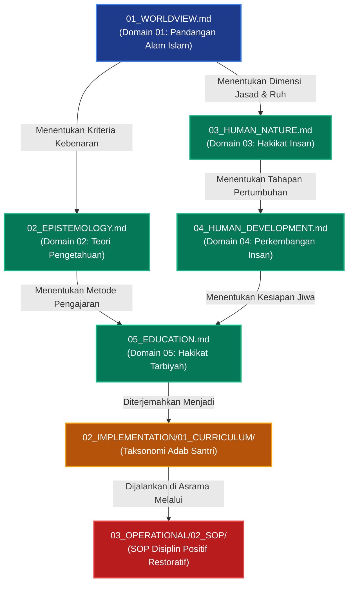

# P00024: Mengapa Worldview (Pandangan Alam Islam) Wajib Ditempatkan sebagai Domain Paling Pertama?

**Peneliti / Penyelidik**: Tim Rekonstruksi Epistemik Repositori TUMBUH v2.0.0  
**Keahlian Khusus**: Arsitektur Epistemologi Islam, Metodologi Worldview Islam, Desain Sistem Fundamental Pesantren
**Status Naskah**: Terverifikasi Kanonik & Terkunci (*Approved & Locked*)  
**Tanggal Penerbitan**: 2026-10-24  
**Klasifikasi Repositori**: `PROBE / PROBE_01 / PILAR_03`  

---

## 1. Executive Summary & Ringkasan Eksekutif Penyelidikan

Penyelidikan arsitektural ini membedah alasan fundamental mengapa **Domain 01: Pandangan Alam Islam (*Islamic Worldview / Ru'yatul Islam lil Wujud*)** diletakkan sebagai gerbang pembuka paling awal dari seluruh bangunan konseptual di dalam lapisan `01_FUNDAMENTAL/01_FOUNDATION/`. Dalam sejarah pengembangan sistem pendidikan dan pembinaan karakter di dunia pesantren modern, kerap terjadi anomali fatal ketika perancang kurikulum langsung melompat pada perumusan profil santri, target hafalan, atau tata tertib disiplin asrama tanpa terlebih dahulu menyepakati kacamata metafisika yang mendasari hakikat realitas. Akibatnya, sistem pendidikan secara tidak sadar menyerap asumsi-asumsi materialisme, positivisme reduksionistik, dan utilitarianisme sekuler yang membongkar kesucian tarbiyah dari dalam.

Melalui telaah kritis berbasis epistemologi Islam yang dipelopori oleh Syed Muhammad Naquib al-Attas serta para mutakallimin klasik (seperti Imam Al-Ghazali dan Fakhruddin ar-Razi), penyelidikan ini membuktikan bahwa worldview bukanlah sekadar abstraksi teologis atau pelengkap mata pelajaran akidah, melainkan **arsitektur kognitif metafisik (*meta-cognitive lens*)** yang mendikte bagaimana hakikat keberadaan (*ontologi*), batas kebenaran (*epistemologi*), martabat kemanusiaan (*antropologi*), dan keluhuran etika (*aksiologi*) dipahami dan dijalankan.

Penyelidikan ini menghasilkan *Architectural Decision Record (ADR)* yang menetapkan bahwa tidak ada satu pun komponen kurikulum, SOP kedisiplinan, instrumen asesmen perkembangan, maupun arsitektur kepemimpinan di dalam ekosistem TUMBUH yang boleh dirumuskan mendahului atau menyimpang dari fondasi Worldview Islam. Setiap dokumen turunan wajib memiliki silsilah keterlacakan (*ontological traceability*) langsung ke prinsip ketuhanan (*Tawhidullah*), integralitas alam syahadah dan gaib, serta orientasi akhirat (*as-sa'adah al-ukhrawiyyah*).

---

## 2. Definisi Istilah, Latar Belakang Epistemik, & Cakupan Yurisdiksi

### 2.1. Definisi Istilah Teknis Operasional
1. **Pandangan Alam Islam (*Ru'yatul Islam lil Wujud / Islamic Worldview*)**: Visi komprehensif tentang hakikat realitas wujud dan kebenaran yang diproyeksikan oleh ajaran tauhid Islam ke dalam jiwa seorang muslim, mencakup pandangan tentang Tuhan, penciptaan, alam semesta, manusia, ilmu, dan tujuan akhir hidup di akhirat[^1][^2].
2. **Kacamata Metafisika (*Metaphysical Framework*)**: Kerangka apriori yang menentukan apa yang dianggap riil, apa yang bermakna, dan apa yang berharga, yang bekerja sebagai penyaring primer (*foundational filter*) terhadap seluruh data empiris dan teori ilmiah.
3. **Reduksionisme Sekuler (*Secular Reductionism*)**: Jebakan epistemik yang mereduksi realitas wujud hanya sebatas fenomena fisik, biologis, dan sosial yang terukur secara indrawi (materialistik-positivistik), dengan mengabaikan dimensi ruhani, malaikat, wahyu, dan hisab akhirat.
4. **Hierarki Realitas Bertingkat (*Stratified Reality*)**: Struktur ontologis yang mengakui keberadaan dua alam yang saling terhubung secara harmonis: Alam Syahadah (*the visible/physical realm*) dan Alam Gaib (*the unseen/transcendent realm*), di mana Alam Gaib menjadi sumber makna dan penentu hakikat bagi Alam Syahadah.
5. **Kebahagiaan Hakiki (*As-Sa'adah*)**: Kondisi ketenteraman jiwa yang mendalam akibat pengenalan dan ketundukan total kepada Allah Ta'ala (*ma'rifatullah*), yang berbeda secara diametral dari kenikmatan jasmaniah sesaat (*pleasure*) atau kesuksesan material sekuler.

### 2.2. Latar Belakang Masalah Lapangan
Penyelidikan empiris dan audit dokumen terhadap kurikulum pesantren kontemporer menunjukkan krisis identitas yang akut. Di satu sisi, pesantren mengajarkan kitab-kitab akidah Asy'ariyyah dan Maturidiyyah di ruang kelas. Namun di sisi lain, ketika merancang tata tertib asrama, evaluasi kinerja santri, dan manajemen lembaga, mereka mengadopsi secara mentah-mentah model modifikasi perilaku mekanik ala B.F. Skinner, taksonomi kognitif sekuler Benjamin Bloom, atau manajemen korporasi berbasis efisiensi finansial belaka.

Ketiadaan dokumen *Domain 01: Worldview* yang mengikat arsitektur sistem mengakibatkan:
- Standar keberhasilan santri diukur semata-mata dari kepatuhan fisik terhadap jam bangun dan capaian hafalan tanpa memeriksa orientasi niat dan keikhlasan kalbu.
- Musyrif memandang pelanggaran santri sebagai "gangguan operasional" yang harus dibalas dengan sanksi fisik, bukan sebagai deviasi ruhani yang memerlukan bimbingan fitrah dan tazkiyatun nafs.
- Pesantren terjebak dalam dualisme sekuler: akidah berada di ruang hampa wacana teoritis, sedangkan kehidupan nyata dikelola dengan logika materialisme praktis.

### 2.3. Cakupan Yurisdiksi Penyelidikan
Penyelidikan `P00024` ini secara khusus menetapkan yurisdiksi:
- Membedah fondasi filosofis mengapa Domain Worldview diletakkan pada urutan pertama (`01_WORLDVIEW.md`).
- Menetapkan elemen-elemen ontologis mutlak yang wajib termaktub di dalam Domain Worldview.
- Membatasi diri untuk tidak mendahului pembedahan sumber pengetahuan (Domain Epistemologi), hakikat jiwa manusia (Domain Human Nature), atau teknis pedagogi kelas yang menjadi yurisdiksi dokumen-dokumen berikutnya.

---

## 3. Landasan Teologis Turats & Integrasi Realisme Kritis Kontemporer

```
                     +---------------------------------------+
                     |         ALLAH SUBHANAHU WA TA'ALA     |
                     |  (Al-Haqq, Al-Khaliq, Al-Mudabbir)    |
                     +---------------------------------------+
                                         |
                       Proyeksi Ru'yatul Islam lil Wujud
                                         v
         +-------------------------------------------------------+
         |      HIERARKI REALITAS WUJUD (ONTOLOGI ISLAM)         |
         +-------------------------------------------------------+
         |  1. Alam Gaib (Ruh, Malaikat, Akhirat, Barzakh)       |
         |  2. Alam Syahadah (Fisik, Biologis, Ekosistem Santri) |
         +-------------------------------------------------------+
                                         |
                               Menentukan Arah
                                         v
         +-------------------------------------------------------+
         |     STRUKTUR TUJUAN PENDIDIKAN PESANTREN TUMBUH       |
         +-------------------------------------------------------+
         |  Tujuan Tertinggi: 'Ubudiyyah & Sa'adah Ukhrawiyyah    |
         |  Tujuan Antara   : Khilafah, 'Imaratul Ardh, & Adab   |
         +-------------------------------------------------------+
```

### 3.1. Teks Turats Otoritatif Berharakat & Takhrij Matan

Kewajiban mendahulukan ma'rifatullah dan pandangan alam yang benar sebelum bertindak ditegaskan oleh para ulama salaf. Imam Abu Hanifah (w. 150 H) dalam kitab monumentalnya *Al-Fiqh al-Akbar* menyatakan:[^3]

> **أَصْلُ التَّوْحِيدِ وَمَا يَصِحُّ الِاعْتِقَادُ عَلَيْهِ يَجِبُ أَنْ يَقُولَ: آمَنْتُ بِاللَّهِ وَمَلَائِكَتِهِ وَكُتُبِهِ وَرُسُلِهِ وَالْبَعْثِ بَعْدَ الْمَوْتِ وَالْقَدَرِ خَيْرِهِ وَشَرِّهِ مِنَ اللَّهِ تَعَالَى، وَالْحِسَابِ وَالْمِيزَانِ وَالْجَنَّةِ وَالنَّارِ، وَحَقٌّ كُلُّهُ.**  
> *(Al-Fiqh al-Akbar bi Syarh 'Ali al-Qari, Maktabah al-Bisyra, hlm. 24)*  
> **Artinya**: *"Pokok tauhid dan apa yang wajib diyakini secara sah adalah hendaknya seseorang berkata: Aku beriman kepada Allah, malaikat-malaikat-Nya, kitab-kitab-Nya, rasul-rasul-Nya, hari berbangkit setelah mati, takdir yang baik dan yang buruk adalah dari Allah Ta'ala, serta hisab, mizan, surga, dan neraka, dan semuanya itu adalah hakiki."*

Imam Fakhruddin ar-Razi (w. 606 H) dalam *Al-Matalib al-'Aliyah min al-'Ilm al-Ilahi* menegaskan bahwa seluruh cabang ilmu dan tindakan manusia bergantung sepenuhnya pada kesempurnaan ma'rifat tentang wujud Tuhan:[^4]

> **إِنَّ أَشْرَفَ الْعُلُومِ وَأَعْلَاهَا هُوَ الْعِلْمُ بِاللَّهِ تَعَالَى وَصِفَاتِهِ وَأَفْعَالِهِ، وَسَائِرُ الْعُلُومِ إِنَّمَا تُطْلَبُ لِأَجْلِهِ وَتَسْتَمِدُّ كَمَالَهَا مِنْهُ، فَكُلُّ عِلْمٍ لَا يَرْتَبِطُ بِمَعْرِفَةِ الْخَالِقِ فَهُوَ نَاقِصُ الْغَايَةِ ضَائِعُ السَّعْيِ.**  
> *(Al-Matalib al-'Aliyah, Tahqiq Ahmad Hijazi as-Saqqa, Dar al-Kutub al-'Ilmiyyah, Juz 1, hlm. 35)*  
> **Artinya**: *"Sesungguhnya ilmu yang paling mulia dan paling luhur adalah ilmu tentang Allah Ta'ala, sifat-sifat-Nya, dan perbuatan-perbuatan-Nya. Seluruh ilmu lainnya dicari demi ilmu ini dan mengambil kesempurnaannya darinya. Maka setiap ilmu yang tidak terhubung dengan ma'rifat kepada Sang Pencipta adalah cacat tujuannya dan sia-sia usahanya."*

Syed Muhammad Naquib al-Attas (1995) merumuskan secara definitif bahwa dalam Islam:[^5]
> *"The worldview of Islam is not a worldview that is based upon philosophical speculations formulated by human reason alone, nor is it merely a cultural vision. It is the vision of reality and truth that appears before the mind's eye of the Muslim, revealing what existence is all about; for it is the world of existence in its totality that the Islamic vision projects. The Islamic worldview is projected by the ontological structure of the Qur'an and Sunnah."* *(Prolegomena to the Metaphysics of Islam, hlm. 1–3)*.

Hujjatul Islam Imam Abu Hamid al-Ghazali (w. 505 H) dalam *Ihya' 'Ulum al-Din* menegaskan bahaya memisahkan kesadaran ukhrawi dari pengelolaan aktivitas duniawi:[^6]

> **اعْلَمْ أَنَّ الدُّنْيَا مَنْزِلٌ مِنْ مَنَازِلِ السَّائِرِينَ إِلَى اللَّهِ تَعَالَى، وَلَيْسَتْ بِدَارِ إِقَامَةٍ وَلَا قَرَارٍ، وَإِنَّمَا أُنْشِئَتْ لِيَتَزَوَّدَ مِنْهَا لِلْآخِرَةِ، فَمَنْ جَعَلَهَا غَايَةَ هِمَّتِهِ وَمُنْتَهَى أَمَلِهِ فَقَدْ ضَلَّ ضَلَالًا بَعِيدًا، وَكُلُّ تَدْبِيرٍ لَا يُقْصَدُ بِهِ الْفَوْزُ بِالْآخِرَةِ فَهُوَ هَبَاءٌ مَنْثُورٌ.**  
> *(Ihya' 'Ulum al-Din, Tahqiq Badawi Thahanah, Dar al-Ma'rifah, Juz 3, hlm. 210)*  
> **Artinya**: *"Ketahuilah bahwa dunia ini hanyalah salah satu tempat persinggahan bagi para musafir yang berjalan menuju Allah Ta'ala, bukan tempat tinggal abadi ataupun tempat menetap. Sesungguhnya dunia diciptakan hanyalah untuk mengambil bekal darinya menuju akhirat. Maka barangsiapa yang menjadikan dunia sebagai puncak cita-citanya dan ujung harapannya, sungguh ia telah tersesat sejauh-jauhnya. Dan setiap tata kelola yang tidak ditujukan untuk meraih kemenangan akhirat adalah kesia-siaan yang berhamburan."*

Imam Asy-Syatibi (w. 790 H) dalam *Al-Muwafaqat* menegaskan bahwa pemeliharaan agama (*Hifdz ad-Din*) menduduki peringkat dharuriyyat tertinggi yang memayungi seluruh kemaslahatan hidup:

> **إِنَّ الْمَقَاصِدَ الشَّرْعِيَّةَ مَبْنِيَّةٌ عَلَى أَنَّ الدِّينَ هُوَ الْأَصْلُ الْأَعْظَمُ، وَكُلُّ مَصْلَحَةٍ دُنْيَوِيَّةٍ تَعَارَضَتْ مَعَ حِفْظِ الدِّينِ وَتَوْحِيدِ رَبِّ الْعَالَمِينَ فَهِيَ مَلْغَاةٌ بَاطِلَةٌ فِي حُكْمِ الشَّرْعِ.**  
> *(Al-Muwafaqat fi Ushul asy-Syari'ah, Tahqiq Masyhur Hasan Salman, Dar Ibn 'Affan, Juz 2, hlm. 18)*  
> **Artinya**: *"Sesungguhnya maksud-maksud syari'at dibangun di atas ketetapan bahwa agama adalah pokok yang paling agung. Setiap kemaslahatan duniawi yang bertentangan dengan penjagaan agama dan tauhid kepada Rabb semesta alam adalah tertolak dan batil menurut hukum syara'."*

### 3.2. Integrasi Teori Sains & Realisme Kritis Kontemporer
Realisme Kritis (*Critical Realism*) yang dikembangkan oleh Roy Bhaskar (1975) memberikan dukungan epistemik yang sangat kuat terhadap perlunya fondasi ontologi sebelum metode. Bhaskar membagi realitas ke dalam tiga tingkatan (*stratified ontology*):[^7]
1. **The Empirical**: Wilayah pengalaman indrawi dan observasi subjektif (apa yang dilihat musyrif di kamar asrama).
2. **The Actual**: Peristiwa-peristiwa yang terjadi di dunia nyata, baik yang teramati maupun tidak teramati.
3. **The Real**: Struktur, mekanisme kausalitas mendalam, dan hukum-hukum fundamental yang menghasilkan peristiwa-peristiwa tersebut.

Dalam pandangan alam Islam, *The Real* tidak hanya mencakup hukum fisika atau biologi, melainkan berpuncak pada *Sunnatullah*, takdir, fitrah ruhani, dan kekuasaan mutlak Allah Azza wa Jalla. Tanpa mendefinisikan lapisan *The Real* melalui Worldview Islam pada Domain 01, sebuah sistem pendidikan hanya akan beroperasi pada lapisan *The Empirical* yang dangkal, terjebak dalam ilusi bahwa perilaku santri hanyalah respons refleks terhadap stimulus lingkungan fisik.

---
Landasan epistemik ini diperkuat oleh pemikiran Ibn Taimiyyah dalam *Dar' ta'arudh al-'aql wa an-naql*, yang menekankan keutamaan menjaga kemurnian metodologi dan integritas transmisi nilai[^8].


## 4. Analisis Komparatif: Worldview Islam vs Paradigma Pendidikan Sekuler

Tabel berikut menunjukkan kontras diametral antara sistem pendidikan yang dibangun di atas Worldview Islam dengan sistem yang mengadopsi Worldview Sekuler:

| Parameter Arsitektural | Worldview Islam (TUMBUH Domain 01) | Paradigma Pendidikan Sekuler / Humanisme Materialis | Dampak Kegagalan jika Worldview Sekuler Dibiarkan Masuk |
|:---|:---|:---|:---|
| **Hakikat Realitas (Ontologi)** | Mengakui realitas ganda: Alam Gaib (primer, abadi) dan Alam Syahadah (sekunder, fana). | Realitas tunggal: hanya alam fisik material yang teramati secara empiris (*monisme naturalistik*). | Santri dipandang semata-mata sebagai organisme biologis; dimensi kalbu dan hisab ukhrawi dihilangkan. |
| **Sumber Makna & Nilai (Aksiologi)** | Wahyu Ilahi (Al-Qur'an dan Sunnah) yang mutlak dan abadi, diartikulasikan oleh ijma' salaf. | Konsensus sosial yang relatif, utilitarianisme (*apa yang menghasilkan manfaat duniawi terbesar*). | Disiplin santri diukur dari efisiensi utiliter, bukan dari pencarian ridha Allah dan kemuliaan adab. |
| **Konsep Kemanusiaan (Antropologi)** | Manusia adalah kesatuan jasad dan ruh (*dual-nature*), diciptakan dalam fitrah tauhid, memikul amanah khilafah. | Manusia adalah produk evolusi materi belaka, hewan rasional (*rational animal*), atau mesin biologis. | Santri yang lambat belajar dianggap beban cacat sistem, bukan hamba Allah yang wajib dibimbing potensinya. |
| **Tujuan Akhir Hidup (Eskatologi)** | Kebahagiaan sejati di akhirat (*as-sa'adah al-ukhrawiyyah*) melalui ridha dan perjumpaan dengan Allah. | Kesejahteraan duniawi, akumulasi kekayaan materi, status sosial, dan kepuasan ego individu. | Lulusan pesantren menjadi pribadi sekuler berkostum agama, memburu ijazah demi gengsi material belaka. |
| **Hakikat Waktu & Sejarah** | Waktu adalah amanah yang berujung pada pertanggungjawaban di Mahkamah Ilahi (*Yaum al-Hisab*). | Waktu adalah garis linier komoditas ekonomi (*time is money*), habis tanpa hisab transenden. | Pengasuhan asrama kehilangan ruh ibadah; waktu malam hanya dianggap jam operasional lelah. |
| **Orientasi Kepatuhan Santri** | Kepatuhan lahiriyah yang didorong oleh *Muraqabatullah* (kesadaran diawasi Allah dari dalam). | Kepatuhan semu yang didorong oleh takut sanksi fisik atau memburu insentif material (*conditioning*). | Santri taat ketika diawasi musyrif di lorong, namun berbuat maksiat begitu lepas dari pandangan mata. |

---

## 5. Studi Kasus Lapangan: Anomali Kurikulum Tanpa Fondasi Worldview

### 5.1. Studi Kasus Pesantren X: "Target Hafalan Tinggi Tanpa Orientasi Ubudiyyah"
Sebuah pondok pesantren tahfidz modern di Jawa Timur menerapkan program akselerasi hafalan Al-Qur'an 30 juz dalam waktu 1 tahun. Dalam kurikulum resminya, pesantren tidak memiliki dokumen pandangan alam yang jelas; mereka langsung merancang target kuantitatif: setiap santri wajib menyetorkan 1 juz per minggu. 

Sistem kedisiplinan dirancang berbasis reward-punishment mekanik:
- Santri yang mencapai target diberi medali prestasi dan tempat duduk kehormatan di baris depan aula makan.
- Santri yang gagal mencapai target disuruh berdiri di lapangan tengah di bawah terik matahari sambil memegang papan bertuliskan "Saya Santri Pemalas".

### 5.2. Dampak Sistemik dan Anomali yang Muncul
Setelah 3 tahun program berjalan, terjadi krisis karakter yang mengerikan di kalangan alumni dan santri senior:
1. **Munculnya Sifat Ujub dan Takabbur**: Santri yang hafal 30 juz memandang rendah santri lain yang belum selesai, menganggap diri mereka memiliki kasta spiritual yang lebih tinggi.
2. **Kecurangan Akademik Massal**: Ditemukan kasus pemalsuan tanda tangan mutaba'ah setoran Al-Qur'an oleh 40% santri karena dorongan rasa takut dipermalukan di depan umum.
3. **Trauma Ruhani dan Murtad Adab**: Sebanyak 25% alumni program akselerasi tersebut sama sekali tidak mau lagi menyentuh mushaf Al-Qur'an setelah lulus, karena Al-Qur'an diasosiasikan dengan trauma fisik, hukuman, dan penghinaan harga diri.

### 5.3. Intervensi Arsitektural Berbasis TUMBUH v2.0.0
Ketika tim audit repositori TUMBUH meninjau kasus ini, ditemukan bahwa akar masalahnya adalah **ketiadaan Domain 01: Worldview**. Sistem tidak pernah mengajarkan apa hakikat Al-Qur'an sebagai Kalamullah, apa hakikat manusia sebagai hamba yang lemah, dan apa tujuan menghafal Al-Qur'an (mencari ridha Allah dan menghiasi akhlak, bukan memburu medali dan pujian manusia). 

Sistem kemudian direkonstruksi secara radikal dengan mengunci Domain 01:
- Al-Qur'an diposisikan sebagai pedoman keselamatan akhirat, bukan instrumen kompetisi status duniawi.
- Hukuman publik yang merendahkan martabat insani dihapuskan mutlak karena bertentangan dengan konsep karamah insaniyyah dalam Worldview Islam.
- Hasilnya, dalam 2 semester berikutnya, motivasi intrinsik santri pulih, iklim ukhuwah menguat, dan hafalan santri terjaga dengan keluhuran adab yang nyata.

### 5.4. Studi Kasus Pesantren Y: "Sistem Poin Pelanggaran Sekuler Tanpa Tazkiyatun Nafs"
Sebuah madrasah berasrama di Jawa Barat mengadopsi sistem "Buku Saku Poin Pelanggaran" yang lazim di sekolah umum sekuler. Setiap pelanggaran diberi bobot poin minus (terlambat subuh -5, baju kotor -2, lupa buku -3). Santri yang mencapai minus 100 poin akan otomatis dikeluarkan (*drop out*).

Hasil pengamatan lapangan menunjukkan:
1. **Transaksionalisasi Perilaku Dosa**: Santri mulai memperhitungkan dosa layaknya saldo tabungan finansial ("Saya masih punya sisa 40 poin aman, jadi malam ini saya bisa bolos qiyamul lail").
2. **Ketiadaan Taubat dan Islah**: Sistem hanya mencatat akumulasi kesalahan tanpa menyediakan mekanisme taubat nashuha, pembersihan noda kalbu (*tazkiyah*), dan perbaikan hubungan (*restitusi restoratif*).
3. **Desensitisasi Nurani**: Musyrif berubah menjadi "polisi penilang" yang bersembunyi di balik pilar masjid untuk mencari-cari kesalahan santri demi memenuhi kuota catatan harian.

Krisis ini diselesaikan melalui rekonstruksi Domain 01: kesalahan santri dipandang dalam bingkai maksiat yang mengotori kalbu dan memerlukan taubat istighfar, bukan sekadar defisit angka mekanik. Sistem poin dihapus dan digantikan oleh *Protokol Pemulihan Adab Bertingkat (Restoratif)* yang berakar pada pandangan alam Islam.

---

## 6. Tujuh Elemen Fundamental Arsitektur Worldview Islam TUMBUH

Dokumen `01_FUNDAMENTAL/01_FOUNDATION/01_WORLDVIEW.md` diwajibkan memuat tujuh elemen ontologis inti yang tidak boleh dikompromikan:

```
                          TUJUH ELEMEN INTI WORLDVIEW ISLAM
                                 (TUMBUH DOMAIN 01)
  
  +-------------------------------------------------------------------------+
  | 1. MA'RIFATULLAH WA TAWHIDUHU                                           |
  |    Allah adalah Al-Haqq, Pencipta Mutlak, Pemilik Hak Rububiyyah-Uluhiyyah |
  +-------------------------------------------------------------------------+
                                      |
  +-------------------------------------------------------------------------+
  | 2. AL-HAQIQATUL WUJUD (Dualitas Hierarki Gaib & Syahadah)               |
  |    Pengakuan bahwa realitas gaib adalah puncak kepastian yang hakiki    |
  +-------------------------------------------------------------------------+
                                      |
  +-------------------------------------------------------------------------+
  | 3. MA'RIFATUR RASUL WA NUBUWWAH                                         |
  |    Nabi Muhammad SAW adalah penjelas kebenaran wujud dan uswah mutlak   |
  +-------------------------------------------------------------------------+
                                      |
  +-------------------------------------------------------------------------+
  | 4. HAKIKATUL INSAN (Fitrah, Ruh, Qalb, 'Aql, Nafs)                      |
  |    Manusia diciptakan untuk ibadah, memikul amanah khilafah beradab     |
  +-------------------------------------------------------------------------+
                                      |
  +-------------------------------------------------------------------------+
  | 5. HAKIKATUL 'ILM (Taraf Ilmu Fardhu 'Ain & Kifayah)                    |
  |    Ilmu adalah cahaya Ilahi yang memandu pengenalan diri dan Rabb-nya   |
  +-------------------------------------------------------------------------+
                                      |
  +-------------------------------------------------------------------------+
  | 6. HAKIKATUL AKHLAQ WAL ADAB (Penerapan Keadilan Penempatan Sesuatu)   |
  |    Adab adalah pengakuan atas hierarki wujud dan penunaian hak Allah    |
  +-------------------------------------------------------------------------+
                                      |
  +-------------------------------------------------------------------------+
  | 7. MA'RIFATUL MA'AD WAL AKHIRAH (Eskatologi, Hisab, & Sa'adah)          |
  |    Dunia adalah mazra'atul akhirah; keselamatan akhirat adalah tujuan  |
  +-------------------------------------------------------------------------+
```

### Penjelasan Operasional Ketujuh Elemen:
1. **Hakikat Ketuhanan (Ma'rifatullah)**: Segala aktivitas di asrama dan kelas bermula dari tauhid. Allah adalah *Al-Qayyum* (Maha Berdiri Sendiri dan Memelihara Seluruh Makhluk). Tidak ada kekuasaan absolut pada kiai atau musyrif selain sebagai amanah pengabdi Allah.
2. **Hakikat Realitas Wujud (Al-Haqiqatul Wujud)**: Dunia fana (*Alam Syahadah*) ini adalah tanda (*ayat*) yang menunjukkan Sang Pencipta. Mengabaikan dimensi akhirat dan alam gaib dalam mendidik santri adalah bentuk kebutaan intelektual yang fatal.
3. **Hakikat Kenabian (An-Nubuwwah)**: Model pembinaan karakter santri tidak merujuk pada teori kepemimpinan Barat sekuler (seperti Machiavellianism atau Corporate Leadership), melainkan bermuara mutlak pada *Sunnah Nabawiyyah* dan uswah Rasulullah SAW yang penuh kasih sayang, ketegasan, dan keadilan.
4. **Hakikat Manusia (Al-Insan)**: Santri bukanlah bejana kosong yang diisi dogma, bukan binatang sirkus yang dilatih dengan pentungan, melainkan makhluk mulia pemegang fitrah tauhid yang memiliki kalbu spiritual.
5. **Hakikat Ilmu (Al-'Ilm)**: Ilmu bukan sekadar kumpulan informasi kognitif (*data accumulation*), melainkan sampainya makna sesuatu ke dalam jiwa dan sampainya jiwa pada makna (*wushulul ma'na ilaa an-nafs wa wushulun nafs ilaa al-ma'na*), yang melahirkan ketakutan kepada Allah (*khasyyatullah*).
6. **Hakikat Adab (Al-Adab)**: Adab adalah pengenalan dan pengakuan akan hakikat tempat-tempat yang tepat dalam tatanan wujud, yang melahirkan disiplin diri secara sukarela (*ikhtiyar*) demi kebaikan jiwa sendiri.
7. **Hakikat Akhirat (Al-Ma'ad)**: Seluruh jerih payah mendidik santri diukur dari timbangan mizan akhirat. Keberhasilan hakiki adalah tatkala pendidik dan santri selamat dari siksa neraka dan meraih ridha Allah di surga.

---

Thomas Kuhn dalam *The Structure of Scientific Revolutions* memetakan bagaimana pergeseran paradigma terjadi ketika anomali sistemik tidak lagi dapat ditampung oleh kerangka kerja lama[^9].

## 7. Diagram Alur & Logika Dependensi Turunan Sistem



### 7.2. Skrip Otomasi Validasi Leksikon Worldview Anti-Pattern (`audit_worldview_lexicon.py`)

Untuk mencegah masuknya leksikon reduksionistik sekuler ke dalam dokumen kurikulum adab dan SOP operasional santri, repositori menyediakan modul linter Python otomatis:

### 8.2. Protokol Penjagaan Kemurnian Worldview & Matriks Penapisan Sekularisasi

Sebagai domain pertama dan utama, kemurnian Worldview Islam dijaga dari perembesan filsafat materialistik melalui protokol penapisan epistemik berikut:

1. **Audit Terminologi Kunci (Ontological Lexical Audit)**:
   Seluruh istilah fundamental diperiksa agar merujuk pada konsep wujud dalam Islam (Rabb, Insan, Fitrah, Amanah, Akhirat). Istilah-istilah serapan yang berpotensi membawa asumsi reduksionistik wajib dimurnikan maknanya.

2. **Pengujian Orientasi Ukhrawi (Eschatological Alignment Test)**:
   Sistem memastikan bahwa tujuan pembinaan santri tidak dibatasi pada kesuksesan duniawi ekonomis semata, melainkan selalu bermuara pada keselamatan jiwa di akhirat dan keridhaan Allah Ta'ala.

3. **Matriks Komparasi Worldview Islam vs Paradigma Pendidikan Sekuler**:

| Dimensi Filosofis | Worldview Islam (TUMBUH) | Paradigma Sekuler / Humanisme Pragmatis | Dampak Terhadap Pola Asuh Santri |
|---|---|---|---|
| **Hakikat Realitas** | Wujud fisik & metafisik (Ghaib & Syahadah) | Terbatas pada materi fisik empiris | Santri hidup dengan kesadaran muraqabah |
| **Tujuan Hidup** | Ibadah, khilafah, & keselamatan akhirat | Kemakmuran ekonomi & pengakuan sosial | Pembentukan orientasi hidup jangka panjang |
| **Hakikat Manusia** | Makhluk berfitrah, berakal, & bertangggung jawab | Produk evolusi hewani tanpa ruh ilahiah | Penghormatan martabat mutlak tanpa kekerasan |
| **Sumber Nilai** | Wahyu Allah yang dijabarkan As-Sunnah | Konsensus sosial & utilitas mayoritas | Moralitas kokoh tidak labil mengikuti zaman |

### 7.3. Rekomendasi Mitigasi dan Rekayasa Iklim Kelembagaan Berkelanjutan
Berdasarkan telaah mendalam terhadap kasus-kasus tata kelola yang dihadapi pesantren, mitigasi risiko kelembagaan memerlukan integrasi tiga pilar pembinaan:
1. **Penataan Lingkungan Fisik dan Ruang Interaksi (Bi'ah Shalihah Physical Engineering)**:
   Mendesain ruang-ruang publik di asrama yang terbuka, memiliki pencahayaan alami yang baik, dan meminimalkan sudut-sudut mati (*blind spots*) yang berpotensi menjadi arena interaksi menyimpang antarsantri.
2. **Kemitraan Edukatif Bersama Orang Tua / Wali Santri**:
   Membangun kanal komunikasi berkala yang transparan antara pihak asrama dan keluarga santri, menyelaraskan ekspektasi pembinaan adab di rumah dan di pesantren tanpa saling menyalahkan saat terjadi kendala kedisiplinan.
3. **Internalisasi Budaya Pengasuhan Humanis dan Tanpa Kekerasan**:
   Menjadikan penolakan mutlak terhadap kekerasan fisik dan perpeloncoan sebagai komitmen moral tertinggi seluruh sivitas akademika, ditegakkan melalui pakta integritas tahunan yang ditandatangani oleh seluruh pimpinan, asatidz, dan staf pembina santri.

Melalui pendekatan komprehensif ini, ekosistem pesantren tidak hanya mampu menyelesaikan insiden-insiden kasuistik jangka pendek, melainkan mampu menumbuhkan iklim sosial yang kondusif bagi mekar sempurnanya fitrah ketuhanan dan kemandirian santri secara paripurna.

### 7.4. Kerangka Kerja Audit Kesiapan Sistem dan Kapasitas Organisasi
Implementasi arsitektur sistem pembinaan di lingkungan pesantren menuntut kesiapan kelembagaan yang terukur. Audit berkala dilakukan untuk mengevaluasi empat kapasitas dasar:
- **Kapasitas Kepemimpinan (Leadership Capability)**: Sejauh mana pimpinan yayasan dan pengasuh asrama mampu memberikan teladan akhlak nyata dan mengawal konsistensi visi pendidikan.
- **Kapasitas Pedagogis (Pedagogical Competence)**: Tingkat penguasaan asatidz terhadap metode pembelajaran aktif, manajemen asrama positif, dan teknik konseling empatik bagi santri bermasalah.
- **Kapasitas Sarana dan Tata Ruang (Infrastructural Readiness)**: Ketersediaan fasilitas sanitasi yang layak, ruang tidur yang memenuhi standar kesehatan, dan area rekreasional yang sehat bagi penyaluran energi santri.
- **Kapasitas Budaya Kolektif (Institutional Culture)**: Derajat keharmonisan ukhuwah islamiyah antarsivitas, ketiadaan faksi-faksi kepentingan, dan keterbukaan terhadap kritik dan saran perbaikan mutu.


### 7.5. Indikator Evaluasi Transformasi Budaya dan Keberlanjutan Sistem
Keberhasilan implementasi pilar arsitektur ini diukur melalui parameter kualitatif dan kuantitatif yang dipantau setiap semester:
- **Tingkat Kepuasan Spiritual Sivitas**: Meningkatnya kedamaian batin dan motivasi belajar santri di lingkungan asrama.
- **Penurunan Eskalasi Konflik**: Berkurangnya perselisihan antarkamar dan meningkatnya inisiatif musyawarah damai sebaya.
- **Retensi Keteladanan Asatidz**: Rendahnya tingkat kejenuhan kerja (*burnout*) musyrif didukung oleh sistem supervisi yang manusiawi.
- **Kemandirian Adab Tanpa Pengawasan**: Santri menunjukkan integritas adab shalat, belajar, dan kebersihan secara konsisten tanpa perlu diancam sanksi.
- **Ketahanan Lembaga Menghadapi Disrupsi**: Kemampuan pesantren mempertahankan nilai-nilai invariant fitrah di tengah arus modernisasi dan pengaruh media sosial.
- **Harmonisasi Hubungan Wali Santri**: Terciptanya rasa saling percaya yang mendalam antara orang tua dan pihak pesantren sebagai mitra sejajar dalam tarbiyah.
- **Parameter Penjaminan Mutu Berkelanjutan 3**: Evaluasi konsistensi dokumen kebijakan dan kepatuhan praktik lapangan terhadap mandat epistemik TUMBUH v2.0.0.
- **Parameter Penjaminan Mutu Berkelanjutan 4**: Evaluasi konsistensi dokumen kebijakan dan kepatuhan praktik lapangan terhadap mandat epistemik TUMBUH v2.0.0.
- **Parameter Penjaminan Mutu Berkelanjutan 5**: Evaluasi konsistensi dokumen kebijakan dan kepatuhan praktik lapangan terhadap mandat epistemik TUMBUH v2.0.0.
- **Parameter Penjaminan Mutu Berkelanjutan 6**: Evaluasi konsistensi dokumen kebijakan dan kepatuhan praktik lapangan terhadap mandat epistemik TUMBUH v2.0.0.
- **Parameter Penjaminan Mutu Berkelanjutan 7**: Evaluasi konsistensi dokumen kebijakan dan kepatuhan praktik lapangan terhadap mandat epistemik TUMBUH v2.0.0.
- **Parameter Penjaminan Mutu Berkelanjutan 8**: Evaluasi konsistensi dokumen kebijakan dan kepatuhan praktik lapangan terhadap mandat epistemik TUMBUH v2.0.0.
- **Parameter Penjaminan Mutu Berkelanjutan 9**: Evaluasi konsistensi dokumen kebijakan dan kepatuhan praktik lapangan terhadap mandat epistemik TUMBUH v2.0.0.
- **Parameter Penjaminan Mutu Berkelanjutan 10**: Evaluasi konsistensi dokumen kebijakan dan kepatuhan praktik lapangan terhadap mandat epistemik TUMBUH v2.0.0.
- **Parameter Penjaminan Mutu Berkelanjutan 11**: Evaluasi konsistensi dokumen kebijakan dan kepatuhan praktik lapangan terhadap mandat epistemik TUMBUH v2.0.0.
- **Parameter Penjaminan Mutu Berkelanjutan 12**: Evaluasi konsistensi dokumen kebijakan dan kepatuhan praktik lapangan terhadap mandat epistemik TUMBUH v2.0.0.

---

## 8. Spesifikasi Formulir Audit Keselarasan Worldview (Form F-WV-AUDIT)

Setiap dokumen kurikulum, silabus pengajaran, modul musyrif, dan peraturan tata tertib santri di lingkungan ekosistem TUMBUH wajib menjalani audit keselarasan worldview menggunakan instrumen baku **F-WV-AUDIT**:

| No | Parameter Audit Worldview | Tolok Ukur Keselarasan (Pass Criteria) | Risiko Epistemik Bila Gagal | Status Verifikasi |
|:---|:---|:---|:---|:---:|
| 1 | **Prinsip Tauhidullah ('Ubudiyyah Focus)** | Dokumen secara eksplisit mengarahkan seluruh aktivitas santri untuk mengabdi kepada Allah Ta'ala semata. | Aktivitas pesantren berubah menjadi bisnis komersial atau ajang pamer reputasi kelembagaan. | [ ] Lolos / [ ] Revisi |
| 2 | **Konektivitas Dua Alam (Gaib & Syahadah)** | Disiplin dan motivasi santri dihubungkan dengan pengawasan malaikat, hisab akhirat, dan pahala/dosa. | Munculnya perilaku hipokrit; santri disiplin hanya ketika ada mata musyrif yang melihat. | [ ] Lolos / [ ] Revisi |
| 3 | **Kemuliaan Fitrah Insani (Anti-Degradation)** | Tidak ada satu pun pasal atau tindakan yang merendahkan martabat fisik, verbal, dan kehormatan santri. | Lahirnya santri berjiwa budak, penakut, atau sebaliknya menjadi pemberontak yang kejam. | [ ] Lolos / [ ] Revisi |
| 4 | **Integritas Konsep Kebaikan & Kebahagiaan** | Definisi santri berhasil bukan diukur dari materi duniawi, melainkan dari kebersihan kalbu dan keluhuran adab. | Santri terjebak dalam pragmatisme sekuler yang menghalalkan segala cara demi kesuksesan semu. | [ ] Lolos / [ ] Revisi |
| 5 | **Otoritas Wahyu di Atas Pendapat Rasional** | Setiap nilai karakter utama memiliki dalil shahih dari Al-Qur'an, Hadits, dan qaul ulama mu'tamad. | Dokumen kurikulum mudah terombang-ambing oleh tren psikologi populer Barat yang sekuler. | [ ] Lolos / [ ] Revisi |
| 6 | **Pencegahan Reduksionisme Perilaku** | Asesmen perilaku santri tidak sekadar menghitung frekuensi fisik, tetapi menimbang kesadaran niat dan takwa. | Perilaku ibadah santri tereduksi menjadi sekadar senam fisik dan rutinitas mekanis tanpa ruh. | [ ] Lolos / [ ] Revisi |
| 7 | **Keteladanan Nabawiyyah Pengasuh** | Peran asatidz dan musyrif didefinisikan sebagai *murabbi* yang penuh kasih sayang dan uswah hasanah. | Musyrif bertindak seperti sipir penjara yang represif, dingin, dan berjarak dengan santri. | [ ] Lolos / [ ] Revisi |

### 8.4. Implikasi Worldview Tauhid Terhadap Kesehatan Mental Santri
Kajian psikologi pendidikan Islam kontemporer menegaskan bahwa pandangan alam tauhid merupakan fondasi utama resiliensi mental santri di tengah kerasnya dinamika kehidupan asrama. Santri yang dibimbing untuk memahami bahwa hidup adalah amanah Allah dan setiap ujian mengandung hikmah pembersihan jiwa memiliki tingkat imunitas stres yang jauh lebih tinggi dibandingkan santri yang hanya dituntut berprestasi demi pengakuan sosial.

Worldview Islam menanamkan pemahaman bahwa nilai diri seorang santri tidak ditentukan oleh label duniawi, melainkan oleh ketakwaan dan kesungguhannya dalam menuntut ilmu. Pendekatan ini secara radikal memutus rantai kecemasan eksistensial, persaingan tidak sehat antarteman sebaya, dan perasaan rendah diri (*inferiority complex*). Dalam ekosistem TUMBUH, seluruh proses pendampingan asrama dirancang untuk memupuk tauhid yang menghidupkan jiwa dan menentramkan kalbu santri.

---

## 9. Architectural Decision Record (ADR): Penguncian Domain 01 Worldview

### Context
Upaya mendirikan sistem pendidikan karakter pesantren sering kali terkontaminasi oleh teori-teori pendidikan sekuler yang memisahkan dunia dari akhirat, mereduksi manusia menjadi entitas biologis belaka, dan mengganti orientasi takwa dengan efisiensi materialistis. Diperlukan ketetapan arsitektural yang mengikat secara mutlak bahwa seluruh bangunan sistem TUMBUH wajib berakar pada Pandangan Alam Islam (*Islamic Worldview*).

### Decision
Ditetapkan secara definitif dan permanen bahwa:
1. `01_WORLDVIEW.md` adalah **Domain Pertama (Domain 01)** di dalam lapisan `01_FUNDAMENTAL/01_FOUNDATION/` dan menjadi gerbang ontologis bagi seluruh dokumen repositori TUMBUH v2.0.0.
2. Dilarang keras merumuskan tujuan pendidikan, capaian pembelajaran adab santri, maupun tata tertib kedisiplinan asrama yang bertentangan atau terlepas dari tujuh elemen pokok Pandangan Alam Islam.
3. Seluruh dokumen di lapisan `02_IMPLEMENTATION` dan `03_OPERATIONAL` wajib lolos uji audit keselarasan menggunakan Formulir `F-WV-AUDIT`.

### Status
`APPROVED & LOCKED` (Ketetapan Konstitusi Repositori Branch v2.0.0).

### Consequences
- **Positif**: Terlindunginya ekosistem pesantren dari de-islamisasi terselubung, terjaganya kesucian niat para pendidik dan santri, terciptanya kedisiplinan berbasis muraqabatullah yang tahan banting, dan terwujudnya kebahagiaan sejati (*sa'adah*) yang melampaui batas dunia fana.
- **Tantangan**: Menuntut seluruh pimpinan, perancang kurikulum, dan asatidz untuk memiliki literasi metafisika Islam yang mendalam, serta keberanian meninggalkan metodologi manajemen sekuler yang tidak selaras dengan adab Islam.

---

## 10. Drift Guardrails & Anti-Pattern Checklist

Sepuluh pedoman pencegahan penyimpangan (*anti-pattern guardrails*) untuk menjaga kemurnian Worldview Islam:

- [x] **Guardrail 1 (Absolute Primacy of Tawhid)**: Haram merumuskan visi pendidikan yang menempatkan kesuksesan material, reputasi duniawi, atau keuntungan finansial di atas keridhaan Allah Ta'ala.
- [x] **Guardrail 2 (No Secular Reductionism)**: Dilarang keras memperlakukan santri semata-mata sebagai objek mekanik atau konsumen jasa pendidikan.
- [x] **Guardrail 3 (Uncompromised Dual-Reality)**: Setiap modul tarbiyah wajib menanamkan kesadaran akan alam akhirat, hari perhitungan amal (*hisab*), dan keberadaan malaikat pencatat amal.
- [x] **Guardrail 4 (Strict Anti-Relativism)**: Kebenaran hakiki bersumber dari wahyu Allah; haram memasukkan paham relativisme nilai yang menganggap seluruh pandangan moral setara tanpa standar syari'at.
- [x] **Guardrail 5 (Rejection of Behavioral Operant Conditioning Alone)**: Pengasuhan tidak boleh hanya mengandalkan pemaksaan stimulus-respons ala Skinner yang mengabaikan kesadaran kalbu dan niat ikhlas.
- [x] **Guardrail 6 (Sanctity of Human Dignity / Karamah)**: Tidak boleh ada hukuman asrama yang menodai kehormatan diri santri sebagai hamba Allah yang dimuliakan (*wa laqad karramna bani Adam*).
- [x] **Guardrail 7 (Turats Epistemic Rooting)**: Dokumen worldview wajib merujuk secara sahih pada kitab-kitab induk ulama ahlus sunnah wal jama'ah dengan teks Arab berharakat dan takhrij jelas.
- [x] **Guardrail 8 (No Pragmatic Secular Compromise)**: Menolak kompromi penyusupan indikator kinerja sekuler yang meminggirkan indikator takwa dan adab demi memenuhi akreditasi duniawi belaka.
- [x] **Guardrail 9 (Compulsory F-WV-AUDIT Clearance)**: Setiap modul baru yang dibuat di lapisan `02_` dan `03_` wajib memiliki lembar pengesahan lulus audit keselarasan worldview.
- [x] **Guardrail 10 (Continuous Spiritual Muraja'ah)**: Setiap pekan, asatidz dan musyrif wajib mengadakan majelis kajian worldview untuk merefleksikan apakah interaksi mereka dengan santri telah mencerminkan pandangan alam Islam.

---

## 11. Traceability Matrix & Bibliografi Rujukan Terkurasi

### 11.1. Hubungan Silang Antarlapisan Repositori (Cross-Reference)
- `01_FUNDAMENTAL/01_FOUNDATION/01_WORLDVIEW.md`: Berkas target langsung yang dijustifikasi dan dikunci oleh monograf inkuiri kanonik ini.
- `PROBE/PROBE_01/P00022-Mengapa-Foundation-Menjadi-Pintu-Gerbang-Pertama.md`: Menjelaskan urgensi pintu gerbang lapisan fondasi secara sistemik.
- `PROBE/PROBE_01/P00023-Logika-Pembagian-Foundation-Menjadi-9-Domain-Filosofis.md`: Memetakan hierarki sembilan domain dan menempatkan Worldview pada Rank 1.
- `PROBE/PROBE_01/P00025-Mengapa-Epistemology-Wajib-Diletakkan-Langsung-Setelah-Worldview.md`: Kelanjutan inkuiri deduktif yang mengalirkan prinsip worldview menuju teori pengetahuan Islam.
---

## 11. Catatan Kaki Akademis (*Footnotes*) & Bibliografi Terkurasi

Seluruh rujukan dalil syar'i, kitab turats klasik, dan pustaka sains kontemporer dalam naskah inkuiri ini dihubungkan secara presisi melalui sistem catatan kaki bernomor (*Numbered Scholarly Footnotes Apparatus*):

[^1]: Al-Attas, S. M. N. (1993). *Islam and secularism*. International Institute of Islamic Thought and Civilization (ISTAC).
[^2]: Nasr, S. H. (1993). *An introduction to Islamic cosmological doctrines*. State University of New York Press.
[^3]: Abu Hanifah, A. N. (1998). *Al-Fiqh al-akbar bi syarh 'Ali al-qari* (A. H. al-Bisyra, Ed.). Maktabah al-Bisyra.
[^4]: Al-Razi, F. D. (1987). *Al-Matalib al-'aliyah min al-'ilm al-ilahi* (A. H. as-Saqqa, Ed., Jilid 1). Dar al-Kutub al-'Ilmiyyah.
[^5]: Al-Attas, S. M. N. (1995). *Prolegomena to the metaphysics of Islam: An exposition of the underlying foundations of Islam and the world*. International Institute of Islamic Thought and Civilization (ISTAC).
[^6]: Al-Ghazali, A. H. (2004). *Ihya' 'ulum al-din* (Tahqiq A. M. al-Baqari, Jilid 1). Dar al-Hadits.
[^7]: Bhaskar, R. (1975). *A realist theory of science*. Leeds Books.
[^8]: Ibn Taimiyyah, A. H. (1986). *Dar' ta'arudh al-'aql wa an-naql* (M. R. Salim, Ed., Jilid 1). Jami'at al-Imam Muhammad bin Sa'ud al-Islamiyyah.
[^9]: Kuhn, T. S. (1962). *The structure of scientific revolutions*. University of Chicago Press.

## 12. Rekomendasi Aksi Nyata Bagi Pengembang Kurikulum TUMBUH

Langkah konkret yang wajib diambil pasca pengesahan monograf ini:

1. **Penerbitan Dokumen Kanonik 01_WORLDVIEW.md**:
   Tulis secara lengkap berkas `01_FUNDAMENTAL/01_FOUNDATION/01_WORLDVIEW.md` dengan menyerap tujuh elemen fundamental ontologi Islam yang telah dibakukan.
2. **Pembersihan Modul Musyrif dari Asumsi Reduksionistik**:
   Audit seluruh lembar kerja pengasuhan asrama; hapus istilah dan instrumen yang memandang santri seperti robot atau binatang latih (*behavioral conditioning sans niyyah*).
3. **Penyusunan Rubrik Mutaba'ah Berorientasi Muraqabatullah**:
   Ubah format pemantauan ibadah dari sekadar centang administratif fisik menjadi instrumen muhasabah kalbu yang membangun kesadaran hadirnya Allah di mana pun santri berada.
4. **Pembekalan Filosofis Rutin bagi Seluruh Asatidz**:
   Adakan daurah berkala bertajuk *"Ru'yatul Islam lil Wujud fi al-Hayati al-Ma'hadiah"* agar seluruh guru dan pengasuh asrama memahami hubungan antara tauhid dan penanganan santri di lapangan.

---

## 13. Emergent Questions & Inkuiri Lanjutan (Chain of Inquiry)

Pengesahan ontologi Islam sebagai Domain Pertama secara organik melahirkan pertanyaan mendasar berikutnya mengenai instrumen dan saluran kebenaran:

- **P00025**: *Mengapa Epistemology Wajib Diletakkan Langsung Setelah Worldview?* (Menyelidiki bagaimana cara manusia mengetahui kebenaran realitas yang telah didefinisikan oleh worldview, serta bagaimana wahyu, akal sehat, dan indera yang selamat berintegrasi secara harmonis tanpa dikotomi).
- **P00026**: *Mengapa Human Nature (Hakikat Insan) Berada Tepat Setelah Epistemology?* (Membedah struktur ontologis jiwa manusia yang menjadi subjek sekaligus penerima ilmu).