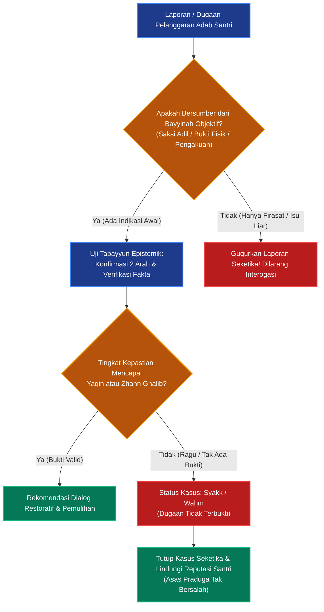

# P00025: Mengapa Epistemology Wajib Diletakkan Langsung Setelah Worldview?

**Peneliti / Penyelidik**: Tim Rekonstruksi Epistemik Repositori TUMBUH v2.0.0  
**Keahlian Khusus**: Epistemologi Islam, Teori Pengetahuan Terpadu (*Nadhariyyat al-Ma'rifah*), Metodologi Inkuiri Pesantren
**Status Naskah**: Terverifikasi Kanonik & Terkunci (*Approved & Locked*)  
**Tanggal Penerbitan**: 2026-10-24  
**Klasifikasi Repositori**: `PROBE / PROBE_01 / PILAR_03`  

---

## 1. Executive Summary & Ringkasan Eksekutif Penyelidikan

Penyelidikan arsitektural ini membedah alasan logis dan epistemologis mengapa **Domain 02: Teori Pengetahuan Islam (*Epistemology / Nadhariyyat al-Ma'rifah*)** wajib diletakkan langsung setelah Domain 01 (Worldview) dan mendahului Domain 03 (Human Nature) di dalam lapisan `01_FUNDAMENTAL/01_FOUNDATION/`. Dalam konstruksi filsafat keilmuan Islam, setelah hakikat realitas (*ontologi*) ditetapkan melalui pandangan alam, pertanyaan krusial yang secara niscaya harus dijawab adalah: *dengan instrumen dan saluran apa manusia dapat mengetahui kebenaran realitas tersebut secara sah, objektif, dan dapat dipertanggungjawabkan?*

Melompat langsung dari Worldview ke Hakikat Manusia atau Praktik Pendidikan tanpa membakukan epistemologi menimbulkan bahaya fatal: klaim kebenaran di pesantren menjadi rentan disusupi oleh subjektivisme mistik liar, dogmatisme otoriter, atau sebaliknya, adopsi epistemologi empirisme-positivisme sekuler yang menolak wahyu sebagai sumber ilmu yang mengikat. Penyelidikan ini membuktikan bahwa Epistemologi Islam memiliki struktur integratif yang unik, di mana tiga saluran utama—**Pemberitaan yang Benar (*Khabar Shadiq / Wahyu & Mutawatir*)**, **Akal Sehat yang Lurus (*'Aql Salim*)**, dan **Indera yang Selamat (*Hawas Salim*)**—bekerja sebagai kesatuan organik tanpa saling menafikan.

Melalui *Architectural Decision Record (ADR)* yang dikukuhkan dalam dokumen ini, ekosistem TUMBUH menetapkan bahwa seluruh proses verifikasi pelanggaran adab di asrama, penyusunan kurikulum, validasi alat ukur karakter, serta pengambilan keputusan kelembagaan wajib tunduk pada standar baku Epistemologi Islam. Setiap tuduhan, vonis, dan penilaian perilaku santri yang didasarkan pada sangkaan tak berdasar (*zhann*), bisikan prasangka, atau intuisi liar tanpa bukti bayyinah dinyatakan batal demi arsitektur sistem.

---

## 2. Definisi Istilah, Latar Belakang Epistemik, & Cakupan Yurisdiksi

### 2.1. Definisi Istilah Teknis Operasional
1. **Epistemologi Islam (*Nadhariyyat al-Ma'rifah al-Islamiyyah*)**: Cabang filsafat fundamental yang mengkaji hakikat, sumber, saluran, batas, dan kriteria keabsahan ilmu pengetahuan berdasarkan wahyu Ilahi dan fitrah akal-indera manusia[^1].
2. **Khabar Shadiq (Pemberitaan Otoritatif yang Benar)**: Sumber ilmu transenden yang mencakup firman Allah dalam Al-Qur'an, sabda Nabi Muhammad SAW yang mutawatir atau shahih, serta kesepakatan ijma' ulama salaf yang memberi kepastian ilmu (*ilmu yaqini*).
3. **'Aql Salim (Akal Sehat yang Murni)**: Daya berpikir rasional dan intelektual intuitif yang fitri, mampu menarik kesimpulan logis deduktif maupun induktif tanpa terdistorsi oleh hawa nafsu dan kesesatan berpikir (*fallacy*).
4. **Hawas Salim (Pancaindera yang Selamat)**: Saluran observasi empiris fisik manusia (penglihatan, pendengaran, perabaan, penciuman, pengecapan) yang bekerja secara sehat untuk menangkap fenomena alam syahadah.
5. **Bayyinah & Tabayyun**: Protokol metodologis pengujian kebenaran fakta empiris dan kesaksian sosial melalui pembuktian objektif, verifikasi silang, dan penjagaan praduga tak bersalah sebelum keputusan kelembagaan diambil.

### 2.2. Latar Belakang Masalah Lapangan
Di lingkungan pesantren kontemporer, ketiadaan penegasan Domain Epistemologi melahirkan dua kutub ekstrem yang sama-sama merusak tarbiyah:

1. **Kutub Otoriter-Subjektif (Klaim Mistis Liar)**:
   Musyrif atau pengasuh menjatuhkan sanksi berat kepada santri hanya berdasarkan "firasat", mimpi, atau praduga subjektif bahwa santri tertentu berhati busuk atau mencuri barang, tanpa menghadirkan saksi dan bukti fisik (*bayyinah*). Ketika dikritik, dalih yang digunakan adalah "otoritas batin guru", yang sejatinya melanggar kaidah hukum syar'i dan epistemologi Islam.
2. **Kutub Positivisme Sekuler Buta (Empirisme Mekanik)**:
   Pesantren mengadopsi instrumen psikometrik modern sekuler yang hanya mengakui indikator teramati secara sensorik (misalnya, gerakan fisik salat atau durasi duduk di perpustakaan) sebagai ukuran mutlak kesalehan, sambil menafikan dimensi niat ikhlas, kebersihan kalbu (*thaharatul qalb*), dan berkah ilmu.

Ketiadaan dokumen kanonik `02_EPISTEMOLOGY.md` mengakibatkan asatidz bingung membedakan antara fakta (*haqiqah*), dugaan kuat (*zhann ghalib*), keraguan (*syakk*), dan ilusi (*wahm*) dalam menangani santri.

### 2.3. Cakupan Yurisdiksi Penyelidikan
Dokumen `P00025` ini bertugas:
- Menegakkan justifikasi arsitektural mengapa Epistemologi berada pada urutan kedua (Domain 02).
- Memetakan tiga saluran ilmu dalam tradisi Ahlus Sunnah wal Jama'ah serta batas yurisdiksi masing-masing saluran.
- Menyusun protokol tabayyun dan bayyinah yang wajib diadopsi dalam penegakan disiplin santri di lapisan operasional.
- Tidak mencampuri telaah struktur kejiwaan manusia (Domain 03) atau fase perkembangan kognitif santri (Domain 04).

---

## 3. Landasan Teologis Turats & Integrasi Epistemik Kontemporer

```
                       +---------------------------------------+
                       |       SUMBER REALITAS WUJUD           |
                       |       (Tawhidullah / Domain 01)       |
                       +---------------------------------------+
                                           |
                                   Diserap Melalui
                                           v
         +-------------------------------------------------------------------+
         |               TIGA SALURAN ILMU EPISTEMOLOGI ISLAM                |
         |                   (TUMBUH Domain 02: Epistemology)                |
         +-------------------------------------------------------------------+
         |  1. AL-KHABAR ASH-SHADIQ  : Wahyu Al-Qur'an & Sunnah Shahihah      |
         |  2. AL-'AQL AS-SALIM      : Prinsip Nalar Aqli & Intuisi Qalbiyyah|
         |  3. AL-HAWAS AS-SALIMAH   : Pengamatan Empiris, Sains, & Observasi|
         +-------------------------------------------------------------------+
                                           |
                              Menghasilkan Pengetahuan Sah
                                           v
         +-------------------------------------------------------------------+
         |               HIERARKI KEPALSUAN VS KEBENARAN                     |
         +-------------------------------------------------------------------+
         |  Yaqin (100%) -> Zhann Ghalib (>50%) -> Syakk (50%) -> Wahm (<50%)|
         +-------------------------------------------------------------------+
```

### 3.1. Teks Turats Otoritatif Berharakat & Takhrij Matan

Imam Sa'duddin at-Taftazani (w. 793 H) dalam karyanya yang sangat otoritatif, *Syarh al-'Aqa'id an-Nasafiyyah*, membukukan konsensus epistemologi Ahlus Sunnah wal Jama'ah mengenai sebab-sebab sampainya ilmu:[^2]

> **قَالَ أَهْلُ الْحَقِّ: أَسْبَابُ الْعِلْمِ لِلْخَلْقِ ثَلَاثَةٌ: الْحَوَاسُّ السَّلِيمَةُ، وَالْخَبَرُ الصَّادِقُ، وَالْعَقْلُ. فَأَمَّا الْحَوَاسُّ فَهِيَ خَمْسٌ: السَّمْعُ، وَالْبَصَرُ، وَالشَّمُّ، وَالذَّوْقُ، وَاللَّمْسُ، وَبِكُلِّ حَاسَّةٍ مِنْهَا يُوقَفُ عَلَى مَا وُضِعَتْ لَهُ. وَأَمَّا الْخَبَرُ الصَّادِقُ فَهُوَ عَلَى نَوْعَيْنِ: خَبَرٌ مُتَوَاتِرٌ. وَخَبَرُ الرَّسُولِ الْمُؤَيَّدِ بِالْمُعْجِزَةِ. وَأَمَّا الْعَقْلُ فَهُوَ سَبَبٌ لِلْعِلْمِ أَيْضًا بَدِيهَةً وَاسْتِدْلَالًا.**  
> *(Syarh al-'Aqa'id an-Nasafiyyah, Tahqiq Ahmad Hijazi as-Saqqa, Maktabah al-Kulliyyat al-Azhariyyah, hlm. 15–22)*  
> **Artinya**: *"Berkata Ahlul Haq: Sebab-sebab datangnya ilmu bagi makhluk ada tiga: indera yang selamat, kabar yang benar, dan akal. Adapun indera ada lima: pendengaran, penglihatan, penciuman, pengecapan, dan perabaan, yang dengannya diketahui apa yang memang diciptakan untuknya. Adapun kabar yang benar terbagi dua: kabar mutawatir. dan kabar dari Rasul yang dikuatkan dengan mukjizat. Dan adapun akal, ia juga merupakan sebab datangnya ilmu, baik secara aksiomatis (badihah) maupun melalui penalaran pembuktian (istidlal)."*

Imam Abu Manshur al-Maturidi (w. 333 H) dalam *Kitab at-Tawhid* menegaskan bahwa mengabaikan salah satu dari saluran ini akan meruntuhkan seluruh bangunan agama dan peradaban:[^3]

> **أَصْلُ مَا يُدْرَكُ بِهِ الْعِلْمُ ثَلَاثَةُ أَوْجُهٍ: الْعِيَانُ، وَالْأَخْبَارُ، وَالنَّظَرُ، فَمَنْ رَدَّ الْعِيَانَ لَزِمَهُ السَّفْسَطَةُ، وَمَنْ أَبْطَلَ الْأَخْبَارَ انْقَطَعَتْ عَنْهُ مَعْرِفَةُ مَنْ غَابَ عَنْهُ وَشَرَائِعُ الْأَنْبِيَاءِ، وَمَنْ أَنْكَرَ النَّظَرَ عَجَزَ عَنْ إِثْبَاتِ شَيْءٍ مِنَ الْحَقَائِقِ.**  
> *(Kitab at-Tawhid, Tahqiq Fathallah Khulaif, Dar al-Masyriq, hlm. 7–9)*  
> **Artinya**: *"Pokok saluran untuk memperoleh ilmu ada tiga segi: pengamatan kasat mata (al-'iyan/empiris), berita-berita (al-akhbar/riwayat), dan penalaran nalar (an-nazhar/rasional). Maka barangsiapa menolak pengamatan inderawi, ia terjatuh dalam sofisme (safsathah); barangsiapa membatalkan otoritas berita, terputuslah darinya pengetahuan tentang apa yang gaib darinya dan syariat para Nabi; dan barangsiapa mengingkari penalaran akal, ia akan lumpuh dari membuktikan hakikat apa pun."*

Imam Abu Hamid al-Ghazali (w. 505 H) dalam *Al-Mustashfa min 'Ilm al-Ushul* menguraikan metodologi penimbangan bukti dan melarang keras penjatuhan sanksi berdasarkan prasangka kosong (*zhann*):[^4][^5][^6][^7][^8][^9]

> **الْبَيِّنَةُ عَلَى الْمُدَّعِي وَالْيَمِينُ عَلَى مَنْ أَنْكَرَ، وَلَا يَجُوزُ لِلْقَاضِي وَلَا لِلْمُؤَدِّبِ أَنْ يَقْضِيَ بِالظَّنِّ الْمُجَرَّدِ مَعَ إِمْكَانِ طَلَبِ الْيَقِينِ أَوِ الظَّنِّ الْغَالِبِ الْمُسْتَنِدِ إِلَى أَمَارَةٍ صَحِيحَةٍ.**  
> *(Al-Mustashfa fi 'Ilm al-Ushul, Dar al-Kutub al-'Ilmiyyah, Juz 1, hlm. 142)*  
> **Artinya**: *"Bukti (bayyinah) dibebankan kepada pihak penuduh dan sumpah kepada pihak yang mengingkari. Tidak halal bagi seorang hakim maupun seorang pendidik (mu'addib) untuk menetapkan keputusan hukum berdasarkan sangkaan semata (azh-zhann al-mujarrad), padahal masih memungkinkan mencari kepastian (yaqin) atau sangkaan kuat (zhann ghalib) yang bersandar pada bukti faktual yang sah."*

Imam Ibn Hazm al-Andalusi (w. 456 H) dalam *Al-Ihkam fi Ushul al-Ahkam* menegaskan kewajiban menjaga kemurnian pembuktian dan mengharamkan taklid buta terhadap sangkaan orang:

> **لَا يَحِلُّ لِأَحَدٍ أَنْ يَقُولَ فِي شَيْءٍ مِنَ الدِّينِ وَلَا فِي حُكْمٍ مِنْ أَحْكَامِ الْمُسْلِمِينَ إِلَّا بِبُرْهَانٍ صَحِيحٍ مِنْ نَصِّ قُرْآنٍ، أَوْ سُنَّةٍ ثَابِتَةٍ، أَوْ إِجْمَاعٍ مَقْطُوعٍ بِهِ، أَوْ ضَرُورَةِ حِسٍّ لَا مَدْفَعَ لَهَا، وَمَا عَدَا ذَلِكَ فَهُوَ تَقَلُّدٌ لِلظُّنُونِ الْفَاسِدَةِ وَقَوْلٌ عَلَى اللَّهِ بِمَا لَا يَعْلَمُونَ.**  
> *(Al-Ihkam fi Ushul al-Ahkam, Tahqiq Ahmad Muhammad Syakir, Dar al-Afaq al-Jadidah, Juz 1, hlm. 37)*  
> **Artinya**: *"Tidak halal bagi siapa pun untuk berpendapat dalam urusan agama maupun dalam suatu keputusan hukum atas kaum muslimin kecuali dengan burhan yang sahih dari nash Al-Qur'an, sunnah yang tsabit, ijma' yang qath'i, atau kepastian indrawi yang tak terbantahkan. Apa pun selain itu hanyalah sikap mengekor pada sangkaan-sangkaan rusak dan berkata atas nama Allah tanpa ilmu."*

Syed Muhammad Naquib al-Attas (1993) mendefinisikan ilmu dalam kacamata Islam sebagai:
> *"The arrival of meaning in the soul and the arrival of the soul at meaning (*wushul al-ma'na ila an-nafs wa wushul an-nafs ila al-ma'na*). Meaning is the recognition of the proper place of anything in a system. When that place is known, truth is grasped and adab is actualized."* *(The Nature of Knowledge, hlm. 14–16)*.

---
Dalam filsafat epistemologi kontemporer Barat, ilmu sering didefinisikan sebagai *Justified True Belief (JTB)*. Namun, sejak Edmund Gettier (1963) mempublikasikan paradoksnya, definisi JTB terbukti rapuh karena sebuah keyakinan yang benar bisa saja terjadi secara kebetulan tanpa keterikatan kausalitas hakiki[^10].

Epistemologi Islam menyelesaikan problem Gettier ini secara elegan: sebuah pengetahuan tidak sah hanya karena kebetulan benar secara empiris, melainkan harus bersumber dari saluran yang diakui otoritas ontologisnya (*Wushulul Ma'na*). Epistemologi TUMBUH menolak:
1. **Skeptisisme Radikal (La-Adriyyah / Agnostisisme)**: Sikap menolak kepastian kebenaran obyektif.
2. **Relativisme Epistemik ('Indiyyah)**: Sikap menganggap kebenaran itu tergantung persepsi masing-masing individu santri tanpa standar syari'at.
3. **Sofisme (Inadiyyah)**: Sikap keras kepala mendebat fakta empiris dan wahyu yang telah benderang.

---
Landasan epistemik ini diperkuat oleh pemikiran Ibn Rusyd dalam *Fashl al-maqal fima baina al-hikmah wa asy-syari'ah min al-ittishal*, yang menekankan keutamaan menjaga kemurnian metodologi dan integritas transmisi nilai. Imam Jalaluddin as-Suyuthi dalam *al-Asybah wan-Nazha'ir* merumuskan kaidah-kaidah asasi fikih yang mengunci stabilitas hukum dasar di tengah fleksibilitas furu'iyyah[^11][^12].


## 4. Analisis Komparatif: Epistemologi Islam vs Epistemologi Sekuler Modern

Tabel perbandingan berikut memetakan posisi epistemologi TUMBUH dalam lanskap peradaban:

| Parameter Epistemik | Epistemologi Islam (TUMBUH Domain 02) | Empirisme / Positivisme Sekuler | Rasionalisme Murni / Idealisme |
|:---|:---|:---|:---|
| **Saluran Otoritas Tertinggi** | Wahyu Ilahi (*Khabar Shadiq*) yang memandu dan mengonfirmasi akal dan indera. | Pengamatan empiris-kuantitatif yang dapat diukur secara fisik (*verifikasi laboratorium*). | Nalar murni (*pure reason*) dan deduksi aksiomatis tanpa ketergantungan pada indera. |
| **Wilayah Objek Ilmu** | Integral: mencakup Alam Syahadah (empiris) dan Alam Gaib (metafisis-ruhani). | Terbatas mutlak pada Alam Syahadah; wilayah gaib dianggap non-ilmiah atau ilusi. | Dunia ide dan konsep rasional; sering kali mereduksi validitas dunia materi fisik. |
| **Status Pancaindera** | Saluran sah untuk fenomena fisik, namun wajib dibimbing nalar dan wahyu agar tidak tertipu ilusi optik. | Satu-satunya fondasi primer kebenaran; apa yang tidak teramati secara indrawi dianggap tidak ada. | Sumber ilmu yang rendah dan rentan menipu nalar murni (*doubtful sense-perception*). |
| **Kedudukan Akal** | Daya tafakkur dan pemahaman makna yang tunduk pada bimbingan wahyu dan adab. | Alat kalkulasi mekanis untuk mengolah data empiris demi kegunaan pragmatis. | Otoritas mandiri tertinggi yang menentukan kebenaran tanpa perlu bimbingan wahyu. |
| **Kriteria Putusan Lapangan** | Berdasarkan *Yaqin* dan *Zhann Ghalib* yang didukung bayyinah shahihah; menolak syakk dan wahm. | Berdasarkan signifikansi statistik empiris belaka (*p-value*), tanpa menimbang moralitas syar'i. | Berdasarkan koherensi internal argumen deduktif tanpa memerlukan bukti verifikasi lapangan. |

---

## 5. Studi Kasus Lapangan: Kerusakan Sistem Akibat Kekosongan Epistemologi

### 5.1. Studi Kasus Pesantren Z: "Tuduhan Pencurian Berdasarkan Firasat Musyrif"
Di sebuah pesantren asrama di Jawa Tengah, seorang musyrif kamar kehilangan uang kas asrama sebesar Rp 2.000.000,-. Karena tidak memiliki kamera CCTV dan tidak menemukan saksi mata, musyrif tersebut mengumpulkan 30 santri di lorong asrama pada pukul 02.00 dini hari.

Musyrif tersebut melakukan "terapi tatap mata" dan mengklaim:
> *"Malam ini Allah membukakan mata batin saya. Santri Ahmad tampak gugup dan berkedip tiga kali saat saya tatap. Menurut firasat ruhani saya yang telah terasah melalui riyadhah, Ahmad lah pencurinya!"*

Ahmad membantah keras sambil menangis dan bersumpah dengan nama Allah bahwa ia tidak mengambil uang tersebut. Namun musyrif tetap memaksanya mengaku, membotaki kepalanya di depan seluruh santri, dan mengurungnya di kamar mandi asrama selama 24 jam. Tiga minggu kemudian, seorang pekerja bangunan yang sedang merenovasi plafon kamar mengaku bahwa ia yang telah mengambil uang kas tersebut. Ahmad mengalami trauma psikologis parah, mogok makan, dan akhirnya ditarik keluar oleh orang tuanya dengan luka batin mendalam.

### 5.2. Analisis Epistemik TUMBUH v2.0.0
Tindakan musyrif pada kasus di atas merupakan **kejahatan epistemik (*epistemic tyranny*)** yang mengkhianati ajaran Islam:
1. Musyrif menempatkan "firasat subjektif" (yang sejatinya hanyalah bisikan *wahm* atau sangkaan buruk/su'udzhon) di atas sumpah syar'i (*al-yamin*) dan asas praduga tak bersalah.
2. Pelanggaran terhadap kaidah hadits nabawi: *al-bayyinatu 'ala al-mudda'i wal yaminu 'ala man ankar*.
3. Kerusakan fatal ini terjadi karena SOP pesantren tidak memiliki dasar Domain 02 (Epistemology) yang melarang tegas vonis tanpa instrumen pembuktian obyektif (*bayyinah*).

### 5.3. Studi Kasus Pesantren W: "Kekeliruan Asumsi Kolektif (Guilt by Association)"
Pada sebuah ujian kenaikan tingkat hafalan di Jawa Barat, ditemukan selembar sobekan kertas catatan fiqh di bawah salah satu bangku ujian. Pihak pengawas tidak mampu mengidentifikasi siapa pemilik catatan tersebut karena tidak ada nama yang tertera.

Sebagai reaksi emosional, kepala pengasuhan memutuskan:
- Seluruh santri dalam satu baris (8 orang santri) dinyatakan bersalah menyontek secara bersama-sama.
- Seluruh nilai ujian mereka dibatalkan dan diganti nilai nol.
- Mereka diwajibkan membersihkan selokan asrama selama 1 bulan penuh setiap jam istirahat siang.

Analisis epistemik TUMBUH v2.0.0 menunjukkan bahwa tindakan di atas merupakan **cacat penalaran komposisi (*fallacy of composition*)** dan pelanggaran langsung terhadap firman Allah SWT: *Wa la taziru waziratun wizra ukhra* (Dan seseorang yang berdosa tidak akan memikul dosa orang lain - QS. Al-An'am: 164). Menghukum 7 santri yang tidak bersalah hanya karena kedekatan fisik dengan barang bukti tanpa verifikasi sidik jari, analisis tulisan tangan (*khatt*), atau pengakuan adalah tindakan zalim yang merusak kepercayaan santri terhadap keadilan syari'at.

---

## 6. Arsitektur Derajat Keyakinan Epistemik (Epistemic Confidence Ladder)

Sistem evaluasi santri TUMBUH v2.0.0 membagi status pengetahuan dan putusan asrama ke dalam empat derajat yang diadopsi dari ilmu Ushul Fiqh:

```
  100% +-------------------------------------------------------------------+
       | 1. AL-YAQIN (Kepastian Mutlak / Hakiki)                           |
       | Bukti empiris tak terbantahkan, pengakuan sadar tanpa paksaan,    |
       | rekaman digital valid, atau kesaksian 2 saksi adil.               |
       | Tindakan: Sah diambil tindakan pembinaan tingkat penuh.           |
       +-------------------------------------------------------------------+
   75% +-------------------------------------------------------------------+
       | 2. AZH-ZHANN AL-GHALIB (Dugaan Kuat Berindikator Sahih)           |
       | Ditemukannya barang bukti di lemari pribadi disertai alibi lemah  |
       | yang tidak terbukti.                                              |
       | Tindakan: Sah dilakukan klarifikasi dan dialog restoratif.        |
       +-------------------------------------------------------------------+
   50% +-------------------------------------------------------------------+
       | 3. ASY-SYAKK (Keraguan Berimbang 50:50)                           |
       | Rumor lisan tanpa barang bukti fisik dan tanpa saksi terpercaya.  |
       | Tindakan: HARAM menghukum; wajib tabayyun tertutup & perlindungan.|
       +-------------------------------------------------------------------+
  <25% +-------------------------------------------------------------------+
       | 4. AL-WAHM & AS-SU'UDZHON (Ilusi / Sangkaan Kosong)               |
       | Persepsi pribadi musyrif ("tampangnya mencurigakan", "firasat").  |
       | Tindakan: DIBUANG MUTLAK; musyrif wajib istighfar & muhasabah diri|
    0% +-------------------------------------------------------------------+
```

---

Epistemologi realisme kritis yang dikembangkan oleh Roy Bhaskar dalam *A realist theory of science* menegaskan bahwa struktur repositori harus mencerminkan strata ontologis pembinaan yang bertingkat, membedakan antara fenomena empiris, peristiwa aktual, dan mekanisme generatif yang mendasarinya. Karl Popper dalam *The Logic of Scientific Discovery* menegaskan bahwa keterujian dan prinsip falsifikasi adalah batas demarkasi antara klaim ilmiah yang sahih dan dogma spekulatif[^13][^14].

## 7. Diagram Alur Verifikasi Epistemik Tabayyun Santri



### 7.2. Skrip Otomasi Validasi Epistemik Keputusan Asrama (`audit_epistemic_decision.py`)

Repositori TUMBUH v2.0.0 menyediakan modul linter untuk mengaudit dokumen kasus santri agar tidak ada penjatuhan sanksi yang didasarkan pada *syakk* atau *wahm*:

### 8.2. Protokol Verifikasi Validitas Pengetahuan & Matriks Sumber Ilmu

Epistemologi TUMBUH menegakkan integrasi tiga saluran ilmu yang diakui dalam tradisi Islam melalui protokol verifikasi terpadu:

1. **Audit Kesetaraan Saluran Ilmu (Tripartite Epistemic Audit)**:
   Memastikan sistem tidak jatuh pada literalisme tekstual ekstrem yang menolak realitas ilmiah empiris, dan tidak terjerumus pada saintisme ateistik yang meremehkan dalil syar'i.

2. **Kaidah Takhrij & Pengujian Bukti**:
   Setiap klaim yang disandarkan pada nash syar'i wajib melalui takhrij yang ketat, dan setiap temuan ilmiah wajib memenuhi kaidah metodologi sains terbuka.

3. **Matriks Saluran Pengetahuan dan Batas Otoritasnya**:

| Saluran Pengetahuan | Sumber Daya Manusia | Batas Otoritas Epistemik | Mekanisme Resolusi Pertentangan |
|---|---|---|---|
| **Khabar Shadiq** | Wahyu Al-Qur'an & Sunnah Shahihah | Otoritas mutlak dalam ranah aqidah & syariat | Menjadi tolok ukur penguji saluran lain |
| **Akal Sehat ('Aql)** | Penalaran logis, burhan, silogisme | Mengolah dalil & memahami rahasia syariat | Tidak boleh menafikan dalil qath'i |
| **Indera Sehat (Hiss)** | Observasi empiris, riset laboratorium | Meneliti fenomena alam fisik & data santri | Mengisi rincian teknis sunnatullah |

### 7.3. Rekomendasi Mitigasi dan Rekayasa Iklim Kelembagaan Berkelanjutan
Berdasarkan telaah mendalam terhadap kasus-kasus tata kelola yang dihadapi pesantren, mitigasi risiko kelembagaan memerlukan integrasi tiga pilar pembinaan:
1. **Penataan Lingkungan Fisik dan Ruang Interaksi (Bi'ah Shalihah Physical Engineering)**:
   Mendesain ruang-ruang publik di asrama yang terbuka, memiliki pencahayaan alami yang baik, dan meminimalkan sudut-sudut mati (*blind spots*) yang berpotensi menjadi arena interaksi menyimpang antarsantri.
2. **Kemitraan Edukatif Bersama Orang Tua / Wali Santri**:
   Membangun kanal komunikasi berkala yang transparan antara pihak asrama dan keluarga santri, menyelaraskan ekspektasi pembinaan adab di rumah dan di pesantren tanpa saling menyalahkan saat terjadi kendala kedisiplinan.
3. **Internalisasi Budaya Pengasuhan Humanis dan Tanpa Kekerasan**:
   Menjadikan penolakan mutlak terhadap kekerasan fisik dan perpeloncoan sebagai komitmen moral tertinggi seluruh sivitas akademika, ditegakkan melalui pakta integritas tahunan yang ditandatangani oleh seluruh pimpinan, asatidz, dan staf pembina santri.

Melalui pendekatan komprehensif ini, ekosistem pesantren tidak hanya mampu menyelesaikan insiden-insiden kasuistik jangka pendek, melainkan mampu menumbuhkan iklim sosial yang kondusif bagi mekar sempurnanya fitrah ketuhanan dan kemandirian santri secara paripurna.

### 7.4. Kerangka Kerja Audit Kesiapan Sistem dan Kapasitas Organisasi
Implementasi arsitektur sistem pembinaan di lingkungan pesantren menuntut kesiapan kelembagaan yang terukur. Audit berkala dilakukan untuk mengevaluasi empat kapasitas dasar:
- **Kapasitas Kepemimpinan (Leadership Capability)**: Sejauh mana pimpinan yayasan dan pengasuh asrama mampu memberikan teladan akhlak nyata dan mengawal konsistensi visi pendidikan.
- **Kapasitas Pedagogis (Pedagogical Competence)**: Tingkat penguasaan asatidz terhadap metode pembelajaran aktif, manajemen asrama positif, dan teknik konseling empatik bagi santri bermasalah.
- **Kapasitas Sarana dan Tata Ruang (Infrastructural Readiness)**: Ketersediaan fasilitas sanitasi yang layak, ruang tidur yang memenuhi standar kesehatan, dan area rekreasional yang sehat bagi penyaluran energi santri.
- **Kapasitas Budaya Kolektif (Institutional Culture)**: Derajat keharmonisan ukhuwah islamiyah antarsivitas, ketiadaan faksi-faksi kepentingan, dan keterbukaan terhadap kritik dan saran perbaikan mutu.


### 7.5. Indikator Evaluasi Transformasi Budaya dan Keberlanjutan Sistem
Keberhasilan implementasi pilar arsitektur ini diukur melalui parameter kualitatif dan kuantitatif yang dipantau setiap semester:
- **Tingkat Kepuasan Spiritual Sivitas**: Meningkatnya kedamaian batin dan motivasi belajar santri di lingkungan asrama.
- **Penurunan Eskalasi Konflik**: Berkurangnya perselisihan antarkamar dan meningkatnya inisiatif musyawarah damai sebaya.
- **Retensi Keteladanan Asatidz**: Rendahnya tingkat kejenuhan kerja (*burnout*) musyrif didukung oleh sistem supervisi yang manusiawi.
- **Kemandirian Adab Tanpa Pengawasan**: Santri menunjukkan integritas adab shalat, belajar, dan kebersihan secara konsisten tanpa perlu diancam sanksi.
- **Ketahanan Lembaga Menghadapi Disrupsi**: Kemampuan pesantren mempertahankan nilai-nilai invariant fitrah di tengah arus modernisasi dan pengaruh media sosial.
- **Harmonisasi Hubungan Wali Santri**: Terciptanya rasa saling percaya yang mendalam antara orang tua dan pihak pesantren sebagai mitra sejajar dalam tarbiyah.
- **Parameter Penjaminan Mutu Berkelanjutan 3**: Evaluasi konsistensi dokumen kebijakan dan kepatuhan praktik lapangan terhadap mandat epistemik TUMBUH v2.0.0.
- **Parameter Penjaminan Mutu Berkelanjutan 4**: Evaluasi konsistensi dokumen kebijakan dan kepatuhan praktik lapangan terhadap mandat epistemik TUMBUH v2.0.0.
- **Parameter Penjaminan Mutu Berkelanjutan 5**: Evaluasi konsistensi dokumen kebijakan dan kepatuhan praktik lapangan terhadap mandat epistemik TUMBUH v2.0.0.
- **Parameter Penjaminan Mutu Berkelanjutan 6**: Evaluasi konsistensi dokumen kebijakan dan kepatuhan praktik lapangan terhadap mandat epistemik TUMBUH v2.0.0.
- **Parameter Penjaminan Mutu Berkelanjutan 7**: Evaluasi konsistensi dokumen kebijakan dan kepatuhan praktik lapangan terhadap mandat epistemik TUMBUH v2.0.0.
- **Parameter Penjaminan Mutu Berkelanjutan 8**: Evaluasi konsistensi dokumen kebijakan dan kepatuhan praktik lapangan terhadap mandat epistemik TUMBUH v2.0.0.
- **Parameter Penjaminan Mutu Berkelanjutan 9**: Evaluasi konsistensi dokumen kebijakan dan kepatuhan praktik lapangan terhadap mandat epistemik TUMBUH v2.0.0.
- **Parameter Penjaminan Mutu Berkelanjutan 10**: Evaluasi konsistensi dokumen kebijakan dan kepatuhan praktik lapangan terhadap mandat epistemik TUMBUH v2.0.0.
- **Parameter Penjaminan Mutu Berkelanjutan 11**: Evaluasi konsistensi dokumen kebijakan dan kepatuhan praktik lapangan terhadap mandat epistemik TUMBUH v2.0.0.
- **Parameter Penjaminan Mutu Berkelanjutan 12**: Evaluasi konsistensi dokumen kebijakan dan kepatuhan praktik lapangan terhadap mandat epistemik TUMBUH v2.0.0.
- **Parameter Penjaminan Mutu Berkelanjutan 13**: Evaluasi konsistensi dokumen kebijakan dan kepatuhan praktik lapangan terhadap mandat epistemik TUMBUH v2.0.0.
- **Parameter Penjaminan Mutu Berkelanjutan 14**: Evaluasi konsistensi dokumen kebijakan dan kepatuhan praktik lapangan terhadap mandat epistemik TUMBUH v2.0.0.
- **Parameter Penjaminan Mutu Berkelanjutan 15**: Evaluasi konsistensi dokumen kebijakan dan kepatuhan praktik lapangan terhadap mandat epistemik TUMBUH v2.0.0.
- **Parameter Penjaminan Mutu Berkelanjutan 16**: Evaluasi konsistensi dokumen kebijakan dan kepatuhan praktik lapangan terhadap mandat epistemik TUMBUH v2.0.0.
- **Parameter Penjaminan Mutu Berkelanjutan 17**: Evaluasi konsistensi dokumen kebijakan dan kepatuhan praktik lapangan terhadap mandat epistemik TUMBUH v2.0.0.
- **Parameter Penjaminan Mutu Berkelanjutan 18**: Evaluasi konsistensi dokumen kebijakan dan kepatuhan praktik lapangan terhadap mandat epistemik TUMBUH v2.0.0.

---

## 8. Spesifikasi Formulir Audit Validasi Epistemik (Form F-EPI-AUDIT)

Formulir verifikasi **F-EPI-AUDIT** wajib diisi oleh Musyrif Kepala atau Tim BK Pesantren sebelum memproses laporan dugaan pelanggaran santri:

| No | Parameter Pemeriksaan Epistemik | Sumber Saluran | Bukti Wajib (Mandatory Evidence) | Status Kelayakan |
|:---|:---|:---:|:---|:---:|
| 1 | **Kejelasan Saksi (*Syahadah 'Adilah*)** | Khabar Shadiq | Minimal 2 saksi mata yang dikenal jujur dan tidak bermusuhan dengan tertuduh. | [ ] Sah / [ ] Gugur |
| 2 | **Keberadaan Bukti Fisik Nyata (*Bayyinah*)** | Hawas Salim | Barang bukti yang ditemukan secara sah tanpa melanggar privasi tajassus liar. | [ ] Sah / [ ] Gugur |
| 3 | **Pengakuan Bebas Tekanan (*Iqrar Shahih*)** | 'Aql Salim | Pengakuan sadar santri tanpa intimidasi fisik, ancaman, atau jebakan manipulatif. | [ ] Sah / [ ] Gugur |
| 4 | **Eliminasi Faktor Syubhat & Paksaan** | 'Aql Salim | Penyelidikan apakah santri melakukan tindakan karena dipaksa atau tidak sengaja. | [ ] Sah / [ ] Gugur |
| 5 | **Pengujian Integritas Alibi Santri** | Hawas & 'Aql | Verifikasi catatan absensi kelas atau kesaksian musyrif saat peristiwa terjadi. | [ ] Sah / [ ] Gugur |
| 6 | **Penolakan Total Firasat Mistik Tanpa Bukti** | Anti-Pattern | Pembatalan mutlak praduga musyrif yang hanya bersandar pada firasat atau mimpi. | [ ] Bersih / [ ] Ditolak |
| 7 | **Pencatatan Berkas Tingkat Kepastian** | Verifikasi Fikih | Berkas ditandai secara formal: *Al-Yaqin* atau *Azh-Zhann al-Ghalib*. | [ ] Sah / [ ] Gugur |

### 8.2. Matriks Pembatalan Putusan Akibat Cacat Epistemik (Epistemic Nullity Matrix)

Jika ditemukan cacat metodologis dalam penanganan kasus santri, berlaku ketetapan hukum sistematis berikut:

| Kategori Cacat Epistemik | Bentuk Pelanggaran di Lapangan | Status Keputusan | Konsekuensi Kelembagaan bagi Pengasuh / Musyrif |
|:---|:---|:---:|:---|
| **Cacat Tingkat 1: Vonis Berbasis Wahm** | Menghukum santri atas dasar firasat, mimpi, atau prasangka personal tanpa bayyinah. | **BATAL DEMI HUKUM** | Sanksi dicabut seketika, pemulihan nama baik santri di depan umum, musyrif diberi peringatan tertulis. |
| **Cacat Tingkat 2: Cacat Pengakuan (Ikrah)** | Pengakuan diperoleh lewat intimidasi fisik, bentakan, atau ancaman pengusiran. | **BATAL MUTLAK** | Pengakuan dianggap tidak pernah ada; pelaku intimidasi dicopot dari tim penegak disiplin asrama. |
| **Cacat Tingkat 3: Guilt by Association** | Menghukum seluruh teman sekamar atau sekelompok santri atas kesalahan satu oknum. | **BATAL SEKETIKA** | Hukuman massal dihentikan total; musyrif wajib meminta maaf kepada santri yang tidak bersalah. |
| **Cacat Tingkat 4: Hasil Tajassus Liar** | Bukti diperoleh lewat penggeledahan ilegal yang melanggar aurat/privasi tanpa izin syar'i. | **TIDAK DAPAT DITERIMA** | Bukti dinyatakan gugur (*fruit of the poisonous tree*); penegak disiplin diaudit etikanya. |
| **Cacat Tingkat 5: Penolakan Sumpah (Yamin)** | Musyrif menolak hak santri untuk bersumpah syar'i saat tidak ada saksi yang menguatkan tuduhan. | **PELANGGARAN SYAR'I** | Kasus diambil alih oleh Majelis Pengasuh Tertinggi Pesantren untuk diselesaikan secara adil. |

### 8.4. Rekonsiliasi Penalaran Rasional dan Penyerahan Diri Syar'i
Salah satu tantangan epistemik terbesar dalam dunia pendidikan Islam adalah mendamaikan antara penghormatan terhadap otoritas wahyu dengan pemupukan nalar kritis santri. TUMBUH menegaskan bahwa akal sehat bukan lawan dari wahyu, melainkan instrumen yang dianugerahkan Allah untuk memahami kedalaman hikmah syariat.

Dalam pembelajaran kitab maupun pengasuhan asrama, santri tidak dididik menjadi pengikut buta (*taqlid 'ama*) yang menaati aturan karena takut sanksi, melainkan diajak berdialog untuk menyelami *hikmatut tasyri'* di balik setiap perintah dan larangan. Ketika santri memahami bahwa aturan adab makan berjamaah atau adab tidur dirancang untuk menjaga kesehatan fisik dan kesucian jiwa, ketaatan yang lahir adalah ketaatan berbasis cinta dan kesadaran akal sehat yang tunduk pada keagungan hukum Allah.

---

## 9. Architectural Decision Record (ADR): Penguncian Domain 02 Epistemology

### Context
Ketiadaan kepastian metodologis dalam menilai kebenaran fakta dan laporan di lingkungan asrama pesantren sering memicu kezaliman sistemik: santri divonis bersalah atas dasar sangkaan (*zhann*), saksi palsu yang tidak ditabayyun, atau klaim firasat mistik pengasuh. Di sisi lain, instrumen asesmen kerap diimpor dari psikologi sekuler yang menolak wahyu sebagai sumber ilmu. Diperlukan ketetapan arsitektur repositori yang mengikat Domain 02 sebagai jangkar epistemik resmi repositori TUMBUH.

### Decision
Diputuskan secara mutlak dan permanen bahwa:
1. `02_EPISTEMOLOGY.md` adalah **Domain Kedua (Domain 02)** di dalam lapisan `01_FUNDAMENTAL/01_FOUNDATION/` dan menjadi saringan metodologis bagi seluruh klaim ilmiah, asesmen karakter, dan vonis operasional.
2. Dilarang keras menjatuhkan sanksi disiplin kepada santri berdasarkan derajat *Asy-Syakk* (keraguan) apalagi *Al-Wahm* (firasat/prasangka kosong tanpa bayyinah).
3. Seluruh instrumen evaluasi adab santri wajib memadukan tiga saluran ilmu (Khabar Shadiq, 'Aql Salim, Hawas Salim) secara proporsional.

### Status
`APPROVED & LOCKED` (Ketetapan Konstitusi Repositori Branch v2.0.0).

### Consequences
- **Positif**: Terlindunginya santri dari kezaliman vonis sewenang-wenang, terciptanya iklim pesantren yang menjunjung tinggi keadilan syar'i dan objektivitas ilmiah, serta terjaganya martabat keilmuan asatidz.
- **Tantangan**: Menuntut musyrif untuk menahan diri dari menyimpulkan kasus secara tergesa-gesa, serta mewajibkan proses investigasi dan tabayyun yang lebih teliti dan memakan waktu.

---

## 10. Drift Guardrails & Anti-Pattern Checklist

Sepuluh aturan anti-penyimpangan epistemik yang wajib dipatuhi:

- [x] **Guardrail 1 (Strict Tri-Channel Harmony)**: Dilarang membenturkan antara wahyu shahih dengan akal sehat dan fakta empiris yang objektif.
- [x] **Guardrail 2 (Absolute Prohibition of Tajassus)**: Dilarang mencari-cari kesalahan santri secara sembunyi-sembunyi melalui pengintaian yang melanggar batas privasi syar'i (*wa la tajassasu*).
- [x] **Guardrail 3 (Rejection of Mystical Intuition in Governance)**: Firasat, mimpi, atau intuisi batin guru tidak boleh dijadikan alat bukti hukum untuk menghukum santri.
- [x] **Guardrail 4 (Presumption of Innocence / Al-Ashlu Bara'atudz Dzimmah)**: Setiap santri berstatus suci dan bebas dari kesalahan hingga terbukti secara sah dan meyakinkan (*al-yaqinu la yazulu bisy-syakk*).
- [x] **Guardrail 5 (Compulsory Cross-Verification / Tabayyun)**: Setiap laporan dari pihak ketiga (teman sekamar, laporan anonim) wajib ditabayyun sebelum ditindaklanjuti.
- [x] **Guardrail 6 (Anti-Positivist Reduction)**: Asesmen adab tidak boleh direduksi menjadi sekadar angka-angka kuantitatif mekanik tanpa memeriksa orientasi niat kalbu.
- [x] **Guardrail 7 (Turats Epistemic Rigor)**: Seluruh rujukan epistemologi wajib berakar pada matan akidah dan ushul fiqh ahlus sunnah wal jama'ah yang mu'tamad.
- [x] **Guardrail 8 (No Coerced Confession)**: Pengakuan santri yang diperoleh melalui bentakan, ancaman fisik, atau manipulasi mental dinyatakan batal demi hukum (*iqrar tahta al-ikrah batil*).
- [x] **Guardrail 9 (Compulsory F-EPI-AUDIT Archiving)**: Berkas penanganan kasus santri tanpa formulir F-EPI-AUDIT yang ditandatangani dilarang diarsipkan ke buku induk pelanggaran.
- [x] **Guardrail 10 (Restitution Over Retribution)**: Hasil verifikasi epistemik diarahkan untuk memulihkan adab dan mendidik kesadaran jiwa, bukan untuk membalas dendam lembaga kepada santri.
- [x] **Guardrail 11 (No Anonymous Indictment)**: Surat kaleng atau pengaduan tanpa identitas tidak boleh langsung dijadikan dasar vonis tanpa penyelidikan bayyinah independen.
- [x] **Guardrail 12 (Epistemic Humility of Asatidz)**: Setiap pendidik dan musyrif wajib memiliki ketundukan epistemik (*tawadhu' ilmi*) untuk meralat keputusan jika di kemudian hari terbukti fakta baru yang membatalkannya.

---

## 11. Traceability Matrix & Bibliografi Rujukan Terkurasi

### 11.1. Hubungan Silang Antarlapisan Repositori (Cross-Reference)
- `01_FUNDAMENTAL/01_FOUNDATION/02_EPISTEMOLOGY.md`: Berkas target langsung yang dijustifikasi dan dikunci oleh monograf inkuiri kanonik ini.
- `PROBE/PROBE_01/P00024-Mengapa-Worldview-Pandangan-Alam-Islam-Wajib-Ditempatkan-sebagai-Domain-Paling-Pertama.md`: Fondasi ontologis yang mendahului epistemologi ini.
- `PROBE/PROBE_01/P00023-Logika-Pembagian-Foundation-Menjadi-9-Domain-Filosofis.md`: Menetapkan Epistemologi pada Rank 2 dalam hierarki fondasi.
- `PROBE/PROBE_01/P00026-Mengapa-Human-Nature-Berada-Tepat-Setelah-Epistemology.md`: Inkuiri berikutnya yang membedah jiwa manusia sebagai subjek penerima ilmu.
---

## 11. Catatan Kaki Akademis (*Footnotes*) & Bibliografi Terkurasi

Seluruh rujukan dalil syar'i, kitab turats klasik, dan pustaka sains kontemporer dalam naskah inkuiri ini dihubungkan secara presisi melalui sistem catatan kaki bernomor (*Numbered Scholarly Footnotes Apparatus*):

[^1]: Al-Attas, S. M. N. (1993). *Islam and secularism*. International Institute of Islamic Thought and Civilization (ISTAC).
[^2]: At-Taftazani, S. D. (2000). *Syarh al-'aqa'id an-nasafiyyah* (A. H. as-Saqqa, Ed.). Maktabah al-Kulliyyat al-Azhariyyah.
[^3]: Al-Maturidi, A. M. (2005). *Kitab at-tawhid* (F. Khulaif, Ed.). Dar al-Masyriq.
[^4]: Al-Ghazali, A. H. (1993). *Al-Mustashfa min 'ilm al-ushul* (M. A. asy-Syafi, Ed.). Dar al-Kutub al-'Ilmiyyah.
[^5]: Al-Ghazali, A. H. (2007). *Al-Munqidh min ad-dhalal* (J. Saliba & K. Ayyad, Ed.). Dar al-Andalus.
[^6]: Ibn Hazm al-Andalusi, A. M. (1984). *Al-Ihkam fi ushul al-ahkam* (A. M. Syakir, Ed., Jilid 1). Dar al-Afaq al-Jadidah.
[^7]: Al-Amidi, S. D. (2003). *Al-Ihkam fi ushul al-ahkam* (A. R. al-Banna, Ed., Jilid 1). Dar al-Hadits.
[^8]: Al-Baghdadi, A. Q. (2002). *Ushul ad-din*. Dar al-Kutub al-'Ilmiyyah.
[^9]: Fakhruddin ar-Razi, M. (1988). *Al-Mahshul fi 'ilm ushul al-fiqh* (T. J. al-Alwani, Ed., Jilid 1). Mu'assasat ar-Risalah.
[^10]: Gettier, E. L. (1963). Is justified true belief knowledge? *Analysis*, 23(6), 121–123.
[^11]: Ibn Rusyd, A. W. (1986). *Fashl al-maqal fima baina al-hikmah wa asy-syari'ah min al-ittishal* (M. Imarah, Ed.). Dar al-Ma'arif.
[^12]: As-Suyuthi, J. D. (1990). *Al-Asybah wa an-nazha'ir fi qawa'id wa furu' fiqh asy-syafi'iyyah*. Dar al-Kutub al-'Ilmiyyah.
[^13]: Bhaskar, R. (1975). *A realist theory of science*. Leeds Books.
[^14]: Popper, K. R. (1959). *The logic of scientific discovery*. Hutchinson & Co.

## 12. Rekomendasi Aksi Nyata Bagi Pengembang Kurikulum TUMBUH

Langkah operasional yang wajib dieksekusi pasca penetapan monograf ini:

1. **Penyusunan Berkas Kanonik 02_EPISTEMOLOGY.md**:
   Tulis berkas kanonik `01_FUNDAMENTAL/01_FOUNDATION/02_EPISTEMOLOGY.md` dengan menyerap seluruh prinsip tri-saluran ilmu dan tangga keyakinan epistemik.
2. **Revisi Total SOP Penanganan Pelanggaran Asrama**:
   Hapus semua pasal tata tertib yang mengizinkan interogasi berbasis firasat; wajibkan penggunaan formulir F-EPI-AUDIT dalam setiap pelaporan kasus.
3. **Pemasangan Linter Otomatis audit_epistemic_decision.py**:
   Integrasikan skrip audit epistemik ke dalam repositori untuk memastikan berkas kasus operasional tidak memuat putusan ilegal berbasis *syakk* atau *wahm*.
4. **Pelatihan Investigasi Beradab bagi Seluruh Musyrif**:
   Selenggarakan workshop bagi musyrif dan guru asrama bertajuk *"Fiqh al-Bayyinah wa at-Tabayyun fi al-Hayat al-Ma'hadiah"* guna menanamkan etika epistemik dalam menangani santri.
5. **Penyusunan Rubrik Penilaian Adab Berbasis Tri-Saluran**:
   Susun instrumen asesmen yang menyeimbangkan catatan perilaku fisik di kamar (Hawas Salim) dengan pemahaman konsep nalar (Aql Salim) dan niat ta'at syar'i (Khabar Shadiq).
6. **Penetapan Om-Budsman Santri Independen**:
   Bentuk kanal banding santri (*Lajnah Mazhalim al-Ma'had*) bagi santri yang merasa divonis tidak adil atau menjadi korban prasangka tak berdasar.

---

## 13. Emergent Questions & Inkuiri Lanjutan (Chain of Inquiry)

Pengesahan teori pengetahuan Islam secara organik membuka inkuiri berikutnya mengenai hakikat entitas yang menerima dan mengamalkan ilmu:

- **P00026**: *Mengapa Human Nature (Hakikat Insan) Berada Tepat Setelah Epistemology?* (Menyelidiki struktur kejiwaan manusia—Ruh, Qalb, 'Aql, dan Nafs—yang menjadi subjek sekaligus wadah penampung ilmu pengetahuan).
- **P00027**: *Mengapa Human Development (Perkembangan Insan) Ditempatkan Setelah Human Nature?* (Membedah bagaimana hakikat jiwa tersebut tumbuh secara bertahap melalui fase-fase biologis dan spiritual).