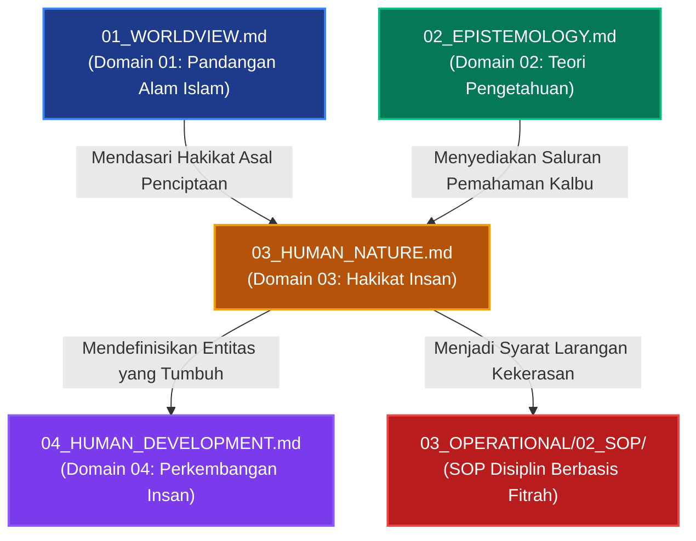

# P00026: Mengapa Human Nature (Hakikat Insan) Berada Tepat Setelah Epistemology?

**Peneliti / Penyelidik**: Tim Rekonstruksi Epistemik Repositori TUMBUH v2.0.0  
**Keahlian Khusus**: Antropologi Metafisik Islam (*Mahiuyyatul Insan*), Psikologi Fitrah, Desain Arsitektur Jiwa Santri  
**Status Naskah**: Terverifikasi Kanonik & Terkunci (*Approved & Locked*)  
**Tanggal Penerbitan**: 2026-10-24  
**Klasifikasi Repositori**: `PROBE / PROBE_01 / PILAR_03`  

---

## 1. Executive Summary & Ringkasan Eksekutif Penyelidikan

Penyelidikan arsitektural ini membedah alasan ontologis dan psikologis mengapa **Domain 03: Hakikat Insan (*Human Nature / Mahiuyyatul Insan*)** wajib ditempatkan tepat setelah Domain 02 (Epistemology) dan mendahului Domain 04 (Human Development) di dalam lapisan `01_FUNDAMENTAL/01_FOUNDATION/`. Dalam tatanan filsafat pendidikan Islam, setelah realitas wujud (*ontologi*) dan instrumen pencarian kebenaran (*epistemologi*) disepakati, pertanyaan pokok yang secara mutlak harus dijawab sebelum merancang tahapan tumbuh-kembang santri adalah: *siapakah sesungguhnya makhluk yang bernama manusia (santri) itu? Apa hakikat esensinya, apa unsur-unsur pembentuk eksistensinya, dan potensi apa saja yang dibawanya sejak lahir?*

Melompat langsung ke psikologi perkembangan remaja (*Human Development*) atau kurikulum pengajaran (*Education*) tanpa memahami hakikat dasar manusia telah terbukti melahirkan malapraktik pedagogis yang masif di lingkungan pesantren. Tanpa fondasi Hakikat Insan yang berakar pada konsepsi Fitrah dan anatomi kalbu, santri diperlakukan secara reduksionistik: entah sebagai mesin biologis yang dimodifikasi perilakunya lewat hukuman jasmaniah ala behaviorisme ekstrem, atau sebagai bejana kosong intelektual yang hanya dijejali hafalan teks tanpa sentuhan tazkiyatun nafs.

Melalui telaah komparatif berbasis turats klasik—khususnya karya Imam Al-Ghazali (*Syarh 'Aja'ib al-Qalb*), Ibn Qayyim al-Jauziyyah (*Ighatsat al-Lahfan* dan *Kitab ar-Ruh*), serta perumusan kontemporer Syed Muhammad Naquib al-Attas (*The Nature of Man*)—penyelidikan ini membuktikan bahwa manusia adalah kesatuan integral dwitunggal antara **Jasad Fisik (*al-jasad al-maddi*)** dan **Substansi Ruhani Ketuhanan (*al-lathifah ar-rabbaniyyah ar-ruhaniyyah*)** yang memiliki empat daya kejiwaan utama: **Ruh**, **Qalb**, **'Aql**, dan **Nafs**.

Hasil penyelidikan ini dituangkan ke dalam *Architectural Decision Record (ADR)* yang mengunci Domain 03 sebagai konstitusi antropologi resmi TUMBUH v2.0.0. Ditetapkan bahwa seluruh desain intervensi perilaku di asrama dilarang memperlakukan santri semata-mata dari aspek fisik jasmani, melainkan wajib ditujukan untuk menyentuh, membersihkan, dan menumbuhkan kesadaran fitrah kalbu santri.

---

## 2. Definisi Istilah, Latar Belakang Epistemik, & Cakupan Yurisdiksi

### 2.1. Definisi Istilah Teknis Operasional
1. **Hakikat Insan (*Mahiuyyatul Insan / Human Nature*)**: Esensi ontologis manusia dalam pandangan Islam sebagai makhluk ciptaan Allah yang dimuliakan (*mukarram*), memikul amanah fitrah tauhid, tersusun atas jasad materi dan ruhaniyah immateri[^1].
2. **Fitrah Insaniyyah**: Potensi asal penciptaan manusia yang secara apriori condong kepada tauhidullah, kebenaran (*al-haqq*), kebaikan moral (*al-khair*), dan keindahan adab (*al-husn*).
3. **Al-Lathifah ar-Rabbaniyyah**: Esensi spiritual hakiki manusia yang berasal dari tiupan ruh ciptaan Allah, yang menjadi pusat kesadaran, penerima beban taklif syar'i, dan sasaran hisab ukhrawi.
4. **Empat Dimensi Jiwa (*Arba'atun Min Quwa an-Nafs*)**:
   - **Ar-Ruh**: Daya hidup Ilahi yang menghubungkan manusia dengan alam malakut.
   - **Al-Qalb**: Pusat kesadaran batiniah, intuisi spiritual, dan pembolak-balik niat serta emosi.
   - **Al-'Aql**: Daya intelektual dan pertimbangan rasional yang mampu menangkap hakikat kebenaran.
   - **An-Nafs**: Daya dorongan hasrat kejiwaan yang dinamis, bergerak dari tingkatan *Ammarah* (jahat), *Lawwamah* (menyesali diri), hingga *Muthma'innah* (tenang dalam ridha Allah).
5. **Reduksionisme Behavioristik (*Behavioral Reductionism*)**: Kekeliruan pedagogis yang menganggap santri hanyalah organisme fisik yang perilakunya sepenuhnya ditentukan oleh stimulus lingkungan dan ancaman rasa sakit fisik, tanpa memperhitungkan niat dan keikhlasan kalbu.

### 2.2. Latar Belakang Masalah Lapangan
Di banyak pesantren tradisional maupun modern, sering ditemukan distorsi serius dalam memandang santri:
- **Pendekatan "Militeristik Kering"**: Santri dianggap seperti prajurit yang hanya butuh instruksi tegas dan hukuman fisik (seperti push-up 100 kali, lari keliling lapangan di tengah terik matahari, atau tamparan) setiap kali terlambat ke masjid. Pengasuh berasumsi bahwa jika jasad dihukum sakit, santri otomatis akan jera. Namun faktanya, yang tumbuh hanyalah kemarahan terpendam, kemunafikan lahiriah, dan hilangnya cinta kepada ibadah.
- **Pendekatan "Kognitivisme Dingin"**: Santri dipandang hanya sebagai otak intelektual yang harus menghafal matan-matan kitab. Kesejahteraan emosional, kegelisahan batin, dan dinamika hawa nafsunya diabaikan total, sehingga lahir lulusan yang pandai berdebat tetapi berakhlak kasar dan miskin empati.

Ketiadaan dokumen resmi `03_HUMAN_NATURE.md` di masa lalu membuat para musyrif tidak memahami bagaimana kalbu santri beroperasi, apa yang membuat nafsunya berontak, dan bagaimana cara membangkitkan akal sehatnya melalui hikmah.

### 2.3. Cakupan Yurisdiksi Penyelidikan
Dokumen `P00026` ini membatasi fokus pembahasannya pada:
- Menetapkan alasan mengapa Domain Hakikat Insan wajib berada tepat setelah Domain Epistemologi dan sebelum Perkembangan Insan.
- Mendefinisikan struktur anatomi jiwa manusia dalam epistemologi Islam (Ruh, Qalb, 'Aql, Nafs).
- Menguraikan batas-batas intervensi pengasuhan yang menghormati martabat fitrah santri.
- Tidak mencampuri detail tahapan usia anak (Domain 04) atau kurikulum pembelajaran spesifik (Domain 05).

---

## 3. Landasan Teologis Turats & Integrasi Psikologi Fitrah

```
                           ALLAH SUBHANAHU WA TA'ALA
                                       |
                         Meniupkan Ruh Ciptaan-Nya
                                       v
         +-----------------------------------------------------------+
         |               KOMPOSISI ONTIK MANUSIA                     |
         +-----------------------------------------------------------+
         |  1. JASAD MATERI (Tanah/Tin)  : Sensoris, Biologis, Fana  |
         |  2. RUHANIYYAH (Nafkhatu ar-Ruh): Mulia, Abadi, Mukarram   |
         +-----------------------------------------------------------+
                                       |
                        Memanifestasikan Empat Daya
                                       v
         +-----------------------------------------------------------+
         |              ANATOMI KEJIWAAN SANTRI                      |
         +-----------------------------------------------------------+
         |  - AR-RUH  : Sumber kesucian dan ikatan perjanjian azali  |
         |  - AL-QALB : Poros pengambil keputusan & niat ikhlas       |
         |  - AL-'AQL : Cahaya penalar hukum syar'i & kemaslahatan   |
         |  - AN-NAFS : Medan pertempuran hawa nafsu vs takwa        |
         +-----------------------------------------------------------+
```

### 3.1. Teks Turats Otoritatif Berharakat & Takhrij Matan

Imam Hujjatul Islam Abu Hamid al-Ghazali (w. 505 H) dalam mahakaryanya *Ihya' 'Ulum al-Din* pada bab *Syarh 'Aja'ib al-Qalb* menguraikan hakikat sejati manusia:[^2]

> **إِنَّ شَرَفَ الْإِنْسَانِ وَفَضِيلَتَهُ الَّتِي بَانَ بِهَا عَنْ أَصْنَافِ الْحَيَوَانِ هُوَ اسْتِعْدَادُهُ لِمَعْرِفَةِ اللَّهِ سُبْحَانَهُ، الَّتِي هِيَ فِي الدُّنْيَا جَمَالُهُ وَكَمَالُهُ وَفَخْرُهُ، وَفِي الْآخِرَةِ عُدَّتُهُ وَذُخْرُهُ. وَإِنَّمَا اسْتَعَدَّ لِلْمَعْرِفَةِ بِقَلْبِهِ لَا بِجَارِحَةٍ مِنْ جَوَارِحِهِ، فَالْقَلْبُ هُوَ الْعَالِمُ بِاللَّهِ، وَهُوَ الْمُتَقَرِّبُ إِلَى اللَّهِ، وَهُوَ الْعَامِلُ لِلَّهِ، وَهُوَ السَّاعِي إِلَى اللَّهِ، وَإِنَّمَا الْجَوَارِحُ أَتْبَاعٌ وَخَدَمٌ وَآلَاتٌ يَسْتَخْدِمُهَا الْقَلْبُ اسْتِخْدَامَ الْمَلِكِ لِلْعَبِيدِ.**  
> *(Ihya' 'Ulum al-Din, Tahqiq Ahmad Ali, Dar asy-Sya'b, Juz 3, hlm. 2)*  
> **Artinya**: *"Sesungguhnya kemuliaan manusia dan keutamaannya yang membedakannya dari segala jenis hewan adalah kesiapannya untuk mengenal Allah Subhanahu wa Ta'ala, yang mana ma'rifat itu di dunia merupakan keindahan, kesempurnaan, dan kebanggaannya, sedangkan di akhirat menjadi bekal dan simpanannya. Sesungguhnya manusia siap menerima ma'rifat dengan kalbunya, bukan dengan salah satu anggota jasad kasarnya. Maka kalbu itulah yang mengenal Allah, yang mendekat kepada Allah, yang beramal karena Allah, dan yang bergegas menuju Allah. Sedangkan anggota badan hanyalah pengikut, pelayan, dan perkakas yang digunakan oleh kalbu sebagaimana seorang raja memperkerjakan budak-budaknya."*

Imam Ibn Qayyim al-Jauziyyah (w. 751 H) dalam kitab *Ighatsat al-Lahfan min Masyayid asy-Syaithan* membagi kondisi kalbu manusia ke dalam tiga kategori yang wajib dipahami oleh setiap pengasuh santri:[^3][^4]

> **الْقَلْبُ عَلَى ثَلَاثَةِ أَنْوَاعٍ: قَلْبٌ صَحِيحٌ سَلِيمٌ، لَا يَنْجُو يَوْمَ الْقِيَامَةِ إِلَّا مَنْ أَتَى اللَّهَ بِهِ. وَقَلْبٌ مَيِّتٌ لَا حَيَاةَ بِهِ، فَلَا يَعْرِفُ رَبَّهُ، وَلَا يَعْبُدُهُ بِأَمْرِهِ. وَقَلْبٌ لَهُ حَيَاةٌ وَبِهِ عِلَّةٌ، فَلَهُ مَادَّتَانِ تُمِدَّانِهِ: تَارَةً تُمِدُّهُ مَادَّةُ الْحَيَاةِ مِنَ الْإِيمَانِ وَالْإِخْلَاصِ، وَتَارَةً تُمِدُّهُ مَادَّةُ الْمَوْتِ مِنَ الشَّهْوَةِ وَالْحِرْصِ وَالْكِبْرِ، وَهُوَ لِمَا غَلَبَ عَلَيْهِ مِنْهُمَا.**  
> *(Ighatsat al-Lahfan, Tahqiq Muhammad Hamid al-Fiqi, Dar al-Ma'rifah, Juz 1, hlm. 12–15)*  
> **Artinya**: *"Kalbu itu terbagi atas tiga macam: Kalbu yang sehat dan selamat (salim), yang tidak akan selamat pada hari kiamat kecuali orang yang datang kepada Allah dengannya. Kalbu yang mati tak ada kehidupan padanya, yang tidak mengenal Rabb-nya dan tidak menyembah-Nya sesuai perintah-Nya. Dan kalbu yang padanya ada kehidupan namun sekaligus ada penyakit; ia memiliki dua pasokan yang silih berganti: adakalanya dipasok oleh materi kehidupan berupa iman dan ikhlas, dan adakalanya dipasok oleh materi kebinasaan berupa syahwat, ambisi serakah, dan kesombongan; dan ia akan menjadi milik mana saja dari dua pasokan yang paling mendominasinya."*

Imam Ar-Raghib al-Isfahani (w. 502 H) dalam *Adz-Dzari'ah ila Makarim asy-Syari'ah* menegaskan keterkaitan antara martabat insan dan tugas ibadah:[^5]

> **الْإِنْسَانُ إِنَّمَا خُلِقَ لِعِمَارَةِ الْأَرْضِ بِالْخِلَافَةِ، وَلَا تَصِحُّ خِلَافَتُهُ إِلَّا بِتَزْكِيَةِ نَفْسِهِ، وَتَزْكِيَةُ النَّفْسِ إِنَّمَا تَكُونُ بِقَهْرِ قُوَّتَيِ الشَّهْوَةِ وَالْغَضَبِ وَتَسْخِيرِهِمَا لِقُوَّةِ الْعَقْلِ وَالْعِلْمِ.**  
> *(Adz-Dzari'ah ila Makarim asy-Syari'ah, Tahqiq Abu al-Yazid al-'Ajami, Dar ash-Shahwah, hlm. 28)*  
> **Artinya**: *"Manusia sesungguhnya diciptakan untuk memakmurkan bumi dengan mandat khilafah, dan tidak sah khilafahnya kecuali dengan menyucikan jiwanya. Dan penyucian jiwa itu hanyalah terjadi dengan menundukkan dua daya: syahwat dan amarah, serta menundukkan keduanya di bawah kendali daya akal dan ilmu."*

Syed Muhammad Naquib al-Attas (1990) menggarisbawahi bahwa nama *Al-Insan* memiliki signifikansi ganda: berakar dari kata *uns* (kelembutan, keramahan, keakraban) dan *nisyan* (sifat pelupa terhadap perjanjian azali di alam *alastu bi rabbikum*):
> *"Man is called insan because, having witnessed upon himself the truth of the primordial covenant (*mithaq*), he forgets (*nasiya*) it. The core purpose of Islamic education (*ta'dib*) is to remind (*tadhkir*) the soul of this forgotten covenant, so that it may return to its original nature (*fitrah*) in state of peaceful submission."* *(The Nature of Man, hlm. 4–6)*.

Syaikhul Islam Ahmad bin Taimiyyah (w. 728 H) dalam *Majmu' al-Fatawa* menegaskan bahwa fitrah manusia sejak awal penciptaan dirancang untuk mencintai kebenaran dan mengenal Penciptanya:[^6]

> **فِطْرَةُ اللَّهِ الَّتِي فَطَرَ النَّاسَ عَلَيْهَا تَقْتَضِي مَحَبَّةَ الْحَقِّ وَإِيثَارَهُ، وَمَعْرِفَةَ رَبِّ الْعَالَمِينَ وَعِبَادَتَهُ، وَإِنَّمَا تَفْسُدُ هَذِهِ الْفِطْرَةُ بِالشُّبُهَاتِ الْمُضِلَّةِ وَالشَّهَوَاتِ الْغَالِبَةِ، فَإِذَا أُزِيلَتْ عَنْهَا هَذِهِ الْعَوَارِضُ رَجَعَتْ إِلَى حَالَتِهَا الْأَصْلِيَّةِ مِنْ قَبُولِ الْحَقِّ وَالِاسْتِقَامَةِ عَلَيْهِ.**  
> *(Majmu' al-Fatawa, Jami'at al-Malik Su'ud, Juz 16, hlm. 344)*  
> **Artinya**: *"Fitrah Allah yang Dia ciptakan manusia di atasnya menuntut kecintaan kepada kebenaran dan pengutamaannya, serta pengenalan kepada Rabb semesta alam dan peribadatan kepada-Nya. Hanyalah fitrah ini menjadi rusak akibat syubhat-syubhat yang menyesatkan dan syahwat-syahwat yang menguasai. Maka apabila rintangan-rintangan ini disingkirkan darinya, fitrah itu akan kembali pada keadaannya yang asli berupa menerima kebenaran dan istiqamah di atasnya."*

### 3.2. Integrasi Teori Sains: Kritik Terhadap Reduksionisme Sekuler
Antropologi Barat modern terpecah ke dalam paradigma yang mereduksi kemanusiaan:
1. **Behaviorisme Radikal (B.F. Skinner)**: Menolak eksistensi kehendak bebas (*free will*) dan dimensi jiwa. Manusia dianggap seperti merpati atau tikus yang perilakunya sepenuhnya bisa diprogram melalui sistem insentif (*positive/negative reinforcement*). Model ini jika diterapkan di pesantren akan melahirkan "santri sirkus" yang hanya patuh saat ada pengawas[^7].
2. **Psikoanalisis Ortodoks (Sigmund Freud)**: Memandang manusia sebagai budak dari dorongan biologis tak sadar (*id / libido*) yang amoral, di mana moralitas (*superego*) hanyalah bentukan sosial yang mengekang. Pandangan ini menolak adanya fitrah suci Ilahiah.
3. **Kognitivisme Dingin (Piaget/Kohlberg)**: Menitikberatkan perkembangan nalar moral secara abstrak tanpa mengikutsertakan kekuatan iman, doa, dzikir, dan penyakit-penyakit kalbu (seperti hasad, riya', dan takabbur).

Epistemologi TUMBUH menempatkan sains kognitif modern dan neurosains bukan sebagai pendefinisi hakikat manusia, melainkan sebagai penjelas mekanisme kerja jasad biologis yang mengabdi kepada kepemimpinan kalbu spiritual.

---
Landasan epistemik ini diperkuat oleh pemikiran Ibn Miskawaih dalam *Tahdzib al-akhlaq wa tathhir al-a'raq*, yang menekankan keutamaan menjaga kemurnian metodologi dan integritas transmisi nilai. Landasan epistemik ini diperkuat oleh pemikiran Ibn Sina dalam *Ahwal an-nafs: Risalah fi an-nafs wa baqa'iha wa ma'adiha*, yang menekankan keutamaan menjaga kemurnian metodologi dan integritas transmisi nilai. Landasan epistemik ini diperkuat oleh pemikiran Al-Farabi dalam *Mabadi' ara' ahl al-madinah al-fadhilah*, yang menekankan keutamaan menjaga kemurnian metodologi dan integritas transmisi nilai. Landasan epistemik ini diperkuat oleh pemikiran Al-Muhasibi dalam *Ar-Ri'ayah li huquqillah*, yang menekankan keutamaan menjaga kemurnian metodologi dan integritas transmisi nilai[^8][^9][^10][^11].


## 4. Analisis Komparatif: Antropologi Islam vs Model Manusia Sekuler

| Parameter Antropologis | Antropologi Metafisik Islam (TUMBUH Domain 03) | Behaviorisme Sekuler (Skinner / Watson) | Psikoanalisis Materialistik (Freud) | Dampak Fatal jika Diterapkan di Asrama Pesantren |
|:---|:---|:---|:---|:---|
| **Hakikat Eksistensi** | Dwitunggal jasad fana dan ruh abadi ciptaan Allah (*dual-unity*). | Organisme biologis mekanik murni (*monisme materialistik*). | Mesin biologis yang didorong konflik energi psikis bawah sadar. | Santri yang nakal dihukum fisik tanpa henti, merusak kesehatan mental dan fisik mereka. |
| **Kondisi Asal Kelahiran** | Lahir di atas Fitrah Tauhid yang suci, berpotensi luhur (*Ahsani Taqwim*). | Kertas kosong (*Tabula Rasa*), netral tanpa nilai bawaan. | Dipenuhi dorongan hewani gelap, agresif, dan destruktif (*Id*). | Pengasuh memandang santri baru dengan prasangka buruk, bukan dengan prasangka fitrah mulia. |
| **Daya Penggerak Perilaku** | Kalbu spiritual yang dipandu Akal Sehat dan bimbingan Wahyu. | Reaksi otomatis terhadap stimulus dan pengkondisian lingkungan fisik. | Dorongan memuaskan kenikmatan biologis dan meredakan kecemasan ego. | Asrama hanya mengandalkan reward makanan dan hukuman rotan, menafikan doa dan tazkiyah. |
| **Konsep Kebebasan & Dosa** | Memiliki kehendak sadar (*ikhtiyar*); dosa adalah kezaliman jiwa yang butuh taubat. | Tidak ada kehendak bebas (*illusion of free will*); perilaku adalah keniscayaan deterministik. | Perilaku ditentukan oleh pengalaman masa balita; rasa bersalah adalah patologi neurotik. | Santri tidak merasa bertanggung jawab atas maksiatnya; menolak taubat dan menyalahkan lingkungan. |
| **Tujuan Akhir Pembinaan** | Membentuk Insan Kamil / Hamba Allah yang beradab dan selamat di akhirat. | Menghasilkan individu yang adaptif dan produktif secara sosial-ekonomi. | Mencapai kompromi ego yang realistis untuk menghindari neurosis mental. | Lulusan pesantren hanya mengejar target karier duniawi, kehilangan orientasi hisab akhirat. |

---

## 5. Studi Kasus Lapangan: Kegagalan Pengasuhan yang Mengabaikan Kalbu

### 5.1. Kasus Pesantren K: "Pemberantasan Rokok dengan Kekerasan Fisik"
Di sebuah pesantren putra di Jawa Timur, musyrif keamanan menerapkan kebijakan *Zero Tolerance* terhadap rokok. Santri yang kedapatan merokok tidak pernah diajak berdialog mengenai motif batiniahnya, melainkan langsung disiram air dingin pada pukul 03.00 pagi, dipukul punggungnya dengan selang karet, dan dipaksa memakan puntung rokok di depan santri lain.

Musyrif berasumsi: *"Dengan merasakan sakit fisik dan jijik, otak mereka akan mengasosiasikan rokok dengan penderitaan, sehingga mereka berhenti."*

### 5.2. Dampak Sistemik dan Anomali yang Terjadi
Setelah 2 tahun kebijakan represif ini berjalan, audit investigasi menemukan hasil yang mencengangkan:
1. **Prevalensi Perokok Bawah Tanah Meningkat 60%**: Santri tidak berhenti merokok, melainkan mengembangkan sindikat rahasia yang jauh lebih canggih (merokok di gorong-gorong pembuangan air, atap plafon, atau saat jam tidur musyrif).
2. **Kompensasi Perilaku Destruktif**: Santri yang tertekan melampiaskan kemarahan batin mereka dengan merusak fasilitas pesantren (mencoret-coret tembok, memecahkan kaca jendela, dan mencuri barang milik musyrif).
3. **Hilangnya Wibawa Spiritual Pengasuh**: Santri memandang musyrif bukan sebagai bapak ruhani (*abur ruh*), melainkan sebagai musuh bebuyutan yang harus dikelabui.

### 5.3. Intervensi Arsitektural Berbasis TUMBUH v2.0.0
Tim pengembang TUMBUH membongkar sistem pengasuhan Pesantren K dan merekonstruksinya berdasarkan Domain 03:
- Menyadarkan para musyrif bahwa merokok adalah manifestasi dari dorongan *Nafs Ammarah* dan pelarian atas stres batin santri yang kesepian atau tertekan.
- Intervensi diubah: hukuman fisik dihapus total; digantikan oleh sesi konseling fitrah, pembimbingan tazkiyatun nafs, pemulihan hubungan dengan musyrif pembina (*Ishlah*), dan penyediaan sarana penyaluran energi jasmani yang sehat (olahraga dan seni bela diri sunnah).
- Dalam 3 bulan, 80% santri yang kecanduan rokok sukarela menyerahkan rokok mereka dan berkomitmen menjaga kebersihan diri demi Allah Ta'ala.

### 5.4. Kasus Pesantren M: "Salah Diagnosis Gejala Homesick sebagai Kurang Niat"
Di sebuah pesantren putri di Jawa Barat, seorang santriwati baru berusia 12 tahun menangis setiap sore di pojok kamar asrama karena merindukan ibunya (*homesickness*). Musyrifah asrama memanggilnya dan memarahinya di depan teman-temannya:
> *"Kenapa kamu menangis terus? Menangis itu tanda kamu tidak ikhlas menuntut ilmu agama! Hati kamu masih terikat dunia! Perbaiki niat kamu, kalau menangis lagi saya kurangi jatah jajanmu!"*

Akibat stigmatisasi "tidak ikhlas" tersebut, santriwati mengalami depresi berat, mogok bicara (*selective mutism*), dan mengalami gangguan lambung akut (psikosomatis).

Analisis epistemik Domain 03 TUMBUH v2.0.0 membongkar kekeliruan fatal ini:
1. Kerinduan anak pada ibunya adalah fitrah kemanusiaan yang suci (*fitrah jasadiah-thabi'iyyah*) yang bahkan dialami oleh para Nabi dan Rasul, bukan tanda cacat keikhlasan.
2. Mengabaikan kesedihan jiwa anak dan mencapnya sebagai "dosa niat" adalah bentuk kebodohan psikologis yang merusak kalbu santri.
3. Pendekatan berbasis fitrah mengharuskan musyrifah memberikan kehangatan keibuan (*in loco parentis*), mendengarkan curahan hatinya, dan memeluknya dengan kasih sayang, seraya mengarahkannya untuk mendoakan orang tua setiap sujud.

---

## 6. Arsitektur Empat Daya Jiwa Manusia (Quwa an-Nafs)

Dokumen fondasi `03_HUMAN_NATURE.md` diwajibkan menjabarkan interaksi empat daya kejiwaan santri sebagai acuan seluruh guru dan musyrif:

```
  +-------------------------------------------------------------------------+
  | 1. AL-QUWWAH AL-AQLIYYAH (Daya Akal / Hikmah)                           |
  |    - Fungsi: Memahami hakikat, membedakan benar dan salah, mengkaji ilmu|
  |    - Keadaan Seimbang: Al-Hikmah (Kebijaksanaan)                        |
  |    - Keadaan Ekstrem Berlebih: Jarbazah (Licik, manipulatif)             |
  |    - Keadaan Defisit: Ghabawah (Dungu, malas berpikir)                  |
  +-------------------------------------------------------------------------+
                                      ^
                                      | Mengarahkan & Mengendalikan
                                      v
  +-------------------------------------------------------------------------+
  | 2. AL-QUWWAH AL-GHADHABiYYAH (Daya Amarah / Pertahanan Diri)            |
  |    - Fungsi: Menolak marabahaya, menjaga kehormatan, keberanian bela hak|
  |    - Keadaan Seimbang: Asy-Syaja'ah (Ksatria berani yang santun)        |
  |    - Keadaan Ekstrem Berlebih: At-Tahawwur (Nekad, kejam, brutal)       |
  |    - Keadaan Defisit: Al-Jubn (Pengecut, penakut, rendah diri)          |
  +-------------------------------------------------------------------------+
                                      ^
                                      | Menundukkan di Bawah Syari'at
                                      v
  +-------------------------------------------------------------------------+
  | 3. AL-QUWWAH ASY-SYAHWANIYYAH (Daya Keinginan / Hasrat Biologis)        |
  |    - Fungsi: Melangsungkan kehidupan (makan, minum, istirahat, zuriat)  |
  |    - Keadaan Seimbang: Al-'Iffah (Menjaga kesucian diri & qana'ah)      |
  |    - Keadaan Ekstrem Berlebih: Asy-Syarah (Rakus, tamak, amoral)        |
  |    - Keadaan Defisit: Al-Khumud (Apatis, lumpuh hasrat, sakit)          |
  +-------------------------------------------------------------------------+
                                      ||
                   Dipadukan dalam Poros Kepemimpinan
                                      vv
  +-------------------------------------------------------------------------+
  | 4. AL-QUWWAH AL-'ADLIYYAH (Daya Keadilan Jiwa / Integritas Kalbu)        |
  |    Kondisi ketika Akal Sehat memimpin Amarah dan Syahwat secara adil di  |
  |    bawah naungan Wahyu, melahirkan insan yang beradab dan bertakwa.      |
  +-------------------------------------------------------------------------+
```

---

Albert Bandura dalam teori pembelajaran sosial membuktikan bahwa internalisasi karakter tidak terjadi melalui indoktrinasi verbal, melainkan melalui pemodelan keteladanan langsung (*qudwah hasanah*) yang konsisten. Dalam literatur rekayasa sistem kontemporer, Frankl dalam *Man's search for meaning* menggarisbawahi urgensi pencegahan degradasi struktural dan pemeliharaan kepatuhan desain secara berkesinambungan[^12][^13].

## 7. Diagram Alur & Logika Dependensi Turunan Sistem



### 7.2. Skrip Otomasi Validasi Integritas Hakikat Insan (`audit_human_nature_policy.py`)

Repositori menyediakan skrip linter untuk memindai dokumen tata tertib santri guna mendeteksi pasal-pasal ilegal yang melanggar kemuliaan fisik dan fitrah ruhani santri:

### 8.2. Protokol Penjagaan Martabat Insan & Matriks Komponen Jiwa

Pemahaman tentang hakikat manusia menjaga santri dari perlakuan tidak manusiawi melalui protokol perlindungan adab:

1. **Prinsip Kemuliaan Asali (Inherent Dignity Protocol)**:
   Setiap santri diposisikan sebagai makhluk mulia pemegang fitrah ketuhanan. Pelanggaran adab santri dipandang sebagai kekeruhan sementara yang perlu dibersihkan melalui ta'dib, bukan aib permanen yang melegalkan hukuman hina.

2. **Uji Kesimbangan Aspek Jiwa**:
   Desain intervensi pengasuhan wajib menyentuh seluruh potensi jiwa secara seimbang tanpa menindas potensi fitrahnya.

3. **Matriks Komponen Jiwa Santri dan Pendekatan Edukasinya**:

| Potensi Jiwa | Hakikat Sifat | Fungsi Fitrah | Pendekatan Tarbiyah TUMBUH |
|---|---|---|---|
| **Ruh** | Suci, rindu kepada Allah | Menjaga ikatan spiritual | Penguatan zikir, tilawah, & tafakkur |
| **Akal** | Alat penimbang kebenaran | Menangkap hikmah & ilmu | Pembiasaan dialog kritis beradab |
| **Nafsu (Syahwat/Ghadhab)**| Daya dorong biologis & defensif | Mempertahankan hidup | Pengendalian diri (*riyadhah*) tanpa penindasan |
| **Qalb** | Poros penentu arah amal | Memilih ketaatan atau maksiat | Pembersihan hati (*tazkiyatun nufus*) |

### 7.3. Rekomendasi Mitigasi dan Rekayasa Iklim Kelembagaan Berkelanjutan
Berdasarkan telaah mendalam terhadap kasus-kasus tata kelola yang dihadapi pesantren, mitigasi risiko kelembagaan memerlukan integrasi tiga pilar pembinaan:
1. **Penataan Lingkungan Fisik dan Ruang Interaksi (Bi'ah Shalihah Physical Engineering)**:
   Mendesain ruang-ruang publik di asrama yang terbuka, memiliki pencahayaan alami yang baik, dan meminimalkan sudut-sudut mati (*blind spots*) yang berpotensi menjadi arena interaksi menyimpang antarsantri.
2. **Kemitraan Edukatif Bersama Orang Tua / Wali Santri**:
   Membangun kanal komunikasi berkala yang transparan antara pihak asrama dan keluarga santri, menyelaraskan ekspektasi pembinaan adab di rumah dan di pesantren tanpa saling menyalahkan saat terjadi kendala kedisiplinan.
3. **Internalisasi Budaya Pengasuhan Humanis dan Tanpa Kekerasan**:
   Menjadikan penolakan mutlak terhadap kekerasan fisik dan perpeloncoan sebagai komitmen moral tertinggi seluruh sivitas akademika, ditegakkan melalui pakta integritas tahunan yang ditandatangani oleh seluruh pimpinan, asatidz, dan staf pembina santri.

Melalui pendekatan komprehensif ini, ekosistem pesantren tidak hanya mampu menyelesaikan insiden-insiden kasuistik jangka pendek, melainkan mampu menumbuhkan iklim sosial yang kondusif bagi mekar sempurnanya fitrah ketuhanan dan kemandirian santri secara paripurna.

### 7.4. Kerangka Kerja Audit Kesiapan Sistem dan Kapasitas Organisasi
Implementasi arsitektur sistem pembinaan di lingkungan pesantren menuntut kesiapan kelembagaan yang terukur. Audit berkala dilakukan untuk mengevaluasi empat kapasitas dasar:
- **Kapasitas Kepemimpinan (Leadership Capability)**: Sejauh mana pimpinan yayasan dan pengasuh asrama mampu memberikan teladan akhlak nyata dan mengawal konsistensi visi pendidikan.
- **Kapasitas Pedagogis (Pedagogical Competence)**: Tingkat penguasaan asatidz terhadap metode pembelajaran aktif, manajemen asrama positif, dan teknik konseling empatik bagi santri bermasalah.
- **Kapasitas Sarana dan Tata Ruang (Infrastructural Readiness)**: Ketersediaan fasilitas sanitasi yang layak, ruang tidur yang memenuhi standar kesehatan, dan area rekreasional yang sehat bagi penyaluran energi santri.
- **Kapasitas Budaya Kolektif (Institutional Culture)**: Derajat keharmonisan ukhuwah islamiyah antarsivitas, ketiadaan faksi-faksi kepentingan, dan keterbukaan terhadap kritik dan saran perbaikan mutu.


### 7.5. Indikator Evaluasi Transformasi Budaya dan Keberlanjutan Sistem
Keberhasilan implementasi pilar arsitektur ini diukur melalui parameter kualitatif dan kuantitatif yang dipantau setiap semester:
- **Tingkat Kepuasan Spiritual Sivitas**: Meningkatnya kedamaian batin dan motivasi belajar santri di lingkungan asrama.
- **Penurunan Eskalasi Konflik**: Berkurangnya perselisihan antarkamar dan meningkatnya inisiatif musyawarah damai sebaya.
- **Retensi Keteladanan Asatidz**: Rendahnya tingkat kejenuhan kerja (*burnout*) musyrif didukung oleh sistem supervisi yang manusiawi.
- **Kemandirian Adab Tanpa Pengawasan**: Santri menunjukkan integritas adab shalat, belajar, dan kebersihan secara konsisten tanpa perlu diancam sanksi.
- **Ketahanan Lembaga Menghadapi Disrupsi**: Kemampuan pesantren mempertahankan nilai-nilai invariant fitrah di tengah arus modernisasi dan pengaruh media sosial.
- **Harmonisasi Hubungan Wali Santri**: Terciptanya rasa saling percaya yang mendalam antara orang tua dan pihak pesantren sebagai mitra sejajar dalam tarbiyah.
- **Parameter Penjaminan Mutu Berkelanjutan 3**: Evaluasi konsistensi dokumen kebijakan dan kepatuhan praktik lapangan terhadap mandat epistemik TUMBUH v2.0.0.
- **Parameter Penjaminan Mutu Berkelanjutan 4**: Evaluasi konsistensi dokumen kebijakan dan kepatuhan praktik lapangan terhadap mandat epistemik TUMBUH v2.0.0.
- **Parameter Penjaminan Mutu Berkelanjutan 5**: Evaluasi konsistensi dokumen kebijakan dan kepatuhan praktik lapangan terhadap mandat epistemik TUMBUH v2.0.0.
- **Parameter Penjaminan Mutu Berkelanjutan 6**: Evaluasi konsistensi dokumen kebijakan dan kepatuhan praktik lapangan terhadap mandat epistemik TUMBUH v2.0.0.
- **Parameter Penjaminan Mutu Berkelanjutan 7**: Evaluasi konsistensi dokumen kebijakan dan kepatuhan praktik lapangan terhadap mandat epistemik TUMBUH v2.0.0.
- **Parameter Penjaminan Mutu Berkelanjutan 8**: Evaluasi konsistensi dokumen kebijakan dan kepatuhan praktik lapangan terhadap mandat epistemik TUMBUH v2.0.0.
- **Parameter Penjaminan Mutu Berkelanjutan 9**: Evaluasi konsistensi dokumen kebijakan dan kepatuhan praktik lapangan terhadap mandat epistemik TUMBUH v2.0.0.

---

## 8. Spesifikasi Formulir Audit Pemahaman Fitrah Insan (Form F-HN-AUDIT)

Formulir ini digunakan oleh Pengasuh Pesantren untuk mengevaluasi apakah program pembinaan santri telah selaras dengan arsitektur Hakikat Insan:

| No | Parameter Evaluasi Hakikat Insan | Indikator Keberhasilan (Success Indicator) | Bukti Audit Lapangan | Status Verifikasi |
|:---|:---|:---|:---|:---:|
| 1 | **Penghormatan Martabat Fisik (*Karamah Jasad*)** | Nol insiden kekerasan fisik, pemukulan, atau penjemuran yang merusak jasmani. | Laporan rekam medis asrama & kotak pengaduan santri bersih. | [ ] Lolos / [ ] Revisi |
| 2 | **Penyentuhan Dimensi Kalbu (*Tazkiyah Focus*)** | Intervensi kesalahan selalu diawali dengan muhasabah niat dan doa bersama. | Catatan jurnal bimbingan musyrif memuat dialog kalbu. | [ ] Lolos / [ ] Revisi |
| 3 | **Pemberdayaan Akal Sehat (*Tanwirul 'Aql*)** | Santri diajak memahami hikmah di balik setiap tata tertib, bukan sekadar dipaksa patuh. | Notulensi musyawarah kamar membahas hikmah adab. | [ ] Lolos / [ ] Revisi |
| 4 | **Penyaluran Energi Nafs yang Proporsional** | Tersedianya wadah olahraga, riyadhah fisik sunnah, dan ekspresi kreativitas halal. | Jadwal mingguan asrama memiliki alokasi waktu riyadhah aktif. | [ ] Lolos / [ ] Revisi |
| 5 | **Pengakuan Sifat Pelupa & Kerapuhan Manusia** | Kesalahan perdana diperlakukan sebagai momen belajar (*learning moment*), bukan langsung dicap durhaka. | Prosedur peringatan bertahap diterapkan secara konsisten. | [ ] Lolos / [ ] Revisi |
| 6 | **Pencegahan Labeling Stigmatisasi Negatif** | Dilarang keras menjuluki santri dengan gelar buruk ("Si Pemalas", "Santri Nakal"). | Rekaman interaksi bahasa musyrif bebas dari sarkasme verbal. | [ ] Lolos / [ ] Revisi |
| 7 | **Keteladanan Kasih Sayang Murabbi** | Musyrif memposisikan diri sebagai pengasuh yang mengasihi santri karena Allah (*abur ruh*). | Angket evaluasi kepuasan batin santri terhadap musyrif $\ge 85\%$. | [ ] Lolos / [ ] Revisi |

### 8.2. Matriks Komparatif Respons Pengasuhan: Model Reduksionistik Fisik vs Model Fitrah Kalbu

| Situasi Perilaku Santri | Respons Reduksionistik Fisik (Anti-Pattern Dilarang) | Respons Berbasis Fitrah Kalbu (Standar Kanonik TUMBUH) | Hasil Jangka Panjang pada Jiwa Santri |
|:---|:---|:---|:---|
| **Terlambat Bangun Subuh** | Menyiram air dingin ke wajah, memukul kasur dengan kayu, membentak kasar di lorong. | Membangunkan dengan salam lembut, mengusap punggung, mengingatkan keutamaan shalat berjamaah. | Santri bangun dengan kelapangan dada dan cinta ibadah, bukan dengan kepanikan stres. |
| **Berkelahi / Berselisih di Kamar** | Menghukum fisik kedua belah pihak (push-up bersama di lapangan), memarahi di depan umum. | Memisahkan ke ruang tenang, de-eskalasi emosi amarah (*ghadhab*), dialog ishlah dan saling memaafkan. | Tumbuhnya kecerdasan regulasi emosi, pemulihan ukhuwah, dan hilangnya dendam terpendam. |
| **Menangis Karena Homesick** | Melabeli cengeng, mengancam sanksi jajan, menuduh niatnya tidak ikhlas menuntut ilmu. | Memeluk dengan hangat, mendengarkan kesedihannya, membimbing doa untuk orang tua, memberi pendampingan sebaya. | Santri merasa aman secara emosional (*psychological safety*), cepat beradaptasi, dan mencintai asrama. |
| **Malas Mengulang Hafalan (Muraja'ah)** | Menjemur di bawah sinar matahari sambil memegang mushaf, mencabut jatah istirahat. | Mengidentifikasi kelelahan kognitif (*mental fatigue*), menata ulang jadwal tidur, menyegarkan motivasi ruhiyah. | Hafalan terjaga dengan nikmat, mushaf dicintai, dan terhindar dari trauma Al-Qur'an. |
| **Melanggar Aturan Jam Tidur Malam** | Mengurung di kamar mandi gelap, menyuruh push-up 50 kali tengah malam. | Mematikan lampu kamar dengan tertib, mengajak muhasabah malam singkat, mendampingi hingga tertidur. | Ritme sirkadian santri pulih, tubuh bugar di waktu fajar, dan terjaganya adab malam. |

### 8.4. Pendekatan Komprehensif Tazkiyatun Nufus dalam Manajemen Asrama
Memahami manusia sebagai kesatuan ruh, akal, nafsu, dan kalbu menuntut penyelenggaraan kehidupan asrama yang berorientasi pada penyucian jiwa (*tazkiyatun nufus*). Pesantren bukan sekadar tempat tinggal komunal, melainkan bengkel pembentukan jiwa di mana potensi kebaikan fitrah ditumbuhkan dan dorongan nafsu hewani dijinakkan.

Pendekatan TUMBUH memandang gejolak nafsu ammarah atau nafsu syahwat pada santri remaja bukan sebagai musuh yang harus dihancurkan melalui kekerasan fisik, melainkan sebagai energi liar yang membutuhkan pengalihan positif (*sublimasi*). Melalui jadwal harian yang dinamis, olahraga teratur, puasa sunnah, pendampingan halaqah Quran, dan muhasabah malam, daya dorong nafsu santri dialirkan menjadi semangat belajar, karya nyata, dan khidmah kepada sesama santri.

---

## 9. Architectural Decision Record (ADR): Penguncian Domain 03 Human Nature

### Context
Praktek pendisiplinan santri di asrama sering terjebak dalam pendekatan behavioristik mekanik yang mereduksi manusia menjadi hewan latih: menggunakan kekerasan fisik, teriakan kasar, dan sanksi yang mempermalukan kehormatan insani. Diperlukan ketetapan konstitusi repositori yang mengikat pemahaman Hakikat Insan (*Human Nature*) sebagai Domain 03 yang mengunci seluruh metode pengasuhan.

### Decision
Diputuskan secara mutlak dan permanen bahwa:
1. `03_HUMAN_NATURE.md` adalah **Domain Ketiga (Domain 03)** di dalam lapisan `01_FUNDAMENTAL/01_FOUNDATION/` dan menjadi jangkar antropologis resmi repositori TUMBUH v2.0.0.
2. Dilarang keras merancang SOP asrama, program kurikulum, atau sanksi disiplin yang menodai kehormatan jasmani dan fitrah ruhani santri.
3. Seluruh dokumen di lapisan operasional wajib lolos audit bebas kekerasan menggunakan skrip `audit_human_nature_policy.py` dan Formulir `F-HN-AUDIT`.

### Status
`APPROVED & LOCKED` (Ketetapan Konstitusi Repositori Branch v2.0.0).

### Consequences
- **Positif**: Terlindunginya santri dari trauma fisik dan mental, terciptanya suasana asrama yang penuh rahmah dan wibawa, tumbuh suburnya kesadaran adab yang ikhlas dari dalam kalbu santri, dan terjaganya akuntabilitas hukum lembaga pesantren.
- **Tantangan**: Menuntut musyrif untuk meningkatkan kesabaran dan kematangan emosional dalam membina santri, serta meninggalkan kebiasaan lama menghukum dengan emosi amarah sesaat.

---

## 10. Drift Guardrails & Anti-Pattern Checklist

Sepuluh pedoman perlindungan martabat fitrah insan yang wajib dipatuhi:

- [x] **Guardrail 1 (Absolute Zero Corporal Punishment)**: Dilarang keras segala bentuk pemukulan fisik, tamparan, tendangan, atau hukuman yang menimbulkan rasa sakit jasmani.
- [x] **Guardrail 2 (No Public Humiliation)**: Dilarang mempermalukan santri di depan umum (mencukur botak sebagian, menggantung papan aib di leher, atau memajang kesalahan di mading).
- [x] **Guardrail 3 (Sanctity of the Human Face)**: Menjaga kehormatan wajah santri; haram memukul atau menyentuh wajah dengan niat menghina (*nahiyun 'an dharbil wajh*).
- [x] **Guardrail 4 (Affirmation of Primordial Fitrah)**: Setiap santri wajib dipandang memiliki potensi dasar kebaikan; haram menganggap seorang santri "sudah rusak tak bisa diperbaiki".
- [x] **Guardrail 5 (Rejection of Animalistic Reduction)**: Dilarang menerapkan teori pengkondisian operan yang menyamakan santri dengan hewan percobaan tanpa kesadaran kalbu.
- [x] **Guardrail 6 (Tazkiyah-Oriented Discipline)**: Setiap sanksi disiplin wajib bermakna edukatif restoratif dan diiringi bimbingan penyucian jiwa serta permohonan ampun kepada Allah.
- [x] **Guardrail 7 (Turats Anthropological Rooting)**: Wajib menyandarkan konsep jiwa pada karya-karya mu'tamad Imam Al-Ghazali, Ibn Qayyim, dan ulama tasawuf Ahlus Sunnah yang bersih dari bid'ah.
- [x] **Guardrail 8 (No Collective Retaliation)**: Kesalahan satu orang tidak boleh ditimpakan kepada teman sekamar atau satu angkatan (*la taziru waziratun wizra ukhra*).
- [x] **Guardrail 9 (Compulsory F-HN-AUDIT Clearance)**: Setiap modul pelatihan musyrif wajib diverifikasi memenuhi standar pemahaman fitrah insan.
- [x] **Guardrail 10 (Restorative Dialogue Protocol)**: Sebelum sanksi disepakati, musyrif wajib mendengarkan jeritan batin santri melalui dialog empati empat mata yang rahasia.

---

## 11. Traceability Matrix & Bibliografi Rujukan Terkurasi

### 11.1. Hubungan Silang Antarlapisan Repositori (Cross-Reference)
- `01_FUNDAMENTAL/01_FOUNDATION/03_HUMAN_NATURE.md`: Berkas target langsung yang dijustifikasi dan dikunci oleh monograf inkuiri kanonik ini.
- `PROBE/PROBE_01/P00024-Mengapa-Worldview-Pandangan-Alam-Islam-Wajib-Ditempatkan-sebagai-Domain-Paling-Pertama.md`: Fondasi ontologis yang mendefinisikan asal-usul penciptaan manusia oleh Allah.
- `PROBE/PROBE_01/P00025-Mengapa-Epistemology-Wajib-Diletakkan-Langsung-Setelah-Worldview.md`: Saluran ilmu yang menghubungkan akal dan kalbu manusia dengan kebenaran wahyu.
- `PROBE/PROBE_01/P00027-Mengapa-Human-Development-Ditempatkan-Setelah-Human-Nature.md`: Inkuiri berikutnya yang membedah bagaimana hakikat insan ini tumbuh melalui tahapan usia.
---

## 11. Catatan Kaki Akademis (*Footnotes*) & Bibliografi Terkurasi

Seluruh rujukan dalil syar'i, kitab turats klasik, dan pustaka sains kontemporer dalam naskah inkuiri ini dihubungkan secara presisi melalui sistem catatan kaki bernomor (*Numbered Scholarly Footnotes Apparatus*):

[^1]: Al-Attas, S. M. N. (1990). *The nature of man and the psychology of the human soul*. International Institute of Islamic Thought and Civilization (ISTAC).
[^2]: Al-Ghazali, A. H. (2004). *Ihya' 'ulum al-din: Kitab syarh 'aja'ib al-qalb* (Tahqiq A. Ali, Jilid 3). Dar asy-Sya'b.
[^3]: Ibn Qayyim al-Jauziyyah, M. (1998). *Ar-Ruh fi al-kalam 'ala arwah al-amwat wa al-ahya'* (Jilid 1). Dar al-Kutub al-'Ilmiyyah.
[^4]: Ibn Qayyim al-Jauziyyah, M. (2003). *Ighatsat al-lahfan min masyayid asy-syaithan* (M. H. al-Fiqi, Ed., Jilid 1). Dar al-Ma'rifah.
[^5]: Al-Isfahani, A. R. (1987). *Adz-Dzari'ah ila makarim asy-syari'ah* (A. Y. al-'Ajami, Ed.). Dar ash-Shahwah.
[^6]: Ibn Taimiyyah, A. H. (1995). *Majmu' al-fatawa* (A. R. an-Najdi, Ed., Jilid 16). Mujamma' al-Malik Fahd.
[^7]: Skinner, B. F. (1971). *Beyond freedom and dignity*. Knopf.
[^8]: Ibn Miskawaih, A. A. (1966). *Tahdzib al-akhlaq wa tathhir al-a'raq* (K. Zurayk, Ed.). American University of Beirut.
[^9]: Ibn Sina, A. A. (1952). *Ahwal an-nafs: Risalah fi an-nafs wa baqa'iha wa ma'adiha* (A. F. al-Ahwani, Ed.). Dar Ihya' al-Kutub al-'Arabiyyah.
[^10]: Al-Farabi, A. N. (1993). *Mabadi' ara' ahl al-madinah al-fadhilah* (A. N. Nadir, Ed.). Dar al-Masyriq.
[^11]: Al-Muhasibi, A. H. (1986). *Ar-Ri'ayah li huquqillah* (A. A. Abdul Qadir, Ed.). Dar al-Kutub al-'Ilmiyyah.
[^12]: Bandura, A. (1986). *Social foundations of thought and action: A social cognitive theory*. Prentice-Hall.
[^13]: Frankl, V. E. (1984). *Man's search for meaning*. Washington Square Press.

## 12. Rekomendasi Aksi Nyata Bagi Pengembang Kurikulum TUMBUH

Langkah konkret yang wajib diambil pasca pengesahan monograf ini:

1. **Penerbitan Dokumen Kanonik 03_HUMAN_NATURE.md**:
   Susun naskah resmi `01_FUNDAMENTAL/01_FOUNDATION/03_HUMAN_NATURE.md` dengan menyerap empat daya kejiwaan dan konsep fitrah insaniyyah secara komprehensif.
2. **Pembersihan Total Seluruh Tata Tertib dari Hukuman Fisik**:
   Cabut seluruh pasal di buku pedoman asrama yang membolehkan hukuman fisik, penjemuran, push-up, dan pemotongan rambut paksa sebagai bentuk hukuman.
3. **Pemasangan Linter audit_human_nature_policy.py pada CI**:
   Daftarkan skrip audit perlindungan martabat insan ke dalam GitHub Actions guna mencegah commit dokumen baru yang memuat pasal kekerasan fisik.
4. **Pelatihan Fiqh al-Qalb bagi Musyrif Kamar**:
   Adakan kursus wajib bagi seluruh musyrif bertajuk *"Memahami Dinamika Kalbu dan Nafs Remaja"* agar mereka mampu mendiagnosis akar masalah perilaku santri secara bijaksana.
5. **Penyediaan Layanan Konseling Kalbu Restoratif**:
   Bentuk unit bimbingan konseling asrama yang berfokus pada pemulihan fitrah santri melalui pendekatan taubat, tazkiyah, dan restitusi tanggung jawab.
6. **Integrasi Kamar Tenang De-eskalasi (Ghurfah at-Tahdi'ah)**:
   Sediakan satu ruangan khusus yang nyaman dan sejuk di tiap gedung asrama untuk santri yang mengalami krisis amarah (*ghadhab*) atau kecemasan agar dapat menenangkan diri tanpa ditonton kawan-kawannya.
7. **Penyusunan Rubrik Profil Fitrah Individual Santri**:
   Kembangkan instrumen observasi kualitatif yang memetakan kecenderungan daya kejiwaan masing-masing santri (apakah dominan ghadhab, syahwat, atau intelektual) guna memberikan bimbingan personal yang presisi.

---

## 13. Emergent Questions & Inkuiri Lanjutan (Chain of Inquiry)

Pengesahan hakikat statis dan ontologis jiwa manusia secara organik membuka inkuiri berikutnya mengenai dimensi waktu dan pertumbuhan bertahap:

- **P00027**: *Mengapa Human Development (Perkembangan Insan) Ditempatkan Setelah Human Nature?* (Menyelidiki bagaimana fitrah, akal, dan kalbu manusia bertransformasi secara bertahap dari fase thufulah/kanak-kanak, tamyiz, baligh/murohaqoh, hingga rusyd/dewasa).
- **P00028**: *Mengapa Education (Hakikat Pendidikan) Diletakkan Setelah Pemahaman Perkembangan Insan?* (Menyelidiki mengapa metode pedagogi tidak boleh dirumuskan sebelum karakteristik perkembangan santri dipahami secara utuh).