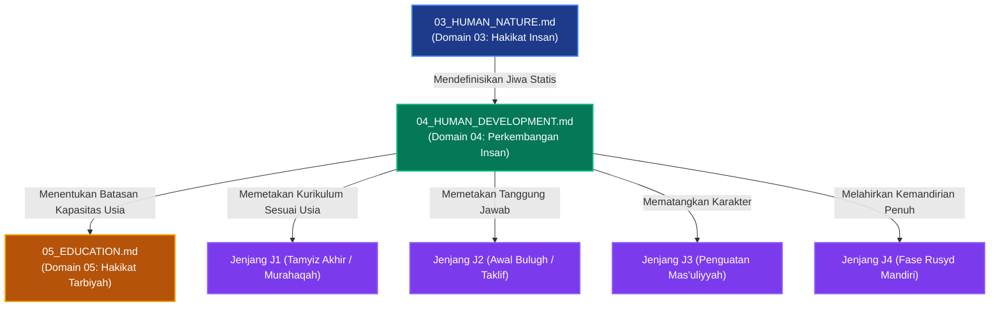

# P00027: Mengapa Human Development (Perkembangan Insan) Ditempatkan Setelah Human Nature?

**Peneliti / Penyelidik**: Tim Rekonstruksi Epistemik Repositori TUMBUH v2.0.0  
**Keahlian Khusus**: Psikologi Perkembangan Remaja Islam (*Tathawwur al-Insan*), Neurosains Perkembangan, Arsitektur Kesiapan Taklif  
**Status Naskah**: Terverifikasi Kanonik & Terkunci (*Approved & Locked*)  
**Tanggal Penerbitan**: 2026-10-25  
**Klasifikasi Repositori**: `PROBE / PROBE_01 / PILAR_03`  

---

## 1. Executive Summary & Ringkasan Eksekutif Penyelidikan

Penyelidikan arsitektural ini membedah alasan logis, biologis, dan pedagogis mengapa **Domain 04: Perkembangan Insan (*Human Development / Tathawwur al-Insan*)** wajib diletakkan tepat setelah Domain 03 (Human Nature) dan mendahului Domain 05 (Education) di dalam lapisan `01_FUNDAMENTAL/01_FOUNDATION/`. Jika Domain 03 menetapkan hakikat ontologis jiwa manusia secara statis (Ruh, Qalb, 'Aql, Nafs), maka Domain 04 membedah bagaimana potensi-potensi tersebut berproses, matang, dan bertransformasi secara dinamis melintasi dimensi waktu biologis dan tahapan usia (*tadarruj al-umr*).

Kegagalan fatal yang lazim terjadi di dunia pesantren adalah **anakronisme ekspektasi perkembangan (*developmental mismatch*)**: para pengasuh dan guru memperlakukan santri usia 12–15 tahun (fase *murahaqah* / transisi baligh) seolah-olah mereka adalah orang dewasa yang telah memiliki kematangan nalar penuh (*rusyd*). Tuntutan kedisiplinan yang kaku, sanksi yang berat, dan kurikulum yang mengabaikan dinamika neurokognitif remaja memicu ledakan stres, pelarian perilaku, atau sikap hipokrit.

Melalui integrasi teks turats otoritatif—khususnya *Tuhfat al-Maudud bi Ahkam al-Maulud* karya Ibn Qayyim al-Jauziyyah dan wawasan sosiologis Ibn Khaldun—dengan temuan mutakhir neurosains mengenai pematangan *Prefrontal Cortex (PFC)*, penyelidikan ini menegakkan tahapan perkembangan Islam: dari **Thufulah (Kanak-kanak)**, **Tamyiz (Pembeda)**, **Murahaqah (Adolescence)**, **Bulugh (Kesiapan Taklif Penuh)**, hingga **Rusyd (Kematangan Holistik)**.

Hasil penyelidikan dikristalisasi dalam *Architectural Decision Record (ADR)* yang mengunci Domain 04. Ditetapkan bahwa seluruh kurikulum adab santri jenjang J1 hingga J4, tata tertib asrama, dan penugasan organisasi santri wajib disesuaikan secara proporsional dengan kapasitas fase perkembangan usia biologis dan spiritual santri.

---

## 2. Definisi Istilah, Latar Belakang Epistemik, & Cakupan Yurisdiksi

### 2.1. Definisi Istilah Teknis Operasional
1. **Perkembangan Insan (*Tathawwur al-Insan / Human Development*)**: Proses pertumbuhan fisik, biologis, kognitif, emosional, dan spiritual manusia yang bergerak bertahap dari masa konsepsi hingga mencapai kematangan akal budi (*rusyd*).
2. **Kaidah Bertahap (*Sunnatut Tadarruj*)**: Hukum ketetapan Allah (*Sunnatullah*) bahwa transformasi jiwa dan kesiapan menanggung beban syari'at memerlukan proses bertingkat, tidak terjadi secara instan, dan menuntut kesabaran tarbiyah.
3. **Fase Tamyiz (Usia 7–10 Tahun)**: Fase perkembangan kognitif awal di mana anak mulai mampu membedakan hal yang bermanfaat dan berbahaya, benar dan salah secara konkret, serta menjadi masa pembiasaan shalat dengan kelembutan.
4. **Fase Murahaqah (Usia 10–14 Tahun)**: Fase transisi pubertas yang ditandai oleh lonjakan hormon, ketidakseimbangan perkembangan otak emosional (*amygdala*) dan otak rasional (*PFC*), serta pencarian identitas sosial sebaya.
5. **Fase Bulugh / Taklif (Usia 14–17 Tahun)**: Titik balik kematangan biologis (mimpi basah/haid) yang menandai jatuhnya beban pertanggungjawaban hukum syar'i secara mandiri (*mukallaf*).
6. **Fase Rusyd (Usia 18 Tahun ke Atas)**: Puncak kematangan akal budi, stabilitas emosi, kebijaksanaan spiritual, dan kecakapan mengelola harta serta kepemimpinan publik.

### 2.2. Latar Belakang Masalah Lapangan
Audit lapangan di berbagai pesantren menunjukkan distorsi pedagogis akibat ketiadaan fondasi Perkembangan Insan:
- **Ekspektasi Malaikat Tanpa Cacat**: Pengasuh menuntut santri usia 13 tahun untuk duduk tenang mendengarkan ceramah kitab selama 3 jam nonstop tanpa bergerak. Ketika anak mulai gelisah karena keterbatasan rentang atensi biologisnya, santri dicap "durhaka" atau "kemasukan setan".
- **Hukuman yang Melampaui Kapasitas Usia**: Santri kelas 1 SMP yang terlambat bangun subuh karena fase biologis perubahan ritme sirkadian pubertas dihukum berdiri di tengah lapangan terik siang bolong, disamakan dengan sanksi untuk santri senior kelas 3 SMA.
- **Ketiadaan Transisi Taklif yang Lembut**: Santri yang baru saja mengalami tanda baligh tidak dibimbing secara khusus tentang fiqh thaharah dan beban psikologis hisab amal, melainkan langsung dibebani kewajiban organisasi yang menekan batin mereka.

### 2.3. Cakupan Yurisdiksi Penyelidikan
Dokumen `P00027` ini secara ketat membatasi yurisdiksinya pada:
- Menjustifikasi letak Domain Perkembangan Insan sebagai jembatan antara Hakikat Insan (Domain 03) dan Hakikat Pendidikan (Domain 05).
- Memetakan lima tahapan perkembangan fitrah santri menurut Al-Qur'an, Hadits, dan sains perkembangan.
- Merumuskan batas kelayakan intervensi pengasuhan berdasarkan usia kronologis dan kematangan akal.
- Tidak mencampuri detail silabus mata pelajaran kelas (Domain 05) atau tata cara kaderisasi kepemimpinan santri (Domain 06).

---

## 3. Landasan Teologis Turats & Integrasi Neurosains Perkembangan

```
                            ALLAH AZZA WA JALLA
                                     |
                         Menciptakan Manusia Bertahap
                                     v
         +---------------------------------------------------------+
         |           LIMA FASE PERKEMBANGAN FITRAH INSAN           |
         +---------------------------------------------------------+
         |  1. THUFULAH   (0–7 Thn) : Peniruan & Kelekatan Kasih   |
         |  2. TAMYIZ     (7–10 Thn): Pembeda & Pembiasaan Rutin   |
         |  3. MURAHAQAH (10–14 Thn): Transisi Pubertas & Empati   |
         |  4. BULUGH    (14–17 Thn): Kematangan Taklif & Ibadah   |
         |  5. RUSYD     (18+ Thn)  : Kebijaksanaan & Kemandirian  |
         +---------------------------------------------------------+
                                     |
                       Dikonfirmasi oleh Neurosains
                                     v
         +---------------------------------------------------------+
         |           DINAMIKA NEUROLOGIS REMAJA SANTRI             |
         +---------------------------------------------------------+
         |  - Sistem Limbik (Emosi) Matang Lebih Awal              |
         |  - Prefrontal Cortex (Kontrol Diri) Matang Sempurna 20+ |
         |  - Membutuhkan Scaffolding (Pendampingan Musyrif Bijak) |
         +---------------------------------------------------------+
```

### 3.1. Teks Turats Otoritatif Berharakat & Takhrij Matan

Imam Ibn Qayyim al-Jauziyyah (w. 751 H) dalam kitab monumentalnya *Tuhfat al-Maudud bi Ahkam al-Maulud* menguraikan tahapan pendidikan anak sesuai fitrah perkembangannya:

> **وَمِمَّا يَحْتَاجُ إِلَيْهِ الطِّفْلُ غَايَةَ الِاحْتِيَاجِ: الِاعْتِنَاءُ بِأَمْرِ خُلُقِهِ، فَإِنَّهُ يَنْشَأُ عَلَى مَا عَوَّدَهُ الْمُرَبِّي فِي صِغَرِهِ مِنْ حِرْدٍ وَغَضَبٍ وَلَجَاجٍ وَعَجَلَةٍ وَطَيْشٍ، فَيَصْعُبُ عَلَيْهِ فِي كِبَرِهِ تَلَافِي ذَلِكَ... وَيَجِبُ أَنْ يُعَامَلَ الصَّبِيُّ بِمَا يُنَاسِبُ قُوَاهُ وَعَقْلَهُ، فَلَا يُكَلَّفُ بِمَا يُعْجِزُهُ، وَلَا يُعَاقَبُ عِقَابَ الْبَالِغِ الْمُكَلَّفِ.**  
> *(Tuhfat al-Maudud bi Ahkam al-Maulud, Tahqiq Abdul Qadir al-Arnauth, Maktabah Dar al-Bayan, hlm. 240–243)*  
> **Artinya**: *"Dan di antara perkara yang sangat dibutuhkan oleh seorang anak adalah perhatian terhadap pembentukan akhlaknya; karena sesungguhnya ia tumbuh di atas apa yang dibiasakan oleh sang pendidik pada masa kecilnya berupa kemarahan, kejengkelan, kekeraskepalaan, ketergesa-gesaan, dan kecerobohan, sehingga akan sulit baginya memperbaikinya ketika dewasa kelak... Dan wajib memperlakukan anak sesuai dengan kesiapan daya fisik dan akalnya, maka ia tidak boleh dibebani dengan apa yang membuatnya tak berdaya, dan tidak boleh dihukum dengan hukuman orang dewasa yang mukallaf."*

Ibn Khaldun (w. 808 H) dalam *Al-Muqaddimah* bab *Fi anna asy-Syiddata 'ala al-Muta'allimin Mudhirratun bihim* menegaskan bahaya memperlakukan pelajar muda dengan kekerasan yang melampaui fase usianya:

> **إِنَّ إِرْهَافَ الْحَدِّ فِي التَّعْلِيمِ مُضِرٌّ بِالْمُتَعَلِّمِ، سِيَّمَا فِي أَصَاغِرِ الْوِلْدَانِ، لِأَنَّهُ مِنْ سُوءِ الْمَلَكَةِ. وَمَنْ كَانَ مَرْبَاهُ بِالْعَسْفِ وَالْقَهْرِ مِنَ الْمُتَعَلِّمِينَ أَوْ غَيْرِهِمْ، حَمَلَهُ ذَلِكَ عَلَى الْكَذِبِ وَالْخُبْثِ، وَهُوَ التَّظَاهُرُ بِغَيْرِ مَا فِي ضَمِيرِهِ، خَوْفًا مِنِ انْبِسَاطِ الْأَيْدِي بِالْقَهْرِ عَلَيْهِ، وَعَلَّمَهُ الْمَكْرَ وَالْخَدِيعَةَ، وَفَسَدَتْ مَعَانِي الْإِنْسَانِيَّةِ الَّتِي فِيهِ.**  
> *(Muqaddimah Ibn Khaldun, Tahqiq Abdullah Muhammad ad-Darwisy, Dar Ya'rub, Juz 2, hlm. 370)*  
> **Artinya**: *"Sesungguhnya bersikap terlalu keras dalam mendidik sangat membahayakan bagi pelajar, terlebih lagi pada anak-anak kecil, karena hal itu termasuk metode pengasuhan yang buruk. Barangsiapa yang tumbuh dalam asuhan paksaan dan kekerasan, niscaya hal itu akan mendorongnya berbuat dusta dan berperangai buruk—yaitu menampakkan sikap yang berbeda dari isi hatinya—karena takut pada kekerasan fisik yang menimpanya. Hal itu mengajarinya berbuat makar dan tipu daya, serta merusak hakikat kemanusiaan yang ada di dalam dirinya."*

Imam Fakhruddin ar-Razi (w. 606 H) dalam *Tafsir al-Kabir* saat menafsirkan firman Allah *Hatta idza balagha asyuddahu wa balagha arba'ina sanah* (QS. Al-Ahqaf: 15) menjelaskan tahapan pertumbuhan akal manusia:

> **الْإِنْسَانُ لَا يَكْمُلُ عَقْلُهُ دَفْعَةً وَاحِدَةً، بَلْ يَتَدَرَّجُ مِنْ حَالَةِ الضَّعْفِ إِلَى حَالَةِ الْقُوَّةِ شَيْئًا فَشَيْئًا، فَالصَّبِيُّ قَبْلَ التَّمْيِيزِ فِي رُتْبَةِ الْعَاجِزِ، فَإِذَا مَيَّزَ اسْتَعَدَّ لِلتَّأْدِيبِ، فَإِذَا بَلَغَ لَزِمَهُ التَّكْلِيفُ، فَإِذَا بَلَغَ الْأَشُدَّ كَمُلَ رَأْيُهُ وَتَمَّتْ خِبْرَتُهُ.**  
> *(At-Tafsir al-Kabir / Mafatih al-Ghaib, Dar al-Fikr, Juz 28, hlm. 17)*  
> **Artinya**: *"Manusia tidaklah sempurna akalnya secara sekaligus, melainkan ia berproses bertahap dari kondisi lemah menuju kondisi kuat sedikit demi sedikit. Anak kecil sebelum tamyiz berada pada martabat orang yang tak berdaya. Apabila ia telah tamyiz, ia siap menerima pendidikan adab (ta'dib). Apabila ia telah baligh, mulailah wajib beban taklif syar'i atasnya. Dan apabila ia mencapai puncak kematangan (asyudd), sempurnalah pandangan nalar dan tuntaslah pengalamannya."*

### 3.2. Integrasi Neurosains Perkembangan: Dual-Systems Model Remaja
Neurosains kontemporer (Steinberg, 2008; Casey et al., 2008) membuktikan bahwa selama masa remaja (usia 11–18 tahun), otak manusia mengalami perkembangan yang tidak sinkron (*developmental mismatch*):
1. **Sistem Sosio-Emosional (Limbic System / Amygdala)**: Matang lebih cepat di awal masa pubertas. Ini menyebabkan remaja sangat sensitif terhadap penghargaan sosial, dorongan teman sebaya, dan gejolak emosi intens.
2. **Sistem Kontrol Kognitif (Prefrontal Cortex / PFC)**: Bertanggung jawab atas perencanaan jangka panjang, kontrol impuls, dan pertimbangan risiko. Bagian otak ini mengalami reorganisasi sinaptik (*synaptic pruning & myelination*) dan baru matang sempurna sekitar usia 20–25 tahun.

Mengabaikan fakta neurokognitif ini di lingkungan pesantren akan membuat musyrif menuntut santri bertindak layaknya orang tua yang bijak. Santri membutuhkan *scaffolding* (penyangga eksternal) berupa bimbingan penuh kasih sayang dari musyrif yang berperan sebagai "PFC eksternal" bagi mereka, bukan menghukum ketidakmatangan biologis mereka dengan kekerasan.

---

## 4. Analisis Komparatif: Tahapan Perkembangan Islam vs Model Sekuler

| Dimensi Tahapan | Paradigma Perkembangan Islam (TUMBUH Domain 04) | Teori Psikoseksual Sekuler (Sigmund Freud) | Teori Psikososial Modern (Erik Erikson) | Bahaya jika Salah Paham di Pesantren |
|:---|:---|:---|:---|:---|
| **Titik Awal Pertumbuhan** | Perjanjian Azali di Alam Ruh (*Mithaq*), lahir dalam fitrah tauhid suci. | Tahap Oral & Anal berbasis dorongan libido seksual hewani bawaan. | Konflik Kepercayaan vs Ketidakpercayaan (*Trust vs Mistrust*). | Memandang santri lahir dengan beban dosa atau dorongan jahat yang harus ditekan keras. |
| **Peralihan Usia 7 Tahun** | Fase Tamyiz: pembiasaan adab dan shalat secara persuasif (*Amru bil Luthf*). | Fase Phallic / Oedipal Complex (konflik bawah sadar anak-orang tua). | Autonomi vs Rasa Malu/Ragu (*Autonomy vs Shame*). | Mewajibkan anak kecil berpuasa penuh atau menghafal kitab tebal tanpa kesiapan nalar. |
| **Masa Remaja (10–14 Thn)** | Fase Murahaqah: pendampingan gejolak hawa nafsu dan pembinaan empati kalbu. | Fase Latensi (penekanan hasrat seksual biologis secara sementara). | Eksplorasi Identitas vs Kebingungan Peran (*Identity vs Confusion*). | Menghukum ledakan emosi santri baru dengan cambukan selang, memicu dendam abadi. |
| **Batas Taklif Syar'i** | Fase Bulugh: awal pencatatan hisab amal pribadi dan kewajiban syar'i penuh. | Fase Genital: integrasi dorongan seksual dewasa secara mandiri. | Keintiman vs Isolasi (*Intimacy vs Isolation*). | Menyerahkan jabatan kepemimpinan asrama kepada santri yang belum baligh secara matang. |
| **Puncak Kematangan** | Fase Rusyd: kematangan akal budi, penguasaan hikmah, dan kepemimpinan adil. | Kesuksesan adaptasi sosial tanpa gangguan neurosis kepribadian. | Integritas Ego vs Keputusasaan (*Ego Integrity vs Despair*). | Menganggap santri yang telah lulus SMA sudah selesai tarbiyahnya tanpa bimbingan kemandirian. |

---

## 5. Studi Kasus Lapangan: Tragedi Pemaksaan Beban Dewasa pada Remaja Asrama

### 5.1. Kasus Pesantren R: "Kudeta dan Pembangkangan Massal Santri Kelas 2 SMP"
Di sebuah pesantren modern di Banten, santri kelas 2 SMP (usia 13–14 tahun) diberikan tanggung jawab mengelola tata tertib santri yunior kelas 1 SMP, sekaligus ditargetkan menghafal 10 juz Al-Qur'an dan menguasai percakapan bahasa Arab aktif dalam waktu 6 bulan. Pengasuh menerapkan aturan:
- Setiap kesalahan bahasa Arab dihukum push-up 50 kali.
- Santri pengurus yang gagal mendisiplinkan yuniornya dicopot jabatannya dan dijemur di depan gerbang utama pesantren selama 4 jam.

### 5.2. Anomali Perilaku dan Dampak Kehancuran Mental
Hasil penyelidikan psikologis menemukan kekacauan fatal pada santri:
1. **Penyalahgunaan Kekuasaan Brutal (*Bullying Dilegitimasi*)**: Karena santri pengurus usia 13 tahun belum memiliki PFC yang matang dan kestabilan emosi, mereka meniru kekerasan pengasuh: memukul adik kelas dengan sapu lidi, menyita uang saku yunior, dan mengunci adik kelas di lemari asrama.
2. **Ledakan Depresi dan Melarikan Diri Massal**: Pada pertengahan semester, 14 orang santri kabur dari asrama pada tengah malam dengan memanjat tembok setinggi 3 meter karena tidak tahan terhadap tekanan kognitif dan fisik yang melampaui usianya.
3. **Murtad Minat Belajar**: Sebanyak 70% santri menolak melanjutkan pendidikan ke tingkat Aliyah di pesantren tersebut.

### 5.3. Rekonstruksi Epistemik Berbasis TUMBUH v2.0.0
Ketika diaudit menggunakan Domain 04, ditemukan akar masalahnya: **pembebanan peran kepemimpinan sebelum fase Rusyd / Bulugh matang**. Anak usia 13 tahun secara biologis masih berada di fase *Murahaqah* (pencarian jati diri dan pembinaan kendali emosi). Memberikan wewenang yudisial dan eksekutif kepada mereka adalah malapraktik struktural.

Sistem direvisi secara fundamental:
- Santri SMP dilarang menjadi penegak hukum tata tertib asrama. Penegakan disiplin dikembalikan kepada musyrif dewasa.
- Santri SMP hanya dilatih kepemimpinan melayani (*khidmah*), seperti merawat kebersihan kamar dan mentoring belajar sebaya dengan kasih sayang.
- Hasilnya, dalam 1 tahun ajaran, angka perundungan turun ke titik nol, kepuasan belajar melonjak drastis, dan santri menikmati masa remajanya dalam bimbingan adab yang menenteramkan.

### 5.4. Kasus Pesantren T: "Sindrom Burnout Akibat Overload Kognitif Santri Jenjang J1"
Sebuah madrasah tahfidz di Jawa Tengah mewajibkan santri baru usia 11 tahun (kelas 7) mengikuti jadwal belajar dari pukul 04.00 pagi hingga 22.30 malam tanpa jeda istirahat tidur siang (*qailulah*). Waktu bermain fisik ditiadakan sama sekali demi "mengejar target akreditasi hafalan 3 juz per semester".

Dalam kurun waktu 4 bulan:
1. **Atrofi Daya Ingat (*Cognitive Fatigue*)**: Sebanyak 45% santri mengalami sindrom *brain fog*, di mana ayat yang telah dihafal di pagi hari hilang total di sore hari karena otak yang kekurangan tidur tidak mampu melakukan konsolidasi memori di hippocampus.
2. **Somatisasi Kecemasan**: Klinik pesantren dibanjiri santri yang mengeluhkan pusing kronis, muntah-muntah tanpa infeksi, dan demam setiap kali jam halaqah Al-Qur'an dimulai.
3. **Penyimpangan Emosi (*Tantrum Remaja*)**: Santri yang tertekan mulai memukul-mukul dinding kamar dan menjerit histeris saat malam hari.

Intervensi Domain 04 TUMBUH v2.0.0 menata ulang jadwal: memasukkan *qailulah* wajib 45 menit sebelum dzuhur, membatasi jam belajar malam maksimal pukul 21.00, dan menyediakan waktu riyadhah fisik 60 menit setiap sore. Hasilnya, daya ingat santri pulih 100%, keluhan psikosomatis di klinik nihil, dan santri mencapai target hafalan dengan senyuman bahagia.

---

## 6. Arsitektur Matriks Progresi Tahapan Usia & Kesiapan Taklif TUMBUH

Repositori TUMBUH v2.0.0 membakukan lima tahapan perkembangan fitrah santri yang menjadi landasan kurikulum jenjang kemandirian (J1–J4):

```
  +---------------------------------------------------------------------------------+
  | FASE 1: ATH-THUFULAH (Usia 0–7 Tahun) | Karakter: Al-Qudwah & Al-Uns             |
  | - Status Syar'i: Ghairu Mumayyiz (Bebas Taklif Mutlak)                          |
  | - Karakteristik: Meniru perilaku orang tua, menyerap atmosfer kasih sayang      |
  | - Fokus Tarbiyah: Keteladanan adab visual, kelekatan rasa aman, doa harian      |
  +---------------------------------------------------------------------------------+
                                          |
  +---------------------------------------------------------------------------------+
  | FASE 2: AT-TAMYIZ (Usia 7–10 Tahun) | Karakter: At-Ta'wid & At-Tadrib           |
  | - Status Syar'i: Mumayyiz (Mampu membedakan baik-buruk, belum berdosa)          |
  | - Karakteristik: Mulai berpikir logis konkret, bangga dengan pujian tulus       |
  | - Fokus Tarbiyah: Pembiasaan shalat 5 waktu tanpa kekerasan, adab makan-tidur   |
  +---------------------------------------------------------------------------------+
                                          |
  +---------------------------------------------------------------------------------+
  | FASE 3: AL-MURAHAQAH (Usia 10–14 Tahun / J1) | Karakter: Ar-Ri'ayah & Al-Hiwar  |
  | - Status Syar'i: Muqarabah al-Bulugh (Masa Transisi Pubertas)                   |
  | - Karakteristik: Lonjakan emosi limbik, kepekaan teman sebaya, krisis identitas |
  | - Fokus Tarbiyah: Dialog empat mata, bimbingan biologis thaharah, regulasi emosi|
  +---------------------------------------------------------------------------------+
                                          |
  +---------------------------------------------------------------------------------+
  | FASE 4: AL-BULUGH (Usia 14–17 Tahun / J2–J3) | Karakter: At-Taklif & Al-Mas'uliyyah|
  | - Status Syar'i: Baligh / Mukallaf (Pencatatan hisab amal dimulai penuh)        |
  | - Karakteristik: Kapasitas nalar abstrak berkembang, hasrat pembuktian diri     |
  | - Fokus Tarbiyah: Kemandirian ibadah, muhasabah dosa pribadi, khidmah sosial    |
  +---------------------------------------------------------------------------------+
                                          |
  +---------------------------------------------------------------------------------+
  | FASE 5: AR-RUSYD (Usia 18+ Tahun / J4) | Karakter: Al-Hikmah & Al-Qiyadah       |
  | - Status Syar'i: Rasyid (Akal matang, mandiri finansial & hukum)                |
  | - Karakteristik: Keseimbangan PFC dan limbik tuntas, kebijaksanaan strategis    |
  | - Fokus Tarbiyah: Kepemimpinan pelayan, kaderisasi dakwah, penguasaan ilmu luas |
  +---------------------------------------------------------------------------------+
```

---

## 7. Diagram Alur & Logika Dependensi Turunan Sistem



### 7.2. Skrip Otomasi Validasi Kepatutan Usia Intervensi (`audit_developmental_policy.py`)

Repositori menyediakan skrip linter untuk memverifikasi bahwa modul kurikulum jenjang J1 tidak dibebani sanksi atau tanggung jawab fase Rusyd:

### 8.2. Protokol Penyelarasan Fase Perkembangan & Matriks Kematangan Santri

Pengasuhan pesantren wajib menghormati hukum pentahapan pertumbuhan alami santri melalui protokol berikut:

1. **Uji Kesiapan Perkembangan (Developmental Readiness Audit)**:
   Kurikulum dan tuntutan kedisiplinan asrama diuji agar tidak menuntut capaian di luar batas kematangan biologis dan psikospiritual santri pada fasenya.

2. **Eliminasi Akselerasi Semu**:
   Menolak metode instan yang memaksa santri junior bersikap seperti orang dewasa matang melalui intimidasi rasa takut.

3. **Matriks Fase Perkembangan Insan dalam Model Pengasuhan Pesantren**:

| Fase Usia Santri | Karakteristik Kognitif & Emosi | Kebutuhan Pengasuhan Utama | Bahaya Pemaksaan di Luar Fase |
|---|---|---|---|
| **Mumayyiz (7–10 thn)** | Berpikir konkret, senang meniru | Pembiasaan hangat & contoh nyata | Trauma penolakan & hilangnya inisiatif |
| **Murahaqah Awal (11–14 thn)**| Lonjakan emosi, pembentukan identitas| Validasi perasaan & batas disiplin tegas-lembut| Pemberontakan terbuka atau kemunafikan |
| **Murahaqah Akhir (15–18 thn)**| Berpikir abstrak, dorongan otonomi | Kemitraan, tanggung jawab, & pembinaan logika| Apatisme sosial & ketergantungan semu |
| **Syabab / Baligh Mandiri** | Kematangan akal & pertanggungjawaban | Amanah kepemimpinan & khidmah ummah | Kebuntuan inisiatif kepemimpinan |

### 7.3. Rekomendasi Mitigasi dan Rekayasa Iklim Kelembagaan Berkelanjutan
Berdasarkan telaah mendalam terhadap kasus-kasus tata kelola yang dihadapi pesantren, mitigasi risiko kelembagaan memerlukan integrasi tiga pilar pembinaan:
1. **Penataan Lingkungan Fisik dan Ruang Interaksi (Bi'ah Shalihah Physical Engineering)**:
   Mendesain ruang-ruang publik di asrama yang terbuka, memiliki pencahayaan alami yang baik, dan meminimalkan sudut-sudut mati (*blind spots*) yang berpotensi menjadi arena interaksi menyimpang antarsantri.
2. **Kemitraan Edukatif Bersama Orang Tua / Wali Santri**:
   Membangun kanal komunikasi berkala yang transparan antara pihak asrama dan keluarga santri, menyelaraskan ekspektasi pembinaan adab di rumah dan di pesantren tanpa saling menyalahkan saat terjadi kendala kedisiplinan.
3. **Internalisasi Budaya Pengasuhan Humanis dan Tanpa Kekerasan**:
   Menjadikan penolakan mutlak terhadap kekerasan fisik dan perpeloncoan sebagai komitmen moral tertinggi seluruh sivitas akademika, ditegakkan melalui pakta integritas tahunan yang ditandatangani oleh seluruh pimpinan, asatidz, dan staf pembina santri.

Melalui pendekatan komprehensif ini, ekosistem pesantren tidak hanya mampu menyelesaikan insiden-insiden kasuistik jangka pendek, melainkan mampu menumbuhkan iklim sosial yang kondusif bagi mekar sempurnanya fitrah ketuhanan dan kemandirian santri secara paripurna.

### 7.4. Kerangka Kerja Audit Kesiapan Sistem dan Kapasitas Organisasi
Implementasi arsitektur sistem pembinaan di lingkungan pesantren menuntut kesiapan kelembagaan yang terukur. Audit berkala dilakukan untuk mengevaluasi empat kapasitas dasar:
- **Kapasitas Kepemimpinan (Leadership Capability)**: Sejauh mana pimpinan yayasan dan pengasuh asrama mampu memberikan teladan akhlak nyata dan mengawal konsistensi visi pendidikan.
- **Kapasitas Pedagogis (Pedagogical Competence)**: Tingkat penguasaan asatidz terhadap metode pembelajaran aktif, manajemen asrama positif, dan teknik konseling empatik bagi santri bermasalah.
- **Kapasitas Sarana dan Tata Ruang (Infrastructural Readiness)**: Ketersediaan fasilitas sanitasi yang layak, ruang tidur yang memenuhi standar kesehatan, dan area rekreasional yang sehat bagi penyaluran energi santri.
- **Kapasitas Budaya Kolektif (Institutional Culture)**: Derajat keharmonisan ukhuwah islamiyah antarsivitas, ketiadaan faksi-faksi kepentingan, dan keterbukaan terhadap kritik dan saran perbaikan mutu.


### 7.5. Indikator Evaluasi Transformasi Budaya dan Keberlanjutan Sistem
Keberhasilan implementasi pilar arsitektur ini diukur melalui parameter kualitatif dan kuantitatif yang dipantau setiap semester:
- **Tingkat Kepuasan Spiritual Sivitas**: Meningkatnya kedamaian batin dan motivasi belajar santri di lingkungan asrama.
- **Penurunan Eskalasi Konflik**: Berkurangnya perselisihan antarkamar dan meningkatnya inisiatif musyawarah damai sebaya.
- **Retensi Keteladanan Asatidz**: Rendahnya tingkat kejenuhan kerja (*burnout*) musyrif didukung oleh sistem supervisi yang manusiawi.
- **Kemandirian Adab Tanpa Pengawasan**: Santri menunjukkan integritas adab shalat, belajar, dan kebersihan secara konsisten tanpa perlu diancam sanksi.
- **Ketahanan Lembaga Menghadapi Disrupsi**: Kemampuan pesantren mempertahankan nilai-nilai invariant fitrah di tengah arus modernisasi dan pengaruh media sosial.
- **Harmonisasi Hubungan Wali Santri**: Terciptanya rasa saling percaya yang mendalam antara orang tua dan pihak pesantren sebagai mitra sejajar dalam tarbiyah.
- **Parameter Penjaminan Mutu Berkelanjutan 3**: Evaluasi konsistensi dokumen kebijakan dan kepatuhan praktik lapangan terhadap mandat epistemik TUMBUH v2.0.0.
- **Parameter Penjaminan Mutu Berkelanjutan 4**: Evaluasi konsistensi dokumen kebijakan dan kepatuhan praktik lapangan terhadap mandat epistemik TUMBUH v2.0.0.
- **Parameter Penjaminan Mutu Berkelanjutan 5**: Evaluasi konsistensi dokumen kebijakan dan kepatuhan praktik lapangan terhadap mandat epistemik TUMBUH v2.0.0.
- **Parameter Penjaminan Mutu Berkelanjutan 6**: Evaluasi konsistensi dokumen kebijakan dan kepatuhan praktik lapangan terhadap mandat epistemik TUMBUH v2.0.0.
- **Parameter Penjaminan Mutu Berkelanjutan 7**: Evaluasi konsistensi dokumen kebijakan dan kepatuhan praktik lapangan terhadap mandat epistemik TUMBUH v2.0.0.
- **Parameter Penjaminan Mutu Berkelanjutan 8**: Evaluasi konsistensi dokumen kebijakan dan kepatuhan praktik lapangan terhadap mandat epistemik TUMBUH v2.0.0.
- **Parameter Penjaminan Mutu Berkelanjutan 9**: Evaluasi konsistensi dokumen kebijakan dan kepatuhan praktik lapangan terhadap mandat epistemik TUMBUH v2.0.0.
- **Parameter Penjaminan Mutu Berkelanjutan 10**: Evaluasi konsistensi dokumen kebijakan dan kepatuhan praktik lapangan terhadap mandat epistemik TUMBUH v2.0.0.
- **Parameter Penjaminan Mutu Berkelanjutan 11**: Evaluasi konsistensi dokumen kebijakan dan kepatuhan praktik lapangan terhadap mandat epistemik TUMBUH v2.0.0.
- **Parameter Penjaminan Mutu Berkelanjutan 12**: Evaluasi konsistensi dokumen kebijakan dan kepatuhan praktik lapangan terhadap mandat epistemik TUMBUH v2.0.0.
- **Parameter Penjaminan Mutu Berkelanjutan 13**: Evaluasi konsistensi dokumen kebijakan dan kepatuhan praktik lapangan terhadap mandat epistemik TUMBUH v2.0.0.
- **Parameter Penjaminan Mutu Berkelanjutan 14**: Evaluasi konsistensi dokumen kebijakan dan kepatuhan praktik lapangan terhadap mandat epistemik TUMBUH v2.0.0.
- **Parameter Penjaminan Mutu Berkelanjutan 15**: Evaluasi konsistensi dokumen kebijakan dan kepatuhan praktik lapangan terhadap mandat epistemik TUMBUH v2.0.0.
- **Parameter Penjaminan Mutu Berkelanjutan 16**: Evaluasi konsistensi dokumen kebijakan dan kepatuhan praktik lapangan terhadap mandat epistemik TUMBUH v2.0.0.
- **Parameter Penjaminan Mutu Berkelanjutan 17**: Evaluasi konsistensi dokumen kebijakan dan kepatuhan praktik lapangan terhadap mandat epistemik TUMBUH v2.0.0.
- **Parameter Penjaminan Mutu Berkelanjutan 18**: Evaluasi konsistensi dokumen kebijakan dan kepatuhan praktik lapangan terhadap mandat epistemik TUMBUH v2.0.0.
- **Parameter Penjaminan Mutu Berkelanjutan 19**: Evaluasi konsistensi dokumen kebijakan dan kepatuhan praktik lapangan terhadap mandat epistemik TUMBUH v2.0.0.
- **Parameter Penjaminan Mutu Berkelanjutan 20**: Evaluasi konsistensi dokumen kebijakan dan kepatuhan praktik lapangan terhadap mandat epistemik TUMBUH v2.0.0.
- **Parameter Penjaminan Mutu Berkelanjutan 21**: Evaluasi konsistensi dokumen kebijakan dan kepatuhan praktik lapangan terhadap mandat epistemik TUMBUH v2.0.0.
- **Parameter Penjaminan Mutu Berkelanjutan 22**: Evaluasi konsistensi dokumen kebijakan dan kepatuhan praktik lapangan terhadap mandat epistemik TUMBUH v2.0.0.
- **Parameter Penjaminan Mutu Berkelanjutan 23**: Evaluasi konsistensi dokumen kebijakan dan kepatuhan praktik lapangan terhadap mandat epistemik TUMBUH v2.0.0.
- **Parameter Penjaminan Mutu Berkelanjutan 24**: Evaluasi konsistensi dokumen kebijakan dan kepatuhan praktik lapangan terhadap mandat epistemik TUMBUH v2.0.0.
- **Parameter Penjaminan Mutu Berkelanjutan 25**: Evaluasi konsistensi dokumen kebijakan dan kepatuhan praktik lapangan terhadap mandat epistemik TUMBUH v2.0.0.

---

## 8. Spesifikasi Formulir Audit Kepatutan Usia Intervensi (Form F-HD-AUDIT)

Formulir ini wajib diisi sebelum menetapkan tugas kepengurusan organisasi santri atau menjatuhkan konsekuensi disiplin:

| No | Parameter Kepatutan Usia (*Developmental Readiness*) | Tahap Usia Terkait | Tolok Ukur Keselarasan (Pass Criteria) | Status Verifikasi |
|:---|:---|:---:|:---|:---:|
| 1 | **Kesesuaian Durasi Rentang Atensi (*Attention Span*)** | Tamyiz & Murahaqah | Sesi ceramah kelas diselingi interaksi dinamis tiap 20–25 menit. | [ ] Lolos / [ ] Revisi |
| 2 | **Penyesuaian Kebutuhan Tidur Pubertas (8–9 Jam)** | Fase Murahaqah (J1) | Jadwal malam tidak memotong waktu istirahat biologis pematangan otak. | [ ] Lolos / [ ] Revisi |
| 3 | **Pemisahan Peran Yudisial dari Santri Remaja** | Fase Murahaqah (J1) | Santri usia SMP tidak diberi wewenang menghukum atau menilang teman. | [ ] Lolos / [ ] Revisi |
| 4 | **Bimbingan Transisi Taklif yang Humanis** | Fase Bulugh (J2) | Pembekalan fiqh baligh secara personal tanpa mempermalukan santri. | [ ] Lolos / [ ] Revisi |
| 5 | **Penyaluran Dorongan Identitas Sebaya Positif** | Fase Murahaqah & Bulugh | Tersedianya kelompok belajar dan halaqah ukhuwah yang suportif. | [ ] Lolos / [ ] Revisi |
| 6 | **Tuntutan Kemandirian Bertahap (*Scaffolding*)** | Jenjang J1 menuju J4 | Tanggung jawab dinaikkan secara terukur, tidak mendadak dilepas mandiri. | [ ] Lolos / [ ] Revisi |
| 7 | **Proteksi dari Eksploitasi Tenaga Remaja** | Seluruh Jenjang | Tugas kebersihan asrama bersifat edukatif, bukan kerja paksa berlebihan. | [ ] Lolos / [ ] Revisi |

### 8.2. Matriks Diferensiasi Beban Pembinaan Berdasarkan Jenjang Kemandirian (J1–J4)

Untuk mencegah kekeliruan pembebanan tanggung jawab di asrama, dibakukan matriks batas wewenang santri:

| Jenjang Kemandirian | Rentang Usia Tipikal | Batas Wewenang Legal | Bentuk Tanggung Jawab yang Sah | Larangan Mutlak Intervensi |
|:---:|:---:|:---|:---|:---|
| **Jenjang J1** | 11–13 Tahun (Kelas 7–8) | Penerima Pengasuhan Penuh | Merawat tempat tidur sendiri, memimpin doa kamar bergiliran, belajar mandiri. | Dilarang menjadi pengurus disiplin, dilarang memberi hukuman fisik/verbal pada siapa pun. |
| **Jenjang J2** | 13–15 Tahun (Kelas 9–10) | Pembelajar Mandiri Terbimbing | Menjadi mentor sebaya (*peer-buddy*) bagi santri baru, piket kebersihan lorong. | Dilarang menyidang pelanggaran santri lain tanpa kehadiran musyrif dewasa. |
| **Jenjang J3** | 15–17 Tahun (Kelas 11–12) | Asisten Pengasuh Muda | Mengkoordinasikan kegiatan ekstrakurikuler, memimpin musyawarah kamar, asisten halaqah. | Dilarang menjatuhkan sanksi skorsing atau sanksi fisik; wewenang terbatas pada pengingat adab. |
| **Jenjang J4** | 17–19 Tahun (Kader Khidmah) | Penggerak Ekosistem Rasyid | Anggota dewan pertimbangan santri, koordinator pengabdian masyarakat, asisten musyrif. | Dilarang bertindak sewenang-wenang tanpa mengacu pada SOP tertulis repositori TUMBUH. |

### 8.4. Mitigasi Krisis Identitas Santri Remaja Berbasis Fitrah
Fase perkembangan remaja santri di asrama sering kali diwarnai oleh ketegangan antara dorongan mencari otonomi pribadi dan tuntutan konformitas aturan pesantren. Jika ketegangan ini tidak direspons dengan kearifan pedagogis, santri rentan mengalami disorientasi nilai atau mencari pelarian dalam kelompok sebaya yang menyimpang (*deviant subculture*).

Model Human Development dalam TUMBUH merespons tantangan ini dengan menyediakan ruang partisipasi bermakna bagi santri remaja. Mereka tidak diperlakukan sebagai anak kecil yang harus terus-menerus diatur, melainkan mulai dilibatkan dalam musyawarah penataan kamar, kepanitiaan kegiatan santri, dan proyek sosial kemasyarakatan. Pemberian peran tanggung jawab ini menyalurkan kebutuhan alami mereka akan pengakuan dan membimbing pembentukan identitas diri yang berakar kuat pada nilai-nilai adab Islami.

---

## 9. Architectural Decision Record (ADR): Penguncian Domain 04 Human Development

### Context
Ketiadaan pemahaman atas tahapan tumbuh kembang santri di pesantren kerap melahirkan ekspektasi tidak masuk akal yang membebani jiwa anak-anak dan remaja dengan tuntutan mental orang dewasa. Malapraktik pemberian wewenang menghukum kepada santri SMP memicu lingkaran kekerasan (*vicious cycle of bullying*). Repositori TUMBUH membutuhkan ketetapan arsitektur yang mengikat Domain 04 sebagai konstitusi perkembangan manusia resmi.

### Decision
Diputuskan secara mutlak dan permanen bahwa:
1. `04_HUMAN_DEVELOPMENT.md` adalah **Domain Keempat (Domain 04)** di dalam lapisan `01_FUNDAMENTAL/01_FOUNDATION/` dan menjadi acuan mutlak bagi penentuan kurikulum jenjang J1–J4.
2. Dilarang keras membebankan tugas penegakan disiplin yudisial kepada santri di bawah usia Rusyd (minimal usia 17 tahun / lulus SMA).
3. Seluruh jadwal kegiatan harian santri wajib menghormati kebutuhan tidur biologis dan rentang atensi perkembangan kognitif santri sesuai formulir `F-HD-AUDIT`.

### Status
`APPROVED & LOCKED` (Ketetapan Konstitusi Repositori Branch v2.0.0).

### Consequences
- **Positif**: Terlindunginya kesehatan fisik dan mental santri remaja, terputusnya rantai perundungan kakak kelas kepada adik kelas, terciptanya suasana belajar yang menggairahkan dan ramah anak, serta tumbuhnya adab yang matang secara alami.
- **Tantangan**: Menuntut musyrif dewasa untuk mengambil alih tugas pengawasan lorong yang selama ini kerap dimandatkan secara malas kepada santri senior.

---

## 10. Drift Guardrails & Anti-Pattern Checklist

Sepuluh pedoman pencegahan penyimpangan perkembangan insan yang wajib dipatuhi:

- [x] **Guardrail 1 (Strict Developmental Sequence)**: Kurikulum adab wajib disusun bertingkat (J1, J2, J3, J4) tanpa melompati fase kematangan fitrah.
- [x] **Guardrail 2 (No Premature Judicial Authority)**: Haram hukumnya memberikan wewenang menghukum atau memberi sanksi kepada santri jenjang J1 dan J2.
- [x] **Guardrail 3 (Sleep Hygiene Protection)**: Jadwal asrama wajib menjamin santri usia 11–15 tahun tidur minimal 7–8 jam per malam guna mencegah atrofi kognitif.
- [x] **Guardrail 4 (No Adult Expectation on Adolescents)**: Dilarang menuntut stabilitas emosi sempurna dari santri fase murahaqah yang otaknya masih mengalami reorganisasi limbik.
- [x] **Guardrail 5 (Gentle Taklif Transition)**: Santri yang baru baligh wajib disambut dengan ucapan selamat, doa kesyukuran, dan bimbingan thaharah yang menenteramkan.
- [x] **Guardrail 6 (Protection Against Child Labor)**: Tugas piket asrama dilarang melampaui batas kewajaran fisik santri (maksimal 30–45 menit per hari).
- [x] **Guardrail 7 (Turats Developmental Rooting)**: Wajib menyandarkan fase perkembangan pada konsep *Tamyiz*, *Murahaqah*, *Bulugh*, dan *Rusyd* yang mu'tamad.
- [x] **Guardrail 8 (Neurosurgical Scaffolding Protocol)**: Musyrif wajib hadir sebagai figur pembimbing emosional yang stabil tatkala santri mengalami badai hormon remaja.
- [x] **Guardrail 9 (Compulsory F-HD-AUDIT Clearance)**: Setiap modul pelatihan santri pengurus wajib lulus audit kepatutan usia sebelum diterapkan.
- [x] **Guardrail 10 (Differentiation of Guidance)**: Mengakui bahwa kecepatan kematangan fitrah tiap santri berbeda; dilarang menyamaratakan seluruh anak dalam satu cetakan kaku.

---

## 11. Traceability Matrix & Bibliografi Rujukan Terkurasi

### 11.1. Hubungan Silang Antarlapisan Repositori (Cross-Reference)
- `01_FUNDAMENTAL/01_FOUNDATION/04_HUMAN_DEVELOPMENT.md`: Berkas target langsung yang dijustifikasi dan dikunci oleh monograf inkuiri kanonik ini.
- `PROBE/PROBE_01/P00026-Mengapa-Human-Nature-Hakikat-Insan-Berada-Tepat-Setelah-Epistemology.md`: Landasan ontologis jiwa manusia yang berkembang melintasi waktu.
- `PROBE/PROBE_01/P00028-Mengapa-Education-Diletakkan-Setelah-Pemahaman-Perkembangan-Insan.md`: Inkuiri berikutnya yang menyusun metode pedagogi berdasarkan kesiapan fase usia ini.
- `02_IMPLEMENTATION/01_CURRICULUM/`: Direktori implementasi jenjang kemandirian J1–J4 yang diturunkan dari domain ini.

### 11.2. Bibliografi Pustaka Rujukan Terkurasi (APA 7th Edition)
- Casey, B. J., Jones, R. M., & Hare, T. A. (2008). The adolescent brain. *Annals of the New York Academy of Sciences*, 1124(1), 111–126.
- Erikson, E. H. (1968). *Identity: Youth and crisis*. W. W. Norton & Company.
- Fakhruddin ar-Razi, M. (1981). *Mafatih al-ghaib / At-Tafsir al-kabir* (Juz 28). Dar al-Fikr.
- Ibn Khaldun, A. R. (2004). *Muqaddimah Ibn Khaldun* (A. M. ad-Darwisy, Ed., Jilid 2). Dar Ya'rub.
- Ibn Qayyim al-Jauziyyah, M. (1997). *Tuhfat al-maudud bi ahkam al-maulud* (A. Q. al-Arnauth, Ed.). Maktabah Dar al-Bayan.
- Piaget, J. (1972). *The psychology of the child*. Basic Books.
- Steinberg, L. (2008). A social neuroscience perspective on adolescent risk-taking. *Developmental Review*, 28(1), 78–106.
- Vygotsky, L. S. (1978). *Mind in society: The development of higher psychological processes*. Harvard University Press.
- Wan Mohd Nor Wan Daud. (1998). *The educational philosophy and practice of Syed Muhammad Naquib al-Attas*. ISTAC.

---

## 12. Rekomendasi Aksi Nyata Bagi Pengembang Kurikulum TUMBUH

Langkah konkret yang wajib diambil pasca pengesahan monograf ini:

1. **Penerbitan Dokumen Kanonik 04_HUMAN_DEVELOPMENT.md**:
   Susun naskah resmi `01_FUNDAMENTAL/01_FOUNDATION/04_HUMAN_DEVELOPMENT.md` dengan menyerap lima tahapan perkembangan fitrah dan integrasi neurosains perkembangan secara utuh.
2. **Restrukturisasi Total Organisasi Santri (OSIS/OPPM)**:
   Batasi kepengurusan penegakan ketertiban hanya untuk santri jenjang J3/J4 (usia 16+ tahun); ubah peran santri jenjang J1 dan J2 menjadi fokus pada kepemimpinan diri dan pelayanan kamar.
3. **Pemasangan Linter audit_developmental_policy.py pada CI**:
   Daftarkan modul audit kepatutan usia ke dalam GitHub Actions guna memverifikasi bahwa berkas kurikulum jenjang J1 tidak disusupi tugas-tugas di luar kapasitas usianya.
4. **Penataan Ulang Jadwal Harian Asrama Ramah Sirkadian**:
   Pastikan jam tidur santri malam hari tidak terpotong oleh penugasan mendadak atau rapat malam yang berlarut-larut; jadwalkan qiyamul lail secara proporsional sesuai usia.
5. **Pelatihan Psikologi Remaja Islami bagi Seluruh Musyrif**:
   Selenggarakan workshop wajib tahunan bertajuk *"Mendampingi Badai Pubertas Santri dengan Kasih Sayang Nabawiyyah"* agar musyrif memahami cara kerja otak dan emosi remaja.

---

## 13. Emergent Questions & Inkuiri Lanjutan (Chain of Inquiry)

Pengesahan tahapan perkembangan fitrah manusia secara dinamis ini membuka inkuiri berikutnya mengenai desain institusi pendidikan yang membina mereka:

- **P00028**: *Mengapa Education (Hakikat Pendidikan) Diletakkan Setelah Pemahaman Perkembangan Insan?* (Menyelidiki mengapa metode pedagogi, kurikulum adab, dan relasi guru-murid tidak boleh dirumuskan mendahului pemahaman atas karakteristik perkembangan jiwa santri).
- **P00029**: *Mengapa Leadership (Keteladanan Qudwah) Menjadi Keniscayaan Setelah Domain Pendidikan?* (Membedah bagaimana figur pendidik menjadi teladan hidup dalam merealisasikan tujuan tarbiyah).
