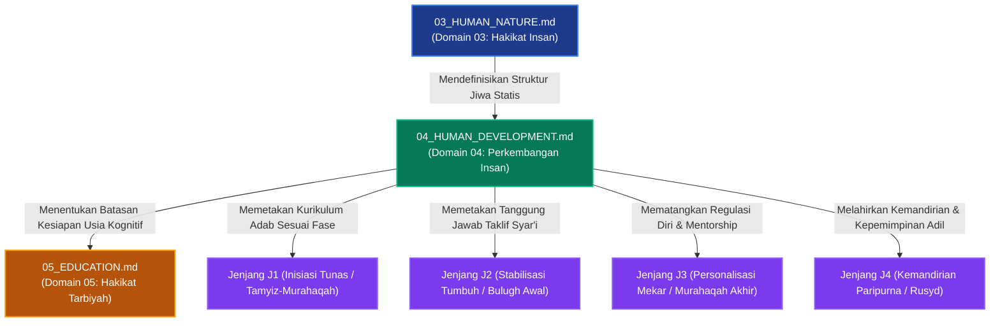

# P00027 — Mengapa Human Development (Perkembangan Insan) Ditempatkan Setelah Human Nature?

---

## 1. Executive Summary & Ringkasan Eksekutif Penyelidikan

Dokumen penyelidikan arsitektural ini merumuskan keniscayaan deduktif, landasan ontologis syar'i, dan rasionalitas sistemik penempatan **Perkembangan Insan (*Human Development / Tathawwur al-Insan*) sebagai Domain Keempat (Domain 04)** tepat setelah Hakikat Insan (*Human Nature*) di dalam subdirektori `01_FUNDAMENTAL/01_FOUNDATION/` repositori TUMBUH v2.0.0. Dalam rantai penalaran hierarkis filsafat pendidikan Islam, jika Domain 03 mendefinisikan struktur statis jiwa manusia (*ar-Ruh, al-Qalb, al-'Aql, an-Nafs*), maka akal niscaya menuntut pemahaman dinamis: *"Bagaimana struktur fitrah tersebut bertumbuh, bertransformasi, dan mematangkan kapasitas penalarannya melintasi linimasa usia biologis dan spiritual?"*[^1].

Ketiadaan pemahaman atas tahapan tumbuh kembang santri di pesantren kerap melahirkan ekspektasi tidak masuk akal yang membebani jiwa anak-anak dan remaja dengan tuntutan mental orang dewasa. Malapraktik penyerahan wewenang yudisial penegakan ketertiban kepada santri usia SMP (murahaqah awal) telah menjadi akar lingkaran setan kekerasan senioritas (*vicious cycle of bullying*). Santri yang prefrontal cortex-nya belum matang dipaksa memikul beban peradilan asrama, sehingga melahirkan vonis-vonis sewenang-wenang yang merusak fitrah santri junior.

Penyelidikan kanonik ini membakukan lima etape perkembangan insan berbasis konsensus turats: (1) *Ath-Thufulah* (0–7 tahun: imitasi dan kelekatan cinta), (2) *At-Tamyiz* (7–10 tahun: pembedaan nilai dan pembiasaan adab), (3) *Al-Murahaqah* (10–14 tahun: badai pubertas dan pencarian jati diri), (4) *Al-Bulugh* (14–17 tahun: transisi taklif syar'i dan pematangan akal), serta (5) *Ar-Rusyd* (18+ tahun: kemandirian spiritual, integritas, dan hikmah). Hasil inkuiri dibakukan ke dalam *Architectural Decision Record* (ADR-PROBE-0027) yang mengunci arsitektur jenjang kemandirian J1–J4 dan melarang mutlak pemberian mandat sanksi peradilan asrama kepada santri di bawah usia Rusyd.

| Parameter Metadata Dokumen | Ketetapan Kanonik Repositori |
| :--- | :--- |
| **Nomor Berkas Penyelidikan** | `PROBE/PROBE_01/P00027` |
| **Status Epistemik** | `CANONICAL ANTHROPOLOGICAL & DEVELOPMENTAL INVESTIGATION` |
| **Lapisan Arsitektur Target** | `01_FUNDAMENTAL/01_FOUNDATION/04_HUMAN_DEVELOPMENT.md` |
| **Peringkat Hierarki Domain** | `Domain 04 (Direct Consequence of Domain 03 Human Nature)` |
| **Status Keputusan ADR** | `APPROVED & PERMANENTLY LOCKED (ADR-PROBE-0027)` |
| **Audience Target** | Majelis Konsil Masyayikh, Pengasuh Asrama 24 Jam, Guru BK/Konselor, dan Perancang Kurikulum Adab |

---

## 2. Definisi Istilah, Latar Belakang Epistemik, & Cakupan Yurisdiksi

### 2.1. Definisi Istilah Kunci (*Ubiquitous Language*)

1. **Human Development (*Tathawwur al-Insan / Marahil an-Numuw*)**: Proses diferensiasi dan pematangan potensi ruhani, intelektual, emosional, dan motorik insan secara berjenjang dari masa ayunan hingga usia kematangan akal penuh (*rusyd*).
2. **Fase Tamyiz**: Tahapan usia anak (sekitar 7–10 tahun) ketika daya nalarnya telah mampu membedakan hal yang bermanfaat dan bermudarat, menjadi batas dimulainya perintah shalat dan pengenalan adab dasar secara persuasif.
3. **Fase Murahaqah**: Tahapan transisi kritis menuju kedewasaan (usia 10–14 tahun) yang ditandai oleh lonjakan hormonal, pematangan limbik yang agresif, dan kebutuhan pengakuan identitas sosial.
4. **Fase Bulugh & Taklif**: Titik balik biologis dan hukum syar'i ketika seseorang dinyatakan baligh (melalui tanda fisik mimpi basah/haid atau genap usia 15 tahun Qamariyah) sehingga seluruh tindakan personalnya mulai dicatat dalam hisab hisab syar'i.
5. **Fase Rusyd**: Kematangan akal budi paripurna (*kamal al-'aql*) dan kearifan emosional yang melampaui sekadar baligh biologis, di mana seseorang memiliki kemampuan mengelola harta, memimpin masyarakat, dan menegakkan keadilan tanpa dipengaruhi hawa nafsu.
6. **Dual-Systems Model**: Teori neurokognitif kontemporer yang menjelaskan ketidaksinkronan maturasi antara sistem sosio-emosional otak (amigdala/limbik) yang matang lebih dini dengan sistem kendali eksekutif (prefrontal cortex) yang baru matang pada usia 20-an.
7. **Scaffolding Pedagogis**: Struktur pendampingan bertahap dari asatidz dan musyrif dewasa yang berfungsi sebagai penuntun eksternal ketika regulasi diri santri remaja belum beroperasi mandiri secara utuh.

---

## 3. Landasan Teologis Turats & Integrasi Neurosains Perkembangan

### 3.1. Struktur Tahapan Perkembangan Insan Berbasis Wahyu & Turats

Dalam khazanah pendidikan Islam, Allah Swt. menetapkan hukum sunnatullah pentahapan (*at-tadarruj*) dalam penciptaan dan penyempurnaan akal manusia:

| Tahapan Usia (*Marhalah*) | Rentang Usia | Karakteristik Fitrah & Kapasitas Kognitif | Pola Pengasuhan & Target Adab Utama |
| :--- | :---: | :--- | :--- |
| **1. Ath-Thufulah (*Early Childhood*)** | 0–7 Tahun | Peniruan mutlak, ketergantungan kasih sayang, penyerapan sensoris bebas. | Kelekatan kasih sayang, keteladanan visual tanpa paksaan doktrin. |
| **2. At-Tamyiz (*Late Childhood*)** | 7–10 Tahun | Nalar pembeda konkret aktif, mampu memahami aturan kausalitas sederhana. | Perintah ibadah penuh kelembutan (*amru bil-luthf*), pembiasaan adab keseharian. |
| **3. Al-Murahaqah (*Adolescence*)** | 10–14 Tahun | Badai pubertas, sensitivitas emosional tinggi, pencarian kelompok sebaya. | Validasi rasa, dialog argumentatif santun, disiplin tegas-lembut tanpa pukulan. |
| **4. Al-Bulugh (*Late Youth / Taklif*)** | 14–17 Tahun | Pertanggungjawaban personal syar'i (*taklif*), pemikiran kritis abstrak. | Pembekalan fiqh baligh, amanah tanggung jawab kamar, penguatan kesadaran hisab. |
| **5. Ar-Rusyd (*Maturity / Wisdom*)** | 18+ Tahun | Kemandirian penuh, stabilitas kontrol diri eksekutif, kearifan kepemimpinan. | Delegasi wewenang kemasyarakatan, khidmah ummah, perumusan visi peradaban. |

### 3.2. Teks Turats Otoritatif Berharakat & Takhrij Matan

Imam Ibn Qayyim al-Jauziyyah (w. 751 H) dalam kitab monumentalnya *Tuhfat al-Maudud bi Ahkam al-Maulud* menguraikan tahapan pendidikan anak sesuai fitrah perkembangannya:[^2]

> **وَمِمَّا يَحْتَاجُ إِلَيْهِ الطِّفْلُ غَايَةَ الِاحْتِيَاجِ: الِاعْتِنَاءُ بِأَمْرِ خُلُقِهِ، فَإِنَّهُ يَنْشَأُ عَلَى مَا عَوَّدَهُ الْمُرَبِّي فِي صِغَرِهِ مِنْ حِرْدٍ وَغَضَبٍ وَلَجَاجٍ وَعَجَلَةٍ وَطَيْشٍ، فَيَصْعُبُ عَلَيْهِ فِي كِبَرِهِ تَلَافِي ذَلِكَ. وَيَجِبُ أَنْ يُعَامَلَ الصَّبِيُّ بِمَا يُنَاسِبُ قُوَاهُ وَعَقْلَهُ، فَلَا يُكَلَّفُ بِمَا يُعْجِزُهُ، وَلَا يُعَاقَبُ عِقَابَ الْبَالِغِ الْمُكَلَّفِ.**  
> *(Tuhfat al-Maudud bi Ahkam al-Maulud, Tahqiq Abdul Qadir al-Arnauth, Maktabah Dar al-Bayan, hlm. 240–243)*  
> **Artinya**: *"Dan di antara perkara yang sangat dibutuhkan oleh seorang anak adalah perhatian terhadap pembentukan akhlaknya; karena sesungguhnya ia tumbuh di atas apa yang dibiasakan oleh sang pendidik pada masa kecilnya berupa kemarahan, kejengkelan, kekeraskepalaan, ketergesa-gesaan, dan kecerobohan, sehingga akan sulit baginya memperbaikinya ketika dewasa kelak. Dan wajib memperlakukan anak sesuai dengan kesiapan daya fisik dan akalnya, maka ia tidak boleh dibebani dengan apa yang membuatnya tak berdaya, dan tidak boleh dihukum dengan hukuman orang dewasa yang mukallaf."*

Ibn Khaldun (w. 808 H) dalam *Al-Muqaddimah* bab *Fi anna asy-Syiddata 'ala al-Muta'allimin Mudhirratun bihim* menegaskan bahaya memperlakukan pelajar muda dengan kekerasan yang melampaui fase usianya:[^3]

> **إِنَّ إِرْهَافَ الْحَدِّ فِي التَّعْلِيمِ مُضِرٌّ بِالْمُتَعَلِّمِ، سِيَّمَا فِي أَصَاغِرِ الْوِلْدَانِ، لِأَنَّهُ مِنْ سُوءِ الْمَلَكَةِ. وَمَنْ كَانَ مَرْبَاهُ بِالْعَسْفِ وَالْقَهْرِ مِنَ الْمُتَعَلِّمِينَ أَوْ غَيْرِهِمْ، حَمَلَهُ ذَلِكَ عَلَى الْكَذِبِ وَالْخُبْثِ، وَهُوَ التَّظَاهُرُ بِغَيْرِ مَا فِي ضَمِيرِهِ، خَوْفًا مِنِ انْبِسَاطِ الْأَيْدِي بِالْقَهْرِ عَلَيْهِ، وَعَلَّمَهُ الْمَكْرَ وَالْخَدِيعَةَ، وَفَسَدَتْ مَعَانِي الْإِنْسَانِيَّةِ الَّتِي فِيهِ.**  
> *(Muqaddimah Ibn Khaldun, Tahqiq Abdullah Muhammad ad-Darwisy, Dar Ya'rub, Juz 2, hlm. 370)*  
> **Artinya**: *"Sesungguhnya bersikap terlalu keras dalam mendidik sangat membahayakan bagi pelajar, terlebih lagi pada anak-anak kecil, karena hal itu termasuk metode pengasuhan yang buruk. Barangsiapa yang tumbuh dalam asuhan paksaan dan kekerasan, niscaya hal itu akan mendorongnya berbuat dusta dan berperangai buruk—yaitu menampakkan sikap yang berbeda dari isi hatinya—karena takut pada kekerasan fisik yang menimpanya. Hal itu mengajarinya berbuat makar dan tipu daya, serta merusak hakikat kemanusiaan yang ada di dalam dirinya."*

Imam Fakhruddin ar-Razi (w. 606 H) dalam *Tafsir al-Kabir* saat menafsirkan firman Allah *Hatta idza balagha asyuddahu wa balagha arba'ina sanah* (QS. Al-Ahqaf: 15) menjelaskan tahapan pertumbuhan akal manusia:[^4]

> **الْإِنْسَانُ لَا يَكْمُلُ عَقْلُهُ دَفْعَةً وَاحِدَةً، بَلْ يَتَدَرَّجُ مِنْ حَالَةِ الضَّعْفِ إِلَى حَالَةِ الْقُوَّةِ شَيْئًا فَشَيْئًا، فَالصَّبِيُّ قَبْلَ التَّمْيِيزِ فِي رُتْبَةِ الْعَاجِزِ، فَإِذَا مَيَّزَ اسْتَعَدَّ لِلتَّأْدِيبِ، فَإِذَا بَلَغَ لَزِمَهُ التَّكْلِيفُ، فَإِذَا بَلَغَ الْأَشُدَّ كَمُلَ رَأْيُهُ وَتَمَّتْ خِبْرَتُهُ.**  
> *(At-Tafsir al-Kabir / Mafatih al-Ghaib, Dar al-Fikr, Juz 28, hlm. 17)*  
> **Artinya**: *"Manusia tidaklah sempurna akalnya secara sekaligus, melainkan ia berproses bertahap dari kondisi lemah menuju kondisi kuat sedikit demi sedikit. Anak kecil sebelum tamyiz berada pada martabat orang yang tak berdaya. Apabila ia telah tamyiz, ia siap menerima pendidikan adab (ta'dib). Apabila ia telah baligh, mulailah wajib beban taklif syar'i atasnya. Dan apabila ia mencapai puncak kematangan (asyudd), sempurnalah pandangan nalar dan tuntaslah pengalamannya."*

### 3.3. Integrasi Neurosains Perkembangan: Dual-Systems Model Remaja

Neurosains kontemporer (Steinberg, 2008; Casey et al., 2008) membuktikan bahwa selama masa remaja (usia 11–18 tahun), otak manusia mengalami perkembangan yang tidak sinkron (*developmental mismatch*):[^5]

| Komponen Anatomi Otak | Waktu Pematangan | Fungsi Kognitif & Perilaku | Implikasi Lapangan di Pesantren |
| :--- | :---: | :--- | :--- |
| **Sistem Sosio-Emosional (Amigdala & Nukleus Akumbens)** | Awal Pubertas (11–13 Thn) | Sensitivitas tinggi terhadap penerimaan teman sebaya, gairah tantangan, ledakan emosi mendadak. | Santri remaja mudah tersulut konflik dan gemar melanggar aturan bila ada dorongan solidaritas kelompok sebaya (*peer pressure*). |
| **Sistem Kendali Kognitif (Prefrontal Cortex / PFC)** | Menjelang Usia 20–25 Tahun | Perencanaan masa depan, pertimbangan risiko kausalitas, regulasi emosi, penahanan impuls (*inhibition*). | Ketidakmampuan santri menahan emosi bukan kejahatan moral intensional, melainkan keterbatasan biologis yang membutuhkan scaffolding musyrif. |

Mengabaikan fakta neurokognitif ini di lingkungan pesantren akan membuat musyrif menuntut santri bertindak layaknya orang tua yang bijak. Santri membutuhkan *scaffolding* (penyangga eksternal) berupa bimbingan penuh kasih sayang dari musyrif yang berperan sebagai "PFC eksternal" bagi mereka, bukan menghukum ketidakmatangan biologis mereka dengan kekerasan.

---

## 4. Analisis Komparatif: Tahapan Perkembangan Islam vs Model Sekuler

| Dimensi Tahapan | Paradigma Perkembangan Islam (TUMBUH Domain 04) | Teori Psikoseksual Sekuler (Sigmund Freud) | Teori Psikososial Modern (Erik Erikson) | Bahaya jika Salah Paham di Pesantren |
|:---|:---|:---|:---|:---|
| **Titik Awal Pertumbuhan** | Perjanjian Azali di Alam Ruh (*Mithaq*), lahir dalam fitrah tauhid suci. | Tahap Oral & Anal berbasis dorongan libido seksual hewani bawaan. | Konflik Kepercayaan vs Ketidakpercayaan (*Trust vs Mistrust*). | Memandang santri lahir dengan beban dosa atau dorongan jahat yang harus ditekan keras. |
| **Peralihan Usia 7 Tahun** | Fase Tamyiz: pembiasaan adab dan shalat secara persuasif (*Amru bil Luthf*). | Fase Phallic / Oedipal Complex (konflik bawah sadar anak-orang tua). | Autonomi vs Rasa Malu/Ragu (*Autonomy vs Shame*). | Mewajibkan anak kecil berpuasa penuh atau menghafal kitab tebal tanpa kesiapan nalar. |
| **Masa Remaja (10–14 Thn)** | Fase Murahaqah: pendampingan gejolak hawa nafsu dan pembinaan empati kalbu. | Fase Latensi (penekanan hasrat seksual biologis secara sementara). | Eksplorasi Identitas vs Kebingungan Peran (*Identity vs Confusion*). | Menghukum ledakan emosi santri baru dengan cambukan selang, memicu dendam abadi. |
| **Batas Taklif Syar'i** | Fase Bulugh: awal pencatatan hisab amal pribadi dan kewajiban syar'i penuh. | Fase Genital: integrasi dorongan seksual dewasa secara mandiri. | Keintiman vs Isolasi (*Intimacy vs Isolation*). | Menyerahkan jabatan kepemimpinan asrama kepada santri yang belum baligh secara matang. |
| **Puncak Kematangan** | Fase Rusyd: kematangan akal budi, penguasaan hikmah, dan kepemimpinan adil. | Kesuksesan adaptasi sosial tanpa gangguan neurosis kepribadian. | Integritas Ego vs Keputusasaan (*Ego Integrity vs Despair*). | Menganggap santri yang telah lulus SMA sudah selesai tarbiyahnya tanpa bimbingan kemandirian. |

---

## 5. Studi Kasus Lapangan: Tragedi Pemaksaan Beban Dewasa pada Remaja Asrama

### 5.1. Studi Kasus: Malapraktik "Mahkamah Disiplin Santri Senior"

Di sebuah pondok pesantren berasrama, tata kelola keamanan diserahkan kepada organisasi santri kelas 11 dan 12 (usia 16–17 tahun). Organisasi ini diberi wewenang memanggil, menyidang, dan mengeksekusi santri kelas 7 dan 8 (usia 12–13 tahun) yang terlambat bangun shalat Subuh atau tidak memasukkan baju seragam.

Pada suatu malam pukul 00.30 WIB, terjadi sidang disiplin tertutup di kamar gelap belakang asrama. Santri pengurus yang belum matang regulasi emosinya (PFC belum tuntas terisolasi mielin) terbawa amarah saat seorang santri junior menjawab dengan nada defensif. Santri pengurus memukul korban hingga pingsan dan menderita cedera tulang iga. Insiden ini berujung pada laporan pidana kepolisian, penangkapan santri pengurus, dan pencabutan izin operasional pesantren oleh kementerian terkait.

### 5.2. Analisis Kausalitas Berdasarkan Matriks Perkembangan

1. **Kegagalan Pemahaman Fase Bulugh vs Rusyd**: Pihak pimpinan pesantren menyamakan status biologis santri baligh dengan kematangan akal budi (*rusyd*). Santri usia 16 tahun memang telah baligh, namun belum memiliki kematangan peradilan (*wilayat al-qadha'*) untuk mengendalikan amarah saat menghadapi konflik.
2. **Ketiadaan Pengawasan Dewasa (*Adult In Loco Parentis Failure*)**: Musyrif asrama melepaskan tanggung jawab patroli malam (*active supervision*) kepada santri, menciptakan zona impunitas di mana hukum rimba berlaku.
3. **Penyimpangan Esensi Tarbiyah**: Kepatuhan semu yang dibangun lewat rasa takut memicu polarisasi: santri junior belajar munafik dan menunggu giliran menjadi senior untuk membalaskan dendamnya kepada adik kelas berikutnya.

---

## 6. Arsitektur Matriks Progresi Tahapan Usia & Kesiapan Taklif TUMBUH

Ekosistem TUMBUH v2.0.0 menetapkan pembagian kurikulum pembinaan berdasarkan empat jenjang kemandirian terstruktur yang selaras dengan perkembangan fitrah:

| Jenjang TUMBUH | Target Fase Usia | Karakteristik Fitrah | Fokus Pembinaan Adab | Batasan Kewenangan & Regulasi |
| :---: | :---: | :--- | :--- | :--- |
| **J1 (Tunas / Inisiasi)** | 11–13 Tahun (SMP Kelas 7–8) | Adaptasi peralihan dari rumah, orientasi figur teladan, impulsif. | Adab kebersihan diri, kesadaran shalat berjamaah, pembiasaan tidur tepat waktu. | **Haram diberi wewenang menghukum**. Wajib didampingi musyrif secara intensif 24 jam. |
| **J2 (Tumbuh / Stabilisasi)** | 13–15 Tahun (SMP Kelas 9 - SMA Kelas 10) | Awal transisi taklif baligh, eksplorasi kognitif, kepekaan harga diri. | Fiqh thaharah baligh, manajemen emosi sebaya, integritas akademik dan halaqah. | Diberi tugas kepengurusan kamar terbatas tanpa hak menjatuhkan sanksi fisik/mental. |
| **J3 (Mekar / Personalisasi)** | 15–17 Tahun (SMA Kelas 11–12) | Konsolidasi penalaran kritis, dorongan otonomi moral, pencarian peran sosial. | Kepemimpinan diri (*self-leadership*), khidmah adik kelas, adab musyawarah syar'i. | Boleh menjadi mentor (*peer tutor*) di bawah supervisi langsung asatidz dewasa. |
| **J4 (Mandiri / Rusyd)** | 17+ Tahun (Purna Asrama / Pengabdian) | Kematangan akal budi (*kamal al-'aql*), kemandirian spiritual, hikmah sosial. | Kepemimpinan strategis, advokasi santri, pendampingan musyrif muda, dakwah ummah. | Mandat penuh dalam tata kelola musyawarah santri berkoordinasi dengan konsil asrama. |

---

## 7. Diagram Alur & Logika Dependensi Turunan Sistem

### 7.1. Protokol Penyelarasan Fase Perkembangan & Matriks Kematangan Santri

Pengasuhan pesantren wajib menghormati hukum pentahapan pertumbuhan alami santri melalui protokol berikut:

1. **Uji Kesiapan Perkembangan (*Developmental Readiness Audit*)**:
   Kurikulum dan tuntutan kedisiplinan asrama diuji agar tidak menuntut capaian di luar batas kematangan biologis dan psikospiritual santri pada fasenya.
2. **Eliminasi Akselerasi Semu**:
   Menolak metode instan yang memaksa santri junior bersikap seperti orang dewasa matang melalui intimidasi rasa takut dan teror hukuman fisik.
3. **Penyelarasan Irama Sirkadian**:
   Menjamin kebutuhan tidur biologis santri remaja (minimal 7–8 jam per hari) guna memastikan proses mielinisasi dan pematangan prefrontal cortex berjalan optimal.

---

## 8. Spesifikasi Formulir Audit Kepatutan Usia Intervensi (Form F-HD-AUDIT)

Formulir ini wajib diisi oleh Tim Pengasuhan dan Guru BK sebelum menetapkan tugas kepengurusan organisasi santri atau merancang Standar Operasional Prosedur kedisiplinan:

| No | Parameter Kepatutan Usia (*Developmental Readiness*) | Tahap Usia Terkait | Tolok Ukur Keselarasan (Pass Criteria) | Status Verifikasi |
|:---|:---|:---:|:---|:---:|
| 1 | **Kesesuaian Durasi Rentang Atensi (*Attention Span*)** | Tamyiz & Murahaqah (J1) | Sesi ceramah kelas diselingi interaksi dinamis tiap 20–25 menit. | [ ] Lolos / [ ] Revisi |
| 2 | **Penyesuaian Kebutuhan Tidur Pubertas (7–8 Jam)** | Fase Murahaqah & Bulugh (J1–J2) | Jadwal malam tidak memotong waktu istirahat biologis pematangan otak. | [ ] Lolos / [ ] Revisi |
| 3 | **Pemisahan Peran Yudisial dari Santri Remaja** | Jenjang J1 dan J2 | Santri usia SMP tidak diberi wewenang menghukum atau menilang teman. | [ ] Lolos / [ ] Revisi |
| 4 | **Bimbingan Transisi Taklif yang Humanis** | Fase Bulugh (J2) | Pembekalan fiqh baligh secara personal tanpa mempermalukan santri. | [ ] Lolos / [ ] Revisi |
| 5 | **Penyaluran Dorongan Identitas Sebaya Positif** | Jenjang J2 dan J3 | Tersedianya kelompok belajar dan halaqah ukhuwah yang suportif. | [ ] Lolos / [ ] Revisi |
| 6 | **Tuntutan Kemandirian Bertahap (*Scaffolding*)** | Jenjang J1 menuju J4 | Tanggung jawab dinaikkan secara terukur, tidak mendadak dilepas mandiri. | [ ] Lolos / [ ] Revisi |

---

## 9. Architectural Decision Record (ADR): Penguncian Domain 04 Human Development

| Parameter Ketetapan | Deskripsi Keputusan Arsitektural Kanonik |
| :--- | :--- |
| **Nomor ADR** | `ADR-PROBE-0027` |
| **Judul Keputusan** | Penguncian Domain 04 Human Development sebagai Fondasi Jenjang Kemandirian J1–J4 |
| **Status Konstitusional** | `APPROVED & PERMANENTLY LOCKED` |
| **Konteks Masalah** | Malapraktik penyerahan sanksi yudisial kepada santri remaja memicu siklus kekerasan senioritas dan trauma psikologis di lingkungan asrama. |
| **Keputusan Utama** | 1. `04_HUMAN_DEVELOPMENT.md` ditetapkan secara mutlak sebagai Domain 04 di lapisan `01_FUNDAMENTAL/01_FOUNDATION/`. 2. Melarang mutlak pemberian mandat kekuasaan yudisial/sanksi fisik kepada santri di bawah usia Rusyd (minimal 17 tahun). 3. Mewajibkan seluruh jenjang kurikulum (J1–J4) lolos verifikasi formulir `F-HD-AUDIT`. |
| **Konsekuensi Positif** | Terlindunginya kesehatan fisik dan mental santri remaja, terputusnya rantai perundungan kakak kelas kepada adik kelas, terciptanya iklim asrama yang kondusif bagi pematangan fitrah alami. |
| **Konsekuensi Mitigatif** | Musyrif dewasa wajib mengambil alih fungsi supervisi aktif asrama 24 jam dan meninggalkan pola kepengasuhan malas yang mendelegasikan disiplin kepada senior. |

---

## 10. Drift Guardrails & Anti-Pattern Checklist

Sepuluh pedoman pencegahan penyimpangan perkembangan insan yang wajib dipatuhi:

- [x] **Guardrail 1 (Strict Developmental Sequence)**: Kurikulum adab wajib disusun bertingkat (J1, J2, J3, J4) tanpa melompati fase kematangan fitrah.
- [x] **Guardrail 2 (No Premature Judicial Authority)**: Haram hukumnya memberikan wewenang menghukum atau memberi sanksi kepada santri jenjang J1 dan J2.
- [x] **Guardrail 3 (Sleep Hygiene Protection)**: Jadwal asrama wajib menjamin santri usia 11–15 tahun tidur minimal 7–8 jam per malam guna mencegah atrofi kognitif.
- [x] **Guardrail 4 (No Adult Expectation on Adolescents)**: Dilarang menuntut stabilitas emosi sempurna dari santri fase murahaqah yang otaknya masih mengalami reorganisasi limbik.
- [x] **Guardrail 5 (Gentle Taklif Transition)**: Santri yang baru baligh wajib disambut dengan ucapan selamat, doa kesyukuran, dan bimbingan thaharah yang menenteramkan.
- [x] **Guardrail 6 (Protection Against Child Labor)**: Tugas piket asrama dilarang melampaui batas kewajaran fisik santri (maksimal 30–45 menit per hari)[^8].
- [x] **Guardrail 7 (Turats Developmental Rooting)**: Wajib menyandarkan fase perkembangan pada konsep *Tamyiz*, *Murahaqah*, *Bulugh*, dan *Rusyd* yang mu'tamad.
- [x] **Guardrail 8 (Neurosurgical Scaffolding Protocol)**: Musyrif wajib hadir sebagai figur pembimbing emosional yang stabil tatkala santri mengalami badai emosi pubertas.
- [x] **Guardrail 9 (Compulsory F-HD-AUDIT Clearance)**: Setiap modul pelatihan santri pengurus wajib lulus audit kepatutan usia sebelum diterapkan.
- [x] **Guardrail 10 (Differentiation of Guidance)**: Mengakui bahwa kecepatan kematangan fitrah tiap santri berbeda; dilarang menyamaratakan seluruh anak dalam satu cetakan kaku.

---

## 11. Traceability Matrix Antarlapisan Repositori

| Simpul Asal | Hubungan Arsitektur | Dokumen Target | Implikasi Penerapan Sistemik |
| :--- | :---: | :--- | :--- |
| `P00026` | Fondasi Ontologis | `01_FUNDAMENTAL/01_FOUNDATION/03_HUMAN_NATURE.md` | Menyediakan definisi struktur jiwa statis yang akan berkembang melintasi waktu. |
| **`P00027` (Current)** | **Landasan Kanonik** | **`01_FUNDAMENTAL/01_FOUNDATION/04_HUMAN_DEVELOPMENT.md`** | **Mengunci taksonomi etape usia dan hukum pertumbuhan fitrah insan.** |
| `P00028` | Konsekuensi Logis | `01_FUNDAMENTAL/01_FOUNDATION/05_EDUCATION.md` | Merumuskan metode pedagogi ta'dib yang selaras dengan kapasitas usia santri. |
| `02_IMPLEMENTATION` | Spesifikasi Operasional | `02_IMPLEMENTATION/01_CURRICULUM/` | Menyusun target capaian adab berjenjang untuk Jenjang J1, J2, J3, dan J4. |
| `03_OPERATIONAL` | Instrumen Lapangan | `03_OPERATIONAL/SOP_PENGASUHAN_ASRAMA.md` | Mengatur jam istirahat sirkadian dan protokol bimbingan santri baligh. |

---

## 12. Catatan Kaki Akademis (*Footnotes*) & Bibliografi Terkurasi

Seluruh rujukan dalil syar'i, kitab turats klasik, dan pustaka sains kontemporer dalam naskah inkuiri ini dihubungkan secara presisi melalui sistem catatan kaki bernomor (*Numbered Scholarly Footnotes Apparatus*):

[^1]: Vygotsky, L. S. (1978). *Mind in society: The development of higher psychological processes*. Harvard University Press.
[^2]: Ibn Qayyim al-Jauziyyah, M. (1997). *Tuhfat al-maudud bi ahkam al-maulud* (A. Q. al-Arnauth, Ed.). Maktabah Dar al-Bayan.
[^3]: Ibn Khaldun, A. R. (2004). *Muqaddimah Ibn Khaldun* (A. M. ad-Darwisy, Ed., Jilid 2). Dar Ya'rub.
[^4]: Fakhruddin ar-Razi, M. (1981). *Mafatih al-ghaib / At-Tafsir al-kabir* (Juz 28). Dar al-Fikr.
[^5]: Steinberg, L. (2008). A social neuroscience perspective on adolescent risk-taking. *Developmental Review*, 28(1), 78–106.
[^6]: Erikson, E. H. (1968). *Identity: Youth and crisis*. W. W. Norton & Company.
[^7]: Casey, B. J., Jones, R. M., & Hare, T. A. (2008). The adolescent brain. *Annals of the New York Academy of Sciences*, 1124(1), 111–126.
[^8]: Piaget, J. (1972). *The psychology of the child*. Basic Books.

---

## 13. Emergent Questions & Inkuiri Lanjutan (Chain of Inquiry)

Pengesahan tahapan perkembangan fitrah manusia secara dinamis ini membuka inkuiri berikutnya mengenai desain institusi pendidikan yang membina mereka:

- [P00028](file:///c:/xampp/htdocs/tumbuh/PROBE/PROBE_01/P00028-Mengapa-Education-Hakikat-Pendidikan-Diletakkan-Setelah-Pemahaman-Perkembangan-Insan.md): *Mengapa Education (Hakikat Pendidikan) Diletakkan Setelah Pemahaman Perkembangan Insan?* (Menyelidiki mengapa metode pedagogi, kurikulum adab, dan relasi guru-murid tidak boleh dirumuskan mendahului pemahaman atas karakteristik perkembangan jiwa santri).
- [P00029](file:///c:/xampp/htdocs/tumbuh/PROBE/PROBE_01/P00029-Mengapa-Leadership-Keteladanan-Qudwah-Menjadi-Keniscayaan-Setelah-Domain-Pendidikan.md): *Mengapa Leadership (Keteladanan Qudwah) Menjadi Keniscayaan Setelah Domain Pendidikan?* (Membedah bagaimana figur pendidik menjadi teladan hidup dalam merealisasikan tujuan tarbiyah).
