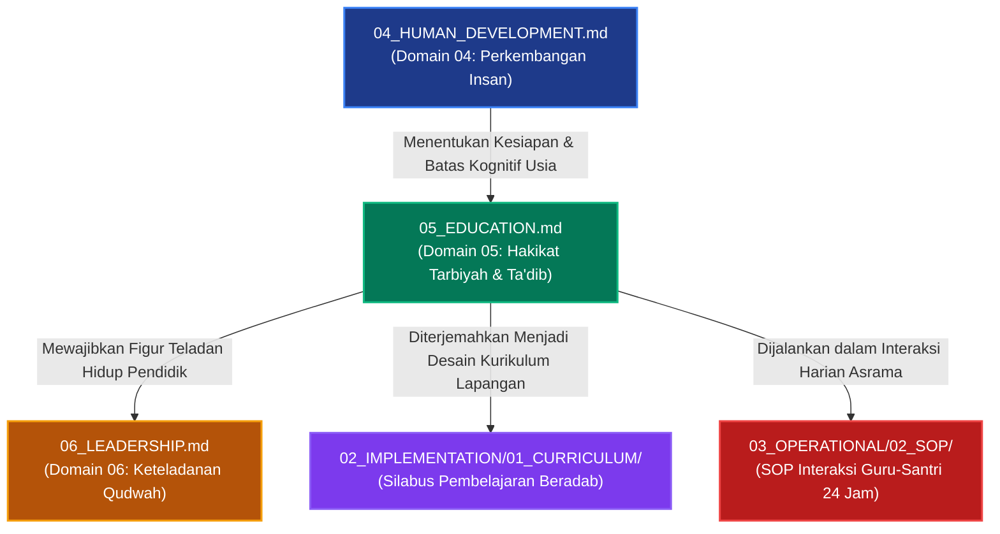

# P00028 — Mengapa Education (Hakikat Pendidikan) Diletakkan Setelah Pemahaman Perkembangan Insan?

---

## 1. Executive Summary & Ringkasan Eksekutif Penyelidikan

Dokumen penyelidikan arsitektural ini merumuskan keniscayaan deduktif, landasan epistemologis syar'i, dan rasionalitas sistemik penempatan **Hakikat Pendidikan (*Education / Haqiqat at-Ta'dib*) sebagai Domain Kelima (Domain 05)** tepat setelah Perkembangan Insan (*Human Development*) dan mendahului Kepemimpinan Keteladanan (*Leadership / Qudwah*) di dalam subdirektori `01_FUNDAMENTAL/01_FOUNDATION/` repositori TUMBUH v2.0.0. Dalam rantai penalaran hierarkis filsafat pendidikan Islam, setelah Domain 04 memetakan tahapan perkembangan fitrah dan batas kapasitas biologis-kognitif santri (*Developmental Readiness*), maka akal niscaya menuntut penegasan mengenai: *"Metode pedagogi apa yang sah dan mampu menumbuhkan adab santri tanpa merusak fitrah mereka? Bagaimana arsitektur intervensi tarbiyah dijalankan secara proporsional?"*[^1].

Kekeliruan paling umum dalam perancangan kurikulum pesantren kontemporer adalah **reduksionisme pedagogis**: pendidikan disempitkan sekadar menjadi *Ta'lim* (transfer instruksi pengetahuan kognitif dan hafalan teks) atau *Tarbiyah* jasmaniah mekanik, seraya meminggirkan esensi tertinggi pendidikan Islam yaitu **Ta'dib** (penanaman dan pengenalan adab ke dalam jiwa). Akibatnya, lahir institusi pesantren yang mempraktikkan model "pendidikan gaya bank" (*banking model of education*), di mana guru bertindak sebagai depositor informasi dan santri diperlakukan sebagai wadah pasif yang hanya wajib mencatat, menghafal, dan mengulang tanpa keterlibatan kalbu.

Melalui penelusuran turats ulama tarbiyah klasik—khususnya risalah *Ayyuha al-Walad* karya Imam Al-Ghazali, *Adab al-Mu'allimin* karya Imam Ibn Sahnun, serta karya seminal Syed Muhammad Naquib al-Attas (*The Concept of Education in Islam*)—yang dipadukan dengan teori konstruktivisme sosial (*Zone of Proximal Development*) dan *Self-Determination Theory*, penyelidikan ini membuktikan bahwa pendidikan Islam yang sejati adalah proses pembebasan jiwa dari kebodohan dan kezaliman menuju keadilan penempatan segala sesuatu sesuai tatanan wujud (*Adab*). Hasil inkuiri dibakukan ke dalam *Architectural Decision Record* (ADR-PROBE-0028) yang mengesahkan integrasi tripartit **Tarbiyah, Ta'lim, dan Ta'dib** sebagai rukun konstitusi kurikulum TUMBUH.

| Parameter Metadata Dokumen | Ketetapan Kanonik Repositori |
| :--- | :--- |
| **Nomor Berkas Penyelidikan** | `PROBE/PROBE_01/P00028` |
| **Status Epistemik** | `CANONICAL PEDAGOGICAL PHILOSOPHY & TA'DIB FOUNDATION` |
| **Lapisan Arsitektur Target** | `01_FUNDAMENTAL/01_FOUNDATION/05_EDUCATION.md` |
| **Peringkat Hierarki Domain** | `Domain 05 (Direct Consequence of Domain 04 Human Development)` |
| **Status Keputusan ADR** | `APPROVED & PERMANENTLY LOCKED (ADR-PROBE-0028)` |
| **Audience Target** | Majelis Konsil Masyayikh, Dewan Asatidz Madrasah, Kepala Pengasuhan Asrama, dan Pengembang Kurikulum Adab |

---

## 2. Definisi Istilah, Latar Belakang Epistemik, & Cakupan Yurisdiksi

### 2.1. Definisi Istilah Kunci (*Ubiquitous Language*)

1. **Hakikat Pendidikan Islam (*Haqiqat at-Ta'dib*)**: Proses penanaman adab ke dalam diri manusia secara bertahap dan menyeluruh, mencakup penataan kalbu, pencerdasan akal, dan pembiasaan raga agar manusia mengenali tempat-tempat yang hakiki dalam tatanan wujud dan bertakwa kepada Allah.
2. **Ta'dib**: Istilah paling komprehensif untuk pendidikan Islam menurut Al-Attas, yang mencakup unsur ilmu (*'ilm*), pengajaran (*ta'lim*), dan pengasuhan (*tarbiyah*), namun secara spesifik berfokus pada pembentukan manusia beradab (*insan adabi*)[^1].
3. **Model Pendidikan Gaya Bank (*Banking Concept of Education*)**: Pendekatan pedagogis opresif di mana santri diposisikan sebagai wadah kosong yang harus diisi hafalan dogma tanpa dialog nalar, tanpa refleksi kritis, dan tanpa kehangatan empati.
4. **Bi'ah Shalihah (Ekosistem Lingkungan Suci)**: Totalitas iklim asrama, ruang kelas, dan masjid yang dirancang secara sadar untuk mendukung pembiasaan adab secara natural (*conditioning by noble culture*), bebas dari polusi kekerasan dan kemunafikan.
5. **Zona Perkembangan Proksimal (*Zone of Proximal Development / ZPD*)**: Jarak antara kapasitas aktual santri dalam mempraktikkan adab secara mandiri dengan kapasitas potensial yang dapat dicapainya melalui bimbingan hangat asatidz dan musyrif (*scaffolding*)[^2].

### 2.2. Latar Belakang Masalah Lapangan

Di lapangan pesantren kontemporer, kekosongan dokumen definisi Domain Pendidikan memicu krisis orientasi tarbiyah yang parah:
- **Pemujaan Angka dan Nilai Kognitif (Akademisisme Kering)**: Keberhasilan santri hanya diukur dari nilai ujian tertulis *imtihan* atau banyaknya lembar juz Al-Qur'an yang disetor. Santri yang nilainya tinggi namun berperilaku kasar kepada sesama teman tetap diberi predikat lulus tanpa evaluasi akhlak.
- **Ketiadaan Hubungan Edukatif Bernyawa**: Guru masuk kelas hanya untuk membacakan kitab kuning, menerjemahkan kata per kata, lalu keluar begitu bel berbunyi tanpa pernah menanyakan kabar jiwa, kesedihan batin, atau kendala spiritual santrinya.
- **Pemisahan Kelas dan Asrama**: Terjadi pemisahan dikotomis antara asatidz pengajar di kelas (yang merasa tidak bertanggung jawab atas akhlak santri di asrama) dan musyrif asrama (yang hanya dipandang sebagai "satpam penjaga malam" tanpa wibawa pendidik).

---

## 3. Landasan Teologis Turats & Integrasi Pedagogi Humanis

### 3.1. Struktur Tripartit Pendidikan Islam TUMBUH

Repositori TUMBUH menolak pemisahan artifisial antara pengasuhan fisik, pengajaran intelektual, dan pembinaan moral. Ketiganya diintegrasikan ke dalam hierarki tripartit:

| Pilar Pendidikan Islam | Dimensi Jiwa yang Dibina | Esensi & Metode Pendekatan | Indikator Keberhasilan Lapangan |
| :--- | :--- | :--- | :--- |
| **1. At-Tarbiyah (*Nurturing & Care*)** | *Al-Jasad* (Fisik) & *Al-Hawas* (Indra Raga) | Perawatan kasih sayang, penyediaan gizi sehat, lingkungan tidur layak, rasa aman psikologis. | Kebugaran jasmani, keteraturan ritme sirkadian, lenyapnya rasa takut terintimidasi. |
| **2. At-Ta'lim (*Instruction & Reason*)** | *Al-'Aql* (Akal Nalar) & *Al-Fikr* (Daya Analisis) | Pengajaran ilmu syar'i, nalar kritis, pemahaman kausalitas, dan eksplorasi teks turats berdalil. | Kemampuan memahami dalil, berpikir logis, memecahkan masalah tanpa dogmatisme buta. |
| **3. At-Ta'dib (*Instillation of Adab*)** | *Al-Qalb* (Kalbu) & *Al-Khuluq* (Karakter Spiritual) | Penanaman kesadaran menempatkan segala sesuatu pada maqamnya yang benar di hadapan Allah. | Keikhlasan beramal, kerendahan hati (*tawadhu'*), wibawa akhlak, dan integritas mandiri. |

### 3.2. Teks Turats Otoritatif Berharakat & Takhrij Matan

Hujjatul Islam Imam Abu Hamid al-Ghazali (w. 505 H) dalam risalah terkenalnya *Ayyuha al-Walad* menegaskan bahwa ilmu tanpa pendidikan adab dan amal adalah kegilaan semata:[^4]

> **أَيُّهَا الْوَلَدُ، الْعِلْمُ بِلَا عَمَلٍ جُنُونٌ، وَالْعَمَلُ بِغَيْرِ عِلْمٍ لَا يَكُونُ. وَاعْلَمْ أَنَّ عِلْمًا لَا يُبْعِدُكَ الْيَوْمَ عَنِ الْمَعَاصِي، وَلَا يَحْمِلُكَ عَلَى الطَّاعَةِ، لَنْ يُبْعِدَكَ غَدًا عَنْ نَارِ جَهَنَّمَ. أَيُّهَا الْوَلَدُ، كَمْ مِنْ لَيْلَةٍ أَحْيَيْتَهَا بِتَكْرَارِ الْعِلْمِ وَمُطَالَعَةِ الْكُتُبِ، وَحَرَمْتَ عَلَى نَفْسِكَ النَّوْمَ، فَلَا أَعْلَمُ مَا كَانَ الْبَاعِثُ فِيهِ؟ إِنْ كَانَ نَيْلَ عَرَضِ الدُّنْيَا وَجَذْبَ حُطَامِهَا، فَوَيْلٌ لَكَ ثُمَّ وَيْلٌ لَكَ!**  
> *(Ayyuha al-Walad, Tahqiq Ali Muhyiddin al-Qarahdaghi, Dar al-Basyair al-Islamiyyah, hlm. 24–27)*  
> **Artinya**: *"Wahai anakku, ilmu tanpa amal adalah kegilaan, dan amal tanpa ilmu adalah kesia-siaan. Ketahuilah bahwa ilmu yang tidak menjauhkanmu hari ini dari kemaksiatan dan tidak mendorongmu untuk taat, niscaya tidak akan mampu menjauhkanmu esok hari dari api neraka. Wahai anakku, berapa banyak malam yang engkau hidupkan dengan mengulang-ulang ilmu dan menelaah kitab-kitab, serta engkau haramkan tidur atas dirimu; maka aku tidak tahu apa motif pendorongmu? Jika motifmu adalah demi memburu kemilau dunia dan menarik remah-remahnya, maka celakalah engkau, kemudian celakalah engkau!"*

Imam Badruddin Ibn Jama'ah (w. 733 H) dalam karyanya yang sangat masyhur *Tadzkirat as-Sami' wal Mutakallim fi Adab al-'Alim wal Muta'allim* menguraikan sifat kasih sayang yang wajib dimiliki seorang pendidik sejati:[^5]

> **يَنْبَغِي لِلْمُعَلِّمِ أَنْ يَقْصِدَ بِتَعْلِيمِهِ وَتَهْذِيبِهِ وَجْهَ اللَّهِ تَعَالَى، وَنَشْرَ الْعِلْمِ، وَإِحْيَاءَ الشَّرِيعَةِ، وَدَوَامَ خَيْرِ الْأُمَّةِ. وَأَنْ يُعَامِلَ الْمُتَعَلِّمِينَ بِمَا يُعَامِلُ بِهِ أَعَزَّ أَوْلَادِهِ مِنَ الشَّفَقَةِ وَالْمَحَبَّةِ وَاللُّطْفِ، وَالصَّبْرِ عَلَى جَفَائِهِمْ وَسُوءِ أَدَبِهِمْ فِي بَعْضِ الْأَحْيَانِ، فَيَرُدَّهُمْ بِالرِّفْقِ لَا بِالْعُنْفِ.**  
> *(Tadzkirat as-Sami' wal Mutakallim, Tahqiq Muhammad Hasyim an-Nadwi, Dar al-Kutub al-'Ilmiyyah, hlm. 48–50)*  
> **Artinya**: *"Seyogianya bagi seorang guru meniatkan pengajaran dan pendidikannya semata-mata mencari ridha Allah Ta'ala, menyebarkan ilmu, menghidupkan syariat, dan melanggengkan kebaikan umat. Dan hendaknya ia memperlakukan para murid sebagaimana ia memperlakukan anak-anak kandungnya yang paling ia cintai: dengan penuh rasa belas kasih, kecintaan, dan kelembutan, serta bersabar atas kekasaran tabiat mereka dan kekhilafan adab mereka di sebagian waktu; lalu membimbing mereka kembali dengan kelembutan, bukan dengan kekerasan."*

Hadratussyaikh KH Muhammad Hasyim Asy'ari (w. 1366 H) dalam kitab monumentalnya *Adab al-'Alim wal Muta'allim* menegaskan bahwa kasih sayang pendidik kepada santri merupakan fondasi mutlak keberkahan ilmu:[^6]

> **يَنْبَغِي لِلْعَالِمِ أَنْ يَكُونَ شَفِيقًا عَلَى الْمُتَعَلِّمِينَ، حَرِيصًا عَلَى تَعْلِيمِهِمْ وَتَفْهِيمِهِمْ، نَاصِحًا لَهُمْ فِي أُمُورِ دِينِهِمْ وَدُنْيَاهُمْ، وَأَنْ يُنْزِلَهُمْ مَنْزِلَةَ أَوْلَادِهِ فِي الشَّفَقَةِ عَلَيْهِمْ وَالْبِرِّ بِهِمْ وَالصَّبْرِ عَلَى مَا يَبْدُو مِنْ جَفَائِهِمْ، وَلَا يَتَرَفَّعَ عَلَيْهِمْ، بَلْ يَتَوَاضَعَ لَهُمْ؛ فَإِنَّ التَّوَاضُعَ لِلْمُتَعَلِّمِ رِفْعَةٌ لِلْمُعَلِّمِ.**  
> *(Adab al-'Alim wal Muta'allim, Maktabah at-Turats al-Islami, hlm. 28–30)*  
> **Artinya**: *"Seyogianya bagi seorang yang berilmu (guru) bersikap sangat penyayang kepada para muridnya, bersungguh-sungguh dalam mengajarkan dan memahamkan mereka, tulus menasihati mereka dalam urusan agama dan dunia mereka, serta memposisikan mereka seperti anak-anak kandungnya sendiri dalam hal kasih sayang, kebaikan, dan kesabaran atas kekasaran tabiat mereka yang sesekali muncul. Dan janganlah ia menyombongkan diri di hadapan mereka, melainkan bertawadhu'-lah kepada mereka; karena sesungguhnya sikap rendah hati seorang guru kepada muridnya adalah kemuliaan sejati bagi sang guru."*

Imam Abu al-Hasan al-Mawardi (w. 450 H) dalam *Adab ad-Dunya wa ad-Din* menguraikan keharusan menyeimbangkan pengajaran dengan kelapangan jiwa:[^7]

> **إِذَا أَرَادَ الْمُعَلِّمُ أَنْ يَثْبُتَ عِلْمُهُ فِي قَلْبِ صَاحِبِهِ، فَلْيَبْسُطْ لَهُ وَجْهَهُ، وَلْيُلْطِفْ لَهُ كَلَامَهُ، وَلَا يُعَنِّفْهُ إِذَا قَصُرَ فَهْمُهُ، فَإِنَّ الْعُنْفَ مَنْفَرَةٌ لِلْقُلُوبِ، وَسَبَبٌ لِانْقِطَاعِ الطَّالِبِ عَنِ التَّحْصِيلِ.**  
> *(Adab ad-Dunya wa ad-Din, Dar al-Kutub al-'Ilmiyyah, hlm. 94)*  
> **Artinya**: *"Apabila seorang pendidik menghendaki ilmunya tertanam kokoh di dalam kalbu muridnya, maka hendaknya ia membentangkan wajah yang berseri-seri kepadanya, memperhalus tutur katanya, dan tidak bersikap kasar manakala pemahaman muridnya terbatas. Karena sesungguhnya kekasaran itu adalah hal yang membuat hati lari menjauh, dan menjadi sebab terputusnya penuntut ilmu dari meraih keberhasilan."*

Imam Muhammad Ibn Sahnun (w. 256 H) dalam *Adab al-Mu'allimin*—kitab risalah pedagogi tertua dalam sejarah Islam—secara tegas melarang pemukulan murid di luar batas syar'i dan mewajibkan asas keadilan pengajaran:[^11]
> Pendidik diharamkan melampiaskan kemarahan pribadi saat menghukum murid, dilarang memukul area wajah atau organ vital, dan wajib memperlakukan anak-anak kaum muslimin dengan amanah keadilan tanpa membeda-bedakan status sosial ekonomi mereka.

### 3.3. Integrasi Teori Pedagogi Modern: Dari Vygotsky hingga Paulo Freire

Kritik tajam Paulo Freire (1970) terhadap *Banking Concept of Education* sangat relevan dengan pembenahan pendidikan pesantren. Freire menunjukkan bahwa pendidikan yang menindas menempatkan murid sebagai objek pasif, menciptakan budaya bisu (*culture of silence*), dan melahirkan kepribadian terbelah (*split personality*)[^8].

Epistemologi TUMBUH memadukan kritik Freire dengan teori *Zone of Proximal Development (ZPD)* dari Lev Vygotsky (1978) dan *Self-Determination Theory* dari Deci & Ryan (2000):[^9]
1. **Otonomi (*Autonomy*)**: Santri didorong menjalankan adab bukan karena takut rotan musyrif, melainkan atas dorongan kesadaran batin (*ikhtiyar*) yang dibangun lewat pemahaman hikmah.
2. **Keterhubungan (*Relatedness*)**: Santri merasa aman dan dikasihi oleh gurunya, sehingga nasihat masuk ke dalam kalbu tanpa resistensi psikologis.
3. **Kompetensi (*Competence*)**: Santri diberikan tantangan adab yang sesuai dengan kapasitas jenjang usianya (J1 hingga J4), tidak dibebani target yang mustahil dicapai.

---

## 4. Analisis Komparatif: Model Pendidikan Ta'dib vs Model Pengajaran Konvensional

| Dimensi Penilaian | Pendekatan Ta'dib (Kanonik TUMBUH) | Model Pengajaran Positivis Sekuler | Model Tradisional Feodalistik |
| :--- | :--- | :--- | :--- |
| **Tujuan Akhir** | Terbentuknya insan adabi yang mengenal maqam Allah dan ciptaan-Nya. | Kompetensi keterampilan kerja teknis dan utilitas pasar ekonomi. | Kepatuhan mutlak tanpa bantahan kepada figur senior dan guru. |
| **Kedudukan Santri** | Subjek fitrah yang dimuliakan dan dipandu potensinya secara bertahap. | Konsumen jasa pendidikan dan wadah pasif pengujian kognitif. | Objek kepatuhan yang harus ditundukkan kehendak pribadinya. |
| **Metode Utama** | Keteladanan hidup (*qudwah*), dialog reflektif, pembiasaan bermakna. | Ceramah didaktik, tes pilihan ganda, pemeringkatan kompetitif. | Dikte hafalan searah, indoktrinasi dogma, ancaman hukuman fisik. |
| **Penanganan Cacat Adab** | Pemulihan relasi restoratif, restitusi hikmah, bimbingan kalbu. | Konseling perilaku mekanik berorientasi poin pelanggaran. | Hukuman fisik, perundungan verbal, pengusiran dari asrama. |

---

## 5. Studi Kasus Lapangan: Krisis Disintegrasi Kelas dan Asrama

### 5.1. Kasus Lapangan: Jurang Dikotomi Guru Madrasah dan Musyrif Asrama

Pada sebuah pesantren dengan 800 santri, terjadi pemisahan total antara ranah madrasah formal dan ranah kehidupan asrama. Guru-guru madrasah beranggapan bahwa kewajiban mereka tuntas saat bel pulang kelas berbunyi pada pukul 14.00 WIB. Sementara itu, musyrif asrama—yang umumnya terdiri dari alumni muda berusia 19–20 tahun tanpa bekal ilmu pedagogi—dibiarkan mengelola dinamika 800 santri selama 18 jam sisanya sendirian.

Ketiadaan filosofi pendidikan terpadu memicu bencana karakter:
1. Di kelas, santri mempelajari kitab adab dan akhlak secara teoritis dengan menghafal nadhom, namun mendapat nilai tinggi semata karena rajin mencatat.
2. Di asrama, saat santri melakukan pelanggaran kerapian sandal atau keterlambatan antrean mandi, musyrif yang kelelahan menggunakan metode represif: menampar santri, mencelupkan kepala ke bak mandi, dan memaksa santri push-up ratusan kali di tengah malam.
3. Dampaknya, santri mengembangkan kepribadian ganda: menjadi anak manis dan penurut di hadapan guru kelas, namun bersikap beringas dan merundung santri junior di kamar asrama saat musyrif lengah.

### 5.2. Resolusi Arsitektur TUMBUH

Repositori TUMBUH memulihkan kesatuan sistemik melalui Domain 05:
- **Penyatuan Kurikulum 24 Jam**: Seluruh staf pengajar dan pengasuh asrama dipersatukan dalam wadah Korps Pendidik Ta'dib (*Mu'addib*).
- **Asrama sebagai Laboratorium Hidup**: Asrama bukan sekadar tempat tidur, melainkan ruang pembiasaan nilai yang diajarkan di kelas madrasah.
- **Standarisasi Pengasuhan Ramah Fitrah**: Musyrif asrama dibekali protokol bimbingan berbasis disiplin positif dan eliminasi mutlak segala bentuk kekerasan fisik.

---

## 6. Arsitektur Matriks Dimensi Pendidikan Ta'dib TUMBUH

Penyelenggaraan pendidikan di ekosistem TUMBUH memadukan tiga tingkatan yang saling menopang secara hierarkis:

| Tingkatan Ta'dib | Lapisan Jiwa Sasaran | Fokus Kurikulum Lapangan | Indikator Kematangan Santri |
| :--- | :--- | :--- | :--- |
| **Tingkat 3: At-Ta'dib** | *Al-Qalb* & *Al-Khuluq* | Penanaman adab kepada Allah, Rasul-Nya, guru, orang tua, ilmu, dan alam sekitar. | Keikhlasan beribadah, kepekaan empati, sopan santun natural tanpa perlu diawasi. |
| **Tingkat 2: At-Ta'lim** | *Al-'Aql* & *Al-Fikr* | Penguasaan literasi syar'i, penalaran logika, metodologi riset, dan keterampilan bahasa. | Kemampuan membaca kitab kuning, nalar kritis, dan integritas akademik tanpa menyontek. |
| **Tingkat 1: At-Tarbiyah** | *Al-Jasad* & *Al-Hawas* | Pemenuhan gizi seimbang, sanitasi asrama bersih, waktu tidur sirkadian cukup, dan perlindungan fisik. | Ketahanan tubuh bugar, kedisiplinan hidup bersih, dan stabilitas emosional yang ceria. |

---

## 7. Diagram Alur & Logika Dependensi Turunan Sistem

### 7.1. Protokol Evaluasi Ekosistem Ta'dib & Matriks Dimensi Pendidikan

Hakikat pendidikan sebagai proses penanaman adab (*ta'dib*) ditegakkan melalui protokol evaluasi pendidikan terstruktur:

1. **Uji Keselarasan Pedagogis (*Pedagogical Alignment Protocol*)**:
   Setiap aktivitas pembelajaran asrama dievaluasi apakah ia berfungsi sebagai medium ta'dib yang menumbuhkan adab, atau sekadar pengajaran administratif kaku.
2. **Audit Keseimbangan Tiga Rukun Pendidikan (Ta'lim, Tarbiyah, Ta'dib)**:
   Memastikan pengasuhan tidak timpang pada aspek hafalan semata dengan melupakan pembiasaan karakter dan pemurnian adab.
3. **Penyelarasan Bi'ah Shalihah Asrama dan Madrasah**:
   Menghilangkan standar ganda antara aturan di kelas dan perlakuan di asrama, mewujudkan ekosistem pengasuhan 24 jam yang saling menguatkan.

---

## 8. Spesifikasi Formulir Audit Mutu Pedagogi Adab (Form F-EDU-AUDIT)

Formulir evaluasi ini wajib diisi oleh Kepala Madrasah atau Tim Pengasuhan saat melakukan supervisi klinis pembelajaran asatidz dan musyrif:

| No | Parameter Supervisi Pedagogi Ta'dib | Standar Keberhasilan (Pass Threshold) | Bukti Supervisi Lapangan | Status Verifikasi |
|:---|:---|:---|:---|:---:|
| 1 | **Kejelasan Niat & Orientasi Akhirat** | Pengajaran dibuka dengan doa tulus dan pengingat keikhlasan menuntut ilmu. | Pengamatan awal sesi pembelajaran. | [ ] Lolos / [ ] Revisi |
| 2 | **Penyampaian Hikmah di Balik Teks** | Asatidz menjelaskan hikmah dan relevansi adab dari teks kitab yang dikaji. | Notulensi dialog refleksi santri. | [ ] Lolos / [ ] Revisi |
| 3 | **Keterbukaan Ruang Dialog & Tanya Jawab** | Santri diberi ruang berdiskusi tanpa rasa takut disalahkan atau ditertawakan. | Rekaman interaksi dua arah di kelas. | [ ] Lolos / [ ] Revisi |
| 4 | **Kehangatan Sikap & Kasih Sayang Pendidik** | Pendidik tidak menggunakan nada bentakan, sarkasme, atau bahasa tubuh merendahkan. | Lembar observasi etika guru. | [ ] Lolos / [ ] Revisi |
| 5 | **Kesesuaian dengan Kapasitas Usia Santri** | Materi disajikan selaras dengan kesiapan nalar jenjang J1–J4. | Kesesuaian modul dengan kurikulum. | [ ] Lolos / [ ] Revisi |
| 6 | **Integrasi Pembiasaan Adab Nyata** | Teori kitab langsung dipraktikkan dalam adab duduk, berbicara, dan menghormati sesama. | Pengamatan adab santri di majelis. | [ ] Lolos / [ ] Revisi |
| 7 | **Umpan Balik Formatif yang Membangun** | Kesalahan santri diluruskan dengan hikmah tanpa mempermalukan di hadapan umum. | Rubrik asesmen formatif guru. | [ ] Lolos / [ ] Revisi |

---

## 9. Architectural Decision Record (ADR): Penguncian Domain 05 Education

| Parameter Ketetapan | Deskripsi Keputusan Arsitektural Kanonik |
| :--- | :--- |
| **Nomor ADR** | `ADR-PROBE-0028` |
| **Judul Keputusan** | Penguncian Domain 05 Education (Haqiqat at-Ta'dib) sebagai Konstitusi Pedagogi Holistik |
| **Status Konstitusional** | `APPROVED & PERMANENTLY LOCKED` |
| **Konteks Masalah** | Reduksionisme pengajaran pesantren yang terjebak pada hafalan kognitif kering (*banking model*) dan kekerasan asrama akibat ketiadaan filosofi ta'dib terpadu. |
| **Keputusan Utama** | 1. Menetapkan `05_EDUCATION.md` secara mutlak sebagai Domain 05 pada lapisan `01_FUNDAMENTAL/01_FOUNDATION/`. 2. Mewajibkan integrasi tripartit Tarbiyah, Ta'lim, dan Ta'dib dalam seluruh modul kurikulum. 3. Mengesahkan instrumen `F-EDU-AUDIT` sebagai syarat kelayakan kurikulum madrasah dan asrama. |
| **Konsekuensi Positif** | Terciptanya suasana belajar yang bermakna, penuh berkah, dialogis, dan ramah fitrah; terhapusnya budaya kekerasan kelas; serta lestarinya sanad adab keilmuan Islam. |
| **Konsekuensi Mitigatif** | Asatidz dan musyrif wajib mengikuti pelatihan intensif metodologi pedagogi ta'dib dan meninggalkan pola pengajaran feodalistik satu arah. |

---

## 10. Drift Guardrails & Anti-Pattern Checklist

Sepuluh aturan perlindungan filosofi pendidikan Ta'dib yang wajib dipatuhi:

- [x] **Guardrail 1 (Strict Tripartite Integration)**: Haram memisahkan antara Tarbiyah (pengasuhan), Ta'lim (pengajaran), dan Ta'dib (penanaman adab).
- [x] **Guardrail 2 (No Banking Concept)**: Dilarang memperlakukan santri sebagai wadah kosong pasif yang hanya dicekoki hafalan tanpa dialog pemahaman.
- [x] **Guardrail 3 (Adab Precedes Knowledge)**: Pembelajaran adab wajib mendahului dan memayungi seluruh cabang ilmu syar'i dan ilmu umum (*al-adabu qabla al-'ilmi*).
- [x] **Guardrail 4 (Eradication of Sarcasm in Teaching)**: Dilarang keras guru mencela, meremehkan, atau menggunakan kata-kata sarkasme kepada santri yang lambat paham.
- [x] **Guardrail 5 (Rejection of Pure Pragmatic Education)**: Menolak orientasi pendidikan yang hanya bertujuan mencetak buruh industri sekuler tanpa orientasi akhirat.
- [x] **Guardrail 6 (Mandatory Pedagogical Warmth)**: Asatidz wajib menampilkan wajah yang ramah, senyuman, dan kehangatan saat menyambut santri di pintu kelas.
- [x] **Guardrail 7 (Turats Pedagogical Rigor)**: Wajib menyandarkan etika mengajar pada kitab *Tadzkirat as-Sami'* dan *Adab al-Mu'allimin* yang mu'tamad.
- [x] **Guardrail 8 (No Score-Only Evaluation)**: Evaluasi kelulusan santri wajib menggabungkan nilai adab keseharian (70%) dan capaian akademik kognitif (30%).
- [x] **Guardrail 9 (Compulsory F-EDU-AUDIT Clearance)**: Setiap modul silabus baru wajib diverifikasi memenuhi standar pedagogi Ta'dib sebelum diajarkan.
- [x] **Guardrail 10 (Continuous Asatidz Mudzakarah)**: Setiap bulan, para pengajar wajib menghadiri majelis talaqqi adab mengajar untuk mengevaluasi mutu interaksi mereka dengan santri.

---

## 11. Traceability Matrix Antarlapisan Repositori

| Simpul Asal | Hubungan Arsitektur | Dokumen Target | Implikasi Penerapan Sistemik |
| :--- | :---: | :--- | :--- |
| `P00027` | Fondasi Prasyarat | `01_FUNDAMENTAL/01_FOUNDATION/04_HUMAN_DEVELOPMENT.md` | Menyediakan peta kesiapan kognitif dan tahapan usia santri. |
| **`P00028` (Current)** | **Landasan Kanonik** | **`01_FUNDAMENTAL/01_FOUNDATION/05_EDUCATION.md`** | **Mengunci definisi komprehensif Ta'dib dan arsitektur tripartit pendidikan.** |
| `P00029` | Konsekuensi Logis | `01_FUNDAMENTAL/01_FOUNDATION/06_LEADERSHIP.md` | Menuntut figur kepemimpinan qudwah yang merealisasikan nilai pendidikan. |
| `02_IMPLEMENTATION` | Spesifikasi Operasional | `02_IMPLEMENTATION/01_CURRICULUM/` | Merumuskan silabus pengajaran berbasis adab terpadu 24 jam. |
| `03_OPERATIONAL` | Pedoman Praktis | `03_OPERATIONAL/SOP_PENGAJARAN_MADRASAH.md` | Mengatur etika asatidz di depan kelas dan mekanisme supervisi berkala. |

---

## 12. Catatan Kaki Akademis (*Footnotes*) & Bibliografi Terkurasi

Seluruh rujukan dalil syar'i, kitab turats klasik, dan pustaka sains kontemporer dalam naskah inkuiri ini dihubungkan secara presisi melalui sistem catatan kaki bernomor (*Numbered Scholarly Footnotes Apparatus*):

[^1]: Al-Attas, S. M. N. (1980). *The concept of education in Islam: A framework for an Islamic philosophy of education*. International Institute of Islamic Thought and Civilization (ISTAC).
[^2]: Vygotsky, L. S. (1978). *Mind in society: The development of higher psychological processes*. Harvard University Press.
[^3]: Al-Zarnuji, B. D. (2002). *Ta'lim al-muta'allim thariq at-ta'allum* (M. Abdul Qadir, Ed.). Dar al-Kutub al-'Ilmiyyah.
[^4]: Al-Ghazali, A. H. (1998). *Ayyuha al-walad* (A. M. al-Qarahdaghi, Ed.). Dar al-Basyair al-Islamiyyah.
[^5]: Ibn Jama'ah, B. D. (2012). *Tadzkirat as-sami' wal mutakallim fi adab al-'alim wal muta'allim* (M. H. an-Nadwi, Ed.). Dar al-Kutub al-'Ilmiyyah.
[^6]: Asy'ari, K. H. M. H. (1995). *Adab al-'alim wal muta'allim*. Maktabah at-Turats al-Islami.
[^7]: Al-Mawardi, A. H. (1987). *Adab ad-dunya wa ad-din* (M. as-Saqqa, Ed.). Dar al-Kutub al-'Ilmiyyah.
[^8]: Freire, P. (1970). *Pedagogy of the oppressed*. Herder and Herder.
[^9]: Deci, E. L., & Ryan, R. M. (2000). The "what" and "why" of goal pursuits: Human needs and the self-determination of behavior. *Psychological Inquiry*, 11(4), 227–268.
[^10]: Ibn Taimiyyah, A. H. (1986). *Dar' ta'arudh al-'aql wa an-naql* (M. R. Salim, Ed.). Jami'at al-Imam.
[^11]: Ibn Sahnun, M. (1972). *Adab al-mu'allimin* (M. al-Arousi, Ed.). Al-Jaza'ir: Syarikah al-Wathaniyyah.

---

## 13. Emergent Questions & Inkuiri Lanjutan (Chain of Inquiry)

Pengesahan hakikat pendidikan Islam yang berpusat pada penanaman adab secara niscaya melahirkan pertanyaan mengenai aktor pelaksana dan keteladanan:

- [P00029](file:///c:/xampp/htdocs/tumbuh/PROBE/PROBE_01/P00029-Mengapa-Leadership-Keteladanan-Qudwah-Menjadi-Keniscayaan-Setelah-Domain-Pendidikan.md): *Mengapa Leadership (Keteladanan Qudwah) Menjadi Keniscayaan Setelah Domain Pendidikan?* (Menyelidiki mengapa kurikulum adab yang sempurna akan lumpuh total tanpa kehadiran figur pemimpin dan asatidz yang menjadi teladan hidup / qudwah hasanah).
- [P00030](file:///c:/xampp/htdocs/tumbuh/PROBE/PROBE_01/P00030-Mengapa-Change-Dinamika-Perubahan-Jiwa-Berada-Setelah-Kepemimpinan.md): *Mengapa Change (Dinamika Perubahan Jiwa) Berada Setelah Kepemimpinan?* (Membedah bagaimana dinamika perubahan perilaku santri digerakkan oleh tarikan keteladanan kepemimpinan, bukan oleh paksaan kekuasaan).
