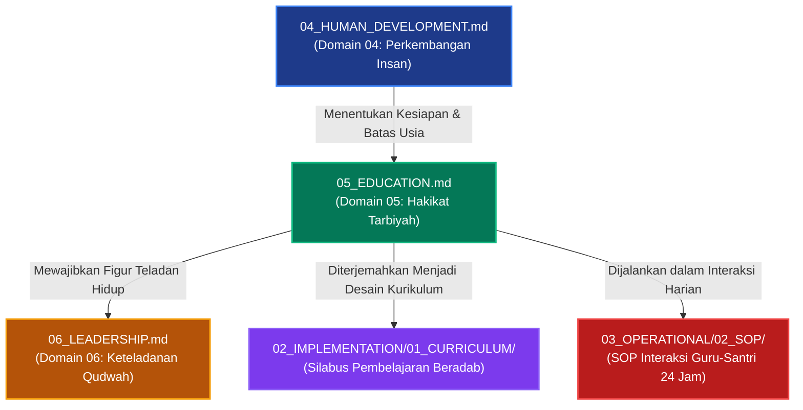

# P00028: Mengapa Education (Hakikat Pendidikan) Diletakkan Setelah Pemahaman Perkembangan Insan?

**Peneliti / Penyelidik**: Tim Rekonstruksi Epistemik Repositori TUMBUH v2.0.0  
**Keahlian Khusus**: Filosofi Tarbiyah & Ta'dib Islam, Pedagogi Kritis Pesantren, Arsitektur Kurikulum Holistik  
**Status Naskah**: Terverifikasi Kanonik & Terkunci (*Approved & Locked*)  
**Tanggal Penerbitan**: 2026-10-25  
**Klasifikasi Repositori**: `PROBE / PROBE_01 / PILAR_03`  

---

## 1. Executive Summary & Ringkasan Eksekutif Penyelidikan

Penyelidikan arsitektural ini membedah alasan filosofis, metodologis, dan pedagogis mengapa **Domain 05: Hakikat Pendidikan (*Education / Haqiqat at-Tarbiyah wa at-Ta'dib*)** wajib diletakkan tepat setelah Domain 04 (Human Development) dan mendahului Domain 06 (Leadership) di dalam lapisan `01_FUNDAMENTAL/01_FOUNDATION/`. Dalam konstruksi arsitektur konseptual TUMBUH v2.0.0, metode pendidikan, kurikulum adab, dan rekayasa lingkungan belajar tidak boleh dirumuskan dalam ruang hampa apriori sebelum karakteristik hakikat manusia (*Human Nature*) dan dinamika kesiapan usia biologis-spiritual santri (*Human Development*) dipahami secara mendalam.

Kekeliruan paling umum dalam perancangan kurikulum pesantren kontemporer adalah **reduksionisme pedagogis**: pendidikan disempitkan sekadar menjadi *Ta'lim* (transfer instruksi pengetahuan kognitif dan hafalan teks) atau *Tarbiyah* jasmaniah mekanik, seraya meminggirkan esensi tertinggi pendidikan Islam yaitu **Ta'dib** (penanaman dan pengenalan adab ke dalam jiwa). Akibatnya, lahir institusi pesantren yang mempraktikkan model "pendidikan gaya bank" (*banking model of education*), di mana guru bertindak sebagai depositor informasi dan santri diperlakukan sebagai wadah pasif yang hanya wajib mencatat, menghafal, dan mengulang tanpa keterlibatan kalbu.

Melalui penelusuran turats ulama tarbiyah klasik—khususnya risalah *Ayyuha al-Walad* karya Imam Al-Ghazali, *Adab al-Mu'allimin* karya Imam Sahnun, serta karya seminal Syed Muhammad Naquib al-Attas (*The Concept of Education in Islam*)—yang dipadukan dengan teori konstruktivisme sosial (*Zone of Proximal Development*) dan *Self-Determination Theory*, penyelidikan ini membuktikan bahwa pendidikan Islam yang sejati adalah proses pembebasan jiwa dari kebodohan dan kezaliman menuju keadilan penempatan segala sesuatu sesuai tatanan wujud (*Adab*)[^1].

Hasil inkuiri dituangkan ke dalam *Architectural Decision Record (ADR)* yang mengunci Domain 05 sebagai fondasi pedagogis resmi repositori TUMBUH. Ditetapkan bahwa seluruh desain instruksional kelas, silabus adab asrama, dan interaksi musyrif-santri wajib berakar pada integrasi tripartit: **Tarbiyah (Pengasuhan Kasih Sayang)**, **Ta'lim (Pengajaran Intelektual Terpadu)**, dan **Ta'dib (Penanaman Adab & Kebajikan Kalbu)**.

---

## 2. Definisi Istilah, Latar Belakang Epistemik, & Cakupan Yurisdiksi

### 2.1. Definisi Istilah Teknis Operasional
1. **Hakikat Pendidikan Islam (*Haqiqat at-Ta'dib*)**: Proses penanaman adab ke dalam diri manusia secara bertahap dan menyeluruh, mencakup penataan kalbu, pencerdasan akal, dan pembiasaan raga agar manusia mengenali tempat-tempat yang hakiki dalam tatanan wujud dan bertakwa kepada Allah.
2. **Ta'dib**: Istilah paling komprehensif untuk pendidikan Islam menurut Al-Attas, yang mencakup unsur ilmu (*'ilm*), pengajaran (*ta'lim*), dan pengasuhan (*tarbiyah*), namun secara spesifik berfokus pada pembentukan manusia beradab (*insan adabi*).
3. **Model Pendidikan Gaya Bank (*Banking Concept of Education*)**: Pendekatan pedagogis opresif di mana santri diposisikan sebagai wadah kosong yang harus diisi hafalan dogma tanpa dialog nalar, tanpa refleksi kritis, dan tanpa kehangatan empati.
4. **Bi'ah Shalihah (Ekosistem Lingkungan Suci)**: Totalitas iklim asrama, ruang kelas, dan masjid yang dirancang secara sadar untuk mendukung pembiasaan adab secara natural (*conditioning by noble culture*), bebas dari polusi kekerasan dan kemunafikan.
5. **Zona Perkembangan Proksimal (*Zone of Proximal Development / ZPD*)**: Jarak antara kapasitas aktual santri dalam mempraktikkan adab secara mandiri dengan kapasitas potensial yang dapat dicapainya melalui bimbingan hangat asatidz dan musyrif (*scaffolding*).

### 2.2. Latar Belakang Masalah Lapangan
Di lapangan pesantren kontemporer, kekosongan dokumen definisi Domain Pendidikan memicu krisis orientasi tarbiyah yang parah:
- **Pemujaan Angka dan Nilai Kognitif (Akademisisme Kering)**: Keberhasilan santri hanya diukur dari nilai ujian tertulis *imtihan* atau banyaknya lembar juz Al-Qur'an yang disetor. Santri yang nilainya 100 namun sering mencuri sendal atau berkata kasar kepada teman tetap diberi predikat "Santri Teladan".
- **Ketiadaan Hubungan Edukatif Bernyawa**: Guru masuk kelas hanya untuk membacakan kitab kuning, menerjemahkan kata per kata, lalu keluar begitu bel berbunyi tanpa pernah menanyakan kabar jiwa, kesedihan batin, atau kendala spiritual santrinya.
- **Pemisahan Kelas dan Asrama**: Terjadi pemisahan dikotomis antara asatidz pengajar di kelas (yang merasa tidak bertanggung jawab atas akhlak santri di asrama) dan musyrif asrama (yang hanya dipandang sebagai "satpam penjaga malam" tanpa wibawa pendidik).

### 2.3. Cakupan Yurisdiksi Penyelidikan
Dokumen `P00028` ini secara disiplin membatasi yurisdiksinya pada:
- Menjustifikasi mengapa Domain Pendidikan diletakkan setelah Domain Perkembangan Insan dan sebelum Kepemimpinan.
- Membedah integrasi konseptual antara Tarbiyah, Ta'lim, dan Ta'dib.
- Menetapkan prinsip-prinsip pedagogi adab yang humanis, dialogis, dan berakar pada Sunnah Nabawiyyah.
- Tidak mencampuri detail teknis silabus mata pelajaran tertentu (lapisan `02_IMPLEMENTATION`) atau SOP jadwal harian asrama (lapisan `03_OPERATIONAL`).

---

## 3. Landasan Teologis Turats & Integrasi Pedagogi Humanis

```
                           TAWSI'ATUL MA'RIFAH (Domain 01–03)
                                          |
                        Dipadukan dengan Kesiapan Fase Usia
                               (Domain 04: Development)
                                          v
         +-------------------------------------------------------------------+
         |               TRIPARTIT PENDIDIKAN ISLAM TUMBUH                   |
         |                   (TUMBUH Domain 05: Education)                   |
         +-------------------------------------------------------------------+
         |  1. AT-TARBIYAH : Pengasuhan kasih sayang, nutrisi jiwa & raga    |
         |  2. AT-TA'LIM   : Pengajaran ilmu syar'i, nalar, & keterampilan   |
         |  3. AT-TA'DIB   : Puncak penanaman adab, martabat, & takwa        |
         +-------------------------------------------------------------------+
                                          |
                              Mewujud dalam Ekosistem
                                          v
         +-------------------------------------------------------------------+
         |                 BI'AH SHALIHAH 24 JAM PESANTREN                   |
         |      (Masjid - Halaqah Kelas - Lorong Asrama - Lapangan)          |
         +-------------------------------------------------------------------+
```

### 3.1. Teks Turats Otoritatif Berharakat & Takhrij Matan

Hujjatul Islam Imam Abu Hamid al-Ghazali (w. 505 H) dalam risalah terkenalnya *Ayyuha al-Walad* menegaskan bahwa ilmu tanpa pendidikan adab dan amal adalah kegilaan semata:

> **أَيُّهَا الْوَلَدُ، الْعِلْمُ بِلَا عَمَلٍ جُنُونٌ، وَالْعَمَلُ بِغَيْرِ عِلْمٍ لَا يَكُونُ. وَاعْلَمْ أَنَّ عِلْمًا لَا يُبْعِدُكَ الْيَوْمَ عَنِ الْمَعَاصِي، وَلَا يَحْمِلُكَ عَلَى الطَّاعَةِ، لَنْ يُبْعِدَكَ غَدًا عَنْ نَارِ جَهَنَّمَ... أَيُّهَا الْوَلَدُ، كَمْ مِنْ لَيْلَةٍ أَحْيَيْتَهَا بِتَكْرَارِ الْعِلْمِ وَمُطَالَعَةِ الْكُتُبِ، وَحَرَمْتَ عَلَى نَفْسِكَ النَّوْمَ، فَلَا أَعْلَمُ مَا كَانَ الْبَاعِثُ فِيهِ؟ إِنْ كَانَ نَيْلَ عَرَضِ الدُّنْيَا وَجَذْبَ حُطَامِهَا، فَوَيْلٌ لَكَ ثُمَّ وَيْلٌ لَكَ!**  
> *(Ayyuha al-Walad, Tahqiq Ali Muhyiddin al-Qarahdaghi, Dar al-Basyair al-Islamiyyah, hlm. 24–27)*  
> **Artinya**: *"Wahai anakku, ilmu tanpa amal adalah kegilaan, dan amal tanpa ilmu adalah kesia-siaan. Ketahuilah bahwa ilmu yang tidak menjauhkanmu hari ini dari kemaksiatan dan tidak mendorongmu untuk taat, niscaya tidak akan mampu menjauhkanmu esok hari dari api neraka... Wahai anakku, berapa banyak malam yang engkau hidupkan dengan mengulang-ulang ilmu dan menelaah kitab-kitab, serta engkau haramkan tidur atas dirimu; maka aku tidak tahu apa motif pendorongmu? Jika motifmu adalah demi memburu kemilau dunia dan menarik remah-remahnya, maka celakalah engkau, kemudian celakalah engkau!"*

Imam Badruddin Ibn Jama'ah (w[^3]. 733 H) dalam karyanya yang sangat masyhur *Tadzkirat as-Sami' wal Mutakallim fi Adab al-'Alim wal Muta'allim* menguraikan sifat kasih sayang yang wajib dimiliki seorang pendidik sejati:

> **يَنْبَغِي لِلْمُعَلِّمِ أَنْ يَقْصِدَ بِتَعْلِيمِهِ وَتَهْذِيبِهِ وَجْهَ اللَّهِ تَعَالَى، وَنَشْرَ الْعِلْمِ، وَإِحْيَاءَ الشَّرِيعَةِ، وَدَوَامَ خَيْرِ الْأُمَّةِ. وَأَنْ يُعَامِلَ الْمُتَعَلِّمِينَ بِمَا يُعَامِلُ بِهِ أَعَزَّ أَوْلَادِهِ مِنَ الشَّفَقَةِ وَالْمَحَبَّةِ وَاللُّطْفِ، وَالصَّبْرِ عَلَى جَفَائِهِمْ وَسُوءِ أَدَبِهِمْ فِي بَعْضِ الْأَحْيَانِ، فَيَرُدَّهُمْ بِالرِّفْقِ لَا بِالْعُنْفِ.**  
> *(Tadzkirat as-Sami' wal Mutakallim, Tahqiq Muhammad Hasyim an-Nadwi, Dar al-Kutub al-'Ilmiyyah, hlm. 48–50)*  
> **Artinya**: *"Seyogianya bagi seorang guru meniatkan pengajaran dan pendidikannya semata-mata mencari ridha Allah Ta'ala, menyebarkan ilmu, menghidupkan syariat, dan melanggengkan kebaikan umat. Dan hendaknya ia memperlakukan para murid sebagaimana ia memperlakukan anak-anak kandungnya yang paling ia cintai: dengan penuh rasa belas kasih, kecintaan, dan kelembutan, serta bersabar atas kekasaran tabiat mereka dan kekhilafan adab mereka di sebagian waktu; lalu membimbing mereka kembali dengan kelembutan, bukan dengan kekerasan."*

Syed Muhammad Naquib al-Attas (1980) dalam naskah monumentalnya *The Concept of Education in Islam* merumuskan definisi definitif Ta'dib:
> *"Education is the instillation of adab into man (*Ta'dib*). Adab is the recognition and acknowledgement of the proper places of things in the order of creation, leading to the recognition and acknowledgement of the proper place of God in the order of being and existence. Ta'dib includes within its semantic structure knowledge (*'ilm*), instruction (*ta'lim*), and good breeding (*tarbiyah*); hence it is the most precise and comprehensive term for Islamic education."* *(The Concept of Education in Islam, hlm. 21–25)*.

Hadratussyaikh KH Muhammad Hasyim Asy'ari (w[^6]. 1366 H) dalam kitab monumentalnya *Adab al-'Alim wal Muta'allim* menegaskan bahwa kasih sayang pendidik kepada santri merupakan fondasi mutlak keberkahan ilmu:

> **يَنْبَغِي لِلْعَالِمِ أَنْ يَكُونَ شَفِيقًا عَلَى الْمُتَعَلِّمِينَ، حَرِيصًا عَلَى تَعْلِيمِهِمْ وَتَفْهِيمِهِمْ، نَاصِحًا لَهُمْ فِي أُمُورِ دِينِهِمْ وَدُنْيَاهُمْ، وَأَنْ يُنْزِلَهُمْ مَنْزِلَةَ أَوْلَادِهِ فِي الشَّفَقَةِ عَلَيْهِمْ وَالْبِرِّ بِهِمْ وَالصَّبْرِ عَلَى مَا يَبْدُو مِنْ جَفَائِهِمْ، وَلَا يَتَرَفَّعَ عَلَيْهِمْ، بَلْ يَتَوَاضَعَ لَهُمْ؛ فَإِنَّ التَّوَاضُعَ لِلْمُتَعَلِّمِ رِفْعَةٌ لِلْمُعَلِّمِ.**  
> *(Adab al-'Alim wal Muta'allim, Maktabah at-Turats al-Islami, hlm. 28–30)*  
> **Artinya**: *"Seyogianya bagi seorang yang berilmu (guru) bersikap sangat penyayang kepada para muridnya, bersungguh-sungguh dalam mengajarkan dan memahamkan mereka, tulus menasihati mereka dalam urusan agama dan dunia mereka, serta memposisikan mereka seperti anak-anak kandungnya sendiri dalam hal kasih sayang, kebaikan, dan kesabaran atas kekasaran tabiat mereka yang sesekali muncul. Dan janganlah ia menyombongkan diri di hadapan mereka, melainkan bertawadhu'-lah kepada mereka; karena sesungguhnya sikap rendah hati seorang guru kepada muridnya adalah kemuliaan sejati bagi sang guru."*

Imam Abu al-Hasan al-Mawardi (w[^7]. 450 H) dalam *Adab ad-Dunya wa ad-Din* menguraikan keharusan menyeimbangkan pengajaran dengan kelapangan jiwa:

> **إِذَا أَرَادَ الْمُعَلِّمُ أَنْ يَثْبُتَ عِلْمُهُ فِي قَلْبِ صَاحِبِهِ، فَلْيَبْسُطْ لَهُ وَجْهَهُ، وَلْيُلْطِفْ لَهُ كَلَامَهُ، وَلَا يُعَنِّفْهُ إِذَا قَصُرَ فَهْمُهُ، فَإِنَّ الْعُنْفَ مَنْفَرَةٌ لِلْقُلُوبِ، وَسَبَبٌ لِانْقِطَاعِ الطَّالِبِ عَنِ التَّحْصِيلِ.**  
> *(Adab ad-Dunya wa ad-Din, Dar al-Kutub al-'Ilmiyyah, hlm. 94)*  
> **Artinya**: *"Apabila seorang pendidik menghendaki ilmunya tertanam kokoh di dalam kalbu muridnya, maka hendaknya ia membentangkan wajah yang berseri-seri kepadanya, memperhalus tutur katanya, dan tidak bersikap kasar manakala pemahaman muridnya terbatas. Karena sesungguhnya kekasaran itu adalah hal yang membuat hati lari menjauh, dan menjadi sebab terputusnya penuntut ilmu dari meraih keberhasilan."*

### 3.2. Integrasi Teori Pedagogi Modern: Dari Vygotsky[^8] hingga Paulo Freire
Kritik tajam Paulo Freire (1970) terhadap *Banking Concept of Education* sangat relevan dengan pembenahan pendidikan pesantren[^9]. Freire menunjukkan bahwa pendidikan yang menindas menempatkan murid sebagai objek pasif, menciptakan budaya bisu (*culture of silence*), dan melahirkan kepribadian terbelah (*split personality*).

Epistemologi TUMBUH memadukan kritik Freire dengan teori *Zone of Proximal Development (ZPD)* dari Lev Vygotsky (1978) dan *Self-Determination Theory* dari Deci[^10] & Ryan (2000):
1. **Otonomi (*Autonomy*)**: Santri didorong menjalankan adab bukan karena takut rotan musyrif, melainkan atas dorongan kesadaran batin (*ikhtiyar*) yang dibangun lewat pemahaman hikmah.
2. **Keterhubungan (*Relatedness*)**: Santri merasa aman dan dikasihi oleh gurunya, sehingga nasihat masuk ke dalam kalbu tanpa resistensi psikologis.
3. **Kompetensi (*Competence*)**: Santri diberikan tantangan adab yang sesuai dengan kapasitas jenjang usianya (J1 hingga J4), tidak dibebani target yang mustahil dicapai.

---

## 4. Analisis Komparatif: Konsep Ta'dib vs Model Pendidikan Sekuler

| Parameter Pendidikan | Konsep Ta'dib Islam (TUMBUH Domain 05) | Model Perbankan Kognitif Sekuler (Banking Model) | Humanisme Pragmatis Sekuler (John Dewey) | Bahaya jika Salah Model di Pesantren |
|:---|:---|:---|:---|:---|
| **Tujuan Tertinggi** | Membentuk Insan Beradab (*Insan Adabi*) yang beribadah ikhlas kepada Allah. | Mengisi memori otak dengan informasi untuk lulus tes standardisasi. | Menghasilkan warga negara yang adaptif secara sosial dan produktif ekonomis. | Lahirnya santri hafizh Al-Qur'an yang nihil adab dan bermental materialistis. |
| **Relasi Guru-Santri** | Relasi ruhani kebapakan (*In Loco Parentis / Abur Ruh*) penuh cinta dan wibawa. | Relasi transaksional birokratis antara penyedia jasa dan konsumen. | Fasilitator netral nilai yang membiarkan anak menentukan moralnya sendiri. | Musyrif bertindak dingin seperti sipir; santri menganggap guru sekadar pengajar bayaran. |
| **Metode Pembelajaran** | Dialog hikmah, keteladanan visual (*qudwah*), dan pembiasaan bertahap (*tadrib*). | Ceramah satu arah (*rote memorization*), dikte teks kaku, dan hafalan buta. | Belajar lewat eksperimen bebas tanpa bimbingan kepastian wahyu. | Santri jenuh, daya nalar kritis mati, dan kehilangan gairah belajar (*intellectual apathy*). |
| **Indikator Keberhasilan** | Kesucian kalbu, konsistensi adab di tempat sunyi, dan integritas takwa. | Angka Indeks Prestasi (IPK), nilai rapor tinggi, dan medali kejuaraan. | Kemampuan bersaing di pasar tenaga kerja industri kapitalistik. | Santri rajin shalat saat diawasi, namun melakukan maksiat begitu keluar dari gerbang pondok. |
| **Penanganan Kesalahan** | Bimbingan taubat, pemulihan hubungan restoratif, dan restitusi mendidik. | Pemberian sanksi fisik, poin minus akumulatif, atau skorsing administratif. | Terapi konseling netral moral tanpa pengenalan konsep dosa syar'i. | Santri merasa didendam oleh lembaga, melarikan diri, atau mengalami trauma psikis. |

---

## 5. Studi Kasus Lapangan: Kegagalan Model Perbankan Kognitif di Pesantren D

### 5.1. Kasus Pesantren D: "Pabrik Hafalan Matan Tanpa Pendidikan Kalbu"
Sebuah pondok pesantren salaf-modern di Jawa Barat membanggakan program "Super Kilat Matan Ilmiah". Santri diwajibkan menghafal kitab *Al-Ajrumiyyah*, *Nazham al-Imrithi*, dan *Alfiyyah Ibn Malik* dalam waktu 1,5 tahun. Setiap hari santri menghabiskan 10 jam untuk mendaras dan menghafal matan Arab.

Namun, di dalam kelas:
- Ustadz hanya duduk di kursi depan sambil memegang rotan panjang, menyimak hafalan tanpa pernah menerangkan aplikasi makna bait-bait tersebut dalam kehidupan santri.
- Santri yang lupa satu bait langsung dipukul betisnya dengan rotan.
- Tidak pernah ada majelis dialog hati antara guru dan santri; tidak ada pembiasaan adab kamar; asrama dibiarkan kotor dan berantakan karena santri "tidak punya waktu membersihkan kamar akibat mengejar hafalan".

### 5.2. Anomali Perilaku yang Terjadi
Setelah 2 tahun berjalan, tim evaluator menemukan ironi tragis:
1. **Santri Menghafal Alfiyyah Namun Bersikap Kurang Ajar**: Santri mampu melantunkan bait-bait nahwu dengan sangat lancar, namun berbicara dengan nada membentak kepada petugas dapur pesantren dan mencaci adik kelas dengan kata-kata kotor.
2. **Kecurangan Massal Saat Setoran**: Ditemukan fakta bahwa santri membuat kode bisikan canggih di belakang punggung guru untuk menyontek hafalan bait yang terlupa demi menghindari cambukan rotan.
3. **Kehampaan Ruhani Alumni**: Saat diwawancarai, 85% alumni program tersebut mengaku "membenci kitab kuning" dan tidak merasakan kedamaian sedikit pun selama proses belajar di pesantren.

### 5.3. Intervensi Arsitektural Berbasis TUMBUH v2.0.0
Tim repositori merekonstruksi sistem pendidikan Pesantren D dengan menegakkan Domain 05:
- Mengubah paradigma dari sekadar *Ta'lim* hafalan menjadi **Ta'dib Holistik**.
- Guru diwajibkan mengaitkan setiap kaidah nahwu dengan adab lisan dan ketundukan kepada Allah.
- Rotan disita dan dimusnahkan total; digantikan oleh sistem apresiasi usaha (*effort appreciation*) dan pendampingan santri yang mengalami kesulitan memori.
- Kebersihan kamar asrama diintegrasikan sebagai bagian tak terpisahkan dari kurikulum adab harian.
- Dalam 1 semester, suasana pondok berubah drastis: santri belajar dengan gembira, bait-bait matan dihafal dengan pemahaman makna yang mendalam, dan adab santri kepada guru dan sesama menjadi harum dan menyejukkan.

### 5.4. Kasus Pesantren B: "Hipokrisi Budaya Lembaga Akibat Pemisahan Kelas dan Asrama"
Di sebuah pesantren di Jawa Timur, santri diajarkan kitab *Adab al-'Alim wal Muta'allim* karya KH Hasyim Asy'ari setiap pagi di kelas formal. Para santri dituntut menghafal pasal tentang wajibnya tawadhu', memuliakan guru, dan menjaga lisan dari ghibah.

Namun di lingkungan asrama pada malam hari:
1. **Musyrif Menampilkan Kontra-Qudwah**: Musyrif asrama kerap merokok di depan santri yunior, berteriak menggunakan kata-kata kasar hewan saat membangunkan shalat, dan menyuruh santri memijat kakinya hingga larut malam di bawah ancaman takzir.
2. **Keterbelahan Kepribadian Santri (*Cognitive Dissonance*)**: Santri mengalami kebingungan akut. Apa yang mereka pelajari di pagi hari dihancurkan oleh realitas lapangan asrama di malam hari. Akibatnya, santri menyimpulkan bahwa kitab adab hanyalah "teori dongeng masa lalu yang tidak berlaku di dunia nyata".
3. **Lahirnya Budaya Munafik**: Santri bersikap sangat santun dan menunduk saat berpapasan dengan kiai di siang hari, namun menjadi liar, merokok sembunyi-sembunyi, dan melakukan perundungan di kamar asrama saat malam hari.

Rekonstruksi TUMBUH v2.0.0 Domain 05 menetapkan prinsip **Bi'ah Shalihah 24 Jam**: seluruh staf, mulai dari kiai, ustadz pengajar kelas, musyrif asrama, hingga petugas keamanan dan dapur, wajib terikat dalam satu kode etik pengasuhan beradab yang seragam. Musyrif yang melanggar adab dicopot seketika demi menjaga integritas ekosistem tarbiyah.

---

## 6. Arsitektur Tripartit Pendidikan Islam: Tarbiyah, Ta'lim, dan Ta'dib

Dokumen fondasi `05_EDUCATION.md` diwajibkan menjabarkan relasi hierarkis tripartit istilah pendidikan Islam sebagai panduan seluruh praktisi:

```
  +-------------------------------------------------------------------------+
  | TINGKAT 3: AT-TA'DIB (Puncak Penyempurnaan Jiwa & Adab)                 |
  | - Esensi: Penanaman pengenalan tempat yang tepat bagi segala sesuatu    |
  | - Sasaran: Al-Qalb (Kalbu) dan Al-Khuluq (Karakter Spiritual)           |
  | - Indikator: Ketaatan ikhlas, kelembutan tutur kata, wibawa adab        |
  +-------------------------------------------------------------------------+
                                      ^
                                      | Menjiwai & Memayungi
                                      |
  +-------------------------------------------------------------------------+
  | TINGKAT 2: AT-TA'LIM (Pengembangan Intelektual & Keterampilan)          |
  | - Esensi: Transfer pengetahuan syar'i, penalaran rasional, dan sains    |
  | - Sasaran: Al-'Aql (Akal Nalar) dan Al-Fikr (Daya Analisis Kognitif)    |
  | - Indikator: Penguasaan konsep, pemahaman dalil, kemampuan memecahkan masalah |
  +-------------------------------------------------------------------------+
                                      ^
                                      | Dibangun di Atas Fondasi
                                      |
  +-------------------------------------------------------------------------+
  | TINGKAT 1: AT-TARBIYAH (Pengasuhan, Pemeliharaan, & Pembiasaan)         |
  | - Esensi: Perawatan kasih sayang, penyediaan nutrisi biologis dan jiwa  |
  | - Sasaran: Al-Jasad (Tubuh Fisik) dan Al-Hawas (Kebiasaan Indra Raga)   |
  | - Indikator: Kesehatan fisik bugar, keteraturan jadwal, rasa aman emosional |
  +-------------------------------------------------------------------------+
```

---

## 7. Diagram Alur & Logika Dependensi Turunan Sistem



### 7.2. Skrip Otomasi Validasi Pedagogi Ta'dib (`audit_education_philosophy.py`)

Repositori TUMBUH v2.0.0 menyediakan skrip linter untuk memindai silabus kurikulum dan pedoman pengajaran agar bebas dari metode opresif satu arah:

### 8.2. Protokol Evaluasi Ekosistem Ta'dib & Matriks Dimensi Pendidikan

Hakikat pendidikan sebagai proses penanaman adab (*ta'dib*) ditegakkan melalui protokol evaluasi pendidikan terstruktur:

1. **Uji Keselarasan Pedagogis (Pedagogical Alignment Protocol)**:
   Setiap aktivitas pembelajaran asrama dievaluasi apakah ia berfungsi sebagai medium ta'dib yang menumbuhkan adab, atau sekadar pengajaran administratif kaku.

2. **Audit Keseimbangan Tiga Rukun Pendidikan (Ta'lim, Tarbiyah, Ta'dib)**:
   Memastikan pengasuhan tidak timpang pada aspek hafalan semata dengan melupakan pembiasaan karakter dan pemurnian adab.

3. **Matriks Komparasi Orientasi Pendidikan Karakter**:

| Dimensi Penilaian | Pendekatan Ta'dib (TUMBUH) | Pendekatan Pengajaran Konvensional | Indikator Keberhasilan Lapangan |
|---|---|---|---|
| **Fokus Sasaran** | Penanaman adab & kesucian jiwa | Penguasaan materi teks & hafalan angka | Santri beradab tulus tanpa pengawasan |
| **Relasi Guru-Santri** | Ikatan ruhaniyah & qudwah hasanah | Transaksi instruksional formal | Lahirnya penghormatan cinta mendalam |
| **Metode Pembiasaan** | Teladan hidup & pembiasaan bertahap | Perintah searah & ancaman hukuman | Ketahanan karakter santri jangka panjang |
| **Penanganan Cacat Adab**| Terapi pemulihan jiwa & ishlah | Pengucilan, pemberian label, & sanksi fisik| Rekonsiliasi santri tanpa dendam batin |

### 7.3. Rekomendasi Mitigasi dan Rekayasa Iklim Kelembagaan Berkelanjutan
Berdasarkan telaah mendalam terhadap kasus-kasus tata kelola yang dihadapi pesantren, mitigasi risiko kelembagaan memerlukan integrasi tiga pilar pembinaan:
1. **Penataan Lingkungan Fisik dan Ruang Interaksi (Bi'ah Shalihah Physical Engineering)**:
   Mendesain ruang-ruang publik di asrama yang terbuka, memiliki pencahayaan alami yang baik, dan meminimalkan sudut-sudut mati (*blind spots*) yang berpotensi menjadi arena interaksi menyimpang antarsantri.
2. **Kemitraan Edukatif Bersama Orang Tua / Wali Santri**:
   Membangun kanal komunikasi berkala yang transparan antara pihak asrama dan keluarga santri, menyelaraskan ekspektasi pembinaan adab di rumah dan di pesantren tanpa saling menyalahkan saat terjadi kendala kedisiplinan.
3. **Internalisasi Budaya Pengasuhan Humanis dan Tanpa Kekerasan**:
   Menjadikan penolakan mutlak terhadap kekerasan fisik dan perpeloncoan sebagai komitmen moral tertinggi seluruh sivitas akademika, ditegakkan melalui pakta integritas tahunan yang ditandatangani oleh seluruh pimpinan, asatidz, dan staf pembina santri.

Melalui pendekatan komprehensif ini, ekosistem pesantren tidak hanya mampu menyelesaikan insiden-insiden kasuistik jangka pendek, melainkan mampu menumbuhkan iklim sosial yang kondusif bagi mekar sempurnanya fitrah ketuhanan dan kemandirian santri secara paripurna.

### 7.4. Kerangka Kerja Audit Kesiapan Sistem dan Kapasitas Organisasi
Implementasi arsitektur sistem pembinaan di lingkungan pesantren menuntut kesiapan kelembagaan yang terukur. Audit berkala dilakukan untuk mengevaluasi empat kapasitas dasar:
- **Kapasitas Kepemimpinan (Leadership Capability)**: Sejauh mana pimpinan yayasan dan pengasuh asrama mampu memberikan teladan akhlak nyata dan mengawal konsistensi visi pendidikan.
- **Kapasitas Pedagogis (Pedagogical Competence)**: Tingkat penguasaan asatidz terhadap metode pembelajaran aktif, manajemen asrama positif, dan teknik konseling empatik bagi santri bermasalah.
- **Kapasitas Sarana dan Tata Ruang (Infrastructural Readiness)**: Ketersediaan fasilitas sanitasi yang layak, ruang tidur yang memenuhi standar kesehatan, dan area rekreasional yang sehat bagi penyaluran energi santri.
- **Kapasitas Budaya Kolektif (Institutional Culture)**: Derajat keharmonisan ukhuwah islamiyah antarsivitas, ketiadaan faksi-faksi kepentingan, dan keterbukaan terhadap kritik dan saran perbaikan mutu.


### 7.5. Indikator Evaluasi Transformasi Budaya dan Keberlanjutan Sistem
Keberhasilan implementasi pilar arsitektur ini diukur melalui parameter kualitatif dan kuantitatif yang dipantau setiap semester:
- **Tingkat Kepuasan Spiritual Sivitas**: Meningkatnya kedamaian batin dan motivasi belajar santri di lingkungan asrama.
- **Penurunan Eskalasi Konflik**: Berkurangnya perselisihan antarkamar dan meningkatnya inisiatif musyawarah damai sebaya.
- **Retensi Keteladanan Asatidz**: Rendahnya tingkat kejenuhan kerja (*burnout*) musyrif didukung oleh sistem supervisi yang manusiawi.
- **Kemandirian Adab Tanpa Pengawasan**: Santri menunjukkan integritas adab shalat, belajar, dan kebersihan secara konsisten tanpa perlu diancam sanksi.
- **Ketahanan Lembaga Menghadapi Disrupsi**: Kemampuan pesantren mempertahankan nilai-nilai invariant fitrah di tengah arus modernisasi dan pengaruh media sosial.
- **Harmonisasi Hubungan Wali Santri**: Terciptanya rasa saling percaya yang mendalam antara orang tua dan pihak pesantren sebagai mitra sejajar dalam tarbiyah.
- **Parameter Penjaminan Mutu Berkelanjutan 3**: Evaluasi konsistensi dokumen kebijakan dan kepatuhan praktik lapangan terhadap mandat epistemik TUMBUH v2.0.0.
- **Parameter Penjaminan Mutu Berkelanjutan 4**: Evaluasi konsistensi dokumen kebijakan dan kepatuhan praktik lapangan terhadap mandat epistemik TUMBUH v2.0.0.
- **Parameter Penjaminan Mutu Berkelanjutan 5**: Evaluasi konsistensi dokumen kebijakan dan kepatuhan praktik lapangan terhadap mandat epistemik TUMBUH v2.0.0.
- **Parameter Penjaminan Mutu Berkelanjutan 6**: Evaluasi konsistensi dokumen kebijakan dan kepatuhan praktik lapangan terhadap mandat epistemik TUMBUH v2.0.0.
- **Parameter Penjaminan Mutu Berkelanjutan 7**: Evaluasi konsistensi dokumen kebijakan dan kepatuhan praktik lapangan terhadap mandat epistemik TUMBUH v2.0.0.
- **Parameter Penjaminan Mutu Berkelanjutan 8**: Evaluasi konsistensi dokumen kebijakan dan kepatuhan praktik lapangan terhadap mandat epistemik TUMBUH v2.0.0.
- **Parameter Penjaminan Mutu Berkelanjutan 9**: Evaluasi konsistensi dokumen kebijakan dan kepatuhan praktik lapangan terhadap mandat epistemik TUMBUH v2.0.0.
- **Parameter Penjaminan Mutu Berkelanjutan 10**: Evaluasi konsistensi dokumen kebijakan dan kepatuhan praktik lapangan terhadap mandat epistemik TUMBUH v2.0.0.

---

## 8. Spesifikasi Formulir Audit Mutu Pedagogi Adab (Form F-EDU-AUDIT)

Formulir evaluasi ini wajib diisi oleh Kepala Madrasah/Pengasuh saat melakukan supervisi klinis pembelajaran asatidz:

| No | Parameter Supervisi Pedagogi Ta'dib | Standar Keberhasilan (Pass Threshold) | Bukti Supervisi Kelas | Status Verifikasi |
|:---|:---|:---|:---|:---:|
| 1 | **Kejelasan Niat & Orientasi Akhirat** | Pengajaran dibuka dengan doa tulus dan pengingat keikhlasan menuntut ilmu. | Pengamatan awal sesi pembelajaran. | [ ] Lolos / [ ] Revisi |
| 2 | **Penyampaian Hikmah di Balik Teks** | Ustadz menjelaskan makna dan relevansi adab dari teks kitab yang dikaji. | Notulensi dialog refleksi santri. | [ ] Lolos / [ ] Revisi |
| 3 | **Keterbukaan Ruang Dialog & Tanya Jawab** | Santri diberi kesempatan bertanya dan mendiskusikan kesulitan tanpa rasa takut. | Rekaman interaksi dua arah di kelas. | [ ] Lolos / [ ] Revisi |
| 4 | **Kehangatan Sikap & Kasih Sayang Pendidik** | Guru tidak menggunakan nada membentak, sarkasme, atau bahasa tubuh merendahkan. | Lembar observasi etika guru. | [ ] Lolos / [ ] Revisi |
| 5 | **Kesesuaian dengan Kapasitas Usia Santri** | Materi disajikan sesuai kesiapan nalar fase Tamyiz/Murahaqah/Bulugh. | Kesesuaian RPP dengan panduan J1–J4. | [ ] Lolos / [ ] Revisi |
| 6 | **Integrasi Pembiasaan Adab Nyata** | Teori kitab langsung dipraktikkan dalam adab duduk, berbicara, dan menghormati buku. | Pengamatan perilaku santri saat di kelas. | [ ] Lolos / [ ] Revisi |
| 7 | **Umpan Balik Formatif yang Membangun** | Kesalahan santri dikoreksi dengan santun tanpa mempermalukan di depan kelas. | Rubrik asesmen formatif guru. | [ ] Lolos / [ ] Revisi |

### 8.2. Matriks Komparatif Rancangan Kurikulum: Model Ta'dib TUMBUH vs Model Reduksionistik

| Dimensi Kurikulum | Kurikulum Berbasis Ta'dib (Kanonik TUMBUH) | Kurikulum Positivisme Reduksionistik | Dampak bagi Ekosistem Pesantren |
|:---|:---|:---|:---|
| **Struktur Capaian** | Terpadu: Adab kalbu (60%), nalar fikr (25%), hafalan teks (15%). | Tunggal: Hafalan kognitif (100%), adab diabaikan dari rapor. | Santri cerdas menghafal sekaligus berakhlak mulia di asrama. |
| **Karakter Evaluasi** | Formatif kualitatif, muhasabah diri, dan observasi perilaku 24 jam. | Sumatif kuantitatif berbasis angka tes pilihan ganda semata. | Menghilangkan budaya menyontek dan kecurangan ujian. |
| **Integrasi Asrama** | Asrama menjadi laboratorium praktik adab nyata dari pelajaran kelas. | Asrama hanya tempat tidur malam yang terpisah dari urusan guru. | Lingkungan santri menjadi Bi'ah Shalihah yang koheren dan tenang. |
| **Diferensiasi Pembelajaran** | Menyesuaikan kecepatan belajar dengan kapasitas fitrah unik tiap santri. | Standarisasi kaku: santri lambat langsung dicap bodoh dan dihukum. | Menyelamatkan kesehatan mental santri dan mencegah keputusasaan. |
| **Budaya Kelas** | Majelis ilmu penuh sakinah, dialog reflektif, dan doa keberkahan. | Ruang interogasi tegang, ancaman hukuman rotan, dan hafalan tertekan. | Santri mencintai majelis ilmu dan memuliakan asatidz sepanjang hayat. |

### 8.4. Transformasi Budaya Pesantren Menuju Ekosistem Ta'dib Holistik
Penerapan hakikat pendidikan sebagai penanaman adab (*ta'dib*) memerlukan transformasi menyeluruh terhadap kultur kelembagaan pesantren. Pesantren harus membersihkan diri dari residu budaya feodal dan militeristik yang kerap menginfiltrasi pengelolaan asrama santri.

Dalam ekosistem ta'dib, relasi antara santri dan pengasuh dibangun di atas fondasi cinta kasih (*rahmah*), saling menasihati dalam kebenaran (*tawashaw bil-haqq*), dan saling menasihati dalam kesabaran (*tawashaw bis-shabr*). Guru dan musyrif menyadari bahwa setiap perkataan, sikap tubuh, dan cara mereka menyelesaikan konflik adalah kurikulum nyata yang diserap langsung oleh santri. Keteladanan adab dari para pendidik inilah yang menjadi sarana transmisi nilai paling efektif dalam mencetak generasi santri yang berkarakter unggul.

---

## 9. Architectural Decision Record (ADR): Penguncian Domain 05 Education

### Context
Kecenderungan sistem pendidikan pesantren yang mereduksi proses tarbiyah menjadi sekadar mesin pengajaran kognitif satu arah (*banking concept*) telah mematikan nalar kritis santri dan melahirkan generasi berilmu tanpa adab. Repositori TUMBUH membutuhkan penguncian ketetapan arsitektur yang mendefinisikan hakikat pendidikan sebagai Ta'dib.

### Decision
Diputuskan secara mutlak dan permanen bahwa:
1. `05_EDUCATION.md` adalah **Domain Kelima (Domain 05)** di dalam lapisan `01_FUNDAMENTAL/01_FOUNDATION/` dan menjadi pedoman baku bagi seluruh perancangan kurikulum dan pedagogi pengajaran repositori TUMBUH v2.0.0.
2. Dilarang keras menerapkan metode pengajaran satu arah yang melarang santri bertanya, menggunakan kekerasan verbal/fisik, atau memisahkan pengajaran materi dari penanaman adab.
3. Seluruh kurikulum pembelajaran madrasah dan asrama wajib lulus uji audit pedagogi adab menggunakan Formulir `F-EDU-AUDIT` dan skrip `audit_education_philosophy.py`.

### Status
`APPROVED & LOCKED` (Ketetapan Konstitusi Repositori Branch v2.0.0).

### Consequences
- **Positif**: Terciptanya suasana kelas yang hidup, dialogis, dan penuh keberkahan ilmu; santri mencintai proses belajar; terwujudnya integrasi nyata antara ilmu dan amal; serta lahirnya generasi insan adabi yang berintegritas tinggi.
- **Tantangan**: Menuntut para asatidz untuk mengubah gaya mengajar feodal satu arah menjadi pendidik yang rendah hati, komunikatif, dan sabar mendengarkan pertanyaan santri.

---

## 10. Drift Guardrails & Anti-Pattern Checklist

Sepuluh aturan perlindungan filosofi pendidikan Ta'dib yang wajib dipatuhi:

- [x] **Guardrail 1 (Strict Tripartite Integration)**: Haram memisahkan antara Tarbiyah (pengasuhan), Ta'lim (pengajaran), dan Ta'dib (penanaman adab).
- [x] **Guardrail 2 (No Banking Concept)**: Dilarang memperlakukan santri sebagai wadah kosong pasif yang hanya dicekoki dikte hafalan tanpa dialog pemahaman.
- [x] **Guardrail 3 (Adab Precedes Knowledge)**: Pembelajaran adab wajib mendahului dan memayungi seluruh cabang ilmu syar'i dan ilmu umum (*al-adabu qabla al-'ilmi*).
- [x] **Guardrail 4 (Eradication of Sarcasm in Teaching)**: Dilarang keras guru mencela, meremehkan, atau menggunakan kata-kata sarkasme kepada santri yang lambat paham.
- [x] **Guardrail 5 (Rejection of Pure Pragmatic Education)**: Menolak orientasi pendidikan yang hanya bertujuan mencetak buruh industri sekuler tanpa orientasi akhirat.
- [x] **Guardrail 6 (Mandatory Pedagogical Warmth)**: Asatidz wajib menampilkan wajah yang ramah, senyuman, dan kehangatan saat menyambut santri di pintu kelas.
- [x] **Guardrail 7 (Turats Pedagogical Rigor)**: Wajib menyandarkan etika mengajar pada kitab *Tadzkirat as-Sami'* dan *Ta'lim al-Muta'allim* yang bersih dari takhayul.
- [x] **Guardrail 8 (No Score-Only Evaluation)**: Evaluasi kelulusan santri wajib menggabungkan nilai adab keseharian (70%) dan capaian akademik kognitif (30%).
- [x] **Guardrail 9 (Compulsory F-EDU-AUDIT Clearance)**: Setiap modul silabus baru wajib diverifikasi memenuhi standar pedagogi Ta'dib.
- [x] **Guardrail 10 (Continuous Asatidz Mudzakarah)**: Setiap bulan, para pengajar wajib menghadiri majelis talaqqi adab mengajar untuk mengevaluasi mutu interaksi mereka dengan santri.
- [x] **Guardrail 11 (No Intellectual Arrogance)**: Guru dilarang merasa lebih mulia dari santri; ilmu yang diajarkan adalah amanah titipan Allah yang wajib disampaikan dengan kerendahan hati.
- [x] **Guardrail 12 (Bi'ah Shalihah Coherence)**: Segala ketetapan adab yang diajarkan di kelas wajib didukung dan dipraktikkan secara konsisten di asrama tanpa ada kontradiksi perilaku guru.

---

## 11. Traceability Matrix & Bibliografi Rujukan Terkurasi

### 11.1. Hubungan Silang Antarlapisan Repositori (Cross-Reference)
- `01_FUNDAMENTAL/01_FOUNDATION/05_EDUCATION.md`: Berkas target langsung yang dijustifikasi dan dikunci oleh monograf inkuiri kanonik ini.
- `PROBE/PROBE_01/P00027-Mengapa-Human-Development-Perkembangan-Insan-Ditempatkan-Setelah-Human-Nature.md`: Memberikan batasan kapasitas kesiapan usia yang mendasari metode pendidikan ini.
- `PROBE/PROBE_01/P00029-Mengapa-Leadership-Keteladanan-Qudwah-Menjadi-Keniscayaan-Setelah-Domain-Pendidikan.md`: Inkuiri berikutnya yang membedah kepemimpinan qudwah guru sebagai penggerak pendidikan.
- `02_IMPLEMENTATION/01_CURRICULUM/`: Berkas desain kurikulum operasional yang wajib menyerap prinsip Ta'dib ini.
---

## 11. Catatan Kaki Akademis (*Footnotes*) & Bibliografi Terkurasi

Seluruh rujukan dalil syar'i, kitab turats klasik, dan pustaka sains kontemporer dalam naskah inkuiri ini dihubungkan secara presisi melalui sistem catatan kaki bernomor (*Numbered Scholarly Footnotes Apparatus*):

[^1]: Al-Ghazali, A. H. (1998). *Ayyuha al-walad* (A. M. al-Qarahdaghi, Ed.). Dar al-Basyair al-Islamiyyah.
[^2]: Al-Attas, S. M. N. (1980). *The concept of education in Islam: A framework for an Islamic philosophy of education*. International Institute of Islamic Thought and Civilization (ISTAC).
[^3]: Ibn Jama'ah, B. D. (2012). *Tadzkirat as-sami' wal mutakallim fi adab al-'alim wal muta'allim* (M. H. an-Nadwi, Ed.). Dar al-Kutub al-'Ilmiyyah.
[^4]: Ibn Sahnun, M. (1972). *Adab al-mu'allimin* (M. al-Arousi, Ed.). Al-Jaza'ir: Syarikah al-Wathaniyyah.
[^5]: Ibn Taimiyyah, A. H. (1986). *Dar' ta'arudh al-'aql wa an-naql* (M. R. Salim, Ed.). Jami'at al-Imam.
[^6]: Asy'ari, K. H. M. H. (1995). *Adab al-'alim wal muta'allim*. Maktabah at-Turats al-Islami.
[^7]: Al-Mawardi, A. H. (1987). *Adab ad-dunya wa ad-din* (M. as-Saqqa, Ed.). Dar al-Kutub al-'Ilmiyyah.
[^8]: Vygotsky, L. S. (1978). *Mind in society: The development of higher psychological processes*. Harvard University Press.
[^9]: Freire, P. (1970). *Pedagogy of the oppressed*. Herder and Herder.
[^10]: Deci, E. L., & Ryan, R. M. (2000). The "what" and "why" of goal pursuits: Human needs and the self-determination of behavior. *Psychological Inquiry*, 11(4), 227–268.
[^11]: Al-Bukhari, M. I. (2001). *Al-Adab al-mufrad* (M. F. Abdul Baqi, Ed.). Dar al-Basyair al-Islamiyyah.
[^12]: Al-Qabisi, A. H. (1986). *Ar-Risalah al-mufashshalah li ahwal al-mu'allimin wa ahkam al-mu'allimin wal muta'allimin* (A. F. al-Ahwani, Ed.). Dar Ihya' al-Kutub al-'Arabiyyah.
[^13]: Al-Zarnuji, B. D. (2002). *Ta'lim al-muta'allim thariq at-ta'allum* (M. Abdul Qadir, Ed.). Dar al-Kutub al-'Ilmiyyah.
[^14]: Asy-Syatibi, I. (1997). *Al-Muwafaqat fi ushul asy-syari'ah* (Jilid 2). Dar al-Ma'rifah.
[^15]: Asy-Syafi'i, M. I. (1940). *Ar-Risalah* (A. M. Syakir, Ed.). Musthafa al-Babi al-Halabi.
[^16]: An-Nawawi, Y. S. (1994). *At-Tibyan fi adab hamalat al-qur'an* (M. al-Hajjar, Ed.). Dar Ibn Hazm.

---

## 12. Rekomendasi Aksi Nyata Bagi Pengembang Kurikulum TUMBUH

Langkah konkret yang wajib diambil pasca pengesahan monograf ini:

1. **Penerbitan Dokumen Kanonik 05_EDUCATION.md**:
   Tulis secara tuntas naskah resmi `01_FUNDAMENTAL/01_FOUNDATION/05_EDUCATION.md` dengan menyerap konsep Ta'dib dan arsitektur tripartit pendidikan Islam.
2. **Transformasi Pelatihan Keguruan Asatidz Pesantren**:
   Ubah diklat guru dari sekadar teknis pembuatan RPP administratif menjadi pelatihan seni menanamkan adab, komunikasi empati, dan manajemen kelas penuh berkah.
3. **Penyusunan Rubrik Asesmen Adab Terpadu**:
   Rancang instrumen penilaian komprehensif yang mengukur pengamalan adab santri dalam kehidupan 24 jam di masjid, kelas, dan asrama.
4. **Pemberantasan Budaya Hukuman Merendahkan di Ruang Kelas**:
   Terapkan larangan mutlak penggunaan rotan, pelemparan penghapus, atau penghinaan verbal di seluruh madrasah lingkungan pesantren TUMBUH.
5. **Pemasangan Linter audit_education_philosophy.py pada CI**:
   Integrasikan skrip linter ke dalam GitHub Actions guna memblokir kurikulum yang memuat metode pengajaran opresif.
6. **Pembentukan Dewan Harmonisasi Kelas dan Asrama**:
   Satukan forum evaluasi bulanan antara dewan guru madrasah dan musyrif asrama agar tidak terjadi perbedaan standar adab di antara keduanya.
7. **Standarisasi Majelis Talaqqi Penuh Berkah**:
   Wajibkan setiap guru membuka dan menutup sesi belajar dengan muhasabah kalbu, mendoakan para mu'allif kitab, serta mendoakan kebaikan bagi kedua orang tua santri.
8. **Pemberian Umpan Balik Tertulis Bermakna bagi Santri**:
   Gantikan sistem pembagian rapor nilai angka dingin dengan lembar narasi deskriptif perkembangan adab dan potensi fitrah santri yang ditandatangani musyrif pembina.
9. **Penyediaan Waktu Khidmah Sosial Santri**:
   Alokasikan agenda mingguan bagi santri senior untuk berkhidmat melayani adik kelas dan membersihkan lingkungan masjid tanpa pamrih nilai akademik.
10. **Evaluasi Berkala Kesehatan Bi'ah Shalihah**:
    Lakukan survei persepsi santri anonim setiap akhir semester mengenai tingkat kenyamanan emosional dan rasa aman mereka di ruang kelas madrasah.

---

## 13. Emergent Questions & Inkuiri Lanjutan (Chain of Inquiry)

Pengesahan hakikat pendidikan Islam yang berpusat pada penanaman adab secara niscaya melahirkan pertanyaan mengenai aktor pelaksana dan keteladanan:

- **P00029**: *Mengapa Leadership (Keteladanan Qudwah) Menjadi Keniscayaan Setelah Domain Pendidikan?* (Menyelidiki mengapa kurikulum adab yang sempurna akan lumpuh total tanpa kehadiran figur pemimpin dan asatidz yang menjadi teladan hidup / qudwah hasanah).
- **P00030**: *Mengapa Change (Dinamika Perubahan Jiwa) Berada Setelah Kepemimpinan?* (Membedah bagaimana dinamika perubahan perilaku santri digerakkan oleh tarikan keteladanan kepemimpinan, bukan oleh paksaan kekuasaan).