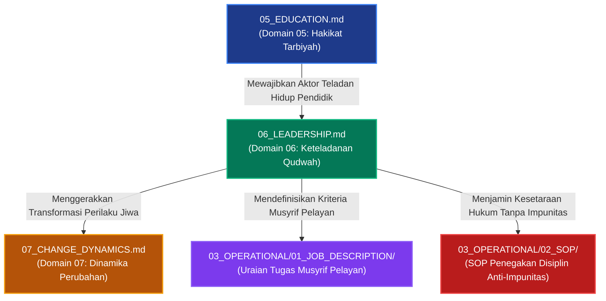

# P00029 — Mengapa Leadership (Keteladanan Qudwah) Menjadi Keniscayaan Setelah Domain Pendidikan?

---

## 1. Executive Summary & Ringkasan Eksekutif Penyelidikan

Dokumen penyelidikan arsitektural ini merumuskan keniscayaan deduktif, landasan epistemologis syar'i, dan rasionalitas sistemik penempatan **Kepemimpinan Keteladanan (*Leadership / Al-Qiyadah bi al-Qudwah*) sebagai Domain Keenam (Domain 06)** tepat setelah Hakikat Pendidikan (*Education*) dan mendahului Dinamika Perubahan Jiwa (*Change Dynamics*) di dalam subdirektori `01_FUNDAMENTAL/01_FOUNDATION/` repositori TUMBUH v2.0.0. Dalam rantai penalaran hierarkis filsafat pendidikan Islam, setelah Domain 05 mengesahkan bahwa pendidikan adalah proses penanaman adab (*Ta'dib*), maka akal niscaya menuntut penegasan mengenai: *"Siapakah aktor utama penggerak tarbiyah tersebut? Melalui instrumen apa nilai-nilai adab ditransformasikan ke dalam kalbu santri?"*[^1].

Penyakit paling kronis yang menghancurkan wibawa tarbiyah di dunia pesantren adalah **feodalisme kepemimpinan dan budaya impunitas**: kiai, guru, atau santri senior memposisikan diri sebagai kasta bangsawan yang berhak dilayani, kebal dari aturan disiplin, dan bebas menggunakan kekerasan dengan dalih "ketaatan mutlak kepada guru". Akibatnya, nilai-nilai adab tereduksi menjadi sekadar topeng kemunafikan sosial, di mana santri patuh semata-mata karena takut sanksi fisik, bukan karena penghormatan yang tulus.

Melalui penelusuran khazanah turats klasik—khususnya *As-Siyasah asy-Syar'iyyah* karya Syaikhul Islam Ibn Taimiyyah, *Al-Ahkam as-Sulthaniyyah* karya Imam Al-Mawardi, serta nasihat kepemimpinan Imam Al-Ghazali dalam *Nashihat al-Muluk*—yang diintegrasikan dengan teori kepemimpinan pelayan (*Servant Leadership*) dari Robert K. Greenleaf dan teori pemodelan sosial (*Social Learning Theory*) dari Albert Bandura, penyelidikan ini menegakkan bahwa kepemimpinan Islam adalah **pelayanan tanpa pamrih (*Sayyidul qaumi khadimuhum*)**. Hasil inkuiri dibakukan ke dalam *Architectural Decision Record* (ADR-PROBE-0029) yang mengunci empat pilar kepemimpinan profetik (Al-Khidmah, Al-'Adalah, At-Tawadhu', Asy-Syaja'ah) dan melarang mutlak segala bentuk impunitas feodal di lingkungan asrama.

| Parameter Metadata Dokumen | Ketetapan Kanonik Repositori |
| :--- | :--- |
| **Nomor Berkas Penyelidikan** | `PROBE/PROBE_01/P00029` |
| **Status Epistemik** | `CANONICAL LEADERSHIP ETHICS & ANTI-FEUDALISM FOUNDATION` |
| **Lapisan Arsitektur Target** | `01_FUNDAMENTAL/01_FOUNDATION/06_LEADERSHIP.md` |
| **Peringkat Hierarki Domain** | `Domain 06 (Direct Consequence of Domain 05 Education)` |
| **Status Keputusan ADR** | `APPROVED & PERMANENTLY LOCKED (ADR-PROBE-0029)` |
| **Audience Target** | Majelis Pimpinan Pesantren, Dewan Asatidz, Musyrif Asrama 24 Jam, dan Pengurus Santri |

---

## 2. Definisi Istilah, Latar Belakang Epistemik, & Cakupan Yurisdiksi

### 2.1. Definisi Istilah Kunci (*Ubiquitous Language*)

1. **Kepemimpinan Keteladanan (*Al-Qiyadah bi al-Qudwah*)**: Model kepemimpinan di mana figur pemimpin mempengaruhi, mendidik, dan menggerakkan orang lain melalui integritas akhlak pribadi yang tampak nyata, bukan melalui intimidasi jabatan atau paksaan instruktif.
2. **Khadimul Ummah (Pemimpin Pelayan)**: Paradigma kepemimpinan profetik di mana kekuasaan dipandang sebagai beban amanah pengorbanan untuk melayani kebutuhan ruhani, moral, dan fisik santri (*In Loco Parentis*).
3. **Feodalisme Pesantren (*Feudal Authoritarianism*)**: Distorsi budaya kelembagaan di mana pengasuh atau santri senior menuntut penghormatan buta, meminta fasilitas istimewa tanpa kerja, dan menganggap diri mereka berada di atas tata tertib asrama.
4. **Kurikulum Berjalan (*The Living Curriculum*)**: Perilaku faktual, cara bertutur kata, respons terhadap kemarahan, dan ketepatan waktu ibadah para guru yang menjadi materi ajar visual utama yang diserap oleh santri selama 24 jam.
5. **Impunitas Kepemimpinan (*Leadership Impunity*)**: Kondisi cacat struktural di mana pengurus atau pengasuh yang melakukan pelanggaran tata tertib tidak pernah disanksi, sehingga meruntuhkan legitimasi moral seluruh sistem kedisiplinan[^1].

### 2.2. Latar Belakang Masalah Lapangan

Penyelidikan mendalam terhadap kasus-kasus pembangkangan santri dan runtuhnya wibawa pesantren menemukan bahwa akar masalahnya hampir selalu bermuara pada krisis kepemimpinan:
- **Kontradiksi Perkataan dan Perbuatan (Hipokrisi Moral)**: Musyrif asrama membentak-bentak santri untuk shalat tahajjud dengan ancaman sanksi fisik, namun musyrif tersebut justru tidur di kamarnya dan tidak ikut berjamaah di masjid.
- **Hierarki Kasta Pengurus Santri**: Santri senior yang diangkat menjadi pengurus merasa memiliki hak istimewa untuk tidak ikut piket kebersihan, menyerobot antrean kamar mandi, dan memaksa santri junior mencuci pakaian kotornya.
- **Kultus Individu Tanpa Akuntabilitas**: Santri dilarang bertanya kritis atau mengoreksi kekeliruan pengurus karena ditakut-takuti dengan doktrin ketaatan buta yang disalahgunakan, menyimpang dari adab Islam salafus shalih.

---

## 3. Landasan Teologis Turats & Integrasi Kepemimpinan Pelayan

### 3.1. Struktur Empat Pilar Kepemimpinan Profetik TUMBUH

Repositori TUMBUH membakukan kepemimpinan berbasis Sunnah Nabawiyyah melalui empat pilar pokok:

| Pilar Kepemimpinan Profetik | Landasan Turats & Makna Filosofis | Manifestasi Perilaku Lapangan | Bahaya Jika Diabaikan |
| :--- | :--- | :--- | :--- |
| **1. Al-Khidmah (*Servant Leadership*)** | *Sayyidul qaumi khadimuhum* (Pemimpin adalah pelayan kaumnya). | Musyrif menjadi teladan yang melayani, merawat santri sakit, dan bangun lebih awal. | Munculnya mentalitas feodal majikan-budak di asrama. |
| **2. Al-'Adalah (*Absolute Equality*)** | Surat Umar bin Khattab: menyetarakan manusia di hadapan hukum. | Tidak ada impunitas; pengurus yang melanggar aturan disanksi terbuka. | Hilangnya kepercayaan santri terhadap keadilan lembaga. |
| **3. At-Tawadhu' (*Humility & Anti-Cult*)** | *Rif'atun lil mu'allim*; kerendahan hati adalah kemuliaan hakiki. | Bersedia menerima kritik santun dari santri, tidak gila hormat. | Terjadinya kultus individu yang merusak kemurnian tauhid. |
| **4. Asy-Syaja'ah (*Moral Courage*)** | Keberanian membela kebenaran dan menegakkan keadilan syar'i. | Berani mengakui kesalahan pribadi dan membela santri lemah dari perundungan. | Merajalelanya hukum rimba senioritas di asrama. |

### 3.2. Teks Turats Otoritatif Berharakat & Takhrij Matan

Kaidah profetik fundamental mengenai kepemimpinan diriwayatkan dalam hadits yang masyhur:

> **سَيِّدُ الْقَوْمِ خَادِمُهُمْ، وَمَنْ أَرَادَ أَنْ يَكُونَ سَيِّدًا فَلْيَبْذُلْ نَفْسَهُ فِي قَضَاءِ حَوَائِجِهِمْ، فَإِنَّ الشَّرَفَ لَا يُنَالُ بِالتَّرَفُّعِ وَإِنَّمَا يُنَالُ بِالتَّوَاضُعِ وَالْبَذْلِ.**  
> *(Diriwayatkan oleh Al-Baihaqi dalam Syu'ab al-Iman, Maktabah ar-Rusyd, No. 7642; dan Al-Khatib al-Baghdadi dalam Tarikh Baghdad, Juz 6, hlm. 248)*  
> **Artinya**: *"Pemimpin suatu kaum adalah pelayan mereka. Dan barangsiapa yang ingin menjadi pemimpin sejati, maka hendaknya ia mencurahkan dirinya dalam menunaikan hajat-hajat mereka. Karena sesungguhnya kemuliaan itu tidaklah diraih dengan menyombongkan diri, melainkan diraih dengan kerendahan hati dan pengorbanan."*

Syaikhul Islam Ibn Taimiyyah (w. 728 H) dalam kitab *As-Siyasah asy-Syar'iyyah fi Ishlah ar-Ra'i war-Ra'iyyah* menegaskan bahwa amanah kepemimpinan adalah ibadah dan qurbah, bukan sarana meraih kemewahan duniawi:[^3]

> **يَجِبُ أَنْ يُعْرَفَ أَنَّ وِلَايَةَ أَمْرِ النَّاسِ مِنْ أَعْظَمِ وَاجِبَاتِ الدِّينِ، بَلْ لَا قِيَامَ لِلدِّينِ وَلَا لِلدُّنْيَا إِلَّا بِهَا. وَالْمَقْصُودُ بِالْوِلَايَةِ إِصْلَاحُ دِينِ الْخَلْقِ، الَّذِي مَتَى فَاتَهُمْ خَسِرُوا خُسْرَانًا مُبِينًا، وَإِصْلَاحُ مَا لَا يَقُومُ الدِّينُ إِلَّا بِهِ مِنْ أَمْرِ دُنْيَاهُمْ. فَمَنْ قَصَدَ بِالْوِلَايَةِ الْعُلُوَّ فِي الْأَرْضِ وَالْفَسَادَ كَانَ مِنْ جِنْسِ فِرْعَوْنَ.**  
> *(As-Siyasah asy-Syar'iyyah, Tahqiq Ali bin Muhammad al-Umran, Dar 'Alim al-Fawa'id, hlm. 168–170)*  
> **Artinya**: *"Wajib diketahui bahwa memegang kepemimpinan atas urusan manusia termasuk kewajiban agama yang paling agung; bahkan tidak akan tegak agama dan tidak pula dunia melainkan dengannya. Maksud utama kepemimpinan adalah memperbaiki urusan agama makhluk, yang mana bila hal itu luput niscaya mereka merugi dengan kerugian yang nyata, serta memperbaiki urusan dunia mereka yang tanpanya agama tidak dapat tegak. Maka barangsiapa yang berniat dengan kepemimpinannya untuk mencari ketinggian derajat di bumi secara sewenang-wenang dan berbuat kerusakan, ia termasuk golongan Fir'aun."*

Imam Hujjatul Islam Abu Hamid al-Ghazali (w. 505 H) dalam risalah *Nashihat al-Muluk* menggarisbawahi bahwa keteladanan pemimpin adalah cermin bagi rakyatnya:[^4]

> **اعْلَمْ أَنَّ مَثَلَ الرَّاعِي مَثَلُ الْعَيْنِ الصَّافِيَةِ، فَإِذَا كَانَتِ الْعَيْنُ صَافِيَةً جَرَتْ مِنْهَا الْمِيَاهُ عَذْبَةً نَقِيَّةً، وَإِذَا كَانَتِ الْعَيْنُ كَدِرَةً كَانَ جَمِيعُ مَا يَجْرِي مِنْهَا كَدِرًا خَبِيثًا. وَكَذَلِكَ الْقَائِدُ، إِنْ كَانَ صَالِحًا مُتَوَاضِعًا كَانَ أَتْبَاعُهُ عَلَى خُلُقِهِ، وَإِنْ كَانَ جَبَّارًا مُسْتَكْبِرًا ضَلَّتِ الرَّعِيَّةُ بِضَلَالِهِ.**  
> *(Nashihat al-Muluk, Tahqiq Jalaluddin Huma'i, Dar al-Kutub al-Haditsah, hlm. 82)*  
> **Artinya**: *"Ketahuilah bahwa perumpamaan seorang pemimpin adalah seperti mata air yang jernih. Apabila mata air itu jernih, niscaya mengalirlah darinya air yang manis dan suci; namun apabila mata air itu keruh kotor, niscaya seluruh aliran air yang terpancar darinya akan menjadi keruh dan busuk. Demikian pula seorang pemimpin: apabila ia orang shalih yang rendah hati, niscaya para pengikutnya akan meneladani akhlaknya; namun apabila ia sosok yang kejam dan sombong, niscaya sesatlah rakyat akibat kesesatannya."*

Amirul Mukminin Umar bin al-Khattab radhiyallahu 'anhu dalam surat monumentalnya kepada Abu Musa al-Asy'ari menegaskan prinsip keadilan mutlak tanpa pandang bulu dalam memimpin:

> **آسِ بَيْنَ النَّاسِ فِي وَجْهِكَ وَمَجْلِسِكَ وَقَضَائِكَ، حَتَّى لَا يَيْأَسَ الضَّعِيفُ مِنْ عَدْلِكَ، وَلَا يَطْمَعَ الشَّرِيفُ فِي حَيْفِكَ. وَالْبَيِّنَةُ عَلَى مَنْ ادَّعَى، وَالْيَمِينُ عَلَى مَنْ أَنْكَرَ، وَالصُّلْحُ جَائِزٌ بَيْنَ الْمُسْلِمِينَ إِلَّا صُلْحًا أَحَلَّ حَرَامًا أَوْ حَرَّمَ حَلَالًا.**  
> *(Diriwayatkan oleh Ad-Daraquthni dalam Sunan-nya, Juz 4, hlm. 206; dan Al-Baihaqi dalam As-Sunan al-Kubra, Juz 10, hlm. 150)*  
> **Artinya**: *"Samakanlah kedudukan manusia di hadapanmu: dalam pandangan wajahmu, dalam majelismu, dan dalam keputusan hukummu; sehingga orang yang lemah tidak berputus asa dari keadilanmu, dan orang yang terpandang tidak tamak mengharapkan keberpihakanmu yang curang. Bukti dibebankan kepada pihak yang menuduh dan sumpah kepada pihak yang mengingkari. Dan perdamaian (ishlah) adalah sah di antara kaum muslimin kecuali perdamaian yang menghalalkan yang haram atau mengharamkan yang halal."*

Imam Al-Qadhi Abu Ya'la al-Farra' (w. 458 H) dalam *Al-Ahkam as-Sulthaniyyah* menguraikan bahwa syarat utama seorang pemimpin adalah kesanggupan menegakkan keadilan dan melayani kepentingan umat di atas kepentingan pribadi:[^5]

> **يَلْزَمُ وَالِيَ الْأَمْرِ أَنْ يَتَفَقَّدَ أُمُورَ رَعِيَّتِهِ بِنَفْسِهِ، وَلَا يَعْتَمِدَ عَلَى تَفْوِيضِ ذَلِكَ إِلَى النُّوَّابِ دُونَ إِشْرَافٍ، فَإِنَّ الْأَمَانَةَ تَقْتَضِي النُّصْحَ، وَالنُّصْحُ لَا يَتِمُّ مَعَ الْغَفْلَةِ وَالتَّرَفُّعِ عَنِ الْمُبَاشَرَةِ.**  
> *(Al-Ahkam as-Sulthaniyyah, Tahqiq Muhammad Hamid al-Fiqi, Dar al-Kutub al-'Ilmiyyah, hlm. 27)*  
> **Artinya**: *"Wajib bagi pemegang kepemimpinan untuk memeriksa langsung urusan rakyatnya dengan dirinya sendiri, dan janganlah ia bersandar semata-mata pada pelimpahan wewenang kepada para wakil tanpa pengawasan langsung. Karena sesungguhnya amanah itu menuntut ketulusan nasihat, dan ketulusan nasihat tidak akan pernah sempurna jika disertai kelalaian dan sikap menyombongkan diri dari terjun langsung ke lapangan."*

### 3.3. Integrasi Teori Kepemimpinan Modern: Dari Greenleaf hingga Bandura

Teori *Servant Leadership* yang dipopulerkan oleh Robert K. Greenleaf (1977) memiliki keselarasan mendalam dengan ajaran Islam. Greenleaf merumuskan bahwa ujian sejati dari seorang pemimpin pelayan adalah: *Apakah orang-orang yang dipimpinnya bertumbuh sebagai manusia? Apakah mereka menjadi lebih sehat, lebih bijak, lebih merdeka, dan lebih terdorong untuk melayani sesama?*[^6]

Sementara itu, *Social Learning Theory* dari Albert Bandura (1977) membuktikan secara empiris bahwa proses belajar manusia yang paling dominan terjadi melalui **pengamatan (*modeling*)** dan **peniruan (*vicarious reinforcement*)**. Santri di asrama tidak belajar kejujuran dari buku fiqh, melainkan dari apakah mereka melihat musyrifnya jujur mengakui kesalahan saat keliru membagi jatah makan. Jika figur pemimpin menampilkan hipokrisi, maka seluruh materi kurikulum adab otomatis kehilangan kekuatan transformasinya[^7].

---

## 4. Analisis Komparatif: Paradigma Kepemimpinan di Lingkungan Pesantren

| Parameter Kepemimpinan | Qudwah Profetik (Kanonik TUMBUH) | Feodalisme Otoriter Tradisional | Manajerial Korporat Sekuler |
| :--- | :--- | :--- | :--- |
| **Sumber Otoritas** | Kesucian keteladanan moral dan kedalaman kasih sayang (*Rahmah*). | Garis darah nasab, senioritas angkatan, dan gelar formal. | Surat keputusan (SK) jabatan dan kontrak finansial profesional. |
| **Respon Terhadap Kritik** | Berterima kasih, muhasabah diri, dan terbuka meralat kebijakan. | Membungkam pengkritik, mencap durhaka, dan mengancam sanksi. | Defensif birokratis dan berlindung di balik celah regulasi hukum. |
| **Pola Relasi Harian** | Duduk melingkar sejajar, makan bersama, dan menyapa lebih dulu. | Duduk di kursi tinggi terpisah, menuntut dilayani dan disembah. | Rapat formal berjadwal, menjaga jarak dingin di luar urusan dinas. |
| **Motivasi Pengikut** | Keridhaan batin, cinta ikhlas, dan keinginan meneladani adab. | Ketakutan akan hukuman fisik, rasa tertekan, dan ancaman aib. | Menghindari pemotongan insentif atau mencari pujian performa kerja. |
| **Dampak Regenerasi** | Lahirnya kader pemimpin pelayan yang tangguh dan rendah hati. | Terwariskannya rantai perundungan dan budaya feodal antargenerasi. | Lahirnya teknokrat birokratis yang hampa rasa empati dan kasih sayang. |

---

## 5. Studi Kasus Lapangan: Bahaya Sindrom "Raja Kecil" di Asrama

### 5.1. Kasus Lapangan: Monopoli Kekuasaan Senior Asrama

Di sebuah pondok pesantren dengan tradisi asrama mandiri, santri kelas 12 diangkat sebagai pengurus departemen keamanan. Tanpa adanya supervisi aktif dari musyrif dewasa, para pengurus ini membentuk oligarki kekuasaan yang kebal hukum:
1. Mereka membuat aturan jam tidur ketat bagi santri junior (pukul 22.00 WIB), namun mereka sendiri begadang bermain ponsel dan memasak mi instan di posko pengurus hingga dini hari.
2. Saat seorang santri junior berani bertanya mengapa pengurus tidak shalat tahajjud berjamaah, santri tersebut dituduh "melawan sunnah pondok" dan dihukum lari keliling lapangan sambil disiram air kotor.
3. Dampak jangka panjangnya sangat destruktif: lembaga tersebut menghasilkan alumni yang arogan, gemar menindas bawahan di dunia kerja, dan memandang kekuasaan sebagai lisensi untuk menumpuk keistimewaan pribadi.

### 5.2. Resolusi Epistemik TUMBUH

Repositori TUMBUH menolak keras segala bentuk pembenaran spiritual terhadap kezaliman:
- **Pemberlakuan Asas Tanpa Impunitas (*Zero Impunity*)**: Setiap pelanggaran yang dilakukan oleh asatidz atau musyrif diproses secara terbuka dengan konsekuensi yang adil.
- **Dekonstruksi Feodalisme Asrama**: Penghapusan hak-hak istimewa pengurus; kepemimpinan dikembalikan kepada esensinya sebagai *Khidmah* (pelayanan).
- **Audit Rutin Integritas Qudwah**: Pengurus santri dan musyrif dinilai secara berkala melalui instrumen `F-LEAD-AUDIT`.

---

## 6. Arsitektur Empat Tingkat Keteladanan Qudwah TUMBUH

Kepemimpinan di ekosistem TUMBUH dioperasionalkan melalui empat tingkatan yang saling terhubung:

| Tingkatan Qudwah | Subjek Pemimpin | Tanggung Jawab Lapangan | Indikator Integritas Profetik |
| :--- | :--- | :--- | :--- |
| **Tingkat 4: Konsil Masyayikh** | Kiai & Pimpinan Lembaga | Pengawalan arah kebijakan, penegakan syariat, dan independensi moral. | Sederhana dalam gaya hidup, zuhud, dan adil dalam memperlakukan seluruh staf. |
| **Tingkat 3: Dewan Asatidz** | Guru Kelas & Pengajar Kitab | Keteladanan adab ilmu, integritas akademis, dan kasih sayang pedagogis. | Tidak korupsi jam mengajar, ikhlas membimbing, dan tidak memaki santri. |
| **Tingkat 2: Musyrif Asrama 24 Jam** | Pembina Asrama & Wali Kamar | Pendampingan 24 jam, perlindungan fisik dan emosional, serta pengawasan aktif. | Hadir di saf pertama masjid, tidak mengeksploitasi santri, dan ramah menyapa. |
| **Tingkat 1: Pengurus Santri Senior** | Santri Jenjang J3/J4 | Pelayanan kamar, bimbingan teman sebaya (*peer mentoring*), dan ketertiban. | Membantu adik kelas mencuci piring, tidak menyerobot antrean, dan adil. |

---

## 7. Diagram Alur & Logika Dependensi Turunan Sistem

### 7.1. Protokol Audit Keteladanan Qudwah & Matriks Perilaku Musyrif

Keteladanan kepemimpinan asatidz dan musyrif merupakan pilar mutlak keberhasilan tarbiyah yang diaudit melalui protokol kepemimpinan:

1. **Uji Kredibilitas Qudwah (*Congruence & Integrity Audit*)**:
   Memeriksa keselarasan antara apa yang diajarkan di mimbar dengan perilaku nyata asatidz dalam kehidupan 24 jam di pesantren.
2. **Pemberantasan Feodalisme Asrama**:
   Menghapuskan kultur feodal di mana pengurus senior memanfaatkan junior untuk kepentingan pribadi berkedok ketaatan santri.
3. **Penyediaan Kanal Pengaduan Aman (*Safe Grievance Channel*)**:
   Memberikan jaminan perlindungan bagi santri yang melaporkan tindakan penyalahgunaan wewenang atau kekerasan oleh musyrif/senior.

---

## 8. Spesifikasi Formulir Audit Integritas Qudwah Pengasuh (Form F-LEAD-AUDIT)

Formulir evaluasi ini wajib diisi dalam audit internal tahunan pengasuhan santri untuk memastikan para pemimpin asrama tetap berada di jalur keteladanan kenabian:

| No | Parameter Audit Qudwah Kepemimpinan | Standar Kepatutan Profetik | Bukti Verifikasi Lapangan | Status Kelayakan |
|:---|:---|:---|:---|:---:|
| 1 | **Konsistensi Ibadah Berjamaah di Masjid** | Musyrif hadir shalat berjamaah 5 waktu di saf depan sebelum santri tiba. | Rekaman absensi visual di masjid. | [ ] Lolos / [ ] Revisi |
| 2 | **Nol Eksploitasi Pelayanan Pribadi** | Tidak ada santri yang disuruh mencuci pakaian, memijat, atau membelikan rokok. | Wawancara rahasia santri acak. | [ ] Lolos / [ ] Revisi |
| 3 | **Kepatuhan Terhadap Tata Tertib Asrama** | Musyrif mematuhi jam malam, menjaga kebersihan kamar, dan tidak merokok. | Laporan audit sidak pimpinan. | [ ] Lolos / [ ] Revisi |
| 4 | **Keteladanan Integritas Lisan (*Sidqul Lisan*)** | Bahasa tutur musyrif santun, tidak pernah memaki, tidak berkata kotor/jorok. | Rekaman interaksi lorong asrama. | [ ] Lolos / [ ] Revisi |
| 5 | **Kesiapan Menerima Koreksi & Mengakui Salah** | Musyrif bersedia meminta maaf secara terbuka jika keliru menuduh santri. | Catatan notulensi kasus BK. | [ ] Lolos / [ ] Revisi |
| 6 | **Pelayanan Proaktif terhadap Santri Sakit** | Musyrif mengantar santri sakit ke klinik, menjenguk, dan memastikan makanannya. | Rekam logbook medis asrama. | [ ] Lolos / [ ] Revisi |
| 7 | **Kepemimpinan Rendah Hati (*Tawadhu'*)** | Musyrif makan hidangan yang sama dengan santri dan ikut kerja bakti membersihkan asrama. | Pengamatan partisipasi kerja bakti. | [ ] Lolos / [ ] Revisi |

---

## 9. Architectural Decision Record (ADR): Penguncian Domain 06 Leadership

| Parameter Ketetapan | Deskripsi Keputusan Arsitektural Kanonik |
| :--- | :--- |
| **Nomor ADR** | `ADR-PROBE-0029` |
| **Judul Keputusan** | Penguncian Domain 06 Leadership (Al-Qiyadah bi al-Qudwah) sebagai Fondasi Kepemimpinan Pelayan Anti-Feodal |
| **Status Konstitusional** | `APPROVED & PERMANENTLY LOCKED` |
| **Konteks Masalah** | Budaya feodalisme, kultus individu, impunitas hukum bagi senior, dan kekerasan berkedok ketaatan guru telah merusak fitrah kejujuran dan kesehatan mental santri. |
| **Keputusan Utama** | 1. `06_LEADERSHIP.md` ditetapkan secara permanen sebagai Domain 06 di lapisan `01_FUNDAMENTAL/01_FOUNDATION/`. 2. Menghapus mutlak segala bentuk impunitas hukum dan privilege feodal bagi seluruh tingkatan pemimpin pesantren. 3. Mewajibkan penerapan formulir audit `F-LEAD-AUDIT` dalam evaluasi tahunan pengasuh dan pengurus santri. |
| **Konsekuensi Positif** | Terciptanya iklim pesantren yang sehat, berwibawa, egaliter, dan penuh kasih sayang; terputusnya siklus kekerasan senioritas antargenerasi; serta tumbuhnya adab sejati dari kalbu santri. |
| **Konsekuensi Mitigatif** | Masyayikh, asatidz, dan musyrif wajib mengikis arogansi jabatan dan siap menjadi pelayan yang turun tangan langsung mendampingi dinamika kehidupan santri. |

---

## 10. Drift Guardrails & Anti-Pattern Checklist

Sepuluh pedoman perlindungan kepemimpinan qudwah yang wajib dipatuhi:

- [x] **Guardrail 1 (Absolute Zero Impunity)**: Tidak ada seorang pun di pesantren—mulai dari kiai hingga santri senior—yang kebal dari aturan tata tertib lembaga.
- [x] **Guardrail 2 (Prohibition of Personal Exploitation)**: Haram hukumnya menyuruh santri mencuci baju, membersihkan kamar pribadi guru, atau membelikan barang pribadi tanpa upah profesional yang adil.
- [x] **Guardrail 3 (No Double Standards in Discipline)**: Pemimpin atau musyrif yang melanggar aturan wajib disanksi secara transparan sebelum santri biasa disanksi.
- [x] **Guardrail 4 (Servant Leadership Verification)**: Pemimpin diukur dari seberapa besar pengorbanannya melayani santri, bukan dari kemewahan fasilitas yang dinikmatinya.
- [x] **Guardrail 5 (Rejection of Blind Obedience / Anti-Kultus)**: Menolak doktrin ketaatan mutlak yang membuta; tidak ada ketaatan kepada makhluk dalam bermaksiat kepada Al-Khaliq (*la tha'ata li makhluqin fi ma'shiyatil khaliq*).
- [x] **Guardrail 6 (Living Curriculum Primacy)**: Pendidik wajib mempraktikkan terlebih dahulu seluruh adab yang diajarkannya sebelum menuntut santri mempraktikkannya.
- [x] **Guardrail 7 (Turats Political & Ethical Rigor)**: Wajib menyandarkan etika kepemimpinan pada karya ulama mu'tamad salafus shalih seperti *As-Siyasah asy-Syar'iyyah* dan *Nashihat al-Muluk*.
- [x] **Guardrail 8 (No Hierarchical Bullying)**: Mengutuk dan menghapus segala bentuk tradisi perpeloncoan, sidang malam gelap, dan intimidasi senior kepada junior.
- [x] **Guardrail 9 (Compulsory F-LEAD-AUDIT Archiving)**: Berkas pengangkatan pengurus santri wajib melampirkan lembar komitmen bebas feodalisme yang diverifikasi.
- [x] **Guardrail 10 (Restorative Reconciliation Leadership)**: Pemimpin wajib menjadi juru damai (*mushlih*) yang menyatukan hati santri yang berselisih, bukan menjadi provokator perpecahan.

---

## 11. Traceability Matrix Antarlapisan Repositori

| Simpul Asal | Hubungan Arsitektur | Dokumen Target | Implikasi Penerapan Sistemik |
| :--- | :---: | :--- | :--- |
| `P00028` | Fondasi Filosofis | `01_FUNDAMENTAL/01_FOUNDATION/05_EDUCATION.md` | Menyediakan prinsip ta'dib yang menuntut keteladanan pendidik. |
| **`P00029` (Current)** | **Landasan Kanonik** | **`01_FUNDAMENTAL/01_FOUNDATION/06_LEADERSHIP.md`** | **Mengunci etika kepemimpinan pelayan dan penghapusan impunitas feodal.** |
| `P00030` | Konsekuensi Logis | `01_FUNDAMENTAL/01_FOUNDATION/07_CHANGE_DYNAMICS.md` | Menjelaskan bagaimana keteladanan memicu perubahan perilaku jiwa santri. |
| `02_IMPLEMENTATION` | Kerangka Kelembagaan | `02_IMPLEMENTATION/02_GOVERNANCE/` | Mengatur struktur konsil kehormatan etik pengasuh asrama. |
| `03_OPERATIONAL` | Panduan Lapangan | `03_OPERATIONAL/01_JOB_DESCRIPTION/` | Menyusun tupoksi musyrif asrama sebagai pelayan dan mentor ramah anak. |

---

## 12. Catatan Kaki Akademis (*Footnotes*) & Bibliografi Terkurasi

Seluruh rujukan dalil syar'i, kitab turats klasik, dan pustaka sains kontemporer dalam naskah inkuiri ini dihubungkan secara presisi melalui sistem catatan kaki bernomor (*Numbered Scholarly Footnotes Apparatus*):

[^1]: Bass, B. M., & Riggio, R. E. (2006). *Transformational leadership* (2nd ed.). Lawrence Erlbaum Associates.
[^2]: Kouzes, J. M., & Posner, B. Z. (2012). *The leadership challenge: How to make extraordinary things happen in organizations* (5th ed.). Jossey-Bass.
[^3]: Ibn Taimiyyah, A. H. (1998). *As-Siyasah asy-syar'iyyah fi ishlah ar-ra'i wa ar-ra'iyyah* (A. M. al-Umran, Ed.). Dar 'Alim al-Fawa'id.
[^4]: Al-Ghazali, A. H. (1988). *Nashihat al-muluk* (J. Huma'i, Ed.). Dar al-Kutub al-Haditsah.
[^5]: Al-Mawardi, A. H. (1989). *Al-Ahkam as-sulthaniyyah wa al-wilayat ad-diniyyah* (M. F. as-Sirjani, Ed.). Dar al-Kutub al-'Ilmiyyah.
[^6]: Greenleaf, R. K. (1977). *Servant leadership: A journey into the nature of legitimate power and greatness*. Paulist Press.
[^7]: Bandura, A. (1977). *Social learning theory*. Prentice-Hall.
[^8]: Ibn 'Abdil Barr, Y. A. (1994). *Jami' bayan al-'ilm wa fadlihi* (A. Z. az-Zuhairi, Ed., Jilid 1). Dar Ibn al-Jauzi.
[^9]: Al-Baihaqi, A. H. (2003). *Syu'ab al-iman* (A. A. Abdul Hamid, Ed., Jilid 10). Maktabah ar-Rusyd.
[^10]: Al-Farabi, A. N. (1993). *Mabadi' ara' ahl al-madinah al-fadhilah* (A. N. Nadir, Ed.). Dar al-Masyriq.
[^11]: Ibn Khaldun, A. R. (2001). *Muqaddimah Ibn Khaldun* (A. A. Wafi, Ed.). Lajnah al-Bayan al-'Arabi.
[^12]: Abu Ya'la al-Farra', M. H. (2000). *Al-Ahkam as-sulthaniyyah* (M. H. al-Fiqi, Ed.). Dar al-Kutub al-'Ilmiyyah.

---

## 13. Emergent Questions & Inkuiri Lanjutan (Chain of Inquiry)

Pengesahan kepemimpinan berbasis keteladanan qudwah secara organik melahirkan pertanyaan berikutnya mengenai proses perubahan perilaku santri:

- [P00030](file:///c:/xampp/htdocs/tumbuh/PROBE/PROBE_01/P00030-Mengapa-Change-Dinamika-Perubahan-Jiwa-Berada-Setelah-Kepemimpinan.md): *Mengapa Change (Dinamika Perubahan Jiwa) Berada Setelah Kepemimpinan?* (Menyelidiki bagaimana hukum-hukum perubahan jiwa santri beroperasi, mengapa transformasi karakter membutuhkan tarikan keteladanan kepemimpinan, dan bagaimana tahapan perubahan jiwa dari penolakan menuju internalisasi sukarela).
- [P00031](file:///c:/xampp/htdocs/tumbuh/PROBE/PROBE_01/P00031-Mengapa-Core-Principles-Prinsip-Inti-Diletakkan-Setelah-Dinamika-Perubahan.md): *Mengapa Core Principles (Prinsip Inti) Diletakkan Setelah Dinamika Perubahan?* (Membedah bagaimana prinsip-prinsip operasional sistem disarikan setelah seluruh dinamika manusia dan perubahannya dipahami).
