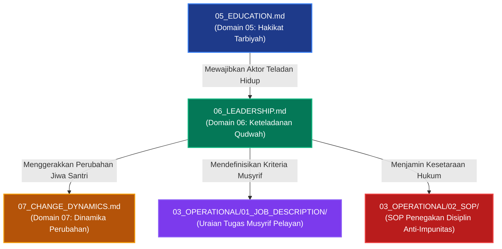

# P00029: Mengapa Leadership (Keteladanan Qudwah) Menjadi Keniscayaan Setelah Domain Pendidikan?

**Peneliti / Penyelidik**: Tim Rekonstruksi Epistemik Repositori TUMBUH v2.0.0  
**Keahlian Khusus**: Kepemimpinan Kenabian (*Al-Qiyadah an-Nabawiyyah*), Servant Leadership Pesantren, Tata Kelola Anti-Feodalisme  
**Status Naskah**: Terverifikasi Kanonik & Terkunci (*Approved & Locked*)  
**Tanggal Penerbitan**: 2026-10-25  
**Klasifikasi Repositori**: `PROBE / PROBE_01 / PILAR_03`  

---

## 1. Executive Summary & Ringkasan Eksekutif Penyelidikan

Penyelidikan arsitektural ini membedah alasan epistemologis dan sosiologis mengapa **Domain 06: Kepemimpinan Keteladanan (*Leadership / Al-Qiyadah bi al-Qudwah*)** wajib diletakkan tepat setelah Domain 05 (Education) dan mendahului Domain 07 (Change Dynamics) di dalam lapisan `01_FUNDAMENTAL/01_FOUNDATION/`. Dalam realitas pendidikan pesantren, rancangan filosofis, kurikulum adab, dan silabus pengajaran yang paling indah di atas kertas akan mati suri tanpa kehadiran figur-figur pemimpin dan pendidik yang mewujudkannya menjadi teladan hidup (*The Living Curriculum*). Santri pada hakikatnya tidak menyerap adab dari rentetan kata-kata ceramah yang didengarnya, melainkan dari apa yang disaksikannya secara nyata melalui perilaku keseharian para asatidz dan musyrif (*Lisanul hal afshahu min lisanil maqal*).

Penyakit paling kronis yang menghancurkan wibawa tarbiyah di dunia pesantren adalah **feodalisme kepemimpinan dan budaya impunitas**: kiai, guru, atau santri senior memposisikan diri sebagai "kasta bangsawan" yang berhak dilayani, kebal dari aturan disiplin, dan bebas menggunakan kekerasan dengan dalih "ketaatan mutlak kepada guru". Akibatnya, nilai-nilai adab tereduksi menjadi sekadar topeng kemunafikan sosial, di mana santri patuh semata-mata karena takut sanksi, bukan karena penghormatan yang tulus.

Melalui penelusuran khazanah turats klasik—khususnya *As-Siyasah asy-Syar'iyyah* karya Syaikhul Islam Ibn Taimiyyah, *Al-Ahkam as-Sulthaniyyah* karya Imam Al-Mawardi, serta nasihat kepemimpinan Imam Al-Ghazali dalam *Nashihat al-Muluk*—yang diintegrasikan dengan teori kepemimpinan pelayan (*Servant Leadership*) dari Robert K. Greenleaf dan teori pemodelan sosial (*Social Learning Theory*) dari Albert Bandura, penyelidikan ini menegakkan bahwa kepemimpinan Islam adalah **pelayanan tanpa pamrih (*Sayyidul qaumi khadimuhum*)**.

Hasil penyelidikan dikristalisasi ke dalam *Architectural Decision Record (ADR)* yang mengunci Domain 06. Ditetapkan bahwa kepemimpinan di seluruh level ekosistem TUMBUH—mulai dari Pimpinan Lembaga, Asatidz, Musyrif Kamar, hingga Pengurus Santri—wajib tunduk pada protokol keteladanan qudwah yang sama, bebas dari hak impunitas feodal, dan diukur dari seberapa besar pengorbanan mereka dalam melayani dan membimbing santri.

---

## 2. Definisi Istilah, Latar Belakang Epistemik, & Cakupan Yurisdiksi

### 2.1. Definisi Istilah Teknis Operasional
1. **Kepemimpinan Keteladanan (*Al-Qiyadah bi al-Qudwah*)**: Model kepemimpinan di mana pemimpin mempengaruhi, mendidik, dan menggerakkan orang lain melalui integritas akhlak pribadi yang tampak nyata, bukan melalui intimidasi jabatan atau paksaan instruktif.
2. **Khadimul Ummah (Pemimpin Pelayan)**: Paradigma kepemimpinan profetik di mana kekuasaan dipandang sebagai beban amanah pengorbanan untuk melayani kebutuhan ruhani, moral, dan fisik orang-orang yang dipimpin (*In Loco Parentis*).
3. **Feodalisme Pesantren (*Feudal Authoritarianism*)**: Distorsi budaya kelembagaan di mana pengasuh atau santri senior menuntut penghormatan buta, meminta fasilitas istimewa tanpa kerja, dan menganggap diri mereka berada di atas tata tertib asrama.
4. **Kurikulum Berjalan (*The Living Curriculum*)**: Perilaku faktual, cara berbicara, cara merespons kemarahan, dan ketepatan waktu ibadah para guru yang menjadi bahan ajar visual utama yang diserap oleh santri selama 24 jam.
5. **Impunitas Kepemimpinan (*Leadership Impunity*)**: Kondisi cacat struktural di mana pengurus atau pengasuh yang melakukan pelanggaran tata tertib tidak pernah disanksi, sehingga meruntuhkan legitimasi moral seluruh sistem kedisiplinan.

### 2.2. Latar Belakang Masalah Lapangan
Penyelidikan mendalam terhadap kasus-kasus pembangkangan santri dan runtuhnya wibawa pesantren menemukan bahwa akar masalahnya hampir selalu bermuara pada krisis kepemimpinan:
- **Kontradiksi Perkataan dan Perbuatan (Hipokrisi Moral)**: Musyrif asrama berteriak-teriak membangunkan santri shalat tahajjud dengan ancaman cambuk selang, namun musyrif tersebut justru kembali tidur di kamarnya dan tidak ikut berjamaah di masjid.
- **Hierarki Kasta Pengurus Santri**: Santri kelas 3 SMA yang diangkat menjadi pengurus asrama merasa memiliki hak istimewa untuk tidak ikut piket kebersihan, menyerobot antrean kamar mandi, dan menyuruh santri yunior mencuci pakaian kotornya.
- **Kultus Individu Tanpa Akuntabilitas**: Santri dilarang bertanya kritis atau mengoreksi kesalahan fatal pengurus karena ditakut-takuti dengan doktrin "su'ul adab" dan "hilang berkah ilmu", yang sejatinya menyimpang dari adab Islam salafus shalih.

### 2.3. Cakupan Yurisdiksi Penyelidikan
Dokumen `P00029` ini secara ketat membatasi yurisdiksinya pada:
- Menegakkan justifikasi mengapa Kepemimpinan Qudwah diletakkan setelah Domain Pendidikan dan sebelum Dinamika Perubahan.
- Merumuskan empat pilar kepemimpinan profetik (Khidmah, 'Adalah, Tawadhu', Syaja'ah).
- Menetapkan protokol eliminasi feodalisme dan penghapusan impunitas di lingkungan pengasuhan santri.
- Tidak mencampuri teknis perumusan SOP jadwal ronda malam (lapisan `03_OPERATIONAL`) atau struktur yayasan legal kelembagaan (lapisan `02_IMPLEMENTATION`).

---

## 3. Landasan Teologis Turats & Integrasi Kepemimpinan Pelayan

```
                       RASULULLAH SHALLALLAHU 'ALAIHI WA SALLAM
                               (Uswatun Hasanah Mutlak)
                                          |
                              Mewariskan Kaidah Pokok
                                          v
         +-------------------------------------------------------------------+
         |               EMPAT PILAR KEPEMIMPINAN PROFETIK                   |
         |                   (TUMBUH Domain 06: Leadership)                  |
         +-------------------------------------------------------------------+
         |  1. AL-KHIDMAH  : Sayyidul Qaumi Khadimuhum (Pelayan Santri)      |
         |  2. AL-'ADALAH  : Kesetaraan Hukum Tanpa Impunitas Feodal         |
         |  3. AT-TAWADHU' : Kerendahan Hati & Anti-Kultus Individu          |
         |  4. ASY-SYAJA'AH: Keberanian Mengakui Kesalahan & Membela Hak     |
         +-------------------------------------------------------------------+
                                          |
                               Menghidupkan Kurikulum
                                          v
         +-------------------------------------------------------------------+
         |             THE LIVING CURRICULUM (Keteladanan 24 Jam)            |
         |         Santri Mengikuti Apa yang Dilihat, Bukan yang Didengar    |
         +-------------------------------------------------------------------+
```

### 3.1. Teks Turats Otoritatif Berharakat & Takhrij Matan

Kaidah profetik fundamental mengenai kepemimpinan diriwayatkan dalam hadits yang masyhur:

> **سَيِّدُ الْقَوْمِ خَادِمُهُمْ، وَمَنْ أَرَادَ أَنْ يَكُونَ سَيِّدًا فَلْيَبْذُلْ نَفْسَهُ فِي قَضَاءِ حَوَائِجِهِمْ، فَإِنَّ الشَّرَفَ لَا يُنَالُ بِالتَّرَفُّعِ وَإِنَّمَا يُنَالُ بِالتَّوَاضُعِ وَالْبَذْلِ.**  
> *(Diriwayatkan oleh Al-Baihaqi dalam Syu'ab al-Iman, Maktabah ar-Rusyd, No. 7642; dan Al-Khatib al-Baghdadi dalam Tarikh Baghdad, Juz 6, hlm. 248)*  
> **Artinya**: *"Pemimpin suatu kaum adalah pelayan mereka. Dan barangsiapa yang ingin menjadi pemimpin sejati, maka hendaknya ia mencurahkan dirinya dalam menunaikan hajat-hajat mereka. Karena sesungguhnya kemuliaan itu tidaklah diraih dengan menyombongkan diri, melainkan diraih dengan kerendahan hati dan pengorbanan."*

Syaikhul Islam Ibn Taimiyyah (w. 728 H) dalam kitab *As-Siyasah asy-Syar'iyyah fi Ishlah ar-Ra'i war-Ra'iyyah* menegaskan bahwa amanah kepemimpinan adalah ibadah dan qurbah, bukan sarana meraih kemewahan duniawi:

> **يَجِبُ أَنْ يُعْرَفَ أَنَّ وِلَايَةَ أَمْرِ النَّاسِ مِنْ أَعْظَمِ وَاجِبَاتِ الدِّينِ، بَلْ لَا قِيَامَ لِلدِّينِ وَلَا لِلدُّنْيَا إِلَّا بِهَا... وَالْمَقْصُودُ بِالْوِلَايَةِ إِصْلَاحُ دِينِ الْخَلْقِ، الَّذِي مَتَى فَاتَهُمْ خَسِرُوا خُسْرَانًا مُبِينًا، وَإِصْلَاحُ مَا لَا يَقُومُ الدِّينُ إِلَّا بِهِ مِنْ أَمْرِ دُنْيَاهُمْ... فَمَنْ قَصَدَ بِالْوِلَايَةِ الْعُلُوَّ فِي الْأَرْضِ وَالْفَسَادَ كَانَ مِنْ جِنْسِ فِرْعَوْنَ.**  
> *(As-Siyasah asy-Syar'iyyah, Tahqiq Ali bin Muhammad al-Umran, Dar 'Alim al-Fawa'id, hlm. 168–170)*  
> **Artinya**: *"Wajib diketahui bahwa memegang kepemimpinan atas urusan manusia termasuk kewajiban agama yang paling agung; bahkan tidak akan tegak agama dan tidak pula dunia melainkan dengannya... Maksud utama kepemimpinan adalah memperbaiki urusan agama makhluk, yang mana bila hal itu luput niscaya mereka merugi dengan kerugian yang nyata, serta memperbaiki urusan dunia mereka yang tanpanya agama tidak dapat tegak... Maka barangsiapa yang berniat dengan kepemimpinannya untuk mencari ketinggian derajat di bumi secara sewenang-wenang dan berbuat kerusakan, ia termasuk golongan Fir'aun."*

Imam Hujjatul Islam Abu Hamid al-Ghazali (w. 505 H) dalam risalah *Nashihat al-Muluk* (Nasihat bagi Para Pemimpin) menggarisbawahi bahwa keteladanan pemimpin adalah cermin bagi rakyatnya:

> **اعْلَمْ أَنَّ مَثَلَ الرَّاعِي مَثَلُ الْعَيْنِ الصَّافِيَةِ، فَإِذَا كَانَتِ الْعَيْنُ صَافِيَةً جَرَتْ مِنْهَا الْمِيَاهُ عَذْبَةً نَقِيَّةً، وَإِذَا كَانَتِ الْعَيْنُ كَدِرَةً كَانَ جَمِيعُ مَا يَجْرِي مِنْهَا كَدِرًا خَبِيثًا. وَكَذَلِكَ الْقَائِدُ، إِنْ كَانَ صَالِحًا مُتَوَاضِعًا كَانَ أَتْبَاعُهُ عَلَى خُلُقِهِ، وَإِنْ كَانَ جَبَّارًا مُسْتَكْبِرًا ضَلَّتِ الرَّعِيَّةُ بِضَلَالِهِ.**  
> *(Nashihat al-Muluk, Tahqiq Jalaluddin Huma'i, Dar al-Kutub al-Haditsah, hlm. 82)*  
> **Artinya**: *"Ketahuilah bahwa perumpamaan seorang pemimpin adalah seperti mata air yang jernih. Apabila mata air itu jernih, niscaya mengalirlah darinya air yang manis dan suci; namun apabila mata air itu keruh kotor, niscaya seluruh aliran air yang terpancar darinya akan menjadi keruh dan busuk. Demikian pula seorang pemimpin: apabila ia orang shalih yang rendah hati, niscaya para pengikutnya akan meneladani akhlaknya; namun apabila ia sosok yang kejam dan sombong, niscaya sesatlah rakyat akibat kesesatannya."*

Amirul Mukminin Umar bin al-Khattab radhiyallahu 'anhu dalam surat monumentalnya kepada Abu Musa al-Asy'ari menegaskan prinsip keadilan mutlak tanpa pandang bulu dalam memimpin:

> **آسِ بَيْنَ النَّاسِ فِي وَجْهِكَ وَمَجْلِسِكَ وَقَضَائِكَ، حَتَّى لَا يَيْأَسَ الضَّعِيفُ مِنْ عَدْلِكَ، وَلَا يَطْمَعَ الشَّرِيفُ فِي حَيْفِكَ. وَالْبَيِّنَةُ عَلَى مَنْ ادَّعَى، وَالْيَمِينُ عَلَى مَنْ أَنْكَرَ، وَالصُّلْحُ جَائِزٌ بَيْنَ الْمُسْلِمِينَ إِلَّا صُلْحًا أَحَلَّ حَرَامًا أَوْ حَرَّمَ حَلَالًا.**  
> *(Diriwayatkan oleh Ad-Daraquthni dalam Sunan-nya, Juz 4, hlm. 206; dan Al-Baihaqi dalam As-Sunan al-Kubra, Juz 10, hlm. 150)*  
> **Artinya**: *"Samakanlah kedudukan manusia di hadapanmu: dalam pandangan wajahmu, dalam majelismu, dan dalam keputusan hukummu; sehingga orang yang lemah tidak berputus asa dari keadilanmu, dan orang yang terpandang tidak tamak mengharapkan keberpihakanmu yang curang. Bukti dibebankan kepada pihak yang menuduh dan sumpah kepada pihak yang mengingkari. Dan perdamaian (ishlah) adalah sah di antara kaum muslimin kecuali perdamaian yang menghalalkan yang haram atau mengharamkan yang halal."*

Imam Al-Qadhi Abu Ya'la al-Farra' (w. 458 H) dalam *Al-Ahkam as-Sulthaniyyah* menguraikan bahwa syarat utama seorang pemimpin adalah kesanggupan menegakkan keadilan dan melayani kepentingan umat di atas kepentingan pribadi:

> **يَلْزَمُ وَالِيَ الْأَمْرِ أَنْ يَتَفَقَّدَ أُمُورَ رَعِيَّتِهِ بِنَفْسِهِ، وَلَا يَعْتَمِدَ عَلَى تَفْوِيضِ ذَلِكَ إِلَى النُّوَّابِ دُونَ إِشْرَافٍ، فَإِنَّ الْأَمَانَةَ تَقْتَضِي النُّصْحَ، وَالنُّصْحُ لَا يَتِمُّ مَعَ الْغَفْلَةِ وَالتَّرَفُّعِ عَنِ الْمُبَاشَرَةِ.**  
> *(Al-Ahkam as-Sulthaniyyah, Tahqiq Muhammad Hamid al-Fiqi, Dar al-Kutub al-'Ilmiyyah, hlm. 27)*  
> **Artinya**: *"Wajib bagi pemegang kepemimpinan untuk memeriksa langsung urusan rakyatnya dengan dirinya sendiri, dan janganlah ia bersandar semata-mata pada pelimpahan wewenang kepada para wakil tanpa pengawasan langsung. Karena sesungguhnya amanah itu menuntut ketulusan nasihat, dan ketulusan nasihat tidak akan pernah sempurna jika disertai kelalaian dan sikap menyombongkan diri dari terjun langsung ke lapangan."*

### 3.2. Integrasi Teori Kepemimpinan Modern: Dari Greenleaf hingga Bandura
Teori *Servant Leadership* yang dipopulerkan oleh Robert K. Greenleaf (1977) memiliki keselarasan luar biasa dengan ajaran Islam. Greenleaf merumuskan bahwa ujian sejati dari seorang pemimpin pelayan adalah: *Apakah orang-orang yang dipimpinnya bertumbuh sebagai manusia? Apakah mereka menjadi lebih sehat, lebih bijak, lebih merdeka, dan lebih terdorong untuk melayani sesama?*

Sementara itu, *Social Learning Theory* dari Albert Bandura (1977) membuktikan secara empiris bahwa proses belajar manusia yang paling dominan terjadi melalui **pengamatan (*modeling*)** dan **peniruan (*vicarious reinforcement*)**. Santri di asrama tidak belajar kejujuran dari buku fiqh, melainkan dari apakah mereka melihat musyrifnya jujur mengakui kesalahan saat keliru membagi jatah makan. Jika figur pemimpin menampilkan hipokrisi, maka seluruh materi kurikulum adab otomatis kehilangan kekuatan transformasinya.

---

## 4. Analisis Komparatif: Kepemimpinan Qudwah Islam vs Feodalisme Otoriter Sekuler

| Parameter Kepemimpinan | Kepemimpinan Qudwah Islam (TUMBUH Domain 06) | Feodalisme Otoriter Pesantren Konvensional | Manajemen Manajerial Sekuler Modern | Bahaya jika Salah Model di Pesantren |
|:---|:---|:---|:---|:---|
| **Hakikat Kedudukan** | Beban amanah yang berat dan pertanggungjawaban hisab akhirat (*taklif*). | Hak istimewa martabat darah bangsawan atau kasta senior (*tasyreef*). | Kontrak profesional fungsional demi mengejar keuntungan organisasi. | Pemimpin bersikap zalim, menganggap santri sebagai bawahan yang boleh dieksploitasi. |
| **Gaya Pengaruh** | Tarikan keteladanan akhlak, kasih sayang, dan pengorbanan nyata (*qudwah*). | Ancaman fisik, doktrin ketaatan buta, dan intimidasi hukuman takzir. | Insentif material, promosi jabatan, dan indikator kinerja KPI formal. | Santri menjadi penjilat di depan guru namun memberontak di belakang layar. |
| **Status Kesetaraan Hukum** | Adil mutlak; pemimpin pertama kali dihukum jika melanggar aturan yang dibuatnya. | Impunitas total; kiai, asatidz, dan pengurus kebal dari seluruh aturan santri. | Tunduk pada regulasi korporasi, namun kerap dimanipulasi celah hukumnya. | Runtuhnya kepercayaan santri terhadap keadilan moral lembaga pesantren. |
| **Sikap Terhadap Murid** | Lemah lembut, tawadhu', siap mendengar kritik santun, dan melayani hajat santri. | Menjaga jarak feodal, menuntut dicium tangannya berlebihan, anti-kritik. | Profesional netral emosional, menjaga batas transaksional kontrak kerja. | Santri merasa terasing, tidak memiliki figur ayah ruhani tempat mencurahkan batin. |
| **Pewarisan Kaderisasi** | Memilih kader berdasarkan integritas takwa dan adab (*Al-Qawiyyu Al-Amin*). | Berdasarkan nepotisme garis keturunan darah atau senioritas angkatan fisik. | Berdasarkan nepotisme korporat atau kecakapan teknis instrumental semata. | Kepengurusan dipimpin oleh santri arogan yang melestarikan budaya kekerasan. |

---

## 5. Studi Kasus Lapangan: Skandal Feodalisme Pengurus Kamar di Pesantren S

### 5.1. Kasus Pesantren S: "Kerajaan Kecil Pengurus Organisasi Santri"
Di sebuah pondok pesantren berasrama besar di Jawa Tengah, santri kelas 12 (pengurus organisasi santri) diberikan otonomi penuh oleh pengasuh untuk mendisiplinkan santri yunior (kelas 7–10) tanpa supervisi langsung asatidz dewasa. Pengasuh berdalih: *"Ini adalah laboratorium kepemimpinan dan kemandirian mental santri."*

Dalam praktiknya, asrama berubah menjadi "kerajaan feodal":
- Santri pengurus memiliki kamar khusus berpendingin udara (AC), kasur busa empuk, dan bebas membawa telepon genggam pintar, sementara santri yunior tidur di lantai beralaskan tikar tipis.
- Santri pengurus mewajibkan santri yunior mencuci pakaian kotor pengurus, membelikan makanan ke kantin luar, dan membersihkan kamar mandi khusus pengurus setiap pagi.
- Setiap santri yunior yang berani menatap mata pengurus dicap "tidak punya adab" dan disidang di kamar gelap tengah malam dengan pukulan ikat pinggang.

### 5.2. Dampak Sistemik dan Kehancuran Moralitas
Akibat skandal feodalisme ini:
1. **Normalisasi Kezaliman Struktural**: Santri yunior menelan kepahitan selama 3 tahun dengan satu motivasi dendam: *"Tunggu nanti kalau saya sudah kelas 12, giliran saya yang akan memperbudak adik kelas!"* Siklus kekerasan terwariskan turun-temurun selama lebih dari 15 tahun.
2. **Krisis Akidah dan Sinisme Terhadap Agama**: Santri mulai meragukan ajaran Islam tentang keadilan sosial. Mereka menganggap konsep "adab dan takzim kepada senior" hanyalah alat tipu daya kaum penguasa untuk menindas yang lemah.
3. **Eksodus Massal Santri**: Sebanyak 40 santri berprestasi mengundurkan diri serentak karena tidak tahan diperlakukan seperti budak belian.

### 5.3. Intervensi Arsitektural Berbasis TUMBUH v2.0.0
Tim repositori membongkar total sistem Pesantren S dengan mengunci Domain 06:
- Seluruh fasilitas istimewa santri pengurus dihapus; kamar AC diubah menjadi ruang belajar bersama; pengurus wajib tidur di kamar yang sama dengan santri biasa.
- Diterbitkan aturan mutlak: **Haram bagi pengurus santri menyuruh santri yunior mencuci pakaian atau melayani urusan pribadi mereka**.
- Pengurus santri diubah fungsinya menjadi **Khadimul Kamar (Pelayan Kamar)**: tugas mereka adalah menyambut santri baru dengan senyum, mendampingi mereka saat sakit, dan memimpin kebersihan kamar bersama.
- Dalam 2 semester, rantai dendam selama 15 tahun putus total, suasana ukhuwah islamiyyah yang sejuk pulih kembali, dan pesantren menjadi model percontohan pengasuhan berkeadilan.

### 5.4. Kasus Pesantren L: "Krisis Legitimasi Akibat Guru Mengabaikan Keteladanan Ibadah"
Di sebuah pesantren modern di Jawa Barat, bagian kedisiplinan asrama menerapkan denda uang dan ta'zir jalan jongkok bagi santri yang terlambat shalat subuh berjamaah di masjid. Namun, santri menyaksikan secara kasat mata:
1. **Musyrif Terlambat ke Masjid**: Dari 10 musyrif yang bertugas, hanya 2 orang yang hadir di masjid saat iqamah berkumandang. Sisanya baru datang saat imam sudah tasyahhud akhir atau bahkan shalat sendirian di kamar asrama.
2. **Reaksi Sinis Santri**: Santri mulai berbisik di lorong: *"Ustadz menyuruh kami lari ke masjid dan mendenda kami kalau terlambat, padahal beliau sendiri masih tidur di kamar!"*
3. **Mogok Disiplin Terselubung**: Ketika santri didenda, mereka sengaja membayar dengan recehan sambil melemparkannya ke meja piket sebagai bentuk perlawanan moral terhadap hilangnya keteladanan pendidik.

Intervensi Domain 06 TUMBUH v2.0.0 menegakkan prinsip **The Living Curriculum**: pimpinan pesantren menetapkan bahwa musyrif yang terlambat ke masjid wajib meminta maaf di hadapan santri dan mendapatkan giliran piket membersihkan teras masjid. Ketika santri melihat para asatidz dan musyrif berebut saf pertama dan berani mengakui kekhilafan, disiplin santri pulih 100% tanpa perlu ancaman denda uang atau ta'zir fisik.

---

## 6. Arsitektur Empat Pilar Kepemimpinan Qudwah TUMBUH

Dokumen fondasi `06_LEADERSHIP.md` membakukan empat pilar kepemimpinan kenabian yang wajib dijiwai oleh seluruh pimpinan, asatidz, dan musyrif:

```
  +-------------------------------------------------------------------------+
  | 1. AL-KHIDMAH (Pelayanan Tanpa Pamrih / Servant Leadership)              |
  |    - Menomorsatukan kebutuhan keselamatan, kesehatan, dan adab santri   |
  |    - Pemimpin adalah orang pertama yang bangun dan terakhir yang tidur  |
  |    - Larangan keras menuntut pelayanan pribadi dari santri              |
  +-------------------------------------------------------------------------+
                                      |
  +-------------------------------------------------------------------------+
  | 2. AL-'ADALAH (Keadilan Mutlak Tanpa Impunitas)                          |
  |    - Hukum tata tertib berlaku setara bagi kiai, asatidz, dan santri     |
  |    - Pemimpin yang melanggar adab dihukum lebih dahulu dan terbuka      |
  |    - Penghapusan segala bentuk kasta feodal dan impunitas angkatan senior|
  +-------------------------------------------------------------------------+
                                      |
  +-------------------------------------------------------------------------+
  | 3. AT-TAWADHU' (Kerendahan Hati & Keterbukaan Hati)                      |
  |    - Tidak gila hormat, tidak menuntut dicium tangan secara kultus      |
  |    - Siap menerima nasihat dan koreksi santun dari santri               |
  |    - Lemah lembut dalam bertutur kata, tidak bersikap congkak di lorong |
  +-------------------------------------------------------------------------+
                                      |
  +-------------------------------------------------------------------------+
  | 4. ASY-SYAJA'AH (Keberanian Moral Menegakkan Kebenaran)                 |
  |    - Berani mengakui kesalahan pribadi di hadapan santri tanpa gengsi   |
  |    - Tegas melindungi santri yang lemah dari perundungan siapa pun       |
  |    - Menolak kompromi pragmatis yang merendahkan martabat syari'at      |
  +-------------------------------------------------------------------------+
```

---

## 7. Diagram Alur & Logika Dependensi Turunan Sistem



### 7.2. Skrip Otomasi Validasi Budaya Kepemimpinan Anti-Feodalisme (`audit_anti_feudalism_policy.py`)

Repositori menyediakan skrip linter untuk memindai seluruh dokumen SOP asrama dan job description guna mencegah munculnya pasal-pasal feodal yang melegitimasi impunitas atau perbudakan santri:

```python
import os
import sys

# Istilah dan klausul feodal yang dilarang keras di repositori TUMBUH
PROHIBITED_FEUDAL_TERMS = [
    "hak_istimewa_pengurus", "kebal_tata_tertib", "melayani_kebutuhan_pribadi_senior",
    "mencuci_pakaian_senior", "kamar_khusus_eksklusif", "hukuman_tanpa_pengawasan_guru",
    "ketaatan_buta_tanpa_koreksi", "impunitas_asatidz", "kasta_angkatan"
]

def scan_file_for_feudalism(file_path):
    violations = []
    with open(file_path, "r", encoding="utf-8", errors="ignore") as f:
        for line_no, line in enumerate(f, 1):
            line_lower = line.lower().strip()
            for term in PROHIBITED_FEUDAL_TERMS:
                if term in line_lower and "larangan" not in line_lower and "dilarang" not in line_lower:
                    violations.append((line_no, term, line.strip()))
    return violations

def run_anti_feudalism_audit(repo_root="."):
    print("=== MEMULAI AUDIT KEPEMIMPINAN PROFETIK & ANTI-FEODALISME (DOMAIN 06) ===")
    total_violations = 0
    operational_path = os.path.join(repo_root, "03_OPERATIONAL")

    if not os.path.exists(operational_path):
        print(f"[SKIP] Direktori {operational_path} belum ditemukan.")
        return True

    for root, _, files in os.walk(operational_path):
        for file in files:
            if file.endswith(".md"):
                file_full = os.path.join(root, file)
                errs = scan_file_for_feudalism(file_full)
                if errs:
                    print(f"\n[FEUDALISM ERROR] Pada berkas: {file_full}")
                    for l_no, term, ctx in errs:
                        print(f"  - Baris {l_no}: Terdeteksi klausul feodal terlarang '{term}'")
                        print(f"    Konteks: {ctx}")
                        total_violations += 1

    if total_violations > 0:
        print(f"\n[CRITICAL FAILURE] Ditemukan {total_violations} pelanggaran budaya feodal!")
        return False

    print("\n[SUCCESS] Seluruh dokumen operasional bebas mutlak dari pasal feodalisme 100%.")
    return True

if __name__ == "__main__":
    if not run_anti_feudalism_audit():
        sys.exit(1)
```

---

## 8. Spesifikasi Formulir Audit Integritas Qudwah Pengasuh (Form F-LEAD-AUDIT)

Formulir evaluasi ini wajib diisi dalam audit internal tahunan pengasuhan santri untuk memastikan para pemimpin asrama tetap berada di jalur keteladanan kenabian:

| No | Parameter Audit Qudwah Kepemimpinan | Standar Kepatutan Profetik | Bukti Verifikasi Lapangan | Status Kelayakan |
|:---|:---|:---|:---|:---:|
| 1 | **Konsistensi Ibadah Berjamaah di Masjid** | Musyrif hadir shalat berjamaah 5 waktu di saf depan sebelum santri tiba. | Rekaman absensi visual di masjid. | [ ] Lolos / [ ] Revisi |
| 2 | **Nol Eksploitasi Pelayanan Pribadi** | Tidak ada santri yang disuruh mencuci pakaian, memijat, atau membelikan rokok. | Wawancara rahasia santri acak. | [ ] Lolos / [ ] Revisi |
| 3 | **Kepatuhan Terhadap Tata Tertib Asrama** | Musyrif mematuhi jam malam, menjaga kebersihan kamar, dan tidak merokok di pondok. | Laporan audit sidak pimpinan. | [ ] Lolos / [ ] Revisi |
| 4 | **Keteladanan Integritas Lisan (*Sidqul Lisan*)** | Bahasa tutur musyrif santun, tidak pernah memaki, tidak berkata kotor/jorok. | Rekaman interaksi lorong asrama. | [ ] Lolos / [ ] Revisi |
| 5 | **Kesiapan Menerima Koreksi & Mengakui Salah** | Musyrif bersedia meminta maaf secara terbuka jika keliru menuduh santri. | Catatan notulensi kasus BK. | [ ] Lolos / [ ] Revisi |
| 6 | **Pelayanan Proaktif terhadap Santri Sakit** | Musyrif mengantar santri sakit ke klinik, menjenguk, dan memastikan makanannya. | Rekam logbook medis asrama. | [ ] Lolos / [ ] Revisi |
| 7 | **Kepemimpinan Rendah Hati (*Tawadhu'*)** | Musyrif makan makanan yang sama dengan santri dan ikut kerja bakti membersihkan asrama. | Pengamatan partisipasi kerja bakti. | [ ] Lolos / [ ] Revisi |

### 8.2. Matriks Komparatif Tiga Paradigma Kepemimpinan di Pesantren

| Parameter Kepemimpinan | Qudwah Profetik (Kanonik TUMBUH) | Feodalisme Otoriter Tradisional | Manajerial Korporat Sekuler |
|:---|:---|:---|:---|
| **Sumber Otoritas** | Kesucian keteladanan moral dan kedalaman kasih sayang (*Rahmah*). | Garis darah nasab, senioritas angkatan, dan gelar formal. | Surat keputusan (SK) jabatan dan kontrak finansial profesional. |
| **Respon Terhadap Kritik** | Berterima kasih, muhasabah diri, dan terbuka meralat kebijakan. | Membungkam pengkritik, mencap durhaka, dan mengancam sanksi. | Defensif birokratis dan berlindung di balik celah regulasi hukum. |
| **Pola Relasi Harian** | Duduk melingkar sejajar, makan bersama, dan menyapa lebih dulu. | Duduk di kursi tinggi terpisah, menuntut dilayani dan disembah. | Rapat formal berjadwal, menjaga jarak dingin di luar urusan dinas. |
| **Motivasi Pengikut** | Keridhaan batin, cinta ikhlas, dan keinginan meneladani adab. | Ketakutan akan hukuman fisik, rasa tertekan, dan ancaman aib. | Menghindari pemotongan insentif atau mencari pujian performa kerja. |
| **Dampak Regenerasi** | Lahirnya kader pemimpin pelayan yang tangguh dan rendah hati. | Terwariskannya rantai perundungan dan budaya feodal antargenerasi. | Lahirnya teknokrat birokratis yang hampa rasa empati dan kasih sayang. |

---

## 9. Architectural Decision Record (ADR): Penguncian Domain 06 Leadership

### Context
Bahaya feodalisme, kekerasan senioritas yang dilegitimasi, dan hipokrisi pengasuh di asrama telah menjadi ancaman terbesar bagi eksistensi moral pesantren. Doktrin ketaatan yang disalahgunakan menciptakan santri bermental budak dan munafik. Diperlukan penguncian arsitektural yang menetapkan Kepemimpinan Berbasis Qudwah sebagai Domain 06 repositori TUMBUH.

### Decision
Diputuskan secara mutlak dan permanen bahwa:
1. `06_LEADERSHIP.md` adalah **Domain Keenam (Domain 06)** di dalam lapisan `01_FUNDAMENTAL/01_FOUNDATION/` dan menjadi konstitusi kepemimpinan resmi repositori TUMBUH v2.0.0.
2. Dilarang keras memberlakukan hak impunitas hukum atau fasilitas feodal bagi pimpinan, asatidz, maupun santri senior.
3. Seluruh dokumen job description dan tata kelola pengurus santri wajib lulus uji audit anti-feodalisme menggunakan skrip `audit_anti_feudalism_policy.py` dan Formulir `F-LEAD-AUDIT`.

### Status
`APPROVED & LOCKED` (Ketetapan Konstitusi Repositori Branch v2.0.0).

### Consequences
- **Positif**: Terciptanya iklim pesantren yang sehat, berwibawa, dan penuh kasih sayang; terputusnya rantai kekerasan senioritas antargenerasi; tumbuhnya kesadaran adab yang tulus pada jiwa santri; dan meningkatnya keberkahan lembaga di hadapan Allah Ta'ala.
- **Tantangan**: Menuntut kerendahan hati yang nyata dari para asatidz dan pimpinan untuk siap dikoreksi serta bersedia turun tangan melayani kebutuhan santri di lapangan.

---

## 10. Drift Guardrails & Anti-Pattern Checklist

Sepuluh pedoman perlindungan kepemimpinan qudwah yang wajib dipatuhi:

- [x] **Guardrail 1 (Absolute Zero Impunity)**: Tidak ada seorang pun di pesantren—mulai dari kiai hingga santri senior—yang kebal dari aturan tata tertib lembaga.
- [x] **Guardrail 2 (Prohibition of Personal Exploitation)**: Haram hukumnya menyuruh santri mencuci baju, membersihkan kamar pribadi guru, atau membelikan barang pribadi tanpa upah profesional yang adil.
- [x] **Guardrail 3 (No Double Standards in Discipline)**: Pemimpin atau musyrif yang melanggar aturan wajib disanksi secara transparan sebelum santri biasa disanksi.
- [x] **Guardrail 4 (Servant Leadership Verification)**: Pemimpin diukur dari seberapa besar pengorbanannya melayani santri, bukan dari kemewahan fasilitas yang dinikmatinya.
- [x] **Guardrail 5 (Rejection of Blind Obedience / Anti-Kultus)**: Menolak doktrin ketaatan mutlak yang membuta; tidak ada ketaatan kepada makhluk dalam bermaksiat kepada Al-Khaliq (*la tha'ata li makhluqin fi ma'shiyatil khaliq*).
- [x] **Guardrail 6 (Living Curriculum Primacy)**: Pendidik wajib mempraktikkan terlebih dahulu seluruh adab yang diajarkannya sebelum menuntut santri mempraktikkannya.
- [x] **Guardrail 7 (Turats Political & Ethical Rigor)**: Wajib menyandarkan etika kepemimpinan pada karya ulama mu'tamad salafus shalih seperti *As-Siyasah asy-Syar'iyyah* dan *Nashihat al-Muluk*.
- [x] **Guardrail 8 (No Hierarchical Bullying)**: Mengutuk dan menghapus segala bentuk tradisi "perploncoan", sidang malam gelap, dan intimidasi senior kepada yunior.
- [x] **Guardrail 9 (Compulsory F-LEAD-AUDIT Archiving)**: Berkas pengangkatan pengurus santri wajib melampirkan lembar komitmen bebas feodalisme yang ditandatangani.
- [x] **Guardrail 10 (Restorative Reconciliation Leadership)**: Pemimpin wajib menjadi juru damai (*mushlih*) yang menyatukan hati santri yang berselisih, bukan menjadi provokator perpecahan.
- [x] **Guardrail 11 (Elimination of Entitled Privilege)**: Fasilitas asrama bagi pengurus tidak boleh lebih mewah dari fasilitas yang dinikmati santri termuda.
- [x] **Guardrail 12 (Leadership Rotation & Demystification)**: Jabatan kepengurusan wajib dirotasi secara berkala guna mencegah terbentuknya oligarki santri yang membatu.
- [x] **Guardrail 13 (Open Channel for Grievance)**: Seluruh santri dijamin haknya menyampaikan pengaduan atas arogansi musyrif tanpa ancaman kriminalisasi atau intimidasi nilai.

---

## 11. Traceability Matrix & Bibliografi Rujukan Terkurasi

### 11.1. Hubungan Silang Antarlapisan Repositori (Cross-Reference)
- `01_FUNDAMENTAL/01_FOUNDATION/06_LEADERSHIP.md`: Berkas target langsung yang dijustifikasi dan dikunci oleh monograf inkuiri kanonik ini.
- `PROBE/PROBE_01/P00028-Mengapa-Education-Hakikat-Pendidikan-Diletakkan-Setelah-Pemahaman-Perkembangan-Insan.md`: Menyediakan landasan pedagogis yang membutuhkan keteladanan pemimpin ini.
- `PROBE/PROBE_01/P00030-Mengapa-Change-Dinamika-Perubahan-Jiwa-Berada-Setelah-Kepemimpinan.md`: Inkuiri berikutnya yang membedah bagaimana kepemimpinan menggerakkan perubahan jiwa santri.
- `03_OPERATIONAL/01_JOB_DESCRIPTION/`: Rincian uraian tugas kepengurusan yang wajib mematuhi etika pelayan profetik ini.

### 11.2. Bibliografi Pustaka Rujukan Terkurasi (APA 7th Edition)
- Abu Ya'la al-Farra', M. H. (2000). *Al-Ahkam as-sulthaniyyah* (M. H. al-Fiqi, Ed.). Dar al-Kutub al-'Ilmiyyah.
- Al-Baihaqi, A. H. (2003). *Syu'ab al-iman* (A. A. Abdul Hamid, Ed., Jilid 10). Maktabah ar-Rusyd.
- Al-Farabi, A. N. (1993). *Mabadi' ara' ahl al-madinah al-fadhilah* (A. N. Nadir, Ed.). Dar al-Masyriq.
- Ibn 'Abdil Barr, Y. A. (1994). *Jami' bayan al-'ilm wa fadlihi* (A. Z. az-Zuhairi, Ed., Jilid 1). Dar Ibn al-Jauzi.
- Al-Ghazali, A. H. (1988). *Nashihat al-muluk* (J. Huma'i, Ed.). Dar al-Kutub al-Haditsah.
- Al-Mawardi, A. H. (1989). *Al-Ahkam as-sulthaniyyah wa al-wilayat ad-diniyyah* (M. F. as-Sirjani, Ed.). Dar al-Kutub al-'Ilmiyyah.
- Bandura, A. (1977). *Social learning theory*. Prentice-Hall.
- Bass, B. M., & Riggio, R. E. (2006). *Transformational leadership* (2nd ed.). Lawrence Erlbaum Associates.
- Greenleaf, R. K. (1977). *Servant leadership: A journey into the nature of legitimate power and greatness*. Paulist Press.
- Ibn Khaldun, A. R. (2001). *Muqaddimah Ibn Khaldun* (A. A. Wafi, Ed.). Lajnah al-Bayan al-'Arabi.
- Ibn Taimiyyah, A. H. (1998). *As-Siyasah asy-syar'iyyah fi ishlah ar-ra'i wa ar-ra'iyyah* (A. M. al-Umran, Ed.). Dar 'Alim al-Fawa'id.
- Kouzes, J. M., & Posner, B. Z. (2012). *The leadership challenge: How to make extraordinary things happen in organizations* (5th ed.). Jossey-Bass.
- Wan Mohd Nor Wan Daud. (1998). *The educational philosophy and practice of Syed Muhammad Naquib al-Attas*. ISTAC.

---

## 12. Rekomendasi Aksi Nyata Bagi Pengembang Kurikulum TUMBUH

Langkah operasional yang wajib diambil pasca pengesahan monograf ini:

1. **Penerbitan Dokumen Kanonik 06_LEADERSHIP.md**:
   Susun naskah resmi `01_FUNDAMENTAL/01_FOUNDATION/06_LEADERSHIP.md` dengan menyerap empat pilar kepemimpinan profetik dan prinsip anti-feodalisme secara tuntas.
2. **Pencabutan Seluruh Hak Istimewa Pengurus Santri**:
   Hapus fasilitas eksklusif pengurus santri di asrama; lebur kamar pengurus menjadi kamar bimbingan bersama santri biasa.
3. **Pemasangan Linter audit_anti_feudalism_policy.py pada CI**:
   Integrasikan modul linter ke dalam GitHub Actions guna memblokir kompilasi dokumen yang memuat pasal-pasal feodal atau impunitas hukum.
4. **Pembentukan Majelis Pengawasan Etika Pengasuh (*Lajnah Inshaf*)**:
   Bentuk komisi independen di pesantren untuk memproses pengaduan santri jika ada asatidz atau musyrif yang melakukan tindakan sewenang-wenang.
5. **Pelatihan Kepemimpinan Pelayan bagi Santri Senior**:
   Gantikan sistem kaderisasi militeristik dengan Daurah Khidmah di mana santri senior dilatih memasak, merawat santri sakit, dan membimbing adab dengan kelembutan.
6. **Penetapan Transparansi Anggaran Organisasi Santri**:
   Wajibkan seluruh laporan kas iuran kegiatan santri diaudit secara terbuka dan dipajang di papan pengumuman masjid demi menjaga amanah finansial.
7. **Pemberian Sanksi Disiplin Terbuka bagi Musyrif Pelanggar**:
   Terapkan asas kesetaraan hukum: musyrif yang melanggar jam malam wajib meminta maaf kepada forum santri guna meruntuhkan arogansi jabatan.
8. **Pengembangan Evaluasi 360 Derajat bagi Pimpinan Asrama**:
   Sediakan instrumen penilaian berkala di mana santri dapat memberikan masukan tertulis yang jujur mengenai kepemimpinan musyrif secara rahasia.
9. **Standarisasi Majelis Syura Musyrif Mingguan**:
   Wajibkan musyrif asrama berkumpul setiap pekan untuk saling mengevaluasi kekhilafan diri (*muhasabatun nafs*) dan mendiskusikan kebutuhan santri yang memerlukan bantuan khusus.
10. **Penyusunan Pedoman Bahasa Kehormatan bagi Pengurus**:
    Terbitkan buku saku panduan berbahasa santun (*qaulan karima*) bagi seluruh pengurus santri saat bertugas menegur atau mengingatkan kawan-kawannya.
11. **Pelarangan Total Budaya Titip Beli Tanpa Izin**:
    Tindak tegas segala bentuk praktik santri senior yang memanfaatkan santri yunior untuk keperluan konsumsi pribadi demi memutus mentalitas majikan-budak di asrama.

---

## 13. Emergent Questions & Inkuiri Lanjutan (Chain of Inquiry)

Pengesahan kepemimpinan berbasis keteladanan qudwah secara organik melahirkan pertanyaan berikutnya mengenai proses perubahan perilaku santri:

- **P00030**: *Mengapa Change (Dinamika Perubahan Jiwa) Berada Setelah Kepemimpinan?* (Menyelidiki bagaimana hukum-hukum perubahan jiwa santri beroperasi, mengapa transformasi karakter membutuhkan tarikan keteladanan kepemimpinan, dan bagaimana tahapan perubahan jiwa dari penolakan menuju internalisasi sukarela).
- **P00031**: *Mengapa Core Principles (Prinsip Inti) Diletakkan Setelah Dinamika Perubahan?* (Membedah bagaimana prinsip-prinsip operasional sistem disarikan setelah seluruh dinamika manusia dan perubahannya dipahami).
