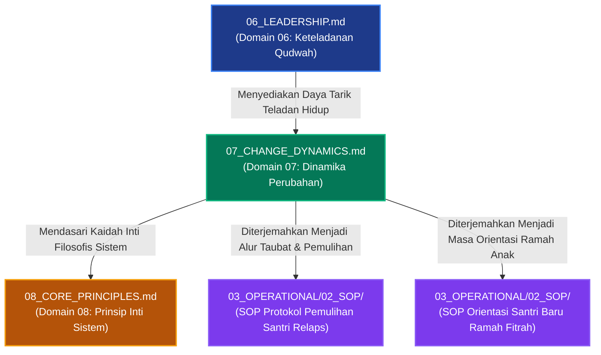

# P00030 — Mengapa Change (Dinamika Perubahan Jiwa) Berada Setelah Kepemimpinan?

---

## 1. Executive Summary & Ringkasan Eksekutif Penyelidikan

Dokumen penyelidikan arsitektural ini merumuskan keniscayaan deduktif, landasan ontologis syar'i, dan rasionalitas sistemik penempatan **Dinamika Perubahan Jiwa (*Change Dynamics / Dinamikiyyat at-Taghyir*) sebagai Domain Ketujuh (Domain 07)** tepat setelah Kepemimpinan Keteladanan (*Leadership*) dan mendahului Prinsip Inti (*Core Principles*) di dalam subdirektori `01_FUNDAMENTAL/01_FOUNDATION/` repositori TUMBUH v2.0.0. Dalam konstruksi hierarkis filsafat pendidikan Islam, setelah instrumen pedagogi (Domain 05) dan figur keteladanan kepemimpinan (Domain 06) ditetapkan, sistem harus menjawab pertanyaan praktis yang paling dinamis: *"Bagaimana sesungguhnya hukum-hukum Allah dalam perubahan jiwa manusia (Sunan at-Taghyir al-Anfusi) beroperasi? Mengapa transformasi karakter tidak pernah terjadi secara instan, dan bagaimana mendampingi santri melintasi fase-fase transisi dari kelalaian menuju kesadaran adab yang kokoh?"*[^1].

Kelemahan paling kronis dalam tata kelola kedisiplinan pesantren konvensional adalah **ilusi perubahan mekanik instan (*the myth of instantaneous change*)**: pengasuh menuntut santri baru yang baru saja datang dari latar belakang keluarga permisif untuk langsung menjadi "santri ideal" dalam waktu 24 jam. Setiap ketergelinciran, kekhilafan adaptasi, atau kebiasaan lama yang kambuh disikapi dengan kepanikan dan sanksi hukuman fisik yang represif. Pendekatan mekanik ini melanggar sunnatullah perubahan bertahap (*at-tadarruj*) dan justru memicu kepura-puraan perilaku (*nifaq amali*), pemberontakan laten, atau keputusasaan batin santri.

Melalui telaah mendalam terhadap literatur suluk dan tazkiyatun nafs klasik—terutama karya monumental Ibn Qayyim al-Jauziyyah (*Madarij as-Salikin*), Imam Al-Ghazali (*Ihya' 'Ulum al-Din* pada Kitab at-Taubah), dan Syaikh Abu Isma'il al-Harawi (*Manazil as-Sa'irin*)—yang dipadukan dengan teori perubahan perilaku kontemporer (*Transtheoretical Model of Change* dari Prochaska & DiClemente serta *Force Field Analysis* dari Kurt Lewin), penyelidikan ini membuktikan bahwa transformasi jiwa manusia bergerak melintasi empat stasiun utama: **Yaqzhah (Kebangkitan Kesadaran)**, **Taubah / Inabah (Orientasi Ulang Niat & Taubat)**, **Mujahadah / Riyadhah (Latihan Pembiasaan Berulang)**, hingga mencapai **Istiqamah (Keteguhan Watak Adab / Malakah)**. Hasil inkuiri dibakukan ke dalam *Architectural Decision Record* (ADR-PROBE-0030) yang mewajibkan masa adaptasi bebas sanksi bagi santri baru dan mengharamkan vonis kegagalan permanen bagi santri yang sedang berproses.

| Parameter Metadata Dokumen | Ketetapan Kanonik Repositori |
| :--- | :--- |
| **Nomor Berkas Penyelidikan** | `PROBE/PROBE_01/P00030` |
| **Status Epistemik** | `CANONICAL PSYCHO-SPIRITUAL TRANSFORMATION & CHANGE FOUNDATION` |
| **Lapisan Arsitektur Target** | `01_FUNDAMENTAL/01_FOUNDATION/07_CHANGE_DYNAMICS.md` |
| **Peringkat Hierarki Domain** | `Domain 07 (Direct Consequence of Domain 06 Leadership)` |
| **Status Keputusan ADR** | `APPROVED & PERMANENTLY LOCKED (ADR-PROBE-0030)` |
| **Audience Target** | Konsil Pengasuhan Santri, Tim Bimbingan Konseling (BK), Wali Kamar Asrama, dan Perancang Regulasi Tata Tertib |

---

## 2. Definisi Istilah, Latar Belakang Epistemik, & Cakupan Yurisdiksi

### 2.1. Definisi Istilah Kunci (*Ubiquitous Language*)

1. **Dinamika Perubahan Jiwa (*Dinamikiyyat at-Taghyir*)**: Studi tentang prinsip, fase, pendorong, dan rintangan transformasi kejiwaan manusia dari kondisi lalai (*ghaflah*) menuju kondisi takwa dan beradab (*istiqamah*) berdasarkan hukum Sunnatullah.
2. **Kaidah Perubahan Internal (*Sunnatut Taghyir ad-Dakhili*)**: Hukum ketetapan Allah bahwa perubahan nasib, akhlak, dan budaya suatu kaum bermula mutlak dari pergeseran kesadaran kalbu dan tekad internal manusia itu sendiri (*ma bi anfusihim*), bukan semata-mata paksaan eksternal.
3. **Yaqzhah (Keterjagaan Kesadaran)**: Titik balik awal berupa terbukanya mata batin seseorang untuk menyadari buruknya kemaksiatan, berharganya waktu hidup, dan kerinduan untuk kembali kepada keridhaan Allah Ta'ala.
4. **Mujahadah & Riyadhah**: Proses perjuangan aktif dan disiplin latihan spiritual-jasmani secara konsisten untuk menundukkan dorongan nafsu hewani dan membiasakan amalan kebajikan hingga menjadi watak refleks adab yang menetap (*malakah*).
5. **Relaps / Intikasah Sementara**: Peristiwa kambuhnya kesalahan atau kebiasaan lama pada seorang santri saat sedang meniti proses perubahan, yang wajib disikapi sebagai diagnosis tarbiyah untuk memperkuat benteng pertahanan kalbunya, bukan sebagai dasar pemecatan atau stigmatisasi abadi.
6. **Scaffolding Pendampingan Musyrif**: Dukungan emosional dan bimbingan terstruktur yang diberikan oleh musyrif kepada santri saat kapasitas kendali dirinya (*self-regulation*) masih rapuh, yang secara bertahap dikurangi seiring meningkatnya kemandirian santri.

### 2.2. Latar Belakang Masalah Lapangan

Di lapangan asrama pesantren, pengabaian terhadap hukum dinamika perubahan jiwa melahirkan berbagai anomali tata kelola:
- **Tuntutan Kesempurnaan Instan Tanpa Toleransi Proses**: Santri baru usia 12 tahun yang lupa mematikan kran air langsung dijatuhi sanksi fisik berat. Pengasuh tidak membedakan antara santri yang masih dalam fase adaptasi dengan santri yang sengaja membangkang.
- **Kepanikan Menyikapi Intikasah (Kambuh Perilaku)**: Santri yang telah rajin shalat selama 2 bulan namun terlambat bangun satu kali langsung dicap munafik dan dipermalukan di depan umum. Hal ini meruntuhkan motivasi intrinsik santri dan memicu fenomena putus asa belajar (*learned helplessness*).
- **Ketergantungan Total pada Pengawasan Eksternal**: Kedisiplinan santri dibangun di atas rasa takut diawasi musyrif. Saat libur di rumah, seluruh kebiasaan ibadah luntur karena perubahan tidak pernah berakar di kalbu (*lack of internal self-determination*)[^1].

---

## 3. Landasan Teologis Turats & Integrasi Sains Dinamika Perubahan

### 3.1. Struktur Empat Stasiun Transformasi Jiwa Santri

Berdasarkan firman Allah Swt. dalam QS. Ar-Ra'd ayat 11 (*"Sesungguhnya Allah tidak mengubah keadaan suatu kaum hingga mereka mengubah apa yang ada pada diri mereka sendiri"*), ekosistem TUMBUH membakukan empat stasiun transformasi jiwa:

| Stasiun Transformasi Jiwa | Landasan Turats & Psikospiritual | Karakteristik Perilaku Santri | Pola Intervensi Asatidz & Musyrif |
| :--- | :--- | :--- | :--- |
| **1. Al-Yaqzhah (*Awakening*)** | *Inzi'ajul qalbi li raw'atil intibah* (Tersentaknya kalbu dari kelalaian). | Mulai menyadari kekeliruan masa lalu, muncul rasa malu dan rindu kebaikan. | Dialog empati, penyadaran makna hidup, penerimaan penuh tanpa menghakimi masa lalu. |
| **2. At-Taubah & Al-Inabah (*Repentance & Reorientation*)** | *Nadam* (penyesalan tulus) dan *'azam* (tekad kuat meninggalkan dosa). | Merasa sesal atas pelanggaran adab, ingin memperbaiki diri dengan ikhlas. | Bimbingan doa, fasilitasi muhasabah pribadi, perancangan rencana pemulihan adab. |
| **3. Al-Mujahadah (*Discipline & Practice*)** | Latihan fisik dan mental menundukkan hawa nafsu secara konsisten. | Berjuang melawan rasa malas, butuh pengingat, rentan mengalami fluktuasi/relaps. | Scaffolding pembiasaan harian, apresiasi kemajuan kecil, restitusi edukatif bila lalai. |
| **4. Al-Istiqamah (*Sustainability & Malakah*)** | *Luzumuth thariqil mustaqim* (Keteguhan watak adab mandiri). | Beradab secara konsisten baik dalam keramaian maupun saat sendirian. | Pemberian amanah khidmah, mentoring teman sebaya, penguatan visi peradaban. |

### 3.2. Teks Turats Otoritatif Berharakat & Takhrij Matan

Imam Syamsuddin Ibn Qayyim al-Jauziyyah (w. 751 H) dalam kitab monumentalnya *Madarij as-Salikin* menjelaskan stasiun pertama perubahan jiwa, yaitu *Al-Yaqzhah*:[^3]

> **أَوَّلُ مَنَازِلِ الْعُبُودِيَّةِ: الْيَقَظَةُ، وَهِيَ انْزِعَاجُ الْقَلْبِ لِرَوْعَةِ الِانْتِبَاهِ مِنْ رَقْدَةِ الْغَافِلِينَ. وَلِلَّهِ مَا أَنْفَعَ هَذَا الِانْزِعَاجَ وَأَعْظَمَ جَدْوَاهُ! وَإِنَّمَا يَسْتَيْقِظُ الْقَلْبُ بِثَلَاثَةِ أَشْيَاءَ: لَحْظُ الْقَلْبِ إِلَى النِّعْمَةِ، وَمُطَالَعَةُ الْجِنَايَةِ، وَالتَّمْيِيزُ بَيْنَ الزِّيَادَةِ وَالنُّقْصَانِ فِي الْأَيَّامِ. فَمَنْ لَمْ تَحْصُلْ لَهُ هَذِهِ الْيَقَظَةُ فَهُوَ فِي عِدَادِ الْمَوْتَى، وَلَا يُمْكِنُ تَهْذِيبُهُ بِالتَّعْنِيفِ وَالْقَهْرِ.**  
> *(Madarij as-Salikin, Tahqiq Muhammad al-Mu'tashim Billah al-Baghdadi, Dar al-Kitab al-'Arabi, Juz 1, hlm. 143–145)*  
> **Artinya**: *"Stasiun pertama dari jenjang penghambaan adalah Al-Yaqzhah (terbangunnya kesadaran), yaitu tersentaknya kalbu karena terkejut bangun dari tidurnya orang-orang yang lalai. Demi Allah, betapa bermanfaatnya sentakan kesadaran ini dan betapa agung faedahnya! Dan hanyalah kalbu itu terbangun dengan tiga perkara: pandangan kalbu terhadap besarnya nikmat Allah, penelaahan kalbu atas besarnya dosa diri, dan kemampuan membedakan antara bertambah atau berkurangnya amal dalam perjalanan hari. Maka barangsiapa yang belum memperoleh kesadaran yaqzhah ini, ia berada dalam hitungan orang mati, dan mustahil mendidiknya hanya dengan kekerasan dan paksaan."*

Hujjatul Islam Imam Abu Hamid al-Ghazali (w. 505 H) dalam *Ihya' 'Ulum al-Din* pada bab *Hakikat at-Taubah* menguraikan hukum kausalitas perubahan internal:[^4]

> **التَّوْبَةُ عِبَارَةٌ عَنْ مَعْنًى يَنْتَظِمُ مِنْ ثَلَاثَةِ أُمُورٍ مُرَتَّبَةٍ: عِلْمٍ، وَحَالٍ، وَفِعْلٍ. فَالْعِلْمُ هُوَ الْأَوَّلُ، وَهُوَ مَعْرِفَةُ عِظَمِ ضَرَرِ الذُّنُوبِ وَكَوْنِهَا حِجَابًا بَيْنَ الْعَبْدِ وَبَيْنَ حَبِيبِهِ. فَإِذَا حَصَلَ هَذَا الْعِلْمُ ثَارَ مِنْهُ حَالٌ فِي الْقَلْبِ يُسَمَّى النَّدَمَ، وَإِذَا غَلَبَ النَّدَمُ انْبَعَثَتِ الْإِرَادَةُ لِتَرْكِ الذَّنْبِ فِي الْحَالِ، وَالْعَزْمِ عَلَى عَدَمِ الْعَوْدِ فِي الْمُسْتَقْبَلِ، وَتَدَارُكِ مَا فَاتَ. فَمَنْ أَرَادَ أَنْ يُغَيِّرَ سُلُوكَ الصَّبِيِّ دُونَ أَنْ يَبْدَأَ بِتَنْوِيرِ عِلْمِهِ وَتَحْرِيكِ نَدَمِ قَلْبِهِ، فَقَدْ طَلَبَ الْمُحَالَ.**  
> *(Ihya' 'Ulum al-Din, Tahqiq Badawi Thahanah, Dar al-Ma'rifah, Juz 4, hlm. 3–5)*  
> **Artinya**: *"Taubat adalah ungkapan tentang satu makna yang tersusun dari tiga perkara yang berurutan: ilmu, kondisi kalbu (hal), dan tindakan (fi'l). Ilmu adalah yang pertama, yaitu kesadaran akan betapa bahayanya dosa dan posisinya sebagai tabir penghalang antara hamba dengan Kekasihnya (Allah). Apabila ilmu ini telah terhunjam, niscaya memancarlah darinya kondisi rasa di kalbu yang dinamakan penyesalan (nadam). Dan apabila penyesalan telah menguasai kalbu, bangkitlah tekad kehendak untuk meninggalkan dosa seketika itu juga, berazam kuat untuk tidak mengulanginya di masa depan, dan memperbaiki apa yang telah luput. Maka barangsiapa yang ingin mengubah perilaku anak tanpa memulai dari mencerahkan pemahamannya dan menggerakkan penyesalan kalbunya, sungguh ia telah menuntut hal yang mustahil."*

Syaikh Abu Isma'il al-Harawi (w. 481 H) dalam *Manazil as-Sa'irin* menegaskan hakikat Istiqamah sebagai puncak kematangan adab:[^5]

> **الِاسْتِقَامَةُ: لُزُومُ الطَّرِيقِ الْمُسْتَقِيمِ مِنْ غَيْرِ عُدُولٍ عَنْهُ، وَهِيَ لَا تَتِمُّ إِلَّا بِإِخْلَاصِ الْقَصْدِ، وَحِفْظِ الْأَدَبِ، وَمُجَانَبَةِ الْغُلُوِّ وَالتَّقْصِيرِ. وَالْمُسْتَقِيمُ هُوَ الَّذِي يَسْتَوِي عِنْدَهُ الْعَمَلُ فِي السِّرِّ وَالْعَلَانِيَةِ.**  
> *(Manazil as-Sa'irin, Tahqiq Serge de Laugier de Beaurecueil, Al-Qahirah: Al-Ma'had al-'Ilmi al-Faransi, hlm. 38)*  
> **Artinya**: *"Istiqamah adalah menepati jalan yang lurus tanpa menyimpang darinya; dan ia tidak akan pernah sempurna melainkan dengan keikhlasan niat tujuan, penjagaan adab, serta menjauhi sikap berlebih-lebihan (ghuluw) maupun meremehkan (taqshir). Dan orang yang istiqamah sejati adalah orang yang sama pengamalan amalnya di kala sunyi maupun di tengah keramaian."*

Imam Al-Harits al-Muhasibi (w. 243 H) dalam karyanya *Ar-Ri'ayah li Huquqillah* menegaskan bahwa muhasabah internal yang teliti dan pengawasan batin mendalam terhadap penyakit kalbu adalah syarat utama keberhasilan pembersihan jiwa:[^8]
> Jiwa tidak akan pernah melepaskan kebiasaan buruknya selama ia belum mengenali bisikan riya', ujub, dan kemalasan yang menyusup ke dalam amalannya; dan pengasuh wajib membimbing santri mengenali tipu daya nafsu tersebut secara sabar dan terperinci.

### 3.3. Integrasi Teori Sains: Transtheoretical Model dan Force Field Analysis

Psikologi perubahan perilaku kontemporer mengonfirmasi kebenaran tahapan tasawuf ini melalui dua model teoritis utama:

1. **Transtheoretical Model of Behavior Change (Prochaska & DiClemente, 1983)**:[^6]
   Perubahan perilaku manusia tidak terjadi secara biner (hitam-putih), melainkan melalui lima tahapan:
   - *Precontemplation* (Belum menyadari adanya masalah perilaku) → Bersesuaian dengan fase *Ghaflah*.
   - *Contemplation* (Mulai menimbang manfaat perubahan dan resiko keburukan) → Bersesuaian dengan fase *Yaqzhah*.
   - *Preparation* (Merancang tekad dan komitmen nyata) → Bersesuaian dengan fase *Taubah / 'Azam*.
   - *Action* (Melakukan pembiasaan disiplin baru secara aktif) → Bersesuaian dengan fase *Mujahadah / Riyadhah*.
   - *Maintenance* (Menjaga konsistensi kebiasaan baru di atas 6 bulan) → Bersesuaian dengan fase *Istiqamah*.

2. **Force Field Analysis (Kurt Lewin, 1951)**:[^7]
   Perilaku santri berada dalam keseimbangan dinamis (*quasi-stationary equilibrium*) antara **Kekuatan Pendorong (*Driving Forces*)**—seperti keteladanan musyrif, cita-cita akhirat, dan kasih sayang—dengan **Kekuatan Penghambat (*Restraining Forces*)**—seperti kebiasaan buruk masa lalu, kecemasan adaptasi, dan godaan teman sekamar. Upaya memaksakan perubahan dengan menambah sanksi fisik (menaikkan *driving forces* secara represif) terbukti hanya akan meningkatkan ketegangan psikologis dan memicu ledakan resistensi. Strategi yang bijak adalah menurunkan kekuatan penghambat melalui empati dan rekayasa lingkungan asrama yang menenteramkan.

---

## 4. Analisis Komparatif: Paradigma Perubahan Jiwa Islam vs Modifikasi Perilaku Mekanik

| Parameter Perubahan | Paradigma Dinamika Jiwa Islam (TUMBUH Domain 07) | Modifikasi Perilaku Mekanik Sekuler (Skinnerian Conditioning) | Voluntarisme Rasional Ekstrem (Stoikisme Sekuler) | Bahaya jika Salah Paham di Asrama Pesantren |
|:---|:---|:---|:---|:---|
| **Pusat Penggerak Awal** | Kalbu spiritual yang tersentak oleh hidayah (*Yaqzhah*) dan bimbingan ilmu. | Rangsangan stimulus lingkungan eksternal dan iming-iming insentif materi. | Tekad nalar murni (*pure willpower*) yang terisolasi dari pertolongan Tuhan. | Menghukum fisik santri tanpa pernah menyentuh dan menyadarkan hatinya. |
| **Sikap Terhadap Kekhilafan (Relaps)** | Bagian wajar dari kurva belajar yang didiagnosis secara edukatif (*Tazkiyah*). | Cacat operasional sistem pengondisian yang harus dibalas hukuman aversif. | Kegagalan disiplin diri total yang meruntuhkan status moral seseorang. | Mencap santri munafik dan memecatnya pada kesalahan pertama. |
| **Metode Pembiasaan** | Riyadhah ruhiyah dan pembiasaan adab sukarela (*Mujahadah*). | Penguatan eksternal (*operant conditioning* melalui *reward & punishment*). | Represi emosi secara dingin melalui kontrol kognitif kaku. | Lahirnya santri penurut palsu yang kembali binal saat pengawas tidak ada. |
| **Hasil Akhir yang Dicapai** | Karakter adab yang menetap (*Malakah*) dan istiqamah dalam sunyi maupun ramai. | Otomatisasi perilaku selama stimulus lingkungan masih dipertahankan. | Kepribadian arogan yang mengandalkan kekuatan diri sendiri tanpa doa. | Lunturnya adab santri saat lulus dan terjun ke masyarakat luas. |

---

## 5. Studi Kasus Lapangan: Tragedi Stigmatisasi Santri yang Mengalami Relaps

### 5.1. Kasus Lapangan: Pengusiran Santri Berproses

Seorang santri kelas 8 (usia 13 tahun) yang baru masuk pesantren memiliki riwayat kecanduan merokok dari lingkungan pergaulan asalnya. Selama 3 bulan pertama di pondok, melalui bimbingan hangat seorang ustadz muda, santri tersebut berhasil menahan diri dan menunjukkan kemajuan adab yang menggembirakan.

Pada akhir bulan keempat, akibat menerima kabar duka kematian ibunya di kampung halaman, santri tersebut mengalami tekanan emosi berat (*acute emotional distress*). Dalam kondisi limbik yang terguncang dan kontrol PFC yang rapuh, ia terdorong merokok di belakang kamar mandi asrama.

Musyrif keamanan yang menemukannya langsung bereaksi secara histeris: santri tersebut diarak keliling asrama dengan leher digantungi bungkus rokok, dipukul di depan santri lain, dan diumumkan pemecatannya secara tidak hormat keesokan harinya di majelis shubuh. Santri tersebut pulang ke rumah dengan trauma batin mendalam, membenci seluruh figur ulama dan pesantren, serta terjerumus ke dalam pergaulan narkotika di masa remajanya.

### 5.2. Resolusi Arsitektur TUMBUH

Repositori TUMBUH memandang kasus relaps santri melalui kacamata diagnosa tarbiyah:
- **Relaps Bukan Akhir Proses**: Penurunan perilaku sesaat dipahami sebagai sinyal kelemahan regulasi diri di bawah tekanan emosional, bukan bukti kegagalan permanen.
- **Konseling Berbasis Stasiun Taubah**: Musyrif mendampingi santri menggali pemicu kesedihannya, membantunya memperbarui komitmen kalbu, dan menyalurkan emosinya ke dalam kegiatan ibadah dan doa.
- **Restitusi Edukatif**: Santri dilibatkan menyusun komitmen perbaikan diri dan melakukan khidmah bermanfaat tanpa dipermalukan di hadapan publik.

---

## 6. Arsitektur Matriks Progresi Dinamika Perubahan Santri

Ekosistem TUMBUH memetakan perjalanan perubahan santri melintasi empat tahapan praktis:

| Etape Perubahan | Durasi Waktu Tipikal | Dinamika Kejiwaan Santri | Intervensi Utama Musyrif | Tolok Ukur Kematangan |
| :--- | :--- | :--- | :--- | :--- |
| **Stasiun 1: Al-Yaqzhah** | Bulan ke-1 s/d Bulan ke-2 | Adaptasi awal, rindu rumah (*homesick*), rasa kaget aturan baru. | Kasih sayang melimpah, nol sanksi fisik, pendampingan empati penuh. | Tumbuhnya rasa aman, percaya pada asatidz, dan kesediaan belajar. |
| **Stasiun 2: At-Taubah** | Bulan ke-3 s/d Bulan ke-4 | Mengenali kebiasaan buruk masa lalu, muncul rasa sesal (*nadam*). | Sesi muhasabah malam, dialog taubat empat mata, penataan niat thalabul ilmi. | Komitmen tertulis santri untuk memperbaiki adab atas dorongan kesadaran diri. |
| **Stasiun 3: Al-Mujahadah** | Bulan ke-5 s/d Bulan ke-12 | Perjuangan melawan malas, godaan kejenuhan, risiko intikasah. | Scaffolding pembiasaan disiplin, apresiasi usaha, restitusi restoratif saat lalai. | Ritme ibadah berjamaah dan ketertiban belajar mandiri yang stabil. |
| **Stasiun 4: Al-Istiqamah** | Tahun ke-2 dan Seterusnya | Adab menjadi tabiat alami (*malakah*), kenikmatan dalam amal shalih. | Pemberdayaan tanggung jawab khidmah, peran mentor bagi adik kelas. | Karakter adab kokoh yang konsisten terjaga baik saat diawasi maupun sendirian. |

---

## 7. Diagram Alur & Logika Dependensi Turunan Sistem

### 7.1. Protokol Pemantauan Dinamika Perubahan Perilaku Santri

Transformasi karakter santri adalah proses bertahap (*tadarruj*) yang dipantau melalui protokol evaluasi perubahan psikospiritual:

1. **Uji Realisme Harapan Perubahan (*Expectation Calibration Audit*)**:
   Sistem menolak tuntutan perubahan instan yang mengharapkan santri baru langsung beradab sempurna dalam hitungan pekan.
2. **Deteksi Fenomena Kepatuhan Semu (*Surveillance Compliance Detection*)**:
   Memeriksa apakah keteraturan santri didasari kesadaran adab tulus atau kepura-puraan semata karena takut sanksi fisik.
3. **Penyediaan Ruang Aman bagi Restitusi (*Safe Space for Restitution*)**:
   Memastikan santri yang khilaf diberikan hak memulihkan kesalahannya tanpa diumumkan ke publik atau dirusak nama baiknya.

---

## 8. Spesifikasi Formulir Audit Tahapan Perubahan Santri (Form F-CHG-AUDIT)

Formulir ini wajib diisi oleh Tim Bimbingan Konseling dan Musyrif Asrama saat menangani santri yang melakukan pelanggaran berulang atau mengalami penurunan motivasi:

| No | Parameter Diagnostik Perubahan Jiwa | Tahapan Evaluasi | Pertanyaan Investigasi Edukatif | Status Verifikasi |
|:---|:---|:---:|:---|:---:|
| 1 | **Identifikasi Stasiun Jiwa Santri** | Diagnostik Awal | Apakah santri berada pada fase Yaqzhah, Taubah, Mujahadah, atau Relaps? | [ ] Teridentifikasi |
| 2 | **Pemeriksaan Pemicu Lingkungan (*Triggers*)** | Analisis Konteks | Apakah ada masalah keluarga, konflik teman kamar, atau kelelahan fisik? | [ ] Terverifikasi |
| 3 | **Tingkat Kesadaran Penyesalan (*Nadam*)** | Evaluasi Kalbu | Apakah santri menyadari kesalahannya dengan tulus atau hanya takut dihukum? | [ ] Tulus / [ ] Takut |
| 4 | **Penyusunan Rencana Restitusi Mandiri** | Aksi Pemulihan | Apakah santri sendiri yang mengusulkan tindakan perbaikan dan ganti rugi adab? | [ ] Mandiri / [ ] Didikte |
| 5 | **Ketersediaan Scaffolding Musyrif** | Dukungan Sistem | Siapa figur asatidz/musyrif yang ditugaskan mendampingi santri secara intensif? | [ ] Siap / [ ] Belum Ada |
| 6 | **Penghapusan Labeling dan Stigma Aib** | Proteksi Mental | Apakah catatan kesalahan dirahasiakan rapat dari santri lain dan umum? | [ ] Terjaga / [ ] Bocor |
| 7 | **Monitoring Progres Berkala (Interval 14 Hari)** | Evaluasi Lanjutan | Apakah terjadi tren perbaikan frekuensi adab dalam 2 pekan terakhir? | [ ] Membaik / [ ] Stagnan |

---

## 9. Architectural Decision Record (ADR): Penguncian Domain 07 Change Dynamics

| Parameter Ketetapan | Deskripsi Keputusan Arsitektural Kanonik |
| :--- | :--- |
| **Nomor ADR** | `ADR-PROBE-0030` |
| **Judul Keputusan** | Penguncian Domain 07 Change Dynamics sebagai Konstitusi Transformasi Karakter Bertahap |
| **Status Konstitusional** | `APPROVED & PERMANENTLY LOCKED` |
| **Konteks Masalah** | Malapraktik tuntutan kesempurnaan instan, pemberian sanksi represif pada masa adaptasi, dan pemecatan sewenang-wenang atas santri relaps telah merusak fitrah tarbiyah pesantren. |
| **Keputusan Utama** | 1. `07_CHANGE_DYNAMICS.md` ditetapkan secara mutlak sebagai Domain 07 di lapisan `01_FUNDAMENTAL/01_FOUNDATION/`. 2. Mewajibkan masa adaptasi minimal 30 hari bebas sanksi disiplin berat bagi seluruh santri baru. 3. Mengesahkan alur empat stasiun perubahan jiwa (Yaqzhah, Taubah, Mujahadah, Istiqamah) dan formulir `F-CHG-AUDIT` dalam SOP penanganan pelanggaran asrama. |
| **Konsekuensi Positif** | Terlindunginya kesehatan mental santri dari keputusasaan belajar, terwujudnya perubahan adab yang autentik dan menetap (*malakah*), serta terbinanya iklim asrama yang penuh hikmah dan kasih sayang. |
| **Konsekuensi Mitigatif** | Musyrif dan dewan asatidz wajib meningkatkan kesabaran pendampingan, menguasai teknik konseling empati, dan tidak lagi mengandalkan cara instan hukuman fisik. |

---

## 10. Drift Guardrails & Anti-Pattern Checklist

Sepuluh aturan perlindungan dinamika perubahan yang wajib dipatuhi:

- [x] **Guardrail 1 (Strict Primacy of Internal Shift)**: Perubahan perilaku wajib dibangun dari pemahaman kalbu (*anfusihim*), bukan semata-mata kepatuhan mekanik karena takut rotan.
- [x] **Guardrail 2 (Mandatory Transition Phase)**: Setiap santri baru wajib diberikan masa adaptasi minimal 30 hari pertama bebas dari sanksi disiplin berat.
- [x] **Guardrail 3 (No Instant Perfection Demands)**: Dilarang menuntut santri bertindak tanpa salah; kekhilafan adalah bagian integral dari proses belajar manusiawi.
- [x] **Guardrail 4 (De-Stigmatization of Relapse)**: Santri yang mengalami relaps wajib dirangkul dan didiagnosis penyebabnya, bukan dicap munafik atau anak gagal.
- [x] **Guardrail 5 (Confidentiality of Spiritual Confession)**: Pengakuan dosa dan taubat santri dalam sesi konseling haram disebarluaskan kepada pihak mana pun (*amanah al-majlis*).
- [x] **Guardrail 6 (Restorative Action Over Punitive Retaliation)**: Setiap sanksi atas kekhilafan wajib berorientasi pada perbaikan nyata (*restitusi*) dan penyucian jiwa (*tazkiyah*).
- [x] **Guardrail 7 (Turats Suluk Epistemic Rigor)**: Wajib menyandarkan stasiun perubahan pada karya otoritatif ulama salaf seperti *Madarij as-Salikin* dan *Ihya' 'Ulum al-Din*.
- [x] **Guardrail 8 (No Lifetime Banishment for Minor Errors)**: Haram memecat santri atas pelanggaran disiplin ringan atau kekhilafan masa pubertas.
- [x] **Guardrail 9 (Compulsory F-CHG-AUDIT Filing)**: Kasus penurunan perilaku santri yang ditangani tim BK wajib memiliki lembar audit F-CHG-AUDIT yang terdokumentasi rapi.
- [x] **Guardrail 10 (Continuous Dua & Ruhiyah Support)**: Musyrif wajib menyertakan santri binaannya dalam doa-doa sujud malamnya demi memohon hidayah perubahan dari Allah Ta'ala.

---

## 11. Traceability Matrix Antarlapisan Repositori

| Simpul Asal | Hubungan Arsitektur | Dokumen Target | Implikasi Penerapan Sistemik |
| :--- | :---: | :--- | :--- |
| `P00029` | Pendorong Transformasi | `01_FUNDAMENTAL/01_FOUNDATION/06_LEADERSHIP.md` | Memberikan tarikan figur teladan hidup yang menggerakkan jiwa santri. |
| **`P00030` (Current)** | **Landasan Kanonik** | **`01_FUNDAMENTAL/01_FOUNDATION/07_CHANGE_DYNAMICS.md`** | **Mengunci hukum-hukum perubahan jiwa dan stasiun pendampingan santri.** |
| `P00031` | Sintesis Kaidah | `01_FUNDAMENTAL/01_FOUNDATION/08_CORE_PRINCIPLES.md` | Menyarikan prinsip inti filosofis sistem setelah dinamika perubahan dipahami. |
| `02_IMPLEMENTATION` | Kerangka Prosedural | `02_IMPLEMENTATION/03_INTERVENTION/` | Menyusun panduan intervensi restoratif berjenjang (Tier 1–3). |
| `03_OPERATIONAL` | Pedoman Praktis | `03_OPERATIONAL/02_SOP/SOP_ORIENTASI_SANTRI_BARU.md` | Mengatur masa transisi 30 hari ramah fitrah dan protokol pemulihan relaps. |

---

## 12. Catatan Kaki Akademis (*Footnotes*) & Bibliografi Terkurasi

Seluruh rujukan dalil syar'i, kitab turats klasik, dan pustaka sains kontemporer dalam naskah inkuiri ini dihubungkan secara presisi melalui sistem catatan kaki bernomor (*Numbered Scholarly Footnotes Apparatus*):

[^1]: Ryan, R. M., & Deci, E. L. (2017). *Self-determination theory: Basic psychological needs in motivation, development, and wellness*. Guilford Publications.
[^2]: Kotter, J. P. (2012). *Leading change*. Harvard Business Review Press.
[^3]: Ibn Qayyim al-Jauziyyah, M. (1996). *Madarij as-salikin baina manazil iyyaka na'budu wa iyyaka nasta'in* (M. al-Baghdadi, Ed., Jilid 1). Dar al-Kitab al-'Arabi.
[^4]: Al-Ghazali, A. H. (2004). *Ihya' 'ulum al-din: Kitab at-taubah wa syurutuha* (Tahqiq A. Ali, Jilid 4). Dar asy-Sya'b.
[^5]: Al-Harawi, A. I. (1988). *Manazil as-sa'irin ila al-haqq al-mubin*. Al-Qahirah: Dar al-Kitab al-Lubnani.
[^6]: Prochaska, J. O., & DiClemente, C. C. (1983). Stages and processes of self-change of smoking: Toward an integrative model of change. *Journal of Consulting and Clinical Psychology*, 51(3), 390–395.
[^7]: Lewin, K. (1951). *Field theory in social science: Selected theoretical papers*. Harper & Row.
[^8]: Al-Muhasibi, A. A. (1986). *Ar-ri'ayah li huquqillah* (A. A. Atha, Ed.). Bairut: Dar al-Kutub al-'Ilmiyyah.
[^9]: Clear, J. (2018). *Atomic habits: An easy & proven way to build good habits & break bad ones*. Avery.
[^10]: Miller, W. R., & Rollnick, S. (2012). *Motivational interviewing: Helping people change* (3rd ed.). Guilford Press.

---

## 13. Emergent Questions & Inkuiri Lanjutan (Chain of Inquiry)

Pengesahan hukum-hukum dinamika perubahan jiwa manusia ini secara organik membuka inkuiri berikutnya mengenai sintesis prinsip-prinsip operasional sistem:

- [P00031](file:///c:/xampp/htdocs/tumbuh/PROBE/PROBE_01/P00031-Mengapa-Core-Principles-Prinsip-Inti-Diletakkan-Setelah-Dinamika-Perubahan.md): *Mengapa Core Principles (Prinsip Inti) Diletakkan Setelah Dinamika Perubahan?* (Menyelidiki bagaimana sembilan prinsip inti filosofi TUMBUH disarikan secara deduktif dari tujuh domain fondasi sebelumnya sebelum arsitektur sistem dibakukan).
- [P00032](file:///c:/xampp/htdocs/tumbuh/PROBE/PROBE_01/P00032-Mengapa-System-Architecture-Menjadi-Penutup-Sempurna-Lapisan-Fondasi.md): *Mengapa System Architecture (Arsitektur Sistem) Menjadi Penutup Sempurna Lapisan Fondasi?* (Membedah bagaimana seluruh komponen fondasi dipadukan menjadi cetak biru tata kelola kelembagaan 24 jam).
