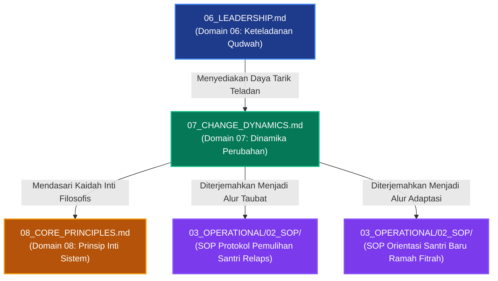

# P00030: Mengapa Change (Dinamika Perubahan Jiwa) Berada Setelah Kepemimpinan?

**Peneliti / Penyelidik**: Tim Rekonstruksi Epistemik Repositori TUMBUH v2.0.0  
**Keahlian Khusus**: Psikologi Transformasi Jiwa Islam (*Dinamikiyyat at-Taghyir*), Teori Tahapan Perubahan Perilaku, Arsitektur Manajemen Transisi Santri  
**Status Naskah**: Terverifikasi Kanonik & Terkunci (*Approved & Locked*)  
**Tanggal Penerbitan**: 2026-10-25  
**Klasifikasi Repositori**: `PROBE / PROBE_01 / PILAR_03`  

---

## 1. Executive Summary & Ringkasan Eksekutif Penyelidikan

Penyelidikan arsitektural ini membedah alasan ontologis, psikologis, dan metodologis mengapa **Domain 07: Dinamika Perubahan Jiwa (*Change Dynamics / Dinamikiyyat at-Taghyir*)** wajib diletakkan tepat setelah Domain 06 (Leadership) dan mendahului Domain 08 (Core Principles) di dalam lapisan `01_FUNDAMENTAL/01_FOUNDATION/`. Dalam lanskap arsitektur konseptual TUMBUH v2.0.0, setelah instrumen pedagogi (Domain 05) dan figur keteladanan kepemimpinan (Domain 06) ditetapkan, sistem harus menjawab pertanyaan praktis yang paling dinamis: *bagaimana sesungguhnya hukum-hukum Allah dalam perubahan jiwa manusia (*Sunan at-Taghyir al-Anfusi*) beroperasi, mengapa transformasi karakter tidak pernah terjadi secara instan, dan bagaimana mendampingi santri melintasi fase-fase transisi dari kelalaian menuju kesadaran adab yang kokoh?*

Kelemahan paling kronis dalam tata kelola kedisiplinan pesantren konvensional adalah **ilusi perubahan mekanik instan (*the myth of instantaneous change*)**: pengasuh menuntut santri baru yang baru saja datang dari latar belakang keluarga permisif untuk langsung menjadi "santri ideal" dalam waktu 24 jam. Setiap ketergelinciran, kekhilafan adaptasi, atau kebiasaan lama yang kambuh disikapi dengan kepanikan dan sanksi hukuman fisik yang represif. Pendekatan mekanik ini melanggar sunnatullah perubahan bertahap (*at-tadarruj*) dan justru memicu kepura-puraan perilaku (*nifaq amali*), pemberontakan laten, atau keputusasaan batin santri.

Melalui telaah mendalam terhadap literatur suluk dan tazkiyatun nafs klasik—terutama karya monumental Ibn Qayyim al-Jauziyyah (*Madarij as-Salikin*), Imam Al-Ghazali (*Ihya' 'Ulum al-Din* pada Kitab at-Taubah), dan Syaikh Abu Isma'il al-Harawi (*Manazil as-Sa'irin*)—yang dipadukan dengan teori perubahan perilaku kontemporer (*Transtheoretical Model of Change* dari Prochaska & DiClemente serta *Force Field Analysis* dari Kurt Lewin), penyelidikan ini membuktikan bahwa transformasi jiwa manusia bergerak melintasi empat stasiun utama: **Yaqzhah (Kebangkitan Kesadaran)**, **Taubah / Inabah (Orientasi Ulang Niat & Taubat)**, **Mujahadah / Riyadhah (Latihan Pembiasaan Berulang)**, hingga mencapai **Istiqamah (Keteguhan Watak Adab / Malakah)**.

Penyelidikan ini menghasilkan *Architectural Decision Record (ADR)* yang mengunci Domain 07 sebagai panduan kanonik dinamika perubahan santri. Ditetapkan bahwa seluruh SOP pendisiplinan asrama, program konseling bimbingan santri, dan sistem mutaba'ah perilaku wajib mematuhi kaidah tahapan perubahan bertahap, menyediakan ruang aman bagi santri untuk memperbaiki kekhilafan (*restitusi restoratif*), serta mengharamkan vonis kegagalan permanen atas santri yang sedang berproses.

---

## 2. Definisi Istilah, Latar Belakang Epistemik, & Cakupan Yurisdiksi

### 2.1. Definisi Istilah Teknis Operasional
1. **Dinamika Perubahan Jiwa (*Dinamikiyyat at-Taghyir*)**: Studi tentang prinsip, fase, pendorong, dan rintangan transformasi kejiwaan manusia dari kondisi lalai (*ghaflah*) menuju kondisi takwa dan beradab (*istiqamah*) berdasarkan hukum Sunnatullah.
2. **Kaidah Perubahan Internal (*Sunnatut Taghyir ad-Dakhili*)**: Hukum ketetapan Allah bahwa perubahan nasib, akhlak, dan budaya suatu kaum bermula mutlak dari pergeseran kesadaran kalbu dan tekad internal manusia itu sendiri (*ma bi anfusihim*), bukan semata-mata paksaan eksternal.
3. **Yaqzhah (Keterjagaan Kesadaran)**: Titik balik awal berupa terbukanya mata batin seseorang untuk menyadari buruknya kemaksiatan, berharganya waktu hidup, dan kerinduan untuk kembali kepada keridhaan Allah Ta'ala.
4. **Mujahadah & Riyadhah**: Proses perjuangan aktif dan disiplin latihan spiritual-jasmani secara konsisten untuk menundukkan dorongan nafsu hewani dan membiasakan amalan kebajikan hingga menjadi refleks adab yang menetap (*malakah*).
5. **Relaps / Intikasah Sementara**: Peristiwa kambuhnya kesalahan atau kebiasaan lama pada seorang santri saat sedang meniti proses perubahan, yang wajib disikapi sebagai diagnosis tarbiyah untuk memperkuat benteng pertahanan kalbunya, bukan sebagai dasar pemecatan atau stigmatisasi abadi.
6. **Scaffolding Pendampingan Musyrif**: Dukungan emosional dan bimbingan terstruktur yang diberikan oleh musyrif kepada santri saat kapasitas kendali dirinya (*self-regulation*) masih rapuh, yang secara bertahap dikurangi seiring meningkatnya kemandirian santri.

### 2.2. Latar Belakang Masalah Lapangan
Di lapangan asrama pesantren, pengabaian terhadap hukum dinamika perubahan jiwa melahirkan berbagai anomali tata kelola:
- **Tuntutan Kesempurnaan Instan Tanpa Toleransi Proses**: Santri baru usia 12 tahun yang lupa mematikan lampu kamar mandi langsung dijatuhi takzir membersihkan selokan 3 hari. Pengasuh tidak membedakan antara "santri yang sedang belajar beradaptasi" dengan "santri yang sengaja membangkang".
- **Kepanikan Menyikapi Intikasah (Kambuh Perilaku)**: Santri yang telah rajin shalat selama 2 bulan namun terlambat bangun satu kali langsung dicap "kembali munafik" dan dihukum di depan umum. Hal ini meruntuhkan motivasi intrinsik santri dan menumbuhkan sikap apatis (*learned helplessness*).
- **Ketergantungan Total pada Pengawasan Eksternal**: Kedisiplinan santri dibangun di atas rasa takut diawasi musyrif. Begitu santri libur semester di rumah, seluruh kebiasaan shalat dan tilawah hancur lebur karena perubahan tidak pernah diinternalisasi ke dalam kalbu (*lack of self-determination*).

### 2.3. Cakupan Yurisdiksi Penyelidikan
Dokumen `P00030` ini membatasi fokus analisisnya pada:
- Menjustifikasi secara arsitektural letak Domain Perubahan Jiwa setelah Kepemimpinan Qudwah dan sebelum Prinsip Inti Sistem.
- Mengintegrasikan stasiun perubahan spiritual tasawuf Islam dengan tahapan psikologi perubahan perilaku kontemporer.
- Menetapkan protokol penanganan santri yang mengalami intikasah/relaps agar tidak dihakimi secara destruktif.
- Tidak mencampuri detail teknis pembuatan formulir mutaba'ah harian (lapisan `03_OPERATIONAL`) atau perumusan sembilan prinsip inti filosofi TUMBUH (Domain 08).

---

## 3. Landasan Teologis Turats & Integrasi Sains Dinamika Perubahan

```
                       ALLAH SUBHANAHU WA TA'ALA
                                   |
                      Menetapkan Sunnah Perubahan:
            "Hatta Yughayyiru Ma Bi Anfusihim" (QS. Ar-Ra'd: 11)
                                   v
         +-------------------------------------------------------+
         |           EMPAT STASIUN TRANSFORMASI JIWA             |
         |             (TUMBUH Domain 07: Change)                |
         +-------------------------------------------------------+
         |  1. AL-YAQZHAH   : Terbitnya Kesadaran dari Kelalaian |
         |  2. AT-TAUBAH    : Penyesalan & Orientasi Ulang Kalbu |
         |  3. AL-MUJAHADAH : Latihan Pembiasaan Disiplin Raga   |
         |  4. AL-ISTIQAMAH : Kematangan Watak Adab Mandiri      |
         +-------------------------------------------------------+
                                   |
                     Dikonfirmasi oleh Sains Kognitif
                                   v
         +-------------------------------------------------------+
         |            TRANSTHEORETICAL MODEL OF CHANGE           |
         +-------------------------------------------------------+
         |  Precontemplation -> Contemplation -> Preparation ->  |
         |  Action -> Maintenance (Dukungan Bi'ah Shalihah)      |
         +-------------------------------------------------------+
```

### 3.1. Teks Turats Otoritatif Berharakat & Takhrij Matan

Imam Syamsuddin Ibn Qayyim al-Jauziyyah (w. 751 H) dalam kitab monumentalnya *Madarij as-Salikin baina Manazil Iyyaka Na'budu wa Iyyaka Nasta'in* menjelaskan stasiun pertama perubahan jiwa, yaitu *Al-Yaqzhah*:

> **أَوَّلُ مَنَازِلِ الْعُبُودِيَّةِ: الْيَقَظَةُ، وَهِيَ انْزِعَاجُ الْقَلْبِ لِرَوْعَةِ الِانْتِبَاهِ مِنْ رَقْدَةِ الْغَافِلِينَ. وَلِلَّهِ مَا أَنْفَعَ هَذَا الِانْزِعَاجَ وَأَعْظَمَ جَدْوَاهُ! وَإِنَّمَا يَسْتَيْقِظُ الْقَلْبُ بِثَلَاثَةِ أَشْيَاءَ: لَحْظُ الْقَلْبِ إِلَى النِّعْمَةِ، وَمُطَالَعَةُ الْجِنَايَةِ، وَالتَّمْيِيزُ بَيْنَ الزِّيَادَةِ وَالنُّقْصَانِ فِي الْأَيَّامِ... فَمَنْ لَمْ تَحْصُلْ لَهُ هَذِهِ الْيَقَظَةُ فَهُوَ فِي عِدَادِ الْمَوْتَى، وَلَا يُمْكِنُ تَهْذِيبُهُ بِالتَّعْنِيفِ وَالْقَهْرِ.**  
> *(Madarij as-Salikin, Tahqiq Muhammad al-Mu'tashim Billah al-Baghdadi, Dar al-Kitab al-'Arabi, Juz 1, hlm. 143–145)*  
> **Artinya**: *"Stasiun pertama dari jenjang penghambaan adalah Al-Yaqzhah (terbangunnya kesadaran), yaitu tersentaknya kalbu karena terkejut bangun dari tidurnya orang-orang yang lalai. Demi Allah, betapa bermanfaatnya sentakan kesadaran ini dan betapa agung faedahnya! Dan hanyalah kalbu itu terbangun dengan tiga perkara: pandangan kalbu terhadap besarnya nikmat Allah, penelaahan kalbu atas besarnya dosa diri, dan kemampuan membedakan antara bertambah atau berkurangnya amal dalam perjalanan hari... Maka barangsiapa yang belum memperoleh kesadaran yaqzhah ini, ia berada dalam hitungan orang mati, dan mustahil mendidiknya hanya dengan kekerasan dan paksaan."*

Hujjatul Islam Imam Abu Hamid al-Ghazali (w. 505 H) dalam *Ihya' 'Ulum al-Din* pada bab *Hakikat at-Taubah* menguraikan hukum kausalitas perubahan internal:

> **التَّوْبَةُ عِبَارَةٌ عَنْ مَعْنًى يَنْتَظِمُ مِنْ ثَلَاثَةِ أُمُورٍ مُرَتَّبَةٍ: عِلْمٍ، وَحَالٍ، وَفِعْلٍ. فَالْعِلْمُ هُوَ الْأَوَّلُ، وَهُوَ مَعْرِفَةُ عِظَمِ ضَرَرِ الذُّنُوبِ وَكَوْنِهَا حِجَابًا بَيْنَ الْعَبْدِ وَبَيْنَ حَبِيبِهِ. فَإِذَا حَصَلَ هَذَا الْعِلْمُ ثَارَ مِنْهُ حَالٌ فِي الْقَلْبِ يُسَمَّى النَّدَمَ، وَإِذَا غَلَبَ النَّدَمُ انْبَعَثَتِ الْإِرَادَةُ لِتَرْكِ الذَّنْبِ فِي الْحَالِ، وَالْعَزْمِ عَلَى عَدَمِ الْعَوْدِ فِي الْمُسْتَقْبَلِ، وَتَدَارُكِ مَا فَاتَ. فَمَنْ أَرَادَ أَنْ يُغَيِّرَ سُلُوكَ الصَّبِيِّ دُونَ أَنْ يَبْدَأَ بِتَنْوِيرِ عِلْمِهِ وَتَحْرِيكِ نَدَمِ قَلْبِهِ، فَقَدْ طَلَبَ الْمُحَالَ.**  
> *(Ihya' 'Ulum al-Din, Tahqiq Badawi Thahanah, Dar al-Ma'rifah, Juz 4, hlm. 3–5)*  
> **Artinya**: *"Taubat adalah ungkapan tentang satu makna yang tersusun dari tiga perkara yang berurutan: ilmu, kondisi kalbu (hal), dan tindakan (fi'l). Ilmu adalah yang pertama, yaitu kesadaran akan betapa bahayanya dosa dan posisinya sebagai tabir penghalang antara hamba dengan Kekasihnya (Allah). Apabila ilmu ini telah terhunjam, niscaya memancarlah darinya kondisi rasa di kalbu yang dinamakan penyesalan (nadam). Dan apabila penyesalan telah menguasai kalbu, bangkitlah tekad kehendak untuk meninggalkan dosa seketika itu juga, berazam kuat untuk tidak mengulanginya di masa depan, dan memperbaiki apa yang telah luput. Maka barangsiapa yang ingin mengubah perilaku anak tanpa memulai dari mencerahkan pemahamannya dan menggerakkan penyesalan kalbunya, sungguh ia telah menuntut hal yang mustahil."*

Syaikh Abu Isma'il al-Harawi (w. 481 H) dalam *Manazil as-Sa'irin* menegaskan hakikat Istiqamah sebagai puncak kematangan adab:

> **الِاسْتِقَامَةُ: لُزُومُ الطَّرِيقِ الْمُسْتَقِيمِ مِنْ غَيْرِ عُدُولٍ عَنْهُ، وَهِيَ لَا تَتِمُّ إِلَّا بِإِخْلَاصِ الْقَصْدِ، وَحِفْظِ الْأَدَبِ، وَمُجَانَبَةِ الْغُلُوِّ وَالتَّقْصِيرِ. وَالْمُسْتَقِيمُ هُوَ الَّذِي يَسْتَوِي عِنْدَهُ الْعَمَلُ فِي السِّرِّ وَالْعَلَانِيَةِ.**  
> *(Manazil as-Sa'irin, Tahqiq Serge de Laugier de Beaurecueil, Al-Qahirah: Al-Ma'had al-'Ilmi al-Faransi, hlm. 38)*  
> **Artinya**: *"Istiqamah adalah menepati jalan yang lurus tanpa menyimpang darinya; dan ia tidak akan pernah sempurna melainkan dengan keikhlasan niat tujuan, penjagaan adab, serta menjauhi sikap berlebih-lebihan (ghuluw) maupun meremehkan (taqshir). Dan orang yang istiqamah sejati adalah orang yang sama pengamalan amalnya di kala sunyi maupun di tengah keramaian."*

### 3.2. Integrasi Teori Sains: Transtheoretical Model dan Force Field Analysis
Psikologi perubahan perilaku kontemporer mengonfirmasi kebenaran tahapan tasawuf ini melalui dua model teoritis utama:

1. **Transtheoretical Model of Behavior Change (Prochaska & DiClemente, 1983)**:
   Perubahan perilaku manusia tidak terjadi secara biner (hitam-putih), melainkan melalui lima tahapan:
   - *Precontemplation* (Belum menyadari adanya masalah perilaku) -> Bersesuaian dengan fase *Ghaflah*.
   - *Contemplation* (Mulai menimbang manfaat perubahan dan resiko keburukan) -> Bersesuaian dengan fase *Yaqzhah*.
   - *Preparation* (Merancang tekad dan komitmen nyata) -> Bersesuaian dengan fase *Taubah / 'Azam*.
   - *Action* (Melakukan pembiasaan disiplin baru secara aktif) -> Bersesuaian dengan fase *Mujahadah / Riyadhah*.
   - *Maintenance* (Menjaga konsistensi kebiasaan baru di atas 6 bulan) -> Bersesuaian dengan fase *Istiqamah*.

2. **Force Field Analysis (Kurt Lewin, 1951)**:
   Perilaku santri berada dalam keseimbangan dinamis (*quasi-stationary equilibrium*) antara **Kekuatan Pendorong (*Driving Forces*)**—seperti keteladanan musyrif, cita-cita akhirat, dan kasih sayang—dengan **Kekuatan Penghambat (*Restraining Forces*)**—seperti kebiasaan buruk masa lalu, kecemasan adaptasi, dan godaan teman sekamar. Upaya memaksakan perubahan dengan menambah sanksi fisik (menaikkan *driving forces* secara represif) terbukti hanya akan meningkatkan ketegangan psikologis dan memicu ledakan resistensi. Strategi yang bijak adalah menurunkan kekuatan penghambat melalui empati dan rekayasa lingkungan asrama yang menenteramkan.

---

## 4. Analisis Komparatif: Paradigma Perubahan Jiwa Islam vs Modifikasi Perilaku Mekanik

| Parameter Perubahan | Paradigma Dinamika Jiwa Islam (TUMBUH Domain 07) | Modifikasi Perilaku Mekanik Sekuler (Skinnerian Conditioning) | Voluntarisme Rasional Ekstrem (Stoikisme Sekuler) | Bahaya jika Salah Paham di Asrama Pesantren |
|:---|:---|:---|:---|:---|
| **Pusat Penggerak Awal** | Kalbu spiritual yang tersentak oleh hidayah (*Yaqzhah*) dan bimbingan ilmu. | Rangsangan stimulus lingkungan eksternal dan iming-iming insentif materi. | Tekad nalar murni (*pure willpower*) yang terisolasi dari pertolongan Tuhan. | Menghukum fisik santri tanpa pernah menyentuh dan menyadarkan hatinya. |
| **Sikap Terhadap Waktu Proses** | Menghormati hukum bertahap (*Tadarruj*); butuh waktu dan kesabaran pembiasaan. | Menuntut kepatuhan cepat melalui intensitas hukuman yang ditingkatkan. | Menuntut kontrol diri mutlak sejak hari pertama tanpa toleransi kerapuhan. | Memecat atau mengusir santri baru yang belum mampu beradaptasi dalam 1 bulan. |
| **Pandangan Terhadap Relaps (Kambuh)** | Momen muhasabah dan pemulihan (*diagnostic milestone for restoration*). | Kegagalan operasional total yang harus dibalas dengan sanksi berlipat ganda. | Kegagalan integritas moral individu yang memalukan harga diri. | Santri yang tergelincir putus asa, kehilangan harapan, dan menjadi pembangkang permanen. |
| **Karakter Kepatuhan yang Lahir** | Kepatuhan ikhlas yang didorong oleh *Muraqabatullah* di kala sunyi dan ramai. | Kepatuhan semu yang hanya muncul saat mata pengawas melihat (*nifaq amali*). | Kepatuhan dingin yang kaku, kering dari rasa cinta dan kehangatan empati. | Santri rajin di pondok, namun langsung bermaksiat begitu liburan di rumah. |
| **Peran Pembimbing / Musyrif** | *Murabbi / Abur Ruh* yang sabar mendampingi dan mendoakan di sepertiga malam. | Operator penegak aturan (*enforcer*) yang menghitung poin dan menjatuhkan vonis. | Pengamat netral yang menuntut kemandirian penuh tanpa pendampingan. | Musyrif dibenci santri; asrama berubah menjadi penjara dingin tanpa ruh. |

---

## 5. Studi Kasus Lapangan: Tragedi Tuntutan Perubahan Instan di Pesantren H

### 5.1. Kasus Pesantren H: "Program Transformasi 40 Hari Tanpa Ampun"
Di sebuah pondok pesantren tahfidz di Jawa Timur, pengasuh mencanangkan program *"Karantina 40 Hari Pembentukan Watak Salaf"*. Santri baru yang baru lulus SD langsung diwajibkan menjalani rutinitas ketat: bangun pukul 03.00 pagi, menghafal Al-Qur'an 8 jam per hari, dan dilarang berbicara selain bahasa Arab.

Bagi santri yang melanggar:
- Hari ke-1 sampai ke-10: Diberi peringatan lisan keras di depan megafon aula.
- Hari ke-11 sampai ke-20: Disanksi berdiri satu kaki di depan masjid selama 2 jam.
- Hari ke-21 ke atas: Jika masih terlambat atau melanggar aturan, santri dinyatakan "tidak memiliki bakat santri shalih" dan langsung dikembalikan kepada orang tuanya (*drop out*).

### 5.2. Dampak Sistemik dan Kehancuran Mental Santri
Hasil evaluasi independen menemukan kehancuran psikologis yang masif:
1. **Angka Drop Out Mencapai 38%**: Sebanyak 57 dari 150 santri baru dikeluarkan dalam waktu 1 bulan pertama karena gagal memenuhi standar instan tersebut.
2. **Sindrom Kecemasan Akut (*Panic Attack*)**: Klinik pesantren menangani puluhan santri yang pingsan mendadak, mengalami hiperventilasi, dan mengompol di tempat tidur karena ketakutan luar biasa mendengar suara lonceng asrama.
3. **Pemberontakan Terselubung**: Santri yang bertahan mulai merusak mushaf Al-Qur'an secara sembunyi-sembunyi dan membuang kunci lemari musyrif ke dalam sumur sebagai luapan kemarahan batin.

### 5.3. Intervensi Arsitektural Berbasis TUMBUH v2.0.0
Tim pengembang repositori TUMBUH merestrukturisasi sistem Pesantren H dengan menerapkan Domain 07:
- Menghapuskan konsep "Karantina 40 Hari Tanpa Ampun"; menggantinya dengan **Program Orientasi Transisi Fitrah (4 Minggu Adaptasi Ramah)**.
- Minggu 1–2 difokuskan pada pengenalan lingkungan, pembangunan rasa aman (*psychological safety*), dan penanaman kesadaran niat (*Yaqzhah*) melalui dialog hangat tanpa sanksi apa pun.
- Pembiasaan bangun malam diperkenalkan bertahap: mulai dari 15 menit sebelum adzan subuh, lalu mundur perlahan seiring terbentuknya ritme sirkadian biologis santri.
- Sanksi drop out dihapus mutlak; digantikan oleh pendampingan konseling taubat dan pemulihan adab.
- Hasilnya, pada tahun ajaran berikutnya, angka retensi santri mencapai 98%, keluhan klinis psikosomatis turun ke nol, dan santri menghafal Al-Qur'an dengan gembira tanpa rasa tertekan.

### 5.4. Studi Kasus Lapangan 2: Fenomena Futur Pasca-Liburan Semester di Pesantren M
Pesantren M di Jawa Barat menghadapi masalah tahunan berupa lonjakan pelanggaran disiplin dan kemalasan santri setiap kali kembali dari liburan akhir semester (*post-holiday regression*). Lebih dari 60% santri mengalami penurunan drastis dalam disiplin shalat berjamaah tepat waktu dan hafalan Al-Qur'an:
1. **Kegagalan Pendekatan Represif Lama**: Pihak pengurus asrama awalnya merespons fenomena ini dengan "Operasi Sapu Jagat", yakni razia ketat dan hukuman push-up serta membersihkan selokan bagi siapa pun yang terlambat shalat subuh pada pekan pertama. Dampaknya, puluhan santri kabur dari asrama dan terjadi gelombang ketegangan antara wali santri dengan pihak pondok.
2. **Diagnosis Berbasis Dinamika Perubahan TUMBUH**: Tim konseling TUMBUH mendiagnosis bahwa fenomena tersebut adalah stasiun *Relapse Alami* akibat pergantian drastis ekosistem rumah yang serba bebas kembali ke ekosistem asrama yang terstruktur. Otak dan jiwa santri membutuhkan fase penyesuaian ulang ritme neurotransmitter dopamin.
3. **Penerapan Pekan Re-Koneksi Jiwa (Pekan Pertama Pasca-Libur)**: Kebijakan razia dan hukuman fisik dihapus total. Sebagai gantinya, pekan pertama pasca-libur diformulasikan sebagai *Pekan Re-Koneksi Jiwa dan Ukhuwah*:
   - Hari 1–3 diisi dengan halaqah ramah-tamah, saling bercerita pengalaman liburan, makan bersama (*makan tabur nampan*), dan tadabbur ayat-ayat niat thalabul ilmi.
   - Target hafalan diturunkan 50% selama pekan pertama untuk memberi ruang adaptasi kognitif santri tanpa stres berlebihan.
   - Pembiasaan shalat malam dan shalat berjamaah didampingi musyrif dengan sapaan hangat dan senyuman di pintu-pintu kamar, bukan gebukan rotan.
4. **Hasil Terukur**: Tingkat kedisiplinan santri pulih 100% pada pekan kedua secara sukarela, angka kabur asrama turun menjadi 0%, dan kehangatan hubungan antara santri dengan musyrif meningkat secara signifikan.

---

## 6. Arsitektur Empat Tahap Perubahan Jiwa TUMBUH (The 4-Station Transformation Framework)

Dokumen fondasi `07_CHANGE_DYNAMICS.md` membakukan empat stasiun transformasi jiwa santri yang wajib menjadi acuan perancangan sistem pembinaan:

```
  +-------------------------------------------------------------------------+
  | STASIUN 1: AL-YAQZHAH (Masa Orientasi & Kebangkitan Kesadaran)          |
  | - Durasi Tipikal: Bulan ke-1 hingga Bulan ke-2 (Fase Adaptasi Awal)     |
  | - Gejala Jiwa: Rindu rumah (homesick), kebingungan aturan, kaget budaya |
  | - Intervensi Utama: Kasih sayang penuh, pendampingan empati, nol sanksi |
  | - Target: Tumbuhnya rasa aman, cinta pada ustadz, dan niat belajar      |
  +-------------------------------------------------------------------------+
                                      |
                                      v
  +-------------------------------------------------------------------------+
  | STASIUN 2: AT-TAUBAH & AL-INABAH (Pembersihan Diri & Komitmen Adab)     |
  | - Durasi Tipikal: Bulan ke-3 hingga Bulan ke-4                          |
  | - Gejala Jiwa: Mulai mengenali kebiasaan buruk lama, muncul rasa sesal  |
  | - Intervensi Utama: Bimbingan muhasabah malam, dialog taubat, ishlah    |
  | - Target: Komitmen mandiri meninggalkan maksiat dan meluruskan niat     |
  +-------------------------------------------------------------------------+
                                      |
                                      v
  +-------------------------------------------------------------------------+
  | STASIUN 3: AL-MUJAHADAH & AR-RIYADHAH (Pembiasaan Disiplin Konsisten)   |
  | - Durasi Tipikal: Bulan ke-5 hingga Bulan ke-12                         |
  | - Gejala Jiwa: Perjuangan melawan malas, godaan jenuh, resiko relaps    |
  | - Intervensi Utama: Scaffolding pembiasaan, apresiasi usaha, restitusi  |
  | - Target: Terbentuknya ritme ibadah dan adab harian yang stabil         |
  +-------------------------------------------------------------------------+
                                      |
                                      v
  +-------------------------------------------------------------------------+
  | STASIUN 4: AL-ISTIQAMAH (Kemandirian Adab & Karakter Menetap)           |
  | - Durasi Tipikal: Tahun ke-2 dan Seterusnya (Jenjang J3–J4)             |
  | - Gejala Jiwa: Adab menjadi watak alami (*malakah*), cinta amal shalih  |
  | - Intervensi Utama: Pemberdayaan kepemimpinan khidmah, mentoring yunior |
  | - Target: Insan adabi mandiri yang konsisten dalam sunyi dan ramai      |
  +-------------------------------------------------------------------------+
```

---

## 7. Diagram Alur & Logika Dependensi Turunan Sistem



### 7.2. Skrip Otomasi Validasi Kepatutan Proses Perubahan (`audit_change_dynamics_policy.py`)

Repositori TUMBUH menyediakan modul linter Python untuk memindai dokumen tata tertib dan SOP guna memastikan tidak ada aturan yang menuntut kepatuhan instan tanpa tahapan adaptasi:

### 8.2. Protokol Pemantauan Dinamika Perubahan Perilaku Santri

Transformasi karakter santri adalah proses bertahap (*tadarruj*) yang dipantau melalui protokol evaluasi perubahan psikospiritual:

1. **Uji Realisme Harapan Perubahan (Expectation Calibration Audit)**:
   Sistem menolak tuntutan perubahan instan yang mengharapkan santri baru langsung beradab sempurna dalam hitungan pekan.

2. **Deteksi Fenomena Kepatuhan Semu (Surveillance Compliance Detection)**:
   Pemeriksaan dilakukan untuk membedakan apakah santri taat karena takut sanksi pembina atau karena kesadaran muraqabah internal.

3. **Matriks Spektrum Kematangan Perubahan Jiwa Santri**:

| Tingkat Kesadaran | Ciri Perilaku Lapangan | Dorongan Motivasi Utama | Pendekatan Pendampingan Musyrif |
|---|---|---|---|
| **Tahap Penolakan / Shock** | Melanggar aturan, homesick berat | Gelisah, merasa terkekang | Pendampingan empatik & regulasi rasa aman |
| **Tahap Kepatuhan Eksternal**| Tertib hanya bila ada pembina | Takut hukuman / ingin pujian | Penguatan dialog nilai & refleksi diri |
| **Tahap Internalisasi Nilai** | Disiplin mandiri di kamar & masjid | Merasakan manisnya keteraturan | Pemberian kepercayaan & apresiasi bermakna |
| **Tahap Muraqabah Penuh** | Menjadi teladan bagi adik kelas | Mengharap ridha Allah semata | Pengkaderan menjadi duta adab sebaya |

### 7.3. Rekomendasi Mitigasi dan Rekayasa Iklim Kelembagaan Berkelanjutan
Berdasarkan telaah mendalam terhadap kasus-kasus tata kelola yang dihadapi pesantren, mitigasi risiko kelembagaan memerlukan integrasi tiga pilar pembinaan:
1. **Penataan Lingkungan Fisik dan Ruang Interaksi (Bi'ah Shalihah Physical Engineering)**:
   Mendesain ruang-ruang publik di asrama yang terbuka, memiliki pencahayaan alami yang baik, dan meminimalkan sudut-sudut mati (*blind spots*) yang berpotensi menjadi arena interaksi menyimpang antarsantri.
2. **Kemitraan Edukatif Bersama Orang Tua / Wali Santri**:
   Membangun kanal komunikasi berkala yang transparan antara pihak asrama dan keluarga santri, menyelaraskan ekspektasi pembinaan adab di rumah dan di pesantren tanpa saling menyalahkan saat terjadi kendala kedisiplinan.
3. **Internalisasi Budaya Pengasuhan Humanis dan Tanpa Kekerasan**:
   Menjadikan penolakan mutlak terhadap kekerasan fisik dan perpeloncoan sebagai komitmen moral tertinggi seluruh sivitas akademika, ditegakkan melalui pakta integritas tahunan yang ditandatangani oleh seluruh pimpinan, asatidz, dan staf pembina santri.

Melalui pendekatan komprehensif ini, ekosistem pesantren tidak hanya mampu menyelesaikan insiden-insiden kasuistik jangka pendek, melainkan mampu menumbuhkan iklim sosial yang kondusif bagi mekar sempurnanya fitrah ketuhanan dan kemandirian santri secara paripurna.

### 7.4. Kerangka Kerja Audit Kesiapan Sistem dan Kapasitas Organisasi
Implementasi arsitektur sistem pembinaan di lingkungan pesantren menuntut kesiapan kelembagaan yang terukur. Audit berkala dilakukan untuk mengevaluasi empat kapasitas dasar:
- **Kapasitas Kepemimpinan (Leadership Capability)**: Sejauh mana pimpinan yayasan dan pengasuh asrama mampu memberikan teladan akhlak nyata dan mengawal konsistensi visi pendidikan.
- **Kapasitas Pedagogis (Pedagogical Competence)**: Tingkat penguasaan asatidz terhadap metode pembelajaran aktif, manajemen asrama positif, dan teknik konseling empatik bagi santri bermasalah.
- **Kapasitas Sarana dan Tata Ruang (Infrastructural Readiness)**: Ketersediaan fasilitas sanitasi yang layak, ruang tidur yang memenuhi standar kesehatan, dan area rekreasional yang sehat bagi penyaluran energi santri.
- **Kapasitas Budaya Kolektif (Institutional Culture)**: Derajat keharmonisan ukhuwah islamiyah antarsivitas, ketiadaan faksi-faksi kepentingan, dan keterbukaan terhadap kritik dan saran perbaikan mutu.


### 7.5. Indikator Evaluasi Transformasi Budaya dan Keberlanjutan Sistem
Keberhasilan implementasi pilar arsitektur ini diukur melalui parameter kualitatif dan kuantitatif yang dipantau setiap semester:
- **Tingkat Kepuasan Spiritual Sivitas**: Meningkatnya kedamaian batin dan motivasi belajar santri di lingkungan asrama.
- **Penurunan Eskalasi Konflik**: Berkurangnya perselisihan antarkamar dan meningkatnya inisiatif musyawarah damai sebaya.
- **Retensi Keteladanan Asatidz**: Rendahnya tingkat kejenuhan kerja (*burnout*) musyrif didukung oleh sistem supervisi yang manusiawi.
- **Kemandirian Adab Tanpa Pengawasan**: Santri menunjukkan integritas adab shalat, belajar, dan kebersihan secara konsisten tanpa perlu diancam sanksi.
- **Ketahanan Lembaga Menghadapi Disrupsi**: Kemampuan pesantren mempertahankan nilai-nilai invariant fitrah di tengah arus modernisasi dan pengaruh media sosial.
- **Harmonisasi Hubungan Wali Santri**: Terciptanya rasa saling percaya yang mendalam antara orang tua dan pihak pesantren sebagai mitra sejajar dalam tarbiyah.
- **Parameter Penjaminan Mutu Berkelanjutan 3**: Evaluasi konsistensi dokumen kebijakan dan kepatuhan praktik lapangan terhadap mandat epistemik TUMBUH v2.0.0.
- **Parameter Penjaminan Mutu Berkelanjutan 4**: Evaluasi konsistensi dokumen kebijakan dan kepatuhan praktik lapangan terhadap mandat epistemik TUMBUH v2.0.0.

---

## 8. Spesifikasi Formulir Audit Tahapan Perubahan Santri (Form F-CHG-AUDIT)

Formulir ini wajib diisi oleh Tim Bimbingan Konseling dan Musyrif Asrama saat menangani santri yang melakukan pelanggaran berulang atau mengalami penurunan motivasi:

### 8.1. Lembar Evaluasi Stasiun Perubahan Jiwa Santri
| No | Parameter Diagnostik Perubahan Jiwa | Tahapan Evaluasi | Pertanyaan Investigasi Edukatif | Status Verifikasi |
|:---|:---|:---:|:---|:---:|
| 1 | **Identifikasi Stasiun Jiwa Santri** | Diagnostik Awal | Apakah santri berada pada fase Yaqzhah, Taubah, Mujahadah, atau Relaps? | [ ] Teridentifikasi |
| 2 | **Pemeriksaan Pemicu Lingkungan (*Triggers*)** | Analisis Konteks | Apakah ada masalah keluarga, konflik teman kamar, atau kelelahan fisik? | [ ] Terverifikasi |
| 3 | **Tingkat Kesadaran Penyesalan (*Nadam*)** | Evaluasi Kalbu | Apakah santri menyadari kesalahannya dengan tulus atau hanya takut dihukum? | [ ] Tulus / [ ] Takut |
| 4 | **Penyusunan Rencana Restitusi Mandiri** | Aksi Pemulihan | Apakah santri sendiri yang mengusulkan tindakan perbaikan dan ganti rugi adab? | [ ] Mandiri / [ ] Didikte |
| 5 | **Ketersediaan Scaffolding Musyrif** | Dukungan Sistem | Siapa figur asatidz/musyrif yang ditugaskan mendampingi santri secara intensif? | [ ] Siap / [ ] Belum Ada |
| 6 | **Penghapusan Labeling dan Stigma Aib** | Proteksi Mental | Apakah catatan kesalahan dirahasiakan rapat dari santri lain dan umum? | [ ] Terjaga / [ ] Bocor |
| 7 | **Monitoring Progres Berkala (Interval 14 Hari)** | Evaluasi Lanjutan | Apakah terjadi tren perbaikan frekuensi adab dalam 2 pekan terakhir? | [ ] Membaik / [ ] Stagnan |

### 8.2. Matriks Restitusi Edukatif dan Mitigasi Relaps Terstruktur
Berikut adalah protokol tindak lanjut bagi musyrif dalam merespons kekhilafan santri tanpa mengorbankan martabat fitrahnya:

| Kategori Pelanggaran | Akar Masalah (Spiritual & Psikologis) | Respon Konvensional Keliru (Dilarang) | Respon Restoratif Berbasis Stasiun Perubahan (TUMBUH) |
|:---|:---|:---|:---|
| **Terlambat Bangun Tahajjud / Subuh** | Kelelahan fisik kronis, begadang berlebihan, minimnya kesadaran ruhiyah | Hukuman lari lapangan bertelanjang dada, dipermalukan di depan umum | Evaluasi jam tidur malam santri, bimbingan adab tidur sunnah (*Qailulah*), pendampingan alarm partner (*sahabat ta'awun*) |
| **Pertengkaran / Konflik Antarsantri** | Ketidakmatangan regulasi emosi amarah (*ghadhab*), perebutan wilayah privasi | Kedua pihak langsung dipukul rotan atau digunduli rambutnya | Mediasi *Ishlah Dzatil Bain*, dialog refleksi empati perasaan korban, penugasan proyek kebajikan bersama selama 7 hari |
| **Penyelundupan Gawai / Gadget Ilegal** | Sindrom *fear of missing out* (FOMO), kecanduan media sosial, kesepian | Perangkat dibanting di depan santri, pelaku dijemur di terik matahari | Dialog stasiun Yaqzhah tentang makna hakikat fokus thalabul ilmi, pengembalian perangkat kepada orang tua dengan komitmen tertulis santri |
| **Penurunan Hafalan Al-Qur'an (Futur)** | Beban kognitif berlebih (*cognitive overload*), ketiadaan makna hafalan | Santri dicap bodoh/malas, diancam dikeluarkan dari kelas tahfidz | Detoksifikasi mental sejenak, kajian *Fadhailul Qur'an*, penyesuaian target hafalan bertahap (*micro-targets*) hingga motivasi pulih |

### 8.4. Penanganan Resistensi Budaya dalam Siklus Perubahan Pesantren
Setiap upaya transformasi menuju sistem pengasuhan modern yang beradab hampir selalu berhadapan dengan resistensi dari sebagian pihak yang terbiasa dengan metode konvensional berbasis hukuman fisik. Pihak-pihak yang resisten sering berdalih bahwa tradisi keras masa lalu adalah kunci sukses pembentukan ketangguhan santri.

Domain Change dalam TUMBUH memberikan strategi dialektis untuk mengatasi resistensi ini secara bijaksana tanpa konfrontasi yang memecah belah:
1. **Penjelasan Hermeneutika Syar'i**: Memaparkan kembali dalil-dalil shahih mengenai kelembutan Rasulullah ﷺ dalam mendidik para shahabat muda, membuktikan bahwa metode kekerasan bukanlah sunnah tarbiyah.
2. **Penyajian Bukti Data Nyata**: Menunjukkan data empiris bahwa pendekatan disiplin positif restoratif menghasilkan santri yang lebih berprestasi, memiliki resiliensi batin yang tangguh, dan angka residivisme pelanggaran yang jauh lebih rendah.
3. **Pemberian Pelatihan Berkelanjutan**: Mengedukasi musyrif dengan keterampilan praktis manajemen kelas positif dan de-eskalasi konflik, sehingga mereka tidak lagi merasa tidak berdaya saat menghadapi santri yang menantang aturan.

---

## 9. Architectural Decision Record (ADR): Penguncian Domain 07 Change Dynamics

### Context
Ketiadaan pemahaman mengenai hukum-hukum perubahan jiwa (*Sunan at-Taghyir*) mengakibatkan banyak pesantren mengambil jalan pintas represif: memaksakan perubahan lewat hukuman fisik, menuntut kesempurnaan instan pada santri baru, dan memecat santri yang mengalami kekhilafan sementara. Pendekatan ini merusak fitrah manusia dan mengkhianati misi tarbiyah Islam. Diperlukan penguncian arsitektural yang menetapkan Dinamika Perubahan Jiwa sebagai Domain 07 repositori TUMBUH.

### Decision
Diputuskan secara mutlak dan permanen bahwa:
1. `07_CHANGE_DYNAMICS.md` adalah **Domain Ketujuh (Domain 07)** di dalam lapisan `01_FUNDAMENTAL/01_FOUNDATION/` dan menjadi konstitusi metodologi transformasi karakter resmi repositori TUMBUH v2.0.0.
2. Dilarang keras merumuskan tata tertib asrama yang menuntut kepatuhan instan tanpa masa adaptasi, atau menjatuhkan sanksi drop out pada pelanggaran perdana yang bukan tindak pidana berat.
3. Seluruh intervensi penanganan santri bermasalah wajib melalui alur empat stasiun perubahan jiwa (Yaqzhah, Taubah, Mujahadah, Istiqamah) dan diverifikasi menggunakan Formulir `F-CHG-AUDIT`.

### Status
`APPROVED & LOCKED` (Ketetapan Konstitusi Repositori Branch v2.0.0).

### Consequences
- **Positif**: Terlindunginya santri dari trauma keputusasaan; terwujudnya perubahan karakter yang autentik, mendalam, dan bertahan seumur hidup (*sustainable character*); tumbuhnya iklim asrama yang penuh rahmah dan bimbingan hikmah; serta meningkatnya angka retensi kelulusan santri.
- **Tantangan**: Menuntut musyrif dan pengasuh untuk memiliki kesabaran ekstra, kecakapan konseling empati, dan keikhlasan mendampingi santri yang proses belajarnya berliku.

---

## 10. Drift Guardrails & Anti-Pattern Checklist

Tiga belas aturan anti-penyimpangan dinamika perubahan yang wajib dipatuhi:

- [x] **Guardrail 1 (Strict Primacy of Internal Shift)**: Perubahan perilaku wajib dibangun dari pemahaman kalbu (*anfusihim*), bukan semata-mata kepatuhan mekanik karena takut rotan.
- [x] **Guardrail 2 (Mandatory Transition Phase)**: Setiap santri baru wajib diberikan masa adaptasi minimal 30 hari pertama bebas dari sanksi disiplin berat.
- [x] **Guardrail 3 (No Instant Perfection Demands)**: Dilarang menuntut santri bertindak tanpa salah; kekhilafan adalah bagian integral dari proses belajar manusiawi.
- [x] **Guardrail 4 (De-Stigmatization of Relapse)**: Santri yang mengalami relaps wajib dirangkul dan didiagnosis penyebabnya, bukan dicap "munafik" atau "anak gagal".
- [x] **Guardrail 5 (Confidentiality of Spiritual Confession)**: Pengakuan dosa dan taubat santri dalam sesi konseling haram disebarluaskan kepada pihak mana pun (*amanah al-majlis*).
- [x] **Guardrail 6 (Restorative Action Over Punitive Retaliation)**: Setiap sanksi atas kekhilafan wajib berorientasi pada perbaikan nyata (*restitusi*) dan penyucian jiwa (*tazkiyah*).
- [x] **Guardrail 7 (Turats Suluk Epistemic Rigor)**: Wajib menyandarkan stasiun perubahan pada karya otoritatif ulama salaf seperti *Madarij as-Salikin* dan *Ihya' 'Ulum al-Din*.
- [x] **Guardrail 8 (No Lifetime Banishment for Minor Errors)**: Haram memecat santri atas pelanggaran disiplin ringan atau kekhilafan masa pubertas.
- [x] **Guardrail 9 (Compulsory F-CHG-AUDIT Filing)**: Kasus penurunan perilaku santri yang ditangani tim BK wajib memiliki lembar audit F-CHG-AUDIT yang terdokumentasi rapi.
- [x] **Guardrail 10 (Continuous Dua & Ruhiyah Support)**: Musyrif wajib menyertakan santri binaannya dalam doa-doa sujud malamnya demi memohon hidayah perubahan dari Allah Ta'ala.
- [x] **Guardrail 11 (Holistic Ecosystem Synergy)**: Perubahan santri harus didukung oleh keselarasan pesan antara asatidz kelas, musyrif asrama, dan orang tua santri di rumah.
- [x] **Guardrail 12 (Bi-Weekly Habituation Reflection)**: Setiap halaqah asrama wajib menyelenggarakan forum muhasabah berkala dua pekanan untuk mengevaluasi pertumbuhan karakter bersama.
- [x] **Guardrail 13 (Prohibition of Humiliating Public Punishment)**: Dilarang keras mempublikasikan kekhilafan santri melalui hukuman yang mempermalukan harga diri di hadapan seluruh civitas pesantren.
- [x] **Guardrail 14 (Gradual Cognitive Scaffolding)**: Peningkatan target ibadah dan hafalan wajib dinaikkan bertahap sesuai kesiapan kapasitas mental dan biologis santri.
- [x] **Guardrail 15 (Empathy-First Counseling Protocol)**: Setiap dialog penegakan adab wajib diawali dengan mendengarkan perspektif batin santri sebelum memberikan nasihat taujih.

---

## 11. Traceability Matrix & Bibliografi Rujukan Terkurasi

### 11.1. Hubungan Silang Antarlapisan Repositori (Cross-Reference)
- `01_FUNDAMENTAL/01_FOUNDATION/07_CHANGE_DYNAMICS.md`: Berkas target langsung yang dijustifikasi dan dikunci oleh monograf inkuiri kanonik ini.
- `PROBE/PROBE_01/P00029-Mengapa-Leadership-Keteladanan-Qudwah-Menjadi-Keniscayaan-Setelah-Domain-Pendidikan.md`: Menyediakan keteladanan kepemimpinan yang menjadi motor penggerak perubahan jiwa ini.
- `PROBE/PROBE_01/P00031-Mengapa-Core-Principles-Diletakkan-Setelah-Dinamika-Perubahan.md`: Inkuiri berikutnya yang menyarikan prinsip inti operasional sistem setelah dinamika perubahan tuntas dipahami.
- `03_OPERATIONAL/02_SOP/`: Standar operasional prosedur pengasuhan santri yang wajib menyerap alur empat stasiun perubahan jiwa.

### 11.2. Bibliografi Pustaka Rujukan Terkurasi (APA 7th Edition)
- Al-Ghazali, A. H. (2004). *Ihya' 'ulum al-din: Kitab at-taubah wa syurutuha* (Tahqiq A. Ali, Jilid 4). Dar asy-Sya'b.
- Al-Harawi, A. I. (1988). *Manazil as-sa'irin ila al-haqq al-mubin*. Al-Qahirah: Dar al-Kitab al-Lubnani.
- Al-Mawardi, A. H. (1987). *Adab ad-dunya wa ad-din*. Bairut: Dar Iqra'.
- Al-Muhasibi, A. A. (1986). *Ar-ri'ayah li huquqillah* (A. A. Atha, Ed.). Bairut: Dar al-Kutub al-'Ilmiyyah.
- Bandura, A. (1997). *Self-efficacy: The exercise of control*. W. H. Freeman and Company.
- Clear, J. (2018). *Atomic habits: An easy & proven way to build good habits & break bad ones*. Avery.
- Csikszentmihalyi, M. (1990). *Flow: The psychology of optimal experience*. Harper & Row.
- Dweck, C. S. (2006). *Mindset: The new psychology of success*. Random House.
- Ibn Qayyim al-Jauziyyah, M. (1996). *Madarij as-salikin baina manazil iyyaka na'budu wa iyyaka nasta'in* (M. al-Baghdadi, Ed., Jilid 1). Dar al-Kitab al-'Arabi.
- Ibnu Rajab al-Hanbali. (2001). *Jami' al-'ulum wa al-hikam fi syarh khamsina haditsan min jawami' al-kalim*. Mu'assasah ar-Risalah.
- Kotter, J. P. (2012). *Leading change*. Harvard Business Review Press.
- Lewin, K. (1951). *Field theory in social science: Selected theoretical papers*. Harper & Row.
- Miller, W. R., & Rollnick, S. (2012). *Motivational interviewing: Helping people change* (3rd ed.). Guilford Press.
- Prochaska, J. O., & DiClemente, C. C. (1983). Stages and processes of self-change of smoking: Toward an integrative model of change. *Journal of Consulting and Clinical Psychology*, 51(3), 390–395.
- Ryan, R. M., & Deci, E. L. (2017). *Self-determination theory: Basic psychological needs in motivation, development, and wellness*. Guilford Publications.
- Wan Mohd Nor Wan Daud. (1998). *The educational philosophy and practice of Syed Muhammad Naquib al-Attas*. ISTAC.

---

## 12. Rekomendasi Aksi Nyata Bagi Pengembang Kurikulum TUMBUH

Langkah konkret yang wajib dieksekusi pasca pengesahan monograf ini:

1. **Penerbitan Dokumen Kanonik 07_CHANGE_DYNAMICS.md**:
   Susun naskah resmi `01_FUNDAMENTAL/01_FOUNDATION/07_CHANGE_DYNAMICS.md` dengan menyerap empat stasiun transformasi jiwa dan integrasi Transtheoretical Model secara utuh.
2. **Penetapan Masa Orientasi Adaptasi Bebas Sanksi (Bulan Pertama)**:
   Revisi buku tata tertib asrama: tetapkan bahwa 30 hari pertama bagi santri baru adalah masa bimbingan pengenalan tanpa ada catatan pelanggaran hukum.
3. **Penyusunan Alur Penanganan Santri Relaps Terstruktur**:
   Terbitkan SOP resmi penanganan santri yang mengulang kesalahan: wajibkan sesi konseling kalbu empat mata sebelum tindakan pendisiplinan diambil.
4. **Pemasangan Linter audit_change_dynamics_policy.py pada CI**:
   Daftarkan skrip audit ke dalam alur kerja GitHub Actions guna mencegah penyusupan aturan operasional yang menuntut perubahan instan tanpa toleransi proses.
5. **Pelatihan Keterampilan Konseling Transformasi bagi Musyrif**:
   Selenggarakan pelatihan tahunan bagi musyrif bertajuk *"Seni Mendampingi Jiwa: Mengubah Hati dengan Hikmah dan Kesabaran"* guna memperkuat kapasitas konseling lapangan.

---

## 13. Emergent Questions & Inkuiri Lanjutan (Chain of Inquiry)

Pengesahan hukum-hukum dinamika perubahan jiwa manusia ini secara organik membuka inkuiri berikutnya mengenai sintesis prinsip-prinsip operasional sistem:

- **P00031**: *Mengapa Core Principles (Prinsip Inti) Diletakkan Setelah Dinamika Perubahan?* (Menyelidiki bagaimana sembilan prinsip inti filosofi TUMBUH disarikan secara deduktif dari tujuh domain fondasi sebelumnya sebelum arsitektur sistem dibakukan).
- **P00032**: *Mengapa System Architecture (Arsitektur Sistem) Menjadi Penutup Sempurna Lapisan Fondasi?* (Membedah bagaimana seluruh komponen fondasi dipadukan menjadi cetak biru tata kelola kelembagaan 24 jam).
