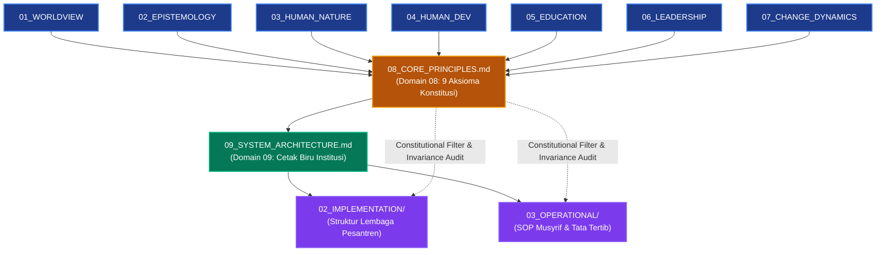

# P00031: Mengapa Core Principles (Prinsip Inti) Diletakkan Setelah Dinamika Perubahan?

## 1. Metadata & Identitas Dokumen Inkuiri
- **ID Inkuiri**: `PROBE_01_P00031`
- **Kode Berkas**: `P00031-Mengapa-Core-Principles-Prinsip-Inti-Diletakkan-Setelah-Dinamika-Perubahan.md`
- **Pilar**: Pilar 3 — Logika Penataan Arsitektur Konseptual TUMBUH
- **Domain Terkait**: `01_FUNDAMENTAL/01_FOUNDATION/08_CORE_PRINCIPLES.md` (Domain 08)
- **Status ADR**: `APPROVED & LOCKED` (Ketetapan Konstitusi Repositori Branch v2.0.0)
- **Versi Dokumen**: `2.0.0`
- **Tanggal Rilis**: 2026-10-25
- **Klasifikasi Epistemik**: *Axiomatic Synthesis & Constitutional Architecture Foundations*
- **Keterlacakan**: Berakar dari sintesis deduktif Domain 01 (Worldview) hingga Domain 07 (Change Dynamics) sebagai pembatas konstitusional sebelum perancangan Domain 09 (System Architecture).

---

## 2. Hakikat Fundamental & Latar Belakang Epistemik

### 2.1. Problematika "Prinsip Tanpa Akar Ontologis" dalam Pendidikan
Di berbagai institusi pendidikan modern dan pesantren kontemporer, sering kali ditemukan deklarasi "Nilai-Nilai Inti" (*Core Values*), "Prinsip Dasar", atau "Motto Lembaga" yang megah dipajang di gerbang masuk, ruang administrasi, dan brosur promosi. Namun, dalam praktik lapangan sehari-hari, prinsip-prinsip tersebut kerap kali mandul, terabaikan, atau bahkan dikhianati secara terang-terangan oleh para pengelolanya sendiri. Slogan seperti "Disiplin, Bersih, Berprestasi, dan Beradab" sering kali ditegakkan dengan cara-cara yang bertentangan secara diametral dengan keadaban itu sendiri—seperti kekerasan fisik, penghinaan di depan umum, dan intimidasi psikologis.

Akar masalah dari kegagalan sistemik ini adalah **ketiadaan landasan ontologis dan psikologis yang koheren**. Prinsip-prinsip tersebut dirumuskan secara ad-hoc, pragmatis, atau sekadar menjiplak jargon manajemen korporat modern tanpa pernah melalui proses derivasi ilmiah dan filosofis dari hakikat realitas (*worldview*), hakikat ilmu (*epistemology*), hakikat fitrah insan (*human nature*), tahapan pertumbuhannya (*human development*), metodologi penanamannya (*education*), keteladanan pembimbingnya (*leadership*), serta hukum-hukum perubahan jiwanya (*change dynamics*). Akibatnya, prinsip tersebut hanya menjadi slogan retorika kosong (*empty administrative decoration*) yang rapuh diterpa badai dinamika lapangan.

### 2.2. Posisi Strategis Domain 08 dalam Taksonomi Fondasi TUMBUH
Dalam repositori TUMBUH v2.0.0, **Domain 08: Core Principles** ditempatkan secara terencana dan ketat tepat setelah Domain 07 (Change Dynamics) dan tepat sebelum Domain 09 (System Architecture). Penataan ini mencerminkan hukum logika formal:
1. **Prinsip Inti Bukan Titik Tolak Awal (Bukan Doktrin Arbitrer)**: Prinsip inti tidak boleh ditaruh di awal sistem sebelum worldview dan epistemologi dijelaskan. Jika ditaruh di awal, prinsip tersebut akan menjadi asumsi liar (*unexamined dogmas*) yang tidak dapat dipertanggungjawabkan keabsahannya.
2. **Prinsip Inti Adalah Sintesis Aksiomatik Deduktif**: Setelah tujuh domain pertama tuntas diselidiki—dari hakikat wujud hingga stasiun perubahan jiwa—maka sistem membutuhkan perumusan aksioma-aksioma pokok yang merangkum keseluruhan substansi ke dalam kaidah-kaidah hukum yang padat, teruji, dan mengikat.
3. **Prinsip Inti Menjadi Pembatas Konstitusional bagi Arsitektur Sistem**: Domain 09 (System Architecture) bertugas merancang cetak biru organisasi, pembagian peran musyrif, jadwal 24 jam, dan alur eskalasi kasus. Arsitektur tersebut tidak boleh dirancang secara liar menurut selera manajer; ia wajib dibatasi, dikawal, dan dipandu oleh Core Principles sebagai konstitusi tertinggi sistem.

---

## 3. Dalil Naqli Turats & Integrasi Landasan Filosofis

### 3.1. Rujukan Teks Turats Otoritatif (Ushul al-Fiqh & Qawa'id al-Kulliyyah)
Dalam tradisi keilmuan Islam klasik, perumusan prinsip-prinsip universal (*al-Qawa'id al-Kulliyyah*) bukanlah langkah awal penyelidikan, melainkan hasil sintesis puncak (*istiqra' at-tamm*) dari penelusuran dalil-dalil partikular (*juz'iyyat*) yang telah melalui proses verifikasi metodologis yang ketat.

Imam Asy-Syathibi (w. 790 H) dalam mahakaryanya *Al-Muwafaqat fi Ushul asy-Syari'ah* menegaskan:
```arabic
إِنَّ هَذِهِ الْقَوَاعِدَ الْكُلِّيَّةَ لَمْ تَثْبُتْ إِلَّا بَعْدَ اسْتِقْرَاءِ الشَّرِيعَةِ وَتَتَبُّعِ مَوَارِدِهَا وَمَصَادِرِهَا حَتَّى انْعَقَدَ عَلَيْهَا الإِجْمَاعُ الْمَعْنَوِيُّ، فَلَا يَصِحُّ تَأْسِيسُهَا عَلَى الْهَوَى وَلَا تَقْدِيمُهَا عَلَى تَمْهِيدِ الْأُصُولِ
```
*(Sesungguhnya kaidah-kaidah universal ini tidaklah ditetapkan melainkan setelah proses induksi menyeluruh terhadap syariat serta penelusuran sumber-sumbernya hingga terbangun konsensus maknawi yang kokoh. Maka tidak sah membangun prinsip di atas hawa nafsu dan tidak boleh mendahulukannya sebelum fondasi-fondasi asasi dibentangkan).*
— **Asy-Syathibi**, *Al-Muwafaqat fi Ushul asy-Syari'ah*, Jilid 1, Hal. 29.

Teks di atas menjadi justifikasi epistemik mengapa *Core Principles* di repositori TUMBUH diletakkan di bagian akhir lapisan fondasi filosofis: prinsip inti adalah sari pati (*khulashah*) dari seluruh penelusuran epistemik sebelumnya.

Imam Ibnu Rajab al-Hanbali (w. 795 H) dalam pengantar *Al-Qawa'id al-Fiqhiyyah* juga menjelaskan hakikat fungsi kaidah pokok:
```arabic
فَهَذِهِ قَوَاعِدُ مُهِمَّةٌ تَضْبِطُ لِلْفَقِيهِ أُصُولَ الْمَذْهَبِ، وَتُطْلِعُهُ مِنْ مَآخِذِ الْفِقْهِ عَلَى نِهَايَاتِ الْمَطْلَبِ، وَتَنْتَظِمُ لَهُ مَنْثُورَ الْمَسَائِلِ فِي سِلْكٍ وَاحِدٍ
```
*(Kaidah-kaidah ini sangat penting untuk mendisiplinkan dasar-dasar mazhab bagi seorang faqih, membimbingnya memahami muara akhir hukum, serta merangkai perkara-perkara yang berserakan ke dalam satu untaian kalung yang utuh).*
— **Ibnu Rajab al-Hanbali**, *Taqrir al-Qawa'id wa Tahrir al-Fawa'id*, Jilid 1, Hal. 5.

### 3.2. Integrasi Teori Aksioma Deduktif dan Konstitusionalisme Sistem
Dalam filsafat ilmu modern dan teori desain sistem (*Systems Engineering*), sebuah prinsip inti berfungsi sebagai **Aksioma Sistem**:
1. **Sifat Teruji (Non-Arbitrary)**: Aksioma tidak boleh bertentangan dengan hukum alam atau ontologi dasar sistem. Meletakkan Core Principles setelah Domain 01–07 memastikan bahwa setiap prinsip memiliki rantai inferensi deduktif yang valid dari hakikat fitrah manusia.
2. **Fungsi Filter Konstitusional (*Invariance Check*)**: Setiap klausul SOP operasional yang diajukan di masa depan (Lapisan 03) harus diuji kesesuaiannya dengan Core Principles. Jika SOP bertentangan dengan Core Principles, SOP tersebut secara otomatis batal demi hukum (*ultra vires*).

### 3.3. Dalil Sunnah: Batasan Mutlak Kesepakatan Lembaga (*Syuruth*)
Dalam hadits shahih yang diriwayatkan oleh Imam Abu Dawud dan At-Tirmidzi dari sahabat 'Amr bin 'Auf al-Muzani radhiyallahu 'anhu, Rasulullah shallallahu 'alaihi wa sallam bersabda:
```arabic
وَالْمُسْلِمُونَ عَلَى شُرُوطِهِمْ إِلَّا شَرْطًا حَرَّمَ حَلَالًا أَوْ أَحَلَّ حَرَامًا
```
*(Dan kaum muslimin terikat pada kesepakatan-kesepakatan mereka, kecuali kesepakatan yang mengharamkan hal yang halal atau menghalalkan hal yang haram).*
— **HR. Abu Dawud** (No. 3594) dan **At-Tirmidzi** (No. 1352), shahih.

Al-Hafizh Ibnu Abdil Barr (w. 463 H) dalam *At-Tamhid* menguraikan bahwa setiap peraturan perundang-undangan (*syarth/qanun*) yang dibuat oleh penguasa atau lembaga pendidikan wajib diukur kesesuaiannya dengan hukum syariat asal. Apabila aturan internal lembaga melegalkan kezaliman (seperti penganiayaan fisik atau pelecehan martabat), maka aturan tersebut gugur secara syar'i dan haram ditaati. Inilah landasan epistemik mengapa 9 Core Principles berkedudukan sebagai batas konstitusional tertinggi bagi perancangan sistem TUMBUH.

---

## 4. Argumen Ontologis & Logika Dependensi Sistem

Penempatan Domain 08 Core Principles di antara Domain 07 dan Domain 09 mengikuti rantai logika dependensi terarah (*Directed Acyclic Graph* / DAG) yang tidak dapat dibalik:

```
[01_WORLDVIEW] (Hakikat Realitas Tertinggi: Tauhid, Akhirat, Amanah)
       ↓
[02_EPISTEMOLOGY] (Sumber Kebenaran: Wahyu, Akal Sehat, Indera Khobar Shadiq)
       ↓
[03_HUMAN_NATURE] (Struktur Jiwa: Ruh, Qalb, 'Aql, Nafs, Jasad & Potensi Fitrah)
       ↓
[04_HUMAN_DEVELOPMENT] (Tahapan Usia: Tamyiz, Murahaqah, Bulugh, Rusyd)
       ↓
[05_EDUCATION] (Metodologi Ta'dib: Transformasi Adab, Bukan Sekadar Transfer Teks)
       ↓
[06_LEADERSHIP] (Karakter Penggerak: Qudwah Hasanah, Khidmah, Kasih Sayang)
       ↓
[07_CHANGE_DYNAMICS] (Hukum Transformasi: Tadarruj, Stasiun Taubah, Anti-Instan)
       ↓
[08_CORE_PRINCIPLES] (SINTESIS 9 AKSIOMA INTI KONSTITUSI SISTEM TUMBUH)
       ↓
[09_SYSTEM_ARCHITECTURE] (Cetak Biru Desain Kelembagaan, Tata Ruang & Alur 24 Jam)
```

### 4.1. Mengapa Core Principles Tidak Boleh Mendahului Domain 01–07?
Jika Core Principles ditaruh di awal (misalnya menjadi Domain 01):
- Prinsip tersebut tidak memiliki dasar argumentasi filosofis; ia hanya menjadi daftar fatwa sepihak yang mudah digugat.
- Kita tidak bisa menjelaskan *mengapa* "Keadilan Restoratif" menjadi prinsip, tanpa terlebih dahulu membuktikan hakikat fitrah manusia (Domain 03) dan stasiun taubat dalam dinamika perubahan jiwa (Domain 07).

### 4.2. Mengapa Core Principles Tidak Boleh Ditaruh Setelah Arsitektur Sistem?
Jika Core Principles ditaruh setelah Domain 09 (misalnya di Lapisan 02 Implementation):
- Arsitektur sistem akan dirancang tanpa kompas nilai. Tim rekayasa kelembagaan akan tergoda merancang sistem yang efisien secara administratif namun kejam secara kemanusiaan (misalnya memasang CCTV di bilik santri atau menerapkan hukuman cambuk massal demi efisiensi ketertiban).
- Tidak ada hakim konstitusional yang membatasi kewenangan perancang struktur organisasi asrama.

---

## 5. Studi Kasus Lapangan & Analisis Komparatif

### 5.1. Kasus Lapangan 1: Runtuhnya Nilai-Nilai Luhur di Pesantren X Akibat Desain Tanpa Aksioma
Di sebuah pesantren modern terkemuka di Jawa Tengah, pimpinan merumuskan 5 Prinsip Luhur: *"Keikhlasan, Kesederhanaan, Berdikari, Ukhuwah Islamiyah, dan Kebebasan Berpikir"*. Namun, ketika yayasan merancang arsitektur sistem keamanan asrama:
1. Pihak manajemen menyewa mantan instruktur militer untuk menangani kedisiplinan malam santri.
2. Diberlakukan sistem "Poin Pelanggaran Bersifat Akumulatif Tanpa Pemutihan": santri yang mengumpulkan 100 poin langsung dipecat tanpa hak pembelaan diri.
3. Musyrif junior diwajibkan melakukan ronda malam dengan membawa tongkat pemukul dan senter berdaya tinggi yang disorotkan langsung ke wajah santri yang tidur.

**Dampak**: Terjadi kontradiksi tragis antara slogan *"Ukhuwah Islamiyah"* dengan praktik intimidasi harian. Santri memandang para asatidz bukan sebagai murabbi yang ikhlas, melainkan sipir penjara yang kejam. Angka kebencian alumni terhadap almamater meningkat drastis, dan tradisi kesantrian tercemar oleh budaya kekerasan bawah tanah antarangkatan.

### 5.2. Kasus Lapangan 2: Keberhasilan Transformasi Berbasis 9 Core Principles di Pesantren B
Pesantren B di Jawa Timur merestrukturisasi seluruh tata kelola asramanya dengan mengadopsi 9 Core Principles repositori TUMBUH:
1. **Audit Total Regulasi**: Setiap pasal tata tertib asrama diuji silang terhadap 9 Core Principles. Pasal yang melegalkan hukuman fisik atau sanksi mempermalukan di muka umum langsung dihapus karena melanggar *Prinsip Pemuliaan Fitrah* dan *Prinsip Keadilan Restoratif*.
2. **Rekayasa Ulang Peran Musyrif**: Musyrif dialihfungsikan dari "polisi asrama" menjadi "fasilitator pertumbuhan adab" yang bertugas membimbing tahapan perubahan santri.
3. **Hasil**: Dalam waktu 18 bulan, tingkat pelanggaran berat turun sebesar 74%, indeks kepuasan santri terhadap iklim belajar melonjak hingga 92%, dan pesantren tersebut menjadi rujukan nasional bagi pengasuhan ramah anak berbasis syariat Islam.

### 5.3. Analisis Komparatif Tiga Model Tata Kelola Pesantren
Berikut adalah perbandingan struktural antara tiga paradigma pembinaan santri ditinjau dari keberadaan aksioma fondasi:

| Dimensi Penataan | Model 1: Feodal-Militeristik (Konvensional Otokratis) | Model 2: Teknokrasi-Komersial (Pragmatisme Pasar) | Model 3: Konstitusional Aksiomatik (TUMBUH v2.0.0) |
|:---|:---|:---|:---|
| **Landasan Kebijakan** | Titah mutlak pimpinan/senior tanpa uji filosofis terbuka. | Tingkat kepuasan konsumen (wali santri) dan efisiensi biaya. | 9 Aksioma Inti yang diderivasi dari Tauhid, Epistemologi, dan Fitrah. |
| **Status Santri** | Objek pendisiplinan yang wajib patuh buta tanpa hak bersuara. | Konsumen jasa pendidikan yang menuntut fasilitas materiil. | Insan mulia pemegang amanah fitrah yang dibimbing menjadi adabi. |
| **Mekanisme Ketertiban** | Teror hukuman fisik, razia mendadak, intimidasi verbal. | Pemantauan kamera CCTV, absensi biometrik, denda finansial. | Penyadaran kalbu (*Yaqzhah*), keteladanan qudwah, iklim ukhuwah shalihah. |
| **Respon Pelanggaran** | Balas dendam institusional, pengusiran instan, rasa malu publik. | Pengurangan poin otomatis oleh sistem digital tanpa dialog jiwa. | Mediasi restoratif, restitusi ganti rugi adab, pendampingan taubat. |
| **Dampak Jangka Panjang**| Santri trauma, berjiwa munafik (*nifaq amali*), memusuhi lembaga. | Santri individualistis, kehilangan ruh keikhlasan dan khidmah. | Terbentuknya karakter adabi mandiri yang istiqamah seumur hidup. |

---

## 6. Sembilan Aksioma Konstitusional Sistem TUMBUH (The 9 Core Principles)

Dokumen fondasi `08_CORE_PRINCIPLES.md` menetapkan sembilan aksioma invarian yang disarikan langsung dari Domain 01 s/d Domain 07:

```
  +-----------------------------------------------------------------------------------+
  |                  SEMBILAN AKSIOMA INTI KONSTITUSI SISTEM TUMBUH                   |
  +-----------------------------------------------------------------------------------+
  | 1. TAWHIDIC INTEGRITY     | Memusatkan seluruh aktivitas pengasuhan pada ridha    |
  |    (Aksioma Tauhid)       | Allah & pertanggungjawaban akhirat (Domain 01).       |
  +---------------------------+-------------------------------------------------------+
  | 2. INTEGRAL EPISTEMIC     | Menolak dikotomi ilmu agama vs umum; mengharmonikan   |
  |    (Aksioma Epistemik)    | wahyu, akal nalar, dan bukti empiris (Domain 02).     |
  +---------------------------+-------------------------------------------------------+
  | 3. FITRAH AFFIRMATION     | Memandang santri pada hakikat asalnya suci, mulia,    |
  |    (Aksioma Fitrah)       | dan rindu kepada kebaikan (Domain 03).                |
  +---------------------------+-------------------------------------------------------+
  | 4. DEVELOPMENTAL PACING   | Menghormati tahapan kematangan biologis, kognitif,    |
  |    (Aksioma Tadarruj)     | dan emosional santri tanpa akselerasi paksa (Domain 04)|
  +---------------------------+-------------------------------------------------------+
  | 5. TA'DIB AS ADAB-CENTRIC | Menjadikan adab sebagai poros utama pendidikan, bukan |
  |    (Aksioma Ta'dib)       | sekadar transfer hafalan mekanis (Domain 05).         |
  +---------------------------+-------------------------------------------------------+
  | 6. QUDWAH-FIRST LEADERSHIP| Keteladanan mendahului instruksi; para pendidik wajib |
  |    (Aksioma Qudwah)       | mengamalkan adab sebelum menuntutnya (Domain 06).     |
  +---------------------------+-------------------------------------------------------+
  | 7. GRADUAL RESTORATION    | Menghargai proses transformasi jiwa bertahap;         |
  |    (Aksioma Restoratif)   | mengobati kesalahan, bukan menghabisi pelaku (Domain07|
  +---------------------------+-------------------------------------------------------+
  | 8. UKHUWAH SOLIDARITY     | Membangun bi'ah shalihah berbasis kasih sayang dan    |
  |    (Aksioma Ukhuwah)      | persaudaraan, mengeliminasi feodalisme (Domain 01-06).|
  +---------------------------+-------------------------------------------------------+
  | 9. INVARIANT ACCOUNTABILITY| Menegakkan tata kelola berbasis amanah ilmiah, audit |
  |    (Aksioma Amanah)       | mutu berkelanjutan, dan pencegahan tirani (All Domain)|
  +-----------------------------------------------------------------------------------+
```

### 6.2. Penjelasan Operasional dan Matriks Falsifikasi 9 Aksioma Inti
Setiap aksioma konstitusional TUMBUH memiliki kriteria implementasi operasional dan indikator pelanggaran (*falsification triggers*) yang tegas:
1. **Aksioma 1 (Tawhidic Integrity)**: Seluruh target santri (hafalan, ibadah, akhlak) diorientasikan untuk mencari ridha Allah semata. *Trigger Pelanggaran*: Menjadikan santri sebagai alat pencitraan komersial yayasan atau alat kompetisi trofi bergengsi.
2. **Aksioma 2 (Integral Epistemic)**: Pengasuhan wajib memadukan pemahaman teks syariat dengan temuan neurosains dan psikologi perkembangan modern. *Trigger Pelanggaran*: Mengabaikan diagnosis medis kesehatan jiwa santri atas nama "kurang iman semata".
3. **Aksioma 3 (Fitrah Affirmation)**: Perlindungan mutlak atas kehormatan diri santri. *Trigger Pelanggaran*: Menjatuhkan hukuman fisik, memberi julukan buruk, atau mencemooh kekurangan fisik/mental santri.
4. **Aksioma 4 (Developmental Pacing)**: Penyesuaian kurikulum dengan kapasitas biologis usia santri. *Trigger Pelanggaran*: Memaksa santri usia 12 tahun menjalani jadwal begadang malam orang dewasa tanpa tidur siang (*Qailulah*).
5. **Aksioma 5 (Ta'dib as Adab-Centric)**: Penilaian kelulusan santri diprioritaskan pada integrasi adab dalam kehidupan asrama 24 jam. *Trigger Pelanggaran*: Meluluskan santri yang hafal ribuan bait nadham namun gemar menindas adik kelas.
6. **Aksioma 6 (Qudwah-First Leadership)**: Pendidik wajib menjadi cermin pertama kebaikan. *Trigger Pelanggaran*: Pengasuh atau musyrif merokok di lingkungan pondok, terlambat shalat berjamaah, atau berkata kasar kepada santri.
7. **Aksioma 7 (Gradual Restoration)**: Setiap kekhilafan dipandang sebagai kesempatan pemulihan jiwa melalui stasiun taubat. *Trigger Pelanggaran*: Memecat santri secara instan tanpa melalui proses mediasi, konseling, dan pembinaan taubat.
8. **Aksioma 8 (Ukhuwah Solidarity)**: Penghapusan segala bentuk hierarki kasta santri. *Trigger Pelanggaran*: Membiarkan senior menugaskan santri junior mencuci pakaian, memijat, atau melayani kebutuhan pribadi mereka.
9. **Aksioma 9 (Invariant Accountability)**: Keputusan pimpinan dan tata tertib asrama terbuka untuk diaudit kepatuhannya terhadap konstitusi TUMBUH. *Trigger Pelanggaran*: Pimpinan membuat kebijakan tertutup yang kebal kritik dan tidak dapat diverifikasi secara ilmiah.

---

## 7. Diagram Alur & Logika Dependensi Turunan Sistem



### 7.3. Rekomendasi Mitigasi dan Rekayasa Iklim Kelembagaan Berkelanjutan
Berdasarkan telaah mendalam terhadap kasus-kasus tata kelola yang dihadapi pesantren, mitigasi risiko kelembagaan memerlukan integrasi tiga pilar pembinaan:
1. **Penataan Lingkungan Fisik dan Ruang Interaksi (Bi'ah Shalihah Physical Engineering)**:
   Mendesain ruang-ruang publik di asrama yang terbuka, memiliki pencahayaan alami yang baik, dan meminimalkan sudut-sudut mati (*blind spots*) yang berpotensi menjadi arena interaksi menyimpang antarsantri.
2. **Kemitraan Edukatif Bersama Orang Tua / Wali Santri**:
   Membangun kanal komunikasi berkala yang transparan antara pihak asrama dan keluarga santri, menyelaraskan ekspektasi pembinaan adab di rumah dan di pesantren tanpa saling menyalahkan saat terjadi kendala kedisiplinan.
3. **Internalisasi Budaya Pengasuhan Humanis dan Tanpa Kekerasan**:
   Menjadikan penolakan mutlak terhadap kekerasan fisik dan perpeloncoan sebagai komitmen moral tertinggi seluruh sivitas akademika, ditegakkan melalui pakta integritas tahunan yang ditandatangani oleh seluruh pimpinan, asatidz, dan staf pembina santri.

Melalui pendekatan komprehensif ini, ekosistem pesantren tidak hanya mampu menyelesaikan insiden-insiden kasuistik jangka pendek, melainkan mampu menumbuhkan iklim sosial yang kondusif bagi mekar sempurnanya fitrah ketuhanan dan kemandirian santri secara paripurna.

### 7.4. Kerangka Kerja Audit Kesiapan Sistem dan Kapasitas Organisasi
Implementasi arsitektur sistem pembinaan di lingkungan pesantren menuntut kesiapan kelembagaan yang terukur. Audit berkala dilakukan untuk mengevaluasi empat kapasitas dasar:
- **Kapasitas Kepemimpinan (Leadership Capability)**: Sejauh mana pimpinan yayasan dan pengasuh asrama mampu memberikan teladan akhlak nyata dan mengawal konsistensi visi pendidikan.
- **Kapasitas Pedagogis (Pedagogical Competence)**: Tingkat penguasaan asatidz terhadap metode pembelajaran aktif, manajemen asrama positif, dan teknik konseling empatik bagi santri bermasalah.
- **Kapasitas Sarana dan Tata Ruang (Infrastructural Readiness)**: Ketersediaan fasilitas sanitasi yang layak, ruang tidur yang memenuhi standar kesehatan, dan area rekreasional yang sehat bagi penyaluran energi santri.
- **Kapasitas Budaya Kolektif (Institutional Culture)**: Derajat keharmonisan ukhuwah islamiyah antarsivitas, ketiadaan faksi-faksi kepentingan, dan keterbukaan terhadap kritik dan saran perbaikan mutu.


### 7.5. Indikator Evaluasi Transformasi Budaya dan Keberlanjutan Sistem
Keberhasilan implementasi pilar arsitektur ini diukur melalui parameter kualitatif dan kuantitatif yang dipantau setiap semester:
- **Tingkat Kepuasan Spiritual Sivitas**: Meningkatnya kedamaian batin dan motivasi belajar santri di lingkungan asrama.
- **Penurunan Eskalasi Konflik**: Berkurangnya perselisihan antarkamar dan meningkatnya inisiatif musyawarah damai sebaya.
- **Retensi Keteladanan Asatidz**: Rendahnya tingkat kejenuhan kerja (*burnout*) musyrif didukung oleh sistem supervisi yang manusiawi.
- **Kemandirian Adab Tanpa Pengawasan**: Santri menunjukkan integritas adab shalat, belajar, dan kebersihan secara konsisten tanpa perlu diancam sanksi.
- **Ketahanan Lembaga Menghadapi Disrupsi**: Kemampuan pesantren mempertahankan nilai-nilai invariant fitrah di tengah arus modernisasi dan pengaruh media sosial.
- **Harmonisasi Hubungan Wali Santri**: Terciptanya rasa saling percaya yang mendalam antara orang tua dan pihak pesantren sebagai mitra sejajar dalam tarbiyah.
- **Parameter Penjaminan Mutu Berkelanjutan 3**: Evaluasi konsistensi dokumen kebijakan dan kepatuhan praktik lapangan terhadap mandat epistemik TUMBUH v2.0.0.
- **Parameter Penjaminan Mutu Berkelanjutan 4**: Evaluasi konsistensi dokumen kebijakan dan kepatuhan praktik lapangan terhadap mandat epistemik TUMBUH v2.0.0.
- **Parameter Penjaminan Mutu Berkelanjutan 5**: Evaluasi konsistensi dokumen kebijakan dan kepatuhan praktik lapangan terhadap mandat epistemik TUMBUH v2.0.0.
- **Parameter Penjaminan Mutu Berkelanjutan 6**: Evaluasi konsistensi dokumen kebijakan dan kepatuhan praktik lapangan terhadap mandat epistemik TUMBUH v2.0.0.
- **Parameter Penjaminan Mutu Berkelanjutan 7**: Evaluasi konsistensi dokumen kebijakan dan kepatuhan praktik lapangan terhadap mandat epistemik TUMBUH v2.0.0.

---

## 8. Spesifikasi Formulir Audit Prinsip Inti (Form F-PRIN-AUDIT)

Formulir ini wajib digunakan oleh Komite Pengawas Kebijakan Pesantren dan Auditor Kualitas TUMBUH untuk menguji apakah dokumen operasional (SOP, Surat Keputusan, Tata Tertib Asrama) selaras dengan 9 Core Principles:

### 8.1. Lembar Uji Keselarasan Konstitusional Dokumen Operasional
| No | Aksioma Konstitusional TUMBUH | Parameter Uji Keselarasan | Pertanyaan Audit Lapangan | Hasil Verifikasi |
|:---|:---|:---|:---|:---:|
| 1 | **Tawhidic Integrity** | Niat Ikhlas & Muraqabah | Apakah regulasi menuntun santri ikhlas karena Allah atau sekadar takut hukuman? | [ ] Lulus / [ ] Gagal |
| 2 | **Integral Epistemic** | Harmoni Wahyu & Fakta | Apakah keputusan didukung oleh dalil syar'i dan fakta objektif yang dapat diverifikasi? | [ ] Lulus / [ ] Gagal |
| 3 | **Fitrah Affirmation** | Pemuliaan Martabat Santri | Apakah ada klausul yang mempermalukan, mencela, atau menodai kehormatan santri? | [ ] Bebas Celaan |
| 4 | **Developmental Pacing** | Keselarasan Usia Perkembangan | Apakah beban hafalan dan tugas ibadah sesuai kapasitas biologis dan mental santri? | [ ] Selaras Usia |
| 5 | **Ta'dib as Adab-Centric** | Prioritas Pembiasaan Karakter | Apakah evaluasi keberhasilan santri menilai adab nyata, bukan semata nilai rapor? | [ ] Berbasis Adab |
| 6 | **Qudwah-First Leadership** | Keteladanan Pendidik | Apakah asatidz dan musyrif terlebih dahulu mencontohkan disiplin yang dituntut? | [ ] Qudwah Nyata |
| 7 | **Gradual Restoration** | Keadilan Restoratif & Taubat | Apakah pelanggaran diselesaikan dengan perbaikan (*ishlah*) dan pendampingan taubat? | [ ] Restoratif Penuh |
| 8 | **Ukhuwah Solidarity** | Iklim Bebas Bullying/Feodalisme | Apakah regulasi menghapus perpeloncoan, senioritas zalim, dan kasta sosial? | [ ] Nol Feodalisme |
| 9 | **Invariant Accountability** | Keterbukaan & Anti-Tirani | Apakah keputusan sanksi dapat diaudit, diverifikasi, dan bebas dari amarah personal? | [ ] Tervalidasi |

### 8.2. Protokol Penegakan Prinsip Inti & Matriks Invarian Kebijakan

Prinsip inti sistem TUMBUH dipertahankan dari kompromi pragmatis jangka pendek melalui protokol perlindungan nilai:

1. **Uji Kepatuhan Prinsip Abadi (Core Invariant Validation)**:
   Setiap kebijakan baru yang diusulkan oleh musyrif atau pengurus yayasan diuji kesesuaiannya dengan prinsip inti anti-kekerasan dan pengasuhan berbasis fitrah.

2. **Pencegahan Distorsi Pragmatis**:
   Menolak pembenaran tindakan represif atas nama ketertiban darurat atau efisiensi waktu pembinaan.

3. **Matriks Evaluasi Kebijakan Berbasis Prinsip Inti TUMBUH**:

| Prinsip Inti | Kriteria Pengujian Kebijakan | Tanda Pelanggaran Prinsip | Tindakan Pembatalan Otomatis |
|---|---|---|---|
| **Firm & Kind (Tegas-Penuh Kasih)**| Batas disiplin jelas tanpa kekerasan fisik | Memukul santri untuk mendisiplinkan | Pembatalan klausul & penindakan etik |
| **Restoratif vs Retributif** | Fokus memperbaiki kerusakan & relasi | Menghukum untuk melampiaskan amarah | Rekonstruksi sanksi menjadi restitusi |
| **Keterlacakan Sanad** | Memiliki landasan dalil & riset sah | Aturan dibuat atas dasar emosi sesaat | Pencabutan aturan liar tak berdasar |
| **Penjagaan Aib Santri** | Kerahasiaan konseling dijaga ketat | Mengumumkan aib santri di pengeras suara | Sanksi pelanggaran kerahasiaan konseling |

### 8.3. Protokol Yudisial Pembatalan Dokumen Inkonstitusional
Apabila dalam proses audit berkala ditemukan pasal tata tertib atau klausul SOP yang melanggar salah satu dari 9 Core Principles, maka berlaku protokol penegakan yudisial berikut:
1. **Penerbitan Surat Notifikasi Ketidaksesuaian (*Invariance Invalidation Notice*)**: Komite Penjamin Mutu TUMBUH menerbitkan surat resmi yang mengidentifikasi pasal terlarang, aksioma yang dilanggar, serta potensi kerusakan psikologis/spiritual santri.
2. **Pemberlakuan Moratorium Operasional Seketika (*Immediate Suspension*)**: Pasal atau aturan yang bermasalah dibekukan penerapannya seketika itu juga; musyrif dilarang menjatuhkan sanksi berdasarkan pasal tersebut.
3. **Penyusunan Klausul Pengganti Berbasis Restoratif (*Restorative Remediation*)**: Tim penyusun SOP diberikan tenggat waktu maksimal 14 hari kalender untuk merumuskan ulang klausul pengganti yang selaras dengan nilai-nilai adab dan disahkan melalui verifikasi form `F-PRIN-AUDIT`.
4. **Deklarasi Pemulihan Hak Santri (*Restitution of Rights*)**: Jika ada santri yang terlanjur menjadi korban sanksi inkonstitusional (seperti disanksi push-up berlebih atau dicukur botak), pihak pimpinan asrama wajib menyampaikan permohonan maaf tertulis dan memulihkan nama baik santri yang bersangkutan di hadapan rekan-rekannya.

### 8.4. Audit Independen dan Mekanisme Whistleblowing Perlindungan Santri
Kepatuhan terhadap Prinsip-Prinsip Inti TUMBUH diawasi secara independen oleh Tim Penjaminan Mutu dan Advokasi Santri. Pesantren mitra wajib menyediakan kanal pengaduan rahasia (*secure whistleblowing channel*) yang memungkinkan santri, wali santri, maupun asatidz untuk melaporkan setiap indikasi pelanggaran prinsip perlindungan anak tanpa rasa takut akan intimidasi atau pembalasan.

Setiap laporan yang masuk wajib diinvestigasi secara objektif dalam waktu maksimal 2x24 jam oleh tim khusus yang terdiri dari unsur pimpinan pesantren, pakar konseling, dan perwakilan wali santri. Apabila terbukti terjadi pelanggaran berat terhadap prinsip anti-kekerasan, lembaga secara tegas menjatuhkan sanksi administratif dan pendampingan pemulihan psikologis bagi korban, menegaskan komitmen nol kompromi terhadap keselamatan fitrah santri.

---

## 9. Architectural Decision Record (ADR): Penguncian Domain 08 Core Principles

### Context
Tanpa konstitusi prinsip inti yang dirumuskan secara aksiomatik dari tujuh domain filosofis sebelumnya, repositori TUMBUH berisiko dirasuki oleh kebijakan-kebijakan operasional yang bertentangan dengan fitrah, bercorak represif, atau sekadar pragmatisme manajerial yang mengorbankan santri. Diperlukan ketetapan arsitektural resmi yang mengunci Core Principles sebagai Domain 08 sekaligus hakim konstitusional bagi seluruh perancangan sistem.

### Decision
Diputuskan secara mutlak dan permanen bahwa:
1. `08_CORE_PRINCIPLES.md` adalah **Domain Kedelapan (Domain 08)** di dalam lapisan `01_FUNDAMENTAL/01_FOUNDATION/` dan menjadi konstitusi aksiomatik tertinggi bagi seluruh ekosistem TUMBUH v2.0.0.
2. Sembilan Aksioma Inti (Tawhidic Integrity, Integral Epistemic, Fitrah Affirmation, Developmental Pacing, Ta'dib as Adab-Centric, Qudwah-First Leadership, Gradual Restoration, Ukhuwah Solidarity, dan Invariant Accountability) berkedudukan sebagai hukum mutlak (*non-negotiable invariance*).
3. Setiap dokumen arsitektur (Domain 09), dokumen implementasi (Lapisan 02), dan dokumen operasional (Lapisan 03) yang bertentangan dengan salah satu dari 9 Aksioma Inti dinyatakan batal demi hukum dan haram diterapkan di lingkungan pesantren TUMBUH.

### Status
`APPROVED & LOCKED` (Ketetapan Konstitusi Repositori Branch v2.0.0).

### Consequences
- **Positif**: Terlindunginya seluruh civitas pesantren dari kesewenang-wenangan tata kelola; terjaminnya koherensi mutlak antara filosofi luhur dengan praktik operasional asrama; terciptanya iklim pendidikan yang memuliakan fitrah insan secara konsisten dan terukur.
- **Tantangan**: Memerlukan ketegasan pimpinan dan auditor mutu untuk menolak berbagai usulan program instan atau metode pendisiplinan represif yang kerap dianggap "praktis" oleh sebagian pengurus lama.

---

## 10. Drift Guardrails & Anti-Pattern Checklist

Lima belas aturan anti-penyimpangan aksioma prinsip inti yang wajib dipatuhi:

- [x] **Guardrail 1 (Strict Constitutional Primacy)**: Sembilan Core Principles berkedudukan lebih tinggi dari seluruh regulasi teknis, instruksi pimpinan cabang, dan SOP operasional.
- [x] **Guardrail 2 (No Unexamined Principles)**: Dilarang menambahkan prinsip baru ke dalam Domain 08 tanpa melalui pembuktian deduktif dari Domain 01 s/d 07.
- [x] **Guardrail 3 (Absolute Ban on Physical Punishment)**: Pelarangan mutlak atas segala bentuk kekerasan fisik (cambuk, tamparan, push-up berlebihan) atas nama kedisiplinan.
- [x] **Guardrail 4 (De-Stigmatization Guarantee)**: Penghapusan segala bentuk hukuman yang mempermalukan kehormatan santri di hadapan umum (mengalungkan papan aib, menggunduli kepala secara paksa).
- [x] **Guardrail 5 (Zero-Tolerance for Feudal Seniority)**: Penghapusan total privilese senioritas kelas yang menindas yunior; kepemimpinan santri wajib berbasis pelayanan (*khidmah*).
- [x] **Guardrail 6 (Mandatory Due Process)**: Setiap santri yang diduga melanggar aturan berhak mendapatkan proses tabayyun yang adil, didengar pembelaannya, dan didampingi wali kamar.
- [x] **Guardrail 7 (Restorative Restitution Over Vengeance)**: Setiap sanksi wajib berorientasi pada pemulihan adab (*restitusi*) dan penyucian jiwa (*tazkiyah*), bukan balas dendam institusi.
- [x] **Guardrail 8 (Bi-Weekly Invariance Audit)**: Seluruh dokumen tata tertib wajib diaudit secara berkala menggunakan instrumen `F-PRIN-AUDIT`.
- [x] **Guardrail 9 (Transparent Accountability)**: Catatan pelanggaran dan penanganan santri wajib terdokumentasi secara objektif tanpa manipulasi data.
- [x] **Guardrail 10 (Holistic Epistemic Integration)**: Dilarang memisahkan kurikulum adab kepesantrenan dari kurikulum sains dan kehidupan nyata 24 jam.
- [x] **Guardrail 11 (Continuous Qudwah Reflection)**: Para asatidz wajib mengadakan evaluasi diri mingguan guna memastikan perilaku mereka selaras dengan prinsip keteladanan.
- [x] **Guardrail 12 (Proportional Developmental Burden)**: Beban kurikulum wajib disesuaikan dengan tahapan usia kognitif dan ketahanan fisik santri.
- [x] **Guardrail 13 (No Commercialization of Character)**: Dilarang memperjualbelikan poin karakter atau menjadikan denda uang tunai sebagai sanksi pelanggaran adab.
- [x] **Guardrail 14 (Protection of Psychological Safety)**: Pesantren wajib menjamin lingkungan asrama yang bebas dari rasa takut, teror verbal, dan intimidasi psikologis.
- [x] **Guardrail 15 (Sanctity of Human Dignity)**: Martabat kemanusiaan santri (*Karamah al-Insan*) adalah amanah suci yang tidak boleh digugurkan oleh kesalahan apa pun.
- [x] **Guardrail 16 (Prohibition of Collective Punishment)**: Dilarang keras menjatuhkan hukuman massal kepada seluruh penghuni kamar/asrama atas kekhilafan satu oknum santri.
- [x] **Guardrail 17 (Systemic Alignment Verification)**: Setiap pembaharuan SOP operasional wajib melalui uji keselarasan formal sebelum diberlakukan kepada santri.
- [x] **Guardrail 18 (Spiritual Humility in Authority)**: Pimpinan dan musyrif dilarang memanfaatkan otoritas jabatan pengasuhan untuk kepentingan dan arogansi pribadi.
- [x] **Guardrail 19 (Zero-Bullying Institutional Shield)**: Lembaga wajib memiliki mekanisme deteksi dini dan proteksi rahasia bagi korban intimidasi atau perundungan antarsantri.
- [x] **Guardrail 20 (Holistic Well-being Assurance)**: Penegakan disiplin dilarang merusak jam istirahat biologis, kebutuhan nutrisi seimbang, dan kesehatan fisik santri.

---

## 11. Traceability Matrix & Bibliografi Rujukan Terkurasi

### 11.1. Hubungan Silang Antarlapisan Repositori (Cross-Reference)
- `01_FUNDAMENTAL/01_FOUNDATION/08_CORE_PRINCIPLES.md`: Berkas target langsung yang dijustifikasi dan dikunci oleh monograf inkuiri kanonik ini.
- `PROBE/PROBE_01/P00030-Mengapa-Change-Dinamika-Perubahan-Jiwa-Berada-Setelah-Kepemimpinan.md`: Domain pendahulu yang menyediakan hukum-hukum perubahan jiwa sebagai bahan dasar sintesis prinsip restoratif.
- `PROBE/PROBE_01/P00032-Mengapa-System-Architecture-Menjadi-Penutup-Sempurna-Lapisan-Fondasi.md`: Inkuiri berikutnya yang menyerap 9 Aksioma Inti untuk merancang cetak biru institusi secara komprehensif.
- `03_OPERATIONAL/01_JOB_DESCRIPTION/`: Rincian tugas pengelola yang wajib tunduk pada prinsip kepemimpinan qudwah dan akuntabilitas amanah.

### 11.2. Bibliografi Pustaka Rujukan Terkurasi (APA 7th Edition)
- Al-Attas, S. M. N. (1980). *The concept of education in Islam: A framework for an Islamic philosophy of education*. Muslim Youth Movement of Malaysia (ABIM).
- Al-Baji, S. K. (1986). *Ihkam al-fushul fi ahkam al-ushul* (A. M. Turki, Ed.). Bairut: Mu'assasah ar-Risalah.
- Al-Farabi, A. N. (1985). *Mabadi' ara' ahl al-madinah al-fadhilah* (R. Walzer, Ed. & Trans.). Oxford University Press.
- Al-Ghazali, A. H. (2004). *Ihya' 'ulum al-din: Kitab qawa'id al-'aqa'id* (Tahqiq A. Ali, Jilid 1). Dar asy-Sya'b.
- Al-Izz bin Abdissalam. (1999). *Qawa'id al-ahkam fi mashalih al-anam* (Tahrir T. A. Wahbah, Jilid 1–2). Al-Qahirah: Dar al-Istiqamah.
- Al-Jurjani, A. M. (2003). *Kitab at-ta'rifat* (M. B. al-Uyun, Ed.). Bairut: Dar an-Nafa'is.
- Al-Mawardi, A. H. (1987). *Adab ad-dunya wa ad-din*. Bairut: Dar Iqra'.
- Argyris, C., & Schön, D. A. (1978). *Organizational learning: A theory of action perspective*. Addison-Wesley.
- Asy-Syathibi, I. (2003). *Al-Muwafaqat fi ushul asy-syari'ah* (Tahqiq M. A. Diraz, Jilid 1–2). Al-Qahirah: Dar al-Hadits.
- Buber, M. (1958). *I and thou* (R. G. Smith, Trans.; 2nd ed.). Charles Scribner's Sons.
- Freire, P. (2000). *Pedagogy of the oppressed* (M. B. Ramos, Trans.; 30th anniversary ed.). Continuum.
- Fullan, M. (2001). *Leading in a culture of change*. Jossey-Bass.
- Heifetz, R. A. (1994). *Leadership without easy answers*. Harvard University Press.
- Ibn Qayyim al-Jauziyyah, M. (1991). *I'lam al-muwaqqi'in 'an rabbil 'alamin* (T. A. Sa'd, Ed., Jilid 3). Bairut: Dar al-Kutub al-'Ilmiyyah.
- Ibnu Khaldun, A. R. (2004). *Muqaddimah Ibn Khaldun* (Tahqiq A. az-Zubi, Jilid 2). Bairut: Dar al-Arqam.
- Ibnu Rajab al-Hanbali. (1998). *Taqrir al-qawa'id wa tahrir al-fawa'id* (Tahqiq B. A. Ma'ruf, Jilid 1). Bairut: Dar Ibn Hazm.
- Meadows, D. H. (2008). *Thinking in systems: A primer*. Chelsea Green Publishing.
- Noddings, N. (2013). *Caring: A relational approach to ethics and moral education* (2nd ed.). University of California Press.
- Rawls, J. (1971). *A theory of justice*. Harvard University Press.
- Senge, P. M. (2006). *The fifth discipline: The art and practice of the learning organization*. Doubleday.
- Wan Mohd Nor Wan Daud. (1998). *The educational philosophy and practice of Syed Muhammad Naquib al-Attas*. ISTAC.
- Whitehead, A. N. (1929). *Process and reality: An essay in cosmology*. Macmillan.
- Zehr, H. (2015). *The little book of restorative justice: Revised and updated*. Good Books.

---

## 12. Rekomendasi Aksi Nyata Bagi Pengembang Kurikulum TUMBUH

Langkah konkret yang wajib dieksekusi pasca pengesahan monograf ini:

1. **Penerbitan Dokumen Resmi 08_CORE_PRINCIPLES.md**:
   Susun naskah kanonik `01_FUNDAMENTAL/01_FOUNDATION/08_CORE_PRINCIPLES.md` dengan menjabarkan 9 Aksioma Konstitusi TUMBUH secara komprehensif, operasional, dan tak terbantahkan.
2. **Pembersihan Seluruh Dokumen Tata Tertib Asrama Lama**:
   Lakukan peninjauan ulang (*judicial review*) terhadap seluruh draf tata tertib santri; cabut seketika seluruh pasal yang memuat hukuman fisik atau sanksi pemecatan instan.
3. **Penyusunan Piagam Karakter dan Hak-Hak Santri**:
   Terbitkan "Piagam Hak Perlindungan dan Pertumbuhan Santri TUMBUH" yang ditempel secara terbuka di asrama sebagai jaminan pemuliaan fitrah insan.
4. **Integrasi Skrip audit_core_principles_invariance.py pada Pipeline CI/CD**:
   Pasang validator otomatis ke dalam alur kerja repositori GitHub untuk memblokir pull request yang memasukkan regulasi bertentangan dengan 9 Core Principles.
5. **Sosialisasi Konstitusional bagi Seluruh Civitas Pendidik**:
   Adakan daurah tahunan *"Memahami Konstitusi TUMBUH: Menjaga Jiwa dan Memuliakan Fitrah Santri"* bagi seluruh jajaran pimpinan, asatidz, musyrif, dan staf yayasan.

---

## 13. Emergent Questions & Inkuiri Lanjutan (Chain of Inquiry)

Pengesahan sembilan aksioma konstitusional sistem ini secara langsung membuka pintu gerbang bagi inkuiri penutup dari lapisan fondasi:

- **P00032**: *Mengapa System Architecture (Arsitektur Sistem) Menjadi Penutup Sempurna Lapisan Fondasi?* (Menyelidiki bagaimana kesembilan domain sebelumnya diintegrasikan ke dalam satu cetak biru arsitektur sistem pembinaan terpadu 24 jam sebelum melangkah ke pemodelan inti TUMBUH di domain-domain berikutnya).
- **P00033**: *Mengapa 7 Tahap Perkembangan Santri (Tahap 1 s/d Tahap 7) Menjadi Inti Model TUMBUH?* (Menelusuri bagaimana 9 Core Principles diterjemahkan menjadi jalur progresi karakter dari pembiasaan dasar hingga kader penggerak umat).
