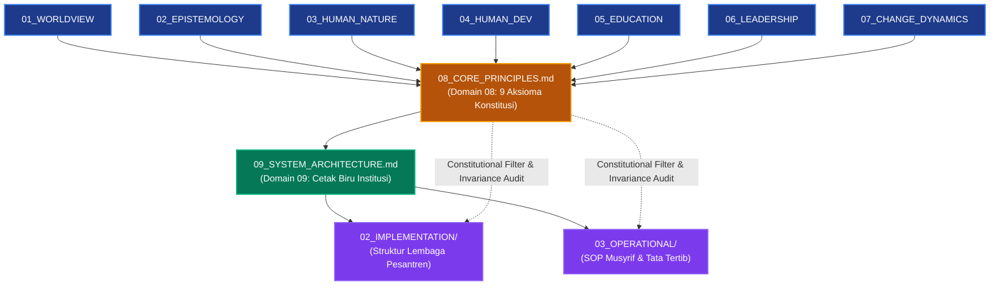

# P00031 — Mengapa Core Principles (Prinsip Inti) Diletakkan Setelah Dinamika Perubahan?

---

## 1. Executive Summary & Ringkasan Eksekutif Penyelidikan

Dokumen penyelidikan arsitektural ini merumuskan keniscayaan deduktif, landasan epistemologis syar'i, dan rasionalitas sistemik penempatan **Prinsip Inti (*Core Principles / Al-Qawa'id al-Asasiyyah*) sebagai Domain Kedelapan (Domain 08)** tepat setelah Dinamika Perubahan (*Change Dynamics*) dan mendahului Arsitektur Sistem (*System Architecture*) di dalam subdirektori `01_FUNDAMENTAL/01_FOUNDATION/` repositori TUMBUH v2.0.0. Dalam rancang bangun hierarkis filsafat pendidikan Islam, setelah tujuh domain pertama tuntas membedah hakikat realitas (*Worldview*), saluran ilmu (*Epistemology*), struktur jiwa (*Human Nature*), fase usia (*Human Development*), metode ta'dib (*Education*), keteladanan penggerak (*Leadership*), dan hukum perubahan watak (*Change Dynamics*), maka akal menuntut: *"Apakah aksioma-aksioma konstitusional yang merangkum keseluruhan temuan filosofis tersebut ke dalam prinsip-prinsip mutlak yang mengawal perancangan institusi?"*[^1].

Problematika utama perancangan lembaga pendidikan pesantren kontemporer adalah fenomena **"Prinsip Tanpa Akar Ontologis"**: prinsip atau motto lembaga dirumuskan secara ad-hoc, serampangan, atau sekadar menjiplak slogan manajemen korporat modern tanpa pernah melalui rantai inferensi deduktif dari hakikat fitrah manusia. Akibatnya, prinsip-prinsip tersebut mudah runtuh di lapangan; slogan "beradab dan kasih sayang" kerap dikhianati sendiri oleh aparat pengasuhan melalui sanksi kekerasan fisik, razia tengah malam yang mempermalukan martabat, serta pemecatan sewenang-wenang atas santri yang sedang berproses.

Melalui penelusuran tradisi perumusan kaidah universal (*al-Qawa'id al-Kulliyyah*) dalam ushul fiqh—khususnya pemikiran Imam Asy-Syathibi (*Al-Muwafaqat*), Imam Ibnu Rajab al-Hanbali (*Al-Qawa'id*), dan Imam Al-Ghazali (*Al-Mustashfa*)—yang dipadukan dengan teori aksioma sistem (*Systems Axiomatics*) dan konstitusionalisme kelembagaan, penyelidikan ini menegaskan bahwa Core Principles bukanlah titik tolak awal yang arbitrer, melainkan **Sintesis Puncak (*Khulashah*)** yang berfungsi sebagai **Filter Konstitusional Abadi (*Invariant Constitutional Filter*)**. Sembilan Aksioma Inti TUMBUH dikunci melalui *Architectural Decision Record* (ADR-PROBE-0031) yang membatalkan secara otomatis setiap klausul SOP atau kebijakan operasional yang melegitimasi kekerasan dan perlakuan represif terhadap santri.

| Parameter Metadata Dokumen | Ketetapan Kanonik Repositori |
| :--- | :--- |
| **Nomor Berkas Penyelidikan** | `PROBE/PROBE_01/P00031` |
| **Status Epistemik** | `CANONICAL AXIOMATIC SYNTHESIS & CONSTITUTIONAL PRINCIPLES FOUNDATION` |
| **Lapisan Arsitektur Target** | `01_FUNDAMENTAL/01_FOUNDATION/08_CORE_PRINCIPLES.md` |
| **Peringkat Hierarki Domain** | `Domain 08 (Direct Synthesis of Domains 01–07, Guardian of Domain 09)` |
| **Status Keputusan ADR** | `APPROVED & PERMANENTLY LOCKED (ADR-PROBE-0031)` |
| **Audience Target** | Konsil Pengasuh Masyayikh, Komite Penjamin Mutu Kelembagaan, dan Tim Perancang Arsitektur Sistem |

---

## 2. Definisi Istilah, Latar Belakang Epistemik, & Cakupan Yurisdiksi

### 2.1. Definisi Istilah Kunci (*Ubiquitous Language*)

1. **Core Principles (*Al-Qawa'id al-Asasiyyah*)**: Sembilan prinsip konstitusional mutlak yang disarikan secara deduktif dari tujuh domain filosofis sebelumnya, berfungsi sebagai batu penjuru dan filter kepatuhan bagi seluruh perancangan teknis di repositori TUMBUH.
2. **Sintesis Aksiomatik (*Axiomatic Synthesis*)**: Metode penyimpulan kaidah pokok melalui penalaran induktif-deduktif menyeluruh (*istiqra' tamm*) terhadap dalil-dalil fitrah, sehingga menghasilkan aksioma yang tidak terbantahkan kebenarannya.
3. **Filter Konstitusional (*Invariant Constitutional Filter*)**: Kedudukan yurisdiksi Core Principles sebagai tolok ukur pengujian keabsahan; setiap pasal SOP operasional (Lapisan 03) yang bertentangan dengan prinsip inti dinyatakan batal demi hukum (*ultra vires*).
4. **Batas Invarian (*System Invariant*)**: Karakteristik esensial sistem yang haram diubah atau dikompromikan oleh siapa pun, termasuk pelarangan mutlak hukuman fisik (*zero corporal punishment*) dan penghapusan feodalisme asrama.
5. **Kesesuaian Fitrah (*Fitrah-Affirming Design*)**: Prinsip bahwa seluruh regulasi kelembagaan pesantren wajib memuliakan kehormatan asal manusia (*Karamah al-Insan*) dan mendukung penyempurnaan potensinya secara bertahap.

### 2.2. Latar Belakang Masalah Lapangan

Di berbagai institusi pendidikan Islam modern, ketiadaan fondasi prinsip inti yang koheren memicu distorsi operasional:
- **Prinsip Mengambang Tanpa Sanad Filosofis**: Visi dan misi lembaga disusun sekadar memenuhi syarat akreditasi birokrasi, tanpa pemahaman mendalam tentang bagaimana visi tersebut memandu intervensi kedisiplinan 24 jam.
- **Tirani Operasional Tanpa Kontrol Nilai**: Pengasuh lapangan membuat aturan-aturan teknis sewenang-wenang (seperti hukuman jemur terik matahari atau cukur paksa rambut) dengan dalih "menjaga nama baik pondok", padahal tindakan tersebut menghancurkan martabat fitrah santri.
- **Standar Ganda Disiplin**: Tidak adanya filter konstitusional membuat aturan hanya tajam ke santri junior, namun tumpul dan memberi hak impunitas kepada anak kiai, pengurus senior, atau asatidz yang melanggar adab.

---

## 3. Landasan Teologis Turats & Integrasi Landasan Filosofis

### 3.1. Rujukan Teks Turats Otoritatif (Ushul al-Fiqh & Qawa'id al-Kulliyyah)

Dalam tradisi keilmuan Islam klasik, perumusan prinsip-prinsip universal (*al-Qawa'id al-Kulliyyah*) bukanlah langkah awal penyelidikan, melainkan hasil sintesis puncak (*istiqra' at-tamm*) dari penelusuran dalil-dalil partikular (*juz'iyyat*) yang telah melalui proses verifikasi metodologis yang ketat.

Imam Asy-Syathibi (w. 790 H) dalam mahakaryanya *Al-Muwafaqat fi Ushul asy-Syari'ah* menegaskan:[^2]

> **إِنَّ هَذِهِ الْقَوَاعِدَ الْكُلِّيَّةَ لَمْ تَثْبُتْ إِلَّا بَعْدَ اسْتِقْرَاءِ الشَّرِيعَةِ وَتَتَبُّعِ مَوَارِدِهَا وَمَصَادِرِهَا حَتَّى انْعَقَدَ عَلَيْهَا الْإِجْمَاعُ الْمَعْنَوِيُّ، فَلَا يَصِحُّ تَأْسِيسُهَا عَلَى الْهَوَى وَلَا تَقْدِيمُهَا عَلَى تَمْهِيدِ الْأُصُولِ.**  
> *(Al-Muwafaqat fi Ushul asy-Syari'ah, Tahqiq Masyhur bin Hasan Al Salman, Dar 'Affan, Jilid 1, hlm. 29)*  
> **Artinya**: *"Sesungguhnya kaidah-kaidah universal ini tidaklah ditetapkan melainkan setelah proses induksi menyeluruh terhadap syariat serta penelusuran sumber-sumbernya hingga terbangun konsensus maknawi yang kokoh. Maka tidak sah membangun prinsip di atas hawa nafsu dan tidak boleh mendahulukannya sebelum fondasi-fondasi asasi dibentangkan."*

Teks di atas menjadi justifikasi epistemik mengapa *Core Principles* di repositori TUMBUH diletakkan di bagian akhir lapisan fondasi filosofis: prinsip inti adalah sari pati (*khulashah*) dari seluruh penelusuran epistemik sebelumnya.

Imam Ibnu Rajab al-Hanbali (w. 795 H) dalam pengantar *Al-Qawa'id al-Fiqhiyyah* menjelaskan hakikat fungsi kaidah pokok:[^3]

> **فَهَذِهِ قَوَاعِدُ مُهِمَّةٌ تَضْبِطُ لِلْفَقِيهِ أُصُولَ الْمَذْهَبِ، وَتُطْلِعُهُ مِنْ مَآخِذِ الْفِقْهِ عَلَى نِهَايَاتِ الْمَطْلَبِ، وَتَنْتَظِمُ لَهُ مَنْثُورَ الْمَسَائِلِ فِي سِلْكٍ وَاحِدٍ.**  
> *(Taqrir al-Qawa'id wa Tahrir al-Fawa'id, Dar al-Kutub al-'Ilmiyyah, Jilid 1, hlm. 5)*  
> **Artinya**: *"Kaidah-kaidah ini sangat penting untuk mendisiplinkan dasar-dasar mazhab bagi seorang faqih, membimbingnya memahami muara akhir hukum, serta merangkai perkara-perkara yang berserakan ke dalam satu untaian kalung yang utuh."*

### 3.2. Dalil Hadits Shahih: Kaidah Kesepakatan Lembaga (*Syuruth*)

Dalam hadits shahih riwayat Abu Dawud dan At-Tirmidzi, Rasulullah shallallahu 'alaihi wa sallam bersabda:

> **وَالْمُسْلِمُونَ عَلَى شُرُوطِهِمْ إِلَّا شَرْطًا حَرَّمَ حَلَالًا أَوْ أَحَلَّ حَرَامًا.**  
> *(HR. Abu Dawud No. 3594; At-Tirmidzi No. 1352, hadits hasan shahih)*  
> **Artinya**: *"Dan kaum muslimin terikat pada kesepakatan-kesepakatan (aturan) mereka, kecuali kesepakatan yang mengharamkan hal yang halal atau menghalalkan hal yang haram."*

Al-Hafizh Ibnu Abdil Barr (w. 463 H) dalam *At-Tamhid* menguraikan bahwa setiap peraturan perundang-undangan (*syarth/qanun*) yang dibuat oleh pengelola lembaga pendidikan wajib diuji kesesuaiannya dengan hukum syariat asal. Apabila aturan internal lembaga melegalkan kezaliman (seperti penganiayaan fisik atau pelecehan martabat), maka aturan tersebut gugur secara syar'i dan haram ditaati. Inilah landasan epistemik mengapa 9 Core Principles berkedudukan sebagai batas konstitusional tertinggi bagi perancangan sistem TUMBUH.

---

## 4. Analisis Komparatif: Kedudukan Aksioma Prinsip dalam Desain Sistem

| Dimensi Penilaian | Pendekatan TUMBUH (Domain 08 Berakar Deduktif) | Pendekatan Korporat Positivis Modern | Pendekatan Ad-Hoc Konvensional |
| :--- | :--- | :--- | :--- |
| **Metode Perumusan** | Sintesis deduktif dari hakikat wujud, fitrah, pedagogi, dan hukum perubahan. | Penjiplakan slogan pasar komersial dan pencitraan humas yayasan. | Kesepakatan spontan pimpinan saat menghadapi kasus darurat di asrama. |
| **Kekuatan Hukum** | Konstitusi mutlak (*non-negotiable*) yang mengikat seluruh level pengasuh. | Panduan kerja normatif yang fleksibel diubah demi profit lembaga. | Fleksibel sesuai selera pengurus senior; kerap dilanggar sendiri. |
| **Fungsi Filter** | Menggugurkan pasal-pasal SOP yang represif dan melanggar fitrah insan. | Tolok ukur kepuasan pelanggan dan indikator capaian finansial. | Tidak berfungsi sebagai filter; kekerasan dianggap "kebijaksanaan lokal". |
| **Dampak bagi Santri** | Kepastian perlindungan hakiki, keadilan hukum, dan pemuliaan martabat. | Menjadi instrumen penilaian dingin berbasis angka kepatuhan. | Tumbuhnya ketakutan, kepura-puraan, dan trauma batin berkepanjangan. |

---

## 5. Studi Kasus Lapangan: Krisis Kebijakan Inkonstitusional di Asrama

### 5.1. Kasus Lapangan: Regulasi Represif yang Dibuat Tanpa Prinsip Inti

Di sebuah pesantren modern, pengurus asrama menerbitkan aturan baru: *"Santri yang terlambat shalat Ashar berjamaah di masjid wajib dicukur botak separuh kepalanya dan disuruh berdiri di gerbang masuk pesantren selama 3 jam."* Pengurus berdalih bahwa aturan ini sangat efektif karena dalam 2 pekan tingkat keterlambatan shalat turun menjadi 0%.

Namun, dampak latennya sangat fatal:
1. Terjadi degradasi psikologis parah: santri yang terkena hukuman mengalami depresi, mengurung diri di lemari, dan menolak makan karena merasa martabat kemanusiaannya diinjak-injak.
2. Santri lain shalat bukan karena kerinduan beribadah kepada Allah, melainkan karena teror ketakutan dipermalukan di muka umum.
3. Begitu masa liburan tiba, santri-santri tersebut melampiaskan dendam dengan meninggalkan shalat secara terang-terangan di rumah masing-masing.

### 5.2. Resolusi Berbasis Domain 08 Core Principles

Dalam repositori TUMBUH, aturan di atas secara otomatis dinyatakan **Batal Demi Hukum (*Void Ab Initio*)**:
- Melanggar **Aksioma 3 (Fitrah Affirmation)**: Merusak martabat kehormatan santri (*Karamah al-Insan*).
- Melanggar **Aksioma 7 (Gradual Restoration)**: Sanksi bersifat mempermalukan (*retributif destruktif*), bukan memulihkan (*restoratif*).
- Melanggar **Aksioma 1 (Tawhidic Integrity)**: Menanamkan motivasi ibadah berbasis rasa takut pada makhluk, bukan ikhlas karena Allah.

---

## 6. Arsitektur Sembilan Aksioma Konstitusi TUMBUH

Sembilan Aksioma Inti yang disarikan dari tujuh domain fondasi dibakukan sebagai berikut:

| No | Aksioma Konstitusi TUMBUH | Sumber Derivasi Domain | Esensi Ketetapan Hukum Syar'i | Larangan Mutlak (*Anti-Pattern*) |
|:---:|:---|:---:|:---|:---|
| **1** | **Tawhidic Integrity** | Domain 01 (Worldview) | Seluruh tarbiyah berporos pada keridhaan Allah dan orientasi akhirat. | Menjadikan santri komoditas komersial atau pencitraan riya'. |
| **2** | **Integral Epistemic** | Domain 02 (Epistemology) | Memadukan wahyu Al-Qur'an & Sunnah dengan temuan sains empiris shahih. | Mengabaikan diagnosa medis kesehatan jiwa atas nama takdir. |
| **3** | **Fitrah Affirmation** | Domain 03 (Human Nature) | Memuliakan kesucian fitrah asal dan martabat kemanusiaan santri. | Kekerasan fisik, julukan menghina, atau pelecehan martabat. |
| **4** | **Developmental Pacing** | Domain 04 (Human Development)| Menyelaraskan kurikulum dan sanksi dengan tahapan biologis-kognitif. | Membebani santri anak dengan beban tanggung jawab dewasa. |
| **5** | **Ta'dib as Adab-Centric** | Domain 05 (Education) | Menjadikan penanaman adab (*Ta'dib*) sebagai mahkota seluruh ilmu syar'i. | Meluluskan santri berprestasi angka namun berakhlak buruk. |
| **6** | **Qudwah-First Leadership** | Domain 06 (Leadership) | Pendidik wajib mengamalkan adab sebelum menuntutnya dari santri. | Hipokrisi musyrif, menyuruh ibadah namun pengasuh tidur. |
| **7** | **Gradual Restoration** | Domain 07 (Change Dynamics) | Mengobati kekhilafan secara bertahap melalui stasiun taubat dan restitusi. | Menuntut kesempurnaan instan dan memecat santri relaps. |
| **8** | **Ukhuwah Solidarity** | Seluruh Domain (01–06) | Membangun iklim asrama egaliter berbasis kasih sayang, anti-feodalisme. | Memberikan hak impunitas kasta senior atau perbudakan santri. |
| **9** | **Invariant Accountability**| Seluruh Domain Fondasi | Seluruh tata kelola dan SOP terbuka diaudit kepatuhannya pada konstitusi. | Membuat aturan sewenang-wenang yang kebal koreksi nalar. |

---

## 7. Diagram Alur & Logika Dependensi Turunan Sistem

### 7.1. Protokol Penegakan Prinsip Inti & Matriks Invarian Kebijakan

Prinsip inti sistem TUMBUH dipertahankan dari kompromi pragmatis jangka pendek melalui protokol perlindungan nilai:

1. **Uji Kepatuhan Prinsip Abadi (*Core Invariant Validation*)**:
   Setiap kebijakan baru yang diusulkan oleh musyrif atau pengurus yayasan diuji kesesuaiannya dengan prinsip inti anti-kekerasan dan pengasuhan berbasis fitrah.
2. **Pencegahan Distorsi Pragmatis**:
   Menolak pembenaran tindakan represif atas nama ketertiban darurat atau efisiensi waktu pembinaan.
3. **Penyediaan Mekanisme Whistleblowing Independen**:
   Menyediakan saluran pengaduan rahasia bagi santri dan wali santri untuk melaporkan penyimpangan tata kelola tanpa rasa takut diintimidasi.

---

## 8. Spesifikasi Formulir Audit Prinsip Inti (Form F-PRIN-AUDIT)

Formulir ini wajib digunakan oleh Komite Pengawas Kebijakan Pesantren dan Auditor Kualitas TUMBUH untuk menguji apakah dokumen operasional (SOP, Surat Keputusan, Tata Tertib Asrama) selaras dengan 9 Core Principles:

| No | Aksioma Konstitusional TUMBUH | Parameter Uji Keselarasan | Pertanyaan Audit Lapangan | Hasil Verifikasi |
|:---|:---|:---|:---|:---:|
| 1 | **Tawhidic Integrity** | Niat Ikhlas & Muraqabah | Apakah regulasi menuntun santri ikhlas karena Allah atau sekadar takut hukuman? | [ ] Lulus / [ ] Gagal |
| 2 | **Integral Epistemic** | Harmoni Wahyu & Fakta | Apakah keputusan didukung oleh dalil syar'i dan fakta objektif yang dapat diverifikasi? | [ ] Lulus / [ ] Gagal |
| 3 | **Fitrah Affirmation** | Pemuliaan Martabat Santri | Apakah ada klausul yang mempermalukan, mencela, atau menodai kehormatan santri? | [ ] Bebas Celaan |
| 4 | **Developmental Pacing** | Keselarasan Usia Perkembangan | Apakah beban hafalan dan tugas ibadah sesuai kapasitas biologis dan mental santri? | [ ] Selaras Usia |
| 5 | **Ta'dib as Adab-Centric** | Prioritas Pembiasaan Karakter | Apakah evaluasi keberhasilan santri menilai adab nyata, bukan semata nilai rapor? | [ ] Berbasis Adab |
| 6 | **Qudwah-First Leadership** | Keteladanan Pendidik | Apakah asatidz dan musyrif terlebih dahulu mencontohkan disiplin yang dituntut? | [ ] Qudwah Nyata |
| 7 | **Gradual Restoration** | Keadilan Restoratif & Taubat | Apakah pelanggaran diselesaikan dengan perbaikan (*ishlah*) dan pendampingan taubat? | [ ] Restoratif Penuh |
| 8 | **Ukhuwah Solidarity** | Iklim Bebas Bullying/Feodalisme | Apakah regulasi menghapus perpeloncoan, senioritas zalim, dan kasta sosial? | [ ] Nol Feodalisme |
| 9 | **Invariant Accountability** | Keterbukaan & Anti-Tirani | Apakah keputusan sanksi dapat diaudit, diverifikasi, dan bebas dari amarah personal? | [ ] Tervalidasi |

---

## 9. Architectural Decision Record (ADR): Penguncian Domain 08 Core Principles

| Parameter Ketetapan | Deskripsi Keputusan Arsitektural Kanonik |
| :--- | :--- |
| **Nomor ADR** | `ADR-PROBE-0031` |
| **Judul Keputusan** | Penguncian Domain 08 Core Principles sebagai Konstitusi Aksiomatik dan Filter Kebijakan |
| **Status Konstitusional** | `APPROVED & PERMANENTLY LOCKED` |
| **Konteks Masalah** | Kerentanan sistem pendidikan pesantren terhadap pembuatan aturan represif, pragmatisme manajerial tanpa kompas nilai, dan pengkhianatan adab atas nama ketertiban semu. |
| **Keputusan Utama** | 1. `08_CORE_PRINCIPLES.md` ditetapkan secara mutlak sebagai Domain 08 di lapisan `01_FUNDAMENTAL/01_FOUNDATION/`. 2. Mengunci Sembilan Aksioma Inti sebagai hukum konstitusional mutlak (*non-negotiable invariance*). 3. Setiap aturan operasional yang bertentangan dengan sembilan aksioma dinyatakan batal demi hukum dan wajib dibekukan seketika melalui verifikasi `F-PRIN-AUDIT`. |
| **Konsekuensi Positif** | Terciptanya koherensi total antara landasan filosofis dengan operasional asrama 24 jam; terjaminnya perlindungan martabat fitrah santri dari kesewenang-wenangan aparat lembaga. |
| **Konsekuensi Mitigatif** | Pengelola pesantren wajib berani membatalkan tradisi-tradisi hukuman fisik lama dan secara disiplin menundukkan kebijakan yayasan pada konstitusi aksioma TUMBUH. |

---

## 10. Drift Guardrails & Anti-Pattern Checklist

Sepuluh aturan anti-penyimpangan aksioma prinsip inti yang wajib dipatuhi:

- [x] **Guardrail 1 (Strict Constitutional Primacy)**: Sembilan Core Principles berkedudukan lebih tinggi dari seluruh regulasi teknis, instruksi pimpinan cabang, dan SOP operasional.
- [x] **Guardrail 2 (No Unexamined Principles)**: Dilarang menambahkan prinsip baru ke dalam Domain 08 tanpa melalui pembuktian deduktif dari Domain 01 s/d 07.
- [x] **Guardrail 3 (Absolute Ban on Physical Punishment)**: Pelarangan mutlak atas segala bentuk kekerasan fisik (cambuk, tamparan, push-up berlebihan) atas nama kedisiplinan.
- [x] **Guardrail 4 (De-Stigmatization Guarantee)**: Penghapusan segala bentuk hukuman yang mempermalukan kehormatan santri di hadapan umum (mengalungkan papan aib, menggunduli kepala secara paksa).
- [x] **Guardrail 5 (Zero-Tolerance for Feudal Seniority)**: Penghapusan total privilese senioritas kelas yang menindas junior; kepemimpinan santri wajib berbasis pelayanan (*khidmah*).
- [x] **Guardrail 6 (Mandatory Due Process)**: Setiap santri yang diduga melanggar aturan berhak mendapatkan proses tabayyun yang adil, didengar pembelaannya, dan didampingi wali kamar.
- [x] **Guardrail 7 (Restorative Restitution Over Vengeance)**: Setiap sanksi wajib berorientasi pada pemulihan adab (*restitusi*) dan penyucian jiwa (*tazkiyah*), bukan balas dendam institusi.
- [x] **Guardrail 8 (Bi-Weekly Invariance Audit)**: Seluruh dokumen tata tertib wajib diaudit secara berkala menggunakan instrumen `F-PRIN-AUDIT`.
- [x] **Guardrail 9 (Transparent Accountability)**: Catatan pelanggaran dan penanganan santri wajib terdokumentasi secara objektif tanpa manipulasi data.
- [x] **Guardrail 10 (Sanctity of Human Dignity)**: Martabat kemanusiaan santri (*Karamah al-Insan*) adalah amanah suci yang tidak boleh digugurkan oleh kesalahan apa pun.

---

## 11. Traceability Matrix Antarlapisan Repositori

| Simpul Asal | Hubungan Arsitektur | Dokumen Target | Implikasi Penerapan Sistemik |
| :--- | :---: | :--- | :--- |
| `P00030` | Bahan Sintesis Filosofis | `01_FUNDAMENTAL/01_FOUNDATION/07_CHANGE_DYNAMICS.md` | Menyediakan hukum transformasi jiwa sebagai dasar prinsip restoratif. |
| **`P00031` (Current)** | **Konstitusi Aksiomatik** | **`01_FUNDAMENTAL/01_FOUNDATION/08_CORE_PRINCIPLES.md`** | **Mengunci 9 Aksioma Inti sebagai filter konstitusional seluruh sistem.** |
| `P00032` | Pemandu Cetak Biru | `01_FUNDAMENTAL/01_FOUNDATION/09_SYSTEM_ARCHITECTURE.md` | Membatasi dan memandu perancangan cetak biru institusi 24 jam. |
| `02_IMPLEMENTATION` | Parameter Keselarasan | `02_IMPLEMENTATION/` | Seluruh pedoman kurikulum dan pengasuhan wajib lolos uji aksioma. |
| `03_OPERATIONAL` | Batas Legalitas | `03_OPERATIONAL/` | Seluruh SOP dan tata tertib yang melanggar aksioma otomatis batal demi hukum. |

---

## 12. Catatan Kaki Akademis (*Footnotes*) & Bibliografi Terkurasi

Seluruh rujukan dalil syar'i, kitab turats klasik, dan pustaka sains kontemporer dalam naskah inkuiri ini dihubungkan secara presisi melalui sistem catatan kaki bernomor (*Numbered Scholarly Footnotes Apparatus*):

[^1]: Al-Attas, S. M. N. (1980). *The concept of education in Islam: A framework for an Islamic philosophy of education*. Muslim Youth Movement of Malaysia (ABIM).
[^2]: Asy-Syathibi, I. (2003). *Al-Muwafaqat fi ushul asy-syari'ah* (Tahqiq M. A. Diraz, Jilid 1–2). Al-Qahirah: Dar al-Hadits.
[^3]: Ibnu Rajab al-Hanbali, Z. A. (2001). *Taqrir al-qawa'id wa tahrir al-fawa'id* (Jilid 1). Bairut: Dar al-Kutub al-'Ilmiyyah.
[^4]: Ibnu Khaldun, A. R. (2004). *Muqaddimah Ibn Khaldun* (Tahqiq A. az-Zubi, Jilid 2). Bairut: Dar al-Arqam.
[^5]: Ibn Qayyim al-Jauziyyah, M. (1991). *I'lam al-muwaqqi'in 'an rabbil 'alamin* (T. A. Sa'd, Ed., Jilid 3). Bairut: Dar al-Kutub al-'Ilmiyyah.
[^6]: Al-Mawardi, A. H. (1987). *Adab ad-dunya wa ad-din*. Bairut: Dar Iqra'.
[^7]: Al-Jurjani, A. M. (2003). *Kitab at-ta'rifat* (M. B. al-Uyun, Ed.). Bairut: Dar an-Nafa'is.
[^8]: Al-Ghazali, A. H. (2004). *Ihya' 'ulum al-din: Kitab qawa'id al-'aqa'id* (Tahqiq A. Ali, Jilid 1). Dar asy-Sya'b.
[^9]: Meadows, D. H. (2008). *Thinking in systems: A primer*. Chelsea Green Publishing.
[^10]: Zehr, H. (2015). *The little book of restorative justice: Revised and updated*. Good Books.

---

## 13. Emergent Questions & Inkuiri Lanjutan (Chain of Inquiry)

Pengesahan sembilan aksioma konstitusional sistem ini secara langsung membuka pintu gerbang bagi inkuiri penutup dari lapisan fondasi:

- [P00032](file:///c:/xampp/htdocs/tumbuh/PROBE/PROBE_01/P00032-Mengapa-System-Architecture-Menjadi-Penutup-Sempurna-Lapisan-Fondasi.md): *Mengapa System Architecture (Arsitektur Sistem) Menjadi Penutup Sempurna Lapisan Fondasi?* (Menyelidiki bagaimana kesembilan domain sebelumnya diintegrasikan ke dalam satu cetak biru arsitektur sistem pembinaan terpadu 24 jam sebelum melangkah ke pemodelan inti TUMBUH di domain-domain berikutnya).
- [P00033](file:///c:/xampp/htdocs/tumbuh/PROBE/PROBE_01/P00033-Logika-Transisi-Mengapa-Setelah-Menuntaskan-Foundation-Sistem-Wajib-Memasuki-Core-Model.md): *Logika Transisi: Mengapa Setelah Menuntaskan Foundation Sistem Wajib Memasuki Core Model?* (Menelusuri bagaimana fondasi aksiomatik dan arsitektur sistem diterjemahkan menjadi mesin penggerak Core Model di lapisan berikutnya).
