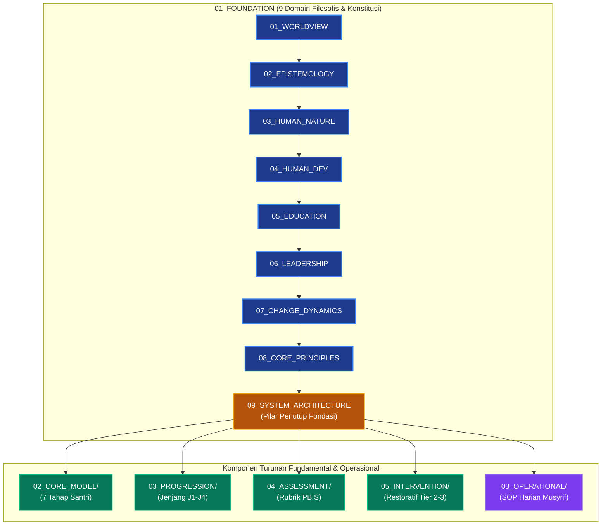

# P00032 — Mengapa System Architecture Menjadi Penutup Sempurna Lapisan Fondasi?

---

## 1. Executive Summary & Ringkasan Eksekutif Penyelidikan

Dokumen penyelidikan arsitektural ini merumuskan keniscayaan deduktif, landasan epistemologis syar'i, dan rasionalitas sistemik penempatan **Arsitektur Sistem (*System Architecture / Handasah an-Nidzam*) sebagai Domain Kesembilan (Domain 09) sekaligus Penutup Sempurna (*Capstone Domain*)** lapisan `01_FUNDAMENTAL/01_FOUNDATION/` repositori TUMBUH v2.0.0. Dalam rantai penalaran hierarkis filsafat pendidikan Islam, setelah Domain 01 s/d Domain 08 tuntas menyediakan seluruh bahan baku konseptual—mulai dari pandangan alam tauhid (*Worldview*), saluran ilmu (*Epistemology*), struktur jiwa (*Human Nature*), trajektori usia (*Human Development*), metode ta'dib (*Education*), keteladanan penggerak (*Leadership*), hukum transformasi watak (*Change Dynamics*), hingga konstitusi aksioma (*Core Principles*)—maka akal niscaya menuntut penegasan mengenai: *"Bagaimana seluruh komponen filosofis tersebut dirajut ke dalam satu cetak biru tata kelola ekosistem asrama 24 jam yang fungsional, terpadu, dan terlindungi?"*[^1].

Lanskap pendidikan pesantren kontemporer kerap terjebak dalam dua kegagalan ekstrem: (1) **Idealisme Romantis Tanpa Desain Sistem**, di mana cita-cita luhur kiai tidak memiliki struktur pendukung operasional sehingga melahirkan kelelahan kronis (*burnout*) musyrif dan sanksi reaktif yang tidak konsisten; atau (2) **Teknokrasi Dingin Tanpa Jiwa**, di mana adopsi manajemen ISO korporat mengubah asrama menjadi pabrik kaku dan mereduksi santri menjadi nomor registrasi tanpa kehangatan adab.

Melalui penelusuran tamsil kenabian mengenai kesatuan bangunan (*kal bunyan yasyuddu ba'dhuhu ba'dha*) yang diuraikan oleh Al-Hafizh Ibnu Hajar al-'Asqalani (*Fath al-Bari*), dipadukan dengan teori sistem umum (*General Systems Theory*) Ludwig von Bertalanffy dan ekologi perkembangan anak Urie Bronfenbrenner, penyelidikan ini menegakkan bahwa Domain 09 berkedudukan sebagai **Jembatan Konseptual Tunggal (*The Sole Conceptual Bridge*)** yang menghubungkan fondasi filosofis dengan model operasional inti di lapisan berikutnya. Hasil inkuiri dibakukan ke dalam *Architectural Decision Record* (ADR-PROBE-0032) yang mengunci 7 Pilar Arsitektur Sistem dan menetapkan penutupan resmi subdirektori Fondasi pada 9 Domain kanonik.

| Parameter Metadata Dokumen | Ketetapan Kanonik Repositori |
| :--- | :--- |
| **Nomor Berkas Penyelidikan** | `PROBE/PROBE_01/P00032` |
| **Status Epistemik** | `CANONICAL SYSTEM ARCHITECTURE SYNTHESIS & CAPSTONE INVESTIGATION` |
| **Lapisan Arsitektur Target** | `01_FUNDAMENTAL/01_FOUNDATION/09_SYSTEM_ARCHITECTURE.md` |
| **Peringkat Hierarki Domain** | `Domain 09 (The Capstone Domain of 01_FOUNDATION, Gateway to Core Model)` |
| **Status Keputusan ADR** | `APPROVED & PERMANENTLY LOCKED (ADR-PROBE-0032)` |
| **Audience Target** | Konsil Pimpinan Masyayikh, Principal Software & Systems Architect, dan Kepala Tata Kelola Asrama 24 Jam |

---

## 2. Definisi Istilah, Latar Belakang Epistemik, & Cakupan Yurisdiksi

### 2.1. Definisi Istilah Kunci (*Ubiquitous Language*)

1. **System Architecture (*Handasah an-Nidzam*)**: Cetak biru rancang bangun terpadu yang memadukan dimensi ruang fisik, irama sirkadian waktu, diferensiasi peran pendidik, alur penanganan masalah bertingkat, dan etika data ke dalam satu ekosistem pembinaan adab 24 jam.
2. **Domain Penutup (*Capstone Domain*)**: Posisi puncak Domain 09 sebagai gerbang akhir yang merangkum delapan domain fondasi sebelumnya menjadi satu arsitektur fungsional sebelum melangkah ke pemodelan inti TUMBUH.
3. **Ekosistem Bi'ah Shalihah 24 Jam**: Totalitas lingkungan asrama yang direkayasa secara sadar agar setiap sudut ruang, rutinitas waktu, dan interaksi manusia di dalamnya secara organik menumbuhkan akhlak mulia dan mencegah kemaksiatan.
4. **Multi-Tier PBIS Escalation Framework**: Alur penanganan perilaku santri berbasis bukti yang terbagi secara proporsional ke dalam tiga lapis: Tier 1 (Universal Prevention 80–85%), Tier 2 (Targeted Support 10–15%), dan Tier 3 (Intensive Restorative 1–5%).
5. **Mitigasi Titik Rawan (*Spatial Hotspots Mitigation*)**: Rekayasa tata ruang asrama yang meniadakan area-area tersembunyi (*blindspots*) guna memutus peluang terjadinya perundungan (*bullying*) dan kekerasan senioritas.

### 2.2. Latar Belakang Masalah Lapangan

Di berbagai pesantren, ketiadaan arsitektur sistem yang komprehensif memicu krisis kelembagaan:
- **Jadwal Bertubrukan dan Deprivasi Tidur Santri**: Jadwal setoran hafalan Subuh bertabrakan dengan antrean sanitasi kamar mandi yang terbatas, menyebabkan santri kurang tidur dan mengalami kelelahan kronis (*circadian disruption*).
- **Konflik Otoritas dan Tumpang Tindih Peran**: Guru madrasah dan musyrif asrama saling menyalahkan saat terjadi pelanggaran disiplin santri; tidak ada uraian tugas tertulis yang membatasi wewenang masing-masing.
- **Ketiadaan Alur Eskalasi Kasus**: Penanganan pelanggaran santri dilakukan secara reaktif; kekhilafan ringan langsung dijatuhi sanksi pengusiran, sementara kasus perundungan berat di kamar gelap asrama luput dari deteksi pimpinan.

---

## 3. Landasan Teologis Turats & Integrasi Teori Rekayasa Sistem

### 3.1. Rujukan Teks Turats Otoritatif: Keterpaduan Bangunan Sistem

Prinsip keterpaduan arsitektur sistem dalam Islam berakar pada sabda Rasulullah shallallahu 'alaihi wa sallam yang mengibaratkan orang-orang beriman dan tatanan masyarakat shalih sebagai satu bangunan utuh yang saling menopang:

> **عَنْ أَبِي مُوسَى الأَشْعَرِيِّ رَضِيَ اللَّهُ عَنْهُ، عَنِ النَّبِيِّ صَلَّى اللَّهُ عَلَيْهِ وَسَلَّمَ قَالَ: «إِنَّ الْمُؤْمِنَ لِلْمُؤْمِنِ كَالْبُنْيَانِ يَشُدُّ بَعْضُهُ بَعْضًا» وَشَبَّكَ أَصَابِعَهُ.**  
> *(HR. Al-Bukhari No. 481; Muslim No. 2585)*  
> **Artinya**: *"Dari Abu Musa al-Asy'ari radhiyallahu 'anhu, dari Nabi shallallahu 'alaihi wa sallam, beliau bersabda: 'Sesungguhnya seorang mukmin dengan mukmin lainnya bagaikan satu bangunan kokoh, yang sebagiannya memperkuat sebagian yang lain.' Dan beliau menyilangkan jari-jemari kedua tangannya."*

Imam Ibnu Hajar al-'Asqalani (w. 852 H) dalam *Fath al-Bari* menjelaskan tamsil agung ini:[^3]

> **وَتَشْبِيكُ الْأَصَابِعِ تَمْثِيلٌ لِلتَّرَاكُبِ وَالِانْدِمَاجِ بَيْنَ أَجْزَاءِ الْبُنْيَانِ؛ بِحَيْثُ إِذَا سَقَطَ جُزْءٌ مِنْهُ اخْتَلَّ النِّظَامُ كُلُّهُ، فَكَذَلِكَ إِقَامَةُ صَرْحِ الدِّينِ لَا تَتِمُّ إِلَّا بِتَنَاسُقِ الْأَحْوَالِ وَتَسَانُدِ الْأَعْمَالِ.**  
> *(Fath al-Bari Syarh Shahih al-Bukhari, Tahqiq Muhibbuddin al-Khathib, Dar al-Ma'rifah, Jilid 1, hlm. 565)*  
> **Artinya**: *"Tindakan beliau menyilangkan jari-jemari merupakan representasi visual mengenai saling terkait dan berpadunya antar-komponen bangunan; sekiranya satu komponen roboh, maka niscaya runtuhlah keseluruhan sistem tatanan tersebut. Demikian pula penegakan pilar agama dan pendidikan, ia tidak akan terwujud sempurna kecuali dengan keterpaduan kondisi dan saling menopangnya amal-amal operasional."*

Teks ini menegaskan bahwa kesalehan individu santri atau kehebatan figur kiai tidak akan melahirkan peradaban yang berkesinambungan jika tidak didukung oleh struktur sistem kelembagaan yang saling mengunci (*yasyuddu ba'dhuhu ba'dha*).

### 3.2. Integrasi Teori Sibernetika Sistem dan Ekologi Perkembangan

Dalam sains sistem modern (*General Systems Theory*) dan ekologi perkembangan anak:[^4]
1. **Teori Sibernetika Ludwig von Bertalanffy & Norbert Wiener**: Sebuah sistem yang hidup (*living open system*) membutuhkan batasan yang jelas (*boundaries*), siklus umpan balik positif dan negatif (*feedback loops*), serta keseimbangan dinamis (*homeostasis*). Domain 09 menyediakan arsitektur sibernetika ini bagi pesantren agar mampu beradaptasi menghadapi perkembangan zaman tanpa kehilangan jati diri adabiahnya[^5].
2. **Teori Ekologi Urie Bronfenbrenner**: Pertumbuhan anak dipengaruhi oleh interaksi harmonis antara mikrosistem (kamar asrama), mesosistem (kemitraan kelas-asrama-orang tua), eksosistem (kebijakan pengasuhan), dan makrosistem (worldview Islam). Domain 09 menata seluruh lapisan ekologis ini agar berpadu menjadi ekosistem pembinaan adab yang koheren[^6].

---

## 4. Analisis Komparatif: Paradigma Tata Kelola Asrama Pesantren

| Parameter Tata Kelola | Arsitektur Sistem TUMBUH (Domain 09) | Manajemen Tradisional Kharismatik | Manajemen Korporat Teknokrasi Kering |
| :--- | :--- | :--- | :--- |
| **Landasan Perancangan** | Sintesis deduktif 8 domain filosofis dan syariat Islam. | Kebijakan lisan spontan figur pimpinan tanpa cetak biru tertulis. | Adopsi mentah-mentah standar ISO industri manufaktur. |
| **Ritme Waktu 24 Jam** | Menghormati ritme sirkadian biologis (tidur minimal 7 jam). | Jadwal padat tidak teratur, sering begadang tanpa perhitungan biologis. | Jadwal mekanik efisiensi produksi, mengabaikan dimensi spiritual kalbu. |
| **Tata Ruang Asrama** | Ramah fitrah, bebas titik rawan kekerasan (*anti-hotspot*). | Banyak sudut mati tak terpantau, menjadi sarang perundungan. | Pengawasan CCTV total yang menindas privasi dan rasa saling percaya. |
| **Alur Penanganan Masalah** | Berjenjang restoratif multi-tier (Tier 1 -> Tier 2 -> Tier 3). | Sanksi reaktif spontan: pemukulan fisik atau pengusiran mendadak. | Pemotongan poin pelanggaran dingin tanpa pendampingan taubat. |

---

## 5. Studi Kasus Lapangan: Bencana Disorientasi Tata Kelola Asrama

### 5.1. Kasus Lapangan: Tragedi Asrama Tanpa Cetak Biru Sistem

Di sebuah pesantren dengan santri lebih dari 1.000 orang, tidak tersedia dokumen arsitektur sistem yang membakukan alur kerja operasional:
1. Jam belajar malam selesai pukul 22.30 WIB, dilanjutkan dengan rapat organisasi santri hingga pukul 00.30 WIB. Pukul 03.30 WIB santri sudah dibangunkan secara paksa dengan siraman air dingin untuk shalat tahajjud. Akibat deprivasi tidur kronis (tidur kurang dari 3 jam per malam), santri mengalami penurunan imunitas dan gangguan kecemasan berat.
2. Penanganan kasus pencurian uang diserahkan sepenuhnya kepada pengurus santri senior. Tanpa protokol eskalasi dan supervisi dewasa, pengurus senior menyiksa tertuduh di kamar mandi belakang hingga mengalami gegar otak.
3. Kasus ini meledak ke media massa nasional, memicu penutupan paksa pesantren oleh pemerintah, dan menghancurkan reputasi lembaga yang telah dirintis selama puluhan tahun.

### 5.2. Resolusi Epistemik Melalui Domain 09

Repositori TUMBUH menata ulang ekosistem asrama melalui Cetak Biru Arsitektur Sistem:
- **Perlindungan Sirkadian**: Penataan jadwal harian yang menjamin santri tidur minimal 7 jam per malam.
- **Pemberantasan Titik Rawan**: Rekayasa tata ruang asrama yang terang, terbuka, dan dilengkapi patroli berkala musyrif dewasa.
- **Standarisasi Alur Eskalasi Kasus Multi-Tier**: Pengurus santri dilarang keras menyidang atau menghukum kawan; seluruh penanganan santri bermasalah diarahkan melalui alur bimbingan konseling profesional.

---

## 6. Arsitektur Tujuh Pilar Sistem Pembinaan Asrama TUMBUH

Domain 09 merumuskan tujuh pilar arsitektur yang menjadi cetak biru tata kelola kelembagaan:

| No | Pilar Arsitektur Sistem | Fokus Rekayasa Lapangan | Indikator Keberhasilan Operasional |
|:---:|:---|:---|:---|
| **1** | **Cadence & Circadian Tempo** | Sinkronisasi ritme biologis tidur, makan, ta'lim, dan ibadah. | Santri bugar, tidak mengantuk di kelas, tidur cukup minimal 7 jam. |
| **2** | **Spatial Adab Engineering** | Penataan ruang fisik asrama yang memuliakan adab dan anti-kekerasan. | Peniadaan titik rawan (*blindspots*), sanitasi bersih, ventilasi sehat. |
| **3** | **Role Differentiation** | Pemisahan tegas wewenang guru madrasah, musyrif, dan konselor BK. | Ketiadaan tumpang tindih instruksi dan kejelasan batas tanggung jawab. |
| **4** | **Multi-Tier PBIS Escalation** | Alur penanganan perilaku berjenjang: Tier 1 (80%), Tier 2 (15%), Tier 3 (5%). | Masalah diselesaikan pada level terendah dengan pendekatan restoratif. |
| **5** | **Cybernetic Feedback Loops** | Rapat koordinasi harian 15 menit (*daily standup*) antarpengasuh. | Deteksi dini kendala santri dan respons kelembagaan yang sinkron. |
| **6** | **Child Protection Protocol** | SOP perlindungan hak anak dan sistem pelaporan rahasia aman. | Nol toleransi kekerasan fisik/verbal dan perlindungan korban bullying. |
| **7** | **Data Ethics & Analytics** | Tata kelola rekam jejak adab digital yang terlindungi dan objektif. | Kerahasiaan catatan konseling terjaga, bebas stigma dan pelabelan aib. |

---

## 7. Diagram Alur & Logika Dependensi Turunan Sistem

### 7.1. Protokol Penguncian Arsitektur Fondasi & Matriks Kesiapan Core Model

Sebagai gerbang penutup Lapisan Fondasi, integritas seluruh domain diuji sebelum melangkah ke Core Model melalui protokol kesiapan arsitektur:

1. **Audit Koherensi Multi-Domain (*Holistic Coherence Audit*)**:
   Memastikan kesembilan domain fondasi telah terhubung secara harmonis tanpa celah kontradiksi epistemik.
2. **Deklarasi Kesiapan Fondasi (*Foundation Completeness Gate*)**:
   Pengesahan formal bahwa landasan filosofis telah memadai untuk menopang perancangan komponen operasional Core Model.
3. **Penyelarasan Tata Ruang Fisik Asrama (*Physical CPTED Audit*)**:
   Memverifikasi bahwa seluruh area asrama memenuhi standar pencahayaan, ventilasi, dan keselamatan anak.

---

## 8. Spesifikasi Formulir Audit Arsitektur Sistem (Form F-ARCH-AUDIT)

Formulir ini wajib digunakan oleh Tim Auditor Arsitektur Kelembagaan TUMBUH untuk menguji apakah cetak biru kelembagaan suatu pesantren memenuhi 7 Pilar Arsitektur Sistem:

| No | Pilar Arsitektur Sistem | Komponen Uji Lapangan | Pertanyaan Investigasi Sistemik | Status Verifikasi |
|:---|:---|:---|:---|:---:|
| 1 | **Cadence & Circadian Tempo** | Waktu Istirahat Biologis | Apakah jadwal menjamin santri tidur minimal 7 jam per hari tanpa pemotongan liar? | [ ] Terjamin Penuh |
| 2 | **Spatial Adab Engineering** | Keamanan Tata Ruang | Apakah kamar mandi, lorong asrama, dan bilik tidur bebas dari titik rawan (*blindspots*) kekerasan? | [ ] Bebas Blindspot |
| 3 | **Role Differentiation** | Kejelasan Batas Tugas | Apakah peran musyrif, guru kelas, dan konselor BK terdiferensiasi dengan jobdesk tertulis? | [ ] Jelas Tertulis |
| 4 | **Multi-Tier PBIS Escalation**| Alur Berjenjang Kasus | Apakah santri bermasalah melalui alur Tier 1 dan Tier 2 sebelum dirujuk ke sidang dewan guru? | [ ] Berjenjang Sah |
| 5 | **Cybernetic Feedback Loops** | Rapat Koordinasi Harian | Apakah forum evaluasi 15 menit (*daily standup*) musyrif berjalan konsisten setiap hari? | [ ] Berjalan Rutin |
| 6 | **Child Protection Protocol** | Keamanan dari Kekerasan | Apakah pesantren memiliki kanal pelaporan anonim yang aman bagi santri korban bullying? | [ ] Tersedia Aman |
| 7 | **Data Ethics & Analytics** | Kerahasiaan Rekam Jejak | Apakah catatan pelanggaran santri terkunci rapat dan bebas dari akses santri lain? | [ ] Terkunci Aman |

---

## 9. Architectural Decision Record (ADR): Penguncian Domain 09 System Architecture

| Parameter Ketetapan | Deskripsi Keputusan Arsitektural Kanonik |
| :--- | :--- |
| **Nomor ADR** | `ADR-PROBE-0032` |
| **Judul Keputusan** | Penguncian Domain 09 System Architecture sebagai Penutup Fondasi dan Gerbang Core Model |
| **Status Konstitusional** | `APPROVED & PERMANENTLY LOCKED` |
| **Konteks Masalah** | Bahaya disorientasi jadwal, deprivasi tidur santri, tumpang tindih peran pengasuh, dan kekerasan di area tak terpantau akibat ketiadaan cetak biru sistem terpadu. |
| **Keputusan Utama** | 1. `09_SYSTEM_ARCHITECTURE.md` ditetapkan secara mutlak sebagai Domain 09 sekaligus penutup subdirektori `01_FOUNDATION/`. 2. Mengunci subdirektori Fondasi pada 9 Domain kanonik dan melarang penambahan domain baru. 3. Mewajibkan seluruh tata kelola asrama 24 jam menerapkan 7 Pilar Arsitektur Sistem dan diverifikasi melalui `F-ARCH-AUDIT`. |
| **Konsekuensi Positif** | Terwujudnya ekosistem pembinaan adab 24 jam yang sehat lahir batin, terpadu, dan terlindungi; tersedianya wadah ekologis yang kokoh untuk menopang perancangan Core Model. |
| **Konsekuensi Mitigatif** | Pimpinan yayasan wajib berkomitmen menata ulang fasilitas fisik, jam kerja musyrif, dan jadwal harian santri agar selaras dengan standar arsitektur sistem. |

---

## 10. Drift Guardrails & Anti-Pattern Checklist

Sepuluh aturan anti-penyimpangan arsitektur sistem yang wajib dipatuhi:

- [x] **Guardrail 1 (Capstone Finality)**: Domain 09 adalah batas akhir dari `01_FOUNDATION/`; dilarang menambahkan Domain 10 ke dalam sub-direktori fondasi ini.
- [x] **Guardrail 2 (No Unanchored Architecture)**: Arsitektur sistem wajib berakar dari sintesis Domain 01 s/d Domain 08, dilarang merancang struktur berbasis pragmatisme semata.
- [x] **Guardrail 3 (Circadian Sleep Protection)**: Jam tidur malam santri (minimal 7 jam) adalah hak biologis mutlak yang haram dipotong untuk hukuman atau tugas tambahan.
- [x] **Guardrail 4 (Spatial Safety Assurance)**: Asrama wajib meniadakan sudut-sudut gelap (*hotspots*) yang berpotensi menjadi arena perundungan antarsantri.
- [x] **Guardrail 5 (Role Confusion Elimination)**: Guru kelas dilarang mencampuri urusan privasi asrama tanpa koordinasi dengan musyrif penanggung jawab kamar.
- [x] **Guardrail 6 (Mandatory PBIS Escalation Path)**: Penanganan pelanggaran wajib mengikuti jalur eskalasi Tier 1 -> Tier 2 -> Tier 3 tanpa potong kompas vonis drop out.
- [x] **Guardrail 7 (Daily Standup Accountability)**: Musyrif wajib mengadakan rapat koordinasi singkat 15 menit setiap pagi untuk sinkronisasi catatan harian santri.
- [x] **Guardrail 8 (Confidential Reporting Channel)**: Lembaga wajib menyediakan kotak saran fisik rahasia dan kanal digital terlindungi untuk pelaporan santri.
- [x] **Guardrail 9 (Prohibition of Spy Culture)**: Dilarang merekrut santri menjadi intelijen rahasia yang mengadu domba antarsantri.
- [x] **Guardrail 10 (Restorative Justice Priority)**: Setiap konflik antarpenghuni asrama diselesaikan melalui mediasi ishlah dan restitusi adab, bukan pembalasan dendam.

---

## 11. Traceability Matrix Antarlapisan Repositori

| Simpul Asal | Hubungan Arsitektur | Dokumen Target | Implikasi Penerapan Sistemik |
| :--- | :---: | :--- | :--- |
| `P00031` | Fondasi Konstitusional | `01_FUNDAMENTAL/01_FOUNDATION/08_CORE_PRINCIPLES.md` | Menyediakan 9 Aksioma Inti yang dipatuhi oleh seluruh rancang bangun sistem. |
| **`P00032` (Current)** | **Cetak Biru Penutup** | **`01_FUNDAMENTAL/01_FOUNDATION/09_SYSTEM_ARCHITECTURE.md`** | **Mengunci 7 Pilar Arsitektur Sistem sebagai jembatan tunggal ke Core Model.** |
| `P00033` | Gerbang Transisi | `01_FUNDAMENTAL/02_CORE_MODEL/` | Memasuki pemodelan 7 Tahap Perkembangan Santri di atas ekologi sistem ini. |
| `01_FUNDAMENTAL` | Wadah Ekologis | `01_FUNDAMENTAL/03_PROGRESSION/` s/d `05_INTERVENTION/` | Menaungi jenjang kemandirian J1–J4 dan intervensi PBIS multi-tier. |
| `03_OPERATIONAL` | Pedoman Operasional | `03_OPERATIONAL/` | Seluruh SOP harian, tata ruang fisik, dan jobdesk musyrif berinduk pada cetak biru ini. |

---

## 12. Catatan Kaki Akademis (*Footnotes*) & Bibliografi Terkurasi

Seluruh rujukan dalil syar'i, kitab turats klasik, dan pustaka sains kontemporer dalam naskah inkuiri ini dihubungkan secara presisi melalui sistem catatan kaki bernomor (*Numbered Scholarly Footnotes Apparatus*):

[^1]: Bertalanffy, L. von. (1968). *General system theory: Foundations, development, applications*. George Braziller.
[^2]: Forrester, J. W. (1968). *Principles of systems*. Wright-Allen Press.
[^3]: Al-'Asqalani, I. H. (2000). *Fath al-bari bi syarh shahih al-bukhari* (Tahqiq M. F. Abdul Baqi, Jilid 1). Al-Qahirah: Dar al-Hadits.
[^4]: Checkland, P. (1999). *Systems thinking, systems practice*. John Wiley & Sons.
[^5]: Wiener, N. (1948). *Cybernetics: Or control and communication in the animal and the machine*. MIT Press.
[^6]: Bronfenbrenner, U. (1979). *The ecology of human development: Experiments by nature and design*. Harvard University Press.
[^7]: Ibnu Khaldun, A. R. (2004). *Muqaddimah Ibn Khaldun: Al-Bab ar-rabi' fi al-amshar wa al-buldan* (Tahqiq A. az-Zubi, Jilid 2). Bairut: Dar al-Arqam.
[^8]: Ibn Taimiyyah, A. H. (1995). *Majmu' al-fatawa: Kitab as-siyasah asy-syar'iyyah* (Tahqiq A. R. al-Jazzar, Jilid 28). Al-Madinah: Majma' al-Malik Fahd.
[^9]: Sugai, G., & Horner, R. H. (2009). Responsiveness-to-intervention and school-wide positive behavior support: Integration of multi-tiered system approaches. *Exceptionality*, 17(4), 223–237.
[^10]: Alexander, C. (1977). *A pattern language: Towns, buildings, construction*. Oxford University Press.

---

## 13. Emergent Questions & Inkuiri Lanjutan (Chain of Inquiry)

Dengan tuntasnya sembilan domain lapisan fondasi filosofis ini, gerbang penyelidikan berpindah dari ranah fondasi menuju pemodelan inti manusiawi:

- [P00033](file:///c:/xampp/htdocs/tumbuh/PROBE/PROBE_01/P00033-Logika-Transisi-Mengapa-Setelah-Menuntaskan-Foundation-Sistem-Wajib-Memasuki-Core-Model.md): *Logika Transisi: Mengapa Setelah Menuntaskan Foundation Sistem Wajib Memasuki Core Model?* (Menyelidiki bagaimana arsitektur sistem menaungi perjalanan santri dari Tahap 1 Pembiasaan Dasar hingga Tahap 7 Penggerak Umat).
- [P00034](file:///c:/xampp/htdocs/tumbuh/PROBE/PROBE_01/P00034-Apa-yang-Menjadi-Poros-Tengah-Core-Model-TUMBUH.md): *Apa yang Menjadi Poros Tengah Core Model TUMBUH?* (Membedah alasan pedagogis dan neurosains di balik peletakan pembiasaan adab pada tahun-tahun awal santri di asrama).
