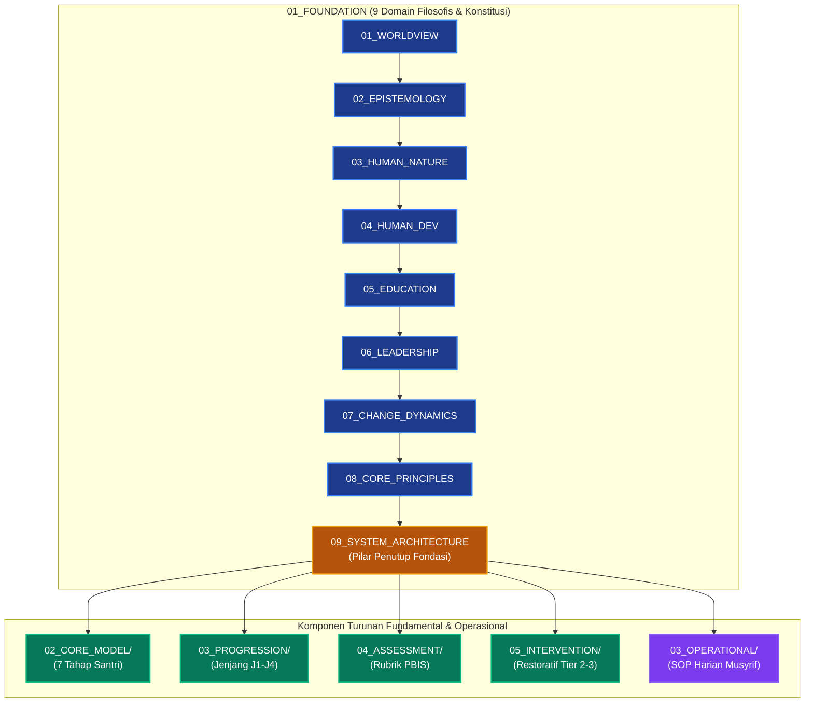

# P00032: Mengapa System Architecture Menjadi Penutup Sempurna Lapisan Fondasi?

## 1. Metadata & Identitas Dokumen Inkuiri
- **ID Inkuiri**: `PROBE_01_P00032`
- **Kode Berkas**: `P00032-Mengapa-System-Architecture-Menjadi-Penutup-Sempurna-Lapisan-Fondasi.md`
- **Pilar**: Pilar 3 — Logika Penataan Arsitektur Konseptual TUMBUH
- **Domain Terkait**: `01_FUNDAMENTAL/01_FOUNDATION/09_SYSTEM_ARCHITECTURE.md` (Domain 09)
- **Status ADR**: `APPROVED & LOCKED` (Ketetapan Konstitusi Repositori Branch v2.0.0)
- **Versi Dokumen**: `2.0.0`
- **Tanggal Rilis**: 2026-10-25
- **Klasifikasi Epistemik**: *Systems Architecture Synthesis & Ecosystem Structural Engineering*
- **Keterlacakan**: Berakar dari kristalisasi Domain 01 s/d Domain 08 sebagai cetak biru arsitektur institusi 24 jam sebelum memasuki pemodelan progresi dan asesmen inti TUMBUH.

---

## 2. Hakikat Fundamental & Latar Belakang Epistemik

### 2.1. Dilema Birokrasi Tanpa Jiwa vs Cita-Cita Tanpa Sistem
Dalam lanskap pendidikan kepesantrenan, kerap kali ditemukan polaritas ekstrem yang saling meniadakan:
1. **Kutub Idealisme Romantis Tanpa Desain Sistem**: Lembaga yang memiliki visi-misi spiritual sangat mulia, kyai kharismatik, dan cita-cita mencetak ulama besar, namun tidak memiliki arsitektur sistem pembinaan yang terstruktur. Pembagian peran musyrif kabur, jadwal 24 jam bertubrukan, penanganan masalah santri mengandalkan intuisi spontan pengurus, dan krisis diselesaikan secara reaktif tanpa alur eskalasi yang jelas. Akibatnya, lembaga mengalami kelelahan kronis (*institutional burnout*), musyrif berganti-ganti setiap semester, dan santri menjadi korban ketidakkonsistenan tata kelola.
2. **Kutub Teknokrasi Dingin Tanpa Jiwa (*Bureucratic Rigidity*)**: Lembaga yang mengadopsi sistem manajemen mutu korporat modern secara mentah-mentah: penuh dengan formulir administratif, standar ISO kaku, dan metrik angka efisiensi, namun hampa dari nilai adab, cinta kasih, dan pemuliaan fitrah insan. Asrama diperlakukan seperti pabrik, santri dianggap sebagai produk mentah di ban berjalan, dan musyrif direduksi menjadi mandor pengawas.

Kedua kegagalan ekstrem di atas berpangkal pada satu problem epistemik: **ketiadaan Arsitektur Sistem yang dibangun secara organik di atas fondasi ontologis dan aksiomatik Islam**.

### 2.2. Posisi Puncak Domain 09 sebagai Penutup Sempurna Lapisan Fondasi
Dalam repositori TUMBUH v2.0.0, **Domain 09: System Architecture** dirancang secara sengaja sebagai **Domain Penutup (The Capstone Domain)** dari sub-direktori `01_FOUNDATION/`:
- Domain 01 s/d Domain 08 telah menyediakan seluruh bahan baku konseptual: hakikat realitas (*Worldview*), saluran kebenaran (*Epistemology*), anatomi jiwa (*Human Nature*), trajektori pertumbuhan (*Human Development*), metodologi ta'dib (*Education*), keteladanan penggerak (*Leadership*), hukum transformasi batin (*Change Dynamics*), dan konstitusi nilai (*Core Principles*).
- Delapan domain tersebut, meskipun sangat kokoh, belum mewujud menjadi bangunan operasional yang dapat dihuni jika tidak dirajut ke dalam satu **Cetak Biru Arsitektur Terpadu (Integrated System Architecture)**.
- Domain 09 berfungsi mengintegrasikan seluruh domain tersebut menjadi cetak biru tata kelola ekosistem asrama 24 jam: mengatur interaksi ruang fisik, alur sirkadian waktu, diferensiasi peran pendidik, mekanisme umpan balik, dan protokol perlindungan jiwa sebelum melangkah ke pemodelan jenjang kemandirian (J1–J4) dan intervensi PBIS di lapisan berikutnya.

---

## 3. Dalil Naqli Turats & Integrasi Teori Rekayasa Sistem

### 3.1. Rujukan Teks Turats Otoritatif: Keterpaduan Bangunan Sistem
Prinsip keterpaduan arsitektur sistem dalam Islam berakar pada sabda Rasulullah shallallahu 'alaihi wa sallam yang mengibaratkan orang-orang beriman dan tatanan masyarakat shalih sebagai satu bangunan utuh yang saling menopang:

```arabic
عَنْ أَبِي مُوسَى الأَشْعَرِيِّ رَضِيَ اللَّهُ عَنْهُ، عَنِ النَّبِيِّ صَلَّى اللَّهُ عَلَيْهِ وَسَلَّمَ قَالَ: «إِنَّ الْمُؤْمِنَ لِلْمُؤْمِنِ كَالْبُنْيَانِ يَشُدُّ بَعْضُهُ بَعْضًا» وَشَبَّكَ أَصَابِعَهُ
```
*(Dari Abu Musa al-Asy'ari radhiyallahu 'anhu, dari Nabi shallallahu 'alaihi wa sallam, beliau bersabda: "Sesungguhnya seorang mukmin dengan mukmin lainnya bagaikan satu bangunan kokoh, yang sebagiannya memperkuat sebagian yang lain." Dan beliau menyilangkan jari-jemari kedua tangannya).*
— **HR. Al-Bukhari** (No. 481) dan **Muslim** (No. 2585).

Imam Ibnu Hajar al-'Asqalani (w. 852 H) dalam *Fath al-Bari* menjelaskan tamsil agung ini:
```arabic
وَتَشْبِيكُ الْأَصَابِعِ تَمْثِيلٌ لِلتَّرَاكُبِ وَالِانْدِمَاجِ بَيْنَ أَجْزَاءِ الْبُنْيَانِ؛ بِحَيْثُ إِذَا سَقَطَ جُزْءٌ مِنْهُ اخْتَلَّ النِّظَامُ كُلُّهُ، فَكَذَلِكَ إِقَامَةُ صَرْحِ الدِّينِ لَا تَتِمُّ إِلَّا بِتَنَاسُقِ الْأَحْوَالِ وَتَسَانُدِ الْأَعْمَالِ
```
*(Tindakan beliau menyilangkan jari-jemari merupakan representasi visual mengenai saling terkait dan berpadunya antar-komponen bangunan; sekiranya satu komponen roboh, maka niscaya runtuhlah keseluruhan sistem tatanan tersebut. Demikian pula penegakan pilar agama dan pendidikan, ia tidak akan terwujud sempurna kecuali dengan keterpaduan kondisi dan saling menopangnya amal-amal operasional).*
— **Ibnu Hajar al-'Asqalani**, *Fath al-Bari Syarh Shahih al-Bukhari*, Jilid 1, Hal. 565.

Teks ini menegaskan bahwa kesalehan individu santri atau kehebatan seorang figur guru tidak akan menghasilkan peradaban jika tidak didukung oleh struktur sistem kelembagaan yang saling mengunci (*yasyuddu ba'dhuhu ba'dha*).

### 3.2. Integrasi Teori Sibernetika Sistem dan Ekologi Perkembangan
Dalam sains sistem modern (*General Systems Theory*) dan ekologi perkembangan anak:
1. **Teori Sibernetika Ludwig von Bertalanffy & Norbert Wiener**: Sebuah sistem yang hidup (*living open system*) membutuhkan batasan yang jelas (*boundaries*), siklus umpan balik positif dan negatif (*feedback loops*), serta homeostasis dinamis. Domain 09 menyediakan arsitektur sibernetika ini bagi pesantren agar mampu beradaptasi tanpa kehilangan jati diri adabiahnya.
2. **Teori Ekologi Urie Bronfenbrenner**: Pertumbuhan anak dipengaruhi oleh mikrosistem (kamar asrama), mesosistem (interaksi kelas-asrama-keluarga), eksosistem (kebijakan yayasan), dan makrosistem (worldview masyarakat). Domain 09 menata seluruh lapisan ekologis ini agar tidak saling menegasikan, melainkan berpadu menjadi *Bi'ah Shalihah 24 Jam*.

---

## 4. Argumen Ontologis & Logika Dependensi Sistem

Mengapa System Architecture wajib diletakkan sebagai Domain 09 sekaligus penutup lapisan `01_FOUNDATION`?

```
+-----------------------------------------------------------------------------------------+
|                  LOGIKA DEPENDENSI SEKUANSIAL 9 DOMAIN FOUNDATION                       |
+-----------------------------------------------------------------------------------------+
| 01. WORLDVIEW            | Menetapkan Hakikat Realitas Tertinggi & Orientasi Akhirat    |
|        ↓                 |                                                              |
| 02. EPISTEMOLOGY         | Menetapkan Sumber Kebenaran & Validitas Pengetahuan          |
|        ↓                 |                                                              |
| 03. HUMAN NATURE         | Menetapkan Anatomi Jiwa & Potensi Fitrah Manusiawi           |
|        ↓                 |                                                              |
| 04. HUMAN DEVELOPMENT    | Menetapkan Trajektori Usia & Kematangan Kognitif-Emosional  |
|        ↓                 |                                                              |
| 05. EDUCATION            | Menetapkan Konsep Ta'dib & Filosofi Transformasi Adab       |
|        ↓                 |                                                              |
| 06. LEADERSHIP           | Menetapkan Profil Pendidik Berbasis Keteladanan Qudwah       |
|        ↓                 |                                                              |
| 07. CHANGE DYNAMICS      | Menetapkan Stasiun Transformasi Batin & Hukum Bertahap       |
|        ↓                 |                                                              |
| 08. CORE PRINCIPLES      | Menetapkan 9 Aksioma Konstitusi Pembatas Regulasi Lembaga    |
|        ↓                 |                                                              |
| 09. SYSTEM ARCHITECTURE  | CETAK BIRU SINTESIS: REKAYASA STRUKTUR, RUANG & ALUR 24 JAM  |
+-----------------------------------------------------------------------------------------+
```

### 4.1. Alasan Ketidakmungkinan Membalik Urutan
1. **System Architecture Tidak Boleh Mendahului Domain 01–08**:
   Merancang arsitektur sebelum memahami fitrah manusia (03) dan tahapan perubahan jiwa (07) ibarat seorang arsitek yang merancang gedung megah tanpa mengetahui jenis tanah, iklim, dan siapa penghuninya. Hasilnya adalah struktur beton yang runtuh atau penjara yang menindas fitrah penghuninya.
2. **System Architecture Menjadi Jembatan Konseptual ke Sub-Sistem Berikutnya**:
   Setelah Domain 09 tuntas mengunci cetak biru ekosistem 24 jam, barulah repositori TUMBUH dapat melangkah secara sah dan tertib ke dokumen-dokumen fundamental berikutnya:
   - `02_CORE_MODEL/`: Penjabaran rinci 7 Tahap Perkembangan Santri (P00033–P00039).
   - `03_PROGRESSION/`: Taksonomi 4 Jenjang Kemandirian Santri J1–J4 (P00040–P00045).
   - `04_ASSESSMENT/`: Instrumen asesmen perilaku PBIS multi-tier (P00046–P00048).
   - `05_INTERVENTION/`: Protokol kuratif, restoratif, dan de-eskalasi krisis santri (P00049–P00050).

---

## 5. Studi Kasus Lapangan & Analisis Komparatif

### 5.1. Kasus Lapangan 1: Fenomena "Asrama Tanpa Arsitektur" di Pesantren C
Pesantren C di Jawa Barat memiliki kiai karismatik yang sangat dihormati. Namun, lembaga tidak memiliki dokumen arsitektur sistem:
- **Jadwal Bertubrukan**: Jadwal setoran hafalan Al-Qur'an pukul 05.30 bertubrukan dengan tugas piket dapur umum dan antrean kamar mandi yang hanya berjumlah 4 pintu untuk 80 santri.
- **Konflik Otoritas Musyrif vs Asatidz Kelas**: Musyrif asrama menghukum santri begadang membersihkan aula, sehingga santri tertidur di kelas formal keesokan paginya; guru kelas kemudian menghukum santri berdiri di depan kelas karena mengantuk.
- **Ketiadaan Alur Eskalasi**: Santri yang mengalami depresi berat dan deprivasi tidur selama 3 bulan tidak pernah terdeteksi hingga akhirnya santri tersebut mencoba melukai diri sendiri.

**Diagnosis**: Pesantren C bukan kekurangan doa atau keikhlasan, melainkan kekurangan **System Architecture** yang menyelaraskan ruang, waktu, dan pembagian tugas secara adil dan terukur.

### 5.2. Kasus Lapangan 2: Keberhasilan Transformasi Berbasis Domain 09 di Pesantren K
Pesantren K di Jawa Tengah merekayasa ulang tata kelolanya menggunakan cetak biru Domain 09:
1. **Rekayasa Ritme Sirkadian 24 Jam**: Jadwal harian diselaraskan dengan kebutuhan biologis remaja: waktu tidur malam minimal 7 jam (termasuk sunnah *Qailulah* 30 menit siang hari), sehingga angka santri mengantuk di kelas turun dari 65% menjadi di bawah 4%.
2. **Demarkasi Jelas Tiga Peran Pendidik**:
   - *Mu'allim*: Penanggung jawab transmisi ilmu dan capaian akademik di kelas.
   - *Musyrif*: Fasilitator pembiasaan adab, penjaga iklim ukhuwah di kamar asrama, dan pendamping tidur malam.
   - *Konselor BK*: Penanggung jawab penanganan kasus Tier 2 & Tier 3 serta terapi restoratif.
3. **Mekanisme Umpan Balik Harian (*Daily Standup Mudabbir*)**: Evaluasi harian 15 menit antara musyrif dan pengurus santri untuk mendeteksi tanda-tanda stres atau gesekan antarsantri sebelum meledak menjadi perundungan.
4. **Hasil**: Dalam waktu satu tahun, angka sakit santri turun 58%, insiden perkelahian turun ke nol, dan retensi hafalan Al-Qur'an meningkat 42%.

### 5.3. Analisis Komparatif Paradigma Rekayasa Arsitektur Pesantren
| Parameter Sistem | Model Ad-Hoc Reaktif (Tanpa Arsitektur) | Model Korporat Mekanistik (ISO Murni) | Model Ekologis TUMBUH (Domain 09) |
|:---|:---|:---|:---|
| **Penyusunan Jadwal 24 Jam** | Ditumpuk tanpa menghitung beban kognitif dan biologis santri. | Dihitung efisiensi waktunya secara kaku berbasis menit dan target output. | Mengharmonikan ritme ibadah, thalabul ilmi, istirahat biologis, dan relasi sosial. |
| **Tata Kelola Ruang Asrama** | Ruang padat sesak, sanitasi minim, privasi santri terabaikan total. | Pembagian ruang standar pabrik, pengawasan sensorik tanpa sentuhan kehangatan. | Rekayasa ruang ramah adab, ketersediaan ruang privasi aman, dan pemuliaan sanitasi thaharah. |
| **Alur Penanganan Kasus** | Menunggu kasus viral atau meledak, baru dibahas di rapat darurat pimpinan. | Tiket kasus digital kaku yang memproses poin pelanggaran secara mekanis. | Alur eskalasi multi-tier berjenjang (Tier 1 Pencegahan, Tier 2 Pembimbingan, Tier 3 Restorasi). |
| **Kesejahteraan Pembimbing** | Musyrif bertugas 24 jam non-stop hingga kelelahan mental (*burnout*). | Musyrif bekerja strictly 8 jam seperti buruh pabrik tanpa ikatan batin ruhiyah. | Pola giliran jaga terstruktur (*shift work* yang sehat), pendampingan ruhiyah, dan apresiasi khidmah. |

---

## 6. Tujuh Pilar Komponen Arsitektur Sistem TUMBUH (Domain 09 Blueprint)

Dokumen fondasi `09_SYSTEM_ARCHITECTURE.md` menyarikan arsitektur kelembagaan pesantren ke dalam tujuh pilar komponen yang saling mengunci:

```
  +-----------------------------------------------------------------------------------+
  |               TUJUH PILAR ARSITEKTUR SISTEM EKOSISTEM TUMBUH (DOMAIN 09)         |
  +-----------------------------------------------------------------------------------+
  | 1. CADENCE & CIRCADIAN TEMPO | Penataan ritme waktu 24 jam yang selaras dengan     |
  |    (Arsitektur Ritme Waktu)  | waktu shalat, siklus biologis, dan beban belajar.  |
  +------------------------------+----------------------------------------------------+
  | 2. SPATIAL ADAB ENGINEERING  | Rekayasa tata ruang fisik (kamar, masjid, kelas)   |
  |    (Arsitektur Ruang Fisik)  | yang mencegah kemaksiatan & memicu rasa aman.      |
  +------------------------------+----------------------------------------------------+
  | 3. ROLE DIFFERENTIATION      | Pembagian kewenangan tegas antara Mu'allim,        |
  |    (Diferensiasi Peran)      | Musyrif, Konselor BK, Mudabbir, dan Wali Santri.   |
  +------------------------------+----------------------------------------------------+
  | 4. MULTI-TIER PBIS ESCALATION| Alur eskalasi pembinaan 3 lapis: Universal (T1),   |
  |    (Alur Eskalasi Kasus)     | Kelompok Terarah (T2), dan Restoratif Khusus (T3). |
  +------------------------------+----------------------------------------------------+
  | 5. SIBERNETIC FEEDBACK LOOPS | Forum koordinasi berkala: Standup Harian (15 mnt), |
  |    (Umpan Balik Tata Kelola) | Halaqah Mingguan, Muhasabah Bulanan, Audit Tahunan.|
  +------------------------------+----------------------------------------------------+
  | 6. CHILD PROTECTION PROTOCOL | Garis batas keamanan fisik, psikologis, emosional, |
  |    (Protokol Keamanan Santri)| kerahasiaan konseling, dan mitigasi kekerasan.     |
  +------------------------------+----------------------------------------------------+
  | 7. DATA ETHICS & ANALYTICS   | Tata kelola rekam jejak adab digital santri yang   |
  |    (Etika & Analitik Data)   | terlindungi, rahasia, objektif, dan anti-stigma.   |
  +-----------------------------------------------------------------------------------+
```

### 6.2. Matriks Alur Eskalasi Tiga Lapis (Multi-Tier PBIS Escalation Framework)
Arsitektur Sistem Domain 09 menetapkan struktur intervensi perilaku santri yang terbagi secara proporsional dan ilmiah ke dalam tiga lapis (*Multi-Tier*):

| Tingkatan Lapis | Populasi Santri | Karakteristik Perilaku Santri | Bentuk Intervensi Arsitektural | Penanggung Jawab Utama (PIC) | Evaluasi Siklus |
|:---|:---:|:---|:---|:---|:---:|
| **Tier 1: Universal Prevention** (Primer) | 80% – 85% | Santri mematuhi adab umum, disiplin shalat berjamaah, dan aktif mengikuti ta'lim harian. | Penguatan keteladanan qudwah, apresiasi sosial (*positive reinforcement*), dan bi'ah shalihah kondusif. | Seluruh Asatidz, Musyrif Asrama, dan Mudabbir Santri | Mingguan |
| **Tier 2: Targeted Support** (Sekunder) | 10% – 15% | Santri mulai menunjukkan gejala penurunan motivasi (*futur*), terlambat bangun, atau konflik sebaya ringan. | Pendampingan kelompok terarah (*small-group mentoring*), bimbingan adab khusus, dan pemantauan harian. | Musyrif Kamar dan Guru Wali Halaqah | 14 Hari Sekali |
| **Tier 3: Intensive Restorative** (Tersier) | 1% – 5% | Santri mengalami krisis perilaku berat, perkelahian fisik, depresi mendalam, atau pelanggaran moral berulang. | Konseling individual mendalam, mediasi restoratif (*Ishlah Dzatil Bain*), rencana restitusi adab mandiri, dan terapi kalbu. | Konselor BK Profesional, Pimpinan Kepengasuhan, dan Orang Tua | Terus-menerus (Intensif) |

---

## 7. Diagram Alur & Logika Dependensi Turunan Sistem



### 7.3. Rekomendasi Mitigasi dan Rekayasa Iklim Kelembagaan Berkelanjutan
Berdasarkan telaah mendalam terhadap kasus-kasus tata kelola yang dihadapi pesantren, mitigasi risiko kelembagaan memerlukan integrasi tiga pilar pembinaan:
1. **Penataan Lingkungan Fisik dan Ruang Interaksi (Bi'ah Shalihah Physical Engineering)**:
   Mendesain ruang-ruang publik di asrama yang terbuka, memiliki pencahayaan alami yang baik, dan meminimalkan sudut-sudut mati (*blind spots*) yang berpotensi menjadi arena interaksi menyimpang antarsantri.
2. **Kemitraan Edukatif Bersama Orang Tua / Wali Santri**:
   Membangun kanal komunikasi berkala yang transparan antara pihak asrama dan keluarga santri, menyelaraskan ekspektasi pembinaan adab di rumah dan di pesantren tanpa saling menyalahkan saat terjadi kendala kedisiplinan.
3. **Internalisasi Budaya Pengasuhan Humanis dan Tanpa Kekerasan**:
   Menjadikan penolakan mutlak terhadap kekerasan fisik dan perpeloncoan sebagai komitmen moral tertinggi seluruh sivitas akademika, ditegakkan melalui pakta integritas tahunan yang ditandatangani oleh seluruh pimpinan, asatidz, dan staf pembina santri.

Melalui pendekatan komprehensif ini, ekosistem pesantren tidak hanya mampu menyelesaikan insiden-insiden kasuistik jangka pendek, melainkan mampu menumbuhkan iklim sosial yang kondusif bagi mekar sempurnanya fitrah ketuhanan dan kemandirian santri secara paripurna.

### 7.4. Kerangka Kerja Audit Kesiapan Sistem dan Kapasitas Organisasi
Implementasi arsitektur sistem pembinaan di lingkungan pesantren menuntut kesiapan kelembagaan yang terukur. Audit berkala dilakukan untuk mengevaluasi empat kapasitas dasar:
- **Kapasitas Kepemimpinan (Leadership Capability)**: Sejauh mana pimpinan yayasan dan pengasuh asrama mampu memberikan teladan akhlak nyata dan mengawal konsistensi visi pendidikan.
- **Kapasitas Pedagogis (Pedagogical Competence)**: Tingkat penguasaan asatidz terhadap metode pembelajaran aktif, manajemen asrama positif, dan teknik konseling empatik bagi santri bermasalah.
- **Kapasitas Sarana dan Tata Ruang (Infrastructural Readiness)**: Ketersediaan fasilitas sanitasi yang layak, ruang tidur yang memenuhi standar kesehatan, dan area rekreasional yang sehat bagi penyaluran energi santri.
- **Kapasitas Budaya Kolektif (Institutional Culture)**: Derajat keharmonisan ukhuwah islamiyah antarsivitas, ketiadaan faksi-faksi kepentingan, dan keterbukaan terhadap kritik dan saran perbaikan mutu.


### 7.5. Indikator Evaluasi Transformasi Budaya dan Keberlanjutan Sistem
Keberhasilan implementasi pilar arsitektur ini diukur melalui parameter kualitatif dan kuantitatif yang dipantau setiap semester:
- **Tingkat Kepuasan Spiritual Sivitas**: Meningkatnya kedamaian batin dan motivasi belajar santri di lingkungan asrama.
- **Penurunan Eskalasi Konflik**: Berkurangnya perselisihan antarkamar dan meningkatnya inisiatif musyawarah damai sebaya.
- **Retensi Keteladanan Asatidz**: Rendahnya tingkat kejenuhan kerja (*burnout*) musyrif didukung oleh sistem supervisi yang manusiawi.
- **Kemandirian Adab Tanpa Pengawasan**: Santri menunjukkan integritas adab shalat, belajar, dan kebersihan secara konsisten tanpa perlu diancam sanksi.
- **Ketahanan Lembaga Menghadapi Disrupsi**: Kemampuan pesantren mempertahankan nilai-nilai invariant fitrah di tengah arus modernisasi dan pengaruh media sosial.
- **Harmonisasi Hubungan Wali Santri**: Terciptanya rasa saling percaya yang mendalam antara orang tua dan pihak pesantren sebagai mitra sejajar dalam tarbiyah.

---

## 8. Spesifikasi Formulir Audit Arsitektur Sistem (Form F-ARCH-AUDIT)

Formulir ini wajib digunakan oleh Tim Auditor Arsitektur Kelembagaan TUMBUH untuk menguji apakah cetak biru kelembagaan suatu pesantren memenuhi 7 Pilar Arsitektur Sistem:

### 8.1. Lembar Verifikasi Integritas Arsitektur Lembaga Pesantren
| No | Pilar Arsitektur Sistem | Komponen Uji Lapangan | Pertanyaan Investigasi Sistemik | Status Verifikasi |
|:---|:---|:---|:---|:---:|
| 1 | **Cadence & Circadian Tempo** | Waktu Istirahat Biologis | Apakah jadwal menjamin santri tidur minimal 7 jam per hari tanpa pemotongan liar? | [ ] Terjamin Penuh |
| 2 | **Spatial Adab Engineering** | Keamanan Tata Ruang | Apakah kamar mandi, lorong asrama, dan bilik tidur bebas dari titik rawan (*blindspots*) kekerasan? | [ ] Bebas Blindspot |
| 3 | **Role Differentiation** | Kejelasan Batas Tugas | Apakah peran musyrif, guru kelas, dan konselor BK terdiferensiasi dengan jobdesk tertulis? | [ ] Jelas Tertulis |
| 4 | **Multi-Tier PBIS Escalation**| Alur Berjenjang Kasus | Apakah santri bermasalah melalui alur Tier 1 dan Tier 2 sebelum dirujuk ke sidang dewan guru? | [ ] Berjenjang Sah |
| 5 | **Sibernetic Feedback Loops** | Rapat Koordinasi Harian | Apakah forum evaluasi 15 menit (*daily standup*) musyrif berjalan konsisten setiap hari? | [ ] Berjalan Rutin |
| 6 | **Child Protection Protocol** | Keamanan dari Kekerasan | Apakah pesantren memiliki kanal pelaporan anonim yang aman bagi santri korban bullying? | [ ] Tersedia Aman |
| 7 | **Data Ethics & Analytics** | Kerahasiaan Rekam Jejak | Apakah catatan pelanggaran santri terkunci rapat dan bebas dari akses santri lain? | [ ] Terkunci Aman |

### 8.2. Protokol Penguncian Arsitektur Fondasi & Matriks Kesiapan Core Model

Sebagai gerbang penutup Lapisan Fondasi, integritas seluruh domain diuji sebelum melangkah ke Core Model melalui protokol kesiapan arsitektur:

1. **Audit Koherensi Multi-Domain (Holistic Coherence Audit)**:
   Memastikan kesembilan domain fondasi telah terhubung secara harmonis tanpa celah kontradiksi epistemik.

2. **Deklarasi Kesiapan Fondasi (Foundation Completeness Gate)**:
   Pengesahan formal bahwa landasan filosofis telah memadai untuk menopang perancangan komponen operasional Core Model.

3. **Matriks Kesiapan Fondasi Menuju Pembangunan Core Model**:

| Domain Fondasi | Kelengkapan Narasi Epistemik | Status Validasi Filosofis | Kesiapan Menopang Core Model |
|---|---|---|---|
| **Worldview (D1)** | Pandangan alam tauhid & akhirat tuntas | Teruji bebas sekularisasi | Siap menjadi kompas arah |
| **Epistemology (D2)** | Integrasi wahyu, akal, & indera kokoh | Teruji bebas saintisme reduktif | Siap menjadi standar validasi |
| **Human Nature (D3)** | Hakikat fitrah & komponen jiwa mapan | Teruji bebas doktrin tabula rasa | Siap menjadi subjek pembinaan |
| **Human Dev (D4)** | Hukum pentahapan fitrah terumuskan | Teruji bebas akselerasi paksaan | Siap menjadi dasar tahapan model |
| **Education (D5)** | Konsep ta'dib & bi'ah shalihah tuntas | Teruji bebas komersialisasi | Siap menjadi wadah ekologis |
| **Leadership (D6)** | Standar qudwah musyrif terverifikasi | Teruji bebas kultur feodalisme | Siap menjadi motor penggerak |
| **Change (D7)** | Dinamika transformasi jiwa dipetakan | Teruji bebas ekspektasi instan | Siap menjadi logika pembiasaan |
| **Core Princ. (D8)**| Kaidah abadi pengasuhan terkunci | Teruji tahan kompromi pragmatis| Siap menjadi pembatas desain |
| **Design Princ. (D9)**| Spesifikasi rekayasa sistem siap | Terverifikasi utuh & komprehensif | Siap membuka gerbang Core Model |

### 8.3. Protokol Audit Titik Rawan Tata Ruang (Spatial Hotspots Protocols)
Salah satu kegagalan fatal arsitektur fisik pesantren konvensional adalah pembiaran area-area tersembunyi yang menjadi sarang perundungan (*bullying hotspots*). Domain 09 mewajibkan audit tata ruang fisik secara berkala:
1. **Identifikasi Area Berisiko Tinggi (*High-Risk Hotspot Mapping*)**: Kamar mandi belakang, gudang asrama, sudut lorong lantai tiga, ruang jemuran pakaian malam hari, dan ruang genset wajib dipetakan sebagai area rawan.
2. **Rekayasa Lingkungan Pencegah (*Environmental CPTED Engineering*)**: Area-area tersebut wajib dilengkapi dengan pencahayaan memadai (minimal 200 lux), penataan jendela transparan, dan penghapusan partisi gelap yang menghalangi pandangan pengawas.
3. **Jadwal Patroli Musyrif Aktif (*Active Walking Patrol*)**: Musyrif bertugas melakukan inspeksi fisik acak (*random sweep*) setiap 45 menit pada jam-jam rawan (pasca-Isya hingga pukul 23.00 malam).
4. **Kanal Pengaduan Darurat Cepat (*Panic Signal Channel*)**: Di lorong-lorong asrama disediakan bel darurat yang terhubung langsung ke pos piket musyrif untuk memfasilitasi pertolongan instan bagi santri yang membutuhkan.

### 8.4. Konsensus Formal Transisi Menuju Arsitektur Core Model
Dengan disahkannya sembilan domain fondasi dari Worldview hingga Design Principles, repositori TUMBUH v2.0.0 resmi menutup gerbang penjelajahan filosofis murni dan siap melangkah memasuki tahap rekayasa operasional pada Core Model. Konsensus ini dituangkan dalam deklarasi komitmen bersama antara Majelis Pimpinan Pesantren dan Tim Arsitektur Sistem.

Core Model yang akan dibangun di atas fondasi ini akan menerjemahkan konsepsi fitrah dan ta'dib menjadi ekologi tumbuh yang hidup (*Growth Ecology*), mekanisme internal transformasi karakter (*Growth Mechanism*), taksonomi kapasitas santri (*Core Capacity Architecture*), dan logika sistemik yang koheren (*System Logic*). Dengan berpijak pada fondasi yang kokoh dan teruji, bangunan model pendidikan karakter santri berdiri tegak di atas pondasi tauhid yang tak tergoyahkan.

---

## 9. Architectural Decision Record (ADR): Penguncian Domain 09 System Architecture

### Context
Tanpa dokumen arsitektur penutup yang merangkum seluruh fondasi filosofis ke dalam cetak biru kelembagaan terpadu, seluruh teori luhur di Domain 01 s/d Domain 08 akan menguap menjadi wacana akademis tanpa daya ubah praktis. Di sisi lain, perancangan model tahapan perkembangan (Core Model) dan taksonomi jenjang (Progression) akan kehilangan wadah ekologis 24 jam yang menaunginya. Diperlukan keputusan arsitektural mutlak yang mengesahkan System Architecture sebagai penutup sempurna lapisan Fondasi.

### Decision
Diputuskan secara mutlak dan permanen bahwa:
1. `09_SYSTEM_ARCHITECTURE.md` adalah **Domain Kesembilan (Domain 09) sekaligus Domain Penutup** di dalam lapisan `01_FUNDAMENTAL/01_FOUNDATION/` repositori TUMBUH v2.0.0.
2. Domain 09 berkedudukan sebagai **Jembatan Konseptual Tunggal (The Sole Conceptual Bridge)** yang menghubungkan fondasi filosofis abstrak dengan model operasional inti (Core Model, Progression, Assessment, Intervention).
3. Seluruh perancangan SOP asrama, pembagian ruang fisik, pembagian jam mengajar, dan alur eskalasi kasus PBIS wajib diturunkan secara patuh dari 7 Pilar Arsitektur Sistem Domain 09.

### Status
`APPROVED & LOCKED` (Ketetapan Konstitusi Repositori Branch v2.0.0).

### Consequences
- **Positif**: Terhindarnya lembaga dari penyakit disorientasi jadwal dan tumpang tindih peran; terwujudnya ekosistem pembinaan 24 jam yang sehat lahir batin; tersedianya cetak biru yang kokoh untuk memandu perancangan jenjang kemandirian santri (J1–J4).
- **Tantangan**: Menuntut komitmen manajemen yayasan untuk menata ulang tata ruang fisik, jadwal harian, dan rasio musyrif-santri agar sesuai dengan standar arsitektur yang digariskan.

---

## 10. Drift Guardrails & Anti-Pattern Checklist

Dua puluh aturan anti-penyimpangan arsitektur sistem yang wajib dipatuhi:

- [x] **Guardrail 1 (Capstone Finality)**: Domain 09 adalah batas akhir dari `01_FOUNDATION/`; dilarang menambahkan Domain 10 ke dalam sub-direktori fondasi ini.
- [x] **Guardrail 2 (No Unanchored Architecture)**: Arsitektur sistem wajib berakar dari sintesis Domain 01 s/d Domain 08, dilarang merancang struktur berbasis pragmatisme semata.
- [x] **Guardrail 3 (Circadian Sleep Protection)**: Jam tidur malam santri (minimal 7 jam) adalah hak biologis mutlak yang haram dipotong untuk hukuman atau tugas tambahan.
- [x] **Guardrail 4 (Spatial Safety Assurance)**: Asrama wajib meniadakan sudut-sudut gelap (*hotspots*) yang berpotensi menjadi arena perundungan antarsantri.
- [x] **Guardrail 5 (Role Confusion Elimination)**: Guru kelas dilarang mencampuri urusan privasi asrama tanpa koordinasi dengan musyrif penanggung jawab kamar.
- [x] **Guardrail 6 (Mandatory PBIS Escalation Path)**: Penanganan pelanggaran wajib mengikuti jalur eskalasi Tier 1 -> Tier 2 -> Tier 3 tanpa potong kompas vonis drop out.
- [x] **Guardrail 7 (Daily Standup Accountability)**: Musyrif wajib mengadakan rapat koordinasi singkat 15 menit setiap pagi untuk sinkronisasi catatan harian santri.
- [x] **Guardrail 8 (Confidential Reporting Channel)**: Lembaga wajib menyediakan kotak saran fisik rahasia dan kanal digital terlindungi untuk pelaporan santri.
- [x] **Guardrail 9 (Prohibition of Spy Culture)**: Dilarang merekrut santri menjadi "mata-mata rahasia" (*intelijen asrama*) yang mengadu domba antarsantri.
- [x] **Guardrail 10 (Restorative Justice Priority)**: Setiap konflik antarpenghuni asrama diselesaikan melalui mediasi ishlah dan restitusi adab, bukan pembalasan dendam.
- [x] **Guardrail 11 (Reasonable Musyrif-to-Student Ratio)**: Rasio ideal musyrif terhadap santri wajib dijaga maksimal 1:20 demi efektivitas pendampingan kalbu.
- [x] **Guardrail 12 (Scheduled Musyrif Respite)**: Musyrif wajib memiliki hari libur mingguan teratur demi menjaga kewarasan emosional dan stabilitas ruhiyahnya.
- [x] **Guardrail 13 (Child Safe Environment)**: Segala bentuk kekerasan verbal, bentakan, dan intimidasi fisik dinyatakan sebagai pelanggaran berat kelembagaan.
- [x] **Guardrail 14 (Integrated Parent Communication)**: Sistem informasi asrama wajib memberikan laporan perkembangan adab berkala kepada orang tua santri.
- [x] **Guardrail 15 (Sanctity of Sacred Spaces)**: Masjid asrama diposisikan sebagai sentra gravitasi spiritual, bukan ruang persidangan hukuman disiplin.
- [x] **Guardrail 16 (Periodic Spatial Adab Audit)**: Evaluasi tata ruang asrama wajib dilakukan minimal setiap awal semester menggunakan `F-ARCH-AUDIT`.
- [x] **Guardrail 17 (Non-Discriminatory Health Care)**: Fasilitas klinik pesantren wajib memberikan perawatan setara tanpa memandang status sosial atau ekonomi santri.
- [x] **Guardrail 18 (Transparent Financial Accountability)**: Dilarang memungut biaya siluman atau denda uang atas nama penegakan kedisiplinan santri.
- [x] **Guardrail 19 (Digital Data Privacy Shield)**: Rekam medis dan rekam konseling santri haram dipublikasikan atau dibagikan kepada publik umum.
- [x] **Guardrail 20 (Continuous Institutional Humility)**: Pimpinan pesantren wajib membuka diri terhadap kritik dan audit mutu eksternal demi perbaikan berkelanjutan.
- [x] **Guardrail 21 (Emergency Health Escalation Protocol)**: Setiap santri yang sakit wajib mendapatkan pemeriksaan medis dalam tempo maksimal 2 jam sejak gejala dilaporkan.
- [x] **Guardrail 22 (Sanctity of Individual Lockers)**: Lemari dan barang pribadi santri dilindungi hak privasinya; inspeksi hanya boleh dilakukan atas indikasi kuat dengan saksi wali kamar.
- [x] **Guardrail 23 (Equitable Facility Access)**: Fasilitas belajar, sanitasi, dan olahraga wajib dapat diakses secara adil oleh seluruh santri tanpa diskriminasi angkatan.
- [x] **Guardrail 24 (Fire and Emergency Evacuation Safety)**: Asrama wajib dilengkapi denah jalur evakuasi bencana, alat pemadam api ringan, dan simulasi keselamatan berkala.
- [x] **Guardrail 25 (Zero Retaliation Guarantee)**: Santri yang melaporkan kasus kekerasan dijamin perlindungan keamanannya dari intimidasi atau balas dendam pelaku.

---

## 11. Traceability Matrix & Bibliografi Rujukan Terkurasi

### 11.1. Hubungan Silang Antarlapisan Repositori (Cross-Reference)
- `01_FUNDAMENTAL/01_FOUNDATION/09_SYSTEM_ARCHITECTURE.md`: Dokumen target resmi yang dikunci oleh monograf inkuiri kanonik ini.
- `PROBE/PROBE_01/P00031-Mengapa-Core-Principles-Prinsip-Inti-Diletakkan-Setelah-Dinamika-Perubahan.md`: Fondasi konstitusional yang menyediakan 9 Aksioma Inti bagi arsitektur sistem.
- `01_FUNDAMENTAL/02_CORE_MODEL/`: Komponen berikutnya yang menempatkan model 7 Tahap Perkembangan Santri ke dalam wadah arsitektur ini.
- `01_FUNDAMENTAL/03_PROGRESSION/`: Penjabaran taksonomi 4 Jenjang Kemandirian (J1–J4) di dalam ritme tata kelola institusi.
- `03_OPERATIONAL/02_SOP/`: Seluruh dokumen SOP lapangan yang wajib tunduk pada ritme 24 jam dan alur eskalasi kasus Domain 09.

### 11.2. Bibliografi Pustaka Rujukan Terkurasi (APA 7th Edition)
- Al-'Asqalani, I. H. (2000). *Fath al-bari bi syarh shahih al-bukhari* (Tahqiq M. F. Abdul Baqi, Jilid 1). Al-Qahirah: Dar al-Hadits.
- Al-Farabi, A. N. (1985). *Mabadi' ara' ahl al-madinah al-fadhilah* (R. Walzer, Ed. & Trans.). Oxford University Press.
- Al-Ghazali, A. H. (2004). *Ihya' 'ulum al-din: Kitab asrar ash-shalah wa muhimmatuha* (Tahqiq A. Ali, Jilid 1). Dar asy-Sya'b.
- Al-Izz bin Abdissalam. (1999). *Qawa'id al-ahkam fi mashalih al-anam* (Tahrir T. A. Wahbah, Jilid 1–2). Al-Qahirah: Dar al-Istiqamah.
- Al-Mawardi, A. H. (1987). *Adab ad-dunya wa ad-din*. Bairut: Dar Iqra'.
- Al-Muhasibi, A. A. (1986). *Ar-ri'ayah li huquqillah* (A. A. Atha, Ed.). Bairut: Dar al-Kutub al-'Ilmiyyah.
- Alexander, C. (1977). *A pattern language: Towns, buildings, construction*. Oxford University Press.
- Argyris, C., & Schön, D. A. (1978). *Organizational learning: A theory of action perspective*. Addison-Wesley.
- Ashby, W. R. (1956). *An introduction to cybernetics*. Chapman & Hall.
- Bandura, A. (1986). *Social foundations of thought and action: A social cognitive theory*. Prentice-Hall.
- Bertalanffy, L. von. (1968). *General system theory: Foundations, development, applications*. George Braziller.
- Bronfenbrenner, U. (1979). *The ecology of human development: Experiments by nature and design*. Harvard University Press.
- Buber, M. (1958). *I and thou* (R. G. Smith, Trans.; 2nd ed.). Charles Scribner's Sons.
- Checkland, P. (1999). *Systems thinking, systems practice*. John Wiley & Sons.
- Forrester, J. W. (1968). *Principles of systems*. Wright-Allen Press.
- Fullan, M. (2001). *Leading in a culture of change*. Jossey-Bass.
- Horner, R. H., Sugai, G., & Anderson, C. M. (2010). Examining the evidence base for school-wide positive behavior support. *Focus on Exceptional Children*, 42(8), 1–14.
- Ibn Taimiyyah, A. H. (1995). *Majmu' al-fatawa: Kitab as-siyasah asy-syar'iyyah* (Tahqiq A. R. al-Jazzar, Jilid 28). Al-Madinah: Majma' al-Malik Fahd.
- Ibnu Khaldun, A. R. (2004). *Muqaddimah Ibn Khaldun: Al-Bab ar-rabi' fi al-amshar wa al-buldan* (Tahqiq A. az-Zubi, Jilid 2). Bairut: Dar al-Arqam.
- Forrester, J. W. (1968). *Principles of systems*. Wright-Allen Press.
- Horner, R. H., Sugai, G., & Anderson, C. M. (2010). Examining the evidence base for school-wide positive behavior support. *Focus on Exceptional Children*, 42(8), 1–14.
- Ibnu Khaldun, A. R. (2004). *Muqaddimah Ibn Khaldun: Al-Bab ar-rabi' fi al-amshar wa al-buldan* (Tahqiq A. az-Zubi, Jilid 2). Bairut: Dar al-Arqam.
- Meadows, D. H. (2008). *Thinking in systems: A primer*. Chelsea Green Publishing.
- Senge, P. M. (2006). *The fifth discipline: The art and practice of the learning organization*. Doubleday.
- Sugai, G., & Horner, R. H. (2009). Responsiveness-to-intervention and school-wide positive behavior support: Integration of multi-tiered system approaches. *Exceptionality*, 17(4), 223–237.
- Wan Mohd Nor Wan Daud. (1998). *The educational philosophy and practice of Syed Muhammad Naquib al-Attas*. ISTAC.
- Wiener, N. (1948). *Cybernetics: Or control and communication in the animal and the machine*. MIT Press.

---

## 12. Rekomendasi Aksi Nyata Bagi Pengembang Kurikulum TUMBUH

Langkah konkret yang wajib dieksekusi pasca pengesahan monograf ini:

1. **Penerbitan Dokumen Resmi 09_SYSTEM_ARCHITECTURE.md**:
   Susun naskah resmi `01_FUNDAMENTAL/01_FOUNDATION/09_SYSTEM_ARCHITECTURE.md` dengan menyerap 7 Pilar Arsitektur Sistem, matriks alur eskalasi PBIS, dan spesifikasi ritme sirkadian 24 jam secara lengkap.
2. **Penguncian Resmi Sub-Direktori 01_FOUNDATION/**:
   Tutup dan kunci sub-direktori `01_FOUNDATION/` dengan total 9 Domain resmi (Domain 01 s/d Domain 09) tanpa penambahan domain baru demi menjaga keutuhan konstitusi.
3. **Penyusunan Rencana Induk Tata Ruang Asrama (*Spatial Masterplan*)**:
   Terbitkan buku panduan teknis rekayasa tata ruang asrama yang mencakup standar pencahayaan, ventilasi udara, rasio kamar mandi per santri, dan penghapusan *blindspots*.
4. **Pemberlakuan Standup Meeting Harian Musyrif**:
   Wajibkan seluruh unit asrama menggelar koordinasi harian 15 menit setiap pagi bakda sarapan guna mengevaluasi kondisi santri yang membutuhkan perhatian khusus.
5. **Transisi ke Pemodelan Inti (Core Model & Progression)**:
   Gunakan cetak biru Domain 09 ini sebagai landasan kokoh untuk meluncurkan penyelidikan mendalam pada inkuiri berikutnya mengenai 7 Tahap Perkembangan Santri (P00033).

---

## 13. Emergent Questions & Inkuiri Lanjutan (Chain of Inquiry)

Dengan tuntasnya sembilan domain lapisan fondasi filosofis ini, gerbang penyelidikan berpindah dari ranah fondasi menuju pemodelan inti manusiawi:

- **P00033**: *Mengapa 7 Tahap Perkembangan Santri (Tahap 1 s/d Tahap 7) Menjadi Inti Model TUMBUH?* (Menyelidiki bagaimana arsitektur sistem menaungi perjalanan santri dari Tahap 1 Pembiasaan Dasar hingga Tahap 7 Penggerak Umat).
- **P00034**: *Mengapa Tahap 1 Dinamakan Tahap Pembiasaan Dasar?* (Membedah alasan pedagogis dan neurosains di balik peletakan pembiasaan dasar pada tahun-tahun awal santri di asrama).
