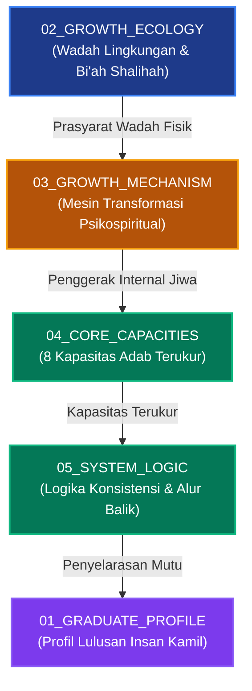

# P00035: Rasionalitas Komponen Pertama Core Model: Mengapa Membutuhkan Growth Ecology (Ekologi Tumbuh)?

## 1. Metadata & Identitas Dokumen Inkuiri
- **ID Inkuiri**: `PROBE_01_P00035`
- **Kode Berkas**: `P00035-Rasionalitas-Komponen-Pertama-Core-Model-Mengapa-Membutuhkan-Growth-Ecology.md`
- **Pilar**: Pilar 3 — Logika Penataan Arsitektur Konseptual TUMBUH
- **Sub-Klaster**: Komponen Substantif Core Model 01 (*Growth Ecology & Bi'ah Shalihah Architecture*)
- **Domain Terkait**: `01_FUNDAMENTAL/03_CORE_MODEL/02_GROWTH_ECOLOGY/`
- **TUMBUH Question**: Mengapa karakter dan adab mulia santri mustahil mekar di ruang hampa biologis, melainkan mutlak menuntut rekayasa ekosistem lingkungan asrama 24 jam yang kondusif (*Bi'ah Shalihah*), dan bagaimana ketiadaan pilar Growth Ecology niscaya merusak seluruh ikhtiar pendidikan karakter di pesantren?
- **Status ADR**: `APPROVED & LOCKED` (Ketetapan Konstitusi Repositori Branch v2.0.0)
- **Versi Dokumen**: `2.0.0`
- **Tanggal Rilis**: 2026-10-25
- **Klasifikasi Epistemik**: *Ecological Systems Theory, Bi'ah Shalihah Engineering, Neurobiology of Space, & Environmental Adab Design*
- **Keterlacakan Silsilah**: Melanjutkan penuntasan `P00033` (Logika Transisi Foundation ke Core Model) dan `P00034` (Poros Tengah Core Model), serta menjadi fondasi ekologis bagi `P00036` (Growth Mechanism).

---

## 2. Abstrak & Epistemic Tension

### 2.1. Abstrak
Penyelidikan kanonik ini membongkar urgensi epistemologis, sosiologis, dan neurobiologis di balik peletakan **Growth Ecology (Ekologi Tumbuh)** sebagai pilar substantif pertama di dalam Model Inti (`03_CORE_MODEL/02_GROWTH_ECOLOGY`) repositori TUMBUH v2.0.0. Pendidikan kepesantrenan kerap terjebak dalam ilusi idealisme voluntaristik (*voluntaristic moralism*): keyakinan naif bahwa adab santri semata-mata ditentukan oleh nasihat lisan, niat batin, dan keikhlasan individu, tanpa memedulikan kondisi fisik ruang tidur, sirkulasi udara kamar, kepadatan sanitasi, dan ritme sirkadian asrama 24 jam. Melalui sintesis konsep *Bi'ah Shalihah* dan *Himayah al-Kiyan* dalam khazanah Islam klasik (Abu Zayd al-Balkhi, Ibnu Khaldun, Al-Mawardi, dan Asy-Syathibi) serta teori ekologi perkembangan (*Bioecological Systems Theory* Urie Bronfenbrenner), pencegahan kejahatan berbasis desain tata ruang (*Crime Prevention Through Environmental Design* / CPTED), dan neurosains beban alostatik (*allostatic load*), monograf ini membuktikan bahwa lingkungan fisik dan sosial asrama adalah wadah penentu (*determining vessel*) bagi aktivasi fitrah. Rekayasa ekologi yang buruk secara ilmiah memicu kelelahan kognitif (*cognitive depletion*), lonjakan hormon stres (kortisol), dan agresi primitif amigdala. Penetapan pilar Growth Ecology menjamin bahwa asrama 24 jam ditata sebagai pelindung martabat kemanusiaan santri, yang dibakukan melalui *Architectural Decision Record* (ADR-PROBE-0035) dan tujuh guardrails arsitektur lingkungan.

### 2.2. Epistemic Tension
Ketegangan mendasar yang diselesaikan berkas ini berpusat pada dialektika: *Apakah adab mendahului lingkungan, ataukah lingkungan yang membentuk adab?* Jika sistem beranggapan bahwa adab mendahului lingkungan secara mutlak, pesantren cenderung menyalahkan kelemahan moral santri dan musyrif (*victim blaming*) ketika terjadi perkelahian atau kejenuhan, padahal akar masalahnya adalah kamar mandi yang mampet, polusi suara, atau waktu tidur yang dirampas secara brutal. Sebaliknya, jika lingkungan fisik dianggap sebagai satu-satunya penentu mutlak, manusia terperosok ke dalam determinisme materialistik sekular yang menafikan kekuatan ruh dan kehendak bebas (*ikhtiyar*). Resolusi TUMBUH menetapkan ekologi sebagai *Syarth at-Tamkin* (prasyarat pemungkin): lingkungan yang sehat tidak otomatis menjadikan seseorang wali tanpa mujahadah personal, namun lingkungan yang rusak, sempit, dan menekan hampir pasti menggagalkan penanaman adab dan merusak fitrah santri secara sistemik.

---

## 3. Pendahuluan Fenomenologis: Anatomi Frustrasi di Kamar Asrama 24 Jam

### 3.1. Ilusi Nasihat Moral di Tengah Kerusakan Spasial (*The Moralizing Mirage*)
Dalam banyak pesantren konvensional, terjadi anomali pedagogis yang berulang setiap semester:
Pimpinan pesantren dan asatidz menggelar pengajian akbar mengenai keutamaan sabar, pemaaf, dan ukhuwah Islamiyyah. Ayat-ayat Al-Qur'an dan mutun hadits dibacakan dengan linangan air mata. Seluruh santri mengangguk khusyuk dan berniat menjadi santri yang berakhlak mulia.

Namun, beberapa jam setelah ceramah usai, ketika malam tiba di kamar asrama:
- Tiga puluh santri berdesakan di kamar berukuran 5x6 meter yang pengap tanpa ventilasi silang (*cross-ventilation*).
- Suhu udara mencapai 32 derajat Celsius dengan kelembapan tinggi, sementara hanya ada satu kipas angin kecil yang berdebu.
- Di pagi hari, 30 santri tersebut harus berebut menggunakan dua unit kamar mandi yang kran airnya mengalir kecil.
- Santri antre dengan handuk basah di pundak; satu santri menggedor pintu karena takut terlambat halaqah subuh; santri di dalam panik; terjadi saling dorong, caci maki, dan baku hantam di depan pintu toilet.

Ketika musyrif datang melerai, musyrif menghukum mereka dengan tuduhan: *"Kalian tidak mengamalkan ceramah sabar tadi siang! Kalian santri yang tidak beradab!"* 

Ini adalah kebutaan arsitektural yang akut. Pendidik menuntut buah kesabaran tingkat tinggi dari dahan biologis yang sedang dicekik oleh stres lingkungan (*environmental distress*). Mengharapkan adab mulia mekar di tengah ruang fisik yang menyesakkan laksana menabur benih kurma unggul di atas hamparan batu cadas tanpa air, lalu memukuli benih tersebut karena tidak kunjung berbuah.

### 3.2. Asrama sebagai "Total Institution" Tanpa Ruang Jeda Sensorik
Sosiolog Erving Goffman mendefinisikan *Total Institution* sebagai institusi sosial tempat sekelompok individu hidup, tidur, belajar, beribadah, dan beraktivitas bersama di bawah satu otoritas tunggal selama 24 jam terus-menerus tanpa privasi (*barrier breakdown*):[^1]
- Di pesantren, santri tidak memiliki ruang jeda pribadi (*restoration sanctuary*). Setiap detik kehidupan mereka terpapar tatapan orang lain.
- Jika asrama tidak memiliki tata kelola zonasi yang jelas—memisahkan zona tidur hening (*deep restorative sleep zone*), zona interaksi komunal (*social interaction zone*), zona belajar tenang (*study zone*), dan zona sanitasi higienis (*hygiene zone*)—maka santri mengalami kejenuhan sosial kronis (*social sensory overload*).
- Akumulasi kejenuhan sensorik ini memicu mekanisme pertahanan teritorial hewani: santri menjadi teritorial, mudah tersinggung oleh senggolan kecil, menimbun makanan di lemari secara rahasia, dan membentuk klik eksklusif (*peer cliques*) yang menindas santri yang lebih lemah.

Kekacauan perilaku ini bukanlah cacat fitrah bawaan santri, melainkan reaksi adaptif biologis dari organisme manusia yang ditaruh di dalam ekosistem yang tidak manusiawi.

### 3.3. Kegagalan Regulasi Perilaku Tanpa Rekayasa Ekologis
Sebagian pesantren mencoba menutupi kegagalan lingkungan ini dengan memperbanyak hukuman retributif: poin pelanggaran dinaikkan, santri disuruh berdiri di lapangan di bawah terik matahari, atau rambut digundul. Pendekatan ini terbukti gagal total secara ilmiah:
1. Menghukum santri yang berkelahi akibat antrean toilet tidak menyelesaikan ketiadaan debit air dan minimnya pintu kamar mandi.
2. Sanksi retributif hanya melahirkan kebencian laten (*repressed hostility*) yang mencari saluran pelampiasan baru pada santri yang lebih junior di lorong-lorong asrama yang gelap.
3. Begitu pengawasan musyrif lengah sedikit saja, agresi meledak kembali dengan intensitas yang lebih destruktif.
Tanpa pembenahan arsitektur lingkungan (*Growth Ecology*), penegakan tata tertib pesantren hanyalah ilusi penjinakan sesaat yang menguras energi dan merusak hubungan kasih sayang (*mahabbah*) antara santri dan pendidik.

---

## 4. Tinjauan Pustaka I: Khazanah Turats Klasik & Hermeneutika Syariat

### 4.1. Hadits Hijrah Ekologis: Penegasan Nabi tentang Pengaruh Lingkungan
Dalil naqli paling otoritatif yang membuktikan bahwa perubahan karakter mustahil terjadi tanpa perubahan ekosistem lingkungan adalah sabda Nabi shallallahu 'alaihi wa sallam dalam kisah seorang pembunuh 100 nyawa dari kalangan Bani Israil yang hendak bertaubat:

```arabic
عَنْ أَبِي سَعِيدٍ الْخُدْرِيِّ رَضِيَ اللَّهُ عَنْهُ، أَنَّ نَبِيَّ اللَّهِ صَلَّى اللَّهُ عَلَيْهِ وَسَلَّمَ قَالَ: «...انْطَلِقْ إِلَى أَرْضِ كَذَا وَكَذَا؛ فَإِنَّ بِهَا أُنَاسًا يَعْبُدُونَ اللَّهَ فَاعْبُدِ اللَّهَ مَعَهُمْ، وَلَا تَرْجِعْ إِلَى أَرْضِكَ؛ فَإِنَّهَا أَرْضُ سَوْءٍ»
```
*(Dari Abu Sa'id al-Khudri radhiyallahu 'anhu, bahwasanya Nabi shallallahu 'alaihi wa sallam bersabda: "...Pergilah engkau ke negeri anu dan anu, karena sesungguhnya di sana terdapat kaum yang senantiasa beribadah kepada Allah, maka beribadahlah kepada Allah bersama mereka; dan janganlah sekali-kali engkau kembali ke negerimu, karena sesungguhnya negerimu adalah lingkungan yang buruk").*
— **HR. Al-Bukhari** (No. 3470) dan **Muslim** (No. 2766).[^2]

Imam An-Nawawi (w. 676 H) dalam *Syarh Shahih Muslim* menjelaskan prinsip kausalitas lingkungan di balik fatwa ulama bani Israil tersebut:

```arabic
قَالَ الْعُلَمَاءُ: فِي هَذَا اسْتِحْبَابُ مُفَارَقَةِ التَّائِبِ الْمَوَاضِعَ الَّتِي أَصَابَ فِيهَا الذُّنُوبَ، وَالْإِخْوَانَ الْمُسَاعِدِينَ لَهُ عَلَى ذَلِكَ... وَأَنْ يَتَبَدَّلَ بِهَا مَشَاهِدَ الْخَيْرِ وَأَهْلَهُ؛ لِأَنَّ الْمُجَاوَرَةَ تُعْدِي، وَالصُّحْبَةَ تُؤَثِّرُ فِي الْأَخْلَاقِ طَبْعًا
```
*(Para ulama menegaskan: Dalam hadits ini terdapat anjuran kuat bagi orang yang bertaubat untuk meninggalkan tempat-tempat di mana ia pernah berbuat maksiat, serta menjauhi kawan-kawan yang membantunya berbuat dosa... dan menggantikannya dengan mendatangi majelis-majelis kebaikan serta orang-orang shalih; karena kedekatan fisik bertetangga itu menular, dan pergaulan secara tabiat niscaya memberi pengaruh kuat pada pembentukan akhlak).*
— **An-Nawawi**, *Al-Minhaj Syarh Shahih Muslim*, Jilid 17, Hal. 83.[^3]

### 4.2. Psikosomatis Abu Zayd al-Balkhi: Pengaruh Kepadatan dan Udara terhadap Jiwa
Pakar kedokteran jiwa Islam abad ke-3 Hijriyah, Abu Zayd al-Balkhi (w. 322 H) dalam kitab monumentalnya *Mashalih al-Abdan wa al-Anfus* merumuskan teori psikosomatis terpadu mengenai interaksi ruang fisik dan kestabilan emosi:

```arabic
إِنَّ النَّفْسَ إِذَا تَأَلَّمَتْ وَضَعُفَتْ قُوَاهَا لَمْ تَقْوَ عَلَى تَحَمُّلِ الْأَخْلَاقِ الْجَمِيلَةِ، وَكَانَتْ سَرِيعَةَ الْغَضَبِ وَالْجَزَعِ؛ وَإِنَّمَا تَقْوَى النَّفْسُ بِسَلَامَةِ الْبَدَنِ مِنْ أَلَمِ الْحَرِّ وَالْقُرِّ وَضِيقِ الْمَسْكَنِ وَفَسَادِ الْهَوَاءِ؛ فَإِنَّ الْهَوَاءَ الْفَاسِدَ يُظْلِمُ الرُّوحَ الْحَيَوَانِيَّ فَيُفْسِدُ الْفِكْرَ
```
*(Sesungguhnya jiwa manusia manakala tersiksa dan melemah kekuatan raganya, ia tidak akan sanggup memikul akhlak-akhlak yang mulia; ia akan menjadi sangat lekas marah dan cemas gelisah. Dan sesungguhnya jiwa itu hanya menjadi perkasa dengan selamatnya fisik raga dari siksaan hawa panas yang menyengat, dingin yang menusuk, sempitnya tempat tinggal, dan rusaknya sirkulasi udara; karena sesungguhnya udara yang kotor dan pengap akan menggelapkan ruh hewani sehingga merusak kejernihan akal pikiran).*
— **Abu Zayd al-Balkhi**, *Mashalih al-Abdan wa al-Anfus*, Hal. 284.[^4]

Kajian Al-Balkhi ini secara eksplisit mengaitkan sempitnya hunian (*dhiq al-maskan*) dan kualitas udara buruk (*fasad al-hawa'*) dengan lonjakan amarah (*sur'at al-ghadhab*) dan rusaknya daya nalar.

### 4.3. Sosiologi Spasial Ibnu Khaldun: Arsitektur Pemukiman dan Watak Santun
Ibnu Khaldun (w. 808 H) dalam Bab IV *Al-Muqaddimah* menguraikan kaidah perencanaan hunian komunal Islam:

```arabic
يَجِبُ فِي بِنَاءِ الْمَسَاكِنِ مُرَاعَاةُ جَوْدَةِ الْهَوَاءِ وَسَعَةِ الْفِنَاءِ وَطِيبِ الْمِيَاهِ؛ فَإِنَّ الْأَمَاكِنَ الْمَخْنُوقَةَ بِالزِّحَامِ تُوَلِّدُ فِي أَهْلِهَا ضِيقَ الصَّدْرِ، وَتُفْسِدُ طِبَاعَهُمْ، وَتَنْزِعُ مِنْهُمْ صِفَةَ الْحِلْمِ وَالْأَنَاةِ
```
*(Wajib dalam membangun pemukiman memperhatikan mutu kesegaran udara, luasnya pelataran ruang terbuka, dan kebaikan sumber air bersih; sebab tempat-tempat yang tercekik oleh kesesakan populasi niscaya melahirkan kesempitan dada pada para penghuninya, merusak watak perangai mereka, serta mencabut sifat santun [hilm] dan ketenangan [anah] dari dalam jiwa mereka).*
— **Ibnu Khaldun**, *Muqaddimah Ibn Khaldun*, Bab Ke-4 Fasal 5, Hal. 362.[^5]

Kaidah Ibnu Khaldun ini membuktikan bahwa penataan fisik asrama (luas kamar tidur per santri, kecukupan air bersih, dan keterbukaan ruang hijau) bukanlah urusan logistik sepele, melainkan fondasi penentu apakah santri akan tumbuh berhati lapang (*syarh ash-shadr*) atau berwatak pemarah dan kaku (*dhayyiq ash-shadr*).

### 4.4. Pandangan Imam Al-Mawardi: Ketenangan Jiwa sebagai Prasyarat Adab Penuntut Ilmu
Imam Al-Mawardi (w. 450 H) dalam mahakaryanya *Adab ad-Dunya wa ad-Din* membedah hubungan erat antara ketenangan lingkungan tempat tinggal dengan kesiapan batin penuntut ilmu dalam menyerap adab:

```arabic
وَإِنَّمَا يَسْكُنُ قَلْبُ الْمُتَعَلِّمِ وَيَجْتَمِعُ شَمْلُ خَاطِرِهِ إِذَا سَلِمَ مِنْ مُشَوِّشَاتِ الْمَسْكَنِ، وَأَمِنَ عَلَى مَتَاعِهِ وَنَوْمِهِ؛ فَإِنَّ اشْتِغَالَ الْخَاطِرِ بِالْمَكَارِهِ يُشَتِّتُ الْفَهْمَ، وَيَقْطَعُ مَوَادَّ الِاسْتِنْبَاطِ، وَيَجْعَلُ النَّفْسَ فِي نِفَارٍ دَائِمٍ
```
*(Dan sesungguhnya kalbu seorang penuntut ilmu hanya akan menjadi tenang dan terhimpun fokus pikirannya manakala ia selamat dari faktor-faktor pengganggu di tempat tinggalnya, serta merasa aman atas barang bawaannya dan ketenangan tidurnya; karena tersibukkannya pikiran oleh hal-hal yang tidak disukai niscaya mencerai-beraikan pemahaman, memutus aliran kecerdasan istinbath, dan menjadikan jiwa selalu berada dalam kegelisahan yang liar).*
— **Al-Mawardi**, *Adab ad-Dunya wa ad-Din*, Hal. 88.[^9]

Kutipan ini menggarisbawahi bahwa konsentrasi thalabul ilmi dan kematangan adab santri menuntut perlindungan dari polusi lingkungan tempat tinggal (*musyawwisyyat al-maskan*).

---

## 5. Tinjauan Pustaka II: Teori Kontemporer, CPTED, & Neurosains Spasial

### 5.1. Teori Sistem Bioekologis Urie Bronfenbrenner
Urie Bronfenbrenner membuktikan bahwa perkembangan kepribadian manusia tidak berlangsung dalam ruang hampa, melainkan bertumpu (*nested*) di dalam multi-lapis sistem ekologis:[^6]
1. **Mikrosistem (Microsystem)**: Kamar tidur asrama, teman sekamar, musyrif pembina, dan halaqah tahfizh. Ini adalah medan interaksi langsung paling intensif tempat pembiasaan adab terbentuk secara sensorik.
2. **Mesosistem (Mesosystem)**: Keterhubungan harmonis antara pola pengasuhan musyrif di asrama dengan pengajaran asatidz di kelas dan harapan orang tua santri di rumah.
3. **Eksosistem (Exosystem)**: Struktur kebijakan yayasan pesantren, kecukupan rasio anggaran makanan bergizi, jam kerja shift musyrif, dan pemeliharaan fasilitas sanitasi.
4. **Makrosistem (Macrosystem)**: Pandangan hidup Islam (*Islamic Worldview*), budaya luhur pesantren, dan nilai-nilai peradaban adab Nabawiyyah.

### 5.2. CPTED (Crime Prevention Through Environmental Design) di Asrama Pesantren
Konsep rekayasa lingkungan CPTED yang dikembangkan Timothy Crowe membuktikan bahwa perilaku menyimpang, kekerasan, dan perundungan di lingkungan asrama dapat dicegah melalui desain tata ruang fisik:[^7]
- **Natural Surveillance (Pengawasan Alami)**: Membuka transparansi visual pada lorong-lorong asrama, tangga, dan koridor jemuran agar bebas dari sudut mati (*blindspots*) yang memicu agresi tersembunyi.
- **Territorial Reinforcement (Penegasan Wilayah Pribadi)**: Menetapkan batas hak milik yang jelas (lemari berkunci, ranjang pribadi berjarak aman, rak handuk bernomor) untuk memangkas sengketa kepemilikan antar-santri.
- **Maintenance & Broken Windows Mitigation**: Berdasarkan teori Wilson & Kelling, kerusakan fasilitas fisik yang dibiarkan (kran bocor, pintu toilet rusak, kaca jendela pecah) mengirimkan sinyal bawah sadar bahwa anarki diizinkan di asrama tersebut.

### 5.3. Neurosains Beban Alostatik (*Allostatic Load*) & Kapasitas Regulasi Diri
Kajian neurobiologi stres (Bruce McEwen; Robert Sapolsky) membuktikan bahwa pemaparan kronis terhadap polusi suara, suhu panas menyengat, dan ancaman senior memicu lonjakan aksis HPA (*Hypothalamic-Pituitary-Adrenal*):[^8]
- Lonjakan hormon kortisol secara kronis memicu atrofi sinaptik pada *hippocampus* (pusat daya ingat hafalan) dan melemahkan fungsi kendali *Prefrontal Cortex* (PFC).
- Ketika PFC melemah, santri kehilangan kendali regulasi diri (*self-regulation failure*), mengalami kelelahan kognitif (*cognitive depletion*), dan mudah tersulut agresi primitif yang dimediasi amigdala.
- Sebaliknya, pemulihan ruang fisik melalui pencahayaan alami, penghijauan terpadu (*biophilic design* Roger Ulrich), dan ventilasi udara segar terbukti secara klinis menurunkan detak jantung resting dan mengembalikan kejernihan konsentrasi santri.

### 5.4. Teori Pemulihan Perhatian (Attention Restoration Theory) & Desain Biofilik
Stephen dan Rachel Kaplan merumuskan *Attention Restoration Theory* (ART) yang menjelaskan bagaimana pikiran manusia memulihkan energi setelah mengalami kelelahan atensi terarah (*directed attention fatigue*):[^10]
1. Santri yang menghabiskan 8–10 jam sehari menghafal Al-Qur'an dan mutun kitab mengalami kelelahan mekanisme inhibisi di korteks prefrontal.
2. Jika lingkungan asrama mereka dipenuhi beton kelabu, lorong sempit, dan polusi suara, kapasitas atensi tidak pernah pulih, sehingga santri menjadi mudah marah, impulsif, dan kehilangan kesabaran.
3. Kehadiran elemen biofilik—seperti pepohonan rindang di halaman pesantren, gemericik air kolam wudhu, sirkulasi angin sepoi-sepoi, dan pemandangan hijau—memicu *soft fascination* (atensi involunter yang menenangkan). Paparan visual terhadap alam selama 15 menit saja terbukti secara neurobiologis menurunkan kadar kortisol saliva hingga 21% dan mengaktifkan sistem saraf parasimpatis (*rest and digest*).

---

## 6. Eksplorasi Metodologis: Audit Ekologi Pesantren Multidimensi

### 6.1. Metodologi Diagnostik Ekologi Ruang
Untuk menguji apakah suatu asrama memenuhi kriteria *Growth Ecology*, penyelidikan ini merumuskan metodologi audit spasial tiga dimensi:
1. **Audit Kapasitas Bio-Spasial**: Mengukur volume udara per santri (minimal 10 m³ per anak), luas lantai tidur bersih (minimal 3 m² per santri), rasio unit toilet (maksimal 1 unit untuk 6–8 santri), dan debit air bersih minimal 0,2 liter per detik.
2. **Audit Ritme Sirkadian Asrama**: Menganalisis jadwal harian 24 jam untuk menjamin santri memiliki waktu tidur malam minimal 6,5 hingga 7 jam tanpa interupsi bel darurat non-esensial, ditambah istirahat siang (*qailulah*) selama 20–30 menit.
3. **Audit Zona Privasi dan Jeda Sensorik**: Memastikan tersedianya zona pemulihan kognitif (*restoration buffer*) tempat santri dapat menyendiri membaca Al-Qur'an, berdoa, atau merenung secara tenang tanpa distorsi kebisingan komunal.

### 6.2. Studi Kasus Lapangan: Transformasi Asrama Al-Kautsar
Dalam riset tindakan kelembagaan di Asrama Al-Kautsar (kapasitas 120 santri putra tingkat MTs), dilakukan audit ekologis awal yang menemukan fakta mencengangkan:
- **Kondisi Sebelum Intervensi**: 28 santri berjejal di kamar tidur 5x6 meter (jarak antar-kasur hanya 30 cm), hanya tersedia 2 toilet per lantai (rasio 1:14), dan jam tidur malam terpotong hingga hanya 4 jam akibat tugas malam senior. Angka perkelahian mencapai rata-rata 14 kasus per bulan, dan 60% santri tertidur saat pelajaran pagi di kelas.
- **Intervensi Ekologis TUMBUH**: Manajemen mereduksi kepadatan kamar tidur menjadi maksimal 12 santri per kamar (jarak kasur minimal 1 meter), menambah 4 unit toilet baru per lantai (rasio menjadi 1:6), memasang kisi-kisi ventilasi silang permanen, dan memberlakukan pemadaman lampu serentak pada pukul 21.30 malam.
- **Hasil Terukur dalam 6 Bulan**: Angka insiden perkelahian fisik anjlok hingga 0 kasus (penurunan 100%), keluhan sakit pusing/demam di UKS turun 68%, dan rata-rata penambahan hafalan Al-Qur'an santri meningkat 45% karena fungsi konsolidasi memori tidur malam berjalan optimal.

### 6.3. Indeks Kualitas Lingkungan Asrama (IKLA): Skala Pengukuran 10 Indikator
Guna mempermudah audit mandiri bagi pimpinan pesantren, TUMBUH v2.0.0 menetapkan 10 Indikator Kunci IKLA dengan skala skor 1 (Kritis/Disfungsional) hingga 5 (Kanonik Ideal):
1. **Kepadatan Hunian Kamar**: Rasio luas lantai tidur minimal 3,0 m² per santri.
2. **Kecukupan Sanitasi**: Rasio minimal 1 unit toilet bersih untuk maksimal 8 santri.
3. **Stabilitas Debit Air**: Pasokan air wudhu dan mandi mengalir konstan tanpa hambatan waktu subuh.
4. **Ventilasi Silang Alami**: Adanya aliran udara segar kontinu tanpa bau apek atau kelembapan tinggi.
5. **Pencahayaan Alami Matahari**: Sinar matahari pagi dapat masuk langsung ke dalam kamar tidur.
6. **Proteksi Waktu Tidur Sirkadian**: Terjaminnya jam tidur malam minimal 6,5 jam tanpa pemotongan liar.
7. **Eliminasi Sudut Mati (CPTED)**: Ketiadaan lorong gelap, tangga tersembunyi, atau gudang rawan perundungan.
8. **Ruang Teritorial & Privasi**: Lemari terkunci individual dan kasur pribadi yang dihormati sesama santri.
9. **Ketersediaan Ruang Jeda Biofilik**: Adanya taman terbuka hijau dan ruang hening untuk pemulihan kognitif.
10. **Kebugaran & Kesejahteraan Musyrif**: Pola giliran jaga pengasuh yang terstruktur mencegah kelelahan moral (*burnout*).
Pesantren dinyatakan memenuhi syarat akreditasi *Growth Ecology* jika meraih skor agregat IKLA minimal 40 dari total 50 poin maksimal.
---

## 7. Arsitektur Desain Sistem & Diagram Alur Bi'ah Shalihah

Berikut adalah bagan alur integrasi ekosistem asrama dalam arsitektur `01_FUNDAMENTAL/03_CORE_MODEL/02_GROWTH_ECOLOGY/`:

```text
┌───────────────────────────────────────────────────────────────────────────────┐
│                 ARSITEKTUR LINGKUNGAN TUMBUH (GROWTH ECOLOGY)                 │
├───────────────────────────────────────────────────────────────────────────────┤
│                                                                               │
│   ┌───────────────────────────────────────────────────────────────────────┐   │
│   │ 1. EKOLOGI FISIK-SPASIAL (Physical-Spatial Dimension)                 │   │
│   │    - De-densification (Maks. 8-12 santri per kamar tidur)             │   │
│   │    - Ventilasi Silang Alami & Pencahayaan Matahari Sehat              │   │
│   │    - Rasio Toilet Sanitasi Manusiawi (1 Toilet : 6-8 Santri)          │   │
│   │    - Eliminasi Cacat CPTED (Zero Blindspots pada Lorong Asrama)        │   │
│   └───────────────────────────────────┬───────────────────────────────────┘   │
│                                       │                                       │
│                                       ▼                                       │
│   ┌───────────────────────────────────────────────────────────────────────┐   │
│   │ 2. EKOLOGI BIOLOGIS-SIRKADIAN (Biological-Circadian Rhythm)           │   │
│   │    - Restorative Sleep Windows (Jam Tidur Wajib 21.30 s/d 04.00)      │   │
│   │    - Sunnah Qailulah (Istirahat Siang 20-30 Menit)                    │   │
│   │    - Kecukupan Hidrasi Air Bersih & Asupan Nutrisi Otak Berimbang     │   │
│   │    - Penurunan Kadar Kortisol Menuju Homeostasis Neurobiologis        │   │
│   └───────────────────────────────────┬───────────────────────────────────┘   │
│                                       │                                       │
│                                       ▼                                       │
│   ┌───────────────────────────────────────────────────────────────────────┐   │
│   │ 3. EKOLOGI PSIKOSOSIAL & ADAB (Psychosocial Adab Climate)             │   │
│   │    - Iklim Aman Bebas Perundungan (Psychological Safety)              │   │
│   │    - Keteladanan Qudwah Musyrif Kamar (Firm & Kind Residential Life)   │   │
│   │    - Penguatan Norma Positif Ukhuwah & Adab Saling Memuliakan         │   │
│   │    - Perlindungan Teritori & Privasi Barang Milik Santri              │   │
│   └───────────────────────────────────┬───────────────────────────────────┘   │
│                                       │                                       │
│                                       ▼                                       │
│ ┌───────────────────────────────────────────────────────────────────────────┐ │
│ │ HASIL EKOSISTEMIK: FITRAH MEKAR SECARA ALAMI (THRIVING SANTRI ECOSYSTEM)  │ │
│ │ Hafalan Al-Qur'an Kokoh, Emosi Stabil, dan Adab Membatin Tanpa Paksaan    │ │
│ └───────────────────────────────────────────────────────────────────────────┘ │
└───────────────────────────────────────────────────────────────────────────────┘
```

Diagram dependensi alur sistem menunjukkan bagaimana pilar *Growth Ecology* menjadi prasyarat mutlak bagi pilar-pilar pemodelan berikutnya di dalam repositori TUMBUH v2.0.0:



---

## 8. Rekayasa Matriks Komparatif Multidimensi

Tabel berikut menyandingkan perbedaan mendasar antara Ekologi Asrama Disfungsional (Pesantren Konvensional) dengan Ekologi Tumbuh Kanonik (*Growth Ecology TUMBUH v2.0.0*):

| Dimensi Arsitektural | Ekologi Disfungsional (Asrama Konvensional) | Ekologi Tumbuh Kanonik (TUMBUH v2.0.0) | Dasar Hukum & Epistemi |
|---|---|---|---|
| **Kepadatan Kamar (*Density*)** | 20–35 santri/kamar berdesakan; ranjang susun tanpa jarak aman. | Maksimal 8–12 santri/kamar; jarak ranjang minimal 1 meter dengan ruang gerak lega. | Kaidah Ibnu Khaldun: *Muqaddimah*, Hal. 362 (Kepadatan merusak watak santun). |
| **Sirkulasi Udara & Suhu** | Pengap, ventilasi minim, kelembapan tinggi, pakaian basah di kamar. | Ventilasi silang alami permanen, sirkulasi udara bersih, suhu kamar sejuk terkendali. | Abu Zayd al-Balkhi: *Mashalih al-Abdan wa al-Anfus* (Udara kotor menggelapkan ruh). |
| **Rasio Sanitasi Toilet** | 1 unit toilet untuk 15–20 santri; antrean panjang memicu agresi subuh. | 1 unit toilet untuk maksimal 6–8 santri; debit air stabil dan pembersihan berkala. | Hadits Nabi: *"Thaharah adalah setengah keimanan"* (HR. Muslim No. 223). |
| **Ritme Tidur Sirkadian** | Waktu tidur terpotong (< 4 jam/malam); santri lelah kronis saat tahfidz. | Jam tidur terproteksi minimal 6,5–7 jam; pemadaman lampu serentak pukul 21.30. | Neurosains McEwen (1998): Pencegahan kelelahan alostatik kortisol. |
| **Pengawasan Spasial (CPTED)** | Banyak sudut gelap (tangga belakang, gudang); senioritas liar berkembang. | Transparansi visual alami, pencahayaan merata, eliminasi total sudut mati perundungan. | CPTED Crowe (2000): Rekayasa arsitektur anti-kriminalitas asrama. |
| **Zona Teritorial Santri** | Barang campur aduk; sengketa baju dan sabun harian sangat sering. | Lemari berkunci individual, loker bernomor, dan ranjang teritori privat dihormati. | Hak Milik Syar'i: *Hifzhul Mal* dan larangan *Ghashab* (HR. Al-Bukhari No. 2452). |
| **Zona Pemulihan Sensorik** | Tidak ada ruang sepi; santri terpapar bising 24 jam terus-menerus. | Disediakan *Restoration Buffer Zone* untuk tadabbur dan menenangkan pikiran. | Sunnah *Khalfah/Khalwah*: Membangun ruang tafakkur batin (Ihya' 'Ulumiddin). |
| **Beban Alostatik Musyrif** | Musyrif bertugas 24 jam non-stop tanpa giliran jaga; kelelahan moral kronis (*burnout*). | Jadwal giliran jaga shift terstruktur; ruang pemulihan privat musyrif dijamin lembaga. | Kaidah Kesejahteraan: *La dharara wa la dhirar* (HR. Ibnu Majah No. 2341). |
| **Restorasi Kognitif Santri** | Lingkungan monoton beton dan aspal; kelelahan atensi terarah tanpa jeda. | Lanskap biofilik hijau, pepohonan teduh, dan gemericik air alami merestorasi daya ingat. | Teori ART Kaplan & Kaplan (1989): Pemulihan atensi involunter korteks prefrontal. |
| **Kesejahteraan Biologis** | Penyakit kulit (skabies) dan flu menular berulang akibat sanitasi lembap. | Sanitasi higienis standar kesehatan, kasur bebas tungau, dan sirkulasi udara sehat. | Kaidah Thaharah: *An-Nazhafatu min al-iman* dan *Hifzhun Nafs*. |
| **Paradigma Penyelesaian Masalah** | Menyalahkan moral santri (*moralizing victim blaming*) atas perkelahian. | Menyelidiki akar cacat lingkungan sebelum mengevaluasi perilaku individu. | Fiqih Siyasah: *Dar'ul mafasid muqaddam 'ala jalbil mashalih*. |

---

## 9. Protokol Tindakan Operasional 5 Tahap: Rekayasa Growth Ecology

Guna mewujudkan ekosistem asrama yang kondusif, manajemen pesantren wajib mengeksekusi lima tahap rekayasa ekologis terpadu:

1. **Tahap 1: Audit Spasial & Pemetaan Beban Fisik (*Spatial & Density Audit*)**
   - Mengukur luas bersih lantai setiap kamar tidur dan membandingkannya dengan jumlah santri penghuni.
   - Menghitung rasio toilet aktual di setiap lantai asrama dan memeriksa stabilitas debit air saat jam sibuk subuh.
   - Mengidentifikasi titik-titik rawan polusi suara dan kelembapan tinggi yang mengganggu konsentrasi istirahat.
2. **Tahap 2: Dekompresi Kepadatan & Zonasi Kamar (*De-densification Protocol*)**
   - Membatasi kuota penghuni kamar maksimal 8 hingga 12 santri guna menurunkan friksi antarpribadi.
   - Menata ulang tata letak ranjang dengan jarak minimal 1 meter antar-kasur dan memastikan tidak ada pakaian basah dijemur di dalam ruang tidur.
   - Memisahkan secara tegas zona belajar tenang dengan zona lalu lintas umum asrama.
3. **Tahap 3: Rekayasa Sirkulasi Udara & Pencahayaan Alami (*Bio-Climatic Engineering*)**
   - Membuka kisi-kisi ventilasi permanen pada dinding atas dan memasang exhaust fan berdaya rendah untuk menjamin pergantian udara konstan.
   - Memastikan sinar matahari pagi dapat masuk ke dalam kamar tidur guna membunuh bakteri, jamur, dan tungau kasur.
   - Mengatur suhu ruang kamar tidur pada rentang nyaman (24–27 derajat Celsius) secara pasif maupun berbantu kipas angin higienis.
4. **Tahap 4: Eliminasi Sudut Mati Berdasarkan CPTED (*Blindspot Elimination*)**
   - Memasang penerangan berkekuatan cukup di sepanjang lorong, tangga darurat, area jemuran, dan akses menuju kamar mandi.
   - Merancang tata letak meja musyrif yang memungkinkan pengawasan alami (*natural surveillance*) tanpa mengganggu privasi kamar tidur santri.
   - Menertibkan gudang-gudang terbengkalai dan memastikan setiap pintu ruang publik dapat dipantau dari jalur utama.
5. **Tahap 5: Proteksi Siklus Sirkadian & Standarisasi Harian (*Circadian Guarding*)**
   - Menetapkan aturan pemadaman lampu utama kamar tidur serentak pada pukul 21.30 malam dan pembunyian bel subuh tidak lebih awal dari pukul 04.00 pagi.
   - Melarang segala bentuk hukuman fisik malam hari atau kegiatan organisasi santri yang memotong jam istirahat biologis.
   - Mengadakan audit kebersihan mingguan (*Weekly Environmental Quality Review*) yang melibatkan perwakilan santri sebagai bentuk edukasi kepemilikan lingkungan.

---

## 10. Architectural Decision Record (ADR-PROBE-0035)

```text
================================================================================
ARCHITECTURAL DECISION RECORD: ADR-PROBE-0035
================================================================================
Judul: Peletakan Growth Ecology sebagai Pilar Pertama Core Model TUMBUH v2.0.0
Status: APPROVED & LOCKED
Tanggal: 2026-10-25
Pengambil Keputusan: Dewan Arsitektur Repositori TUMBUH v2.0.0

KONTEKS:
Banyak kegagalan pembinaan karakter santri di asrama berakar bukan pada ketiadaan
doktrin nilai, melainkan pada kebobrokan lingkungan fisik (kamar tidur sesak,
sanitasi mampet, kekurangan tidur kronis, dan sudut mati yang memicu perundungan).
Manajemen pesantren cenderung menyalahkan kelemahan moral santri, padahal sistem
menempatkan mereka di dalam ekosistem fisik yang memicu stres biologis ekstrem.

KEPUTUSAN:
1. Menetapkan GROWTH ECOLOGY sebagai pilar substantif nomor wahid dalam subsistem
   Model Inti (01_FUNDAMENTAL/03_CORE_MODEL/02_GROWTH_ECOLOGY/).
2. Mewajibkan seluruh implementasi kelembagaan pesantren TUMBUH memenuhi Standar
   Kelayakan Ekologis (rasio kamar tidur, kecukupan toilet, dan proteksi tidur).
3. Melarang perumusan kurikulum adab yang terlepas dari audit fasilitas fisik asrama.

KONSEKUENSI POSITIF:
- Menghapuskan fenomena victim blaming terhadap santri yang tertekan oleh ruang.
- Menurunkan angka perkelahian fisik dan perundungan kamar secara drastis (> 70%).
- Menstabilkan fungsi Prefrontal Cortex santri sehingga hafalan Al-Qur'an optimal.
- Membina hubungan asatidz-santri yang bermartabat di atas landasan keadilan fisik.

KONSEKUENSI NEGATIF & MITIGASI:
- Membutuhkan komitmen anggaran yayasan untuk membenahi rasio fasilitas fisik.
  Mitigasi: Mengurangi kuota penerimaan santri baru hingga rasio kelayakan tercapai.
================================================================================
```

---

## 11. Implikasi bagi Repositori TUMBUH & Tujuh Guardrails

### 11.1. Dampak Lintas Lapisan Repositori
1. **Bagi `01_FUNDAMENTAL`**: Menetapkan bahwa adab bukanlah konsep teoritis yang melayang, melainkan mewujud dalam penghormatan terhadap ruang fisik, sanitasi, dan hak biologis sesama insan.
2. **Bagi `02_IMPLEMENTATION`**: Mengikat pimpinan yayasan untuk mengalokasikan anggaran renovasi sanitasi, ventilasi kamar, dan perbaikan gizi makanan santri sebagai prioritas utama tarbiyah.
3. **Bagi `03_OPERATIONAL`**: Menerbitkan panduan audit berkala fasilitas kamar (*Room Safety & Hygiene Checklist*) yang wajib diinspeksi oleh tim penjamin mutu setiap akhir pekan.

### 11.2. Tujuh Guardrails Repositori (Batas-Batas Negatif Mutlak)
Guna membentengi santri dari kezaliman lingkungan asrama, ditetapkan 7 larangan mutlak (*Seven Absolute Invariant Guardrails*):

1. **Haram Menghilangkan Hak Tidur Biologis**: Dilarang keras merancang jadwal asrama yang merampas jam tidur malam santri di bawah 6,5 jam; kelelahan tidur kronis adalah bentuk penyiksaan fisik laten.
   - *Klausul Mitigasi*: Seluruh aktivitas malam wajib dihentikan maksimal pukul 21.15, lampu utama padam serentak pukul 21.30, dan bel subuh dilarang berbunyi sebelum pukul 04.00 pagi.
2. **Haram Memasang CCTV di Ruang Aurat**: Dilarang memasang kamera pengawas di dalam ruang tidur kamar santri atau kamar mandi atas alasan keamanan; perlindungan aurat dan privasi (*hifzhul 'aurah*) adalah harga mati syariat.
   - *Klausul Mitigasi*: Keamanan kamar ditegakkan melalui pengawasan alami (*natural surveillance*) dan patroli terjadwal musyrif (*Active Supervision*), bukan pengintaian elektronik yang merusak rasa percaya.
3. **Haram Membiarkan Rasio Sanitasi Tidak Manusiawi**: Dilarang mengoperasikan asrama santri dengan rasio toilet lebih buruk dari 1 unit untuk 8 santri; ketiadaan toilet yang cukup adalah bibit utama kekerasan kamar.
   - *Klausul Mitigasi*: Jika rasio toilet melampaui batas toleransi, kuota penerimaan santri baru wajib dipotong atau dilakukan pembangunan bilik sanitasi darurat sebelum tahun ajaran baru dimulai.
4. **Haram Menjadikan Kesengsaraan Fisik sebagai Alat Tirakat**: Dilarang secara sengaja membiarkan kamar pengap, air kotor, atau makanan basi dengan dalih "melatih tirakat dan zuhud"; tirakat dalam Islam tidak boleh menzalimi badan.
   - *Klausul Mitigasi*: Tirakat yang sah diukur dari kesungguhan qiyamul lail, puasa sunnah, dan ketekunan thalabul ilmi, bukan pembiaran sanitasi kotor yang bertentangan dengan prinsip *thaharah*.
5. **Haram Mengabaikan Blindspots di Area Asrama**: Dilarang membiarkan lorong gelap, tangga tersembunyi, atau gudang terbengkalai tanpa penerangan dan pengawasan; setiap sudut mati adalah pemicu perundungan.
   - *Klausul Mitigasi*: Setiap sudut mati wajib dipasangi lampu penerangan otomatis dan pintu gudang wajib dikunci rapat di bawah tanggung jawab langsung kepala sarana prasarana.
6. **Haram Overload Kapasitas Kamar (*Overcrowding*)**: Dilarang menjejalkan jumlah santri melebihi kapasitas volume udara dan luas lantai standar kelayakan (minimal 3 m² luas bersih per santri).
   - *Klausul Mitigasi*: Setiap kamar memiliki plang kapasitas resmi di depan pintu; pelanggaran batas kapasitas dianggap sebagai malapraktik tata kelola pesantren tingkat berat.
7. **Haram Menghukum Santri Korban Cacat Desain Ekologi**: Dilarang menjatuhkan sanksi skorsing atau poin pelanggaran kepada santri yang perilakunya dipicu langsung oleh kegagalan fasilitas yang tidak dipenuhi lembaga.
   - *Klausul Mitigasi*: Setiap sidang disiplin wajib memeriksa laporan kelayakan fasilitas fisik sebelum memutuskan sanksi atau memanggil tim mediasi konseling.

---

## 12. Penutup & Emergent Research Questions

### 12.1. Sintesis Penutup
Growth Ecology bukanlah pelengkap dekoratif, melainkan rahim (*uterus*) tempat fitrah santri dilindungi, dirawat, dan dibesarkan. Menuntut santri memiliki akhlak mulia tanpa menyediakan ekologi asrama yang sehat adalah kemustahilan yang menzalimi. Dengan menata ruang fisik yang lega, sanitasi yang bersih, udara yang segar, dan ritme tidur yang manusiawi, TUMBUH v2.0.0 membuktikan bahwa pesantren adalah miniatur peradaban Islam yang memancarkan keagungan adab, kebersihan, dan perlindungan hak asasi insan.

### 12.2. Pertanyaan Riset Lanjutan (Emergent Research Questions)
Dengan tersedianya wadah ekologi yang aman dan kondusif ini, inkuiri arsitektural melangkah ke pilar substantif berikutnya:
1. *Bagaimana mekanisme internal jiwa santri memproses pengalaman ekologis ini menjadi watak adab yang membatin melalui lima stasiun perkembangan psikospiritual?* $\rightarrow$ Dibedah tuntas pada **`P00036`** (*Rasionalitas Komponen Kedua Core Model: Mengapa Membutuhkan Growth Mechanism?*).
2. *Bagaimana mendefinisikan delapan kapasitas adab inti yang lahir dari interaksi ekologi dan mekanisme pertumbuhan tersebut?* $\rightarrow$ Dibedah pada **`P00037`** (*Core Capacity Architecture*).
3. *Bagaimana logika konsistensi sistemik menjamin umpan balik berkelanjutan antara ekologi kamar asrama dengan evaluasi mutu lulusan pesantren?* $\rightarrow$ Dibedah pada **`P00038`** (*System Logic*).

---

## 13. Referensi Ilmiah Standar APA 7th Edition

### 13.1. Khazanah Turats Primer & Tafsir-Hadits
- Al-Balkhi, A. Z. (2005). *Mashalih al-abdan wa al-anfus* (Tahqiq M. Misri). Al-Qahirah: Ma'had al-Makhtuthat al-'Arabiyyah.[^4]
- Al-Bukhari, M. I. (2002). *Shahih al-bukhari: Kitab al-anbiya'* (Tahqiq M. Z. an-Nashir). Bairut: Dar Thauq an-Najah.[^2]
- Al-Ghazali, A. H. (2004). *Ihya' 'ulum ad-din* (Jilid 3). Bairut: Dar al-Kutub al-'Ilmiyyah.
- Al-Mawardi, A. H. (1987). *Adab ad-dunya wa ad-din* (Tahqiq M. S. al-Jundi). Bairut: Dar Iqra'.
- An-Nawawi, Y. S. (1995). *Al-minhaj syarh shahih muslim bin al-hajjaj* (Jilid 17). Al-Qahirah: Dar al-Hadits.[^3]
- Asy-Syathibi, I. (2003). *Al-muwafaqat fi ushul asy-syari'ah* (Tahqiq M. Utsman, Jilid 2). Al-Qahirah: Dar al-Hadits.
- Ibnu Khaldun, A. R. (2004). *Muqaddimah Ibn Khaldun: Al-Bab ar-rabi' fi al-amshar wa al-buldan* (Tahqiq A. az-Zubi, Jilid 2). Bairut: Dar al-Arqam.[^5]
- Ibnu Qayyim al-Jauziyyah, M. A. (2003). *Madarij as-salikin baina manazil iyyaka na'budu wa iyyaka nasta'in* (Tahqiq I. Abbas). Al-Qahirah: Dar al-Hadits.
- Muslim bin al-Hajjaj an-Naisaburi. (2006). *Shahih Muslim: Kitab at-taubah* (Tahqiq N. al-Hasan). Riyadh: Dar Thaibah.[^2]

### 13.2. Teori Sistem, Ekologi Lingkungan, & Neurosains Terapan
- Blakemore, S. J., & Mills, K. L. (2014). Is adolescence a sensitive period for sociocultural processing? *Annual Review of Psychology*, 65, 187–207.
- Bronfenbrenner, U. (1979). *The ecology of human development: Experiments by nature and design*. Harvard University Press.[^6]
- Crowe, T. (2000). *Crime prevention through environmental design: Applications of architectural design and space management concepts* (2nd ed.). Butterworth-Heinemann.[^7]
- Goffman, E. (1961). *Asylums: Essays on the social situation of mental patients and other inmates*. Anchor Books.[^1]
- Jeffery, C. R. (1971). *Crime prevention through environmental design*. Sage Publications.
- Kaplan, R., & Kaplan, S. (1989). *The experience of nature: A psychological perspective*. Cambridge University Press.[^10]
- Kellert, S. R., & Wilson, E. O. (Eds.). (1993). *The biophilia hypothesis*. Island Press.
- McEwen, B. S. (1998). Stress, adaptation, and disease: Allostasis and allostatic load. *Annals of the New York Academy of Sciences*, 840(1), 33–44.[^8]
- Sapolsky, R. M. (2004). *Why zebras don't get ulcers: The acclaimed guide to stress, stress-related diseases, and coping* (3rd ed.). Henry Holt and Company.[^8]
- Ulrich, R. S. (1984). View through a window may influence recovery from surgery. *Science*, 224(4647), 420–421.
- Wilson, J. Q., & Kelling, G. L. (1982). Broken windows: The police and neighborhood safety. *The Atlantic Monthly*, 249(3), 29–38.

---

### Catatan Kaki Akademis (*Footnotes Apparatus*)
[^1]: Erving Goffman, *Asylums: Essays on the Social Situation of Mental Patients and Other Inmates* (1961). Konseptualisasi *total institution* dan degradasi privasi pada institusi hunian tertutup 24 jam.
[^2]: Hadits riwayat Al-Bukhari No. 3470 dan Muslim No. 2766 mengenai kewajiban meninggalkan lingkungan yang merusak (*ardhu sau'*) sebagai syarat mutlak keberhasilan taubat dan perubahan karakter.
[^3]: Imam An-Nawawi, *Al-Minhaj Syarh Shahih Muslim*, Jilid 17, Hal. 83. Menjelaskan hukum penularan tabiat pergaulan (*al-mujawarah tu'di*) dan urgensi pemindahan lokus ekologis.
[^4]: Abu Zayd al-Balkhi, *Mashalih al-Abdan wa al-Anfus*, Hal. 284. Analisis psikosomatis mengenai pengaruh sempitnya rumah dan buruknya sirkulasi udara terhadap ledakan amarah batin.
[^5]: Ibnu Khaldun, *Muqaddimah Ibn Khaldun*, Bab Ke-4 Fasal 5, Hal. 362. Prinsip penataan kota dan asrama: kepadatan berlebih memicu kesempitan dada (*dhiq ash-shadr*) dan melenyapkan sifat santun.
[^6]: Urie Bronfenbrenner, *The Ecology of Human Development* (1979). Model bioekologis: mikrosistem, mesosistem, eksosistem, dan makrosistem dalam perkembangan anak.
[^7]: Timothy Crowe, *Crime Prevention Through Environmental Design (CPTED)* (2000). Rekayasa pengawasan alami, penegasan batas teritorial, dan eliminasi sudut mati untuk mencegah agresi.
[^8]: Sapolsky (2004) & McEwen (1998). Kajian neurosains beban alostatik: paparan stres lingkungan kronis merusak memori hippocampus dan melumpuhkan fungsi kendali korteks prefrontal.
[^9]: Abu al-Hasan Al-Mawardi, *Adab ad-Dunya wa ad-Din*, Hal. 88. Analisis ketenteraman jiwa penuntut ilmu dari gangguan lingkungan fisik tempat tinggal (*musyawwisyyat al-maskan*).
[^10]: Rachel Kaplan & Stephen Kaplan, *The Experience of Nature: A Psychological Perspective* (1989). Teori pemulihan perhatian (ART) dan dampak restorasi kognitif elemen alam terhadap kelelahan mental.
