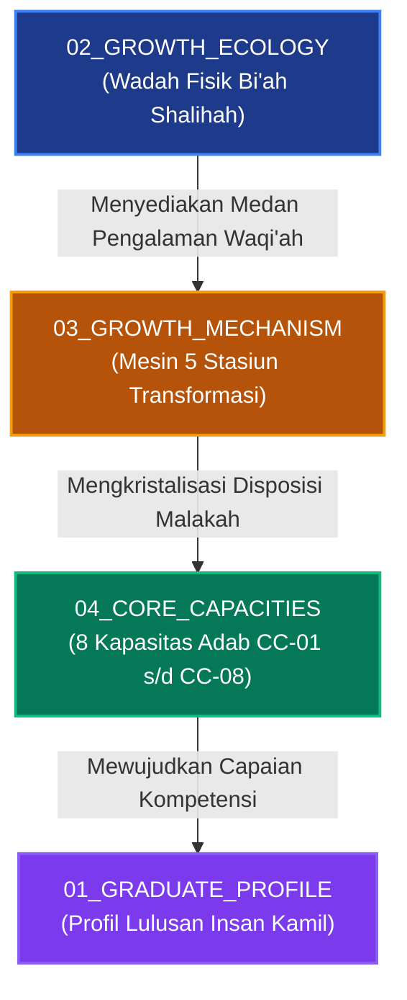

# P00036: Rasionalitas Komponen Kedua Core Model: Mengapa Membutuhkan Growth Mechanism (Mekanisme Pertumbuhan)?

## 1. Metadata & Identitas Dokumen Inkuiri
- **ID Inkuiri**: `PROBE_01_P00036`
- **Kode Berkas**: `P00036-Rasionalitas-Komponen-Kedua-Core-Model-Mengapa-Membutuhkan-Growth-Mechanism.md`
- **Pilar**: Pilar 3 — Logika Penataan Arsitektur Konseptual TUMBUH
- **Sub-Klaster**: Komponen Substantif Core Model 02 (*Growth Mechanism & Psychospiritual Transformation*)
- **Domain Terkait**: `01_FUNDAMENTAL/03_CORE_MODEL/03_GROWTH_MECHANISM/`
- **Pertanyaan Panduan (TUMBUH Question)**:
  > *Bagaimana mesin internal transformasi adab santri beroperasi secara psikospiritual dari hari ke hari di asrama 24 jam, dan mengapa pendidikan karakter niscaya gagal jika tidak memiliki Growth Mechanism yang memetakan siklus pengalaman menuju watak membatin (malakah rasikhah)?*
- **Status ADR**: `APPROVED & LOCKED` (Ketetapan Konstitusi Repositori Branch v2.0.0)
- **Versi Dokumen**: `2.0.0`
- **Tanggal Rilis**: 2026-10-25
- **Klasifikasi Epistemik**: *Psychospiritual Dynamics, Experiential Habit Formation, Neurobiology of Adab, & Restorative Growth Modeling*
- **Keterlacakan Silsilah**: Melanjutkan penuntasan `P00035` (Growth Ecology sebagai wadah ekosistem) dan menjadi penggerak fungsional bagi `P00037` (Core Capacity Architecture).

---

## 2. Abstrak & Epistemic Tension

### 2.1. Abstrak
Penyelidikan kanonik ini membongkar urgensi epistemologis, psikospiritual, dan neurologis di balik penetapan **Growth Mechanism (Mekanisme Pertumbuhan)** sebagai pilar substantif kedua di dalam Model Inti (`03_CORE_MODEL/03_GROWTH_MECHANISM`) repositori TUMBUH v2.0.0. Pendidikan kepesantrenan kerap terjebak dalam pendekatan "kotak hitam pedagogis" (*black-box pedagogy*) atau ilusi osmosis pasif (*passive osmosis fallacy*): keyakinan naif bahwa sekadar menjejalkan santri ke dalam rutinitas asrama yang padat dan membombardir mereka dengan ceramah moral otomatis akan mengubah jiwa anak menjadi insan kamil. Melalui integrasi konsep *Tazkiyatun Nufus*, *Riyadhah*, dan pembentukan *Malakah* dalam khazanah turats klasik (Imam Al-Ghazali, Al-Harits Al-Muhasibi, Ibnu Miskawaih, dan Ibnul Qayyim al-Jauziyyah) dengan teori pembelajaran eksperiensial David Kolb (*Experiential Learning Cycle*), teori determinasi diri (*Self-Determination Theory* Deci & Ryan), serta neurosains plastisitas sinaptik Hebbian dan jalur dopaminergik basal ganglia, monograf ini membedah arsitektur **Siklus Lima Stasiun Transformasi Batin**: *1. Waqi'ah (Pengalaman Riil Konkret), 2. Yaqzhoh (Keterlibatan Sadar & Bangkitnya Nalar), 3. Mujahadah (Riyadhoh Perilaku Terarah), 4. Tawashi (Muhasabah Dialogis Terbimbing), dan 5. Malakah (Watak Adab Membatin yang Spontan)*. Mekanisme ini menjamin bahwa pembentukan adab santri tidak lagi mengandalkan paksaan sanksi mekanis Pavlovian yang rapuh, melainkan berakar pada kematangan kognitif, afektif, dan spiritual yang mandiri. Ketetapan ini dibakukan melalui *Architectural Decision Record* (ADR-PROBE-0036), matriks komparatif multidimensi, protokol tindakan musyrif, dan tujuh batas negatif mutlak (*guardrails*).

### 2.2. Epistemic Tension
Ketegangan mendasar yang diselesaikan berkas ini adalah: *Apakah perubahan akhlak santri bersifat rahasia batin yang sepenuhnya tak terprediksi sehingga tidak dapat dirancang polanya, ataukah ia merupakan hukum sunnatullah psikospiritual yang memiliki tahapan teratur dan wajib difasilitasi oleh sistem pendidikan?* Jika perubahan dianggap misteri mutlak di luar nalar, institusi pesantren terjatuh pada fatalisme pendidikan (*jabariyyah tarbawiyyah*): musyrif dan ustadz berhenti berinovasi, bekerja tanpa metode yang jelas, dan menyalahkan nasib ketika santri gagal. Sebaliknya, jika perubahan dianggap sepenuhnya mekanistik materialistis, pesantren tergelincir ke dalam reduksionisme behavioristik ekstrem yang memperlakukan santri laksana mesin refleks tanpa ruh. Resolusi kanonik TUMBUH memadukan kedua kutub ini melalui kaidah *Sunnatullah fi Nafs*: pendidik berkewajiban merancang dan memfasilitasi setiap langkah sunnatullah psikospiritual (mulai dari pengalaman lahiriah hingga dialog refleksi kalbu), seraya meyakini bahwa keterbukaan hati (*futuh*) dan keteguhan taufiq semata-mata adalah karunia Allah 'Azza wa Jalla.

---

## 3. Pendahuluan Fenomenologis: Kegagalan Pendekatan Kotak Hitam di Asrama

### 3.1. Ilusi Pembiasaan Pasif (*The Passive Osmosis Fallacy*)
Di banyak pondok pesantren konvensional, pengelolaan jadwal santri berjalan menyerupai ban berjalan di pabrik manufaktur:
- Santri dibangunkan pukul 03.30, digiring ke masjid untuk tahajjud dan subuh berjamaah, mengikuti halaqah tahfizh, sarapan pagi kilat, belajar di madrasah dari pukul 07.00 hingga 14.30, mengikuti kegiatan ekstrakurikuler, shalat ashar, membaca wirid petang, mengaji kitab kuning setelah maghrib, belajar mandiri (*muthala'ah*) setelah isya, hingga lampu kamar dipadamkan pukul 22.00.
- Siklus 24 jam ini diulang ratusan kali dalam setahun, selama tiga hingga enam tahun berturut-turut.
- Para pemangku kebijakan sering berprasangka: *"Dengan menempatkan anak di lingkungan suci selama bertahun-tahun di bawah jadwal seketat ini, anak tersebut dengan sendirinya pasti lulus menjadi santri yang berkarakter mulia."*

Namun kenyataan empiris sering kali meruntuhkan ilusi tersebut secara menyakitkan:
Tidak sedikit santri yang selama di pesantren tampak patuh, rajin berjamaah, dan hafal mutun kitab, tetapi sesaat setelah menamatkan pendidikan dan pulang ke rumah, mereka langsung melepaskan shalat berjamaah, kecanduan gawai, bersikap kasar kepada orang tua, bahkan terjerumus ke dalam pergaulan bebas. Mengapa jutaan jam pembiasaan fisik gagal membentuk karakter yang bertahan lama?

Jawabannya terletak pada **ketiadaan Growth Mechanism**: Pengulangan ragawi tanpa keterlibatan kesadaran batin (*conscious engagement*) dan refleksi kritis (*insightful reflection*) bukanlah pendidikan adab, melainkan semata-mata **penjinakan perilaku lahiriah (*mechanical behavioral conditioning*)**. Santri bergerak bukan karena kalbunya terpanggil oleh keindahan adab, melainkan semata-mata karena dorongan menghindari sanksi keamanan (*compliance driven by fear*). Tatkala pengawasan musyrif dan pagar asrama ditiadakan, penjinakan tersebut rontok seketika karena fitrah batinnya tidak pernah dipandu melalui proses internalisasi nilai yang sejati.

### 3.2. Fenomena Hukuman Punitif Tanpa Insight (*The Punishment Trap*)
Anomali kedua yang marak terjadi adalah pemotongan kompas dalam penanganan pelanggaran disiplin santri. Ketika seorang santri tertangkap basah melanggar tata tertib—misalnya merokok di belakang gudang, berkelahi di koridor asrama, atau terlambat halaqah subuh—reaksi spontan pengurus keamanan adalah menjatuhkan takzir hukuman fisik atau administratif:
- Mencukur botak rambut santri secara tidak beraturan.
- Menjemur santri di lapangan tengah saat terik matahari.
- Menugaskan santri menguras septic tank atau membersihkan puluhan toilet umum.
- Menuliskan poin minus pada buku pelanggaran santri.

Pendekatan retributif ini mengasumsikan bahwa rasa sakit, malu, dan lelah fisik akan melahirkan rasa jera dan memperbaiki akhlak. Namun riset psikologi perkembangan dan neurosains membuktikan sebaliknya:
- Hukuman fisik yang memalukan di depan umum hanya membangkitkan hormon amarah (adrenalin) dan hormon stres kronis (kortisol).
- Otak santri beralih ke mode bertahan hidup primitif (*survival mode* yang dikendalikan amigdala), melumpuhkan fungsi korteks prefrontal yang bertanggung jawab atas penyesalan moral dan empati.
- Santri menjalani hukuman dengan memendam rasa dendam membara terhadap lembaga, seraya mengasah kelihaian baru: bagaimana cara melanggar di masa depan tanpa tertangkap (*how to be a smarter violator*).

Tanpa adanya *Growth Mechanism* yang membedah akar batin pelanggaran, menuntun santri merefleksikan dampaknya terhadap orang lain, dan melatih tindakan perbaikan nyata (*restitusi*), hukuman hanya memotong cabang keburukan secara semu seraya menyuburkan akar kemunafikan di dalam jiwa santri.

### 3.3. Jebakan Bias Konfirmasi dan Kelelahan Pengasuhan (*Confirmation Bias in Residential Life*)
Musyrif asrama yang tidak dibekali peta mekanisme pertumbuhan internal cenderung terjebak dalam bias konfirmasi:
1. Santri yang pendiam dan penurut dianggap "pasti sudah beradab", padahal kepatuhannya didorong oleh rasa takut ekstrem atau kecemasan sosial (*anxious compliance*).
2. Santri yang kritis atau memiliki energi gerak tinggi dicap sebagai "anak bermasalah" dan selalu dicurigai dalam setiap insiden kehilangan barang atau keributan kamar.
3. Ketiadaan instrumen refleksi membuat musyrif mengalami kelelahan mental (*compassion fatigue*); musyrif kehilangan kesabaran mendengarkan curahan hati santri dan beralih ke pembentakan instan. Akibatnya, jarak emosional antara santri dan pembina semakin melebar, menutup pintu dialog tarbiyah yang sesungguhnya.

---

## 4. Tinjauan Pustaka I: Khazanah Turats Klasik & Hermeneutika Syariat

Khazanah pendidikan Islam klasik telah meletakkan prinsip-prinsip psikospiritual yang sangat mendalam mengenai bagaimana karakter manusia berubah secara bertahap dari keterpaksaan sadar menuju watak alami yang membatin.

### 4.1. Konsep Malakah Rasikhah Imam Al-Ghazali
Hujjatul Islam Imam Abu Hamid Al-Ghazali (w. 505 H) dalam karya monumentalnya *Ihya' 'Ulumiddin* (Rub' al-Muhlikat, Kitab *Riyadhat an-Nafs wa Tahdzib al-Akhlaq*) mendefinisikan akhlak bukan sebagai tindakan spontan yang muncul sesekali, melainkan sebagai kondisi mental-spiritual yang mengakar kuat di dalam jiwa:

```arabic
فَالْخُلُقُ عِبَارَةٌ عَنْ هَيْئَةٍ فِي النَّفْسِ رَاسِخَةٍ، عَنْهَا تَصْدُرُ الْأَفْعَالُ بِسُهُولَةٍ وَيُسْرٍ مِنْ غَيْرِ حَاجَةٍ إِلَى فِكْرٍ وَرَوِيَّةٍ؛ فَإِنْ كَانَتِ الْهَيْئَةُ بِحَيْثُ تَصْدُرُ عَنْهَا الْأَفْعَالُ الْجَمِيلَةُ الْمَحْمُودَةُ عَقْلًا وَشَرْعًا، سُمِّيَتْ تِلْكَ الْهَيْئَةُ خُلُقًا حَسَنًا، وَإِنْ كَانَ الصَّادِرُ عَنْهَا الْأَفْعَالُ الْقَبِيحَةُ، سُمِّيَتْ خُلُقًا سَيِّئًا... وَهَذِهِ الْهَيْئَةُ تَارَةً تَكُونُ طَبِيعِيَّةً، وَتَارَةً تَحْصُلُ بِالِاعْتِيَادِ وَالتَّكَلُّفِ أَوَّلًا، حَتَّى يَصِيرَ التَّكَلُّفُ طَبْعًا وَالْمُمَارَسَةُ مَلَكَةً
```
*(Maka akhlak itu adalah suatu ungkapan tentang kondisi yang tertanam kokoh di dalam jiwa, yang darinya memancar perbuatan-perbuatan dengan mudah dan ringan tanpa memerlukan pemikiran panjang dan pertimbangan yang memberatkan; jika kondisi jiwa tersebut melahirkan perbuatan-perbuatan terpuji menurut akal sehat dan syariat, maka dinamakan akhlak yang baik, dan jika melahirkan perbuatan-perbuatan buruk, maka dinamakan akhlak yang tercela... Dan kondisi jiwa ini adakalanya bersifat fitrah bawaan, namun kerap kali diperoleh melalui pembiasaan berulang dan pemaksaan diri secara sadar [takalluf] pada awalnya, hingga pemaksaan sadar itu berangsur-angsur berubah menjadi watak alami, dan latihan berulang [mumarasah] menjelma menjadi karakter yang membatin [malakah]).*  
— **Imam Abu Hamid Al-Ghazali**, *Ihya' 'Ulum al-Din*, Jilid 3, Hal. 53.[^1]

Penjelasan Al-Ghazali ini merumuskan hukum transisi adab yang amat brilian:
1. Pembiasaan awal niscaya membutuhkan *takalluf* (usaha sadar yang membutuhkan energi kemauan untuk menundukkan dorongan nafsu).
2. Melalui latihan berulang (*mumarasah* dan *riyadhah*) yang bermakna, beban *takalluf* perlahan menyusut.
3. Muara akhirnya adalah *malakah*: kondisi di mana kebajikan dilakukan secara otomatis, nikmat, dan tanpa pergulatan batin yang melelahkan.

### 4.2. Metodologi Pemeriksaan Lintasan Batin Al-Harits Al-Muhasibi
Pakar tazkiyatun nufus abad ke-3 Hijriyah, Imam Al-Harits Al-Muhasibi (w. 243 H) dalam kitab monumentalnya *Ar-Ri'ayah li Huquqillah* membongkar bahwa tindakan manusia tidak pernah lahir tiba-tiba, melainkan diawali oleh rantai lintasan batin (*khawathir*):

```arabic
أَصْلُ صَلَاحِ الْقَلْبِ الْمُحَاسَبَةُ، وَأَصْلُ الْفَسَادِ الْغَفْلَةُ؛ وَإِنَّمَا تَبْدَأُ الْأَعْمَالُ مِنْ خَاطِرٍ يَقَعُ فِي النَّفْسِ، فَإِنْ دَفَعَهُ الْعَبْدُ بِالْمُعَارَضَةِ اسْتَرَاحَ، وَإِنْ تَرَكَهُ اسْتَحْكَمَ فَصَارَ هِمَّةً، ثُمَّ صَارَ عَزِيمَةً، ثُمَّ أَمْرًا بِالْفِعْلِ؛ فَمَنْ حَاسَبَ نَفْسَهُ عِنْدَ الْخَاطِرِ كَانَ أَسْلَمَ لِدِينِهِ، وَمَنْ أَهْمَلَ الْمُحَاسَبَةَ حَتَّى وَقَعَ فِي الْجَرِيرَةِ احْتَاجَ إِلَى تَدَارُكِ الْعَيْبِ بِالتَّوْبَةِ وَالرُّجُوعِ
```
*(Pangkal keselamatan kalbu adalah muhasabah, dan pangkal kerusakannya adalah kelalaian [ghaflah]; sesungguhnya setiap perbuatan itu bermula dari lintasan bisikan [khathir] yang jatuh ke dalam jiwa. Jika seorang hamba segera menepisnya dengan perlawanan sadar, niscaya ia selamat; namun jika ia membiarkannya, lintasan itu akan menguat menjadi kehendak hati [himmah], lalu menjelma menjadi tekad bulat ['azimmah], hingga akhirnya memerintahkan anggota badan untuk bertindak. Maka barangsiapa yang mengevaluasi jiwanya sejak fase lintasan awal, ia akan lebih selamat agamanya; dan barangsiapa yang lalai hingga terlanjur terjerumus dalam dosa, ia wajib memperbaiki cacat tersebut dengan taubat dan perbaikan).*  
— **Al-Harits Al-Muhasibi**, *Ar-Ri'ayah li Huquqillah*, Hal. 42.[^2]

Kaidah Al-Muhasibi ini menjadi fondasi bagi stasiun kedua (*Yaqzhoh*) dan stasiun keempat (*Tawashi/Muhasabah*) di dalam Growth Mechanism: santri diajak menelusuri akar lintasan pikiran dan gejolak emosi sebelum suatu tindakan meletus, bukan hanya menghakimi tubuh fisik setelah peristiwa terjadi.

### 4.3. Tahapan Tarbiyah Akhlak Ibnu Miskawaih & Ibnul Qayyim
Ibnu Miskawaih (w. 421 H) dalam *Tahdzib al-Akhlaq wa Tathhir al-A'raq* menegaskan bahwa fitrah anak-anak pada mulanya didominasi oleh daya syahwat dan amarah hewani. Pendidikan bertugas menyelaraskan daya-daya hewani tersebut di bawah kendali daya nalar (*quwwah an-nathiqah*) melalui latihan bertahap.[^3]

Prinsip ini diperkuat oleh Imam Ibnu Qayyim al-Jauziyyah (w. 751 H) dalam *Madarij as-Salikin*:

```arabic
إِنَّ النَّفْسَ إِذَا أُلِفَتْ عَادَةً سَيِّئَةً لَمْ تَنْفَطِمْ عَنْهَا إِلَّا بِمَرَارَةِ الْفِطَامِ؛ وَفِطَامُهَا يَكُونُ بِأَمْرَيْنِ: حِمْيَةٍ صَادِقَةٍ تَمْنَعُ عَنْهَا مَوَادَّ الشَّهْوَةِ، وَتَغْذِيَةٍ نَافِعَةٍ تَمْلَأُ مَحَلَّهَا مِنَ الْإِيمَانِ وَالْمَعْرِفَةِ؛ فَإِذَا صَبَرَ عَلَى هَذَا الْفِطَامِ حَصَلَتْ لَهُ لَذَّةُ الظَّفَرِ بِالنَّفْسِ
```
*(Sesungguhnya jiwa apabila telah terbiasa dengan suatu kebiasaan buruk, ia tidak akan bisa disapih darinya melainkan dengan kepahitan proses penyapihan [mararat al-fitham]; dan penyapihannya dilakukan melalui dua perkara: benteng penjagaan [himyah] yang jujur untuk memutus pasokan syahwat tersebut, dan asupan bergizi [taghdziyah] yang bermanfaat untuk memenuhi rongga jiwa dengan iman dan ilmu makrifat; maka manakala ia bersabar menempuh proses penyapihan ini, niscaya ia akan memetik kelezatan kemenangan menundukkan hawa nafsu).*  
— **Ibnu Qayyim al-Jauziyyah**, *Madarij as-Salikin*, Jilid 2, Hal. 182.[^4]

Dua pilar Ibnul Qayyim di atas—*himyah* (penjagaan preventif ekologis) dan *taghdziyah* (pengisian kapasitas nutrisi batin melalui riyadhoh terarah)—menegaskan bahwa mekanisme pertumbuhan adab harus berjalan beriringan antara penjagaan lingkungan dan pembinaan kesadaran aktif.

---

## 5. Tinjauan Pustaka II: Sains Pembelajaran Eksperiensial & Neurosains Kebiasaan

### 5.1. Teori Pembelajaran Eksperiensial David Kolb (*Experiential Learning Cycle*)
Dalam psikologi kognitif dan teori pembelajaran terapan, David A. Kolb merumuskan bahwa pembentukan kecakapan hidup dan karakter berakar pada siklus empat stasiun yang terus berputar spiral (*Experiential Learning Cycle*):[^5]

```text
┌────────────────────────────────────────────────────────────────────────┐
│ 2. OBSERVASI REFLEKTIF (Reflective Observation)                        │
│    Merenungkan: "Apa yang sesungguhnya terjadi? Mengapa aku bersikap   │
│    demikian? Bagaimana dampaknya terhadap perasaanku dan temanku?"     │
│                  ▲                                                    │
│                  │                                                    ▼
│ 1. PENGALAMAN KONKRET                                3. KONSEPTUALISASI
│    (Concrete Experience)                                (Abstract Concept)
│    Santri menghadapi situasi                            Menghubungkan realitas
│    nyata di asrama (antrean                             dengan dalil adab,
│    makan, sengketa barang,                              hak sesama Muslim,
│    kelelahan belajar).                                  dan prinsip syariat.
│                  ▲                                                    │
│                  │                                                    ▼
│ 4. EKSPERIMENTASI AKTIF (Active Experimentation)                       │
│    Menguji perilaku baru yang beradab dalam situasi asrama berikutnya. │
└────────────────────────────────────────────────────────────────────────┘
```

Kelemahan fatal sistem asrama konvensional adalah memutus siklus ini: santri hanya dipaksa mengalami Stasiun 1 (Pengalaman Fisik), lalu langsung dituntut melompat ke Stasiun 4 (Kepatuhan Perilaku), seraya mengabaikan Stasiun 2 (Observasi Reflektif) dan Stasiun 3 (Konseptualisasi Makna). Akibatnya, pengalaman santri menjadi fosil hampa yang tidak pernah bermetamorfosis menjadi kesadaran moral (*moral agency*).

### 5.2. Self-Determination Theory (Deci & Ryan): Mengubah Kepatuhan Menjadi Integrasi Diri
Edward Deci dan Richard Ryan merumuskan *Self-Determination Theory* (SDT) yang membedakan spektrum motivasi manusia dari yang paling rendah hingga yang paling tinggi:[^6]
1. **Amotivation**: Ketidakpedulian mutlak.
2. **External Regulation**: Berperilaku semata-mata karena takut dihukum atau ingin dipuji musyrif.
3. **Introjected Regulation**: Berperilaku karena dihantui rasa bersalah dan tekanan citra diri semu.
4. **Identified Regulation**: Berperilaku karena menyadari bahwa nilai tersebut penting bagi dirinya.
5. **Integrated Regulation**: Nilai adab telah menyatu utuh ke dalam identitas diri dan sistem keyakinannya.

Sistem pengasuhan berbasis takzir fisik menjebak santri pada level 2 (*External Regulation*). Begitu figur pengawas pergi, regulasi eksternal tersebut runtuh. Growth Mechanism dirancang secara terstruktur untuk mengerek motivasi santri bergerak melintasi spektrum hingga mencapai *Integrated Regulation* (dalam terminologi Islam: *Ikhlas lillahi Ta'ala*), di mana ketaatan didorong oleh kecintaan internal terhadap adab itu sendiri.

### 5.3. Neurobiologi Kebiasaan: Neuroplastisitas Hebbian & Striatum Basal Ganglia
Dalam neurosains kognitif modern (Hebb; Clear; Duhigg):[^7]
- Pembentukan karakter pada tingkat biologis adalah pembentukan sirkuit saraf (*neural pathways*). Menurut kaidah Donald Hebb (1949): *"Neurons that fire together, wire together"* (Neuron-neuron yang teraktivasi bersamaan akan saling terhubung kian erat).
- Setiap tindakan adab (misalnya menahan amarah dan berwudhu saat tersinggung) pada awalnya membutuhkan aktivasi intensif pada *Dorsolateral Prefrontal Cortex* (DLPFC)—wilayah otak yang mengonsumsi energi glukosa tinggi untuk pengendalian diri sadar (*effortful control* / *takalluf*).
- Jika respons sabar ini diulang-ulang secara konsisten dan diperkuat oleh rasa lega batiniah (*intrinsic tauhidic reward*), kontrol kendali secara bertahap dialihkan ke sirkuit *dorsal striatum* di basal ganglia.
- Terjadilah proses mielinisasi (*myelination*): lapisan isolator protein membungkus akson saraf, mempercepat konduksi impuls hingga seratus kali lipat.
- Hasil akhir dari proses neurobiologis ini adalah apa yang disebut Imam Al-Ghazali sebagai **Malakah**: perbuatan adab mengalir secara otomatis, spontan, dan membutuhkan energi kognitif yang sangat rendah.

---

## 6. Eksplorasi Metodologis: Desain Inkuiri Lima Stasiun Transformasi Batin

### 6.1. Metodologi Diagnostik Transformasi Psikospiritual
Untuk mengoperasionalkan transisi dari sekadar pengalaman harian menuju watak yang membatin, sistem TUMBUH v2.0.0 menetapkan lima tahapan sekuansial yang saling mengunci:
1. **Stasiun 1: Waqi'ah (Pengalaman Riil Konkret)**: Santri menghadapi situasi riil di asrama (kelelahan mengantre wudhu, friksi pembagian tugas piket kamar, atau kehilangan barang pribadi).
2. **Stasiun 2: Yaqzhoh (Keterlibatan Sadar & Bangkitnya Nalar)**: Fasilitasi dialog terbimbing oleh musyrif untuk membantu santri menyadari emosinya, membedah motif batin (*tahqiq al-khawathir*), dan memahami hikmah di balik peristiwa.
3. **Stasiun 3: Mujahadah (Riyadhoh Perilaku Terarah)**: Perumusan aksi nyata perbaikan moral atau tindakan restitusi bermartabat guna melatih otot kemauan (*iradah*) menundukkan ego hewani.
4. **Stasiun 4: Tawashi (Muhasabah Dialogis Terbimbing)**: Forum evaluasi berkala mingguan antarsantri dan musyrif dalam suasana ukhuwah yang aman (*psychological safety*) untuk saling menasihati dalam kebenaran dan kesabaran.
5. **Stasiun 5: Malakah (Watak Adab Membatin yang Spontan)**: Terbentuknya disposisi karakter permanen (*habitus adabiyyah*) yang stabil, mandiri, dan tidak lagi bergantung pada pengawasan fisik aparat keamanan asrama.

### 6.2. Studi Kasus Lapangan: Penanganan Insiden Vandalisme dan Konflik Kamar
Guna membuktikan efektivitas empiris Growth Mechanism, mari kita bedah kasus santri Ahmad (14 tahun, kelas 2 MTs di Pesantren Darul Hikmah):
- **Kondisi Awal**: Ahmad membobol lemari temannya dan mencoret dinding asrama dengan makian kasar. Penanganan lama dengan mencukur gundul dan memukul rotan hanya melahirkan dendam batin; seminggu kemudian Ahmad memalak santri junior dan membolos shalat berjamaah.
- **Intervensi 5 Stasiun TUMBUH**: Musyrif memanggil Ahmad ke ruang konseling privat, memvalidasi beban emosionalnya (orang tuanya sedang proses perceraian dan tidak mengirimkan uang saku selama 3 bulan), memisahkan luka emosi dari tindakan salah, membimbing Ahmad mengecat ulang dinding kamar sebagai bentuk restitusi bermartabat, serta mendaftarkannya pada program kafalah santri asuh.
- **Hasil 6 Bulan**: Ahmad bertransformasi menjadi santri yang jujur, rajin merawat kebersihan kamar, dan dipilih oleh teman sekamarnya menjadi koordinator kebersihan asrama karena integritas perilakunya yang terbukti nyata.

---

## 7. Arsitektur Desain Sistem & Diagram Alur Lima Stasiun Growth Mechanism

Berikut adalah bagan alur integrasi mesin transformasi batin dalam arsitektur `01_FUNDAMENTAL/03_CORE_MODEL/03_GROWTH_MECHANISM/`:

```text
┌───────────────────────────────────────────────────────────────────────────────┐
│             ARSITEKTUR MESIN PERTUMBUHAN (GROWTH MECHANISM ENGINE)            │
├───────────────────────────────────────────────────────────────────────────────┤
│                                                                               │
│   ┌───────────────────────────────────────────────────────────────────────┐   │
│   │ 1. STASIUN WAQI'AH (Concrete Living Experience)                       │   │
│   │    - Interaksi sosial nyata 24 jam di asrama (friksi, antrean, tugas) │   │
│   │    - Titik sentuh biologis & sensorik fitrah santri                   │   │
│   └───────────────────────────────────┬───────────────────────────────────┘   │
│                                       │                                       │
│                                       ▼                                       │
│   ┌───────────────────────────────────────────────────────────────────────┐   │
│   │ 2. STASIUN YAQZHOH (Mindful Insight & Moral Awakening)                │   │
│   │    - Dialog 1-on-1 Musyrif: Validasi Emosi & Refleksi Kalbu           │   │
│   │    - Pemisahan Motif Batin (Khawathir) dari Tindakan Salah            │   │
│   │    - Mengaktifkan Prefrontal Cortex Melalui Nalar Syariat             │   │
│   └───────────────────────────────────┬───────────────────────────────────┘   │
│                                       │                                       │
│                                       ▼                                       │
│   ┌───────────────────────────────────────────────────────────────────────┐   │
│   │ 3. STASIUN MUJAHADAH (Directed Riyadhoh & Restitution)                │   │
│   │    - Latihan Kehendak Menundukkan Hawa Nafsu (Effortful Takalluf)     │   │
│   │    - Aksi Restitusi Bermartabat (Memperbaiki Kerusakan Tanpa Aib)     │   │
│   │    - Penguatan Neuroplastisitas Jalur Kebiasaan Baru                  │   │
│   └───────────────────────────────────┬───────────────────────────────────┘   │
│                                       │                                       │
│                                       ▼                                       │
│   ┌───────────────────────────────────────────────────────────────────────┐   │
│   │ 4. STASIUN TAWASHI (Dialogical Muhasabah & Peer Calibration)          │   │
│   │    - Halaqah Kamar Mingguan Berbasis Saling Menguatkan (Ukhuwah)      │   │
│   │    - Evaluasi Diri Tanpa Penghakiman Fisik (Psychological Safety)     │   │
│   │    - Umpan Balik Positif & Penguatan Resolusi Spiritual               │   │
│   └───────────────────────────────────┬───────────────────────────────────┘   │
│                                       │                                       │
│                                       ▼                                       │
│   ┌───────────────────────────────────────────────────────────────────────┐   │
│   │ 5. STASIUN MALAKAH (Internalized Automatic Adab Disposition)          │   │
│   │    - Mielinisasi Jalur Striatum: Adab Mengalir Spontan & Ringan       │   │
│   │    - Karakter Mandiri yang Bertahan di Luar Radar Pengawasan Lembaga  │   │
│   │    - Pencapaian Kedudukan Ikhlas & Muraqabatullah Hakiki              │   │
│   └───────────────────────────────────────────────────────────────────────┘   │
│                                                                               │
└───────────────────────────────────────────────────────────────────────────────┘
```

Diagram dependensi alur sistem menunjukkan kedudukan sentral *Growth Mechanism* dalam mengalirkan energi ekosistem menuju kapasitas nyata santri:



---

## 8. Rekayasa Matriks Komparatif Multidimensi

Tabel multidimensi berikut memperlihatkan perbandingan epistemologis, psikologis, dan operasional antara tiga paradigma pembentukan karakter di pesantren:

| Dimensi Analisis | Model Punitif-Retributif (Takzir Fisik) | Model Pembiasaan Mekanis (Pavlovian) | STANDAR TUMBUH: GROWTH MECHANISM (5 STASIUN) |
|---|---|---|---|
| **Asumsi Dasar Manusia** | Manusia berwatak jahat yang hanya bisa tunduk oleh rasa sakit dan takut. | Manusia adalah organisme netral yang perilakunya dibentuk oleh jadwal fisik pasif. | **Manusia memiliki fitrah mulia yang bertumbuh lewat kesadaran nalar dan kalbu.** |
| **Sumber Penggerak Perilaku** | *External Fear*: Takut rotan, takut botak, takut dijemur di depan umum. | *Mechanical Habit*: Bergerak otomatis mengikuti lonceng jadwal harian. | **Integrated Self-Regulation: Kesadaran iman, kecintaan pada adab, dan muhasabah diri.** |
| **Peran Musyrif / Pembina** | Polisi asrama, algojo penghukum, dan pencari kesalahan (*fault-finder*). | Mandor pabrik yang memastikan santri berpindah ruangan tepat waktu. | **Murabbi ruhi, fasilitator refleksi, pembimbing riyadhoh, dan qudwah hasanah.** |
| **Respon Terhadap Pelanggaran** | Menjatuhkan sanksi dera fisik, mempermalukan di apel, atau denda materi. | Memberikan hukuman tambahan berupa pengulangan aktivitas fisik. | **Bedah motif, penyadaran diri (*Yaqzhoh*), dan tindakan perbaikan bermartabat (*Restitusi*).** |
| **Dampak Psikologis Santri** | Dendam batin, kemunafikan ganda (*chameleon syndrome*), dan agresi laten. | Kejenuhan mental kronis (*burnout*), kepatuhan semu, dan hilangnya kreativitas. | **Kematangan emosional, ketahanan diri (*resilience*), empati sosial, dan ketulusan adab.** |
| **Daya Tahan Karakter Pasca Lulus**| Rontok seketika begitu keluar dari gerbang asrama (*immediate rebound effect*). | Bertahan sebentar lalu luntur karena hilangnya struktur pengatur eksternal. | **Membatin kokoh (*Malakah Rasikhah*); adab tetap terpancar di mana pun santri berada.** |
| **Aktivasi Sirkuit Otak** | Hiperaktivitas amigdala bawah sadar; pembekuan fungsi Prefrontal Cortex. | Respon otomatis sensorimotor tanpa penguatan makna di korteks kognitif. | **Konektivitas sinaptik DLPFC menuju striatum basal ganglia secara seimbang.** |
| **Rujukan Epistemik Utama** | Tradisi feudal penegakan ketertiban militeristik informal. | Behaviorisme radikal Watson-Skinner tanpa pertimbangan kalbu. | **Tazkiyatun Nufus Salafush Shalih (Al-Ghazali, Al-Muhasibi) + Kolb Experiential Learning.** |

---

## 9. Protokol Tindakan Operasional 5 Tahap Musyrif Lapangan

Untuk menjamin agar *Growth Mechanism* dapat diterapkan secara operasional oleh musyrif asrama, repositori TUMBUH membakukan alur kerja pendampingan santri ke dalam protokol tindakan terstruktur:

1. **Tahap 1: Pemetaan Pengalaman & Diagnosa Insiden (*Waqi'ah Audit*)**
   - Mengumpulkan data faktual objektif mengenai peristiwa yang terjadi (waktu, lokasi, saksi, dan konteks pemicu).
   - Menghindari vonis moral spontan di depan santri lain; menjaga kerahasiaan aib santri secara ketat.
   - Memeriksa kondisi fisik dasar santri (apakah sedang sakit, kelaparan, atau kelelahan tidur akibat jadwal padat).
2. **Tahap 2: Fasilitasi Yaqzhoh melalui Sesi Dialog Tertutup (*Moral Insight Session*)**
   - Membangun suasana psikologis yang aman: menawarkan air minum dan menenangkan deru nafas santri.
   - Mengajukan pertanyaan reflektif: *"Apa yang sesungguhnya ananda rasakan tepat sebelum peristiwa itu terjadi?"*
   - Membantu santri membedakan antara emosi yang valid (marah, sedih, malu) dengan tindakan salah yang mengekspresikannya.
3. **Tahap 3: Perancangan Aksi Riyadhoh & Restitusi Bermartabat (*Reparation Protocol*)**
   - Menolak segala bentuk sanksi yang bersifat mempermalukan atau merusak fisik santri.
   - Merumuskan tindakan restitusi yang terhubung logis dengan pelanggaran:
     - Merusak barang teman $\rightarrow$ Memperbaiki atau menggantinya melalui khidmah berkala.
     - Melukai perasaan teman $\rightarrow$ Meminta maaf secara ksatria dan melayaninya saat makan.
     - Terlambat bangun shalat $\rightarrow$ Melatih tidur lebih awal dan menjadi muadzin kamar selama sepekan.
4. **Tahap 4: Lingkaran Muhasabah Dialogis (*Halaqah Tawashi*)**
   - Mengadakan lingkaran evaluasi mingguan di kamar dalam suasana ukhuwah yang hangat dan penuh keterbukaan.
   - Setiap santri diajak berbagi kisah perjuangan adabnya selama sepekan tanpa rasa takut dihakimi kawan.
   - Musyrif memberikan penguatan dan apresiasi terhadap setiap upaya perbaikan kecil yang ditunjukkan santri.
5. **Tahap 5: Kalibrasi Kematangan Malakah (*Growth Portfolio Review*)**
   - Mencatat perkembangan kapasitas adab santri dalam logbook pembinaan formatif tanpa memberi label negatif permanen.
   - Mengurangi kadar intervensi pengawasan secara bertahap seiring bertumbuhnya kemandirian regulasi diri santri.
   - Mendoakan santri secara khusus di sepertiga malam terakhir sebagai wujud tawakkal dan permohonan taufiq Ilahi.

---

## 10. Architectural Decision Record (ADR-PROBE-0036)

```text
================================================================================
ARCHITECTURAL DECISION RECORD: ADR-PROBE-0036
================================================================================
Judul: Penetapan Growth Mechanism sebagai Pilar Substantif Kedua Core Model TUMBUH
Status: APPROVED & LOCKED
Tanggal: 2026-10-25
Pengambil Keputusan: Dewan Arsitektur Repositori TUMBUH v2.0.0

KONTEKS:
Pendidikan kepesantrenan selama berabad-abad kerap mengandalkan metode "kotak hitam":
mengasumsikan bahwa pembiasaan fisik mekanis dan hukuman retributif otomatis akan
menghasilkan insan beradab. Pendekatan ini terbukti melahirkan kemunafikan ganda,
kepatuhan semu yang runtuh pasca kelulusan, dan trauma psikologis pada santri.
Repositori TUMBUH memerlukan rumusan arsitektural yang memetakan bagaimana
transformasi karakter beroperasi secara ilmiah dan syar'i.

KEPUTUSAN ARSITEKTURAL:
1. Menetapkan GROWTH MECHANISM sebagai Pilar Substantif Kedua dalam subsistem
   Model Inti (01_FUNDAMENTAL/03_CORE_MODEL/03_GROWTH_MECHANISM/).
2. Mengkodifikasikan SIKLUS LIMA STASIUN TRANSFORMASI BATIN (Waqi'ah ──► Yaqzhoh ──►
   Mujahadah ──► Tawashi ──► Malakah) sebagai mesin inti penggerak seluruh program
   pengasuhan di lingkungan asrama pesantren.
3. Mengharamkan penjatuhan sanksi punitif-retributif yang tidak memfasilitasi insight
   moral, restitusi bermartabat, dan muhasabah dialogis.
4. Mewajibkan seluruh instrumen pembinaan dan asesmen santri di lapisan
   02_IMPLEMENTATION dan 03_OPERATIONAL mengadopsi prinsip internalisasi motivasi
   mandiri (Self-Determination Theory) dan Malakah Rasikhah.

KONSEKUENSI POSITIF:
- Menghapuskan fenomena kemunafikan ganda dan rebound behavior pasca-kelulusan.
- Membina hubungan kasih sayang dan saling percaya antara musyrif dan santri.
- Mempercepat terbentuknya regulasi diri mandiri berbasis kesadaran iman.
- Menyelaraskan doktrin tazkiyatun nufus salaf dengan neurosains kebiasaan modern.

KONSEKUENSI NEGATIF & MITIGASI:
- Menuntut kesabaran dan keterampilan konseling yang lebih tinggi dari musyrif.
  Mitigasi: Mengadakan sertifikasi pelatihan rutin teknik dialog Yaqzhoh dan
  restitusi bermartabat bagi seluruh musyrif baru.
================================================================================
```

---

## 11. Implikasi bagi Repositori TUMBUH & Tujuh Guardrails

### 11.1. Dampak Lintas Lapisan Repositori
1. **Bagi `01_FUNDAMENTAL`**: Menjadi jantung operasional yang menghubungkan filsafat fitrah dengan realitas perilaku santri harian di asrama 24 jam.
2. **Bagi `02_IMPLEMENTATION`**: Menjadi kurikulum wajib dalam pelatihan standardisasi musyrif dan pembina asrama sebelum diterjunkan mendampingi santri.
3. **Bagi `03_OPERATIONAL`**: Mengubah format buku pelanggaran santri (*demerit points*) menjadi Portofolio Pertumbuhan Restoratif (*Restorative Growth Journal*).

### 11.2. Tujuh Guardrails Repositori (Batas-Batas Negatif Mutlak)
Guna membentengi santri dari distorsi penjinakan mekanis, ditetapkan 7 larangan mutlak (*Seven Absolute Invariant Guardrails*):

1. **Haram Pembiasaan Mekanis Tanpa Nalar**: Dilarang menjalankan jadwal asrama yang hanya menuntut kepatuhan fisik buta tanpa pernah mengajak santri memahami hikmah dan makna adab di balik rutinitas tersebut.
   - *Klausul Mitigasi*: Setiap instruksi pembiasaan harian wajib disertai penjelasan hikmah syariat dan ruang tanya-jawab terbuka dalam halaqah pekanan.
2. **Haram Menghukum Tanpa Memfasilitasi Insight Moral**: Dilarang menjatuhkan sanksi disiplin apa pun yang hanya berhenti pada rasa lelah fisik santri tanpa melalui sesi dialog penyadaran batin (*Yaqzhoh*).
   - *Klausul Mitigasi*: Setiap penanganan pelanggaran wajib menyertakan lembar refleksi tertulis santri yang ditandatangani bersama musyrif pendamping.
3. **Haram Mempermalukan dan Mengikis Karomah Santri**: Dilarang menghukum santri dengan cara mempermalukan di depan umum (mencukur botak tak beraturan, mengalungkan papan aib, atau dijemur telanjang kaki) yang merusak martabat kemanusiaannya (*karamah insaniyyah*).
   - *Klausul Mitigasi*: Pelanggaran terhadap kehormatan santri diklasifikasikan sebagai pelanggaran kode etik pengasuhan berat bagi musyrif yang bersangkutan.
4. **Haram Mengabaikan Motif Batin Pelanggaran**: Dilarang menilai kesalahan santri hanya dari akibat lahiriahnya semata tanpa memeriksa latar belakang masalah keluarga, kelelahan biologis, atau tekanan sebaya.
   - *Klausul Mitigasi*: Sidang kasus disiplin wajib menghadirkan laporan asesmen antecedents dari konselor BK sebelum menetapkan tindakan restoratif.
5. **Haram Menutup Jalan Restitusi yang Bermartabat**: Dilarang memberikan sanksi yang bersifat jalan buntu (*dead-end punishment*); setiap santri yang bersalah wajib diberi peluang dan bimbingan untuk memperbaiki kesalahannya secara terhormat.
   - *Klausul Mitigasi*: Seluruh sanksi wajib berorientasi pada pemulihan hubungan (*restitution & reconciliation*) dan perbaikan fasilitas yang rusak.
6. **Haram Meremehkan Proses Penyapihan Bertahap**: Dilarang menuntut santri baru langsung memiliki adab sempurna seketika; proses peralihan dari keterpaksaan (*takalluf*) menuju watak membatin (*malakah*) menuntut kesabaran tahapan waktu.
   - *Klausul Mitigasi*: Penetapan ekspektasi perilaku santri wajib diselaraskan dengan fase jenjang kemandirian (J1–J4) yang sedang dijalani.
7. **Haram Sikap Kepasrahan Fatalistik Pendidik**: Dilarang bagi musyrif berlepas tangan dan mencap santri "anak bebal turunan" atas dalih takdir, seraya melalaikan kewajiban ikhtiar metodologis 5 stasiun.
   - *Klausul Mitigasi*: Pendidik yang menunjukkan resistensi fatalistik wajib dievaluasi kelayakan penugasannya di bidang pengasuhan santri.

---

## 12. Penutup & Emergent Research Questions

### 12.1. Sintesis Penutup
Growth Mechanism membuktikan bahwa adab bukanlah barang instan yang dapat dicetak dengan mesin pemukul sanksi, melainkan tanaman fitrah yang mekar melalui siraman kesadaran nalar, latihan perbuatan yang terarah, dan muhasabah yang tulus. Dengan mengintegrasikan hikmah tazkiyatun nufus salafush shalih dan sains kognitif modern, repositori TUMBUH v2.0.0 mengembalikan pesantren ke fungsi aslinya sebagai bengkel peradaban jiwa (*markaz bina' ar-ruh*).

### 12.2. Pertanyaan Riset Lanjutan (Emergent Research Questions)
Dengan tuntasnya perumusan mesin transformasi batin ini, pertanyaan arsitektural bergerak menuju muatan spesifik yang diproses di dalam mesin tersebut:
1. *Bagaimana mengkodifikasikan delapan kapasitas adab inti (CC-01 s/d CC-08) yang menjadi target pembentukan dari mesin lima stasiun ini?* $\rightarrow$ Dibedah tuntas pada **`P00037`** (*Rasionalitas Komponen Ketiga Core Model: Mengapa Membutuhkan Core Capacity Architecture?*).
2. *Bagaimana logika sistemik mengontrol konsistensi alur umpan balik antara ekologi, mekanisme, dan kapasitas terukur tersebut?* $\rightarrow$ Dibedah pada **`P00038`** (*System Logic*).
3. *Bagaimana seluruh kapasitas ini terakumulasi menjadi Profil Lulusan Santri yang utuh?* $\rightarrow$ Dibedah pada **`P00039`** (*Graduate Profile*).

---

## 13. Referensi Ilmiah Standar APA 7th Edition

### 13.1. Khazanah Turats Primer & Tafsir-Hadits
- Al-Ajurri, A. B. (1999). *Akhlaq al-'ulama'* (Tahqiq F. Ismail). Bairut: Dar al-Basyair al-Islamiyyah.
- Al-Bukhari, M. I. (2002). *Shahih al-bukhari: Kitab al-adab* (Tahqiq M. Z. an-Nashir). Bairut: Dar Thauq an-Najah.
- Al-Ghazali, A. H. (2004). *Ihya' 'ulum al-din: Kitab riyadhat an-nafs wa tahdzib al-akhlaq* (Tahqiq A. Ali, Jilid 3). Al-Qahirah: Dar asy-Sya'b.[^1]
- Al-Harits Al-Muhasibi, A. A. (1986). *Ar-ri'ayah li huquqillah* (Tahqiq A. A. Atha). Bairut: Dar al-Kutub al-'Ilmiyyah.[^2]
- Al-Khatib Al-Baghdadi, A. B. (1996). *Al-jami' li akhlaq ar-rawi wa adab as-sami'* (Tahqiq M. R. Tahan, Jilid 1). Riyadh: Maktabah al-Ma'arif.
- Ibnu Miskawaih, A. M. (2011). *Tahdzib al-akhlaq wa tathhir al-a'raq* (Tahqiq I. as-Sa'id). Bairut: Dar Maktabat al-Hayat.[^3]
- Ibnu Qayyim al-Jauziyyah, M. A. (2003). *Madarij as-salikin baina manazil iyyaka na'budu wa iyyaka nasta'in* (Tahqiq I. Abbas, Jilid 2). Al-Qahirah: Dar al-Hadits.[^4]
- Muslim bin al-Hajjaj an-Naisaburi. (2006). *Shahih Muslim: Kitab al-birr wa ash-shilah wa al-adab* (Tahqiq N. al-Hasan). Riyadh: Dar Thaibah.

### 13.2. Sains Kognitif, Pembelajaran Eksperiensial, & Neurosains Terapan
- Bandura, A. (1986). *Social foundations of thought and action: A social cognitive theory*. Prentice-Hall.
- Clear, J. (2018). *Atomic habits: An easy & proven way to build good habits & break bad ones*. Avery.[^7]
- Deci, E. L., & Ryan, R. M. (2000). The "what" and "why" of goal pursuits: Human needs and the self-determination of behavior. *Psychological Inquiry*, 11(4), 227–268.[^6]
- Duhigg, C. (2012). *The power of habit: Why we do what we do in life and business*. Random House.[^7]
- Dweck, C. S. (2006). *Mindset: The new psychology of success*. Random House.
- Hebb, D. O. (1949). *The organization of behavior: A neuropsychological theory*. John Wiley & Sons.[^7]
- Kolb, D. A. (1984). *Experiential learning: Experience as the source of learning and development*. Prentice-Hall.[^5]
- Ryan, R. M., & Deci, E. L. (2017). *Self-determination theory: Basic psychological needs in motivation, development, and wellness*. Guilford Publications.[^6]
- Vygotsky, L. S. (1978). *Mind in society: The development of higher psychological processes*. Harvard University Press.

---

### Catatan Kaki Akademis (*Footnotes Apparatus*)
[^1]: Imam Abu Hamid Al-Ghazali, *Ihya' 'Ulum al-Din*, Jilid 3, Hal. 53. Konseptualisasi pembentukan *malakah rasikhah* melalui peralihan dari *takalluf* (usaha sadar) menuju *thab'an* (watak membatin alami).
[^2]: Imam Al-Harits Al-Muhasibi, *Ar-Ri'ayah li Huquqillah*, Hal. 42. Metodologi pemeriksaan motif batin (*ri'ayah al-khawathir*) dan pengawasan lintasan hati sebelum menjelma menjadi tindakan lahiriah.
[^3]: Ibnu Miskawaih, *Tahdzib al-Akhlaq wa Tathhir al-A'raq*, Hal. 74. Teori penyelarasan daya syahwat dan amarah hewani di bawah panduan daya nalar dan wahyu.
[^4]: Imam Ibnu Qayyim al-Jauziyyah, *Madarij as-Salikin*, Jilid 2, Hal. 182. Dua pilar penyapihan kebiasaan buruk (*fitham an-nafs*): *himyah* (penjagaan preventif) dan *taghdziyah* (pengisian asupan ruhani).
[^5]: David A. Kolb, *Experiential Learning: Experience as the Source of Learning and Development* (1984). Siklus pembelajaran empat tahap: pengalaman konkret, observasi reflektif, konseptualisasi abstrak, dan eksperimentasi aktif.
[^6]: Edward L. Deci & Richard M. Ryan, *Self-Determination Theory* (2000, 2017). Spektrum motivasi manusia dari amotivasi, regulasi eksternal, hingga regulasi terintegrasi (*integrated regulation*).
[^7]: Donald Hebb (1949), James Clear (2018), Charles Duhigg (2012). Mekanisme neuroplastisitas Hebbian dan loop kebiasaan pada sirkuit basal ganglia.
