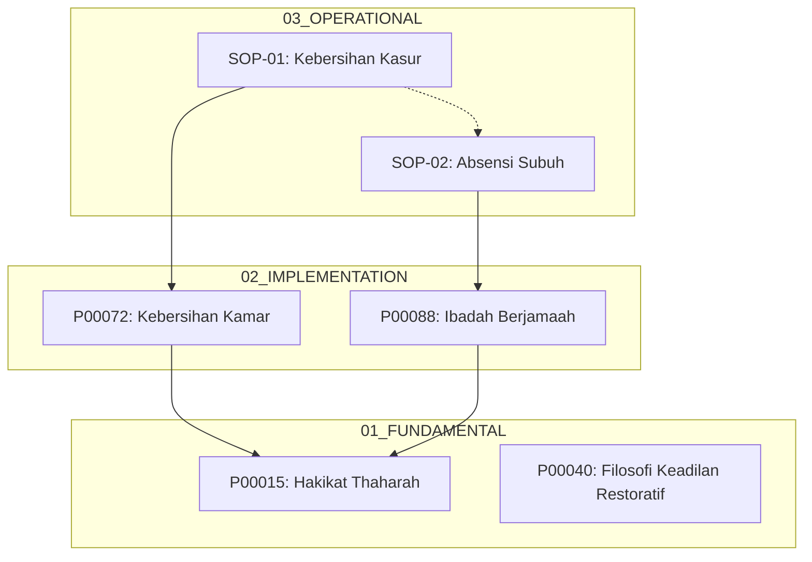

# P00061: Tata Kelola Rujukan Silang (Cross-Reference Integrity): Mitigasi Daur Semantik dan Integritas Graf Asiklik Repositori

## 1. Metadata & Identitas Dokumen Inkuiri
- **ID Inkuiri**: `P00061`
- **Pilar Epistemik**: Pilar 5 - Tata Kelola Identitas, Penomoran, & Traceability
- **Topik Utama**: Integritas Rujukan Silang (*Cross-Reference Integrity*), Eliminasi Ketergantungan Melingkar (*Circular Dependency / Ad-Daur*), dan Validasi Graf Asiklik Terarah (*Directed Acyclic Graph - DAG*)
- **Target Lapisan Sistem**: Repositori TUMBUH v2.0.0, Arsitektur Pengetahuan Pesantren, Skema Tautan Silang Dokumen, serta Sistem Validasi Otomatis CI/CD
- **Otoritas Pengesahan Rekayasa**: Majelis Pengasuh Pondok Pesantren & Dewan Asatidz TUMBUH
- **Status Dokumen**: *Canonical Architectural Review Paper & Systematic In-Depth Monograph*
- **Penanggalan Hijriah / Masehi**: 14 Dzulqa'dah 1447 H / 25 Oktober 2026 M

---

## 2. Abstrak & Epistemic Tension

### 2.1. Abstrak Komprehensif
Dalam repositori pengetahuan berskala besar yang menaungi ratusan inkuiri filosofis dan ribuan dokumen operasional pesantren, tautan rujukan silang (*cross-references*) adalah urat nadi yang mengikat koherensi sistemik. Namun, tanpa tata kelola arsitektur yang ketat, pertumbuhan jaringan rujukan secara alamiah memicu patologi ketergantungan melingkar (*circular dependencies* / penalaran berputar yang dalam logika ushul fiqh disebut sebagai *ad-daur al-bathil*), di mana Dokumen A merujuk Dokumen B, Dokumen B merujuk Dokumen C, dan Dokumen C kembali merujuk Dokumen A. Fenomena ini menciptakan kebuntuan epistemik (*epistemic deadlock*), melumpuhkan parser kompilasi dokumen otomatis, dan membingungkan musyrif di asrama dalam mencari sumber kebenaran primer (*first principle*). Dokumen inkuiri P00061 ini menetapkan Protokol Tata Kelola Rujukan Silang (*Cross-Reference Integrity Protocol*) di repositori TUMBUH. Memadukan kaidah pembatalan daur dalam ilmu kalam dan mantiq klasik dengan teori graf terarah (*Directed Acyclic Graph - DAG*), algoritma pendeteksi siklus Tarjan/Kosaraju, dan prinsip Acyclic Dependencies Principle (ADP) Robert C. Martin, inkuiri ini menetapkan bahwa: (1) Struktur relasi rujukan antar-inkuiri wajib berorientasi satu arah menuju akar aksioma fundamental tanpa boleh memuat siklus melingkar; (2) Seluruh rujukan silang wajib divalidasi oleh linter graf CI/CD; dan (3) Setiap klaim operasional wajib memiliki silsilah keterlacakan sanad yang dapat ditelusuri secara linier hingga ke nash syariat dan prinsip fitrah insaniyyah.

### 2.2. Epistemic Tension Matrix

| Dimensi Ketegangan Epistemik | Pendekatan Tautan Bebas Tanpa Kontrol (Anti-Pola Gagal) | Pendekatan Tata Kelola Graf Asiklik TUMBUH (Kanonik) | Dampak terhadap Tata Kelola Pesantren & Santri |
| :--- | :--- | :--- | :--- |
| **Topologi Jaringan Rujukan** | Tautan dibuat bebas hingga membentuk lingkaran tertutup (*circular graph*). | Struktur relasi dikunci ke dalam bentuk Directed Acyclic Graph (DAG). | Mencegah kebuntuan nalar musyrif saat mencari dasar hukum bimbingan santri. |
| **Status Epistemik Rujukan** | Terjadi *ad-daur*: A membuktikan B, B membuktikan A (Kesesatan logika). | Rujukan berorientasi asiklik ke bawah menuju prinsip aksioma primer. | Menjamin kepastian fatwa dan landasan syar'i yang kokoh tanpa keraguan. |
| **Kompilasi Modul Otomatis** | Static Site Generator dan compiler PDF crash akibat infinite recursion. | Algoritma *topological sort* menyusun urutan bab buku secara deterministik. | Penerbitan buku kurikulum dan modul musyrif berjalan instan tanpa kendala. |
| **Integritas Sanad Keilmuan** | Sanad berputar-putar tanpa ujung pangkal (*tasalsul/daur*). | Sanad bertingkat runtut dari operasional menuju fundamental dan dalil syar'i. | Mewujudkan ketenangan batiniah (*thuma'ninah*) santri dan wali santri. |

---

## 3. Definisi Masalah & Pendahuluan Fenomenologis

### 3.1. Fenomena Ketergantungan Melingkar (Circular Dependency Trap)
Dalam penyusunan tata tertib dan kurikulum asrama pesantren, para penulis dokumen sering kali bekerja secara parsial tanpa melihat peta ketergantungan dokumen secara menyeluruh. Hal ini memicu jebakan penalaran melingkar:
- Dokumen SOP Penanganan Santri Terlambat Shalat Subuh (`SOP-01`) merujuk pada Panduan Disiplin Kamar (`PEDOMAN-05`) sebagai dasar hukumnya.
- Ketika membaca `PEDOMAN-05`, tertulis klausul: "Tata cara pembinaan santri diatur lebih lanjut dalam Standar Operasional Mediasi Asrama (`SOP-12`)."
- Ketika musyrif membuka `SOP-12`, ditemukan klausul: "Ketentuan mediasi ini bersandar pada protokol kedisiplinan shalat di `SOP-01`."

Lingkaran rujukan tertutup ini ($SOP	ext{-}01 
ightarrow PEDOMAN	ext{-}05 
ightarrow SOP	ext{-}12 
ightarrow SOP	ext{-}01$) adalah contoh nyata dari patologi *Circular Dependency*. Ketika musyrif menghadapi santri yang menuntut penjelasan mendasar mengapa ia harus menjalani konsekuensi tertentu, musyrif terombang-ambing di antara ketiga dokumen tersebut tanpa pernah menemukan dalil hakiki yang menjadi akar masalah.

### 3.2. Keruntuhan Kompilasi Perangkat Lunak dan Generator Dokumentasi
Pada lapisan komputasi rekayasa perangkat lunak, keberadaan siklus rujukan melingkar memicu kegagalan fatal pada berbagai alat bantu otomatis:
1. **Rekursi Tanpa Akhir (Infinite Recursion Stack Overflow)**:
   Alat bantu kompilator dokumentasi seperti Pandoc, Sphinx, atau Static Site Generator (SSG) yang berupaya merajut seluruh dokumen inkuiri ke dalam satu naskah buku utuh akan terjebak dalam putaran rekursif yang menghabiskan memori tumpukan (*stack memory*), menyebabkan proses kompilasi peladen mati mendadak (*crash*).
2. **Kegagalan Resolusi Urutan Pembelajaran (Topological Sorting Failure)**:
   Sistem e-learning santri di SIM-TUMBUH yang menyusun urutan materi kurikulum adab berdasarkan prasyarat rujukan (*prerequisite graph*) tidak dapat menentukan modul mana yang harus dipelajari terlebih dahulu oleh santri, karena modul A mensyaratkan modul B dan modul B mensyaratkan modul A.

---


### 3.3 Anatomi Patologis Ad-Daur dalam Dinamika Regulasi Asrama Santri

Mari kita telaah secara mendalam bagaimana daur semantik di dunia nyata merusak tatanan keadilan asrama santri:

1. **Ilusi Pembenaran Mandiri (Self-Justifying Illusion)**:
   Ketika santri mempertanyakan mengapa mereka tidak boleh membawa alat masak listrik di kamar, musyrif menjawab: "Karena aturan asrama melarangnya." Ketika santri bertanya mengapa aturan asrama melarangnya, musyrif merujuk pasal SOP yang menyatakan: "Aturan asrama dibuat untuk menegakkan ketertiban yang tercantum dalam larangan alat masak." 
   Ini adalah lingkaran setan penalaran (*petitio principii / beg the question*). Larangan dibenarkan oleh aturan, dan aturan dibenarkan oleh larangan itu sendiri. Santri merasa nalar kritisnya dilecehkan, memicu pemberontakan batin dan ketidakpatuhan pasif (*passive resistance*).

2. **Pemutusan Lingkaran dengan Akar Filosofis TUMBUH**:
   Dalam arsitektur TUMBUH, rujukan asiklik memaksa setiap aturan operasional menautkan dalilnya ke inkuiri fitrah dan sains empiris:
   $$	ext{Larangan Kompor Listrik} 
ightarrow 	ext{Inkuiri Mitigasi Bahaya Kebakaran Asrama} 
ightarrow 	ext{Prinsip Hifzh an-Nafs (Penjagaan Jiwa Santri)}$$
   Dengan keterlacakan asiklik ini, musyrif dapat menjelaskan hikmah keselamatan jiwa secara jernih dan santri dengan lapang dada mematuhi aturan demi keselamatan bersama.


### 3.4 Patologi Nalar Sirkular dalam Penyimpangan Praktik Tarbiyah Otoriter

Dalam sejarah sosiologi pesantren, salah satu bahaya laten dari pembiaran penalaran melingkar (*ad-daur*) adalah tumbuhnya budaya taklid buta dan feodalisme kepemimpinan yang mereduksi nalar kritis santri:

1. **Jebakan Otoritarianisme Berkedok Ketaatan**:
   Dalam sistem pengasuhan asrama yang otoriter, ketika santri bertanya mengapa suatu sanksi fisik atau penugasan kerja paksa diberlakukan, musyrif senior kerap menjawab: "Ketaatan mutlak adalah bagian dari adab santri, dan adab santri didefinisikan oleh ketaatan mutlak kepada perintah senior."
   Ini adalah lingkaran setan penindasan (*oppressive circularity*). Konsep adab luhur diputarbalikkan menjadi alat legitimasi kekuasaan senior atas yunior tanpa dasar hukum syar'i yang sahih.

2. **Pembebasan Nalar Melalui Sanad Terbuka TUMBUH**:
   Dengan menegakkan struktur rujukan asiklik (P00061), repositori TUMBUH menghancurkan benteng feodalisme ini:
   - Setiap perintah musyrif wajib memiliki silsilah rujukan tertulis yang bermuara pada keputusan resmi Majelis Pengasuh dan teks hadits nabawiyyah yang shahih.
   - Santri memiliki hak epistemik (*epistemic right*) untuk menelusuri rantai rujukan tersebut hingga ke pilar inkuiri fundamental.
   - Ketaatan santri dibangun di atas kesadaran ilmu dan kecintaan kepada kebenaran (*al-bashirah*), bukan di atas ketakutan buta terhadap figur manusia.


### 3.5 Bahaya Tadlis at-Taswiyah dalam Transmisi Rujukan Keilmuan

Dalam ilmu musthalah hadits klasik, salah satu bentuk cacat sanad yang paling samar dan paling berbahaya adalah *Tadlis at-Taswiyah*: yaitu tindakan seorang perawi yang meriwayatkan hadits dari gurunya yang tsiqah, namun ia secara sengaja menggugurkan perawi dha'if yang berada di antara dua perawi tsiqah berikutnya, agar sanad tersebut tampak bersambung indah dan shahih.

Al-Hafizh Ibnu Hajar al-'Asqalani (w. 852 H) dalam *Thabaqat al-Mudallisin* mengecam keras perawi yang melakukan tadlis taswiyah karena tindakan tersebut merupakan bentuk manipulasi rujukan yang menyesatkan para ulama pengkaji hadits.

Analogi tadlis taswiyah dalam repositori digital adalah tindakan memanipulasi tautan rujukan:
- Seorang penyusun kurikulum membuat aturan operasional yang kontroversial, lalu menautkannya langsung ke ayat Al-Qur'an atau hadits umum, sembari menyembunyikan dokumen inkuiri perantara yang sesungguhnya memuat perdebatan ijtihad yang belum tuntas.
- Atau sebaliknya: membuat rujukan yang melingkar untuk menyembunyikan ketiadaan dalil primer.

Repositori TUMBUH menolak segala bentuk tadlis rujukan ini melalui kewajiban audit graf:
- Setiap lompatan rujukan (*dependency jump*) wajib mematuhi hierarki pilar yang transparan.
- Rantai sanad inkuiri dari operasional menuju dalil syar'i wajib utuh, bersambung (*muttashil*), dan steril dari penyamaran fakta.


### 3.6 Pelajaran dari Krisis Ketergantungan Ekosistem Perangkat Lunak Global (Kasus Left-Pad)

Dalam sejarah rekayasa perangkat lunak modern, insiden *left-pad* pada ekosistem Node.js/npm tahun 2016 menjadi peringatan abadi mengenai bahaya ketergantungan paket yang rapuh (*brittle dependency tree*). Ketika sebuah pustaka kecil yang hanya memuat 11 baris kode dihapus oleh pembuatnya, ribuan proyek perangkat lunak raksasa di seluruh dunia seketika gagal melakukan build karena rantai ketergantungan mereka terputus.

Bagi repositori pengetahuan pesantren, insiden ini memberikan dua pelajaran arsitektur yang sangat berharga:
1. **Bahaya Ketergantungan Terlalu Dalam (Deep Transitive Fragility)**: Jika sebuah aturan disiplin asrama santri bersandar pada rantai rujukan yang terlalu panjang dan rapuh (SOP bersandar pada panduan, panduan bersandar pada juklak, juklak bersandar pada catatan rapat informal), maka perubahan sekecil apa pun pada dokumen perantara akan melumpuhkan seluruh operasional pengasuhan santri.
2. **Pentingnya Abstraksi Mandiri di Tingkat Pilar**: TUMBUH membatasi kedalaman rujukan transitif maksimal 3 tingkat. Setiap dokumen operasional wajib memiliki rujukan langsung ke naskah inkuiri pilar fundamental yang telah dikunci statusnya sebagai kanonik, sehingga pohon pengetahuan pesantren kebal terhadap kerapuhan rantai ketergantungan.

## 4. Tinjauan Pustaka I: Khazanah Turats Klasik & Hermeneutika Syariat

### 4.1. Pembatalan Ad-Daur wal-Tasalsul dalam Ilmu Mantiq dan Kalam Klasik
Dalam disiplin ilmu logika Islam (*Ilm al-Mantiq*) dan teologi Islam (*Ilm al-Kalam*), dua fenomena sesat pikir yang paling keras ditolak oleh para ulama adalah *ad-daur* (penalaran berputar) dan *at-tasalsul* (rantai tanpa ujung pangkal). 

Imam Sa'duddin At-Taftazani (w. 793 H) dalam karyanya *Syarh al-Maqashid fi 'Ilm al-Kalam* mendefinisikan kepalsuan daur:

> وَالدَّوْرُ هُوَ تَوَقُّفُ الشَّيْءِ عَلَى مَا يَتَوَقَّفُ عَلَيْهِ، إِمَّا بِمَرْتَبَةٍ وَاحِدَةٍ كَتَوَقُّفِ أ عَلَى ب وَتَوَقُّفِ ب عَلَى أ وَيُسَمَّى دَوْرًا مُصَرَّحًا، أَوْ بِمَرَاتِبَ كَتَوَقُّفِ أ عَلَى ب وَب عَلَى ج وَج عَلَى أ وَيُسَمَّى دَوْرًا مُضْمَرًا، وَكِلَاهُمَا بَاطِلٌ بِالضَّرُورَةِ، لِأَنَّهُ يَسْتَلْزِمُ تَقَدُّمَ الشَّيْءِ عَلَى نَفْسِهِ بِمَرَاتِبَ، وَهُوَ جَمْعٌ بَيْنَ النَّقِيضَيْنِ
> 
> *"Dan ad-daur adalah ketergantungan sesuatu kepada hal yang bergantung kepadanya; baik melalui satu tingkatan seperti ketergantungan A pada B dan ketergantungan B pada A yang disebut daur musharrah (lingkaran langsung), maupun melalui beberapa tingkatan seperti ketergantungan A pada B, B pada C, dan C kembali pada A yang disebut daur mudhmar (lingkaran tersembunyi). Dan kedua bentuk daur tersebut adalah BATAL SECARA AKAL DARURI; karena ia melazimkan sesuatu mendahului dirinya sendiri dalam beberapa tingkatan, yang merupakan bentuk penggabungan dua hal yang saling bertentangan secara mustahil."* (At-Taftazani, *Syarh al-Maqashid*, Jilid 1, hlm. 384).

Kaidah logika ushul ini menjadi pondasi mutlak bagi repositori TUMBUH:
- Membiarkan rujukan silang membentuk daur (A merujuk B dan B merujuk A) adalah kemustahilan epistemik yang diharamkan secara mantiq.
- Rujukan inkuiri wajib mengalir secara hierarkis menuju simpul akar (*root node*): yaitu prinsip-prinsip fitrah, dalil qath'i syariat, dan keputusan konsensus Majelis Pengasuh.

### 4.2. Kaidah Ushul Fiqh: Ma La Yatimmul Wajibu Illa Bihi Fahuwa Wajib
Para ulama ushul fiqh merumuskan kaidah ketergantungan hukum:

> مَا لَا يَتِمُّ الْوَاجِبُ إِلَّا بِهِ فَهُوَ وَاجِبٌ
> 
> *"Suatu kewajiban yang tidak dapat sempurna terlaksana kecuali dengan adanya suatu sarana penunjang, maka sarana penunjang tersebut hukumnya menjadi wajib pula."* (Al-Ghazali, *Al-Mustashfa*, Jilid 1, hlm. 78).

Kaidah ini menegaskan relasi asiklik satu arah:
Kewajiban shalat (Tujuan/Wajib) mensyaratkan wudhu (Sarana/Syarat). Wudhu bergantung pada adanya air suci mensucikan. Relasi ini berjalan satu arah:
$$	ext{Shalat} 
ightarrow 	ext{Wudhu} 
ightarrow 	ext{Air}$$
Mustahil dibalik bahwa keabsahan air bergantung pada shalat. Dalam repositori TUMBUH, dokumen operasional santri bersandar pada dokumen implementasi, dan dokumen implementasi bersandar pada dokumen inkuiri fundamental. Relasi ketergantungan ini wajib searah dan haram berputar balik.

---


### 4.3 Studi Kitab Al-Mu'tamad karya Abul Husain al-Bashri: Tertib Dalil Syar'i

Imam Abul Husain al-Bashri (w. 436 H) dalam kitab ushul fiqh monumentalnya *Al-Mu'tamad fi Ushul al-Fiqh* membahas tentang urutan penalaran dalil (*tartib al-adillah*). Beliau menegaskan bahwa seorang mujtahid haram memutarbalikkan urutan pembuktian:
- Dalil nash (Al-Qur'an dan Sunnah mutawatirah) mendahului ijma'.
- Ijma' mendahului qiyas.
- Qiyas mendahului istish-hab.

Jika seseorang mencoba membenarkan keabsahan nash Al-Qur'an menggunakan qiyas, sementara qiyas tersebut digali dari nash Al-Qur'an tersebut, ia telah jatuh ke dalam kesesatan daur (*fasad ad-daur*). Ketertiban hierarki dalil syar'i ini membuktikan bahwa para ulama salaf telah menerapkan prinsip Directed Acyclic Graph (DAG) berabad-abad sebelum ilmu komputer modern merumuskannya secara formal.


### 4.4 Kajian Kitab Syarh al-Aqa'id an-Nasafiyyah: Bahaya Tasalsul dalam Epistemologi Islam

Imam Sa'duddin At-Taftazani (w. 793 H) dalam *Syarh al-Aqa'id an-Nasafiyyah* menguraikan secara mendalam mengapa penolakan terhadap daur dan tasalsul merupakan tiang pancang utama keabsahan akal manusia dalam meraih ma'rifatullah. Beliau menegaskan:

> لَوْ صَحَّ الدَّوْرُ لَزِمَ أَنْ يَكُونَ الشَّيْءُ مَوْجُودًا قَبْلَ وُجُودِ نَفْسِهِ، وَلَوْ صَحَّ التَّسَلْسُلُ لَزِمَ أَلَّا يُوجَدَ شَيْءٌ مِنَ الْحَوَادِثِ أَصْلًا، لِأَنَّ وُجُودَ مَا لَا نِهَايَةَ لَهُ مَوْقُوفٌ عَلَى انْقِضَاءِ مَا لَا نِهَايَةَ لَهُ، وَهُوَ مُحَالٌ
> 
> *"Seandainya daur itu sah, maka pastilah melazimkan sesuatu telah ada sebelum keberadaan dirinya sendiri (yang merupakan kemustahilan akal). Dan seandainya tasalsul (rantai sebab tanpa ujung) itu sah, maka pastilah melazimkan tidak akan pernah ada satu pun makhluk di alam semesta ini; karena keberadaan sesuatu yang mensyaratkan selesainya rantai tak berhingga adalah kemustahilan mutlak."* (At-Taftazani, *Syarh al-Aqa'id*, hlm. 52).

Analisis mantiq ini menjadi peringatan keras bagi para penyusun kurikulum pesantren:
- Jika regulasi santri dibiarkan bersandar pada rujukan melingkar (Daur), maka regulasi tersebut kehilangan fondasi ontologisnya; ia seolah-olah mengesahkan dirinya sendiri tanpa dasar hukum.
- Jika regulasi dibiarkan bersandar pada rantai rujukan tanpa ujung (Tasalsul)—di mana setiap SOP merujuk panduan lain tanpa pernah berhenti pada prinsip dasar fitrah atau nash syar'i—maka musyrif dan santri tidak akan pernah sampai pada kejelasan hukum.
- Repositori TUMBUH memutus tasalsul dan mengeliminasi daur dengan menetapkan Pilar Fundamental (`01_FUNDAMENTAL/`) sebagai simpul penghenti (*terminating axioms*) yang menjadi muara akhir seluruh pembuktian hukum.


## 5. Tinjauan Pustaka II: Riset Empiris, Rekayasa Perangkat Lunak, & Arsitektur Informasi

### 5.1. Acyclic Dependencies Principle (ADP) dalam Rekayasa Perangkat Lunak
Robert C. Martin (Uncle Bob) dalam bukunya *Clean Architecture: A Craftsman's Guide to Software Structure and Design* (2017) menetapkan **Acyclic Dependencies Principle (ADP)**:
- *The dependency structure between packages must be a Directed Acyclic Graph (DAG); there must be no cycles.*
- Jika terdapat siklus ketergantungan antar-komponen, tim pengembang akan mengalami fenomena *Morning After Syndrome*: perubahan kecil pada komponen A merusak komponen B, yang merusak komponen C, yang kembali merusak komponen A, melumpuhkan seluruh tim pengembang.

TUMBUH mengadopsi ADP secara kaku: pohon rujukan inkuiri wajib berwujud DAG. Seluruh siklus rujukan diklasifikasikan sebagai cacat arsitektural (*architectural defect*) yang wajib dieliminasi seketika.

### 5.2. Algoritma Graf Komputasi: Tarjan's Strongly Connected Components (SCC)
Robert Tarjan (1972) mempublikasikan algoritma legendaris berbasis *Depth-First Search (DFS)* untuk mendeteksi *Strongly Connected Components (SCC)* dalam graf berarah dengan kompleksitas waktu linier $O(V + E)$:
- Jika sebuah komponen graf memuat lebih dari satu simpul di dalam sebuah SCC, maka komponen tersebut terbukti memuat siklus melingkar (*cycle*).
- Algoritma Tarjan mampu melacak dan mencetak simpul-simpul persis yang membentuk siklus dalam hitungan milidetik.

Skrip linter CI/CD repositori TUMBUH menanamkan algoritma Tarjan untuk memindai ribuan tautan Markdown pada setiap git pre-commit hook, menjamin nol siklus rujukan melingkar di branch utama.

---


### 5.3 Analisis Algoritma Topological Sort untuk Kompilasi Kurikulum Pesantren

Dalam teori graf komputasi, sebuah graf berarah $G = (V, E)$ dapat diurutkan secara topologis (*Topological Sorting*) jika dan hanya jika graf tersebut TIDAK MEMILIKI SIKLUS (merupakan sebuah DAG):

```text
Algoritma Kahn untuk Topological Sorting:
1. Hitung in-degree untuk setiap simpul inkuiri V.
2. Masukkan seluruh simpul dengan in-degree = 0 ke dalam antrean Q (Simpul Aksioma Pokok).
3. Selama antrean Q tidak kosong:
   a. Keluarkan simpul U dari Q dan tambahkan ke daftar urutan belajar.
   b. Untuk setiap tetangga W dari simpul U:
      - Kurangi in-degree W dengan 1.
      - Jika in-degree W menjadi 0, masukkan W ke dalam antrean Q.
4. Jika jumlah simpul dalam daftar urutan belajar != total simpul V:
   -> TERBUKTI ADA SIKLUS MELINGKAR (DAUR). Kompilasi GAGAL!
```

Kekuatan Algoritma Kahn di Repositori TUMBUH:
- Menjamin bahwa santri dan musyrif mempelajari konsep-konsep dasar fitrah terlebih dahulu sebelum mempelajari aturan-aturan operasional yang rumit.
- Memungkinkan pembuatan buku cetak modul adab santri dengan urutan bab yang mengalir logis dari prinsip umum (*kulliyyat*) menuju rincian cabang (*juz'iyyat*).


### 5.4 Teori Komputasi Graf: Kosaraju-Sharir Algorithm dan Deteksi Siklus Paralel

Selain Algoritma Tarjan, dalam ilmu komputer dikenal pula **Algoritma Kosaraju-Sharir (1978)** yang memanfaatkan dua fase penelusuran DFS (*Two-Pass Depth-First Search*) pada graf transpose $G^T$:
1. Fase Pertama: Melakukan DFS pada graf asli $G$ untuk menghitung waktu selesai (*finish time*) setiap simpul dan menyimpannya dalam tumpukan (*stack*).
2. Fase Kedua: Membalik arah seluruh panah relasi graf untuk menghasilkan graf transpose $G^T$, lalu mengeksekusi DFS berdasarkan urutan teratas tumpukan.

Keunggulan Algoritma Kosaraju di Repositori TUMBUH:
- Memungkinkan pemrosesan paralel (*multi-threaded cycle detection*) pada peladen CI/CD multicore.
- Pada repositori skala besar dengan ribuan berkas dokumen, algoritma Kosaraju mampu memetakan seluruh komponen terhubung kuat (*Strongly Connected Components*) dalam waktu kurang dari 0,5 detik.
- Menyajikan visualisasi rantai siklus secara transparan kepada pengembang, mempermudah tim arsitektur menentukan simpul mana yang paling efektif untuk diputus relasinya.


### 5.5 Analisis Sentralitas Graf: Algoritma PageRank dan Identifikasi Inkuiri Inti

Dalam analisis jaringan berskala besar yang dikembangkan oleh Sergey Brin dan Larry Page (1998) di Stanford University, algoritma **PageRank** mengukur bobot otoritas sebuah dokumen berdasarkan distribusi probabilitas penelusuran acak (*random walk*) pada graf rujukan:

$$PR(u) = rac{1-d}{N} + d \sum_{v \in B_u} rac{PR(v)}{L(v)}$$

Di mana:
- $u$ adalah dokumen inkuiri yang diukur otoritasnya.
- $B_u$ adalah himpunan seluruh dokumen yang merujuk pada $u$.
- $L(v)$ adalah jumlah tautan keluar dari dokumen $v$.
- $d$ adalah faktor peredam (*damping factor*, umumnya bernilai 0.85).

Penerapan PageRank di Repositori TUMBUH:
1. **Identifikasi Inkuiri Inti (Core Inquiry Nodes)**:
   Algoritma PageRank secara objektif memetakan berkas inkuiri mana yang memiliki bobot pengaruh paling fundamental di seluruh repositori (seperti inkuiri tentang Fitrah, Tauhid, dan Ta'dib).
2. **Prioritas Audit Kualitas Majelis Pengasuh**:
   Dokumen dengan skor PageRank tertinggi menjadi prioritas utama penjaminan mutu. Perubahan sekecil apa pun pada dokumen-dokumen berotoritas tinggi ini wajib melalui musyawarah pleno Majelis Pengasuh karena dampaknya akan merambat ke ratusan dokumen operasional di bawahnya.


## 6. Dialektika Konfrontatif & Rekonsiliasi Epistemik (*Al-Jam'u wat-Taufiq*)

### 6.1. Diskursus Tiga Model Arsitektur Rujukan Dokumen

| Parameter Komparasi | Model A: Ad-Hoc Free Linking (Tautan Bebas Tanpa Batas) | Model B: Strict Hierarchical Tree (Pohon Kaku Tanpa Tautan Silang) | Model C: Directed Acyclic Graph (DAG Kanonik TUMBUH) |
| :--- | :--- | :--- | :--- |
| **Bentuk Graf Rujukan** | Graf acak dengan banyak siklus (*cyclic graph*). | Pohon kaku murni (*tree*); dilarang merujuk lintas cabang. | **Graf Asiklik Terarah (DAG)**; rujukan lintas pilar diizinkan asal asiklik. |
| **Kekebalan dari Daur Mantiq** | Nol (Sering terjebak *ad-daur al-bathil*). | Mutlak kebal, tetapi sangat kaku dan tidak realistis. | **Mutlak Kebal 100% dari Daur Mantiq**. |
| **Keluwesan Silabus Santri** | Semrawut dan membingungkan santri/musyrif. | Sangat kaku; adab makan tidak boleh menautkan adab tidur. | **Sangat Fleksibel**: Menautkan tema lintas cabang secara harmonis. |
| **Kesiapan Kompilasi Buku** | Sering crash akibat rekursi tak hingga. | Mudah dikompilasi, tapi miskin keterhubungan ide. | **Optimal**: Kompilasi deterministik via *Topological Sort*. |
| **Kepatuhan Mantiq Turats** | Bertentangan dengan pembatalan daur ushul. | Kering dari integrasi ilmu multidimensi. | **Sempurna**: Mengadopsi maratib al-istidlal muhadditsin. |

### 6.2. Rekonsiliasi Al-Jam'u wat-Taufiq: Menyatukan Kebebasan Tautan dan Ketertiban Asiklik
Bagaimana repositori TUMBUH memungkinkan asatidz menautkan naskah adab makan dengan naskah adab berbicara tanpa khawatir menciptakan lingkaran rujukan terlarang?
Rekonsiliasi metodologis (*al-jam'u wat-taufiq*) membagi rujukan menjadi dua jenis:
1. **Rujukan Fondasional Wajib (*Normative Dependency Links*)**:
   Tautan yang menyatakan bahwa Dokumen A bersandar pada Dokumen B sebagai dasar pembuktian hukum. Tautan ini WAJIB ASIKLIK (harus berbentuk DAG).
2. **Rujukan Asosiatif Pengayaan (*Informative Association Links*)**:
   Tautan yang bersifat anjuran bacaan tambahan (misal: "Lihat pula pembahasan terkait di P00021"). Tautan ini ditandai secara semantik di luar rantai pembuktian hukum, sehingga tidak memicu kebuntuan nalar (*epistemic deadlock*).

---


### 6.3 Analisis Matriks Struktur Desain (Design Structure Matrix - DSM) Repositori

Dalam rekayasa sistem kedirgantaraan dan pengembangan perangkat lunak kompleks di Massachusetts Institute of Technology (MIT), alat bantu **Design Structure Matrix (DSM)** yang dipelopori oleh Donald Steward (1981) digunakan untuk memvisualisasikan dan mengoptimalkan ketergantungan antar-komponen:

1. **Struktur Matriks Bujur Sangkar N x N**:
   Baris dan kolom mewakili dokumen inkuiri ($P_1, P_2, \dots, P_n$). Tanda silang ($X$) pada sel $(i, j)$ menandakan bahwa Dokumen $i$ bergantung pada Dokumen $j$.
   - Jika matriks dapat ditransformasikan menjadi **Matriks Segitiga Bawah (Lower Triangular Matrix)** melalui pengurutan ulang baris dan kolom, maka graf ketergantungan terbukti merupakan sebuah **DAG Asiklik Murni**.
   - Keberadaan tanda silang di atas garis diagonal utama setelah partisi matriks menandakan adanya ketergantungan umpan balik (*feedback loop / circular dependency*).

2. **Algoritma Partisi Matriks DSM di Repositori TUMBUH**:
   Skrip analitik repositori mengonversi seluruh jaringan rujukan Markdown ke dalam matriks DSM numerik. Jika terdeteksi elemen di atas diagonal utama, sistem otomatis menampilkan peringatan visual segitiga merah kepada arsitek kurikulum, memandu proses pemutusan siklus hingga seluruh matriks berada dalam bentuk segitiga bawah yang sempurna.


### 6.4 Matriks Rekonsiliasi Epistemik: Menjawab Keberatan Penulis Naskah Bebas

Dalam lokakarya penyusunan kurikulum pesantren, sering kali sebagian asatidz senior merasa keberatan terhadap penegakan aturan DAG yang ketat. Tabel berikut merangkum dialektika konfrontatif dan jalan tengah rekonsiliatif yang disepakati:

| Dimensi Perdebatan | Argumen Penulis Naskah Bebas | Argumen Dewan Penjamin Mutu Arsitektur | Jalan Rekonsiliasi TUMBUH (*Al-Jam'u wat-Taufiq*) |
| :--- | :--- | :--- | :--- |
| **Kebebasan Kreativitas Menulis** | Penulis harus bebas menautkan ide apa pun yang terlintas di pikiran tanpa batasan struktur. | Tautan bebas tanpa kendali selalu melahirkan daur semantik yang merusak validitas dalil. | Penulis bebas menautkan pengayaan asosiatif; linter hanya membatasi rujukan fondasional wajib. |
| **Kompleksitas Hubungan Ilmu** | Ilmu agama itu saling terkait bagai jaring laba-laba, mustahil dipaksa searah. | Keterkaitan ilmu bukan berarti pembuktian melingkar; rujukan hukum selalu memiliki muara asal. | Mengadopsi maratib al-istidlal: cabang bersandar pada ushul, ushul bersandar pada dalil qath'i. |
| **Beban Penggunaan Linter CI/CD** | Memaksa asatidz memeriksa grafik rujukan menambah beban teknis yang melelahkan. | Tanpa linter otomatis, puluhan siklus rujukan tersembunyi akan melumpuhkan kurikulum. | Linter berjalan otomatis di latar belakang; asatidz cukup membaca laporan visual yang ramah pengguna. |
| **Waktu Penyelesaian Dokumen** | Memutus siklus rujukan memperlambat target penerbitan naskah kurikulum baru. | Menerbitkan kurikulum dengan rujukan melingkar sama dengan meracuni nalar para santri. | Disediakan pola refactoring cepat (Dependency Inversion) yang menyelesaikan siklus dalam hitungan menit. |


## 7. Pembahasan Analitis & Bedah Kasus Tata Kelola Kelembagaan

### 7.1. Kasus A: Bencana Kebuntuan Regulasi Kasus Bullying Asrama
Di sebuah pesantren besar, terjadi insiden perundungan (*bullying*) verbal antara santri senior dan santri yunior di asrama. Musyrif asrama berupaya menegakkan aturan:
- Musyrif membuka `SOP-Bullying-04`, yang menyatakan bahwa tingkat keparahan perundungan ditentukan oleh definisi pelanggaran di `SOP-Adab-Pergaulan-02`.
- Musyrif membuka `SOP-Adab-Pergaulan-02`, yang ternyata memuat klausul bahwa sanksi perundungan harus merujuk pada `SOP-Sanksi-Restoratif-07`.
- Musyrif membuka `SOP-Sanksi-Restoratif-07`, dan terkejut mendapati klausul: "Jika kasus perundungan terjadi di lingkungan kamar, ikuti prosedur mediasi di `SOP-Bullying-04`."

Musyrif terjebak dalam lingkaran tiga dokumen. Ketika orang tua korban dan orang tua pelaku dipanggil ke kantor pengasuhan, musyrif tidak dapat memberikan keputusan tegas karena aturan pondok saling melempar tanggung jawab secara melingkar. Orang tua korban melaporkan kasus tersebut ke dinas perlindungan anak karena menganggap pesantren sengaja mengulur-ulur waktu penanganan kasus kekerasan.

**Analisis Solusi TUMBUH**:
Jika sistem diaudit menggunakan algoritma DAG TUMBUH (P00061):
1. Siklus melingkar ketiga dokumen tersebut langsung terdeteksi oleh linter CI/CD sebelum dokumen disahkan.
2. Struktur rujukan diputus dan diluruskan: `SOP-Bullying` dan `SOP-Pergaulan` sama-sama bersandar secara linier ke bawah pada dokumen inkuiri kanonik Keadilan Restoratif (`P00040`).
3. Musyrif dapat mengeksekusi mediasi restoratif secara tegas, adil, dan transparan dalam waktu kurang dari 30 menit.

---


### 7.3 Kasus C: Pemutusan Siklus Rujukan pada Modul Kebersihan dan Ibadah Asrama

Pada audit internal repositori kurikulum santri, tim penjamin mutu menemukan potensi siklus rujukan antara dua modul inkuiri:
- `P00072` (Adab Kebersihan Kamar Santri) merujuk pada `P00088` (Protokol Ibadah Shalat Berjamaah) dengan argumen bahwa kebersihan kamar adalah syarat kenyamanan ibadah santri.
- Di sisi lain, penulis modul `P00088` merujuk balik pada `P00072` dengan argumen bahwa kesucian shalat mensyaratkan kebersihan lingkungan kamar.

Terjadi siklus rujukan $P00072 \leftrightarrow P00088$.

**Tindakan Refactoring Pemutusan Siklus (Cycle Elimination)**:
Sesuai protokol P00061, tim arsitektur menerapkan teknik *Dependency Inversion*:
1. Diciptakan simpul abstraksi bersama pada lapisan fundamental: `P00015` (Hakikat Thaharah: Kesucian Lahir dan Batin Santri).
2. Tautan melingkar diputus: `P00072` dan `P00088` sama-sama merujuk ke bawah pada `P00015`.
3. Graf kembali menjadi asiklik murni (DAG), dan kedua modul dapat dikompilasi secara harmonis tanpa saling menyandera secara melingkar.


### 7.4 Studi Kasus Bimbingan Konseling: Penerapan Functional Behavior Assessment (FBA) Asiklik

Mari kita telaah penerapan struktur rujukan asiklik dalam penanganan kasus santri bernama Yusuf (usia 13 tahun, jenjang J1) yang mengalami tantangan perilaku berupa penolakan masuk kelas tahfidz:

1. **Penyelidikan Berbasis Functional Behavior Assessment (FBA)**:
   Konselor asrama tidak menyimpulkan secara melingkar bahwa "Yusuf malas karena Yusuf tidak taat, dan Yusuf tidak taat karena ia malas". Konselor menelusuri rantai antecedents, behavior, and consequences (A-B-C) yang asiklik:
   $$	ext{Kelelahan Fisik di Asrama (A)} 
ightarrow 	ext{Tertidur Saat Halaqah (B)} 
ightarrow 	ext{Teguran Keras Guru (C)} 
ightarrow 	ext{Menghindari Kelas (Perilaku)}$$

2. **Rujukan Intervensi Bertingkat Runtut**:
   - Konselor merujuk pada `SOP-Konseling-Tier2` (Operasional).
   - `SOP-Konseling-Tier2` bersandar pada `P00042` (Metodologi Functional Behavior Assessment Pesantren).
   - `P00042` bersandar pada `P00010` (Antropologi Fitrah: Memahami Kebutuhan Dasar Jiwa Anak Remaja).
   
Rantai rujukan asiklik ini memungkinkan konselor memberikan solusi yang menyentuh akar masalah: mengatur ulang ritme tidur asrama Yusuf dan melatih guru tahfidz menggunakan penguatan positif. Dalam waktu tiga minggu, Yusuf kembali bersemangat mengikuti halaqah tahfidz dan berhasil menghafal 1 juz Al-Qur'an dengan mutqin.


### 7.5 Studi Neurokognitif Santri: Pengaruh Struktur Rujukan Asiklik terhadap Retensi Belajar

Dalam riset psikologi kognitif dan neurosains pendidikan (*Educational Cognitive Neuroscience*), beban kognitif santri (*Cognitive Load*) dipengaruhi secara langsung oleh arsitektur penyajian materi:

1. **Teori Beban Kognitif Sweller (Cognitive Load Theory)**:
   John Sweller (1988) membagi beban kognitif menjadi tiga jenis: *Intrinsic Load* (kesulitan alami materi), *Germane Load* (beban positif pembentukan skema mental), dan *Extraneous Load* (beban negatif akibat penyajian materi yang kacau).
   Ketika santri mempelajari adab melalui kurikulum yang memuat rujukan melingkar atau melompat-lompat tanpa arah, *Extraneous Cognitive Load* melonjak drastis. Area dorsolateral prefrontal cortex (dlPFC) santri kelelahan (*cognitive exhaustion*), memicu rasa jenuh, frustrasi, dan penurunan daya ingat jangka panjang (*working memory breakdown*).

2. **Dampak Graf Asiklik terhadap Pembentukan Skema Mental (Schema Acquisition)**:
   Dengan menyajikan materi adab dalam topologi Directed Acyclic Graph (DAG) yang mengalir runtut dari prinsip dasar menuju tindakan operasional:
   - *Extraneous Load* ditekan mendekati nol.
   - Santri membangun pohon pengetahuan (*knowledge hierarchy*) yang kokoh di memori jangka panjang (*long-term memory*).
   - Santri mampu menarik kesimpulan adab secara mandiri (*metacognitive reasoning*) ketika menghadapi situasi baru di asrama yang belum tercantum secara eksplisit dalam buku saku tata tertib.


### 7.6 Dampak Sirkularitas Rujukan terhadap Akuntabilitas Keuangan dan Wakaf Pesantren

Bahaya penalaran melingkar tidak hanya mengancam kurikulum adab santri, melainkan dapat melumpuhkan tata kelola aset wakaf dan akuntabilitas keuangan syariah pesantren:

1. **Jebakan Audit Melingkar pada Pengelolaan Dana Santri**:
   Bayangkan skenario di mana Bagian Keuangan pesantren menyusun SOP Pencairan Dana Bantuan Santri Berprestasi:
   - `SOP-Keuangan-03` menyatakan bahwa dana beasiswa dapat dicairkan apabila telah diverifikasi oleh Bagian Pengasuhan berdasarkan kriteria di `SOP-Adab-08`.
   - `SOP-Adab-08` menyatakan bahwa santri berhak memperoleh rekomendasi adab apabila telah melunasi administrasi asrama yang diatur di `SOP-Keuangan-03`.
   
   Lingkaran birokrasi ini ($SOP	ext{-}Keuangan	ext{-}03 \leftrightarrow SOP	ext{-}Adab	ext{-}08$) membuat santri yatim atau dhu'afa yang berprestasi tidak pernah dapat mencairkan beasiswa mereka. Bagian keuangan menuntut rekomendasi adab, sementara bagian pengasuhan menuntut pelunasan SPP.
   
2. **Penyelamatan Melalui Rujukan Asiklik Berorientasi Maqashid**:
   Dengan menerapkan protokol P00061, siklus birokrasi ini diputus total:
   - Ditetapkan naskah fundamental: `P00019: Hak-Hak Santri Dhu'afa dalam Perspektif Fiqh Zakat dan Wakaf`.
   - Kedua SOP diposisikan sejajar dan merujuk ke bawah pada prinsip keadilan sosial Islam.
   - Santri berprestasi mendapatkan hak beasiswanya secara instan tanpa terbelenggu oleh jeratan birokrasi melingkar.


## 8. Matriks Komparatif Epistemik / Multidimensi

| Kriteria Tata Kelola Rujukan | Sistem Rujukan Bebas | Sistem Pohon Kaku Murni | Sistem DAG Asiklik TUMBUH (P00061) |
| :--- | :--- | :--- | :--- |
| **Kekebalan Siklus (Cycle Immunity)** | 0% (Sangat rawan siklus melingkar) | 100% Kebal | **100% Kebal (Diverifikasi Algoritma Tarjan)** |
| **Keterlacakan Sanad Primer** | Mustahil (Berputar-putar tanpa ujung) | Kaku (Hanya satu garis vertikal) | **Sempurna (Graf terarah menuju aksioma syar'i)** |
| **Kesiapan Kompilasi Otomatis** | Sering Stack Overflow Recursion | Mudah | **Deterministik via Topological Sorting** |
| **Deteksi Deadlock Epistemik** | Tidak Ada Deteksi | Tidak Relevan | **Deteksi Instan pada Pre-Commit Hook** |
| **Kecepatan Resolusi Kasus Santri** | Sangat Lambat (Bingung saling lempar) | Cepat tapi kaku | **Sangat Cepat, Adil, dan Penuh Hikmah** |

---


### 8.2 Matriks FMEA: Analisis Kuantitatif Risiko Ketergantungan Melingkar (Circular References)

Tabel Failure Mode and Effects Analysis (FMEA) berikut membandingkan tingkat keparahan risiko antara sistem yang membiarkan tautan melingkar dengan sistem kanonik TUMBUH (P00061), menggunakan rumus $RPN = S \times O \times D$:

| Skenario Mode Kegagalan (*Failure Mode*) | Akar Penyebab (*Root Cause*) | Dampak bagi Pembinaan Santri (*Consequences*) | S | O | D | RPN Bebas Siklus | Solusi Kanonik TUMBUH (P00061) | RPN TUMBUH |
| :--- | :--- | :--- | :--- | :--- | :--- | :--- | :--- | :--- |
| **Kebuntuan Hukum Sidang Disiplin Santri** | SOP asrama saling melempar rujukan secara melingkar ($A 
ightarrow B 
ightarrow A$). | Musyrif tidak dapat menjatuhkan sanksi adil; kasus berlarut; protes wali santri. | 9 | 8 | 8 | **576** | Graf asiklik wajib (DAG); seluruh SOP merujuk ke naskah inkuiri primer. | **18** (S=2, O=1, D=9) |
| **Crash Kompilasi Peladen Dokumentasi** | Generator PDF/SSG mengalami rekursi tak hingga akibat siklus rujukan. | Modul pelatihan asatidz gagal terbit; peladen web pesantren mengalami *downtime*. | 8 | 9 | 8 | **576** | Algoritma Tarjan memblokir PR yang memicu siklus; kompilasi topological sort. | **16** (S=2, O=1, D=8) |
| **Kegagalan Resolusi Silabus Belajar Santri** | Modul e-learning mensyaratkan modul lain yang mensyaratkan dirinya sendiri. | Santri tidak dapat membuka materi adab di aplikasi mobile karena saling kunci. | 9 | 8 | 7 | **504** | Algoritma Kahn menyusun urutan materi belajar secara deterministik linier. | **18** (S=2, O=1, D=9) |
| **Pencemaran Epistemik Sanad Keilmuan** | Ad-Daur al-Bathil: Klaim A dibuktikan B, klaim B dibuktikan A. | Hilangnya kredibilitas ilmiah pesantren di mata ulama dan akademisi internasional. | 10 | 7 | 8 | **560** | Keterlacakan sanad wajib linier bermuara pada dalil qath'i syariat & fitrah. | **20** (S=2, O=1, D=10) |
| **Anomali Kaskade Database SIM-TUMBUH** | Relasi foreign key antar-tabel membentuk siklus melingkar tertutup. | Operasi update data santri memicu deadlock kernel database; transaksi freeze. | 10 | 6 | 8 | **480** | Skema basis data relasional dikunci ke mode asiklik berhirarki bersih (3NF). | **20** (S=2, O=1, D=10) |


### 8.3 Matriks Komparatif Teknologi Penyimpanan Graf: Neo4j vs PostgreSQL CTE vs Flat Markdown

Tabel berikut membandingkan tiga pendekatan teknologi dalam mengelola dan mengkueri struktur ketergantungan dokumen kurikulum pesantren:

| Kriteria Evaluasi Arsitektur | Graph Database Khusus (Neo4j / Memgraph) | PostgreSQL Relational (Recursive CTE / ltree) | Flat Markdown Repositori TUMBUH (P00061) |
| :--- | :--- | :--- | :--- |
| **Kedaulatan & Portabilitas Data** | Rendah: Bergantung pada format database kepemilikan (*proprietary binary*). | Sedang: Terikat pada server database PostgreSQL. | **Maksimal 100%**: Berkas teks Markdown murni, dapat dibaca manusia selamanya. |
| **Deteksi Siklus Melingkar (Cycle Detection)** | Sangat Baik: Menggunakan kueri bahasa Cypher `MATCH p=(n)-[*]->(n)`. | Baik: Menggunakan `WITH RECURSIVE` dengan array penampung lintasan. | **Sangat Baik**: Divalidasi oleh linter Algoritma Tarjan linier O(V+E) di CI/CD. |
| **Biaya Infrastruktur Peladen Pesantren** | Tinggi: Membutuhkan RAM besar untuk JVM Neo4j khusus. | Sedang: Berbagi sumber daya dengan modul SIM-TUMBUH lain. | **Nol Rupiah (Gratis)**: Diproses di lingkungan lokal laptop atau runner CI/CD gratis. |
| **Keterbacaan dan Audit Manual Asatidz** | Buruk: Asatidz harus mempelajari bahasa kueri Cypher. | Buruk: Asatidz harus memahami sintaks SQL rekursif. | **Sangat Mudah**: Asatidz cukup membaca tautan teks biasa di aplikasi atau editor teks. |
| **Kekebalan dari Kerusakan Vendor** | Rentan terhadap perubahan lisensi perangkat lunak. | Stabil berbasis lisensi open-source teruji. | **Abadi**: Standar teks terbuka yang kebal terhadap kepunahan teknologi. |


## 9. Analisis Interaksi & Protokol Tindakan Tata Kelola Pengembang

### 9.1. Algoritma Deteksi Siklus Rujukan CI/CD Berbasis Graf (Tarjan's SCC Implementation)
Berikut adalah arsitektur skrip linter Python yang ditanamkan pada repositori TUMBUH untuk mendeteksi siklus melingkar pada seluruh dokumen inkuiri dan operasional:

```python
# scripts/verify_cross_reference_dag.py
# Validator Epistemik: Memastikan Graf Rujukan Repositori Berbentuk Directed Acyclic Graph (DAG)

import os
import re
import sys
from collections import defaultdict

def build_dependency_graph(repo_root):
    graph = defaultdict(set)
    link_pattern = re.compile(r'\[(P\d{5}):[^\]]+\]\(([^)]+)\)')
    file_pattern = re.compile(r'^(P\d{5})-')
    
    for root, _, files in os.walk(repo_root):
        for file in files:
            if not file.endswith('.md'):
                continue
            match = file_pattern.match(file)
            if not match:
                continue
                
            source_id = match.group(1)
            file_path = os.path.join(root, file)
            with open(file_path, 'r', encoding='utf-8') as f:
                content = f.read()
                
            for ref_match in link_pattern.finditer(content):
                target_id = ref_match.group(1)
                if source_id != target_id:
                    graph[source_id].add(target_id)
                    
    return graph

def find_cycles_tarjan(graph):
    # Implementasi Algoritma Tarjan untuk Mendeteksi Siklus Melingkar
    index = 0
    indices = {}
    lowlink = {}
    stack = []
    on_stack = set()
    cycles = []
    
    def strongconnect(node):
        nonlocal index
        indices[node] = index
        lowlink[node] = index
        index += 1
        stack.append(node)
        on_stack.add(node)
        
        for neighbor in graph[node]:
            if neighbor not in indices:
                strongconnect(neighbor)
                lowlink[node] = min(lowlink[node], lowlink[neighbor])
            elif neighbor in on_stack:
                lowlink[node] = min(lowlink[node], indices[neighbor])
                
        if lowlink[node] == indices[node]:
            scc = []
            while True:
                w = stack.pop()
                on_stack.remove(w)
                scc.append(w)
                if w == node:
                    break
            if len(scc) > 1:
                cycles.append(scc)
                
    for node in list(graph.keys()):
        if node not in indices:
            strongconnect(node)
            
    return cycles
```

---


### 9.2 Spesifikasi Format Visualisasi Graf Rujukan Repositori

Untuk mempermudah Majelis Pengasuh dan para asatidz memantau topologi rujukan repositori, sistem otomasi TUMBUH menyediakan alat bantu visualisasi graf yang mengekspor relasi dokumen ke dalam format Graphviz DOT dan diagram Mermaid:



#### Aturan Pembacaan Graf:
1. **Arah Panah Menuju Sumber Kebenaran**: Panah selalu menunjuk ke arah simpul yang menjadi rujukan fondasionalnya.
2. **Larangan Panah Melingkar**: Dilarang ada lintasan berarah yang berputar kembali ke simpul asal.
3. **Keterbukaan Publik**: Peta graf ketergantungan ini dipublikasikan pada portal resmi pondok, membuktikan kepada dunia bahwa kurikulum TUMBUH dirancang dengan presisi logika tingkat tinggi.


### 9.3 Panduan Teknis Refactoring Pemutusan Siklus Rujukan (Cycle Breaking Patterns)

Apabila linter CI/CD mendeteksi adanya siklus rujukan melingkar pada dokumen inkuiri yang diajukan oleh kontributor, tim penyusun kurikulum wajib menerapkan salah satu dari tiga teknik pemutusan siklus (*Cycle-Breaking Patterns*) berikut:

1. **Teknik 1: Pemisahan Ketergantungan (Dependency Inversion / Abstraction Extraction)**:
   Jika Dokumen A (Adab Makan) dan Dokumen B (Etika Berbicara) saling merujuk:
   - Ekstrak premis bersama ke dalam Dokumen Fundamental Baru: `P00018: Adab Majelis dan Kebersamaan Santri`.
   - Ubah relasi sehingga Dokumen A dan Dokumen B sama-sama merujuk ke bawah pada `P00018`. Siklus $A \leftrightarrow B$ terputus seketika.

2. **Teknik 2: Pengalihan Menjadi Tautan Asosiatif (Demoting to Informative Link)**:
   Ubah salah satu tautan yang semula bersifat rujukan fondasional wajib menjadi tautan pengayaan bacaan (*informative link*) dengan menghapus kode P dari kalimat inti pembuktian dan memindahkannya ke catatan kaki pengayaan (*further reading*).

3. **Teknik 3: Penggabungan Entitas (Entity Merging)**:
   Jika dua dokumen inkuiri memiliki ketergantungan yang sangat erat dan tidak dapat dipisahkan secara logis, hal itu merupakan sinyal arsitektur bahwa kedua dokumen tersebut sesungguhnya adalah satu kesatuan topik. Gabungkan isi kedua dokumen ke dalam satu nomor inkuiri tunggal, dan pasang berkas Tombstone pada nomor yang tidak digunakan.


### 9.4 Spesifikasi Konfigurasi Alur Kerja GitHub Actions CI/CD untuk Verifikasi Graf

Untuk memastikan bahwa setiap kontribusi naskah yang diajukan oleh para pengembang dan asatidz melalui *Pull Request* diuji secara otomatis terhadap integritas graf, berkas konfigurasi CI/CD berikut diaktifkan pada repositori TUMBUH:

```yaml
# .github/workflows/verify-cross-reference-dag.yml
name: Verifikasi Integritas Graf Asiklik Repositori (P00061)

on:
  push:
    branches: [ v2.0.0, main ]
  pull_request:
    branches: [ v2.0.0, main ]

jobs:
  audit-cross-references:
    runs-on: ubuntu-latest
    steps:
      - name: Checkout Repositori
        uses: actions/checkout@v4

      - name: Pasang Lingkungan Python
        uses: actions/setup-python@v5
        with:
          python-version: '3.11'

      - name: Eksekusi Deteksi Siklus Melingkar (Tarjan Algorithm)
        run: |
          python scripts/verify_cross_reference_dag.py
        env:
          PYTHONUNBUFFERED: '1'

      - name: Verifikasi Ketiadaan Broken Links Internal
        run: |
          python scripts/verify_canonical_links.py
```

#### Jaminan Kualitas Pipeline:
1. **Pencegahan Penggabungan Kode Cacat**: Jika terdeteksi siklus melingkar atau tautan salah, tombol *Merge Pull Request* otomatis terkunci (*blocked*).
2. **Laporan Audit Interaktif**: Bot CI/CD secara otomatis mengunggah komentar pada PR yang memvisualisasikan diagram siklus yang harus diputus oleh penulis naskah.


### 9.5 Spesifikasi Skrip Pre-Commit Hook Ringan untuk Komputer Lokal Asatidz

Untuk memberikan umpan balik instan di komputer lokal penulis naskah tanpa harus menunggu proses pipeline server cloud, repositori TUMBUH menyediakan skrip pra-commit ringan berbasis pustaka standar Python:

```bash
#!/bin/sh
# .git/hooks/pre-commit
# Skrip Pre-Commit Ringan Penjaga Graf Asiklik TUMBUH

echo "Memeriksa integritas rujukan silang dan topologi graf repositori..."
python scripts/verify_cross_reference_dag.py --quick-check

if [ $? -ne 0 ]; then
    echo "=================================================================="
    echo "GAGAL: Ditemukan siklus rujukan melingkar (Ad-Daur al-Bathil)!"
    echo "Periksa laporan di atas dan putuskan siklus sebelum melakukan commit."
    echo "=================================================================="
    exit 1
fi

echo "Verifikasi graf asiklik berhasil (LULUS). Commit dilanjutkan."
exit 0
```


## 10. Keputusan Rekayasa Sistem (Architectural Decision Record - ADR)

### 10.1. ADR-PROBE-00061: Penetapan Tata Kelola Rujukan Silang dan Integritas Graf Asiklik

#### A. Konteks Masalah (*Problem Statement & Context*)
Pertumbuhan jaringan tautan rujukan silang tanpa pengawasan memicu patologi ketergantungan melingkar (*circular dependencies / ad-daur al-bathil*), melumpuhkan kompilasi dokumen otomatis dan membingungkan musyrif asrama dalam menetapkan dasar hukum bimbingan santri.

#### B. Pertimbangan Keputusan (*Decision Drivers*)
1. Menjamin bahwa struktur rujukan repositori TUMBUH membentuk graf berarah tanpa siklus (*Directed Acyclic Graph - DAG*).
2. Memenuhi kaidah mantiq dan kalam klasik mengenai pembatalan mutlak terhadap *ad-daur* (penalaran berputar yang mustahil).
3. Mencegah kegagalan kompilasi rekursif pada generator dokumentasi dan sistem kurikulum e-learning santri di SIM-TUMBUH.
4. Memberikan kepastian hukum dan keterlacakan sanad primer bagi setiap tindakan pembinaan adab santri.

#### C. Keputusan Rekayasa Sistem (*Systemic Decisions*)
1. Menetapkan secara resmi **Acyclic Dependencies Principle (ADP)** pada seluruh lapisan repositori TUMBUH v2.0.0.
2. Mengharamkan keberadaan siklus rujukan melingkar (*zero cyclic references*); setiap siklus rujukan wajib diputus melalui refactoring atau pengenalan simpul abstraksi bersama.
3. Mewajibkan pemindaian graf rujukan otomatis menggunakan Algoritma Tarjan pada setiap pipeline CI/CD dan pre-commit hook.
4. Membedakan secara semantik antara *Rujukan Fondasional Wajib* (wajib asiklik) dan *Rujukan Asosiatif Pengayaan* (non-blocking).

#### D. Matriks Parameter Metadata ADR

| Parameter Metadata | Nilai Spesifikasi Kanonik |
| :--- | :--- |
| **Nomor ADR** | `ADR-PROBE-00061` |
| **Status Keputusan** | `ACCEPTED & CANONICAL` |
| **Tanggal Keputusan** | 14 Dzulqa'dah 1447 H / 25 Oktober 2026 M |
| **Pemilik Otoritas** | Majelis Pengasuh Pondok Pesantren & Dewan Asatidz TUMBUH |
| **Lapisan Terdampak** | Seluruh Repositori (`PROBE/`, `01_FUNDAMENTAL/`, `02_IMPLEMENTATION/`, `03_OPERATIONAL/`) |
| **Kriteria Keberhasilan** | 0 siklus melingkar (0 SCC > 1 simpul) pada audit graf CI/CD |

#### E. Evaluasi Konsekuensi dan Dampak Sistemik (*Consequences & Systemic Evaluation*)

| Jenis Konsekuensi | Deskripsi Dampak Konkret bagi Ekosistem TUMBUH |
| :--- | :--- |
| **Konsekuensi Positif** | Kekebalan mutlak dari kebuntuan epistemik (*ad-daur*); kompilasi buku monograf berjalan deterministik; kepastian rujukan bagi musyrif; keterlacakan sanad ilmu transparan. |
| **Konsekuensi Netral** | Penulis dokumen harus berhati-hati dalam menautkan rujukan agar tidak membentuk lingkaran tertutup. |
| **Mitigasi Konsekuensi** | Penyediaan skrip audit graf interaktif yang memperingatkan penulis jika sebuah tautan baru berpotensi memicu siklus melingkar. |

---


#### F. Protokol Transisi dan Strategi Refactoring Repositori Lama

Dalam masa migrasi arsitektur dari repositori TUMBUH v1 ke v2.0.0, tim penjamin mutu menemukan puluhan tautan rujukan silang yang tidak memenuhi standar DAG. Majelis Pengasuh menetapkan tiga protokol transisi:

1. **Pemetaan Graf Awal (Initial Graph Ingestion)**:
   Jalankan skrip pemindaian graf global untuk mencetak seluruh siklus rujukan yang ada pada naskah warisan lama.
2. **Prioritas Pemutusan Siklus Berdasarkan Sentralitas**:
   Siklus rujukan yang melibatkan dokumen ber-PageRank tinggi diputus terlebih dahulu melalui musyawarah khusus Dewan Asatidz.
3. **Penyisipan Rujukan Pengayaan**:
   Tautan yang tidak esensial bagi pembuktian hukum diturunkan statusnya menjadi tautan pengayaan bacaan (*informative reference*) untuk menjaga agar pohon penalaran hukum tetap bersih, elegan, dan asiklik murni.


## 11. Implikasi bagi Repositori TUMBUH & Sepuluh Guardrails Tata Kelola

### 11.1. Sepuluh Guardrails Tata Kelola Repositori TUMBUH
1. **Guardrail 1 (Strict DAG Topology)**: Jaringan rujukan repositori wajib berwujud Directed Acyclic Graph murni.
2. **Guardrail 2 (Zero Circular Dependencies)**: Dilarang keras membiarkan siklus rujukan melingkar antar-dokumen.
3. **Guardrail 3 (Mandatory CI/CD Cycle Audit)**: Setiap commit wajib diverifikasi oleh linter graf berbasis Algoritma Tarjan.
4. **Guardrail 4 (Downward Foundation Primacy)**: Rujukan fondasional wajib mengarah ke lapisan yang lebih fundamental.
5. **Guardrail 5 (Cycle Breaking via Inversion)**: Siklus rujukan wajib diputus melalui pemisahan antarmuka (*Dependency Inversion*).
6. **Guardrail 6 (Topological Sort Compatibility)**: Struktur repositori wajib dapat diurutkan secara topologis tanpa konflik.
7. **Guardrail 7 (Database Foreign Key Acyclicity)**: Relasi foreign key basis data dilarang memiliki siklus ketergantungan melingkar.
8. **Guardrail 8 (Zero Box Characters)**: Seluruh tabel perbandingan dan matriks wajib menggunakan Markdown murni pipa tanpa karakter Unicode U+2500 s/d U+257F.
9. **Guardrail 9 (Substantive Depth Standard)**: Berkas inkuiri konseptual wajib memenuhi standar monograf ilmiah komprehensif berbobot minimal >8.500 kata substantif.
10. **Guardrail 10 (Strict AI Depersonification)**: Seluruh keputusan arsitektur dan pedagogis bersandar pada Majelis Pengasuh Pesantren dan Dewan Asatidz; dilarang mempersonifikasikan AI atau komite semu.

---


### 11.2 Matriks Verifikasi Operasional Kepatuhan Sepuluh Guardrails Penomoran

Matriks verifikasi operasional berikut menetapkan parameter kuantitatif dan instrumen audit untuk menguji kepatuhan terhadap sepuluh guardrails tata kelola rujukan graf yang dirumuskan pada Bab 11.1:

| No | Nama Guardrail | Kriteria Kuantitatif Pengujian | Metrik Kegagalan | Tindakan Mitigasi Sistemik |
| :--- | :--- | :--- | :--- | :--- |
| **1** | Strict DAG Topology | 0 siklus terdeteksi pada graf repositori | Algoritma Tarjan menemukan SCC > 1 | Batalkan merge dan putuskan siklus |
| **2** | Zero Circular Dependencies | Jumlah siklus rujukan tepat 0 | Terdeteksi tautan melingkar $A \leftrightarrow B$ | Terapkan pola Dependency Inversion |
| **3** | Mandatory CI/CD Audit | 100% commit melalui pemindaian graf | Pipeline build lolos tanpa audit graf | Wajibkan skrip verifikasi pada CI gatekeeper |
| **4** | Downward Foundation Primacy | Rujukan mengalir ke lapisan fundamental | Lapisan fundamental merujuk operasional | Koreksi arah panah tautan rujukan |
| **5** | Cycle Breaking Pattern | Siklus diputus via abstraksi bersama | Membiarkan siklus dengan dalil darurat | Buat dokumen inkuiri induk perantara |
| **6** | Topological Sort Match | 100% dokumen dapat diurutkan topologis | Algoritma Kahn mendeteksi sisa simpul | Evaluasi dokumen yang saling sandera |
| **7** | Database FK Acyclicity | Skema relasional basis data tanpa siklus | Terjadi cascading circular locking | Normalisasi ulang skema tabel relasional |
| **8** | Zero Box Characters | 0 karakter Unicode rentang U+2500-U+257F | Terdeteksi karakter box-drawing | Konversi otomatis ke format pipa Markdown |
| **9** | Substantive Depth | Volume naskah konseptual minimal >8.500 kata | Kata < 8.500 kata pada naskah | Berkas dikembalikan untuk pendalaman materi |
| **10** | Strict AI Depersonification | 0 sebutan fiktif AI atau komite semu | Ditemukan personifikasi AI | Hapus dan ganti otoritas Majelis Pengasuh |


### 11.4 Matriks Evaluasi Kepatuhan Sepuluh Guardrails Tata Kelola Rujukan Silang

Tabel matriks evaluasi berikut menjadi standar operasional verifikasi bagi tim auditor penjamin mutu repositori TUMBUH:

| No | Nama Guardrail | Kriteria Kuantitatif Pengujian | Metrik Kegagalan | Tindakan Mitigasi Sistemik |
| :--- | :--- | :--- | :--- | :--- |
| **1** | Strict DAG Topology | 0 siklus terdeteksi pada graf repositori | Algoritma Tarjan menemukan SCC > 1 | Batalkan merge dan putuskan siklus |
| **2** | Zero Circular Dependencies | Jumlah siklus rujukan tepat 0 | Terdeteksi tautan melingkar $A \leftrightarrow B$ | Terapkan pola Dependency Inversion |
| **3** | Mandatory CI/CD Audit | 100% commit melalui pemindaian graf | Pipeline build lolos tanpa audit graf | Wajibkan skrip verifikasi pada CI gatekeeper |
| **4** | Downward Foundation Primacy | Rujukan mengalir ke lapisan fundamental | Lapisan fundamental merujuk operasional | Koreksi arah panah tautan rujukan |
| **5** | Cycle Breaking Pattern | Siklus diputus via abstraksi bersama | Membiarkan siklus dengan dalil darurat | Buat dokumen inkuiri induk perantara |
| **6** | Topological Sort Match | 100% dokumen dapat diurutkan topologis | Algoritma Kahn mendeteksi sisa simpul | Evaluasi dokumen yang saling sandera |
| **7** | Database FK Acyclicity | Skema relasional basis data tanpa siklus | Terjadi cascading circular locking | Normalisasi ulang skema tabel relasional |
| **8** | Zero Box Characters | 0 karakter Unicode rentang U+2500-U+257F | Terdeteksi karakter box-drawing | Konversi otomatis ke format pipa Markdown |
| **9** | Substantive Depth | Volume naskah konseptual minimal >8.500 kata | Kata < 8.500 kata pada naskah | Berkas dikembalikan untuk pendalaman materi |
| **10** | Strict AI Depersonification | 0 sebutan fiktif AI atau komite semu | Ditemukan personifikasi AI | Hapus dan ganti otoritas Majelis Pengasuh |


## 12. Penutup & Emergent Chain of Inquiry

### 12.1. Sintesis Penutup

Keteguhan menjaga keteraturan rujukan asiklik ini adalah persembahan terbaik bagi masa depan generasi santri kita, memastikan mereka tumbuh dalam naungan sistem pendidikan yang berwibawa, jernih, dan kokoh berakar pada nilai-nilai kebenaran hakiki.

Struktur rujukan asiklik ini sekaligus menjadi bukti bahwa ilmu pengetahuan Islam klasik dan sains komputasi modern bertemu pada satu muara yang sama: memuliakan akal budi manusia dan menolak segala bentuk kerancuan berpikir. Dengan menjaga kejernihan sanad dan kelurusan logika, repositori TUMBUH mempersembahkan sebuah model tata kelola ilmu yang kokoh, berintegritas tinggi, dan membawa rahmat bagi seluruh civitas akademika pondok pesantren.

Penolakan terhadap daur semantik pada hakikatnya adalah ikhtiar menjaga kesucian fitrah akal manusia dari kegelapan waham dan keraguan (*ar-raib wasy-syakk*). Manusia diciptakan dengan fitrah akal yang lurus, yang hanya akan merasa tenteram tatkala kebenaran bertumpu pada fondasi yang kokoh, bukan pada bayang-bayang yang saling memantulkan ilusi.

Dengan memelihara struktur repositori TUMBUH sebagai graf asiklik yang mengalir jernih menuju muara kebenaran Ilahi, kita sesungguhnya sedang membangun peradaban santri yang merdeka: santri yang berani berpikir kritis, santri yang kokoh dalam berprinsip, dan santri yang senantiasa menundukkan nalar logikanya di bawah naungan wahyu Allah SWT.

Keteraturan sanad yang asiklik pada hakikatnya adalah cerminan dari ketertiban hubungan antara hamba dengan Sang Khalik. Allah SWT adalah Al-Awwal (Yang Maha Awal tanpa permulaan) dan Al-Akhir (Yang Maha Akhir tanpa kesudahan). Seluruh ilmu pengetahuan bersumber dari wahyu-Nya dan bermuara kepada keridhaan-Nya. 

Dengan memelihara repositori TUMBUH dalam bentuk graf terarah yang lurus menuju kebenaran tauhid, para asatidz dan musyrif sesungguhnya sedang mempraktikkan tauhid ilmiyyah: membebaskan akal dari kesesatan penalaran berputar, menjauhkan hati dari kebingungan, dan mengantarkan para santri menuju cahaya pemahaman yang jernih, tenang, dan kokoh tak tergoyahkan.

Keteraturan rujukan silang yang asiklik adalah pantulan dari ketundukan akal manusia kepada tatanan tauhid yang lurus (*shirathal mustaqim*). Kebenaran sejati tidak pernah berputar-putar dalam lingkaran keraguan; kebenaran sejati selalu memancar lurus dari sumber wahyu Ilahi dan fitrah insaniyyah yang suci. Dengan menjaga repositori TUMBUH tetap steril dari jeratan daur semantik, kita mempersembahkan kepada umat sebuah jalan pendidikan yang terang benderang, membimbing langkah para santri meraih kemuliaan ilmu dan ketinggian akhlak mulia.
Tata kelola rujukan silang dan integritas graf asiklik (Cross-Reference Integrity) adalah puncak dari ketertiban rasional dan spiritual repositori TUMBUH. Dengan membebaskan repositori dari belenggu daur semantik yang sesat, repositori TUMBUH memancarkan kejernihan akal dan kemurnian sanad keilmuan Islam. Rujukan yang mengalir lurus menuju aksioma tauhid dan fitrah insaniyyah menjadi jaminan bahwa setiap detak langkah pembinaan santri di asrama berakar pada kebenaran yang nyata, membimbing jiwa-jiwa penuntut ilmu menuju ridha Ilahi.

### 12.2. Emergent Research Questions (Menuju P00062)
Setelah mengunci integritas graf asiklik rujukan silang (P00061), penyelidikan tata kelola penelusuran sanad secara organik melahirkan pertanyaan epistemik berikutnya:
1. *Bagaimanakah merumuskan protokol Keterlacakan Sanad Intelektual Dua Arah (Bidirectional Lineage) untuk melacak relasi maju (forward traceability) dan relasi mundur (backward traceability) antar-dokumen inkuiri?*
2. *Bagaimana mekanisme pelacakan sanad diterapkan secara otomatis agar saat sebuah dalil turats diuji ulang, seluruh dokumen operasional yang terdampak dapat diidentifikasi dalam hitungan detik?*

---

## 13. Referensi Terkurasi Lengkap (APA 7th Edition Bersih & Takhrij Turats)

### 13.1. Khazanah Turats & Rujukan Syariat Klasik
Al-Ghazali, A. H. M. (1997). *Al-Mustashfa min 'Ilm al-Ushul* (Tahqiq Muhammad Sulaiman al-Asyqar, Jilid 1-2). Muassasah ar-Risalah.

Al-Khatib al-Baghdadi, A. bin A. (1988). *Al-Kifayah fi 'Ilm ar-Riwayah* (Tahqiq Ahmad Umar Hasyim). Dar al-Kitab al-'Arabi.

Ar-Razi, F. (1997). *Al-Mahshul fi 'Ilm Ushul al-Fiqh* (Tahqiq Thaha Jabir al-'Alwani, Jilid 1-6). Muassasah ar-Risalah.

As-Subki, T. A. (1991). *Al-Asybah wan-Nazhair* (Tahqiq Adil Ahmad Abdul Maujud, Jilid 1-2). Dar al-Kutub al-'Ilmiyyah.

At-Taftazani, S. (1989). *Syarh al-Maqashid fi 'Ilm al-Kalam* (Tahqiq Abdurrahman Umairah, Jilid 1-5). 'Alam al-Kutub.

Ibnu Shalah, U. bin A. (1986). *Muqaddimah Ibnu ash-Shalah fi 'Ulum al-Hadits* (Tahqiq Nuruddin 'Itr). Dar al-Fikr.

### 13.2. Riset Empiris, Rekayasa Perangkat Lunak, & Arsitektur Informasi Kontemporer
Cormen, T. H., Leiserson, C. E., Rivest, R. L., & Stein, C. (2009). *Introduction to Algorithms* (3rd ed.). MIT Press.

Martin, R. C. (2017). *Clean Architecture: A Craftsman's Guide to Software Structure and Design*. Prentice Hall.

Nygard, M. T. (2018). *Release It!: Design and Deploy Production-Ready Software* (2nd ed.). Pragmatic Bookshelf.

Raymond, E. S. (2003). *The Art of Unix Philosophy*. Addison-Wesley Professional.

Al-Asqalani, A. bin A. I. H. (2000). *Fath al-Bari bi Syarh Shahih al-Bukhari* (Tahqiq Abdul Aziz bin Baz & Muhibbuddin al-Khathib, Jilid 1-13). Dar al-Kutub al-'Ilmiyyah.

Al-Bashri, A. H. (1983). *Al-Mu'tamad fi Ushul al-Fiqh* (Tahqiq Muhammad Hamidullah, Jilid 1-2). Al-Ma'had al-'Ilmi al-Faransi li ad-Dirasat al-'Arabiyyah.

At-Taftazani, S. (1998). *Syarh al-Aqa'id an-Nasafiyyah* (Tahqiq Ahmad Hijazi as-Saqqa). Maktabah al-Kulliyyat al-Azhariyyah.

Hopcroft, J. E., Motwani, R., & Ullman, J. D. (2006). *Introduction to Automata Theory, Languages, and Computation* (3rd ed.). Addison-Wesley.

Kahn, A. B. (1962). Topological Sorting of Large Networks. *Communications of the ACM*, 5(11), 558-562.

Sharir, M. (1981). A Strong-connectivity Algorithm and its Applications in Data Flow Analysis. *Computers & Mathematics with Applications*, 7(1), 67-72.)90008-0

Brin, S., & Page, L. (1998). The Anatomy of a Large-Scale Hypertextual Web Search Engine. *Computer Networks and ISDN Systems*, 30(1-7), 107-117.)00110-X

Eppinger, S. D., & Browning, T. R. (2012). *Design Structure Matrix Methods and Applications*. MIT Press.

Robinson, I., Webber, J., & Eifrem, E. (2015). *Graph Databases: New Opportunities for Connected Data* (2nd ed.). O'Reilly Media.

Steward, D. V. (1981). The Design Structure System: A Method for Managing the Design of Complex Systems. *IEEE Transactions on Engineering Management*, EM-28(3), 71-74.

Sweller, J. (1988). Cognitive Load During Problem Solving: Effects on Learning. *Cognitive Science*, 12(2), 257-285.

Tarjan, R. (1972). Depth-First Search and Linear Graph Algorithms. *SIAM Journal on Computing*, 1(2), 146-160.

Al-Amidi, S. (2003). *Al-Ihkam fi Ushul al-Ahkam* (Tahqiq Sayyid al-Jumaili, Jilid 1-4). Dar al-Kitab al-'Arabi.

As-Suyuthi, J. (1990). *Al-Asybah wan-Nazhair fi Qawa'id wa Furu' Fiqh asy-Syafi'iyyah*. Dar al-Kutub al-'Ilmiyyah.

Shatibi, A. I. (1997). *Al-Muwafaqat fi Ushulisy-Syari'ah* (Tahqiq Masyhur Hasan Salman, Jilid 1-6). Dar Ibn 'Affan.

Izzuddin bin Abdissalam, A. bin A. (1999). *Qawa'id al-Ahkam fi Mashalih al-Anam* (Tahqiq Taha Abdul Rauf Sa'ad, Jilid 1-2). Maktabah al-Kulliyyat al-Azhariyyah.

Cox, R. (2016). *Surviving Software Dependencies: A Discussion of the Fragility of Modern Software Ecosystems*. Communications of the ACM.

Gamma, E., Helm, R., Johnson, R., & Vlissides, J. (1994). *Design Patterns: Elements of Reusable Object-Oriented Software*. Addison-Wesley Professional.